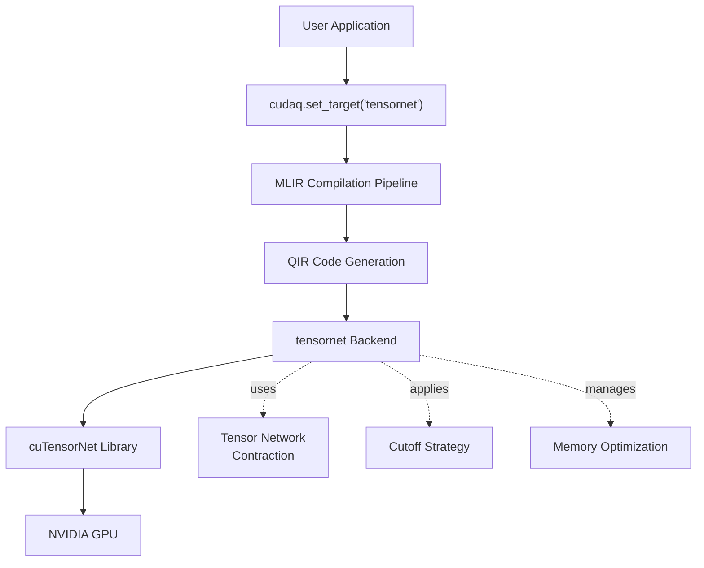
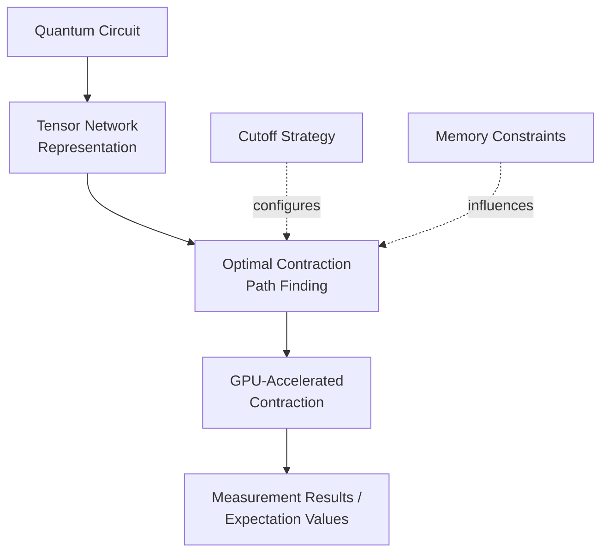
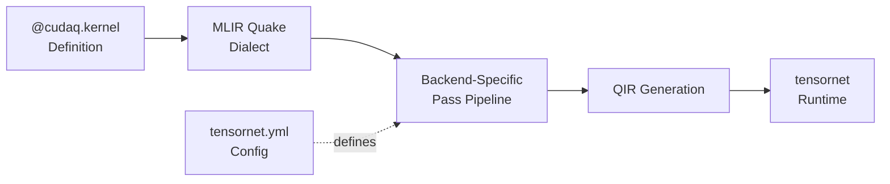
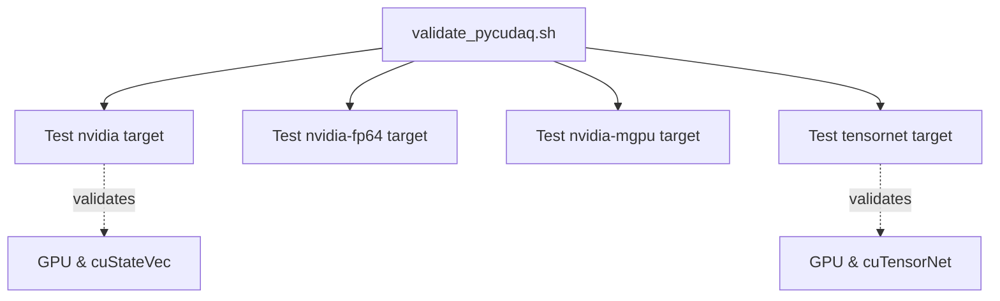
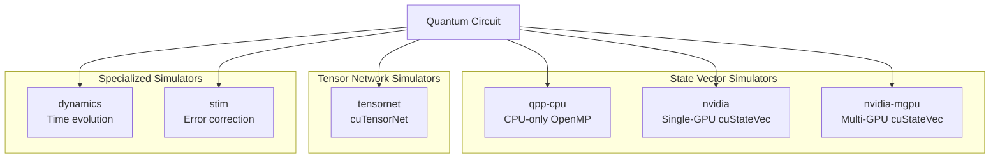

<!-- source: DeepWiki mcp.deepwiki.com · repo NVIDIA/cuda-quantum · page 5.3 Tensor Network Simulation · fetched 2026-10-26 -->

# Tensor Network Simulation

<details>
<summary>Relevant source files</summary>

The following files were used as context for generating this wiki page:

- [.github/workflows/config/gitlab_commits.txt](.github/workflows/config/gitlab_commits.txt)
- [.github/workflows/python_metapackages.yml](.github/workflows/python_metapackages.yml)
- [docs/notebook_validation.py](docs/notebook_validation.py)
- [docs/sphinx/applications/python/hybrid_quantum_neural_networks.ipynb](docs/sphinx/applications/python/hybrid_quantum_neural_networks.ipynb)
- [docs/sphinx/applications/python/quantum_pagerank.ipynb](docs/sphinx/applications/python/quantum_pagerank.ipynb)
- [docs/sphinx/applications/python/unitary_compilation_diffusion_models.ipynb](docs/sphinx/applications/python/unitary_compilation_diffusion_models.ipynb)
- [docs/sphinx/examples/python/dynamics/dynamics_intro_2.ipynb](docs/sphinx/examples/python/dynamics/dynamics_intro_2.ipynb)
- [docs/sphinx/using/backends/circuitsimulators.png](docs/sphinx/using/backends/circuitsimulators.png)
- [docs/sphinx/using/backends/sims/svsims.rst](docs/sphinx/using/backends/sims/svsims.rst)
- [pyproject.toml.cu12](pyproject.toml.cu12)
- [pyproject.toml.cu13](pyproject.toml.cu13)
- [python/metapackages/setup.py](python/metapackages/setup.py)
- [scripts/validate_pycudaq.sh](scripts/validate_pycudaq.sh)

</details>


## Overview

The `tensornet` backend provides GPU-accelerated quantum circuit simulation using tensor network methods via NVIDIA's cuTensorNet library. This backend is designed for memory-efficient simulation of large quantum circuits where traditional state vector methods would require prohibitive amounts of memory.

**Scope**: This document covers the tensor network simulation backend architecture, configuration, and usage. For other GPU-accelerated simulation options, see [NVIDIA GPU-Accelerated Simulation](#5.1) and [Multi-GPU and Multi-Node Simulation](#5.2). For CPU-only simulation, see [Other Simulation Backends](#5.4).

The tensornet backend is particularly well-suited for:
- Circuits with specific topologies that compress well as tensor networks
- Simulations where memory is more constrained than compute time
- Scenarios requiring large qubit counts that exceed state vector memory limits

Sources: [docs/sphinx/using/backends/sims/svsims.rst:1-333](), [pyproject.toml.cu12:1-84](), [pyproject.toml.cu13:1-85]()

## System Architecture



**Backend Integration Architecture**

The tensornet backend integrates into CUDA-Q's execution model as one of several GPU-accelerated simulation options. Unlike the `nvidia` and `nvidia-mgpu` backends which use state vector methods via cuStateVec, tensornet employs tensor network contraction algorithms provided by cuTensorNet.

Sources: [docs/sphinx/using/backends/sims/svsims.rst:1-333](), [scripts/validate_pycudaq.sh:109-115]()

## Backend Selection and Configuration

### Target Selection

The tensornet backend is selected using the standard CUDA-Q target mechanism:

**Python:**
```python
import cudaq
cudaq.set_target('tensornet')
```

**C++:**
```bash
nvq++ --target tensornet program.cpp -o program.x
./program.x
```

**Command Line (Python):**
```bash
python3 program.py --target tensornet
```

Sources: [scripts/validate_pycudaq.sh:109-115](), [docs/sphinx/using/backends/sims/svsims.rst:14-37]()

### Dependencies

The tensornet backend requires:
- NVIDIA GPU with CUDA support
- cuTensorNet library (version ~2.9 for CUDA 12.x/13.x)
- CUDA runtime libraries

```mermaid
graph LR
    TensorNet["tensornet Backend"]
    cuTensorNetCu12["cutensornet-cu12 ~2.9"]
    cuTensorNetCu13["cutensornet-cu13 ~2.9"]
    CUDARuntime12["nvidia-cuda-runtime-cu12"]
    CUDARuntime13["nvidia-cuda-runtime ~13.0"]
    
    TensorNet -.CUDA 12.x.-> cuTensorNetCu12
    TensorNet -.CUDA 13.x.-> cuTensorNetCu13
    cuTensorNetCu12 --> CUDARuntime12
    cuTensorNetCu13 --> CUDARuntime13
```

**Dependency Requirements**

If the required dependencies are not installed, you may encounter an error stating "Invalid simulator requested". The specific cuTensorNet version is determined by your CUDA installation.

Sources: [pyproject.toml.cu12:19-34](), [pyproject.toml.cu13:19-34](), [python/metapackages/setup.py:188-217]()

### Validation Testing

The tensornet backend is validated as part of CUDA-Q's testing infrastructure alongside other GPU targets:

```bash
# Validation script excerpt
for tgt in nvidia nvidia-fp64 nvidia-mgpu tensornet; do
    python3 -c "import cudaq; cudaq.set_target('${tgt}')"
    if [ $? -ne 0 ]; then 
        echo "Python trivial test for target ${tgt} failed."
        status_sum=$((status_sum+1))
    fi
done
```

Sources: [scripts/validate_pycudaq.sh:109-115]()

## Implementation Details

### Tensor Network Contraction

The tensornet backend represents quantum circuits as tensor networks and uses optimized contraction algorithms to compute measurement outcomes and expectation values. This approach differs fundamentally from state vector simulation:



**Tensor Network Simulation Pipeline**

Key characteristics:
- **Memory Efficiency**: Only intermediate tensors need to be stored, not full state vectors
- **Cutoff Strategies**: Approximation techniques can reduce computational cost
- **Circuit Topology Dependence**: Performance varies based on circuit structure and entanglement patterns

Sources: [docs/sphinx/using/backends/sims/svsims.rst:1-333]()

### Cutoff Strategies

The tensornet backend supports cutoff strategies to manage the trade-off between accuracy and computational resources. These strategies determine when and how to approximate tensor contractions:

- **Exact Contraction**: No approximations (highest accuracy, highest cost)
- **Singular Value Cutoff**: Truncates small singular values in tensor decompositions
- **Memory-Based Cutoff**: Limits intermediate tensor sizes to fit memory constraints

The specific cutoff parameters and strategies are configured through environment variables or backend options (implementation-specific).

Sources: [docs/sphinx/using/backends/sims/svsims.rst:1-333]()

### Memory Management

Tensor network simulation provides memory-efficient alternatives to state vector methods:

| Backend | Memory Scaling | Typical Use Case |
|---------|----------------|------------------|
| `qpp-cpu` | O(2^n) | Small circuits (< 30 qubits) |
| `nvidia` | O(2^n) | Medium circuits with GPU memory |
| `nvidia-mgpu` | O(2^n / p) | Large circuits, distributed across p GPUs |
| `tensornet` | Circuit-dependent | Large circuits with favorable topology |

The tensornet backend's memory requirements depend on:
- Circuit topology and gate structure
- Chosen contraction path
- Applied cutoff strategies
- Number of intermediate tensors in the contraction

Sources: [docs/sphinx/using/backends/sims/svsims.rst:1-333]()

## Integration with CUDA-Q Compilation Pipeline



**Compilation Flow to tensornet Backend**

The tensornet backend integrates with CUDA-Q's standard compilation pipeline. Backend-specific optimizations and transformations are applied through the MLIR pass pipeline before code generation.

Sources: [docs/sphinx/using/backends/sims/svsims.rst:1-333]()

## Usage Patterns

### Basic Quantum Simulation

**Python Example:**
```python
import cudaq

# Select tensornet backend
cudaq.set_target('tensornet')

@cudaq.kernel
def circuit(qubit_count: int):
    qubits = cudaq.qvector(qubit_count)
    # Define circuit operations
    h(qubits[0])
    for i in range(qubit_count - 1):
        cx(qubits[i], qubits[i + 1])

# Execute simulation
result = cudaq.sample(circuit, 30)  # 30-qubit circuit
```

**C++ Example:**
```cpp
// Compile with: nvq++ --target tensornet example.cpp -o example.x
#include <cudaq.h>

__qpu__ void circuit(int qubit_count) {
    cudaq::qvector qubits(qubit_count);
    h(qubits[0]);
    for (int i = 0; i < qubit_count - 1; ++i) {
        cx(qubits[i], qubits[i + 1]);
    }
}

int main() {
    auto result = cudaq::sample(circuit, 30);
    return 0;
}
```

Sources: [scripts/validate_pycudaq.sh:109-115](), [docs/sphinx/using/backends/sims/svsims.rst:14-37]()

### Backend Compatibility

The tensornet backend is validated alongside other GPU-accelerated backends in CUDA-Q's testing infrastructure:



**GPU Target Validation Flow**

All GPU targets are tested with trivial operations to ensure proper installation and configuration before running comprehensive test suites.

Sources: [scripts/validate_pycudaq.sh:109-115]()

## Performance Considerations

### When to Use tensornet

The tensornet backend is most effective for:

1. **High Qubit Count Circuits**: When state vector methods exceed available memory
2. **Structured Circuits**: Circuits with local connectivity patterns (e.g., nearest-neighbor)
3. **Shallow Circuits**: Circuits where depth is manageable for contraction algorithms
4. **Memory-Constrained Environments**: When GPU memory is limited relative to qubit count

### When to Use Alternative Backends

Consider other backends for:
- **Deep, Highly Entangled Circuits**: State vector methods may be more efficient
- **Small Circuits (< 30 qubits)**: `qpp-cpu` or `nvidia` backends are simpler
- **Maximum Performance**: `nvidia-mgpu` with multiple GPUs for parallelizable workloads

Sources: [docs/sphinx/using/backends/sims/svsims.rst:1-333]()

## Comparison with Other Simulation Backends



**CUDA-Q Local Simulation Backend Landscape**

Each backend serves different use cases based on circuit characteristics, available hardware, and performance requirements.

Sources: [docs/sphinx/using/backends/sims/svsims.rst:1-333]()

## Dependencies and Package Structure

The tensornet backend's dependencies are managed through CUDA-version-specific Python packages:

| Package | cuTensorNet Version | CUDA Version |
|---------|-------------------|--------------|
| `cuda-quantum-cu12` | ~2.9 | 12.x |
| `cuda-quantum-cu13` | ~2.9 | 13.x |

Additional required dependencies include:
- `nvidia-cublas` (matrix operations)
- `nvidia-cusparse` (sparse matrix operations)
- `nvidia-cuda-runtime` (CUDA runtime)
- `cupy` (GPU array operations)

Sources: [pyproject.toml.cu12:19-34](), [pyproject.toml.cu13:19-34]()

## Installation Verification

To verify the tensornet backend is properly installed:

```bash
# Python verification
python3 -c "import cudaq; cudaq.set_target('tensornet'); print('tensornet backend available')"

# Check cuTensorNet library
python3 -c "import cutensornet; print(f'cuTensorNet version: {cutensornet.__version__}')"
```

If you encounter errors:
1. Verify CUDA installation and version compatibility
2. Check that cuTensorNet is installed for your CUDA version
3. Ensure GPU drivers are up to date
4. Confirm GPU device is accessible

Sources: [scripts/validate_pycudaq.sh:109-115]()

## Notebook and Application Examples

The tensornet backend can be used in any CUDA-Q application or notebook that requires quantum simulation. The notebook validation system tests various backends including tensornet:

```python
# From notebook validation system
available_backends = ['qpp-cpu', 'nvidia', 'nvidia-mgpu', 'tensornet']

for notebook in notebook_filenames:
    if validate(notebook, available_backends):
        execute(notebook)
```

Notebooks are validated to ensure they specify available backends correctly before execution.

Sources: [docs/notebook_validation.py:22-59](), [docs/notebook_validation.py:44-59]()

---

