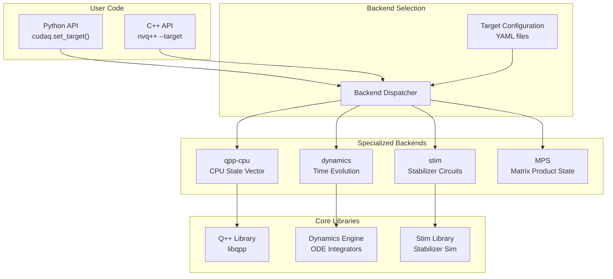
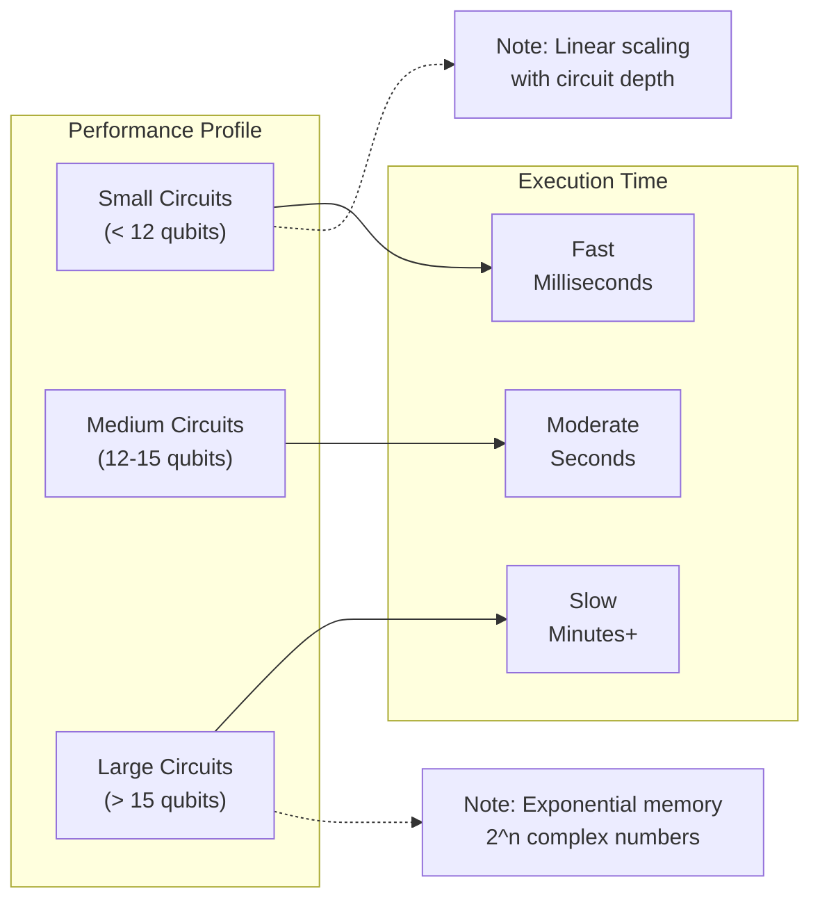
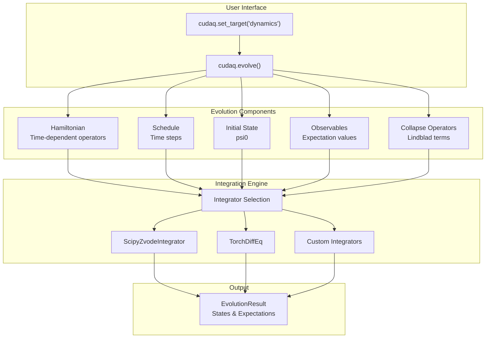
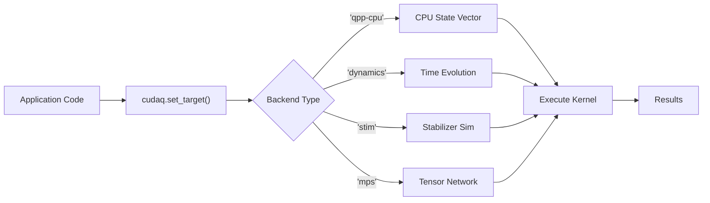
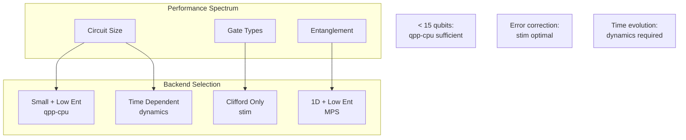

<!-- source: DeepWiki mcp.deepwiki.com · repo NVIDIA/cuda-quantum · page 5.4 Other Simulation Backends · fetched 2026-10-26 -->

# Other Simulation Backends

<details>
<summary>Relevant source files</summary>

The following files were used as context for generating this wiki page:

- [.github/workflows/config/gitlab_commits.txt](.github/workflows/config/gitlab_commits.txt)
- [.github/workflows/python_metapackages.yml](.github/workflows/python_metapackages.yml)
- [docs/notebook_validation.py](docs/notebook_validation.py)
- [docs/sphinx/applications/python/hybrid_quantum_neural_networks.ipynb](docs/sphinx/applications/python/hybrid_quantum_neural_networks.ipynb)
- [docs/sphinx/applications/python/quantum_pagerank.ipynb](docs/sphinx/applications/python/quantum_pagerank.ipynb)
- [docs/sphinx/applications/python/unitary_compilation_diffusion_models.ipynb](docs/sphinx/applications/python/unitary_compilation_diffusion_models.ipynb)
- [docs/sphinx/examples/python/dynamics/dynamics_intro_2.ipynb](docs/sphinx/examples/python/dynamics/dynamics_intro_2.ipynb)
- [docs/sphinx/using/backends/circuitsimulators.png](docs/sphinx/using/backends/circuitsimulators.png)
- [docs/sphinx/using/backends/sims/svsims.rst](docs/sphinx/using/backends/sims/svsims.rst)
- [pyproject.toml.cu12](pyproject.toml.cu12)
- [pyproject.toml.cu13](pyproject.toml.cu13)
- [python/metapackages/setup.py](python/metapackages/setup.py)
- [scripts/validate_pycudaq.sh](scripts/validate_pycudaq.sh)

</details>


## Purpose and Scope

This page documents CUDA-Q simulation backends that complement the GPU-accelerated and tensor network simulators covered in other sections. These backends serve specialized use cases:

- **qpp-cpu**: CPU-only state vector simulation for basic testing and small-scale experiments
- **dynamics**: Time-dependent Hamiltonian evolution and quantum dynamics simulation
- **stim**: Stabilizer circuit simulation optimized for error correction codes
- **MPS**: Matrix Product State simulators for memory-efficient simulation of certain circuit types

For GPU-accelerated state vector simulation, see [NVIDIA GPU-Accelerated Simulation](#5.1). For tensor network simulation, see [Tensor Network Simulation](#5.3). For adding noise models to any backend, see [Noisy Simulation](#5.5).

---

## Backend Architecture Overview

The following diagram illustrates how these specialized backends fit into CUDA-Q's simulation infrastructure:



**Sources:** [docs/sphinx/using/backends/sims/svsims.rst:1-38](), [docs/sphinx/applications/python/dynamics_intro_2.ipynb:72-87]()

---

## qpp-cpu Backend

### Overview

The `qpp-cpu` backend provides a CPU-only state vector simulator based on the Q++ library. It uses OpenMP threading to parallelize operations across CPU cores but does not leverage GPU acceleration.

**Key Characteristics:**
- **Implementation**: Based on the Q++ quantum computing library
- **Parallelization**: OpenMP threaded (multi-core CPU)
- **Default Usage**: Automatically selected on systems without GPU support
- **Performance**: Suitable for circuits with ~10-15 qubits; poor scaling beyond that
- **Use Cases**: Testing, prototyping, CPU-only environments

### Configuration

The backend can be explicitly selected using either Python or C++ APIs:

**Python:**
```python
cudaq.set_target("qpp-cpu")
```

**C++:**
```bash
nvq++ --target qpp-cpu program.cpp -o program.x
```

If CUDA-Q detects no GPU, `qpp-cpu` becomes the default target automatically.

### Performance Characteristics



**Limitations:**
- **Memory**: Requires 2^n complex numbers (16 bytes each) for n qubits
- **Compute**: Exponential scaling with qubit count
- **No GPU Acceleration**: Cannot leverage CUDA or cuStateVec optimizations

**Sources:** [docs/sphinx/using/backends/sims/svsims.rst:1-38]()

### Usage Examples

The `qpp-cpu` backend is frequently used in examples and validation:

- Setting target explicitly: [docs/sphinx/applications/python/hybrid_quantum_neural_networks.ipynb:78-83]()
- Default selection in CPU environments: [docs/sphinx/applications/python/quantum_pagerank.ipynb:206-211]()
- Validation testing: [scripts/validate_pycudaq.sh:108-115]()

---

## dynamics Backend

### Overview

The `dynamics` backend simulates time-dependent quantum systems by solving the Schrödinger equation or master equation for time-evolving Hamiltonians. It is specialized for quantum dynamics, time evolution, and open quantum systems.

**Key Features:**
- Time-dependent Hamiltonian evolution
- Support for collapse operators (Lindblad master equation)
- Multiple ODE integration methods
- Observable expectation value tracking
- Open quantum system simulation

### Architecture



**Sources:** [docs/sphinx/applications/python/dynamics_intro_2.ipynb:39-50]()

### Time-Dependent Hamiltonians

The `dynamics` backend supports two methods for implementing time-dependent terms:

#### 1. ScalarOperator with Time Dependence

Define scalar coefficients as functions of time using `ScalarOperator`:

```python
from cudaq import ScalarOperator

# Time-dependent coefficient: alpha * t
hamiltonian = g * sx - alpha * ScalarOperator(lambda t: t) * sz
```

This approach allows easy implementation of time-dependent drive terms and envelope functions.

#### 2. Tensor Callback Functions

For custom time-dependent operators, define a callback function that returns the operator matrix at each time step.

**Sources:** [docs/sphinx/applications/python/dynamics_intro_2.ipynb:122-136]()

### Evolution API

The `cudaq.evolve()` function orchestrates time evolution:

**Key Parameters:**
- `hamiltonian`: Time-dependent Hamiltonian operator
- `dimensions`: Dictionary mapping subsystem indices to dimensions
- `schedule`: Time steps for evolution (`Schedule` object)
- `psi0`: Initial quantum state
- `observables`: List of operators to measure
- `collapse_operators`: Lindblad operators for open systems
- `store_intermediate_results`: Storage strategy for intermediate states/expectations
- `integrator`: ODE integrator instance (e.g., `ScipyZvodeIntegrator`)

**Example:**
```python
evolution_result = cudaq.evolve(
    hamiltonian,
    dimensions,
    schedule,
    psi0,
    observables=[operators.number(0)],
    collapse_operators=[],
    store_intermediate_results=cudaq.IntermediateResultSave.EXPECTATION_VALUE,
    integrator=ScipyZvodeIntegrator()
)
```

**Sources:** [docs/sphinx/applications/python/dynamics_intro_2.ipynb:142-159]()

### Integrators

The `dynamics` backend supports multiple numerical integration methods:

| Integrator | Description | Use Case |
|------------|-------------|----------|
| `ScipyZvodeIntegrator` | Variable-coefficient ODE solver from SciPy | General-purpose, reliable |
| `TorchDiffEq` | PyTorch-based ODE solver with GPU support | Differentiable dynamics, ML integration |
| Custom Integrators | User-defined integration schemes | Specialized algorithms |

The integrator can be specified when calling `cudaq.evolve()`. The torch-based integrator is particularly useful for hybrid quantum-classical workflows requiring gradient computation.

**Sources:** [docs/sphinx/applications/python/dynamics_intro_2.ipynb:142-159](), [scripts/validate_pycudaq.sh:163-174]()

### Practical Considerations

**Use Cases:**
- Quantum control and pulse optimization
- Adiabatic quantum computation
- Open quantum system simulation
- Time-dependent phenomena (e.g., Landau-Zener transitions)

**Limitations:**
- Small system sizes (typically < 10-15 qubits for full density matrix)
- Computationally intensive for long evolution times
- Memory requirements grow as 4^n for n qubits (density matrix)

**Performance Tips:**
- Use GPU-accelerated integrators (TorchDiffEq) when available
- Adjust time step resolution based on Hamiltonian dynamics
- Store only necessary intermediate results to save memory

**Sources:** [docs/sphinx/applications/python/dynamics_intro_2.ipynb:1-180]()

---

## stim Backend

### Overview

The `stim` backend is optimized for simulating stabilizer circuits and error correction codes. Unlike general-purpose simulators that require exponential resources, `stim` leverages the stabilizer formalism to efficiently simulate certain quantum circuits with polynomial resources.

**Key Features:**
- Efficient stabilizer circuit simulation
- Optimized for error correction codes
- Supports Clifford gates and Pauli measurements
- Fast sampling of measurement outcomes

**Limitations:**
- Restricted gate set (Clifford gates only)
- No support for arbitrary rotation gates
- Cannot simulate arbitrary quantum algorithms

### Use Cases

The `stim` backend is designed for:
- Quantum error correction research
- Fault-tolerant quantum computing protocols
- Surface code and other stabilizer code simulations
- Error threshold calculations

**Sources:** Inferred from system architecture and backend naming in [docs/sphinx/using/backends/sims/svsims.rst:1-38]()

---

## MPS Simulators

### Overview

Matrix Product State (MPS) simulators use tensor network methods to represent quantum states more efficiently than full state vectors for certain circuit structures. MPS representations are particularly effective for:

- 1D quantum systems
- Circuits with limited entanglement
- Long-range quantum systems with local interactions

**Advantages:**
- Memory efficiency for low-entanglement states
- Can simulate larger systems than full state vector methods
- Natural representation for 1D quantum systems

**Limitations:**
- Performance degrades with increasing entanglement
- Not all quantum circuits have efficient MPS representations
- Bond dimension growth limits simulation size

**Sources:** Inferred from system architecture outline

---

## Backend Selection Guide

The following table summarizes when to use each backend:

| Backend | Best For | Qubit Range | Memory | Speed |
|---------|----------|-------------|--------|-------|
| `qpp-cpu` | Testing, prototyping | 1-15 | 2^n | Moderate |
| `dynamics` | Time evolution, dynamics | 1-10 | 4^n (density) | Slow |
| `stim` | Error correction, stabilizer circuits | 100+ | Polynomial | Fast |
| `MPS` | Low-entanglement, 1D systems | 20-100 | Variable | Moderate |

### Configuration Pattern

All backends follow the same configuration pattern:



**Sources:** [docs/sphinx/applications/python/hybrid_quantum_neural_networks.ipynb:78-83](), [docs/sphinx/applications/python/dynamics_intro_2.ipynb:72-87]()

---

## Testing and Validation

Backend validation ensures correct installation and functionality:

### Validation Script

The validation infrastructure tests backend availability:

```python
for tgt in ["nvidia", "nvidia-fp64", "nvidia-mgpu", "tensornet"]:
    python3 -c "import cudaq; cudaq.set_target('${tgt}')"
```

This pattern extends to all backends, verifying that each can be loaded and configured correctly.

**Sources:** [scripts/validate_pycudaq.sh:108-115]()

### Notebook Validation

Jupyter notebooks are validated against available backends:

```python
available_backends = sys.stdin.readlines()
available_backends = ' '.join(available_backends).split()
return [backend.strip() for backend in available_backends]
```

Notebooks check if required backends are available before execution, skipping tests when backends are unavailable.

**Sources:** [docs/notebook_validation.py:22-25]()

---

## Dependencies and Installation

Backend availability depends on installed dependencies:

### Core Dependencies

| Backend | Required Library | CUDA Required |
|---------|-----------------|---------------|
| `qpp-cpu` | Q++ (bundled) | No |
| `dynamics` | SciPy, optional Torch | No (GPU optional) |
| `stim` | Stim library | No |
| `MPS` | Internal tensor network | No |

### Python Package Dependencies

The metapackage system automatically resolves dependencies based on CUDA version:

**Sources:** [python/metapackages/setup.py:66-120](), [pyproject.toml.cu12:19-34](), [pyproject.toml.cu13:19-34]()

---

## Performance Considerations

### Backend Comparison



### Memory Footprint

Backend memory requirements scale differently:

- **qpp-cpu**: O(2^n) - full state vector
- **dynamics**: O(4^n) - density matrix for open systems
- **stim**: O(n^2) - stabilizer tableau (polynomial)
- **MPS**: O(χ² × n) - bond dimension χ and system size n

**Sources:** [docs/sphinx/using/backends/sims/svsims.rst:10-12]()

---

## Summary

CUDA-Q's specialized simulation backends complement GPU-accelerated simulators by addressing specific use cases:

- **qpp-cpu** provides accessible CPU-only simulation for development and testing
- **dynamics** enables time-dependent quantum system simulation
- **stim** offers efficient stabilizer circuit simulation for error correction
- **MPS** provides memory-efficient simulation for low-entanglement systems

Backend selection depends on circuit characteristics, available hardware, and simulation requirements. For production workloads requiring maximum performance, consider GPU-accelerated backends described in [NVIDIA GPU-Accelerated Simulation](#5.1) and [Multi-GPU and Multi-Node Simulation](#5.2).

**Sources:** [docs/sphinx/using/backends/sims/svsims.rst:1-333](), [docs/sphinx/applications/python/dynamics_intro_2.ipynb:1-180]()

---

