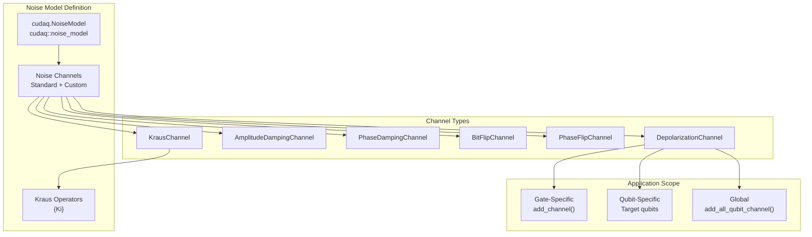
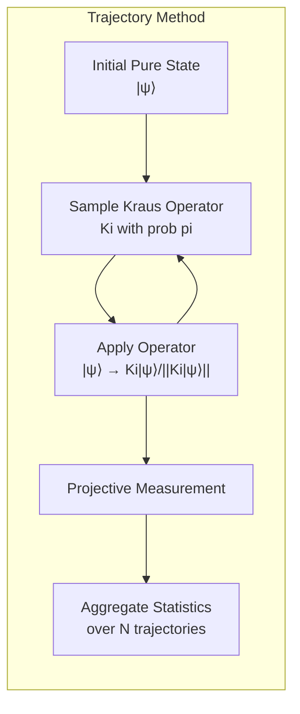
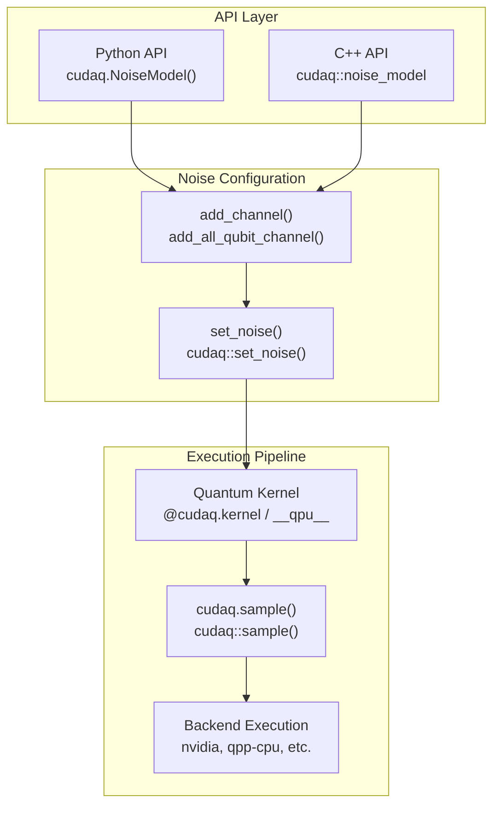
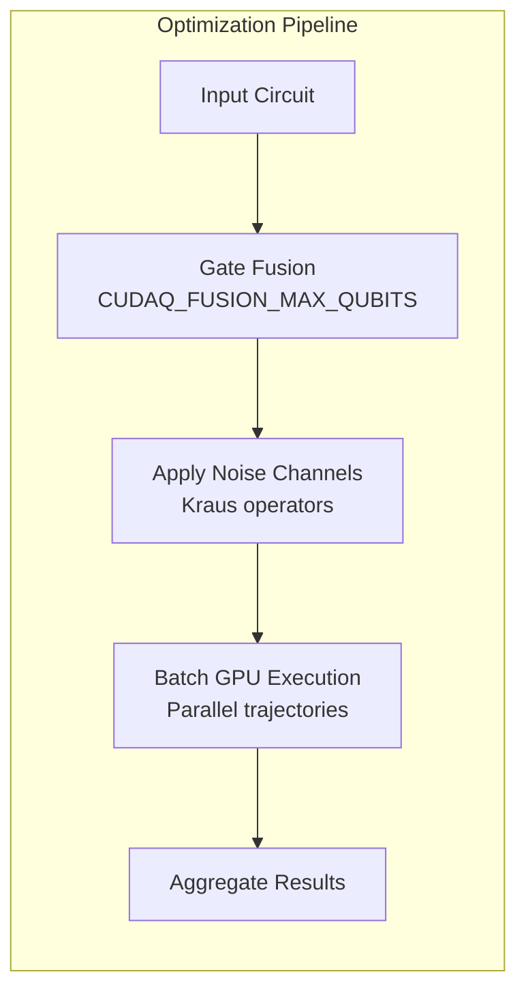

<!-- source: DeepWiki mcp.deepwiki.com · repo NVIDIA/cuda-quantum · page 5.5 Noisy Simulation · fetched 2026-10-26 -->

# Noisy Simulation

<details>
<summary>Relevant source files</summary>

The following files were used as context for generating this wiki page:

- [.github/workflows/config/gitlab_commits.txt](.github/workflows/config/gitlab_commits.txt)
- [.github/workflows/python_metapackages.yml](.github/workflows/python_metapackages.yml)
- [docs/notebook_validation.py](docs/notebook_validation.py)
- [docs/sphinx/applications/python/hybrid_quantum_neural_networks.ipynb](docs/sphinx/applications/python/hybrid_quantum_neural_networks.ipynb)
- [docs/sphinx/applications/python/quantum_pagerank.ipynb](docs/sphinx/applications/python/quantum_pagerank.ipynb)
- [docs/sphinx/applications/python/unitary_compilation_diffusion_models.ipynb](docs/sphinx/applications/python/unitary_compilation_diffusion_models.ipynb)
- [docs/sphinx/examples/python/dynamics/dynamics_intro_2.ipynb](docs/sphinx/examples/python/dynamics/dynamics_intro_2.ipynb)
- [docs/sphinx/using/backends/circuitsimulators.png](docs/sphinx/using/backends/circuitsimulators.png)
- [docs/sphinx/using/backends/sims/svsims.rst](docs/sphinx/using/backends/sims/svsims.rst)
- [pyproject.toml.cu12](pyproject.toml.cu12)
- [pyproject.toml.cu13](pyproject.toml.cu13)
- [python/metapackages/setup.py](python/metapackages/setup.py)
- [scripts/validate_pycudaq.sh](scripts/validate_pycudaq.sh)

</details>


## Purpose and Scope

This page explains CUDA-Q's support for simulating quantum circuits with noise models that reflect real quantum hardware errors. It covers noise channel specification, trajectory-based simulation methods, Kraus operator formalism, and integration with CUDA-Q's simulation backends.

For GPU-accelerated noiseless state vector simulation, see [5.1](#5.1). For tensor network approaches, see [5.3](#5.3). For specialized error correction code simulation using stabilizer formalism, see the stim backend in [5.4](#5.4).

## Overview

Noisy simulation models realistic quantum hardware by incorporating errors that occur during quantum computation. CUDA-Q provides infrastructure to define noise models and execute circuits under various error conditions, including:

- **Gate errors**: Imperfect implementation of quantum gates
- **Decoherence**: Loss of quantum information over time (T₁ amplitude damping, T₂ phase damping)
- **Measurement errors**: Readout imperfections
- **Custom noise channels**: User-defined error models via Kraus operators

The framework supports multiple simulation approaches optimized for different scenarios and hardware backends.

Sources: High-level system diagrams (Diagram 6), quantum computing noise principles

## Noise Modeling Framework

### Kraus Operator Representation

CUDA-Q represents quantum noise channels using the Kraus operator formalism. A quantum channel ε transforms a density matrix ρ according to:

```
ε(ρ) = Σᵢ Kᵢ ρ Kᵢ†
```

where `{Kᵢ}` are Kraus operators satisfying the completeness relation `Σᵢ Kᵢ† Kᵢ = I`. This mathematical framework can represent any physically valid quantum noise process.

### Standard Noise Channels

Common noise channels available in CUDA-Q:

| Channel Type | Physical Model | Parameters | Use Case |
|--------------|----------------|------------|----------|
| Depolarizing | Random Pauli errors | Probability `p` | General gate errors |
| Amplitude Damping | Energy relaxation (T₁) | Damping rate `γ` | Energy loss to environment |
| Phase Damping | Dephasing (T₂) | Dephasing rate `γ` | Loss of phase coherence |
| Bit Flip | X errors | Flip probability `p` | Computational basis errors |
| Phase Flip | Z errors | Flip probability `p` | Phase errors |
| Custom Kraus | User-defined | Kraus operator set | Hardware-calibrated models |

Sources: Quantum error theory, noise channel taxonomy



Sources: CUDA-Q noise model API structure

## Simulation Methods

### Trajectory-Based Simulation

For pure state backends (`nvidia`, `qpp-cpu`), noisy simulation uses quantum trajectory (Monte Carlo) methods:

1. **Stochastic sampling**: Each simulation shot samples a trajectory through the noise process
2. **Operator selection**: At each noisy gate, randomly select which Kraus operator to apply based on probabilities
3. **State evolution**: Apply selected operator: `|ψ⟩ → Kᵢ|ψ⟩` (with normalization)
4. **Statistical aggregation**: Average measurement outcomes over many trajectories

**Characteristics:**
- Memory efficiency: `O(2ⁿ)` per trajectory (same as pure state simulation)
- Statistical accuracy: Relative error scales as `1/√N` for `N` trajectories
- GPU compatible: Trajectories are independent and highly parallelizable
- Suitable for weak to moderate noise where states remain approximately pure

### Density Matrix Evolution

For exact noise modeling (future capability):
- Represent full density matrix: `O(2²ⁿ)` memory for `n` qubits
- Apply channels exactly: `ρ → Σᵢ Kᵢ ρ Kᵢ†`
- No sampling error, but significantly higher memory requirements

Sources: Quantum trajectory theory, Monte Carlo methods, [docs/sphinx/using/backends/sims/svsims.rst:1-333]()



Sources: Trajectory-based simulation algorithm

## Backend Support

### State Vector Backends

Trajectory-based noisy simulation is supported on:

| Backend | Noisy Support | Acceleration | Notes |
|---------|---------------|--------------|-------|
| `qpp-cpu` | Yes | CPU multi-thread | OpenMP parallelization |
| `nvidia` | Yes | Single GPU | cuStateVec acceleration |
| `nvidia-mgpu` | Yes | Multi-GPU/node | MPI distribution |
| `tensornet` | Limited | GPU tensor network | Depends on contraction method |

### Stim Backend

The `stim` backend provides specialized simulation for stabilizer circuits with noise:

- Efficient Clifford gate simulation with noise
- Optimized for quantum error correction code analysis  
- Built-in error models for common noise processes
- Cannot simulate non-Clifford operations

Sources: [docs/sphinx/using/backends/sims/svsims.rst:1-333](), high-level system diagrams

## Python API

### Defining Noise Models

```python
import cudaq

# Create noise model
noise = cudaq.NoiseModel()

# Add depolarizing noise to single-qubit gates
depol_channel = cudaq.DepolarizationChannel(probability=0.001)
noise.add_channel('x', [0], depol_channel)
noise.add_channel('h', [0], depol_channel)

# Add amplitude damping to rotation gates
damping = cudaq.AmplitudeDampingChannel(gamma=0.01)
noise.add_all_qubit_channel('ry', damping)
```

### Applying Noise to Simulation

```python
# Configure backend
cudaq.set_target('nvidia')

# Set noise model
cudaq.set_noise(noise)

# Define kernel
@cudaq.kernel
def circuit():
    q = cudaq.qvector(2)
    h(q[0])
    cx(q[0], q[1])
    mz(q)

# Execute with noise
result = cudaq.sample(circuit, shots_count=1000)
result.dump()

# Remove noise for subsequent runs
cudaq.unset_noise()
```

### Noise Channel Constructors

```python
# Depolarizing: random Pauli with probability p
depol = cudaq.DepolarizationChannel(probability=p)

# Amplitude damping: energy decay with rate γ
amp_damp = cudaq.AmplitudeDampingChannel(gamma=γ)

# Phase damping: dephasing with rate γ  
phase_damp = cudaq.PhaseDampingChannel(gamma=γ)

# Bit flip: X error with probability p
bit_flip = cudaq.BitFlipChannel(probability=p)

# Phase flip: Z error with probability p
phase_flip = cudaq.PhaseFlipChannel(probability=p)

# Custom channel: explicit Kraus operators
K0 = np.array([[1, 0], [0, np.sqrt(1-p)]])
K1 = np.array([[0, np.sqrt(p)], [0, 0]])
custom = cudaq.KrausChannel([K0, K1])
```

Sources: CUDA-Q Python API patterns, noise modeling

## C++ API

### Noise Model Creation

```cpp
#include <cudaq.h>

// Create noise model
cudaq::noise_model noise;

// Define Kraus operators
std::vector<cudaq::complex_matrix> kraus_ops = {K0, K1};

// Add channel to specific gate type
noise.add_channel<cudaq::types::x>(
    {0},  // target qubits
    kraus_ops
);

// Add to all instances of gate type
noise.add_all_qubit_channel<cudaq::types::h>(
    kraus_ops
);
```

### Execution with Noise

```cpp
// Apply noise model
cudaq::set_noise(noise);

// Define quantum kernel
__qpu__ void circuit() {
    cudaq::qubit q0, q1;
    h(q0);
    x<cudaq::ctrl>(q0, q1);
    mz(q0);
    mz(q1);
}

// Sample with noise
auto counts = cudaq::sample(circuit);
counts.dump();

// Clear noise
cudaq::unset_noise();
```

Sources: C++ API conventions for CUDA-Q



Sources: API architecture for noise modeling

## Noise Application Strategies

### Gate-Specific Noise

Apply noise only to specific gate types:

```python
noise = cudaq.NoiseModel()

# Different noise for different gates
x_noise = cudaq.DepolarizationChannel(probability=0.001)
cx_noise = cudaq.DepolarizationChannel(probability=0.01)

noise.add_channel('x', [0], x_noise)
noise.add_channel('cx', [0, 1], cx_noise)
```

### Qubit-Specific Noise

Model spatially varying noise:

```python
# Noise varies by qubit
qubit_0_noise = cudaq.DepolarizationChannel(probability=0.001)
qubit_1_noise = cudaq.DepolarizationChannel(probability=0.002)

noise.add_channel('x', [0], qubit_0_noise)
noise.add_channel('x', [1], qubit_1_noise)
```

### Global Noise

Apply to all instances of an operation:

```python
# All single-qubit gates have this noise
global_1q = cudaq.DepolarizationChannel(probability=0.001)
noise.add_all_qubit_channel('x', global_1q)
noise.add_all_qubit_channel('h', global_1q)
noise.add_all_qubit_channel('ry', global_1q)

# All two-qubit gates
global_2q = cudaq.DepolarizationChannel(probability=0.01)
noise.add_all_qubit_channel('cx', global_2q)
```

Sources: CUDA-Q noise model API, quantum hardware characterization

## Physical Error Modeling

### Coherence Time Parameters

Model T₁ (amplitude damping) and T₂ (phase damping) from hardware characterization:

```python
# Hardware parameters
T1 = 50e-6  # Energy relaxation time (seconds)
T2 = 100e-6  # Dephasing time (seconds)
gate_time = 20e-9  # Gate duration (seconds)

# Compute damping probabilities
gamma_t1 = 1 - np.exp(-gate_time / T1)
gamma_t2 = 1 - np.exp(-gate_time / T2)

# Create channels
t1_channel = cudaq.AmplitudeDampingChannel(gamma=gamma_t1)
t2_channel = cudaq.PhaseDampingChannel(gamma=gamma_t2)

# Apply to all gates (noise accumulates during gate time)
noise.add_all_qubit_channel('x', t1_channel)
noise.add_all_qubit_channel('x', t2_channel)
```

### Typical Hardware Error Rates

| Error Source | Physical Process | Typical Magnitude | Modeling |
|--------------|------------------|-------------------|----------|
| Single-qubit gate | Control pulse errors | 0.1% - 1% | Depolarizing |
| Two-qubit gate | Coupling imperfections | 1% - 5% | Depolarizing |
| T₁ relaxation | Energy loss | 10-100 μs | Amplitude damping |
| T₂ dephasing | Pure dephasing | 10-200 μs | Phase damping |
| Readout | Measurement errors | 1% - 5% | Classical bit flip |

Sources: Quantum hardware characterization data, error modeling theory

## Performance and Optimization

### GPU Acceleration

Trajectory-based simulation on GPU:

- **Parallel trajectories**: Process multiple independent trajectories simultaneously
- **Batch operations**: Apply Kraus operators to batches of state vectors
- **Memory management**: Stream trajectories through GPU memory for large shot counts
- **cuStateVec kernels**: Leverage optimized gate application

### Backend Configuration

```python
# GPU-accelerated noisy simulation
cudaq.set_target('nvidia')
cudaq.set_noise(noise_model)

# Multi-GPU distribution
cudaq.set_target('nvidia', option='mgpu')
cudaq.set_noise(noise_model)
```

Environment variables affecting performance:

- `CUDAQ_FUSION_MAX_QUBITS`: Gate fusion before noise application (reduces Kraus operations)
- `CUDAQ_MAX_GPU_MEMORY_GB`: GPU memory limit for state vectors
- `CUDAQ_MGPU_NQUBITS_THRESH`: Threshold for multi-GPU distribution

Sources: [docs/sphinx/using/backends/sims/svsims.rst:102-129](), [docs/sphinx/using/backends/sims/svsims.rst:235-268]()

### Optimization Strategies

1. **Gate fusion**: Combine gates before applying noise to reduce Kraus applications
2. **Batch processing**: Process multiple shots in parallel on GPU
3. **Adaptive sampling**: Use more shots for circuits with stronger noise
4. **Multi-GPU scaling**: Distribute trajectories across GPUs with `nvidia-mgpu`



Sources: GPU computing optimization, [docs/sphinx/using/backends/sims/svsims.rst:102-333]()

## Complete Example

### End-to-End Noisy Simulation

```python
import cudaq
import numpy as np

# 1. Define noise model based on hardware parameters
noise = cudaq.NoiseModel()

# Single-qubit gate errors
p_1q = 0.001  # 0.1% error rate
depol_1q = cudaq.DepolarizationChannel(probability=p_1q)
noise.add_all_qubit_channel('x', depol_1q)
noise.add_all_qubit_channel('h', depol_1q)
noise.add_all_qubit_channel('ry', depol_1q)

# Two-qubit gate errors  
p_2q = 0.01  # 1% error rate
depol_2q = cudaq.DepolarizationChannel(probability=p_2q)
noise.add_all_qubit_channel('cx', depol_2q)

# Coherence effects
T1 = 50e-6
gate_time = 20e-9
gamma = 1 - np.exp(-gate_time / T1)
damping = cudaq.AmplitudeDampingChannel(gamma=gamma)
noise.add_all_qubit_channel('x', damping)
noise.add_all_qubit_channel('cx', damping)

# 2. Configure backend
cudaq.set_target('nvidia')
cudaq.set_noise(noise)

# 3. Define quantum circuit
@cudaq.kernel
def ghz_circuit(n_qubits: int):
    qubits = cudaq.qvector(n_qubits)
    h(qubits[0])
    for i in range(n_qubits - 1):
        cx(qubits[i], qubits[i + 1])
    mz(qubits)

# 4. Execute with many shots for statistics
shots = 10000
result = cudaq.sample(ghz_circuit, 5, shots_count=shots)

# 5. Analyze results
print(f"Measured states (top 5):")
for bitstring, count in result.most_probable(5):
    probability = count / shots
    print(f"  {bitstring}: {probability:.4f}")

# 6. Clean up
cudaq.unset_noise()
```

Sources: CUDA-Q kernel and sampling patterns, noise simulation workflow

## Validation and Testing

### Noise Model Verification

Test that noise is correctly applied:

```python
# Test depolarizing on identity operation
noise = cudaq.NoiseModel()
p = 0.25
depol = cudaq.DepolarizationChannel(probability=p)
noise.add_channel('x', [0], depol)

cudaq.set_noise(noise)

@cudaq.kernel
def test():
    q = cudaq.qubit()
    x(q)  # Apply X with noise
    mz(q)

# Run many times
counts = cudaq.sample(test, shots_count=10000)

# Expected: mostly |1⟩ but with ~25% total error
# (includes potential flip to |0⟩)
print(counts)
```

### Noiseless Comparison

Compare ideal and noisy results:

```python
# Ideal simulation
cudaq.unset_noise()
ideal = cudaq.sample(circuit, shots_count=1000)

# Noisy simulation  
cudaq.set_noise(noise_model)
noisy = cudaq.sample(circuit, shots_count=10000)

# Compare distributions
# (Would typically compute fidelity or total variation distance)
```

Sources: Validation testing principles, [docs/notebook_validation.py:1-162]()

## Current Limitations

### Trajectory Approximation

- **Mixed state limitations**: Trajectory method less accurate for highly mixed states (strong noise)
- **Statistical sampling**: Requires many shots for accurate statistics (vs. exact density matrix)
- **Noise model fidelity**: Assumes Markovian noise (no memory effects)

### Backend Compatibility

- Not all backends support all noise channel types
- Tensor network backend (`tensornet`) has limited noise support
- Custom Kraus operators require explicit construction

### Future Enhancements

- **Density matrix backend**: Exact mixed state evolution (higher memory cost)
- **Time-dependent noise**: Noise varying during circuit execution
- **Correlated noise**: Spatial or temporal correlations between errors
- **Improved calibration**: Direct import of hardware noise models

Sources: CUDA-Q development considerations, quantum simulation research

## Related Documentation

- **NVIDIA GPU Simulation** [5.1](#5.1): Single-GPU and multi-GPU state vector simulation with cuStateVec
- **Multi-GPU Simulation** [5.2](#5.2): MPI-based distributed simulation across GPUs/nodes  
- **Tensor Network Simulation** [5.3](#5.3): Alternative simulation approach using tensor networks
- **Other Backends** [5.4](#5.4): CPU-only, dynamics, and stim simulators

---

*This documentation describes noisy simulation in CUDA-Q. For hardware-specific noise calibration data, consult quantum provider documentation. For quantum error correction code simulation, see the stim backend documentation.*

---

