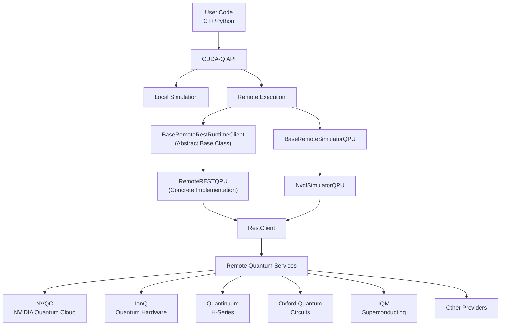
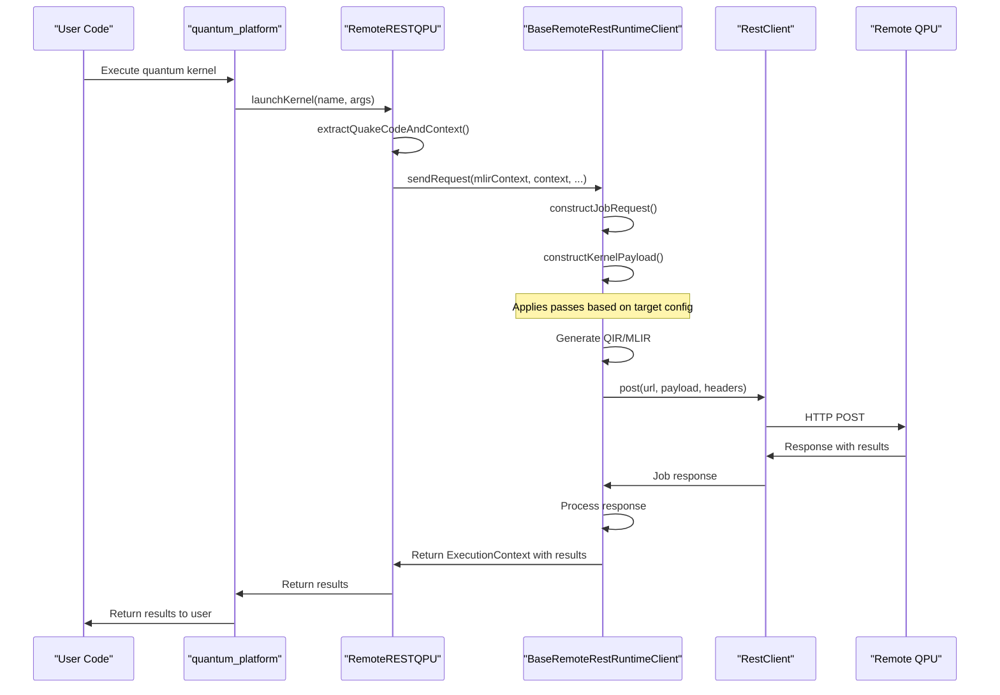
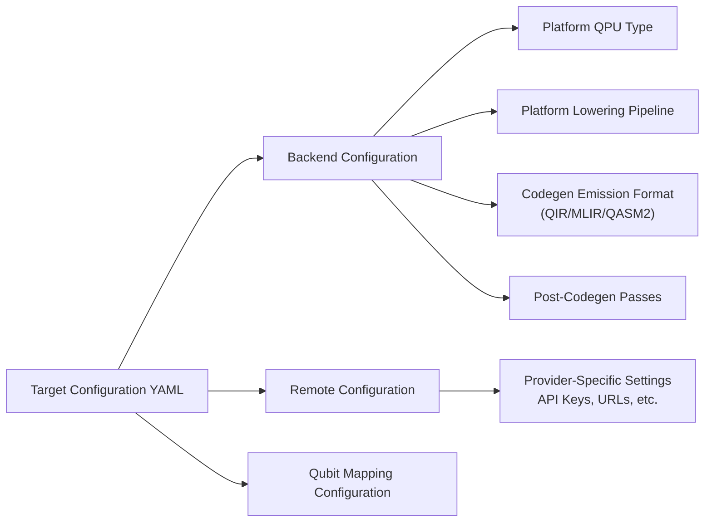
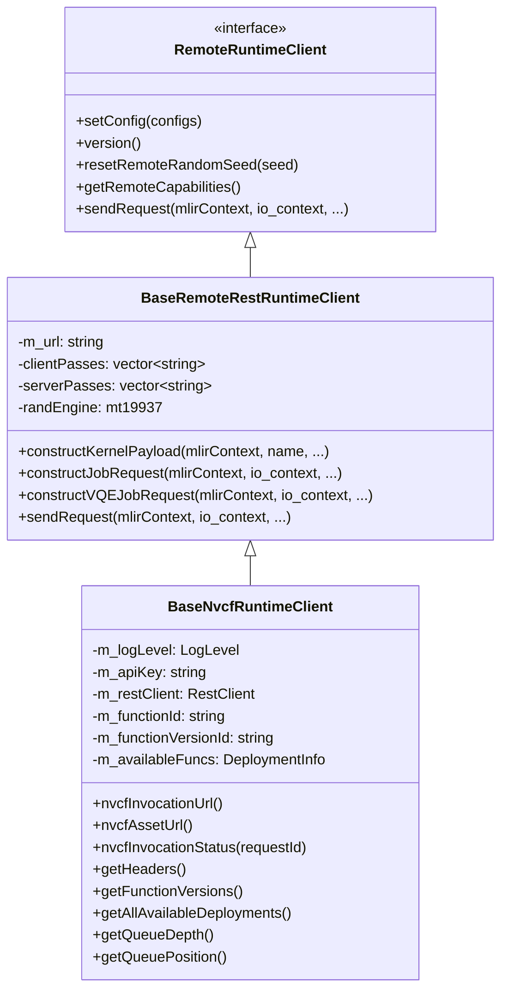
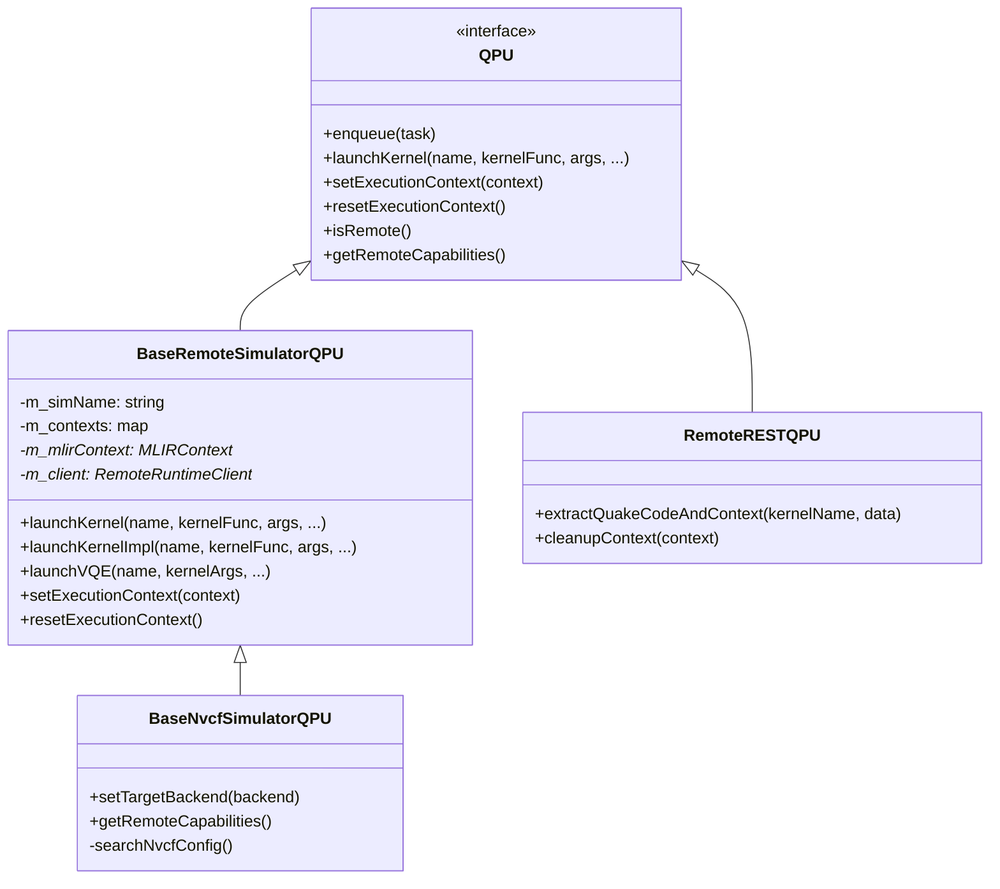
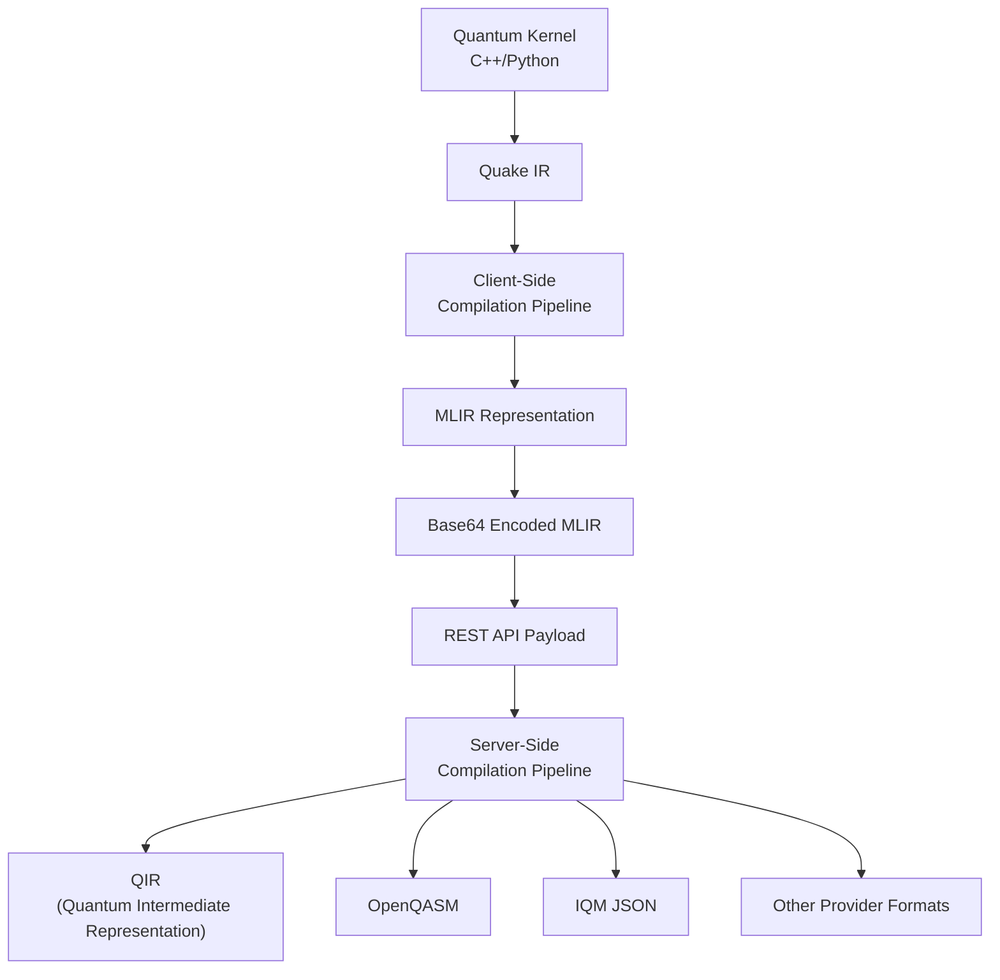

<!-- source: DeepWiki mcp.deepwiki.com · repo NVIDIA/cuda-quantum · page 6 Remote Execution · fetched 2026-10-26 -->

# Remote Execution

<details>
<summary>Relevant source files</summary>

The following files were used as context for generating this wiki page:

- [.gitattributes](.gitattributes)
- [.github/workflows/ci.yml](.github/workflows/ci.yml)
- [.github/workflows/clean_up.yml](.github/workflows/clean_up.yml)
- [.github/workflows/create_cache_command.yml](.github/workflows/create_cache_command.yml)
- [.github/workflows/deployments.yml](.github/workflows/deployments.yml)
- [.github/workflows/dev_environment.yml](.github/workflows/dev_environment.yml)
- [.github/workflows/docker_images.yml](.github/workflows/docker_images.yml)
- [.github/workflows/documentation.yml](.github/workflows/documentation.yml)
- [.github/workflows/generate_cc.yml](.github/workflows/generate_cc.yml)
- [.github/workflows/gh_registry.yml](.github/workflows/gh_registry.yml)
- [.github/workflows/integration_tests.yml](.github/workflows/integration_tests.yml)
- [.github/workflows/prebuilt_binaries.yml](.github/workflows/prebuilt_binaries.yml)
- [.github/workflows/prepare_deployment.yml](.github/workflows/prepare_deployment.yml)
- [.github/workflows/publishing.yml](.github/workflows/publishing.yml)
- [.github/workflows/publishing_stable.yml](.github/workflows/publishing_stable.yml)
- [.github/workflows/python_wheels.yml](.github/workflows/python_wheels.yml)
- [.github/workflows/test_in_devenv.yml](.github/workflows/test_in_devenv.yml)
- [include/cudaq/Optimizer/Transforms/Passes.h](include/cudaq/Optimizer/Transforms/Passes.h)
- [include/cudaq/Optimizer/Transforms/Passes.td](include/cudaq/Optimizer/Transforms/Passes.td)
- [lib/Optimizer/CodeGen/Pipelines.cpp](lib/Optimizer/CodeGen/Pipelines.cpp)
- [lib/Optimizer/Transforms/CMakeLists.txt](lib/Optimizer/Transforms/CMakeLists.txt)
- [lib/Optimizer/Transforms/ClassicalOptimization.cpp](lib/Optimizer/Transforms/ClassicalOptimization.cpp)
- [lib/Optimizer/Transforms/Pipelines.cpp](lib/Optimizer/Transforms/Pipelines.cpp)
- [python/runtime/cudaq/platform/py_alt_launch_kernel.cpp](python/runtime/cudaq/platform/py_alt_launch_kernel.cpp)
- [python/utils/OpaqueArguments.h](python/utils/OpaqueArguments.h)
- [runtime/common/BaseRemoteRESTQPU.h](runtime/common/BaseRemoteRESTQPU.h)
- [runtime/common/RuntimeMLIRCommonImpl.h](runtime/common/RuntimeMLIRCommonImpl.h)
- [runtime/cudaq/platform/default/rest/helpers/quantinuum/quantinuum.yml](runtime/cudaq/platform/default/rest/helpers/quantinuum/quantinuum.yml)
- [runtime/cudaq/remote_capabilities.h](runtime/cudaq/remote_capabilities.h)

</details>


This document describes the remote execution capabilities of CUDA Quantum, which enable users to run quantum programs on various remote quantum hardware providers or cloud-based simulation services. Remote execution allows CUDA-Q kernels to be compiled, transmitted, and executed on quantum processing units (QPUs) that are physically located elsewhere, and to collect results back to the local environment.

For information about local simulation, see [Simulator System](#6).

## Architecture Overview

The remote execution system in CUDA-Q is designed to provide a consistent interface for interacting with various remote quantum hardware providers and cloud simulation services through REST API calls. This abstraction allows users to write code once and target different backends with minimal changes.



**Sources:**
- [runtime/common/BaseRestRemoteClient.h:79-451]()
- [runtime/cudaq/platform/default/rest/RemoteRESTQPU.cpp:19-54]()
- [runtime/common/BaseRemoteSimulatorQPU.h:27-366]()

## Remote Execution Process

The remote execution process transforms a quantum kernel into a format that can be executed on remote hardware, submits it to the appropriate provider, and processes the results.



**Sources:**
- [runtime/common/BaseRestRemoteClient.h:284-352]()
- [runtime/common/BaseRestRemoteClient.h:354-436]()
- [runtime/cudaq/platform/default/rest/RemoteRESTQPU.cpp:29-54]()
- [runtime/cudaq/platform/quantum_platform.cpp:175-191]()

## Remote Execution Configuration

Each remote backend is configured through YAML files in the CUDA-Q installation's targets directory. The CUDA-Q compiler (nvq++) reads these configuration files to determine compilation pipelines and code generation formats required for each backend.

### Target Configuration Structure



**Sources:**
- [runtime/cudaq/platform/default/DefaultQuantumPlatform.cpp:83-134]()
- [runtime/cudaq/platform/mqpu/MultiQPUPlatform.cpp:83-266]()
- [lib/Optimizer/CodeGen/Pipelines.cpp:13-79]()

## Supported Remote Backends

CUDA-Q supports multiple remote quantum hardware and cloud simulator providers. Each provider has specific client implementations that handle provider-specific details for job submission and result processing.

| Provider | Description | Configuration | Authentication |
|----------|-------------|---------------|----------------|
| NVQC | NVIDIA Quantum Cloud | nvqc.yml | NVQC_API_KEY environment variable or ~/.nvqc_config |
| IonQ | Trapped ion quantum computers | ionq.yml | IONQ_API_KEY environment variable |
| Quantinuum | H-series trapped-ion QPUs | quantinuum.yml | Credentials in ~/.quantinuum_config |
| IQM | Superconducting quantum computers | iqm.yml | Tokens in ~/.cache/iqm-cortex-cli/tokens.json |
| OQC | Oxford Quantum Circuits | oqc.yml | OQC_EMAIL and OQC_PASSWORD environment variables |

**Sources:**
- [runtime/common/BaseRemoteSimulatorQPU.h:246-365]()
- [runtime/common/BaseRestRemoteClient.h:455-864]()
- [runtime/cudaq/platform/mqpu/MultiQPUPlatform.cpp:151-264]()

## Using Remote Execution

### Compiler Command Line

To target a remote backend using the nvq++ compiler:

```
nvq++ --target <provider-name> [provider-specific-options] source.cpp
```

For example:

```
nvq++ --target nvqc --nvqc-backend custatevec-fp32 source.cpp
```

**Sources:**
- [tools/nvqpp/nvq++.in:390-429]()

### Python API

To use remote execution in Python:

```python
import cudaq

# Set the target backend
cudaq.set_target("provider-name")

# Define and execute a quantum kernel
@cudaq.kernel
def my_kernel():
    # Quantum code here
    pass

# Execute on remote backend
result = cudaq.sample(my_kernel)
```

For NVQC specifically, you can also specify the number of GPUs:

```python
# Use NVQC with 8 GPUs
target = cudaq.get_target("nvqc")
target.ngpus = 8
cudaq.set_target(target)
```

**Sources:**
- [python/runtime/utils/PyRemoteSimulatorQPU.cpp:112-156]()
- [python/tests/domains/test_qnn.py:57-97]()

## Remote Execution Internals

The remote execution system consists of several key components that work together:

### Remote Runtime Client Architecture



The `RemoteRuntimeClient` interface defines the core functionality for remote execution. The `BaseRemoteRestRuntimeClient` provides a common implementation for REST-based remote execution, while `BaseNvcfRuntimeClient` adds NVIDIA Quantum Cloud-specific functionality.

**Sources:**
- [runtime/common/RemoteKernelExecutor.h:34-104]()
- [runtime/common/BaseRestRemoteClient.h:79-451]()
- [runtime/common/BaseRestRemoteClient.h:455-864]()

### Remote QPU Classes



The `BaseRemoteSimulatorQPU` class provides the core functionality for remote simulation via REST APIs. It handles the compilation of quantum kernel IR, job submission, and result collection. The `BaseNvcfSimulatorQPU` adds NVIDIA Quantum Cloud-specific functionality.

The `RemoteRESTQPU` class is a concrete implementation that extracts Quake IR code from kernel names and provides the specific context needed for remote execution.

**Sources:**
- [runtime/cudaq/platform/qpu.h:39-205]()
- [runtime/common/BaseRemoteSimulatorQPU.h:27-366]()
- [runtime/cudaq/platform/default/rest/RemoteRESTQPU.cpp:29-54]()

### Compilation Pipeline

For remote execution, quantum kernels go through a specialized compilation pipeline that transforms high-level quantum code into provider-specific formats (QIR, MLIR, OpenQASM, etc.).



The compilation process is split between client-side and server-side components:

1. Client-side: Extracts Quake IR, applies initial passes, and encodes as Base64 in the REST payload
2. Server-side: Receives MLIR, applies target-specific passes, and generates the final executable format

**Sources:**
- [runtime/common/BaseRestRemoteClient.h:121-242]()
- [runtime/common/RuntimeMLIR.cpp:74-94]()
- [lib/Optimizer/CodeGen/ConvertToQIR.cpp:144-185]()
- [tools/cudaq-translate/cudaq-translate.cpp:161-184]()

## Continuous Integration and Testing

CUDA-Q includes extensive testing for remote execution through GitHub Actions workflows. These tests validate that remote execution works correctly with various providers.

**Sources:**
- [.github/workflows/integration_tests.yml:1-844]()
- [.github/workflows/nvqc_regression_tests.yml:1-358]()

## Conclusion

The remote execution system in CUDA-Q provides a unified interface for targeting a variety of quantum hardware providers and cloud simulation services. It handles the complexities of different API protocols, authentication methods, and code generation formats, allowing users to focus on quantum algorithm development rather than backend-specific details.

---

