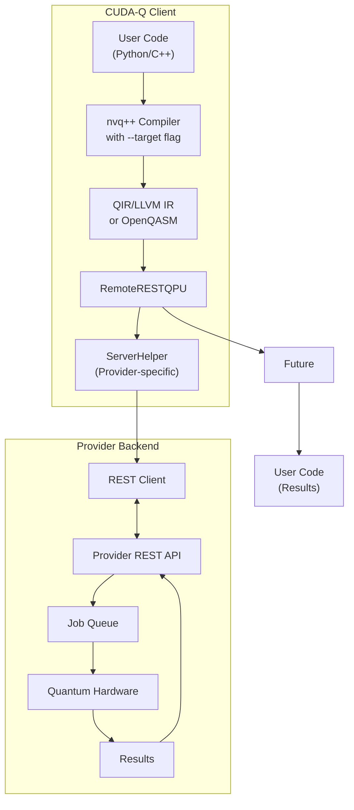
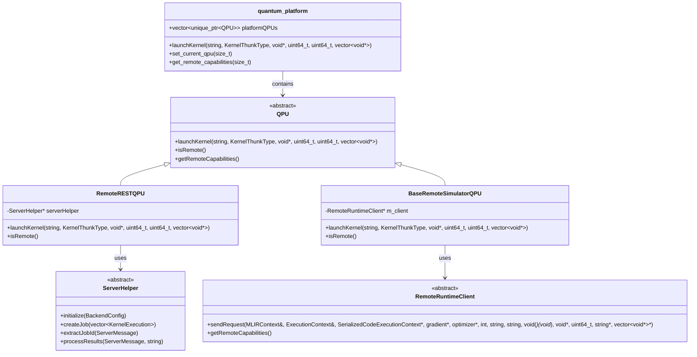
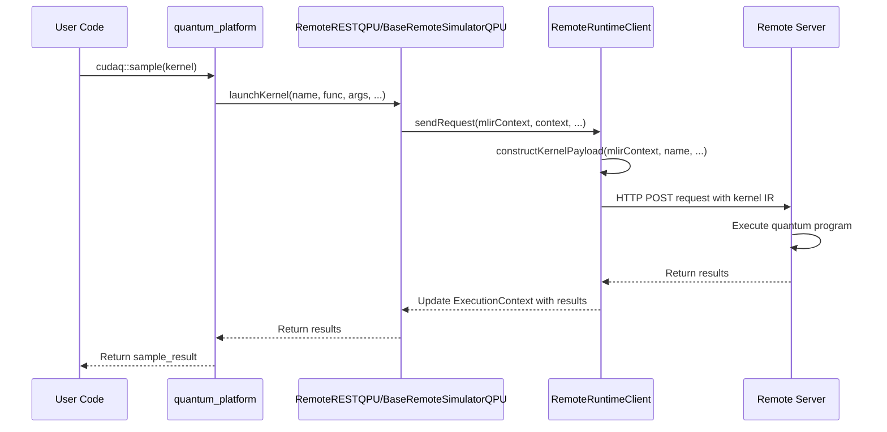
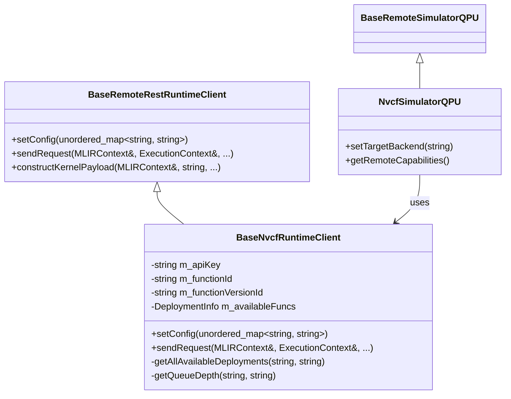
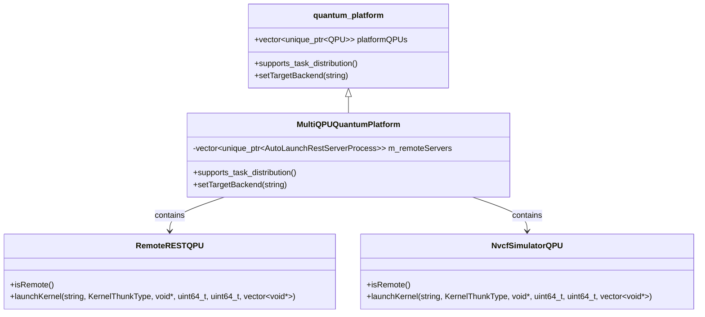
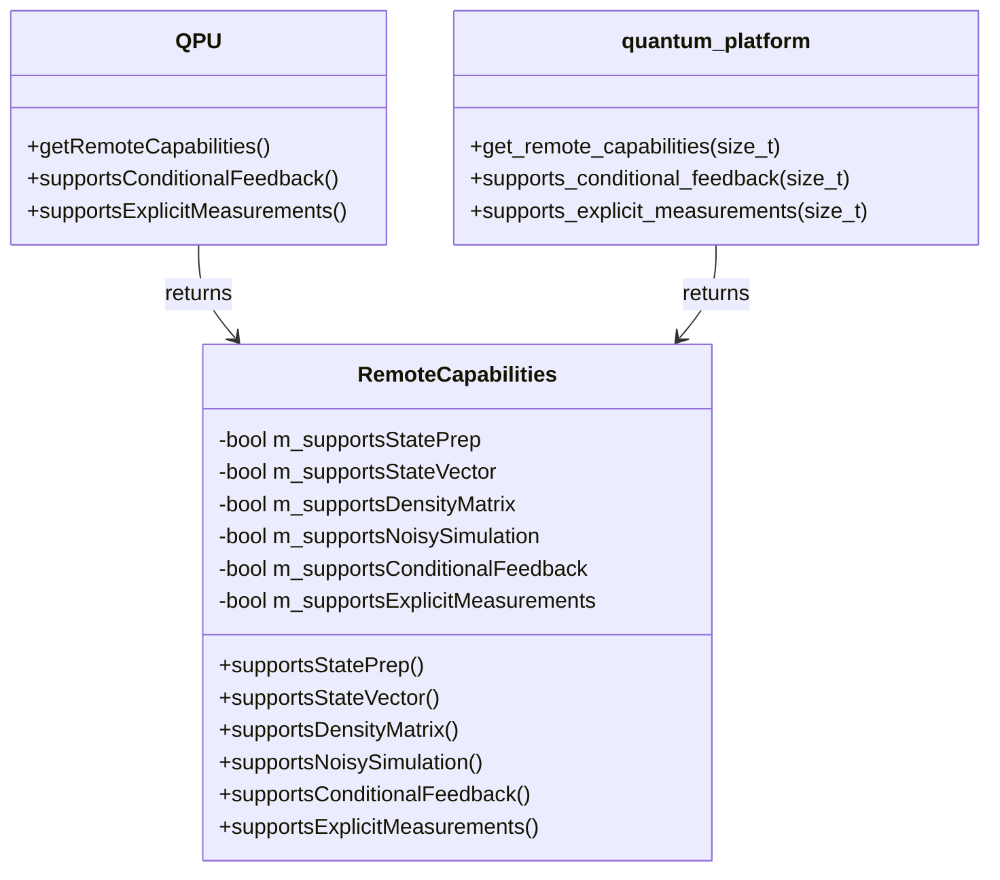

<!-- source: DeepWiki mcp.deepwiki.com · repo NVIDIA/cuda-quantum · page 6.1 Quantum Hardware Providers · fetched 2026-10-26 -->

# Hardware Providers

<details>
<summary>Relevant source files</summary>

The following files were used as context for generating this wiki page:

- [.gitattributes](.gitattributes)
- [.github/workflows/ci.yml](.github/workflows/ci.yml)
- [.github/workflows/clean_up.yml](.github/workflows/clean_up.yml)
- [.github/workflows/config/gitlab_commits.txt](.github/workflows/config/gitlab_commits.txt)
- [.github/workflows/create_cache_command.yml](.github/workflows/create_cache_command.yml)
- [.github/workflows/deployments.yml](.github/workflows/deployments.yml)
- [.github/workflows/dev_environment.yml](.github/workflows/dev_environment.yml)
- [.github/workflows/docker_images.yml](.github/workflows/docker_images.yml)
- [.github/workflows/documentation.yml](.github/workflows/documentation.yml)
- [.github/workflows/generate_cc.yml](.github/workflows/generate_cc.yml)
- [.github/workflows/gh_registry.yml](.github/workflows/gh_registry.yml)
- [.github/workflows/integration_tests.yml](.github/workflows/integration_tests.yml)
- [.github/workflows/prebuilt_binaries.yml](.github/workflows/prebuilt_binaries.yml)
- [.github/workflows/prepare_deployment.yml](.github/workflows/prepare_deployment.yml)
- [.github/workflows/publishing.yml](.github/workflows/publishing.yml)
- [.github/workflows/publishing_stable.yml](.github/workflows/publishing_stable.yml)
- [.github/workflows/python_metapackages.yml](.github/workflows/python_metapackages.yml)
- [.github/workflows/python_wheels.yml](.github/workflows/python_wheels.yml)
- [.github/workflows/test_in_devenv.yml](.github/workflows/test_in_devenv.yml)
- [docs/notebook_validation.py](docs/notebook_validation.py)
- [docs/sphinx/applications/python/hybrid_quantum_neural_networks.ipynb](docs/sphinx/applications/python/hybrid_quantum_neural_networks.ipynb)
- [docs/sphinx/applications/python/quantum_pagerank.ipynb](docs/sphinx/applications/python/quantum_pagerank.ipynb)
- [docs/sphinx/applications/python/unitary_compilation_diffusion_models.ipynb](docs/sphinx/applications/python/unitary_compilation_diffusion_models.ipynb)
- [docs/sphinx/examples/python/dynamics/dynamics_intro_2.ipynb](docs/sphinx/examples/python/dynamics/dynamics_intro_2.ipynb)
- [docs/sphinx/using/backends/circuitsimulators.png](docs/sphinx/using/backends/circuitsimulators.png)
- [docs/sphinx/using/backends/sims/svsims.rst](docs/sphinx/using/backends/sims/svsims.rst)
- [pyproject.toml.cu12](pyproject.toml.cu12)
- [pyproject.toml.cu13](pyproject.toml.cu13)
- [python/metapackages/setup.py](python/metapackages/setup.py)
- [runtime/cudaq/remote_capabilities.h](runtime/cudaq/remote_capabilities.h)
- [scripts/validate_pycudaq.sh](scripts/validate_pycudaq.sh)

</details>


This page documents the quantum hardware providers supported by CUDA-Q and explains how to use them to execute quantum programs on real quantum hardware. For information about simulator backends, see [Simulator System](#6).

CUDA-Q's hardware provider infrastructure allows users to write quantum programs once and run them on various quantum processing units (QPUs) from different vendors without changing the core application code. The system is designed around a flexible remote execution architecture that handles the complexities of job submission, authentication, and result processing.

## Supported Hardware Providers

CUDA-Q supports integration with the following quantum hardware providers:

| Provider | Target Name | Description |
|----------|-------------|-------------|
| NVIDIA Quantum Cloud | `nvqc` | NVIDIA's cloud-based quantum computing platform |
| IonQ | `ionq` | Trapped-ion quantum computers |
| Quantinuum | `quantinuum` | Trapped-ion quantum computers with advanced quantum error correction |
| IQM | `iqm` | Superconducting quantum computers |
| OQC | `oqc` | Superconducting quantum computers |
| Anyon | `anyon` | Neutral-atom quantum computers |
| Pasqal | `pasqal` | Neutral-atom quantum computers |
| Infleqtion | `infleqtion` | Formerly ColdQuanta, neutral-atom quantum computers |
| Orca Computing | `orca` | Photonic quantum computers |
| FermionIQ | `fermioniq` | Specialized quantum simulator for fermionic systems |

Sources: [.github/workflows/integration_tests.yml:10-30](), [tools/nvqpp/nvq++.in:114-116]()

## Remote Execution Architecture

The hardware provider architecture in CUDA-Q follows a consistent pattern that enables uniform interaction with different quantum hardware platforms.



The diagram shows how quantum programs flow from user code through compilation to execution on remote hardware. The `RemoteRESTQPU` class serves as the interface between CUDA-Q and hardware providers, while provider-specific `ServerHelper` implementations handle the details of job submission and result processing.

Sources: [runtime/cudaq/platform/default/rest/RemoteRESTQPU.cpp:17-54](), [runtime/common/ServerHelper.h:19-144](), [runtime/common/BaseRemoteRestClient.h:80-451]()

### Key Components

The remote execution architecture consists of several key components that work together to enable quantum program execution on remote hardware:

1. **quantum_platform**: The base class that manages QPU instances and provides the interface for kernel execution.

2. **RemoteRESTQPU**: A QPU implementation that handles the common patterns of submitting jobs to remote quantum hardware via REST APIs.

3. **ServerHelper**: An abstract class that each hardware provider implements to handle provider-specific details like authentication, job formatting, and result parsing.

4. **RemoteRuntimeClient**: Interface for client implementations that communicate with remote quantum hardware.

5. **BaseRemoteRestRuntimeClient**: Base implementation of the RemoteRuntimeClient interface for REST-based communication.

6. **Future**: Asynchronous job representation that allows retrieval of results once the quantum job completes execution.



Sources: [runtime/cudaq/platform/quantum_platform.h:51-219](), [runtime/cudaq/platform/qpu.h:40-205](), [runtime/common/BaseRemoteSimulatorQPU.h:27-366](), [runtime/common/RemoteKernelExecutor.h:34-104](), [runtime/common/BaseRemoteRestClient.h:80-451]()

## Using Hardware Providers

To target a specific quantum hardware provider, use the `--target` flag with `nvq++` or the `set_target()` function in Python.

### C++ Example

```bash
nvq++ --target quantinuum --quantinuum-machine H1-1E program.cpp -o program.x
./program.x
```

### Python Example

```python
import cudaq

# Set the target to IonQ
cudaq.set_target("ionq")

# Define and run a quantum kernel
@cudaq.kernel
def bell():
    q = cudaq.qubit(2)
    h(q[0])
    x.ctrl(q[0], q[1])
    return measure(q)

result = cudaq.sample(bell)
print(result)
```

Sources: [tools/nvqpp/nvq++.in:401-403](), [.github/workflows/integration_tests.yml:402-411]()

## Hardware Provider Configuration

Each hardware provider supports specific configuration options that can be specified during compilation or execution.

### Target-Specific Options

Target-specific options can be provided using the syntax `--<target-name>-<option>` with the `nvq++` compiler or as additional arguments to `set_target()` in Python.

For example:

```bash
# Specify the machine type for Quantinuum
nvq++ --target quantinuum --quantinuum-machine H1-1E program.cpp -o program.x

# Enable emulation for testing
nvq++ --target ionq --emulate program.cpp -o program.x
```

```python
# Specify the machine type for Anyon
cudaq.set_target("anyon", machine="telegraph-8q")

# Enable emulation for testing
cudaq.set_target("oqc", emulate=True)
```

Sources: [tools/nvqpp/nvq++.in:408-427](), [.github/workflows/integration_tests.yml:347-397]()

### Authentication and Credentials

Most hardware providers require authentication credentials, which can be provided through environment variables:

| Provider | Environment Variable(s) | Description |
|----------|-------------------------|-------------|
| NVQC | `NVQC_API_KEY` | API key for NVIDIA Quantum Cloud |
| IonQ | `IONQ_API_KEY` | API key for IonQ platform |
| Quantinuum | Credential file in `~/.quantinuum_config` | OAuth2 tokens |
| IQM | `IQM_TOKENS_FILE` or `~/.cache/iqm-cortex-cli/tokens.json` | Path to tokens file |
| OQC | `OQC_EMAIL`, `OQC_PASSWORD` | Login credentials |
| Anyon | Credential file in `~/.anyon_config` | OAuth2 tokens |
| Pasqal | `PASQAL_USERNAME`, `PASQAL_PASSWORD`, `PASQAL_PROJECT_ID` | Login credentials |
| Infleqtion | `SUPERSTAQ_API_KEY` | API key for Superstaq platform |
| FermionIQ | `FERMIONIQ_ACCESS_TOKEN_ID`, `FERMIONIQ_ACCESS_TOKEN_SECRET` | Access tokens |
| Orca | `ORCA_ACCESS_URL` | URL for Orca quantum computer access |

Sources: [.github/workflows/integration_tests.yml:347-650](), [runtime/cudaq/platform/default/rest/helpers/iqm/IQMServerHelper.cpp:119-133]()

## Remote Execution Flow

The diagram below illustrates the execution flow when running a quantum program on remote hardware:



This sequence shows how a quantum program flows from user code through the CUDA-Q platform to remote execution and back. The `quantum_platform` delegates to the appropriate QPU implementation, which uses a `RemoteRuntimeClient` to communicate with the remote server.

Sources: [runtime/cudaq/platform/quantum_platform.cpp:175-191](), [runtime/common/BaseRemoteSimulatorQPU.h:123-191](), [runtime/common/BaseRemoteRestClient.h:284-352]()

## Job Submission Process

When submitting a quantum job to a hardware provider, CUDA-Q follows these steps:

1. Compile the quantum kernel into an appropriate intermediate representation (QIR or OpenQASM)
2. Create a `KernelExecution` structure with the compiled code and execution parameters
3. Use the provider-specific `ServerHelper` to format the job for submission
4. Submit the job via REST API and obtain a job ID
5. Poll for job completion using the job ID
6. Process the results using the provider-specific result parser
7. Return the results as a `sample_result` or `observe_result`

Sources: [runtime/common/Future.cpp:17-95](), [runtime/common/ServerHelper.h:28-41]()

## Continuous Integration Testing

CUDA-Q maintains integration tests for all supported hardware providers to ensure continued compatibility.

The CI system performs the following types of tests for each provider:

1. **Syntax checks**: Verify that circuits can be properly compiled for the target
2. **Execution tests**: Submit small circuits to the provider's simulators or hardware
3. **Special feature tests**: Test provider-specific features or capabilities

These tests run on a regular schedule to catch any compatibility issues early.

Sources: [.github/workflows/integration_tests.yml:76-726](), [.github/workflows/nvqc_regression_tests.yml:82-241]()

## NVQC (NVIDIA Quantum Cloud)

NVQC deserves special mention as NVIDIA's cloud-based quantum computing platform that provides remote access to GPU-accelerated quantum simulators. NVQC is implemented through the `BaseNvcfRuntimeClient` class, which extends `BaseRemoteRestRuntimeClient` to provide NVCF (NVIDIA Cloud Function) specific functionality.



NVQC supports:

1. State vector simulations on powerful GPU clusters
2. Multi-QPU simulations for parallelizing quantum applications
3. Various simulation backends including tensor network and matrix product state simulators

The `BaseNvcfRuntimeClient` handles authentication, function discovery, and job submission to NVCF, while the `NvcfSimulatorQPU` provides the interface between CUDA-Q and NVQC.

Sources: [runtime/common/BaseRemoteRestClient.h:452-3736](), [runtime/common/BaseRemoteSimulatorQPU.h:246-366](), [python/runtime/utils/PyRemoteSimulatorQPU.cpp:162-211]()

## Multi-QPU Platform

CUDA-Q provides a `MultiQPUPlatform` implementation that enables the use of multiple QPUs, including remote hardware providers, in a single application. This is particularly useful for distributing quantum workloads across multiple devices or for comparing results from different hardware providers.



The `MultiQPUQuantumPlatform` class extends `quantum_platform` to support multiple QPUs, including remote hardware providers. It can be configured to use different types of QPUs, such as `RemoteRESTQPU` for hardware providers or `NvcfSimulatorQPU` for NVQC.

The platform is configured through the `setTargetBackend` method, which parses a configuration string to determine the type and number of QPUs to create. For example, a configuration string like `"target;nvqc;simulator;nvidia;nqpus;2"` would create two NVQC QPUs using the NVIDIA simulator.

Sources: [runtime/cudaq/platform/mqpu/MultiQPUPlatform.cpp:25-267](), [runtime/cudaq/platform/quantum_platform.h:51-219](), [runtime/cudaq/platform/quantum_platform.cpp:167-206]()

## Remote Capabilities

Different hardware providers support different capabilities, such as conditional feedback or explicit measurements. CUDA-Q provides a `RemoteCapabilities` class to represent these capabilities and allow applications to check what features are supported by a particular provider.



The `RemoteCapabilities` class provides methods to check what features are supported by a remote provider. This allows applications to adapt their behavior based on the capabilities of the target hardware.

The `quantum_platform` class provides methods to check the capabilities of a specific QPU, which delegates to the QPU's implementation of `getRemoteCapabilities()`.

Sources: [runtime/cudaq/remote_capabilities.h:15-85](), [runtime/cudaq/platform/quantum_platform.h:139-147](), [runtime/cudaq/platform/quantum_platform.cpp:168-173](), [runtime/common/BaseRemoteRestClient.h:443-450]()

## Emulation Mode

For testing purposes, most hardware providers support an emulation mode that simulates the behavior of the remote hardware locally. This is useful for development and testing before submitting jobs to actual quantum hardware.

To enable emulation mode, use the `--emulate` flag with `nvq++` or set `emulate=True` in `set_target()`:

```bash
nvq++ --target quantinuum --emulate program.cpp -o program.x
```

```python
cudaq.set_target("ionq", emulate=True)
```

Emulation mode preserves the same API and workflow as the real hardware execution but executes the circuit on a local simulator instead of submitting it to the remote provider.

Sources: [tools/nvqpp/nvq++.in:456-458]()

---

