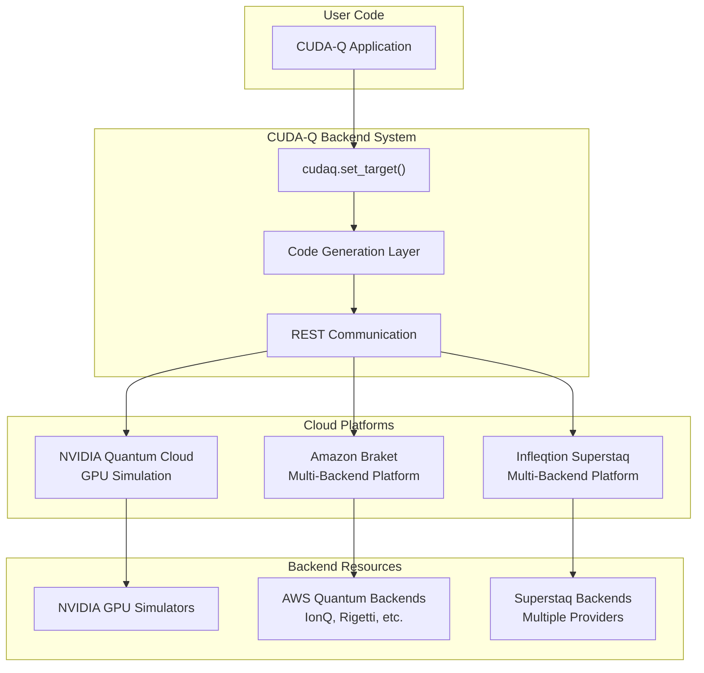
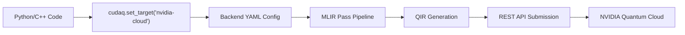
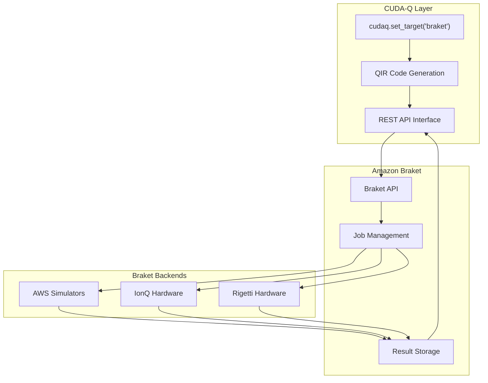
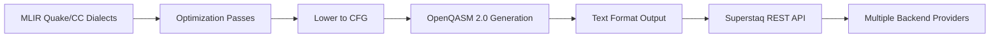
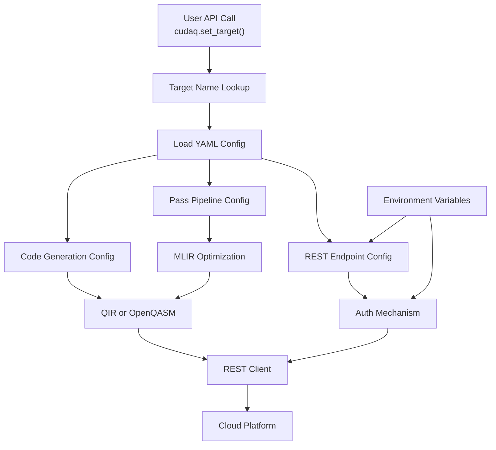
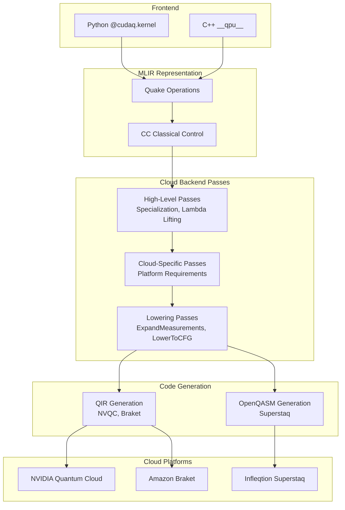
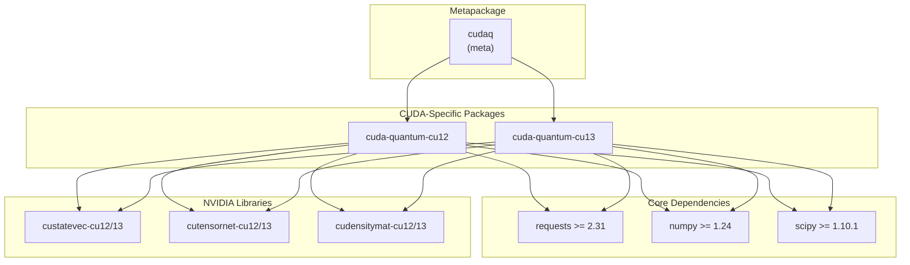

<!-- source: DeepWiki mcp.deepwiki.com · repo NVIDIA/cuda-quantum · page 6.2 Cloud Platforms · fetched 2026-10-26 -->

# Cloud Platforms

<details>
<summary>Relevant source files</summary>

The following files were used as context for generating this wiki page:

- [.github/workflows/command_dispatch.yml](.github/workflows/command_dispatch.yml)
- [.github/workflows/config/gitlab_commits.txt](.github/workflows/config/gitlab_commits.txt)
- [.github/workflows/config/spellcheck_config.yml](.github/workflows/config/spellcheck_config.yml)
- [.github/workflows/config/spelling_allowlist.txt](.github/workflows/config/spelling_allowlist.txt)
- [.github/workflows/python_metapackages.yml](.github/workflows/python_metapackages.yml)
- [.github/workflows/repo_checks.yml](.github/workflows/repo_checks.yml)
- [SECURITY.md](SECURITY.md)
- [docs/notebook_validation.py](docs/notebook_validation.py)
- [docs/sphinx/applications/python/hybrid_quantum_neural_networks.ipynb](docs/sphinx/applications/python/hybrid_quantum_neural_networks.ipynb)
- [docs/sphinx/applications/python/quantum_pagerank.ipynb](docs/sphinx/applications/python/quantum_pagerank.ipynb)
- [docs/sphinx/applications/python/unitary_compilation_diffusion_models.ipynb](docs/sphinx/applications/python/unitary_compilation_diffusion_models.ipynb)
- [docs/sphinx/examples/python/dynamics/dynamics_intro_2.ipynb](docs/sphinx/examples/python/dynamics/dynamics_intro_2.ipynb)
- [docs/sphinx/releases.rst](docs/sphinx/releases.rst)
- [docs/sphinx/using/backends/circuitsimulators.png](docs/sphinx/using/backends/circuitsimulators.png)
- [docs/sphinx/using/backends/cloud.rst](docs/sphinx/using/backends/cloud.rst)
- [docs/sphinx/using/backends/sims/svsims.rst](docs/sphinx/using/backends/sims/svsims.rst)
- [pyproject.toml.cu12](pyproject.toml.cu12)
- [pyproject.toml.cu13](pyproject.toml.cu13)
- [python/metapackages/setup.py](python/metapackages/setup.py)
- [scripts/validate_pycudaq.sh](scripts/validate_pycudaq.sh)

</details>


## Purpose and Scope

This document describes CUDA-Q's integration with cloud-based quantum computing platforms that provide remote access to quantum simulation and hardware resources. Cloud platforms aggregate multiple backends and provide unified APIs for job submission and management. This page covers NVIDIA Quantum Cloud, Amazon Braket, and Infleqtion Superstaq.

For information about direct connections to quantum hardware providers, see [Quantum Hardware Providers](#6.1). For details on the underlying REST-based communication architecture, see [Remote REST QPU Interface](#6.3).

**Sources:** [docs/sphinx/using/backends/cloud.rst:1-11](), [docs/sphinx/releases.rst:93-95,165-171]()

---

## Supported Cloud Platforms

CUDA-Q integrates with three major cloud quantum computing platforms, each providing access to different simulation capabilities and hardware backends through unified interfaces.

### Platform Overview



**Sources:** [docs/sphinx/releases.rst:165-179](), [.github/workflows/config/spelling_allowlist.txt:13,53,92,126]()

---

## NVIDIA Quantum Cloud (NVQC)

NVIDIA Quantum Cloud provides access to GPU-accelerated quantum simulators without requiring local GPU hardware. This platform was introduced in CUDA-Q version 0.7.0.

### Key Features

| Feature | Description |
|---------|-------------|
| **Primary Purpose** | Remote GPU-accelerated simulation |
| **Simulator Access** | cuStateVec-based simulators |
| **Hardware Requirements** | None (cloud-based GPUs) |
| **Code Format** | QIR (Quantum Intermediate Representation) |
| **First Supported Version** | 0.7.0 |

### Configuration



NVQC uses the QIR code generation path, which routes through the LLVM-based compilation pipeline. The backend configuration is specified via YAML files that define the MLIR optimization passes and target-specific transformations.

**Sources:** [docs/sphinx/releases.rst:165-179](), [.github/workflows/config/spelling_allowlist.txt:74]()

---

## Amazon Braket

Amazon Braket is AWS's quantum computing service that provides unified access to multiple quantum hardware providers and simulators. CUDA-Q support was added in version 0.9.1.

### Architecture



### Authentication and Submission

Braket requires AWS credentials for authentication. Jobs submitted through CUDA-Q are paid submissions, as evidenced by the validation script handling:

```python
# From validation script showing paid submission handling
if [ "$t" == "quera" ] || [ "$t" == "braket" ] ; then 
    # Skipped because GitHub does not have the necessary authentication token 
    # to submit a (paid) job to Amazon Braket
    skip_example=true
fi
```

The backend uses QIR as its code generation format, same as NVQC, allowing for efficient representation of quantum circuits.

**Sources:** [scripts/validate_pycudaq.sh:193-199,221-225](), [docs/sphinx/releases.rst:93-95]()

---

## Infleqtion Superstaq

Infleqtion Superstaq (formerly known as Superstaq) is a multi-backend quantum computing platform that provides access to various quantum hardware providers through a unified API. Support was added in CUDA-Q version 0.9.1.

### Code Generation Path

Unlike NVQC and Braket which use QIR, Superstaq utilizes the OpenQASM code generation path:



### Multi-Backend Access

Superstaq serves as an aggregator platform, routing jobs to different quantum hardware providers based on user selection and availability. The platform handles:

- Job optimization and compilation
- Backend selection and routing
- Queue management across providers
- Result aggregation and standardization

**Sources:** [docs/sphinx/releases.rst:93-95](), [.github/workflows/config/spelling_allowlist.txt:126]()

---

## Backend Configuration System

All cloud platforms utilize CUDA-Q's unified backend configuration system, which consists of YAML configuration files and environment variables.

### Configuration Flow



### Code Generation Routing

The routing between QIR and OpenQASM paths is determined by the backend YAML configuration:

| Platform | Code Format | Reason |
|----------|-------------|--------|
| NVQC | QIR | Native NVIDIA simulator format, LLVM-based |
| Braket | QIR | Supports AWS quantum backends via QIR |
| Superstaq | OpenQASM | Standard interchange format for multi-provider routing |

**Sources:** [docs/sphinx/using/backends/svsims.rst:1-11](), [docs/sphinx/releases.rst:93-110]()

---

## Validation and Testing

CUDA-Q includes comprehensive validation for cloud platform integrations, though some are skipped in CI/CD due to authentication and cost requirements.

### Validation Pattern

The validation script demonstrates the typical usage pattern for cloud backends:

```python
# Pattern extracted from validation script
explicit_targets = `cat $ex | grep -Po '^\s*cudaq.set_target\("\K.*(?=")'`
for t in $explicit_targets; do
    if [ "$t" == "quera" ] || [ "$t" == "braket" ] ; then 
        # Skipped due to paid submission requirement
        skip_example=true
    elif [ "$t" == "pasqal" ] && [ -z "${PASQAL_PASSWORD}" ]; then
        # Skipped due to missing credentials
        skip_example=true
    fi
done
```

### Backend Detection

The notebook validation system checks for available backends before executing examples:

```python
def validate(notebook_filename, available_backends):
    # Pattern matching for set_target calls
    pattern = r"set_target\(\s*(\\?['\"])([^'\"]+)\1(?:\s*,\s*option\s*=\s*(\\?['\"])([^'\"]+)\3)?\)"
    
    for notebook_content in lines:
        match = re.search(pattern, notebook_content)
        if match:
            target = match.group(2)
            return target in available_backends
```

This pattern allows graceful skipping of examples that require unavailable cloud platforms while ensuring comprehensive testing when credentials are present.

**Sources:** [scripts/validate_pycudaq.sh:193-252](), [docs/notebook_validation.py:28-59]()

---

## Integration with MLIR Pipeline

Cloud platforms integrate with CUDA-Q's MLIR-based compilation infrastructure, utilizing custom pass pipelines defined per backend.

### Pipeline Architecture



Each cloud platform specifies its required MLIR passes in YAML configuration files. These passes handle:

- Platform-specific gate decompositions
- Measurement expansion strategies
- Classical control flow lowering
- Memory management transformations

**Sources:** [docs/sphinx/releases.rst:97-110](), [pyproject.toml.cu12:1-84](), [pyproject.toml.cu13:1-85]()

---

## Package Dependencies

Cloud platform support is included in the base CUDA-Q Python packages. The dependency structure ensures all necessary libraries are available:

### Python Package Structure



The `requests` library is a core dependency enabling REST API communication with all cloud platforms. This ensures that cloud backend functionality is available immediately upon package installation without additional dependencies.

**Sources:** [pyproject.toml.cu12:19-34](), [pyproject.toml.cu13:19-34](), [python/metapackages/setup.py:1-256]()

---

## Release History and Evolution

Cloud platform support has evolved across CUDA-Q releases:

| Version | Platform | Description |
|---------|----------|-------------|
| **0.7.0** | NVQC | Initial NVIDIA Quantum Cloud support, providing GPU-accelerated simulation access |
| **0.9.1** | Braket | Amazon Braket integration for AWS quantum services |
| **0.9.1** | Superstaq | Infleqtion Superstaq multi-backend platform support |

### Version 0.7.0 - NVIDIA Quantum Cloud

The initial cloud platform release focused on providing remote access to NVIDIA's GPU simulation infrastructure:

> "The 0.7.0 release adds support for using NVIDIA Quantum Cloud, giving you access to our most powerful GPU-accelerated simulators even if you don't have an NVIDIA GPU."

This release democratized access to high-performance quantum simulation by removing the requirement for local GPU hardware.

### Version 0.9.1 - Multi-Platform Expansion

The 0.9.1 release expanded cloud access to include third-party platforms:

> "This release adds support for using Amazon Braket and Infleqtion's Superstaq as backends."

This expansion provided users with:
- Access to real quantum hardware through AWS
- Multi-vendor backend aggregation through Superstaq
- Flexible deployment options across cloud providers

**Sources:** [docs/sphinx/releases.rst:164-179,93-110]()

---

## Summary

Cloud platforms extend CUDA-Q's execution capabilities beyond local resources, providing:

1. **Remote GPU Simulation** (NVQC) - High-performance simulation without local hardware requirements
2. **Multi-Backend Access** (Braket, Superstaq) - Unified APIs to multiple quantum hardware providers
3. **Flexible Code Generation** - QIR for GPU-optimized paths, OpenQASM for hardware compatibility
4. **Unified Configuration** - Consistent `cudaq.set_target()` interface across all platforms

The cloud platform architecture leverages CUDA-Q's MLIR-based compilation pipeline with platform-specific optimization passes and multiple code generation backends, enabling seamless deployment across diverse quantum computing resources.

**Sources:** [docs/sphinx/using/backends/cloud.rst:1-11](), [docs/sphinx/releases.rst:1-251]()

---

