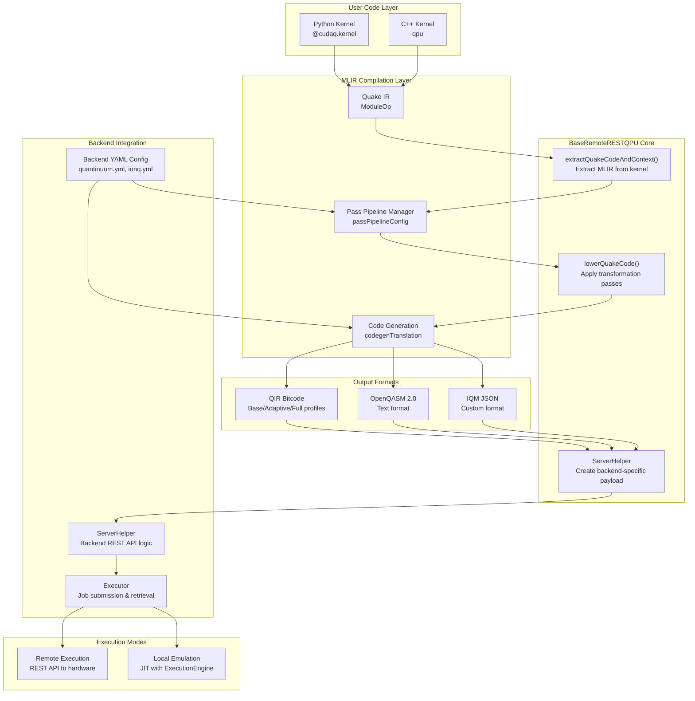
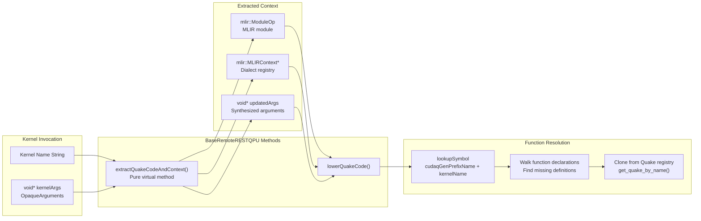
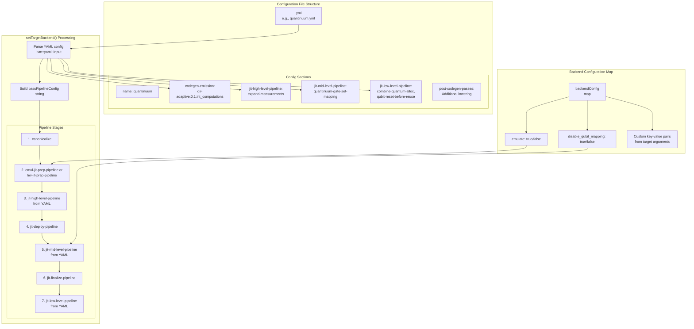
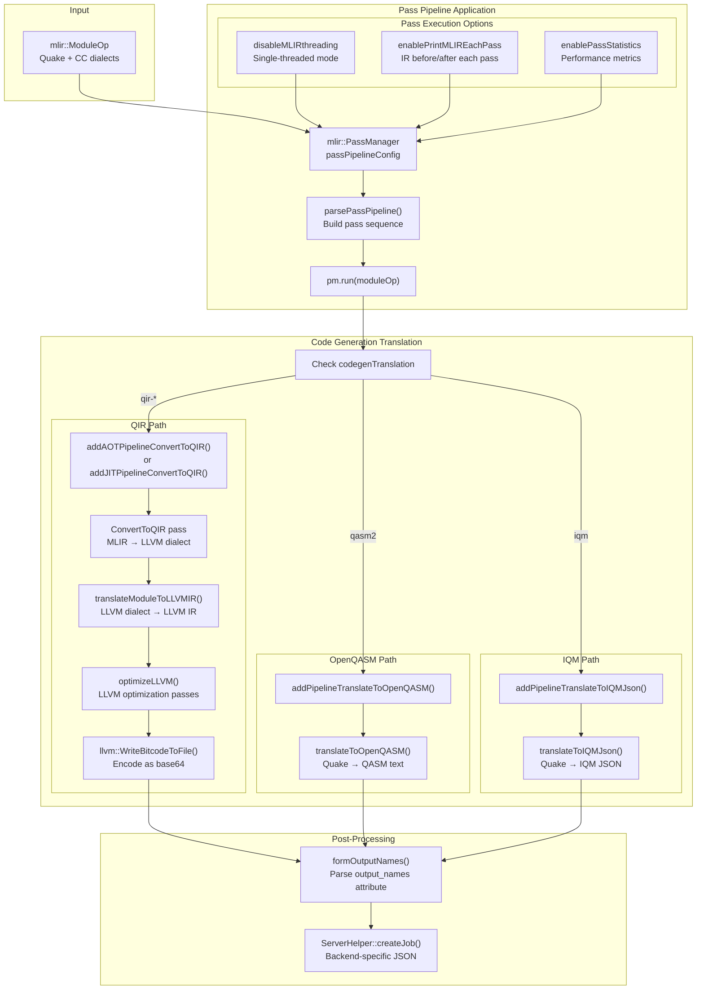
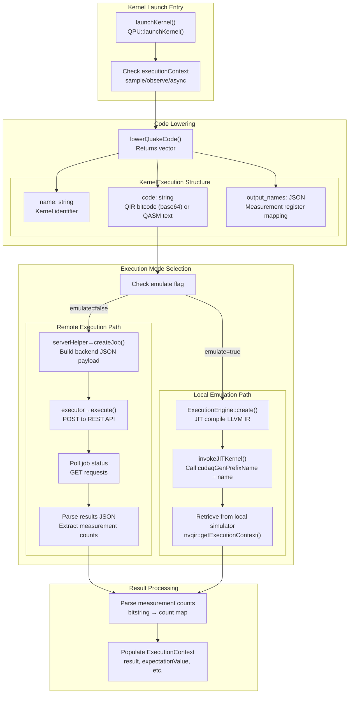
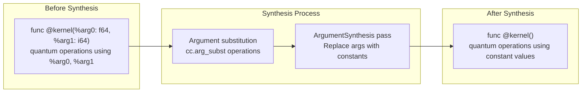
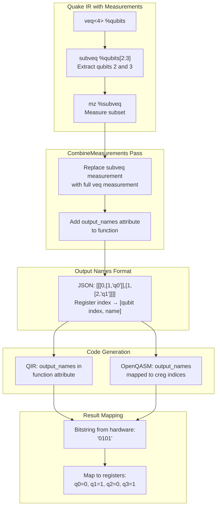

<!-- source: DeepWiki mcp.deepwiki.com · repo NVIDIA/cuda-quantum · page 6.3 Remote REST QPU Interface · fetched 2026-10-26 -->

# Remote REST QPU Interface

<details>
<summary>Relevant source files</summary>

The following files were used as context for generating this wiki page:

- [include/cudaq/Optimizer/Transforms/Passes.h](include/cudaq/Optimizer/Transforms/Passes.h)
- [include/cudaq/Optimizer/Transforms/Passes.td](include/cudaq/Optimizer/Transforms/Passes.td)
- [lib/Optimizer/CodeGen/Pipelines.cpp](lib/Optimizer/CodeGen/Pipelines.cpp)
- [lib/Optimizer/Transforms/CMakeLists.txt](lib/Optimizer/Transforms/CMakeLists.txt)
- [lib/Optimizer/Transforms/ClassicalOptimization.cpp](lib/Optimizer/Transforms/ClassicalOptimization.cpp)
- [lib/Optimizer/Transforms/Pipelines.cpp](lib/Optimizer/Transforms/Pipelines.cpp)
- [python/runtime/cudaq/platform/py_alt_launch_kernel.cpp](python/runtime/cudaq/platform/py_alt_launch_kernel.cpp)
- [python/utils/OpaqueArguments.h](python/utils/OpaqueArguments.h)
- [runtime/common/BaseRemoteRESTQPU.h](runtime/common/BaseRemoteRESTQPU.h)
- [runtime/common/RuntimeMLIRCommonImpl.h](runtime/common/RuntimeMLIRCommonImpl.h)
- [runtime/cudaq/platform/default/rest/helpers/quantinuum/quantinuum.yml](runtime/cudaq/platform/default/rest/helpers/quantinuum/quantinuum.yml)

</details>


## Purpose and Scope

The Remote REST QPU Interface provides the infrastructure for executing CUDA-Q quantum kernels on remote quantum processing units (QPUs) accessed via REST APIs. This system handles the complete workflow from MLIR-based quantum kernel representation to backend-specific code generation, job submission, and result retrieval.

This document covers the compilation pipeline, code generation mechanisms, backend configuration, and execution flow for remote quantum hardware providers. For information about specific quantum hardware integrations, see [Quantum Hardware Providers](#6.1). For cloud platform integrations, see [Cloud Platforms](#6.2). For local simulation backends, see [Simulator Backends](#5).

## Architecture Overview

The Remote REST QPU system consists of several layers that transform quantum kernels from high-level representations to backend-specific formats and manage their execution on remote hardware.



**Sources:** [runtime/common/BaseRemoteRESTQPU.h:73-230](), [runtime/common/BaseRemoteRESTQPU.h:451-595]()

### Core Components

| Component | File Location | Responsibility |
|-----------|---------------|----------------|
| `BaseRemoteRESTQPU` | [runtime/common/BaseRemoteRESTQPU.h:73]() | Abstract base class for REST-based quantum backends |
| `ServerHelper` | [runtime/common/BaseRemoteRESTQPU.h:99-100]() | Backend-specific REST API interactions and payload formatting |
| `Executor` | [runtime/common/BaseRemoteRESTQPU.h:96]() | Job submission, polling, and result retrieval |
| Pass Pipeline | [runtime/common/BaseRemoteRESTQPU.h:83]() | MLIR transformation sequence configured per backend |
| Code Generation | [runtime/common/BaseRemoteRESTQPU.h:88-93]() | Target format translation (QIR/OpenQASM/IQM) |

**Sources:** [runtime/common/BaseRemoteRESTQPU.h:73-104]()

## MLIR Extraction and Context Management

The first stage extracts the Quake MLIR representation from the kernel and prepares it for transformation.



**Sources:** [runtime/common/BaseRemoteRESTQPU.h:148-150](), [runtime/common/BaseRemoteRESTQPU.h:469-533]()

The `extractQuakeCodeAndContext()` method is a pure virtual function that derived classes must implement. It returns a tuple containing:
- `mlir::ModuleOp`: The MLIR module containing the kernel
- `mlir::MLIRContext*`: The MLIR context with loaded dialects
- `void*`: Updated argument data (for argument synthesis)

After extraction, `lowerQuakeCode()` resolves any function declarations by searching the Quake registry and cloning missing function definitions into the module.

**Sources:** [runtime/common/BaseRemoteRESTQPU.h:465-595]()

## Backend Configuration System

Backend behavior is configured through YAML files that specify MLIR pass pipelines, code generation targets, and backend-specific parameters.



**Sources:** [runtime/common/BaseRemoteRESTQPU.h:235-404](), [runtime/cudaq/platform/default/rest/helpers/quantinuum/quantinuum.yml:1-91]()

### Pipeline Construction

The pass pipeline is constructed by concatenating multiple stages:

1. **Target-agnostic preparation**: `hw-jit-prep-pipeline` for hardware or `emul-jit-prep-pipeline` for emulation
2. **High-level passes**: From `JITHighLevelPipeline` in YAML (e.g., `expand-measurements`)
3. **Deployment passes**: `jit-deploy-pipeline` (decomposition, multi-control handling)
4. **Mid-level passes**: From `JITMidLevelPipeline` in YAML (e.g., gate set mapping)
5. **Finalization passes**: `jit-finalize-pipeline` (canonicalization, CFG lowering)
6. **Low-level passes**: From `JITLowLevelPipeline` in YAML (e.g., qubit allocation, reset)

**Sources:** [runtime/common/BaseRemoteRESTQPU.h:312-375]()

### Code Generation Target Specification

The `codegen-emission` field specifies the output format:

| Format | Specification | Description |
|--------|---------------|-------------|
| QIR Base | `qir-base:VERSION` | Base profile QIR (delayed measurements) |
| QIR Adaptive | `qir-adaptive:VERSION:EXTENSIONS` | Adaptive profile QIR (mid-circuit measurements, classical control) |
| QIR Full | `qir-full:VERSION` | Full profile QIR (all features) |
| OpenQASM | `qasm2` | OpenQASM 2.0 text format |
| IQM JSON | `iqm` | IQM custom JSON format |

Extensions for adaptive profile include:
- `int_computations`: Integer arithmetic instructions
- `float_computations`: Floating-point arithmetic instructions
- `output_log`: Output recording functions

**Sources:** [runtime/common/BaseRemoteRESTQPU.h:299-306](), [runtime/cudaq/platform/default/rest/helpers/quantinuum/quantinuum.yml:25-55]()

## Pass Pipeline Execution and Code Lowering

The transformation from Quake IR to backend-specific format proceeds through multiple MLIR pass stages.



**Sources:** [runtime/common/BaseRemoteRESTQPU.h:596-785](), [lib/Optimizer/CodeGen/Pipelines.cpp:35-153]()

### Pass Pipeline Execution Details

The pass pipeline execution in `lowerQuakeCode()` follows these steps:

1. **Parse Pipeline String**: Convert the concatenated pass string into a `PassManager`
2. **Configure Debugging**: Enable IR printing, statistics, or disable threading based on environment variables
3. **Execute Passes**: Run `pm.run(moduleOp)` with timing instrumentation
4. **Handle Errors**: Capture diagnostic messages on failure

**Sources:** [runtime/common/BaseRemoteRESTQPU.h:596-633]()

### QIR Generation Pipeline

For QIR targets, additional transformations are applied:

```mermaid
graph LR
    subgraph "MLIR to LLVM Dialect"
        ExpandMeas["ExpandMeasurements<br/>Vector mz → loop of single mz"]
        MemToReg["ClassicalMemToReg<br/>Stack allocations → SSA values"]
        LoopUnroll["LoopUnroll<br/>Unroll constant-bounded loops"]
        LowerToCFG["LowerToCFG<br/>cc.loop/cc.if → cf.br/cf.cond_br"]
        CombineAlloc["CombineQuantumAllocations<br/>Multiple alloca → single veq"]
        ConvertToQIR["ConvertToQIR<br/>Quake ops → QIR function calls"]
    end
    
    subgraph "LLVM IR Processing"
        TranslateIR["translateModuleToLLVMIR()<br/>MLIR LLVM dialect → LLVM IR"]
        ApplyAttrs["applyWriteOnlyAttributes()<br/>Add WriteOnly to mz result arg"]
        AddModuleFlags["Add module flags<br/>qir_major_version, qir_profiles, etc."]
        OptimizeIR["optimizeLLVM()<br/>Standard LLVM optimization"]
        VerifyProfile["verifyLLVMInstructions()<br/>Check instruction compliance"]
    end
    
    ExpandMeas --> MemToReg
    MemToReg --> LoopUnroll
    LoopUnroll --> LowerToCFG
    LowerToCFG --> CombineAlloc
    CombineAlloc --> ConvertToQIR
    
    ConvertToQIR --> TranslateIR
    TranslateIR --> ApplyAttrs
    ApplyAttrs --> AddModuleFlags
    AddModuleFlags --> OptimizeIR
    OptimizeIR --> VerifyProfile
```



**Sources:** [lib/Optimizer/CodeGen/Pipelines.cpp:54-109](), [runtime/common/RuntimeMLIRCommonImpl.h:94-117](), [runtime/common/RuntimeMLIRCommonImpl.h:476-522]()

The QIR pipeline includes profile-specific verification:
- **Base Profile**: Measurements must occur after all reversible operations, constant arguments required
- **Adaptive Profile**: Mid-circuit measurements allowed, optional integer/float computation extensions
- **Instruction Validation**: Only allowed LLVM instructions per profile specification
- **Range Checking**: Qubit and result indices must be within declared bounds

**Sources:** [runtime/common/RuntimeMLIRCommonImpl.h:185-474]()

## Execution Flow

The execution flow differs based on whether the backend is configured for remote execution or local emulation.



**Sources:** [runtime/common/BaseRemoteRESTQPU.h:787-1036]()

### Remote Execution Workflow

For remote execution, the `Executor` handles job lifecycle management:

1. **Job Creation**: `serverHelper->createJob()` builds a backend-specific JSON payload containing:
   - Quantum program (QIR bitcode, OpenQASM text, or IQM JSON)
   - Shot count (`nShots`)
   - Backend-specific parameters (device name, project ID, credentials, etc.)
   - Extra metadata from `ExtraPayloadProvider` if configured

2. **Job Submission**: `executor->execute()` sends an HTTP POST request to the backend's submission endpoint

3. **Status Polling**: Periodic GET requests check job status until completion or timeout

4. **Result Retrieval**: Parse the backend-specific result JSON to extract measurement counts

**Sources:** [runtime/common/BaseRemoteRESTQPU.h:787-900]()

### Local Emulation Workflow

For local emulation, the code is executed in a JIT-compiled environment:

1. **JIT Compilation**: `ExecutionEngine::create()` compiles the LLVM IR to native code

2. **Kernel Invocation**: Call the function pointer for `cudaqGenPrefixName + kernelName`

3. **Result Collection**: Retrieve results from the local simulator's execution context

**Sources:** [runtime/common/BaseRemoteRESTQPU.h:125-146](), [runtime/common/BaseRemoteRESTQPU.h:901-1036]()

## Backend-Specific Transformations

Different backends require specific MLIR transformations configured through the pass pipeline.

### Pass Categories

| Pass Category | Purpose | Example Passes |
|---------------|---------|----------------|
| **High-Level** | Prepare quantum operations | `expand-measurements`, `add-wireset` |
| **Mid-Level** | Gate set mapping | `quantinuum-gate-set-mapping`, `basis-conversion` |
| **Low-Level** | Resource allocation | `combine-quantum-alloc`, `qubit-reset-before-reuse`, `qubit-mapping-func` |

**Sources:** [include/cudaq/Optimizer/Transforms/Passes.td:1-90](), [runtime/cudaq/platform/default/rest/helpers/quantinuum/quantinuum.yml:21-23]()

### Example: Quantinuum Backend Pipeline

For the Quantinuum backend, the complete pipeline sequence is:

1. **Canonicalize**: Standard MLIR canonicalization
2. **hw-jit-prep-pipeline**: Hardware preparation (erase noise, unwind, mem-to-reg, apply specialization)
3. **expand-measurements**: Expand vector measurements to loops
4. **jit-deploy-pipeline**: Standard deployment (U3 decomposition, multi-control)
5. **quantinuum-gate-set-mapping**: Map to Quantinuum native gates
6. **jit-finalize-pipeline**: Final cleanup (canonicalize, CSE, symbol DCE)
7. **combine-quantum-alloc, qubit-reset-before-reuse**: Qubit resource management

**Sources:** [runtime/cudaq/platform/default/rest/helpers/quantinuum/quantinuum.yml:21-27](), [lib/Optimizer/Transforms/Pipelines.cpp:49-104]()

### Argument Synthesis for Remote Execution

For remote execution, function arguments must be synthesized into the quantum program. The `ArgumentSynthesis` pass replaces function arguments with constants:



**Sources:** [include/cudaq/Optimizer/Transforms/Passes.td:84-117]()

The `ArgumentSynthesis` pass:
- Takes a list of function names and substitution specifications
- Erases specified arguments from function signatures
- Replaces uses of those arguments with computed values (constants)
- Enables remote execution where the quantum program must be fully static

**Sources:** [include/cudaq/Optimizer/Transforms/Passes.h:82-87]()

## Output Names and Measurement Mapping

The `output_names` attribute maps measurement operations to named registers, preserving measurement semantics across code generation.



**Sources:** [include/cudaq/Optimizer/Transforms/Passes.td:196-219](), [runtime/common/BaseRemoteRESTQPU.h:406-448]()

The `CombineMeasurements` pass transforms:
```
func @kernel() {
  %qubits = quake.alloca !quake.veq<4>
  %subset = quake.subveq %qubits, 2, 3 : (!quake.veq<4>, i32, i32) -> !quake.veq<2>
  %result = quake.mz %subset : (!quake.veq<2>) -> !cc.stdvec<!quake.measure>
}
```

Into:
```
func @kernel() attributes {output_names = "[[[0,[2,'q2']],[1,[3,'q3']]]]"} {
  %qubits = quake.alloca !quake.veq<4>
  %result = quake.mz %qubits : (!quake.veq<4>) -> !cc.stdvec<!quake.measure>
}
```

The `formOutputNames()` method extracts this mapping from the generated code (QIR or OpenQASM) and includes it in the job payload for proper result interpretation.

**Sources:** [runtime/common/BaseRemoteRESTQPU.h:406-448]()

## Key Extension Points

The Remote REST QPU system provides several extension points for integrating new quantum backends.

### ServerHelper Interface

Custom backends implement the `ServerHelper` interface to provide backend-specific REST API logic:

| Method | Purpose |
|--------|---------|
| `initialize(backendConfig)` | Set up credentials, endpoints, and configuration |
| `createJob(...)` | Build the JSON payload for job submission |
| `extractResult(...)` | Parse the backend's result format into measurement counts |
| `getJobId(...)` | Extract job ID from submission response |
| `queryStatus(...)` | Check job status (queued, running, completed, failed) |

**Sources:** Backend-specific implementations would extend the `ServerHelper` base class.

### Executor Interface

The `Executor` handles the job lifecycle:
- `setShots(nShots)`: Configure number of measurement shots
- `setServerHelper(helper)`: Associate with a `ServerHelper` instance
- `execute(jobs)`: Submit jobs and wait for results

**Sources:** [runtime/common/BaseRemoteRESTQPU.h:96]()

### Backend YAML Configuration

New backends are integrated by creating a YAML configuration file:

```yaml
name: my_backend
description: "My quantum backend"
config:
  platform-qpu: remote_rest
  gen-target-backend: true
  link-libs: ["-lcudaq-rest-qpu"]
  jit-high-level-pipeline: "my-high-level-passes"
  jit-mid-level-pipeline: "my-gate-set-mapping"
  jit-low-level-pipeline: "my-low-level-passes"
  codegen-emission: qir-adaptive:1.0:int_computations
```

**Sources:** [runtime/cudaq/platform/default/rest/helpers/quantinuum/quantinuum.yml:1-91]()

### Custom MLIR Passes

Backend-specific transformations are implemented as MLIR passes:
- Gate set mapping: Convert standard gates to backend-native gates
- Topology mapping: Map logical qubits to physical qubits
- Constraint enforcement: Apply hardware-specific constraints

These passes are registered in the MLIR pass registry and referenced in the YAML configuration.

**Sources:** [include/cudaq/Optimizer/Transforms/Passes.td:909-960]()

---

