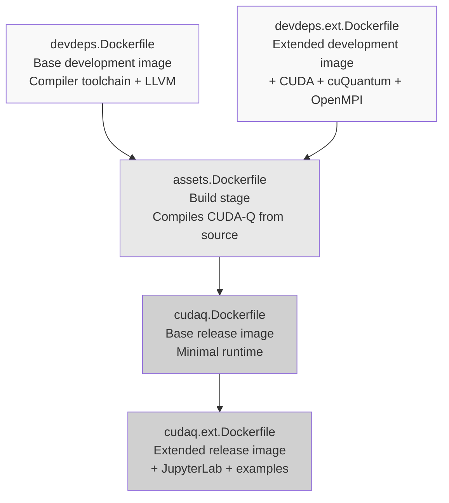
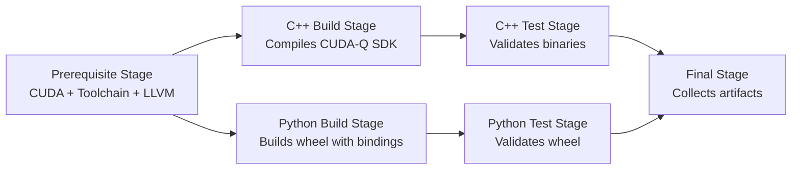
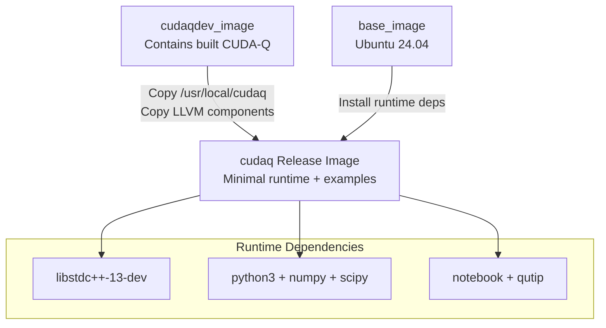
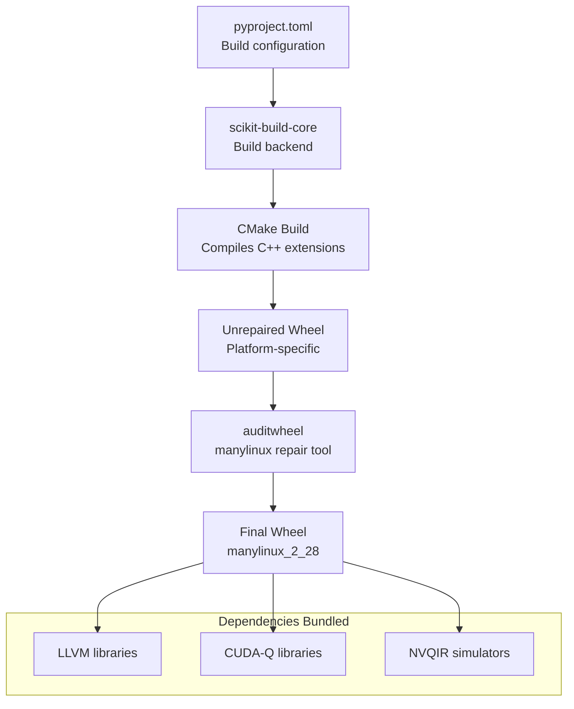
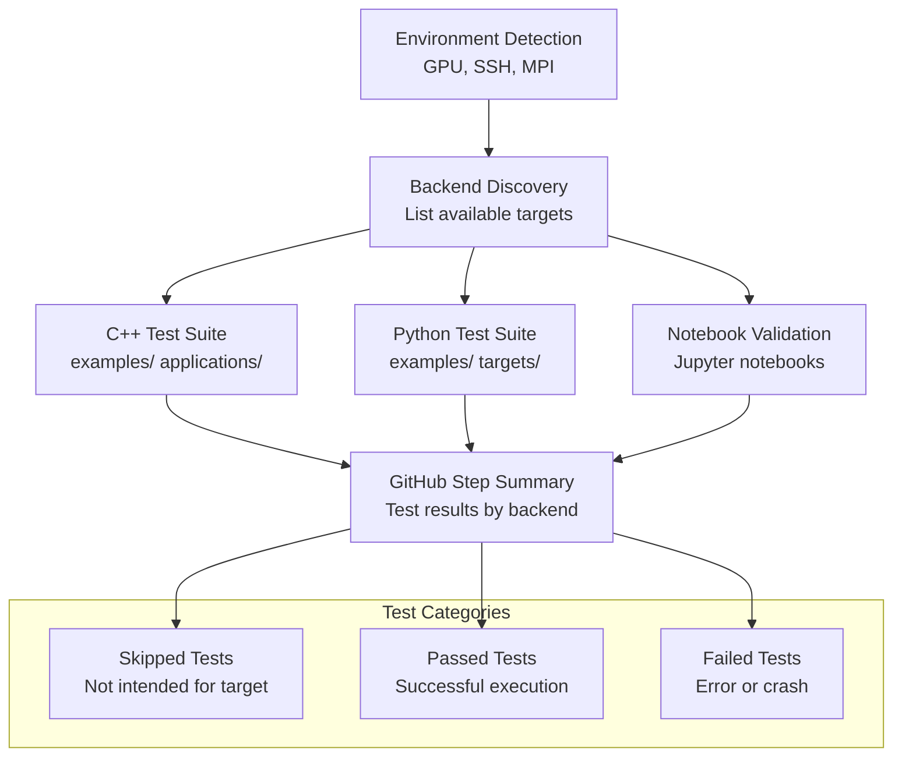
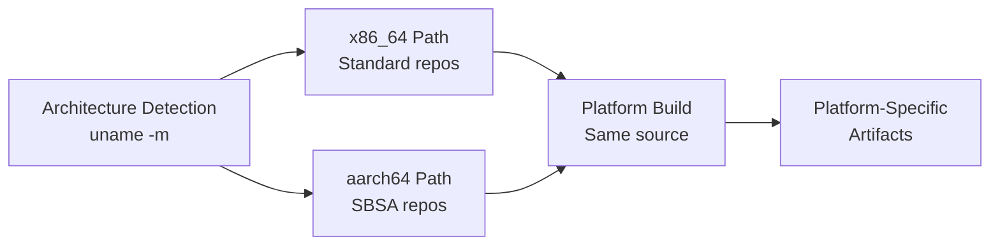

<!-- source: DeepWiki mcp.deepwiki.com · repo NVIDIA/cuda-quantum · page 7 Building and Distribution · fetched 2026-10-26 -->

# Building and Distribution

<details>
<summary>Relevant source files</summary>

The following files were used as context for generating this wiki page:

- [.devcontainer/devcontainer.json](.devcontainer/devcontainer.json)
- [.github/actions/run-in-docker/action.yml](.github/actions/run-in-docker/action.yml)
- [.github/codecov.yml](.github/codecov.yml)
- [.github/workflows/command_dispatch.yml](.github/workflows/command_dispatch.yml)
- [.github/workflows/config/spellcheck_config.yml](.github/workflows/config/spellcheck_config.yml)
- [.github/workflows/config/spelling_allowlist.txt](.github/workflows/config/spelling_allowlist.txt)
- [.github/workflows/repo_checks.yml](.github/workflows/repo_checks.yml)
- [SECURITY.md](SECURITY.md)
- [docker/build/assets.Dockerfile](docker/build/assets.Dockerfile)
- [docker/build/devdeps.Dockerfile](docker/build/devdeps.Dockerfile)
- [docker/build/devdeps.ext.Dockerfile](docker/build/devdeps.ext.Dockerfile)
- [docker/build/devdeps.manylinux.Dockerfile](docker/build/devdeps.manylinux.Dockerfile)
- [docker/release/cudaq.Dockerfile](docker/release/cudaq.Dockerfile)
- [docker/release/cudaq.ext.Dockerfile](docker/release/cudaq.ext.Dockerfile)
- [docker/release/cudaq.wheel.Dockerfile](docker/release/cudaq.wheel.Dockerfile)
- [docker/test/installer/runtime_dependencies.sh](docker/test/installer/runtime_dependencies.sh)
- [docs/sphinx/releases.rst](docs/sphinx/releases.rst)
- [docs/sphinx/using/backends/cloud.rst](docs/sphinx/using/backends/cloud.rst)
- [pyproject.toml](pyproject.toml)
- [scripts/build_llvm.sh](scripts/build_llvm.sh)
- [scripts/configure_build.sh](scripts/configure_build.sh)
- [scripts/generate_cc.sh](scripts/generate_cc.sh)
- [scripts/install_toolchain.sh](scripts/install_toolchain.sh)
- [scripts/validate_container.sh](scripts/validate_container.sh)

</details>


This document describes CUDA-Q's build system architecture, packaging strategies, and distribution channels. It covers the multi-stage Docker build hierarchy, Python wheel generation with manylinux compatibility, and dependency management for both development and release environments.

For information about CI/CD pipelines and automated testing, see [CI/CD Infrastructure](#8). For installation instructions from a user perspective, see the releases documentation.

---

## Build System Overview

CUDA-Q employs a sophisticated multi-stage build system designed to produce portable binaries that work across a range of Linux distributions. The build process separates development dependencies from runtime dependencies and generates multiple distribution artifacts targeting different deployment scenarios.

### Build Artifact Types

The build system produces three primary artifact types:

| Artifact Type | Description | Distribution Channel |
|--------------|-------------|---------------------|
| **Docker Images** | Complete runtime environments with CUDA-Q installed | NGC Catalog (`nvcr.io/nvidia`) |
| **Python Wheels** | Python packages with pre-compiled binaries | PyPI (`cudaq` package) |
| **C++ Installers** | Standalone CUDA-Q SDK for C++ development | GitHub Releases |

**Key Design Principle**: All binaries are built against **glibc 2.28** on AlmaLinux 8 to ensure maximum compatibility with modern Linux distributions while avoiding dependencies on specific GCC versions.

Sources: [docs/sphinx/releases.rst:1-251](), [pyproject.toml:1-85]()

---

## Docker Build Hierarchy

The Docker build system uses a four-stage hierarchy to separate concerns and enable efficient caching:



### Stage 1: Development Dependencies (`devdeps`)

The `devdeps` image establishes the compiler toolchain and builds LLVM/MLIR from source. This stage is crucial because **CUDA-Q must be built with the same toolchain used to build its LLVM dependencies**.

**Key Environment Variables**:
- `LLVM_INSTALL_PREFIX=/usr/local/llvm` - LLVM installation location
- `CUDAQ_INSTALL_PREFIX=/usr/local/cudaq` - Target CUDA-Q installation
- `CC` and `CXX` - Compiler wrappers pointing to selected toolchain

**Supported Toolchains**:
- `gcc11`, `gcc12` - GCC compiler suite
- `clang15`, `clang16` - Clang/LLVM compilers
- `llvm` - Build LLVM from source

The toolchain is installed via `install_toolchain.sh` and LLVM is built with specific projects enabled based on requirements:

```
LLVM_PROJECTS='clang;lld;mlir;python-bindings;compiler-rt'
```

Sources: [docker/build/devdeps.Dockerfile:1-175](), [scripts/install_toolchain.sh:1-187]()

### Stage 2: Extended Development Dependencies (`devdeps.ext`)

The extended image adds GPU-specific dependencies by copying pre-built components from a separate OpenMPI development image:

**Copied Components**:
- **OpenMPI** with CUDA support (`$OPENMPI_INSTALL_PREFIX`)
- **UCX** (Unified Communication X) for high-performance networking
- **GDRCOPY** for GPU Direct RDMA
- **PMI2** and **PMIx** for SLURM integration
- **Mellanox OFED** runtime libraries

**CUDA Packages Installed**:
```
cuda-cudart cuda-nvrtc cuda-compiler libcublas libcurand libcusolver libcusparse
```

The CUDA version is parameterized via `ARG cuda_version=12.6`, allowing builds for different CUDA releases.

**cuQuantum Installation**:
The image installs cuQuantum and cuTensor via pip:
```python
python3 -m pip install cupy-cuda$(echo $CUDA_VERSION | cut -d . -f1)x==13.4.1
python3 -m pip install cuquantum-cu$(echo $CUDA_VERSION | cut -d . -f1)==25.09.1
```

Sources: [docker/build/devdeps.ext.Dockerfile:1-203]()

### Stage 3: Build Assets (`assets`)

The assets stage compiles CUDA-Q from source in a clean AlmaLinux 8 environment. This stage is split into separate C++ and Python builds:



**C++ Build Process** [docker/build/assets.Dockerfile:124-135]():
```bash
CUDAQ_ENABLE_STATIC_LINKING=TRUE \
CUDAQ_REQUIRE_OPENMP=TRUE \
CUDAQ_WERROR=TRUE \
CUDAQ_PYTHON_SUPPORT=OFF \
LLVM_PROJECTS='clang;flang;lld;mlir;openmp;runtimes' \
bash scripts/build_cudaq.sh -t llvm -v
```

**Key Build Flags**:
- `CUDAQ_ENABLE_STATIC_LINKING=TRUE` - Statically link libc++ for portability
- `CUDAQ_REQUIRE_OPENMP=TRUE` - Enable OpenMP support
- `CUDAQ_WERROR=TRUE` - Treat warnings as errors

**Python Build Process** [docker/build/assets.Dockerfile:204-211]():
```bash
LLVM_PROJECTS='clang;flang;lld;mlir;python-bindings;openmp;runtimes' \
bash scripts/install_prerequisites.sh -t llvm
CC="$LLVM_INSTALL_PREFIX/bin/clang" \
CXX="$LLVM_INSTALL_PREFIX/bin/clang++" \
FC="$LLVM_INSTALL_PREFIX/bin/flang-new" \
python3 -m build --wheel
```

The Python build uses MLIR Python bindings and generates a wheel that is then repaired with `auditwheel` for manylinux compatibility.

Sources: [docker/build/assets.Dockerfile:1-336]()

### Stage 4: Release Images (`cudaq` and `cudaq.ext`)

The base release image (`cudaq.Dockerfile`) creates a minimal runtime environment:



**Copied Components from Build Stage**:
- `/usr/local/cudaq/` - Complete CUDA-Q installation
- `/usr/local/cudaq_assets/llvm/` - Clang compiler and linker tools
- LLVM tools: `clang`, `clang++`, `llc`, `lld`, `ld.lld`

**Asset Migration**:
The build produces an XML manifest describing expected file locations. The `migrate_assets.sh` script processes this manifest to copy dependencies to their expected locations [docker/release/cudaq.Dockerfile:82-85]():

```bash
bash "$CUDA_QUANTUM_PATH/bin/migrate_assets.sh" -s "$CUDA_QUANTUM_PATH/assets"
```

The extended release image adds development conveniences:
- **JupyterLab** for notebook environments
- **VS Code integration** via helper scripts
- **MPI4Py** for distributed computing (if MPI is available)
- Examples and documentation

Sources: [docker/release/cudaq.Dockerfile:1-136](), [docker/release/cudaq.ext.Dockerfile:1-92]()

---

## Python Wheel Distribution

Python wheels are built using `scikit-build-core` with a custom build process that integrates CMake compilation into the Python packaging workflow.

### Wheel Build Architecture



### Package Variants by CUDA Version

CUDA-Q distributes separate wheels for different CUDA major versions:

| Package Name | CUDA Version | Python Versions | Target |
|-------------|--------------|-----------------|--------|
| `cuda-quantum-cu12` | CUDA 12.x | 3.11, 3.12, 3.13 | Legacy (deprecating) |
| `cuda-quantum-cu13` | CUDA 13.x | 3.11, 3.12, 3.13 | Current |

The package configuration is managed through templated `pyproject.toml` files:
- [pyproject.toml.cu12]() - CUDA 12 configuration
- [pyproject.toml.cu13]() - CUDA 13 configuration (shown in file listing as [pyproject.toml:1-85]())

**CUDA 13 Dependencies** [pyproject.toml:19-34]():
```toml
dependencies = [
  'custatevec-cu13 ~= 1.10',
  'cutensornet-cu13 ~= 2.9',
  'cudensitymat-cu13 ~= 0.3',  
  'numpy >= 1.24',
  'scipy >= 1.10.1',
  'nvidia-cublas ~= 13.0',
  'nvidia-curand ~= 10.4',
  'nvidia-cuda-runtime ~= 13.0',
]
```

Sources: [pyproject.toml:1-85]()

### Wheel Repair and manylinux Compatibility

The `auditwheel` tool repairs wheels to meet manylinux standards by:

1. **Bundling shared libraries** not provided by the platform
2. **Setting appropriate RPATH** values
3. **Excluding platform libraries** that should not be bundled

**Excluded Libraries** [docker/release/cudaq.wheel.Dockerfile:79-91]():
```bash
python -m auditwheel -v repair dist/cuda_quantum*linux_*.whl \
    --exclude libcustatevec.so.1 \
    --exclude libcutensornet.so.2 \
    --exclude libcudensitymat.so.0 \
    --exclude libcublas.so.$cudaq_major \
    --exclude libcurand.so.10 \
    --exclude libcudart.so.$cudart_libsuffix \
    --exclude libcuda.so.1
```

These exclusions ensure that:
- **cuQuantum libraries** come from pip packages (not bundled)
- **CUDA runtime** comes from system installation
- **Driver libraries** come from NVIDIA driver

The result is a wheel tagged as `manylinux_2_28_x86_64` or `manylinux_2_28_aarch64`, indicating compatibility with systems using glibc 2.28 or newer.

Sources: [docker/release/cudaq.wheel.Dockerfile:1-95](), [docker/build/assets.Dockerfile:219-238]()

### Metapackage System

The published PyPI package `cudaq` is a **metapackage** that depends on the appropriate CUDA-version-specific package. This allows users to install with:

```bash
pip install cudaq
```

And automatically receive the correct variant based on their environment.

Sources: [docs/sphinx/releases.rst:23-25]()

---

## Build Scripts and Dependency Management

Three primary scripts orchestrate the build process:

### `configure_build.sh` - Environment Setup

This script defines installation prefixes and provides functions for installing dependencies [scripts/configure_build.sh:13-23]():

```bash
export CUDAQ_INSTALL_PREFIX=/usr/local/cudaq
export CUQUANTUM_INSTALL_PREFIX=/usr/local/cuquantum
export CUTENSOR_INSTALL_PREFIX=/usr/local/cutensor
export LLVM_INSTALL_PREFIX=/usr/local/llvm
export BLAS_INSTALL_PREFIX=/usr/local/blas
export ZLIB_INSTALL_PREFIX=/usr/local/zlib
export OPENSSL_INSTALL_PREFIX=/usr/local/openssl
export CURL_INSTALL_PREFIX=/usr/local/curl
export AWS_INSTALL_PREFIX=/usr/local/aws
```

**Supported Operations**:
- `install-cuda` - Installs CUDA toolkit [scripts/configure_build.sh:30-43]()
- `install-cudart` - Installs CUDA runtime only [scripts/configure_build.sh:50-70]()
- `install-cuquantum` - Downloads and extracts cuQuantum [scripts/configure_build.sh:77-86]()
- `install-cutensor` - Downloads and extracts cuTensor [scripts/configure_build.sh:93-101]()
- `install-gcc` - Installs GCC toolset [scripts/configure_build.sh:105-115]()
- `build-openmpi` - Builds OpenMPI from source [scripts/configure_build.sh:129-147]()

**CUDA Installation Example** [scripts/configure_build.sh:30-43]():
```bash
CUDA_VERSION=${CUDA_VERSION:-12.6}
CUDA_DOWNLOAD_URL=https://developer.download.nvidia.com/compute/cuda/repos
dnf config-manager --add-repo "${CUDA_DOWNLOAD_URL}/${DISTRIBUTION}/${CUDA_ARCH_FOLDER}/cuda-${DISTRIBUTION}.repo"
dnf install -y --nobest --setopt=install_weak_deps=False \
    cuda-toolkit-$(echo ${CUDA_VERSION} | tr . -)
```

Sources: [scripts/configure_build.sh:1-151]()

### `install_toolchain.sh` - Compiler Setup

Installs and configures the C/C++ compiler toolchain, exporting `CC`, `CXX`, and `FC` environment variables.

**Supported Toolchains**:
- `gcc11`, `gcc12` - GCC via distribution packages
- `clang16` - Clang 16 from LLVM apt repository
- `llvm` - Builds complete LLVM toolchain from source

**GCC Installation** [scripts/install_toolchain.sh:61-84]():
```bash
if [ "${toolchain#gcc}" != "$toolchain" ]; then
    gcc_version=${toolchain#gcc}
    if [ -x "$(command -v apt-get)" ]; then
        apt-get install -y gcc-$gcc_version g++-$gcc_version gfortran-$gcc_version
        CC="$(find_executable gcc-$gcc_version)" 
        CXX="$(find_executable g++-$gcc_version)" 
    elif [ -x "$(command -v dnf)" ]; then
        dnf install -y gcc-toolset-$gcc_version
        enable_script=`find / -path '*gcc*' -path '*'$gcc_version'*' -name enable`
        . "$enable_script"
    fi
fi
```

The `llvm` option bootstraps an LLVM build using Clang 16, then replaces the bootstrap compiler with the newly built one.

Sources: [scripts/install_toolchain.sh:1-187]()

### `build_llvm.sh` - LLVM Compilation

Builds LLVM with custom patches and selective component installation to minimize build size.

**Component Selection** [scripts/build_llvm.sh:135-187]():
```bash
if [ -z "${llvm_projects##*clang;*}" ]; then
  llvm_components+="clang;clang-format;clang-cmake-exports;clang-headers;clang-libraries;"
fi
if [ -z "${llvm_projects##*mlir;*}" ]; then
  llvm_components+="mlir-cmake-exports;mlir-headers;mlir-libraries;mlir-tblgen;"
  if [ "$mlir_python_bindings" == "ON" ]; then
    llvm_components+="MLIRPythonModules;mlir-python-sources;"
  fi
fi
if [ -z "${llvm_projects##*lld;*}" ]; then
  llvm_enable_zlib=ON
  llvm_components+="lld;"
fi
```

**Build Process**:
1. Clone/update LLVM repository
2. Apply custom patches from `tpls/customizations/llvm/`
3. Generate CMake files with distribution components
4. Build and install selected components
5. Build runtime libraries (libc++, compiler-rt) if requested

**CMake Configuration** [scripts/build_llvm.sh:219-231]():
```bash
cmake_args=" \
  -DLLVM_DEFAULT_TARGET_TRIPLE='$(bash $LLVM_SOURCE/llvm/cmake/config.guess)' \
  -DCMAKE_BUILD_TYPE=$build_configuration \
  -DCMAKE_INSTALL_PREFIX='$LLVM_INSTALL_PREFIX' \
  -DLLVM_ENABLE_PROJECTS='${llvm_projects%;}' \
  -DLLVM_ENABLE_RUNTIMES='${llvm_runtimes%;}' \
  -DLLVM_DISTRIBUTION_COMPONENTS='${llvm_components%;}' \
  -DLLVM_ENABLE_ZLIB=${llvm_enable_zlib:-OFF}"
```

Sources: [scripts/build_llvm.sh:1-327]()

---

## Container Validation

The `validate_container.sh` script provides comprehensive testing of built containers and wheels across multiple backend targets.

### Validation Architecture



### Backend Selection Logic

The script filters available backends based on hardware and configuration [scripts/validate_container.sh:66-90]():

```bash
available_backends=`
    echo "default"
    for file in $(ls $CUDA_QUANTUM_PATH/targets/*.yml); do
        platform=$(cat $file | grep "platform-qpu:")
        qpu=${platform##* }
        requirements=$(cat $file | grep "gpu-requirements:")
        gpus=${requirements##* }
        if [ "${qpu}" != "remote_rest" ] \
        && ($gpu_available || [ -z "$gpus" ] || [ "${gpus,,}" == "false" ]); then
            basename $file | cut -d "." -f 1
        fi
    done`
```

This logic:
- Includes `default` backend
- Scans YAML configurations in `$CUDA_QUANTUM_PATH/targets/`
- Excludes `remote_rest` backends (require credentials)
- Checks GPU availability against `gpu-requirements` field
- Filters backends based on requested test list

### C++ Example Testing

For each C++ example, the script [scripts/validate_container.sh:146-277]():

1. **Reads intended target** from file comments:
   ```cpp
   // nvq++ --target nvidia example.cpp
   ```
2. **Compiles with nvq++** for each backend
3. **Executes binary** and captures exit code
4. **Categorizes result** as passed, failed, or skipped

**Target-Specific Options**:
For backends supporting multiple configurations (e.g., `nvidia`), the script tests each option [scripts/validate_container.sh:226-231]():
```bash
declare -A target_options=(
    [nvidia]="fp32 fp64 fp32,mqpu fp64,mqpu fp32,mgpu fp64,mgpu"
    [tensornet]="fp32 fp64"
    [tensornet-mps]="fp32 fp64"
)
```

### Python Example Testing

Python examples are tested by:
1. **Scanning for explicit target setting**: `cudaq.set_target("...")`
2. **Skipping if required backend unavailable**
3. **Executing with Python 3** and checking exit code

Special handling for examples requiring credentials (Braket, QuEra) [scripts/validate_container.sh:316-320]():
```bash
if [ "$t" == "quera" ] || [ "$t" == "braket" ] ; then 
    echo "Explicitly set target braket or quera; skipping validation due to paid submission."
    skip_example=true
fi
```

### Notebook Validation

Notebooks receive special treatment with a dedicated virtual environment [scripts/validate_container.sh:347-402]():

1. **Create venv** with system packages inherited
2. **Install Jupyter kernel** infrastructure
3. **Register custom kernel** for notebook execution
4. **Execute notebooks** via `notebook_validation.py`
5. **Cleanup** venv and kernel after testing

This isolation ensures notebooks can install their own dependencies without polluting the container environment.

Sources: [scripts/validate_container.sh:1-455]()

---

## Dependency Version Matrix

### Core Dependencies

| Component | Version | Source | Notes |
|-----------|---------|--------|-------|
| **LLVM/MLIR** | Custom (16.x base) | Built from source | Patched for CUDA-Q |
| **cuQuantum** | 25.09.1 | pip (cu12/cu13 variants) | State vector simulation |
| **cuTensor** | 2.3.1.0 | pip (cu12/cu13 variants) | Tensor network simulation |
| **cuDensityMat** | 0.3 | pip (cu12/cu13 variants) | Density matrix simulation |
| **CuPy** | 13.4.1 (cu12), 13.6.0 (cu13) | pip | GPU array operations |

### Build Dependencies

| Component | Version | Purpose |
|-----------|---------|---------|
| **CMake** | 3.28.4 | Build system generator |
| **Ninja** | Latest | Build execution |
| **GCC Toolset** | 11 (default) | Host compiler |
| **Python** | 3.11+ | Bindings and packaging |

### Runtime Dependencies (C++ Installer)

The C++ installer requires [docker/test/installer/runtime_dependencies.sh:43-59]():
```bash
## [C development headers]
apt-get install -y ${LIBCDEV_PACKAGE}

## [CUDA runtime libraries]
apt-get install -y cuda-cudart cuda-nvrtc libcusolver libcublas libcurand libcusparse
```

For systems with CUDA 12+, also requires `libnvjitlink`.

Sources: [docker/build/devdeps.ext.Dockerfile:178-189](), [pyproject.toml:19-34]()

---

## Distribution Channels

### NGC Catalog (Docker Images)

Docker images are published to NVIDIA GPU Cloud:

**Image Naming Convention**:
```
nvcr.io/nvidia/[nightly/]cuda-quantum[:tag]
```

**Available Tags**:
- `latest` - Latest stable release
- `cu12-latest` - Latest with CUDA 12
- `cu13-latest` - Latest with CUDA 13  
- `<version>` - Specific version (e.g., `0.13.0`)

**Image Variants**:
- Base image: `cuda-quantum` - Minimal runtime
- Extended image: `cuda-quantum:latest-ext` - Includes JupyterLab and examples

Sources: [docs/sphinx/releases.rst:8-12]()

### PyPI (Python Wheels)

Python packages are published to the Python Package Index:

**Package Names**:
- `cudaq` - Metapackage (auto-selects CUDA version)
- `cuda-quantum-cu12` - CUDA 12.x variant
- `cuda-quantum-cu13` - CUDA 13.x variant

**Installation**:
```bash
pip install cudaq                    # Automatic selection
pip install cuda-quantum-cu13        # Explicit CUDA 13
```

**Platform Support**:
- `manylinux_2_28_x86_64` - Intel/AMD 64-bit
- `manylinux_2_28_aarch64` - ARM 64-bit

Sources: [docs/sphinx/releases.rst:23-25]()

### GitHub Releases (C++ Installers)

C++ SDK installers are distributed as `.tar.gz` archives via GitHub Releases:

**Package Structure**:
```
cudaq-<version>-<platform>.tar.gz
├── bin/          # nvq++, cudaq-* tools
├── lib/          # Shared libraries
├── include/      # C++ headers
├── targets/      # Backend configurations
└── examples/     # Sample code
```

**Installation Process**:
1. Download tarball from GitHub release page
2. Extract to desired location
3. Install runtime dependencies (CUDA libraries)
4. Set environment variables

Sources: [docs/sphinx/releases.rst:25-27](), [docker/release/cudaq.Dockerfile:75-91]()

---

## Build Configuration Files

### Key Configuration Files

| File | Purpose | Key Settings |
|------|---------|--------------|
| `pyproject.toml` | Python package metadata | Dependencies, build backend, versioning |
| `.devcontainer/devcontainer.json` | VS Code dev container | Extensions, environment, GPU passthrough |
| `cmake/caches/LLVM.cmake` | LLVM CMake cache | Component selection, optimization flags |

### CMake Build Options

CUDA-Q CMake build supports several configuration options:

**Python Support** [pyproject.toml:76-80]():
```cmake
-DCUDAQ_ENABLE_PYTHON=TRUE
-DCUDAQ_DISABLE_CPP_FRONTEND=TRUE  # Python-only build
-DCUDAQ_DISABLE_TOOLS=TRUE          # Skip command-line tools
-DCUDAQ_BUILD_TESTS=TRUE            # Include test suite
```

**Static Linking** [docker/build/assets.Dockerfile:129-132]():
```bash
CUDAQ_ENABLE_STATIC_LINKING=TRUE    # Statically link libc++
CUDAQ_REQUIRE_OPENMP=TRUE           # Enable OpenMP
CUDAQ_WERROR=TRUE                   # Warnings as errors
```

Sources: [pyproject.toml:76-80](), [.devcontainer/devcontainer.json:1-272]()

---

## Multi-Platform Build Strategy

CUDA-Q supports both x86_64 and aarch64 architectures through conditional build logic:



**Architecture-Specific Handling** [docker/build/assets.Dockerfile:143]():
```bash
arch_folder=$([ "$(uname -m)" == "aarch64" ] && echo sbsa || echo x86_64)
cuda_packages=$(echo "$cuda_packages" | tr ' ' '\n' | xargs -I {} echo {}-$(echo ${CUDA_VERSION} | cut -d. -f1-2 | tr . -))
```

This determines:
- Which CUDA repository to use (`sbsa` vs `x86_64`)
- Package naming conventions
- Optimization flags

Both architectures produce compatible binaries from the same source code, differing only in compiled object code.

Sources: [docker/build/assets.Dockerfile:143](), [scripts/configure_build.sh:28-29]()

---

