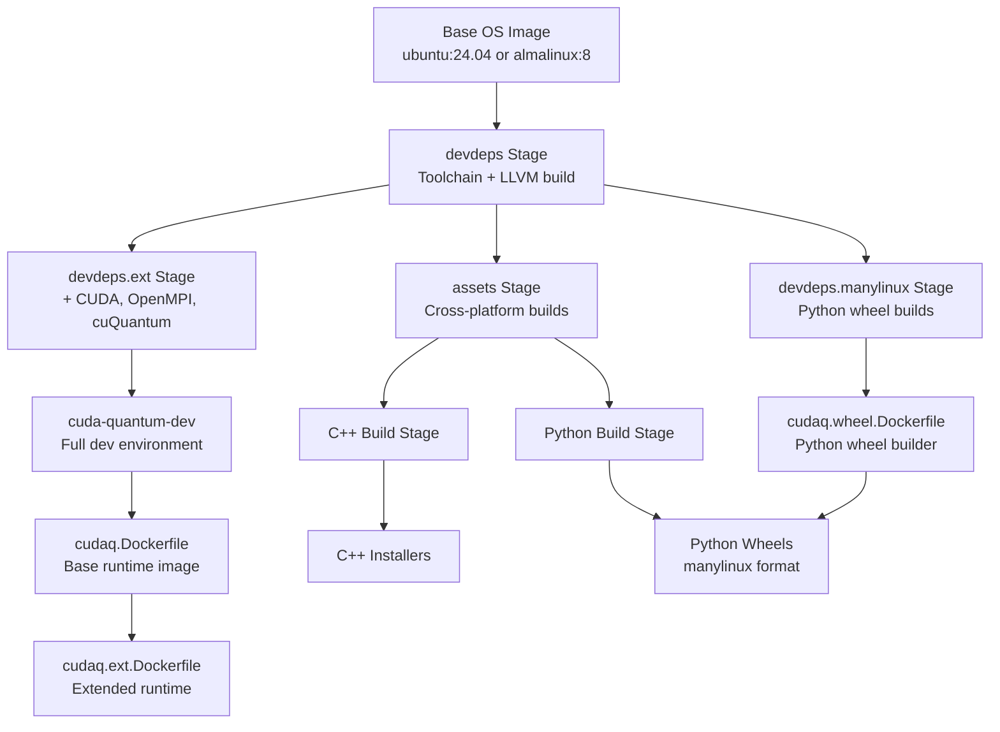
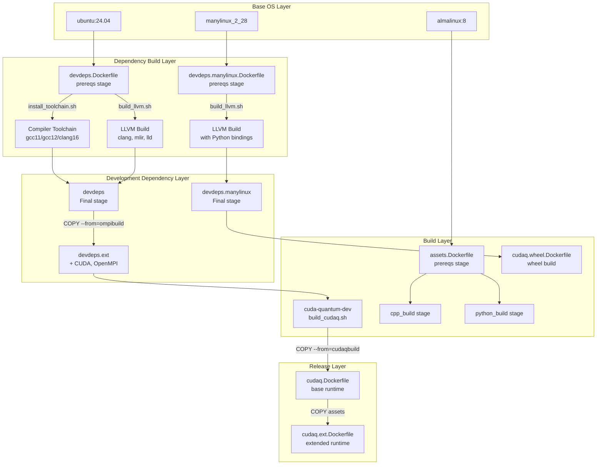
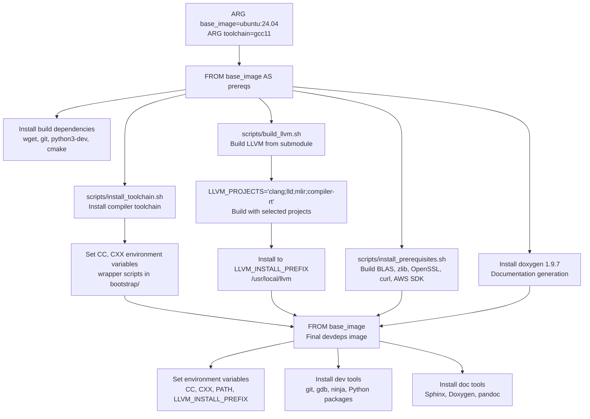
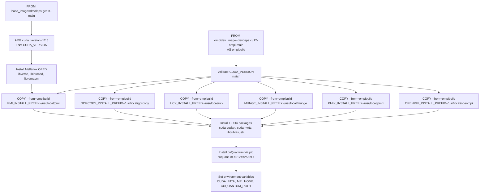
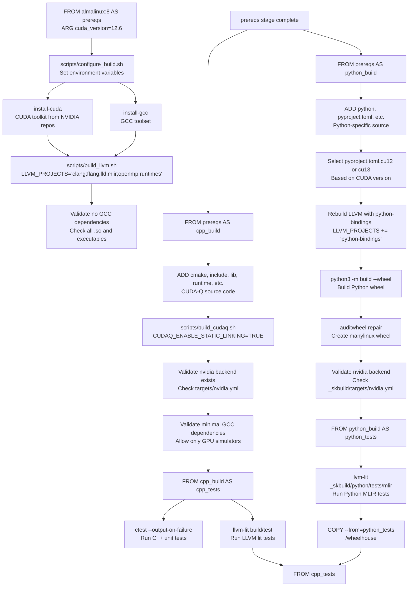
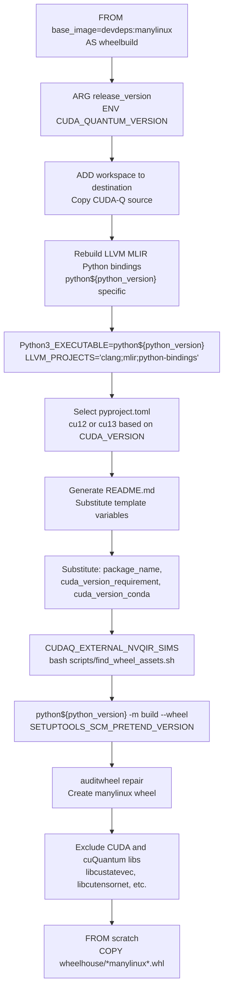
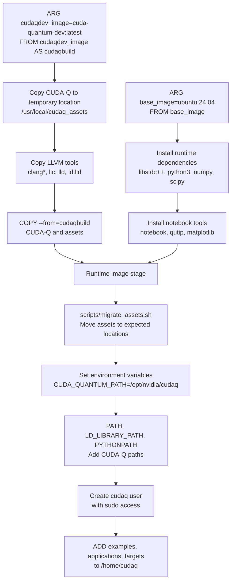
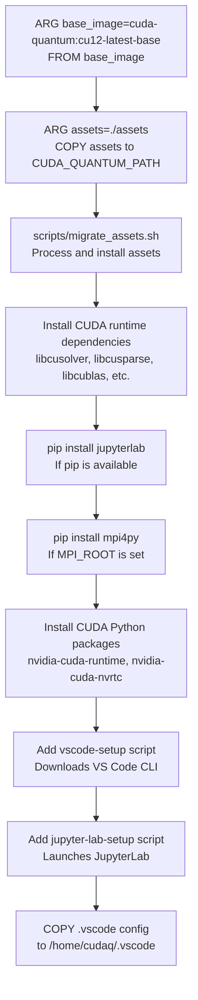
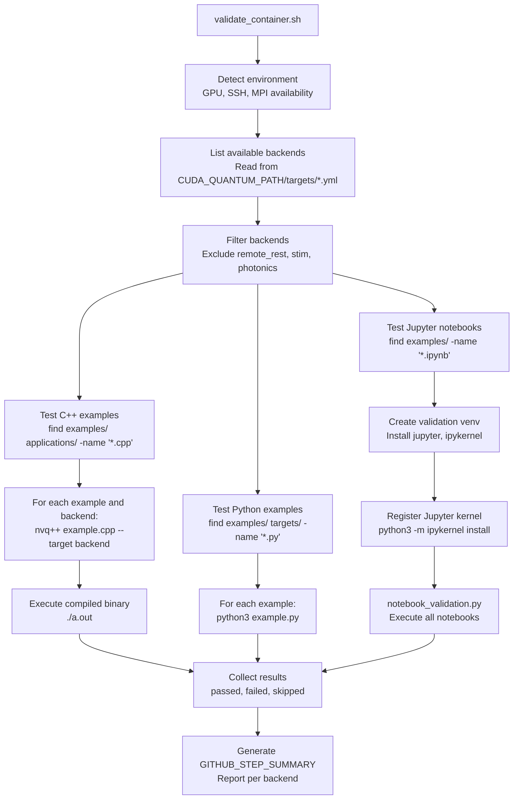

<!-- source: DeepWiki mcp.deepwiki.com · repo NVIDIA/cuda-quantum · page 7.1 Docker Build System · fetched 2026-10-26 -->

## Image Tagging and Registry Conventions

Docker images use a consistent naming and tagging convention across registries.

**Image Naming Convention**

Development and build images (GitHub Container Registry):
```
ghcr.io/nvidia/cuda-quantum-<stage>:<platform>-cu<cuda_ver>-<toolchain>-<tag>
```

Runtime images (NVIDIA GPU Cloud):
```
nvcr.io/nvidia/cuda-quantum:<cuda_ver>-<tag>
nvcr.io/nvidia/nightly/cuda-quantum:<cuda_ver>-<tag>
```

**Tag Components**

| Component | Description | Examples |
|-----------|-------------|----------|
| `<stage>` | Build stage name | `devdeps`, `devdeps-ext`, `assets`, `dev` |
| `<platform>` | Target architecture | `amd64`, `arm64`, `multiarch` |
| `<cuda_ver>` | CUDA major version | `cu11`, `cu12`, `cu13` |
| `<toolchain>` | Compiler toolchain | `gcc11`, `gcc12`, `clang16`, `llvm` |
| `<tag>` | Version identifier | `latest`, `main`, `0.9.0`, `pr-1234` |

**Example Image References**

Development dependencies:
- `ghcr.io/nvidia/cuda-quantum-devdeps:amd64-cu12-gcc11-main`
- `ghcr.io/nvidia/cuda-quantum-devdeps:arm64-cu12-gcc12-latest`

Extended dependencies:
- `ghcr.io/nvidia/cuda-quantum-devdeps:ext-main`
- `ghcr.io/nvidia/cuda-quantum-devdeps:amd64-cu13-gcc11-ext-main`

Asset builds:
- `ghcr.io/nvidia/cuda-quantum-assets:amd64-cu12-llvm-main`
- `ghcr.io/nvidia/cuda-quantum-assets:arm64-cu12-llvm-0.9.0`

Runtime images:
- `nvcr.io/nvidia/cuda-quantum:cu12-latest`
- `nvcr.io/nvidia/nightly/cuda-quantum:cu12-latest-base`
- `nvcr.io/nvidia/cuda-quantum:0.9.0`

**Special Tag Meanings**

- `latest`: Most recent stable release
- `main`: Current development version from main branch
- `pr-<number>`: Build from pull request (for testing)
- `<version>`: Official semantic version release (e.g., `0.9.0`)
- `nightly`: Nightly automated builds from main branch

Sources: [docker/build/devdeps.Dockerfile:16](), [docker/build/devdeps.ext.Dockerfile:17](), [docker/release/cudaq.Dockerfile:19](), [docker/release/cudaq.ext.Dockerfile:9]()
# Docker Build System

<details>
<summary>Relevant source files</summary>

The following files were used as context for generating this wiki page:

- [.devcontainer/devcontainer.json](.devcontainer/devcontainer.json)
- [.github/actions/run-in-docker/action.yml](.github/actions/run-in-docker/action.yml)
- [.github/codecov.yml](.github/codecov.yml)
- [docker/build/assets.Dockerfile](docker/build/assets.Dockerfile)
- [docker/build/devdeps.Dockerfile](docker/build/devdeps.Dockerfile)
- [docker/build/devdeps.ext.Dockerfile](docker/build/devdeps.ext.Dockerfile)
- [docker/build/devdeps.manylinux.Dockerfile](docker/build/devdeps.manylinux.Dockerfile)
- [docker/release/cudaq.Dockerfile](docker/release/cudaq.Dockerfile)
- [docker/release/cudaq.ext.Dockerfile](docker/release/cudaq.ext.Dockerfile)
- [docker/release/cudaq.wheel.Dockerfile](docker/release/cudaq.wheel.Dockerfile)
- [docker/test/installer/runtime_dependencies.sh](docker/test/installer/runtime_dependencies.sh)
- [pyproject.toml](pyproject.toml)
- [scripts/build_llvm.sh](scripts/build_llvm.sh)
- [scripts/configure_build.sh](scripts/configure_build.sh)
- [scripts/generate_cc.sh](scripts/generate_cc.sh)
- [scripts/install_toolchain.sh](scripts/install_toolchain.sh)
- [scripts/validate_container.sh](scripts/validate_container.sh)

</details>


This page documents the Docker build system for CUDA-Q, explaining the multi-stage build hierarchy, image dependencies, and how the build process creates development, asset, and release images. For information about using Docker images or building CUDA-Q from source outside of Docker, see related pages.

## Overview

The CUDA-Q Docker build system uses a multi-stage approach to create a hierarchy of images, each serving a specific purpose in the build and distribution pipeline. The system is designed to:

1. Minimize build times through efficient layer caching and reuse
2. Create reproducible builds across different architectures (amd64, arm64)
3. Support multiple CUDA versions (11.8, 12.x, 13.x) and compiler toolchains
4. Generate both development environments and minimal runtime images
5. Build distributable artifacts (installers and Python wheels)

**Multi-Stage Build Hierarchy**



The build system separates concerns into distinct stages:
- **devdeps**: Development dependencies and toolchain
- **assets**: Cross-platform binary builds
- **release**: Runtime images for end users

Sources: [docker/build/devdeps.Dockerfile](), [docker/build/devdeps.ext.Dockerfile](), [docker/build/assets.Dockerfile](), [docker/release/cudaq.Dockerfile](), [docker/release/cudaq.ext.Dockerfile](), [docker/build/devdeps.manylinux.Dockerfile]()

## Build Stage Overview

The Docker build system consists of several specialized build stages:

| Build Stage | Dockerfile | Purpose | Key Components |
|-------------|-----------|---------|----------------|
| **devdeps** | `devdeps.Dockerfile` | Base development dependencies | Toolchain, LLVM, CMake, Python dev |
| **devdeps.ext** | `devdeps.ext.Dockerfile` | Extended dev dependencies | + CUDA, OpenMPI, cuQuantum, cuTensor |
| **devdeps.manylinux** | `devdeps.manylinux.Dockerfile` | Python wheel build environment | manylinux base, LLVM Python bindings |
| **assets** | `assets.Dockerfile` | Cross-platform C++ and Python builds | Full CUDA-Q build from source |
| **cudaq** | `cudaq.Dockerfile` | Base runtime image | Minimal CUDA-Q runtime |
| **cudaq.ext** | `cudaq.ext.Dockerfile` | Extended runtime image | + JupyterLab, VS Code integration |
| **cudaq.wheel** | `cudaq.wheel.Dockerfile` | Python wheel builder | Uses devdeps.manylinux |

Each stage is available for multiple architectures (amd64, arm64) and CUDA versions (11.8, 12.x, 13.x).

Sources: [docker/build/devdeps.Dockerfile](), [docker/build/devdeps.ext.Dockerfile](), [docker/build/devdeps.manylinux.Dockerfile](), [docker/build/assets.Dockerfile](), [docker/release/cudaq.Dockerfile](), [docker/release/cudaq.ext.Dockerfile](), [docker/release/cudaq.wheel.Dockerfile]()

## Build Dependencies and Flow

The Docker build system follows a specific dependency flow, where earlier stages provide dependencies for later stages.

**Build Dependency Graph**



The build process uses multi-stage builds to:
1. Build dependencies in isolated stages
2. Copy only necessary artifacts between stages
3. Keep final images minimal by excluding build tools

Sources: [docker/build/devdeps.Dockerfile:25-175](), [docker/build/devdeps.ext.Dockerfile:22-203](), [docker/build/assets.Dockerfile:19-336](), [docker/release/cudaq.Dockerfile:25-86](), [docker/release/cudaq.ext.Dockerfile:9-92]()

## Development Dependencies Stage (devdeps)

The `devdeps.Dockerfile` builds the foundation for all CUDA-Q development environments. It uses a two-stage approach: a `prereqs` stage that builds dependencies, and a final stage that creates a clean development environment.

**devdeps.Dockerfile Build Process**



**Key Build Arguments and Environment Variables**

The devdeps stage accepts these build arguments:
- `base_image`: Base OS image (default: `ubuntu:24.04`)
- `toolchain`: Compiler toolchain (default: `gcc11`, options: `gcc11`, `gcc12`, `clang16`, `llvm`)

Environment variables set in the final stage:
```bash
LLVM_INSTALL_PREFIX=/usr/local/llvm
BLAS_INSTALL_PREFIX=/usr/local/blas
ZLIB_INSTALL_PREFIX=/usr/local/zlib
OPENSSL_INSTALL_PREFIX=/usr/local/openssl
CURL_INSTALL_PREFIX=/usr/local/curl
AWS_INSTALL_PREFIX=/usr/local/aws
CC="$LLVM_INSTALL_PREFIX/bootstrap/cc"
CXX="$LLVM_INSTALL_PREFIX/bootstrap/cxx"
```

**LLVM Build Configuration**

The LLVM build is controlled by [scripts/build_llvm.sh]() and uses a CMake cache file at [cmake/caches/LLVM.cmake]():

```bash
LLVM_PROJECTS='clang;lld;mlir;python-bindings;compiler-rt' \
    bash /cuda-quantum/scripts/install_prerequisites.sh -t ${toolchain}
```

The compiler-rt project is built to support code coverage tools.

Sources: [docker/build/devdeps.Dockerfile:1-175](), [docker/build/devdeps.Dockerfile:44-66](), [docker/build/devdeps.Dockerfile:88-90](), [docker/build/devdeps.Dockerfile:119-134](), [scripts/build_llvm.sh:35-38]()

## Extended Dependencies Stage (devdeps.ext)

The `devdeps.ext.Dockerfile` extends the base devdeps image with CUDA, OpenMPI, and GPU acceleration libraries. It uses a separate OpenMPI build image to copy pre-built MPI components.

**devdeps.ext.Dockerfile Build Process**



**CUDA Package Installation**

The image installs specific CUDA packages for the target CUDA version:

```bash
ARG cuda_packages="cuda-cudart cuda-nvrtc cuda-compiler libcublas \
                   libcublas-dev libcurand-dev libcusolver libcusparse-dev \
                   libnvjitlink cuda-nvml-dev"
```

Package names are transformed to include the CUDA version suffix:
```bash
cuda_packages=$(echo "$cuda_packages" | tr ' ' '\n' | \
    xargs -I {} echo {}-$(echo ${CUDA_VERSION} | cut -d. -f1-2 | tr . -))
```

**MPI Configuration**

The OpenMPI installation is configured with environment variables to optimize for UCX and CUDA:

```bash
ENV OMPI_MCA_btl=^smcuda,vader,tcp,uct,openib
ENV OMPI_MCA_pml=ucx
ENV UCX_IB_PCI_RELAXED_ORDERING=on
ENV UCX_MAX_RNDV_RAILS=1
ENV UCX_MEMTYPE_CACHE=n
ENV UCX_TLS=rc,cuda_copy,cuda_ipc,gdr_copy,sm
```

**cuQuantum and cuTensor Installation**

GPU acceleration libraries are installed via pip:
```bash
python3 -m pip install --break-system-packages \
    cupy-cuda$(echo $CUDA_VERSION | cut -d . -f1)x==13.4.1 \
    cuquantum-cu$(echo $CUDA_VERSION | cut -d . -f1)==25.09.1
```

The installation paths are then exposed via environment variables:
```bash
CUQUANTUM_INSTALL_PREFIX=/usr/local/lib/python3.12/dist-packages/cuquantum
CUTENSOR_INSTALL_PREFIX=/usr/local/lib/python3.12/dist-packages/cutensor
```

Sources: [docker/build/devdeps.ext.Dockerfile:1-203](), [docker/build/devdeps.ext.Dockerfile:22-31](), [docker/build/devdeps.ext.Dockerfile:62-124](), [docker/build/devdeps.ext.Dockerfile:126-134](), [docker/build/devdeps.ext.Dockerfile:137-150](), [docker/build/devdeps.ext.Dockerfile:173-203]()

## Asset Build Stage (assets.Dockerfile)

The `assets.Dockerfile` builds CUDA-Q from source in a reproducible environment, creating distributable C++ installers and Python wheels. It uses AlmaLinux 8 as the base to ensure compatibility with a wide range of Linux distributions.

**assets.Dockerfile Multi-Stage Build**



**C++ Build Configuration**

The C++ build is configured with specific flags for static linking and OpenMP:

```bash
cd /cuda-quantum && source scripts/configure_build.sh && \
    LLVM_STAGE1_BUILD="$(find "$(dirname "$(mktemp -d -u)")" -maxdepth 2 -name llvm)" \
    CUDAQ_ENABLE_STATIC_LINKING=TRUE \
    CUDAQ_REQUIRE_OPENMP=TRUE \
    CUDAQ_WERROR=TRUE \
    CUDAQ_PYTHON_SUPPORT=OFF \
    LLVM_PROJECTS='clang;flang;lld;mlir;openmp;runtimes' \
    bash scripts/build_cudaq.sh -t llvm -v
```

The static linking ensures that CUDA-Q libraries can be used with different C++ standard libraries.

**Python Wheel Build and Repair**

The Python build process:
1. Selects the appropriate `pyproject.toml` based on CUDA version
2. Rebuilds LLVM with Python bindings enabled
3. Builds the wheel using Python's build module
4. Uses `auditwheel` to create a manylinux-compatible wheel

The `auditwheel` command excludes CUDA and cuQuantum libraries from bundling:

```bash
python3 -m auditwheel -v repair ${CUDAQ_WHEEL} \
    --plat ${MANYLINUX_PLATFORM} \
    --exclude libcublas.so.11 \
    --exclude libcublasLt.so.11 \
    --exclude libcurand.so.10 \
    --exclude libcusolver.so.11 \
    --exclude libcusparse.so.11 \
    --exclude libcutensor.so.2 \
    --exclude libcutensornet.so.2 \
    --exclude libcustatevec.so.1 \
    --exclude libcudensitymat.so.0 \
    --exclude libcudart.so.11.0 \
    --exclude libnvToolsExt.so.1 \
    --exclude libnvidia-ml.so.1 \
    --exclude libcuda.so.1
```

**Validation Steps**

The build includes multiple validation steps:
1. Verify that LLVM has no GCC dependencies (except for specific GPU simulators)
2. Check that the nvidia backend was built (`targets/nvidia.yml` exists)
3. Run C++ unit tests, LLVM lit tests, and target tests
4. Run Python MLIR tests to validate Python bindings

Sources: [docker/build/assets.Dockerfile:1-336](), [docker/build/assets.Dockerfile:41-69](), [docker/build/assets.Dockerfile:92-163](), [docker/build/assets.Dockerfile:165-259](), [docker/build/assets.Dockerfile:219-238](), [docker/build/assets.Dockerfile:273-318]()

## Python Wheel Build Stage (cudaq.wheel.Dockerfile)

The `cudaq.wheel.Dockerfile` builds Python wheels using the manylinux devdeps image. This Dockerfile is designed to be used with Docker BuildKit to output wheels directly rather than creating an image.

**cudaq.wheel.Dockerfile Build Process**



**Per-Python-Version Build**

The wheel build is parameterized by Python version:

```bash
ARG python_version=3.10
RUN echo "Building MLIR bindings for python${python_version}" && \
    python${python_version} -m pip install --no-cache-dir numpy && \
    rm -rf "$LLVM_INSTALL_PREFIX/src" "$LLVM_INSTALL_PREFIX/python_packages" && \
    Python3_EXECUTABLE="$(which python${python_version})" \
    LLVM_PROJECTS='clang;mlir;python-bindings' \
    LLVM_CMAKE_CACHE=/cmake/caches/LLVM.cmake LLVM_SOURCE=/llvm-project \
    bash /scripts/build_llvm.sh -c Release -v
```

**README Generation**

The README is generated from a template with variable substitution:

```bash
cd cuda-quantum && cat python/README.md.in > python/README.md && \
    package_name=cuda-quantum-cu$(echo ${CUDA_VERSION} | cut -d . -f1) && \
    cuda_version_requirement="\>= ${CUDA_VERSION}" && \
    cuda_version_conda=${CUDA_VERSION}.0 && \
    cuda_version_conda=${cuda_version_conda/13.0.0/13.0.2} && \
    for variable in package_name cuda_version_requirement cuda_version_conda deprecation_notice; do \
        sed -i "s/.{{[ ]*$variable[ ]*}}/${!variable}/g" python/README.md; \
    done
```

**External NVQIR Simulators**

The build can include external simulator plugins:

```bash
export CUDAQ_EXTERNAL_NVQIR_SIMS=$(bash scripts/find_wheel_assets.sh assets)
export LD_LIBRARY_PATH="$LD_LIBRARY_PATH:$(pwd)/assets"
```

These external simulators are packaged into the wheel if present.

Sources: [docker/release/cudaq.wheel.Dockerfile:1-95](), [docker/release/cudaq.wheel.Dockerfile:21-38](), [docker/release/cudaq.wheel.Dockerfile:43-47](), [docker/release/cudaq.wheel.Dockerfile:51-62](), [docker/release/cudaq.wheel.Dockerfile:65-91]()

## Release Image Stages (cudaq.Dockerfile and cudaq.ext.Dockerfile)

The release images create minimal runtime environments from the development images by extracting only the necessary CUDA-Q components.

**cudaq.Dockerfile: Base Runtime Image**



The base runtime image:
1. Extracts CUDA-Q from a development image
2. Copies only essential LLVM tools (clang, lld, llc)
3. Installs minimal runtime dependencies
4. Migrates assets to expected locations using [scripts/migrate_assets.sh]()
5. Creates a non-root user with examples

**Asset Migration**

The `migrate_assets.sh` script processes an XML manifest to install components:

```bash
ADD ./scripts/migrate_assets.sh "$CUDA_QUANTUM_PATH/bin/migrate_assets.sh"
RUN bash "$CUDA_QUANTUM_PATH/bin/migrate_assets.sh" -s "$CUDA_QUANTUM_PATH/assets" \
    && rm -rf "$CUDA_QUANTUM_PATH/assets" \
    && rm "$CUDA_QUANTUM_PATH/bin/migrate_assets.sh"
```

**cudaq.ext.Dockerfile: Extended Runtime Image**



The extended image adds:
1. Additional CUDA-Q assets from the build
2. CUDA runtime dependencies
3. JupyterLab for interactive development
4. mpi4py for Python MPI support (if MPI is present)
5. Helper scripts for VS Code and JupyterLab setup

**Helper Scripts**

The vscode-setup script automatically downloads VS Code CLI:

```bash
RUN echo -e '#! /bin/bash \n\
    if [ ! -x "$(command -v code)" ]; then \n\
        os=$([ "$(uname -m)" == "aarch64" ] && echo cli-alpine-arm64 || echo cli-alpine-x64) \n\
        curl -Lk "https://code.visualstudio.com/sha/download?build=stable&os=$os" --output vscode_cli.tar.gz \n\
        tar -xf vscode_cli.tar.gz && rm vscode_cli.tar.gz && sudo mv code /usr/bin/ \n\
    fi \n\
    code "$@"' > "$CUDA_QUANTUM_PATH/bin/vscode-setup"
```

The jupyter-lab-setup script configures JupyterLab:

```bash
RUN echo -e '#! /bin/bash \n\
    jupyter-lab --no-browser --ip=* --ServerApp.allow_origin=* --IdentityProvider.token="$@" \n\
    ' > "$CUDA_QUANTUM_PATH/bin/jupyter-lab-setup"
```

Sources: [docker/release/cudaq.Dockerfile:1-136](), [docker/release/cudaq.Dockerfile:25-41](), [docker/release/cudaq.Dockerfile:52-91](), [docker/release/cudaq.ext.Dockerfile:1-92](), [docker/release/cudaq.ext.Dockerfile:14-30](), [docker/release/cudaq.ext.Dockerfile:32-66](), [docker/release/cudaq.ext.Dockerfile:77-88]()

## Build Scripts and Configuration

The Docker build system relies on several key scripts that are used across multiple Dockerfiles.

**Core Build Scripts**

| Script | Purpose | Key Functions |
|--------|---------|---------------|
| `scripts/configure_build.sh` | Environment configuration | Sets install prefixes, installs CUDA/cuQuantum/cuTensor |
| `scripts/install_toolchain.sh` | Toolchain installation | Installs gcc11/gcc12/clang16/llvm compiler |
| `scripts/build_llvm.sh` | LLVM build orchestration | Builds LLVM/Clang/MLIR from source |
| `scripts/install_prerequisites.sh` | Dependency installation | Builds BLAS, zlib, OpenSSL, curl, AWS SDK |
| `scripts/build_cudaq.sh` | CUDA-Q build | Orchestrates CMake build of CUDA-Q |
| `scripts/migrate_assets.sh` | Asset installation | Installs components from XML manifest |

**configure_build.sh Functions**

The [scripts/configure_build.sh]() script provides several installation functions:

```bash
# Install full CUDA toolkit
source scripts/configure_build.sh install-cuda

# Install minimal CUDA runtime
source scripts/configure_build.sh install-cudart

# Install cuQuantum
source scripts/configure_build.sh install-cuquantum

# Install cuTensor
source scripts/configure_build.sh install-cutensor

# Install GCC toolset
source scripts/configure_build.sh install-gcc

# Build OpenMPI from source
source scripts/configure_build.sh build-openmpi
```

**Environment Variables Set by configure_build.sh**

```bash
export CUDAQ_INSTALL_PREFIX=/usr/local/cudaq
export CUQUANTUM_INSTALL_PREFIX=/usr/local/cuquantum
export CUTENSOR_INSTALL_PREFIX=/usr/local/cutensor
export LLVM_INSTALL_PREFIX=/usr/local/llvm
export BLAS_INSTALL_PREFIX=/usr/local/blas
export ZLIB_INSTALL_PREFIX=/usr/local/zlib
export OPENSSL_INSTALL_PREFIX=/usr/local/openssl
export CURL_INSTALL_PREFIX=/usr/local/curl
export AWS_INSTALL_PREFIX=/usr/local/aws

export GCC_TOOLCHAIN=/opt/rh/gcc-toolset-11/root/usr/
export CXX="${GCC_TOOLCHAIN}/bin/g++"
export CC="${GCC_TOOLCHAIN}/bin/gcc"
export CUDACXX=/usr/local/cuda/bin/nvcc
export CUDAHOSTCXX="${GCC_TOOLCHAIN}/bin/g++"
```

**LLVM Build Configuration**

The [scripts/build_llvm.sh]() script supports configurable LLVM builds:

```bash
# Build configuration
LLVM_INSTALL_PREFIX=${LLVM_INSTALL_PREFIX:-$HOME/.llvm}
LLVM_PROJECTS=${LLVM_PROJECTS:-'clang;lld;mlir;python-bindings'}

# Build with specific projects
LLVM_PROJECTS='clang;lld;mlir;openmp;runtimes' \
    bash scripts/build_llvm.sh -c Release -v

# Use CMake cache for configuration
LLVM_CMAKE_CACHE=/path/to/LLVM.cmake \
    bash scripts/build_llvm.sh
```

The script applies patches from [tpls/customizations/llvm/]() before building.

**CUDA-Q Build Configuration**

The [scripts/build_cudaq.sh]() script uses environment variables to configure the build:

```bash
# Enable static linking
CUDAQ_ENABLE_STATIC_LINKING=TRUE \
    bash scripts/build_cudaq.sh

# Require OpenMP support
CUDAQ_REQUIRE_OPENMP=TRUE \
    bash scripts/build_cudaq.sh

# Disable Python support (C++ only)
CUDAQ_PYTHON_SUPPORT=OFF \
    bash scripts/build_cudaq.sh

# Enable warnings as errors
CUDAQ_WERROR=TRUE \
    bash scripts/build_cudaq.sh
```

Sources: [scripts/configure_build.sh:1-150](), [scripts/configure_build.sh:13-24](), [scripts/configure_build.sh:26-44](), [scripts/configure_build.sh:118-124](), [scripts/build_llvm.sh:1-327](), [scripts/build_llvm.sh:35-38](), [docker/build/assets.Dockerfile:123-134]()

## Container Validation

The Docker build system includes comprehensive validation through [scripts/validate_container.sh](), which tests C++ examples, Python examples, and Jupyter notebooks across multiple backends.

**Validation Process**



**Backend Selection**

The validation script automatically detects available backends:

```bash
available_backends=`\
    echo "default"
    for file in $(ls $CUDA_QUANTUM_PATH/targets/*.yml); \
    do
        platform=$(cat $file | grep "platform-qpu:")
        qpu=${platform##* }
        requirements=$(cat $file | grep "gpu-requirements:")
        gpus=${requirements##* }
        if [ "${qpu}" != "remote_rest" ] \
        && ($gpu_available || [ -z "$gpus" ] || [ "${gpus,,}" == "false" ]); then \
            basename $file | cut -d "." -f 1; \
        fi; \
    done`
```

Certain backends are automatically filtered:
- `remote_rest`: Requires authentication credentials
- `stim`: Error correction simulator, excluded by default
- `photonics`: Specialized backend
- `fermioniq`, `orca`, `pasqal`, `quera`: Hardware backends requiring credentials

**C++ Example Testing**

For each C++ example:
1. Check for a `--target` flag in the file's comment header
2. Compile with `nvq++` for each compatible backend
3. Execute the compiled binary
4. Collect exit codes and output

Target-specific compilation example:

```bash
# For nvidia backend with multiple options
for opt in fp32 fp64 fp32,mqpu fp64,mqpu fp32,mgpu fp64,mgpu; do
    nvq++ example.cpp --target nvidia --target-option "${opt}"
    ./a.out
done
```

**Python Example Testing**

Python examples are tested by:
1. Checking for explicit `cudaq.set_target()` calls in the code
2. Skipping if the required backend is not available
3. Running with `python3 example.py`

```bash
explicit_targets=`cat $ex | grep -Po "^\s*cudaq.set_target\((['\"])\K.*?(?=\1)"`
for t in $explicit_targets; do
    if [ -z "$(echo $requested_backends | grep $t)" ]; then 
        echo "Explicitly set target $t not available."
        skip_example=true
    fi
done
```

**Notebook Validation**

Notebook validation uses a specialized approach:
1. Creates a Python virtual environment that inherits system packages
2. Installs Jupyter kernel infrastructure
3. Registers a custom kernel for validation
4. Executes all notebooks using [notebook_validation.py]()
5. Cleans up the environment after validation

```bash
NOTEBOOK_VENV="/tmp/cudaq_notebook_validation_venv"
python3 -m venv --system-site-packages "$NOTEBOOK_VENV"
source "$NOTEBOOK_VENV/bin/activate"
pip install jupyter ipykernel notebook -q
python3 -m ipykernel install --user --name="$JUPYTER_KERNEL_NAME"

echo "$available_backends" | python3 notebook_validation.py "$JUPYTER_KERNEL_NAME"

jupyter kernelspec uninstall -f "$JUPYTER_KERNEL_NAME"
deactivate
rm -rf "$NOTEBOOK_VENV"
```

**Result Reporting**

Results are collected and reported to GitHub Actions summary:

```bash
if [ -f "$GITHUB_STEP_SUMMARY" ]; 
then
    for t in $requested_backends
    do  
        file="${tmpFile}_$(echo $t | tr - _)"
        if [ -f "$file" ]; then
            echo "## Execution on $t target" >> $GITHUB_STEP_SUMMARY
            cat "$file" >> $GITHUB_STEP_SUMMARY
        fi
    done
fi
```

Sources: [scripts/validate_container.sh:1-454](), [scripts/validate_container.sh:20-48](), [scripts/validate_container.sh:56-130](), [scripts/validate_container.sh:146-277](), [scripts/validate_container.sh:302-345](), [scripts/validate_container.sh:347-402](), [scripts/validate_container.sh:428-444]()

## Key Paths and Environment Variables

Important paths and environment variables in the Docker images:

| Path/Variable | Description |
|---------------|-------------|
| `CUDA_QUANTUM_PATH` | Base installation path for CUDA-Q (`/opt/nvidia/cudaq`) |
| `LLVM_INSTALL_PREFIX` | LLVM tools and libraries location (`/usr/local/llvm`) |
| `CUQUANTUM_INSTALL_PREFIX` | cuQuantum installation path (`/usr/local/cuquantum`) |
| `CUTENSOR_INSTALL_PREFIX` | cuTensor installation path (`/usr/local/cutensor`) |
| `CUDAQ_INSTALL_PREFIX` | CUDA-Q build installation path (`/usr/local/cudaq`) |
| `MPI_HOME` or `MPI_PATH` | OpenMPI installation directory (`/usr/local/openmpi`) |
| `CUDA_HOME` or `CUDA_ROOT` | CUDA installation path (`/usr/local/cuda-<version>`) |
| `LD_LIBRARY_PATH` | Includes paths to CUDA-Q and dependency libraries |
| `PATH` | Includes CUDA-Q binaries and tools |
| `/home/cudaq` | Home directory for the cudaq user |

The development images set up these environment variables to ensure that all tools and libraries can be found:

```bash
# CUDA-Q installation paths
CUDAQ_INSTALL_PREFIX=/usr/local/cudaq
CUQUANTUM_INSTALL_PREFIX=/usr/local/cuquantum
CUTENSOR_INSTALL_PREFIX=/usr/local/cutensor
LLVM_INSTALL_PREFIX=/usr/local/llvm

# Dependency paths
BLAS_INSTALL_PREFIX=/usr/local/blas
ZLIB_INSTALL_PREFIX=/usr/local/zlib
OPENSSL_INSTALL_PREFIX=/usr/local/openssl
CURL_INSTALL_PREFIX=/usr/local/curl
AWS_INSTALL_PREFIX=/usr/local/aws
```

The runtime images set up paths to ensure CUDA-Q is properly accessible:

```bash
# Runtime paths
CUDA_QUANTUM_PATH="/opt/nvidia/cudaq"
PATH="${PATH}:$CUDA_QUANTUM_PATH/bin"
LD_LIBRARY_PATH="$LD_LIBRARY_PATH:$CUDA_QUANTUM_PATH/lib"
CPLUS_INCLUDE_PATH="$CPLUS_INCLUDE_PATH:$CUDA_QUANTUM_PATH/include"
```

Sources: [docker/build/devdeps.Dockerfile:44-53](), [docker/build/devdeps.ext.Dockerfile:106-111](), [docker/release/cudaq.Dockerfile:72-91]()

## Container Registry Locations

CUDA-Q Docker images are available from multiple registries:

1. **GitHub Container Registry (GHCR)**:
   - Development dependencies: `ghcr.io/nvidia/cuda-quantum-devdeps`
   - Development images: `ghcr.io/nvidia/cuda-quantum-dev`
   - Python wheel build dependencies: `ghcr.io/nvidia/cuda-quantum-wheeldeps`
   - Asset build images: `ghcr.io/nvidia/cuda-quantum-assets`

2. **NVIDIA GPU Cloud (NGC)**:
   - Release images: `nvcr.io/nvidia/cuda-quantum`
   - Nightly builds: `nvcr.io/nvidia/nightly/cuda-quantum`
   - Base images: `nvcr.io/nvidia/cuda-quantum-base`

The NGC registry typically hosts production-ready, optimized images with additional validation, while the GitHub registry hosts development-focused images.

Example image references:
- `ghcr.io/nvidia/cuda-quantum-devdeps:amd64-cu12-gcc11-main`
- `nvcr.io/nvidia/cuda-quantum:cu12-latest`
- `nvcr.io/nvidia/nightly/cuda-quantum:cu12-latest-base`

Sources: [docker/release/cudaq.Dockerfile:9](), [docker/release/cudaq.ext.Dockerfile:9](), [docker/build/devdeps.Dockerfile:16]()

## Cleanup and Management

CUDA-Q maintains the Docker image ecosystem through automated cleanup processes:

- Regular pruning of old image versions
- Cleanup of temporary branches and draft releases
- Retention of key images (latest builds, release versions)

This ensures that users always have access to recent and functional images while managing registry storage efficiently.

Sources: [.github/workflows/clean_up.yml:1-70]()

---

