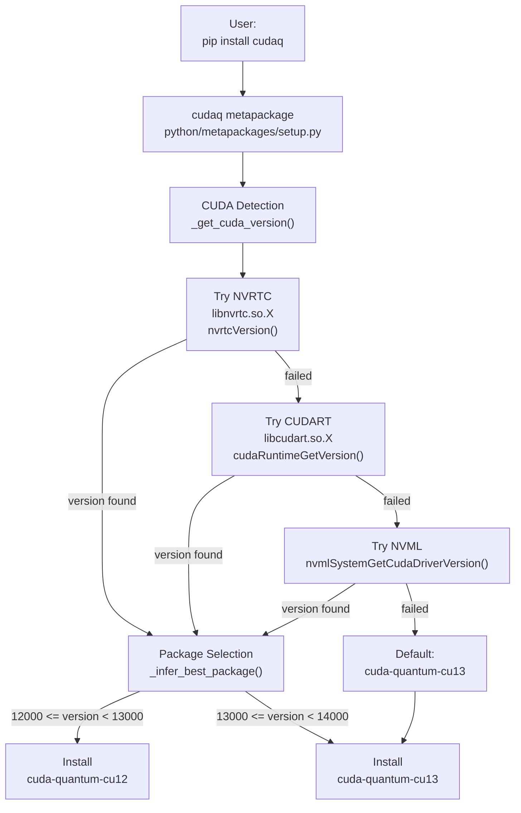
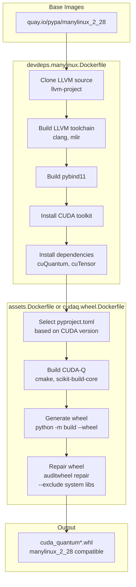
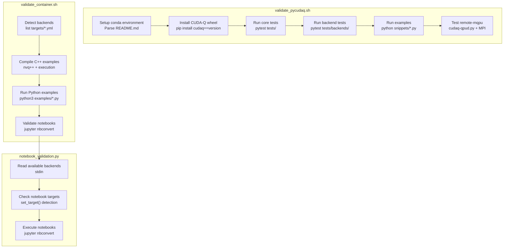

<!-- source: DeepWiki mcp.deepwiki.com · repo NVIDIA/cuda-quantum · page 7.2 Python Package Distribution · fetched 2026-10-26 -->

# Python Package Distribution

<details>
<summary>Relevant source files</summary>

The following files were used as context for generating this wiki page:

- [.devcontainer/devcontainer.json](.devcontainer/devcontainer.json)
- [.github/actions/run-in-docker/action.yml](.github/actions/run-in-docker/action.yml)
- [.github/codecov.yml](.github/codecov.yml)
- [.github/workflows/config/gitlab_commits.txt](.github/workflows/config/gitlab_commits.txt)
- [.github/workflows/python_metapackages.yml](.github/workflows/python_metapackages.yml)
- [docker/build/assets.Dockerfile](docker/build/assets.Dockerfile)
- [docker/build/devdeps.Dockerfile](docker/build/devdeps.Dockerfile)
- [docker/build/devdeps.ext.Dockerfile](docker/build/devdeps.ext.Dockerfile)
- [docker/build/devdeps.manylinux.Dockerfile](docker/build/devdeps.manylinux.Dockerfile)
- [docker/release/cudaq.Dockerfile](docker/release/cudaq.Dockerfile)
- [docker/release/cudaq.ext.Dockerfile](docker/release/cudaq.ext.Dockerfile)
- [docker/release/cudaq.wheel.Dockerfile](docker/release/cudaq.wheel.Dockerfile)
- [docker/test/installer/runtime_dependencies.sh](docker/test/installer/runtime_dependencies.sh)
- [docs/notebook_validation.py](docs/notebook_validation.py)
- [docs/sphinx/applications/python/hybrid_quantum_neural_networks.ipynb](docs/sphinx/applications/python/hybrid_quantum_neural_networks.ipynb)
- [docs/sphinx/applications/python/quantum_pagerank.ipynb](docs/sphinx/applications/python/quantum_pagerank.ipynb)
- [docs/sphinx/applications/python/unitary_compilation_diffusion_models.ipynb](docs/sphinx/applications/python/unitary_compilation_diffusion_models.ipynb)
- [docs/sphinx/examples/python/dynamics/dynamics_intro_2.ipynb](docs/sphinx/examples/python/dynamics/dynamics_intro_2.ipynb)
- [docs/sphinx/using/backends/circuitsimulators.png](docs/sphinx/using/backends/circuitsimulators.png)
- [docs/sphinx/using/backends/sims/svsims.rst](docs/sphinx/using/backends/sims/svsims.rst)
- [pyproject.toml](pyproject.toml)
- [pyproject.toml.cu12](pyproject.toml.cu12)
- [pyproject.toml.cu13](pyproject.toml.cu13)
- [python/metapackages/setup.py](python/metapackages/setup.py)
- [scripts/build_llvm.sh](scripts/build_llvm.sh)
- [scripts/configure_build.sh](scripts/configure_build.sh)
- [scripts/generate_cc.sh](scripts/generate_cc.sh)
- [scripts/install_toolchain.sh](scripts/install_toolchain.sh)
- [scripts/validate_container.sh](scripts/validate_container.sh)
- [scripts/validate_pycudaq.sh](scripts/validate_pycudaq.sh)

</details>


## Purpose and Scope

This document describes the Python package distribution infrastructure for CUDA-Q, including the build process, package architecture, dependency management, and distribution channels. It covers how CUDA-Q Python wheels are created, validated, and published to package repositories.

For information about building CUDA-Q from source, see [7.3](#7.3). For information about the Docker build system used as the foundation for package builds, see [7.1](#7.1). For installation methods and end-user package consumption, see [7.4](#7.4).

## Package Architecture

CUDA-Q uses a multi-package architecture to support different CUDA versions while providing a unified installation experience through a metapackage system.

### CUDA-Version-Specific Wheels

The core CUDA-Q functionality is distributed as CUDA-version-specific wheels:

- `cuda-quantum-cu12`: Built against CUDA 12.x runtime libraries
- `cuda-quantum-cu13`: Built against CUDA 13.x runtime libraries

Each wheel package is configured via separate `pyproject.toml` files that specify CUDA-version-specific dependencies:

**CUDA 12 Configuration** [pyproject.toml.cu12:1-85]():
- Package name: `cuda-quantum-cu12`
- CUDA runtime dependencies: `nvidia-cuda-runtime-cu12`, `nvidia-cuda-nvrtc-cu12`, etc.
- cuQuantum libraries: `custatevec-cu12`, `cutensornet-cu12`, `cudensitymat-cu12`
- CuPy: `cupy-cuda12x ~= 13.6.0`

**CUDA 13 Configuration** [pyproject.toml.cu13:1-85]():
- Package name: `cuda-quantum-cu13`
- CUDA runtime dependencies: `nvidia-cuda-runtime ~= 13.0`, `nvidia-cuda-nvrtc ~= 13.0`, etc.
- cuQuantum libraries: `custatevec-cu13`, `cutensornet-cu13`, `cudensitymat-cu13`
- CuPy: `cupy-cuda13x ~= 13.6.0`

Both configurations support Python 3.11, 3.12, and 3.13 [pyproject.toml:17]().

```mermaid
graph TB
    subgraph "CUDA-Version-Specific Wheels"
        CU12["cuda-quantum-cu12<br/>Python wheel"]
        CU13["cuda-quantum-cu13<br/>Python wheel"]
    end
    
    subgraph "CUDA 12 Dependencies"
        CU12_RT["nvidia-cuda-runtime-cu12"]
        CU12_NVRTC["nvidia-cuda-nvrtc-cu12"]
        CU12_STATEVEC["custatevec-cu12"]
        CU12_TENSORNET["cutensornet-cu12"]
        CU12_CUPY["cupy-cuda12x"]
    end
    
    subgraph "CUDA 13 Dependencies"
        CU13_RT["nvidia-cuda-runtime"]
        CU13_NVRTC["nvidia-cuda-nvrtc"]
        CU13_STATEVEC["custatevec-cu13"]
        CU13_TENSORNET["cutensornet-cu13"]
        CU13_CUPY["cupy-cuda13x"]
    end
    
    subgraph "Common Dependencies"
        NUMPY["numpy >= 1.24"]
        SCIPY["scipy >= 1.10.1"]
        REQUESTS["requests >= 2.31"]
        ASTPRETTY["astpretty ~= 3.0"]
    end
    
    CU12 --> CU12_RT
    CU12 --> CU12_NVRTC
    CU12 --> CU12_STATEVEC
    CU12 --> CU12_TENSORNET
    CU12 --> CU12_CUPY
    
    CU13 --> CU13_RT
    CU13 --> CU13_NVRTC
    CU13 --> CU13_STATEVEC
    CU13 --> CU13_TENSORNET
    CU13 --> CU13_CUPY
    
    CU12 --> NUMPY
    CU12 --> SCIPY
    CU12 --> REQUESTS
    CU12 --> ASTPRETTY
    
    CU13 --> NUMPY
    CU13 --> SCIPY
    CU13 --> REQUESTS
    CU13 --> ASTPRETTY
```



**Sources**: [pyproject.toml:1-85](), [pyproject.toml.cu12:1-85](), [pyproject.toml.cu13:1-85]()

### Metapackage System

The `cudaq` metapackage provides automatic CUDA version detection and installs the appropriate CUDA-version-specific wheel. The metapackage implementation is in [python/metapackages/setup.py:1-256]().

**CUDA Version Detection** [python/metapackages/setup.py:67-119]():

The `_get_cuda_version()` function attempts detection in order:
1. NVRTC library (`libnvrtc.so.13`, `libnvrtc.so.12`, etc.) via `nvrtcVersion` function
2. CUDA Runtime library (`libcudart.so.13`, `libcudart.so.12`, etc.) via `cudaRuntimeGetVersion`
3. NVIDIA Management Library via `pynvml.nvmlSystemGetCudaDriverVersion()`

**Package Selection Logic** [python/metapackages/setup.py:182-218]():

```python
def _infer_best_package() -> str:
    cuda_version = _get_cuda_version()
    if cuda_version is None:
        cudaq_bdist = 'cuda-quantum-cu13'
    elif cuda_version < 12000:
        raise Exception(f'Your CUDA version ({cuda_version}) is too old.')
    elif cuda_version < 13000:
        cudaq_bdist = 'cuda-quantum-cu12'
    elif cuda_version < 14000:
        cudaq_bdist = 'cuda-quantum-cu13'
    else:
        raise Exception(f'Your CUDA version ({cuda_version}) is too new.')
```

The metapackage prevents conflicting installations by checking for existing `cuda-quantum-cu11`, `cuda-quantum-cu12`, or `cuda-quantum-cu13` packages [python/metapackages/setup.py:210-217]().



**Sources**: [python/metapackages/setup.py:67-218]()

### Deprecated `cuda-quantum` Package

The `cuda-quantum` package name has been deprecated in favor of `cudaq`. The metapackage build system creates a deprecated source distribution [.github/workflows/python_metapackages.yml:79-98]():

```yaml
echo "Creating README.md for cuda-quantum package"
echo "# Welcome to the CUDA-Q Python API" > README.md
echo "This package is deprecated and new versions are published under the name \`cudaq\` instead." >> README.md

echo "Building cuda-quantum metapackage ..."
sed -i 's/name = "cudaq"/name = "cuda-quantum"/' pyproject.toml
echo 'Please remove the cuda-quantum package and `pip install cudaq` instead.' > _deprecated.txt
```

The deprecated package setup raises an exception during installation with migration instructions [python/metapackages/setup.py:240-243]().

**Sources**: [.github/workflows/python_metapackages.yml:79-98](), [python/metapackages/setup.py:234-243]()

## Build System

### Docker Build Stages

The Python wheel build process uses a multi-stage Docker pipeline to ensure compatibility and reproducibility.

#### Development Dependencies Image

The `devdeps.manylinux.Dockerfile` creates a manylinux-compatible base image [docker/build/devdeps.manylinux.Dockerfile:1-129]():

**Base Image**: `quay.io/pypa/manylinux_2_28_x86_64:latest` [docker/build/devdeps.manylinux.Dockerfile:23]()

**Key Components**:
- LLVM toolchain built from source [docker/build/devdeps.manylinux.Dockerfile:89-92]()
- PyBind11 for Python bindings [docker/build/devdeps.manylinux.Dockerfile:68-79]()
- CUDA toolkit installation [docker/build/devdeps.manylinux.Dockerfile:98-116]()
- cuQuantum and cuTensor dependencies [docker/build/devdeps.manylinux.Dockerfile:120-128]()

#### Assets Build Image

The `assets.Dockerfile` builds CUDA-Q binaries and Python wheels [docker/build/assets.Dockerfile:1-336]():

**Python Build Stage** [docker/build/assets.Dockerfile:166-259]():

```dockerfile
FROM prereqs AS python_build
ADD pyproject.toml.cu* /cuda-quantum/
ADD "python" /cuda-quantum/python
# ... source files added

ARG release_version=
ENV SETUPTOOLS_SCM_PRETEND_VERSION=$release_version

RUN cd /cuda-quantum && \
    . scripts/configure_build.sh && \
    case "${CUDA_VERSION%%.*}" in \
      12) cp pyproject.toml.cu12 pyproject.toml || true ;; \
      13) cp pyproject.toml.cu13 pyproject.toml || true ;; \
    esac && \
    LLVM_PROJECTS='clang;flang;lld;mlir;python-bindings;openmp;runtimes' \
    bash scripts/install_prerequisites.sh -t llvm && \
    CC="$LLVM_INSTALL_PREFIX/bin/clang" \
    CXX="$LLVM_INSTALL_PREFIX/bin/clang++" \
    FC="$LLVM_INSTALL_PREFIX/bin/flang-new" \
    python3 -m build --wheel
```

**Wheel Repair with auditwheel** [docker/build/assets.Dockerfile:218-238]():

The `auditwheel` tool modifies wheels to be manylinux-compatible by bundling shared libraries:

```bash
CUDAQ_WHEEL="$(find . -name 'cuda_quantum*.whl')"
MANYLINUX_PLATFORM="$(echo ${CUDAQ_WHEEL} | grep -o '[a-z]*linux_[^\.]*' | sed -re 's/^linux_/manylinux_2_28_/')"
LD_LIBRARY_PATH="${LD_LIBRARY_PATH}:$(pwd)/_skbuild/lib" \ 
python3 -m auditwheel -v repair ${CUDAQ_WHEEL} \
    --plat ${MANYLINUX_PLATFORM} \
    --exclude libcublas.so.11 \
    --exclude libcublasLt.so.11 \
    --exclude libcurand.so.10 \
    # ... additional exclusions for system libraries
```

Libraries excluded from bundling are expected to be provided by the system or pip-installed CUDA packages.

#### Wheel-Only Build Image

The `cudaq.wheel.Dockerfile` provides a streamlined build specifically for wheel creation [docker/release/cudaq.wheel.Dockerfile:1-95]():

This Dockerfile:
- Uses pre-built `devdeps` image [docker/release/cudaq.wheel.Dockerfile:21]()
- Rebuilds MLIR Python bindings for specific Python version [docker/release/cudaq.wheel.Dockerfile:32-38]()
- Configures pyproject.toml for CUDA version [docker/release/cudaq.wheel.Dockerfile:40-47]()
- Generates README from template [docker/release/cudaq.wheel.Dockerfile:50-62]()
- Builds and repairs wheel [docker/release/cudaq.wheel.Dockerfile:64-91]()



**Sources**: [docker/build/devdeps.manylinux.Dockerfile:1-129](), [docker/build/assets.Dockerfile:166-259](), [docker/release/cudaq.wheel.Dockerfile:1-95]()

### Build Configuration

CUDA-Q Python packages are built using `scikit-build-core` with CMake integration [pyproject.toml:64-81]():

```toml
[build-system]
requires = ["scikit-build-core==0.9.10", "cmake>=3.27,<3.29", "numpy>=1.24", "pytest==8.3.0"]
build-backend = "scikit_build_core.build"

[tool.scikit-build]
wheel.packages = ["python/cudaq"]
wheel.license-files = [ "LICENSE", "NOTICE", "CITATION.cff" ]
build-dir = "_skbuild"
metadata.version.provider = "scikit_build_core.metadata.setuptools_scm"
cmake.build-type = "Release"
cmake.args = [
    "-DCUDAQ_ENABLE_PYTHON=TRUE",
    "-DCUDAQ_DISABLE_CPP_FRONTEND=TRUE",
    "-DCUDAQ_DISABLE_TOOLS=TRUE",
    "-DCUDAQ_BUILD_TESTS=TRUE"
]
```

The build disables C++ frontend and tools to minimize wheel size while including tests for validation.

**Sources**: [pyproject.toml:64-81]()

## Dependency Management

### CUDA Runtime Libraries

CUDA-Q wheels depend on NVIDIA's PyPI packages for CUDA runtime libraries. These packages are version-specific and automatically installed by pip.

**CUDA 12 Dependencies** [pyproject.toml.cu12:19-34]():
- `nvidia-cuda-runtime-cu12 ~= 12.0`
- `nvidia-cuda-nvrtc-cu12 ~= 12.0`
- `nvidia-cublas-cu12 ~= 12.0`
- `nvidia-curand-cu12 ~= 10.3`
- `nvidia-cusparse-cu12 ~= 12.5`
- `nvidia-cusolver-cu12 ~= 11.4`

**CUDA 13 Dependencies** [pyproject.toml.cu13:19-34]():
- `nvidia-cuda-runtime ~= 13.0` (no `-cu13` suffix)
- `nvidia-cuda-nvrtc ~= 13.0`
- `nvidia-cublas ~= 13.0`
- `nvidia-curand ~= 10.4`
- `nvidia-cusparse ~= 12.6`
- `nvidia-cusolver ~= 12.0`

### cuQuantum Libraries

The cuQuantum suite provides GPU-accelerated quantum simulation libraries:

- `custatevec-cu{12,13} ~= 1.10`: State vector simulation library
- `cutensornet-cu{12,13} ~= 2.9`: Tensor network simulation library
- `cudensitymat-cu{12,13} ~= 0.3`: Density matrix simulation library

These packages are maintained separately on PyPI and include pre-built CUDA-accelerated binaries.

### Python Dependencies

Common Python dependencies across all CUDA versions [pyproject.toml:19-34]():

| Package | Version Constraint | Purpose |
|---------|-------------------|---------|
| `numpy` | `>= 1.24` | Numerical computing |
| `scipy` | `>= 1.10.1` | Scientific computing |
| `requests` | `>= 2.31` | HTTP client for remote backends |
| `astpretty` | `~= 3.0` | Python AST inspection |
| `cupy-cuda{12,13}x` | `~= 13.6.0` | GPU-accelerated NumPy |

### Optional Dependencies

Optional dependency groups are defined in `[project.optional-dependencies]` [pyproject.toml:58-62]():

- **chemistry**: `openfermionpyscf==0.5`, `h5py<3.11` for quantum chemistry applications
- **visualization**: `qutip<5`, `matplotlib>=3.5` for result visualization
- **integrators**: `torchdiffeq` for PyTorch-based time evolution

**Sources**: [pyproject.toml:19-62](), [pyproject.toml.cu12:19-62](), [pyproject.toml.cu13:19-62]()

## Distribution Channels

CUDA-Q Python packages are distributed through multiple channels to support different installation scenarios.

### PyPI (Python Package Index)

The primary distribution channel is PyPI, where packages are published under:
- `cudaq` (metapackage)
- `cuda-quantum-cu12` (CUDA 12 wheel)
- `cuda-quantum-cu13` (CUDA 13 wheel)
- `cuda-quantum` (deprecated, redirects to `cudaq`)

The GitHub workflow for metapackage publishing is defined in [.github/workflows/python_metapackages.yml:1-253]().

### NGC (NVIDIA GPU Cloud) Catalog

Docker images containing pre-installed CUDA-Q Python packages are published to NGC [docker/release/cudaq.ext.Dockerfile:1-92]():

The `cudaq.ext.Dockerfile` installs additional Python packages including:
- `jupyterlab==4.3.4` for notebook environments
- `mpi4py~=3.1` for MPI support (when available)
- CUDA Python packages based on runtime version [docker/release/cudaq.ext.Dockerfile:52-66]()

### GitHub Releases

Source distributions and pre-built wheels are attached to GitHub releases for archival and direct download.

**Sources**: [.github/workflows/python_metapackages.yml:1-253](), [docker/release/cudaq.ext.Dockerfile:1-92]()

## Validation and Testing

### Package Validation Scripts

#### validate_pycudaq.sh

The main validation script [scripts/validate_pycudaq.sh:1-293]() tests Python packages in a conda environment:

**Setup Process** [scripts/validate_pycudaq.sh:75-105]():
1. Install Miniconda if not present
2. Parse README.md for installation instructions
3. Create conda environment with specified Python and CUDA versions
4. Install CUDA-Q wheel from provided packages

**Test Execution** [scripts/validate_pycudaq.sh:108-175]():
```bash
# Verify GPU targets
for tgt in nvidia nvidia-fp64 nvidia-mgpu tensornet; do
    python3 -c "import cudaq; cudaq.set_target('${tgt}')"
done

# Run core tests
python3 -m pytest -v "$root_folder/tests" \
    --ignore "$root_folder/tests/backends" \
    --ignore "$root_folder/tests/dynamics/integrators" \
    --ignore "$root_folder/tests/parallel"

# Run backend tests
for backendTest in "$root_folder/tests/backends"/*.py; do 
    python3 -m pytest -v $backendTest
done

# Run snippets and examples
for ex in `find "$root_folder/snippets" -name '*.py'`; do
    python3 "$ex"
done
```

**Platform Tests** [scripts/validate_pycudaq.sh:254-287]():
- Multi-GPU simulation using `cudaq-qpud.py` wrapper
- MPI coordination test with `nvidia-mgpu` backend
- Distributed simulation validation

#### validate_container.sh

Container validation script [scripts/validate_container.sh:1-455]() tests installed packages inside Docker images:

**Backend Detection** [scripts/validate_container.sh:56-90]():
- Reads available backends from `$CUDA_QUANTUM_PATH/targets/*.yml`
- Filters based on GPU availability
- Excludes `remote_rest`, `photonics`, and `stim` backends
- Tests legacy and new backend configurations

**C++ Examples** [scripts/validate_container.sh:146-277]():
- Compiles examples with `nvq++`
- Tests multiple target options (fp32, fp64, mgpu configurations)
- Validates compilation and execution

**Python Examples** [scripts/validate_container.sh:302-345]():
- Executes Python examples
- Checks for explicit target requirements
- Validates against available backends

**Notebook Validation** [scripts/validate_container.sh:347-402]():
- Creates isolated venv for notebook execution
- Installs Jupyter kernel infrastructure
- Executes notebooks with `jupyter nbconvert`
- Cleans up after validation



**Sources**: [scripts/validate_pycudaq.sh:1-293](), [scripts/validate_container.sh:1-455](), [docs/notebook_validation.py:1-162]()

### Notebook Validation

The `notebook_validation.py` script [docs/notebook_validation.py:1-162]() validates Jupyter notebooks:

**Target Detection** [docs/notebook_validation.py:28-59]():
```python
pattern = r"set_target\(\s*(\\?['\"])([^'\"]+)\1(?:\s*,\s*option\s*=\s*(\\?['\"])([^'\"]+)\3)?\)"

def validate(notebook_filename, available_backends):
    with open(notebook_filename) as f:
        lines = f.readlines()
    for notebook_content in lines:
        match = re.search(pattern, notebook_content)
        if match:
            target = match.group(2)
            return target in available_backends
    return True
```

**Execution with Kernel** [docs/notebook_validation.py:62-86]():
```python
def execute(notebook_filename, jupyter_kernel=None):
    cmd = [
        "jupyter", "nbconvert", "--to", "notebook", "--execute",
        notebook_filename
    ]
    if jupyter_kernel:
        cmd.extend(["--ExecutePreprocessor.kernel_name", jupyter_kernel])
    subprocess.run(cmd, check=True)
```

**Known Exclusions** [docs/notebook_validation.py:145-147]():
- `quantum_transformer.ipynb`: Issue #2689
- `logical_aim_sqale.ipynb`: Skipped

**Sources**: [docs/notebook_validation.py:1-162]()

## Metapackage Build Workflow

The GitHub Actions workflow for building metapackages is defined in [.github/workflows/python_metapackages.yml:1-253]().

### Build Process

**Inputs** [.github/workflows/python_metapackages.yml:3-23]():
- `cudaq_version`: Version string for packages
- `python_versions`: JSON array of Python versions to test
- `cuda_versions`: JSON array of CUDA versions to test
- `wheel_artifacts`: Pattern matching wheel artifacts

**Build Steps** [.github/workflows/python_metapackages.yml:49-94]():

1. **Prepare README Templates**:
```bash
sed -i "s/README.md.in/README.md/g" python/metapackages/pyproject.toml
for file in LICENSE NOTICE CITATION.cff; do
    cp $file python/metapackages/$file
done
```

2. **Create `cudaq` metapackage README**:
```bash
package_name=cudaq
cuda_version_requirement="12.x or 13.x"
cuda_version_conda=12.4.0
cat python/README.md.in > python/metapackages/README.md
for variable in package_name cuda_version_requirement cuda_version_conda; do
  sed -i "s/.{{[ ]*$variable[ ]*}}/${!variable}/g" python/metapackages/README.md
done
```

3. **Build `cudaq` source distribution**:
```bash
cd python/metapackages && echo ${{ inputs.cudaq_version }} > _version.txt
CUDAQ_META_WHEEL_BUILD=1 python3 -m build . --sdist
```

4. **Create deprecated `cuda-quantum` package**:
```bash
sed -i 's/name = "cudaq"/name = "cuda-quantum"/' pyproject.toml
echo 'Please remove the cuda-quantum package and install cudaq instead.' > _deprecated.txt
CUDAQ_META_WHEEL_BUILD=1 python3 -m build . --sdist
```

### Validation Matrix

The workflow validates metapackages against multiple Python and CUDA versions [.github/workflows/python_metapackages.yml:98-198]():

**Matrix Strategy**:
```yaml
matrix:
  python_version: ${{ fromJSON(inputs.python_versions) }}
  cuda_version: ${{ fromJSON(inputs.cuda_versions) }}
  include:
    - cuda_version: '12.6'
      base_image: nvidia/cuda:12.6.3-devel-ubuntu24.04
    - cuda_version: '13.0'
      base_image: nvidia/cuda:13.0.0-devel-ubuntu24.04
```

**Validation Steps**:
1. Download all wheel artifacts matching pattern
2. Build validation container with CUDA runtime
3. Install metapackage (triggers CUDA detection)
4. Run quick validation: `validate_pycudaq.sh -q`
5. Collect and report results

**Sources**: [.github/workflows/python_metapackages.yml:1-253]()

## Installation Workflows

### conda Installation

The README template [python/README.md.in]() (not provided in files but referenced) includes conda installation instructions that are templated during build:

```bash
conda create -y -n cudaq python=3.11
conda install -y -n cudaq -c conda-forge cuda-version={{ cuda_version_conda }}
conda activate cudaq
pip install {{ package_name }}
```

### pip Installation

Direct pip installation with CUDA detection:
```bash
pip install cudaq
```

The metapackage's `setup.py` [python/metapackages/setup.py:182-218]() automatically detects the CUDA version and installs the appropriate wheel.

### Container Installation

For container images, CUDA-Q is installed by copying pre-built binaries [docker/release/cudaq.Dockerfile:34-42](), [docker/release/cudaq.ext.Dockerfile:14-29]() and installing additional runtime dependencies.

**Sources**: [python/metapackages/setup.py:182-218](), [docker/release/cudaq.Dockerfile:34-42](), [docker/release/cudaq.ext.Dockerfile:14-29]()

---

