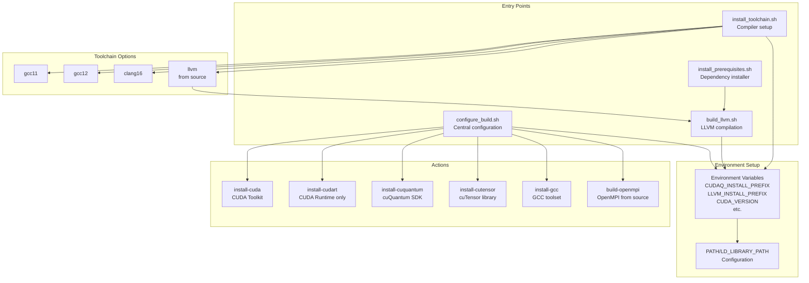
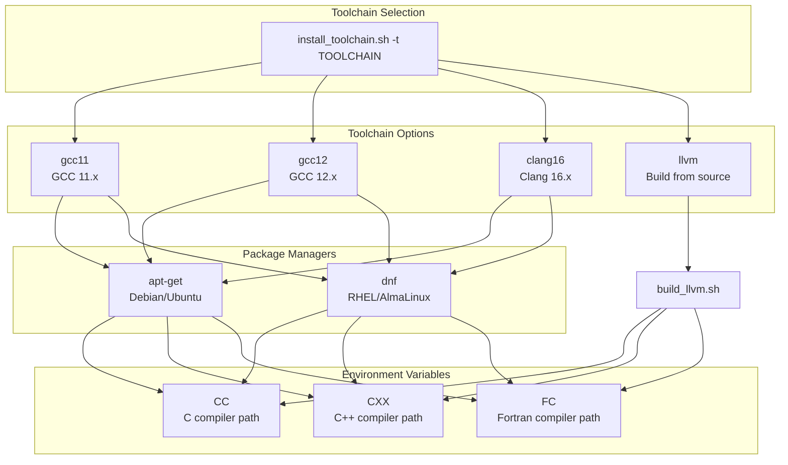
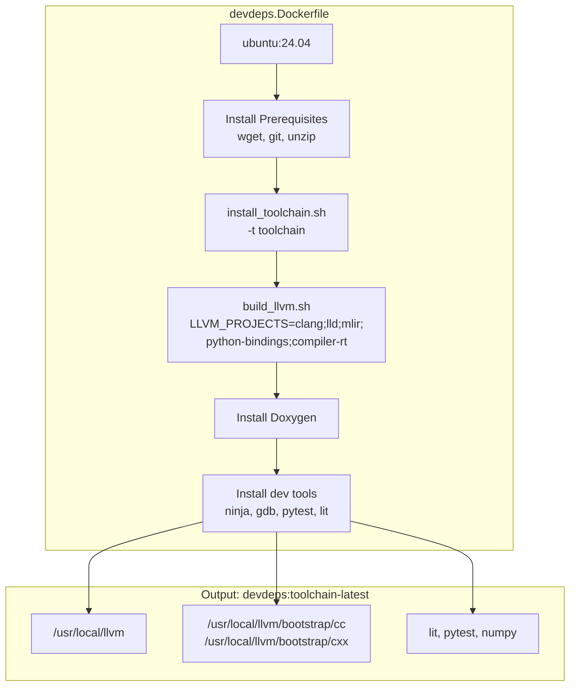
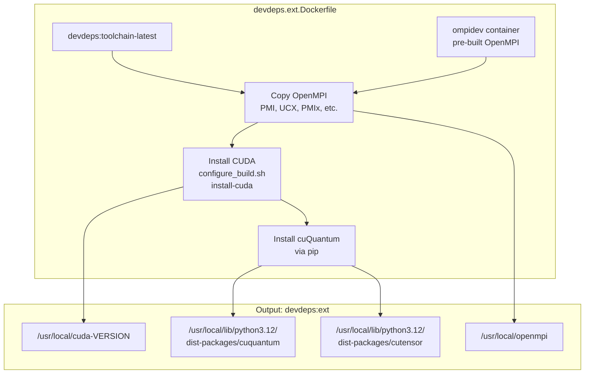
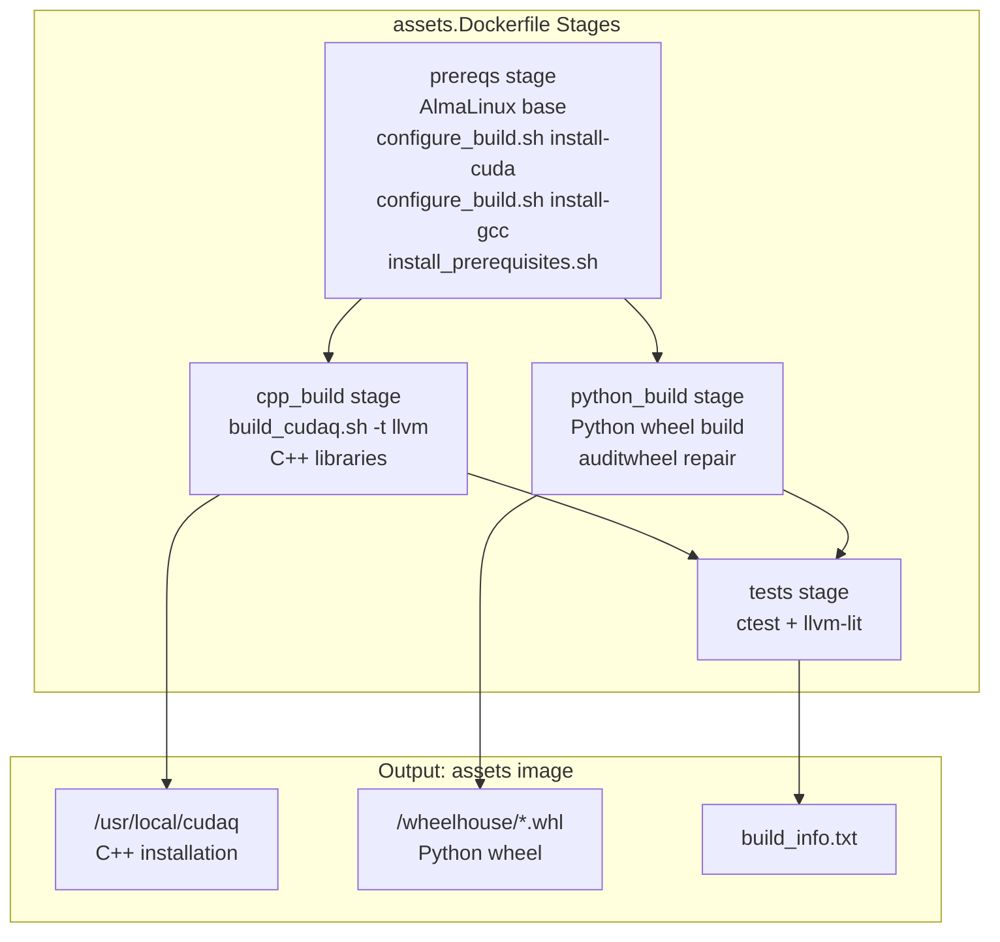

<!-- source: DeepWiki mcp.deepwiki.com · repo NVIDIA/cuda-quantum · page 7.3 Build Scripts and Dependencies · fetched 2026-10-26 -->

# Build Scripts and Dependencies

<details>
<summary>Relevant source files</summary>

The following files were used as context for generating this wiki page:

- [.devcontainer/devcontainer.json](.devcontainer/devcontainer.json)
- [.github/actions/run-in-docker/action.yml](.github/actions/run-in-docker/action.yml)
- [.github/codecov.yml](.github/codecov.yml)
- [docker/build/assets.Dockerfile](docker/build/assets.Dockerfile)
- [docker/build/devdeps.Dockerfile](docker/build/devdeps.Dockerfile)
- [docker/build/devdeps.ext.Dockerfile](docker/build/devdeps.ext.Dockerfile)
- [docker/build/devdeps.manylinux.Dockerfile](docker/build/devdeps.manylinux.Dockerfile)
- [docker/release/cudaq.Dockerfile](docker/release/cudaq.Dockerfile)
- [docker/release/cudaq.ext.Dockerfile](docker/release/cudaq.ext.Dockerfile)
- [docker/release/cudaq.wheel.Dockerfile](docker/release/cudaq.wheel.Dockerfile)
- [docker/test/installer/runtime_dependencies.sh](docker/test/installer/runtime_dependencies.sh)
- [pyproject.toml](pyproject.toml)
- [scripts/build_llvm.sh](scripts/build_llvm.sh)
- [scripts/configure_build.sh](scripts/configure_build.sh)
- [scripts/generate_cc.sh](scripts/generate_cc.sh)
- [scripts/install_toolchain.sh](scripts/install_toolchain.sh)
- [scripts/validate_container.sh](scripts/validate_container.sh)

</details>


This document details the build scripts that manage CUDA-Q's compilation and dependency installation, including `configure_build.sh`, `install_toolchain.sh`, and `build_llvm.sh`. These scripts handle compiler toolchain installation, LLVM building, and management of dependencies such as CUDA, cuQuantum, cuTensor, and other third-party libraries. For information about the complete Docker build system that uses these scripts, see [Docker Build System](#7.1). For Python wheel building specifics, see [Python Package Distribution](#7.2).

## Build Script Ecosystem Overview

CUDA-Q's build system relies on several interconnected shell scripts that automate dependency management and compilation. These scripts are designed to work both in local development environments and within Docker containers, providing consistent builds across different platforms.



Sources: [scripts/configure_build.sh](), [scripts/install_toolchain.sh](), [scripts/build_llvm.sh]()

## configure_build.sh - Central Build Configuration

The `configure_build.sh` script serves as the central orchestrator for CUDA-Q's build environment. It defines standard installation locations and provides functions for installing individual dependencies. The script can be sourced to set environment variables or executed with specific actions as command-line arguments.

### Installation Prefix Definitions

The script establishes standardized installation locations for all dependencies:

```mermaid
graph LR
    subgraph "Standard Installation Prefixes"
        CUDAQ["/usr/local/cudaq<br/>CUDAQ_INSTALL_PREFIX"]
        LLVM["/usr/local/llvm<br/>LLVM_INSTALL_PREFIX"]
        CUDA["/usr/local/cuda-VERSION<br/>CUDA_INSTALL_PREFIX"]
        CUQUANTUM["/usr/local/cuquantum<br/>CUQUANTUM_INSTALL_PREFIX"]
        CUTENSOR["/usr/local/cutensor<br/>CUTENSOR_INSTALL_PREFIX"]
        BLAS["/usr/local/blas<br/>BLAS_INSTALL_PREFIX"]
        ZLIB["/usr/local/zlib<br/>ZLIB_INSTALL_PREFIX"]
        OPENSSL["/usr/local/openssl<br/>OPENSSL_INSTALL_PREFIX"]
        CURL["/usr/local/curl<br/>CURL_INSTALL_PREFIX"]
        AWS["/usr/local/aws<br/>AWS_INSTALL_PREFIX"]
    end
```



These environment variables are exported when the script is sourced, allowing other build scripts and CMake to locate dependencies consistently.

Sources: [scripts/configure_build.sh:13-23]()

### Dependency Installation Actions

The script provides specific action commands for installing individual dependencies:

| Action | Purpose | Key Parameters |
|--------|---------|----------------|
| `install-cuda` | Installs complete CUDA Toolkit | `CUDA_VERSION` (default: 12.6), `DISTRIBUTION` (default: rhel8) |
| `install-cudart` | Installs CUDA runtime libraries only | Same as above, installs minimal runtime subset |
| `install-cuquantum` | Downloads and installs cuQuantum SDK | `CUQUANTUM_VERSION` (25.09.1.12), `CUDA_VERSION` |
| `install-cutensor` | Downloads and installs cuTensor library | `CUTENSOR_VERSION` (2.3.1.0), `CUDA_VERSION` |
| `install-gcc` | Installs GCC toolset | `GCC_VERSION` (default: 11) |
| `build-openmpi` | Builds OpenMPI from source | `OPENMPI_VERSION` (4.1.4) |

**CUDA Installation Example:**

The script dynamically determines the architecture and configures package repositories:

[scripts/configure_build.sh:26-44]()

For CUDA versions 12+, the script also installs `libnvjitlink`, which is required by some CUDA-Q components.

**cuQuantum Installation:**

cuQuantum SDK is downloaded directly from NVIDIA's redistribution servers:

[scripts/configure_build.sh:73-87]()

**Toolchain Configuration:**

The script exports standardized compiler environment variables pointing to GCC toolset 11:

[scripts/configure_build.sh:118-124]()

Sources: [scripts/configure_build.sh:26-149]()

## install_toolchain.sh - Compiler Toolchain Management

The `install_toolchain.sh` script manages installation of C/C++ compiler toolchains required for building LLVM and CUDA-Q. It supports multiple toolchain options and handles platform-specific package management.

### Supported Toolchains

The script supports four primary toolchain configurations:



### GCC Toolchain Installation

For GCC-based toolchains, the script installs the compiler suite including Fortran support:

**On Ubuntu/Debian systems:**

[scripts/install_toolchain.sh:63-72]()

**On RHEL/AlmaLinux systems:**

[scripts/install_toolchain.sh:73-81]()

The script uses `find_executable` to locate the installed binaries and exports their paths.

### Clang 16 Installation

For Clang 16, the script adds LLVM's APT repository or installs from existing DNF repositories:

[scripts/install_toolchain.sh:86-105]()

### Building LLVM Toolchain from Source

When the `llvm` toolchain option is selected, the script orchestrates a complete LLVM build:

[scripts/install_toolchain.sh:106-145]()

This option:
1. Checks if LLVM is already built at `$LLVM_INSTALL_PREFIX`
2. Bootstraps with Clang 16 if no compiler is available
3. Invokes `build_llvm.sh` with projects: `clang`, `lld`, and `runtimes`
4. Installs the toolchain to `$LLVM_INSTALL_PREFIX`

### Environment Export

The script can export the installation command for reproducibility using the `-e` flag:

[scripts/install_toolchain.sh:175-181]()

This creates an `init_command.sh` file that can be used to reinstall the same toolchain configuration.

Sources: [scripts/install_toolchain.sh:1-187]()

## build_llvm.sh - LLVM Build Process

The `build_llvm.sh` script builds LLVM, Clang, MLIR, and related components from source. It's designed to create minimal, distribution-focused builds that only include components needed by CUDA-Q.

### Build Configuration

The script accepts several parameters and environment variables:

| Parameter | Default | Description |
|-----------|---------|-------------|
| `-c` | `Release` | CMake build configuration (Release/Debug) |
| `-j N` | auto | Build concurrency (ninja parallel jobs) |
| `-k N` | 0 | Keep going after N failures |
| `-v` | false | Verbose output |

**Key Environment Variables:**

| Variable | Default | Purpose |
|----------|---------|---------|
| `LLVM_INSTALL_PREFIX` | `$HOME/.llvm` | Installation directory |
| `LLVM_PROJECTS` | `clang;lld;mlir;python-bindings` | Projects to build |
| `LLVM_SOURCE` | auto-cloned | LLVM source directory |
| `PYBIND11_INSTALL_PREFIX` | `/usr/local/pybind11` | PyBind11 location (if building Python bindings) |
| `Python3_EXECUTABLE` | `python3` | Python interpreter for bindings |

### Build Process Flow

```mermaid
graph TB
    Start["build_llvm.sh invocation"]
    
    subgraph "Preparation"
        ParseArgs["Parse command line<br/>arguments"]
        CheckPython["Check for<br/>python-bindings<br/>in LLVM_PROJECTS"]
        BuildPybind11["Build PyBind11<br/>if needed"]
        CloneLLVM["Clone or checkout<br/>LLVM source"]
        ApplyPatches["Apply LLVM patches<br/>from tpls/customizations"]
    end
    
    subgraph "Component Selection"
        ParseProjects["Parse LLVM_PROJECTS"]
        SelectRuntimes["Select runtimes<br/>libcxx, libcxxabi,<br/>libunwind, compiler-rt"]
        SelectComponents["Select distribution<br/>components for each<br/>project"]
    end
    
    subgraph "CMake Generation"
        LoadCache["Load LLVM.cmake<br/>cache file"]
        GenerateCMake["Generate CMake<br/>configuration"]
    end
    
    subgraph "Build and Install"
        NinjaBuild["ninja build<br/>install-distribution-stripped"]
        RuntimesBuild["ninja install-runtimes<br/>if runtimes selected"]
        ManualInstall["Manual install for<br/>builtins and libomp"]
        CreateConfig["Create clang++.cfg<br/>default config"]
    end
    
    Start --> ParseArgs
    ParseArgs --> CheckPython
    CheckPython --> BuildPybind11
    BuildPybind11 --> CloneLLVM
    CloneLLVM --> ApplyPatches
    
    ApplyPatches --> ParseProjects
    ParseProjects --> SelectRuntimes
    SelectRuntimes --> SelectComponents
    
    SelectComponents --> LoadCache
    LoadCache --> GenerateCMake
    
    GenerateCMake --> NinjaBuild
    NinjaBuild --> RuntimesBuild
    RuntimesBuild --> ManualInstall
    ManualInstall --> CreateConfig
```



### LLVM Project Selection

The script intelligently parses the `LLVM_PROJECTS` variable and selects only necessary distribution components:

**For Clang:**
```
clang;clang-format;clang-cmake-exports;clang-headers;clang-libraries;clang-resource-headers
```

**For MLIR:**
```
mlir-cmake-exports;mlir-headers;mlir-libraries;mlir-tblgen;MLIRPythonModules;mlir-python-sources
```

**For LLD:**
```
lld
```
(Also enables `LLVM_ENABLE_ZLIB=ON` for compressed library support)

**For OpenMP:**
```
omptarget;openmp-resource-headers
```
(Manual build targets for `omp`)

Sources: [scripts/build_llvm.sh:150-188]()

### LLVM Patches

The script always applies patches from `tpls/customizations/llvm`:

[scripts/build_llvm.sh:98-123]()

Patches are applied with `--ignore-whitespace` and the script checks if they're already applied to avoid duplicate application.

### Python Bindings

When `python-bindings` is included in `LLVM_PROJECTS`, the script:

1. Ensures PyBind11 is available
2. Builds PyBind11 from the submodule if not found
3. Sets `MLIR_ENABLE_BINDINGS_PYTHON=ON`
4. Includes `MLIRPythonModules` and `mlir-python-sources` in distribution components

[scripts/build_llvm.sh:72-86]()

### Runtime Libraries

If `runtimes` is specified in `LLVM_PROJECTS`, the script builds libc++, libc++abi, libunwind, and compiler-rt as runtimes (instead of projects). This enables building these libraries with the newly-built Clang compiler.

[scripts/build_llvm.sh:136-148]()

After the main build, runtimes are installed separately:

[scripts/build_llvm.sh:278-324]()

The script also creates a `clang++.cfg` configuration file that automatically adds the runtime library paths to the linker search path.

### Build Output

Build logs are written to `$llvm_build_dir/logs/`:
- `cmake_output.txt` / `cmake_error.txt` - CMake configuration logs
- `ninja_output.txt` / `ninja_error.txt` - Build logs

Sources: [scripts/build_llvm.sh:1-327]()

## Dependency Management

CUDA-Q requires several categories of dependencies, managed through a combination of system packages and custom installations.

### CUDA Dependencies

CUDA dependencies are installed via NVIDIA's package repositories. The installation varies by CUDA version and target distribution.

**Package List:**

| Package | Purpose | Version Suffix |
|---------|---------|----------------|
| `cuda-cudart` | CUDA runtime | `cuda$(CUDA_VERSION \| tr . -)` |
| `cuda-nvrtc` | Runtime compilation | Same |
| `cuda-compiler` | NVCC compiler (full toolkit only) | Same |
| `libcublas` | Basic Linear Algebra | Same |
| `libcurand` | Random number generation | Same |
| `libcusolver` | Dense/sparse linear solver | Same |
| `libcusparse` | Sparse matrix operations | Same |
| `libnvjitlink` | JIT linking (CUDA 12+) | Same |

**Installation in Docker:**

In the extended devdeps container, CUDA packages are installed dynamically based on `CUDA_VERSION`:

[docker/build/devdeps.ext.Dockerfile:136-150]()

The script filters out `libnvjitlink` for CUDA 11.x since it's only available in CUDA 12+.

**CUDA Stub Libraries Cleanup:**

After installing CUDA in containers, stub libraries are removed to avoid conflicts when running with `--gpus=all`:

[docker/build/devdeps.ext.Dockerfile:156-163]()

Sources: [scripts/configure_build.sh:26-71](), [docker/build/devdeps.ext.Dockerfile:136-172]()

### cuQuantum and cuTensor

cuQuantum SDK and cuTensor are installed from NVIDIA's redistribution servers as pre-built archives.

**cuQuantum Installation:**

Version 25.09.1.12 is used, downloaded as a tar archive and extracted to `CUQUANTUM_INSTALL_PREFIX`:

[scripts/configure_build.sh:73-87]()

**cuTensor Installation:**

Version 2.3.1.0 is installed similarly:

[scripts/configure_build.sh:89-102]()

**Python Package Installation:**

In Docker builds, cuQuantum is also installed via Python pip packages:

[docker/build/devdeps.ext.Dockerfile:178-202]()

The version is pinned to ensure build reproducibility. cuQuantum provides both C++ libraries (for the C++ backend) and Python packages (for Python-based simulators).

Sources: [scripts/configure_build.sh:73-102](), [docker/build/devdeps.ext.Dockerfile:178-202]()

### Third-Party Libraries

CUDA-Q also depends on several standard third-party libraries, typically built from source during the Docker image construction:

| Dependency | Purpose | Installation Location |
|------------|---------|----------------------|
| BLAS | Basic Linear Algebra Subprograms | `BLAS_INSTALL_PREFIX` |
| zlib | Compression library (for LLD) | `ZLIB_INSTALL_PREFIX` |
| OpenSSL | Cryptographic library | `OPENSSL_INSTALL_PREFIX` |
| Curl | HTTP client library | `CURL_INSTALL_PREFIX` |
| AWS SDK | Amazon Web Services integration | `AWS_INSTALL_PREFIX` |

These are built and installed by `install_prerequisites.sh` (not shown in the provided files, but referenced in multiple locations).

Sources: [scripts/configure_build.sh:13-23](), [docker/build/devdeps.Dockerfile:44-56]()

### MPI and Communication Libraries

For multi-GPU and distributed simulation, additional dependencies are required:

**OpenMPI:**

Built from source with CUDA awareness:

[scripts/configure_build.sh:126-149]()

Configuration options disable debugging and unnecessary features while enabling CUDA support.

**UCX (Unified Communication X):**

Copied from a specialized OpenMPI development container:

[docker/build/devdeps.ext.Dockerfile:82-87]()

**PMI, PMIx, and MUNGE:**

Process management and authentication libraries for HPC environments:

[docker/build/devdeps.ext.Dockerfile:62-103]()

**GDRCOPY:**

GPU Direct RDMA library for efficient GPU-to-GPU communication:

[docker/build/devdeps.ext.Dockerfile:69-80]()

**Mellanox OFED:**

InfiniBand and RDMA runtime dependencies:

[docker/build/devdeps.ext.Dockerfile:50-60]()

Sources: [scripts/configure_build.sh:126-149](), [docker/build/devdeps.ext.Dockerfile:50-124]()

## Environment Variables and Installation Prefixes

CUDA-Q's build system uses a consistent set of environment variables to locate dependencies across different build contexts.

### Core Installation Prefixes

```mermaid
graph TB
    subgraph "Installation Prefix Variables"
        CUDAQ_PREFIX["CUDAQ_INSTALL_PREFIX<br/>/usr/local/cudaq"]
        LLVM_PREFIX["LLVM_INSTALL_PREFIX<br/>/usr/local/llvm"]
        CUDA_PREFIX["CUDA_INSTALL_PREFIX<br/>/usr/local/cuda-VERSION"]
    end
    
    subgraph "Dependency Prefixes"
        CUQUANTUM_PREFIX["CUQUANTUM_INSTALL_PREFIX<br/>/usr/local/cuquantum"]
        CUTENSOR_PREFIX["CUTENSOR_INSTALL_PREFIX<br/>/usr/local/cutensor"]
        BLAS_PREFIX["BLAS_INSTALL_PREFIX<br/>/usr/local/blas"]
        ZLIB_PREFIX["ZLIB_INSTALL_PREFIX<br/>/usr/local/zlib"]
        OPENSSL_PREFIX["OPENSSL_INSTALL_PREFIX<br/>/usr/local/openssl"]
        CURL_PREFIX["CURL_INSTALL_PREFIX<br/>/usr/local/curl"]
        AWS_PREFIX["AWS_INSTALL_PREFIX<br/>/usr/local/aws"]
    end
    
    subgraph "Path Configuration"
        PATH["PATH<br/>$LLVM_PREFIX/bin<br/>$CUDA_PREFIX/bin<br/>$CUDAQ_PREFIX/bin"]
        LD_LIBRARY_PATH["LD_LIBRARY_PATH<br/>$LLVM_PREFIX/lib<br/>$CUDA_PREFIX/lib64<br/>$CUDAQ_PREFIX/lib<br/>$CUQUANTUM_PREFIX/lib<br/>$CUTENSOR_PREFIX/lib"]
        CPATH["CPATH<br/>$CUDAQ_PREFIX/include<br/>$CUQUANTUM_PREFIX/include<br/>$CUTENSOR_PREFIX/include"]
    end
    
    LLVM_PREFIX --> PATH
    CUDA_PREFIX --> PATH
    CUDAQ_PREFIX --> PATH
    
    LLVM_PREFIX --> LD_LIBRARY_PATH
    CUDA_PREFIX --> LD_LIBRARY_PATH
    CUDAQ_PREFIX --> LD_LIBRARY_PATH
    CUQUANTUM_PREFIX --> LD_LIBRARY_PATH
    CUTENSOR_PREFIX --> LD_LIBRARY_PATH
    
    CUDAQ_PREFIX --> CPATH
    CUQUANTUM_PREFIX --> CPATH
    CUTENSOR_PREFIX --> CPATH
```



### Compiler and Build Configuration

| Variable | Purpose | Typical Value |
|----------|---------|---------------|
| `CC` | C compiler | `$LLVM_INSTALL_PREFIX/bootstrap/cc` or toolchain path |
| `CXX` | C++ compiler | `$LLVM_INSTALL_PREFIX/bootstrap/cxx` or toolchain path |
| `FC` | Fortran compiler | `$LLVM_INSTALL_PREFIX/bin/flang-new` or toolchain path |
| `CUDACXX` | CUDA compiler | `/usr/local/cuda/bin/nvcc` |
| `CUDAHOSTCXX` | CUDA host compiler | Same as `CXX` |

Sources: [scripts/configure_build.sh:118-124](), [docker/build/devdeps.Dockerfile:133-134]()

### Version Variables

Build scripts use version variables to select appropriate packages:

| Variable | Default | Usage |
|----------|---------|-------|
| `CUDA_VERSION` | `12.6` | Determines CUDA package versions |
| `CUQUANTUM_VERSION` | `25.09.1.12` | cuQuantum SDK version |
| `CUTENSOR_VERSION` | `2.3.1.0` | cuTensor library version |
| `GCC_VERSION` | `11` | GCC toolset version |
| `OPENMPI_VERSION` | `4.1.4` | OpenMPI version |
| `CUDA_QUANTUM_VERSION` | set at build time | CUDA-Q release version |

Sources: [scripts/configure_build.sh:31-94](), [docker/build/assets.Dockerfile:117-118]()

### Python Environment

| Variable | Purpose | Typical Value |
|----------|---------|---------------|
| `SETUPTOOLS_SCM_PRETEND_VERSION` | Python package version | Set during wheel builds |
| `Python3_EXECUTABLE` | Python interpreter | `python3` or specific version |
| `PYBIND11_INSTALL_PREFIX` | PyBind11 location | `/usr/local/pybind11` |
| `PIP_BREAK_SYSTEM_PACKAGES` | Allow system-wide pip installs | `1` (in containers) |

Sources: [pyproject.toml:83-84](), [docker/build/devdeps.Dockerfile:55]()

## Integration in Docker Builds

The build scripts are orchestrated within Docker multi-stage builds to create reproducible environments.

### devdeps Image Construction

The base development dependencies image uses the build scripts to create a minimal environment:



Sources: [docker/build/devdeps.Dockerfile:29-175]()

### devdeps.ext Image Construction

The extended dependencies image adds CUDA and GPU-specific libraries:



Sources: [docker/build/devdeps.ext.Dockerfile:22-203]()

### assets Image Construction

The assets image builds CUDA-Q from source for distribution:



The script invocations in assets.Dockerfile:

**Prerequisites stage:**
- [docker/build/assets.Dockerfile:41-43]() - Install CUDA via `configure_build.sh install-cuda`
- [docker/build/assets.Dockerfile:67-69]() - Build LLVM with `install_prerequisites.sh -t llvm`

**C++ build stage:**
- [docker/build/assets.Dockerfile:123-134]() - Build CUDA-Q with custom LLVM

**Python build stage:**
- [docker/build/assets.Dockerfile:189-211]() - Build and repair Python wheel

Sources: [docker/build/assets.Dockerfile:19-336]()

### Validation Scripts

Build artifacts are validated using scripts that check dependencies:

**validate_container.sh:**
- Discovers available backends from YAML configurations
- Compiles and runs C++ examples with `nvq++`
- Executes Python examples and notebooks
- Tests multiple target options for backends like `nvidia` (fp32, fp64, mqpu, mgpu)

[scripts/validate_container.sh:226-254]()

Sources: [scripts/validate_container.sh:1-455]()

---

