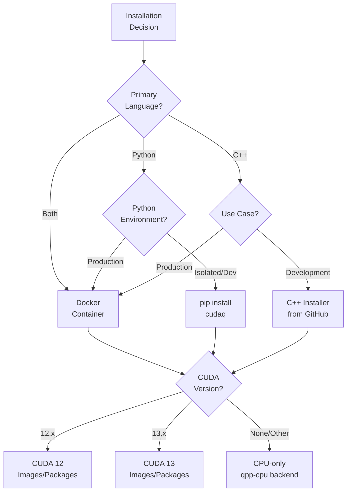
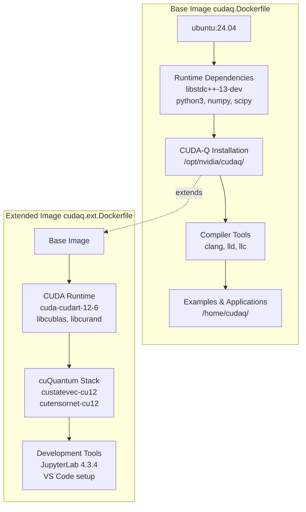
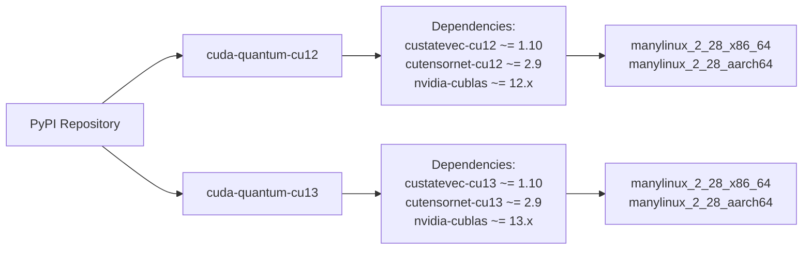
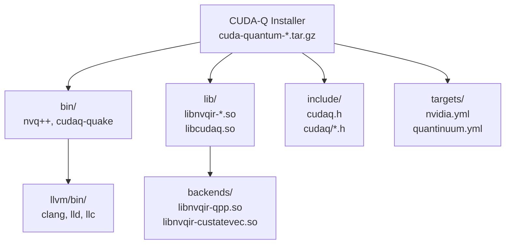
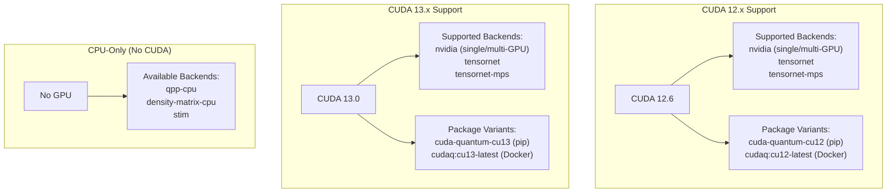

<!-- source: DeepWiki mcp.deepwiki.com · repo NVIDIA/cuda-quantum · page 7.4 Installation Methods · fetched 2026-10-26 -->

# Installation Methods

<details>
<summary>Relevant source files</summary>

The following files were used as context for generating this wiki page:

- [.devcontainer/devcontainer.json](.devcontainer/devcontainer.json)
- [.github/actions/run-in-docker/action.yml](.github/actions/run-in-docker/action.yml)
- [.github/codecov.yml](.github/codecov.yml)
- [.github/workflows/command_dispatch.yml](.github/workflows/command_dispatch.yml)
- [.github/workflows/config/spellcheck_config.yml](.github/workflows/config/spellcheck_config.yml)
- [.github/workflows/config/spelling_allowlist.txt](.github/workflows/config/spelling_allowlist.txt)
- [.github/workflows/repo_checks.yml](.github/workflows/repo_checks.yml)
- [SECURITY.md](SECURITY.md)
- [docker/build/assets.Dockerfile](docker/build/assets.Dockerfile)
- [docker/build/devdeps.Dockerfile](docker/build/devdeps.Dockerfile)
- [docker/build/devdeps.ext.Dockerfile](docker/build/devdeps.ext.Dockerfile)
- [docker/build/devdeps.manylinux.Dockerfile](docker/build/devdeps.manylinux.Dockerfile)
- [docker/release/cudaq.Dockerfile](docker/release/cudaq.Dockerfile)
- [docker/release/cudaq.ext.Dockerfile](docker/release/cudaq.ext.Dockerfile)
- [docker/release/cudaq.wheel.Dockerfile](docker/release/cudaq.wheel.Dockerfile)
- [docker/test/installer/runtime_dependencies.sh](docker/test/installer/runtime_dependencies.sh)
- [docs/sphinx/releases.rst](docs/sphinx/releases.rst)
- [docs/sphinx/using/backends/cloud.rst](docs/sphinx/using/backends/cloud.rst)
- [pyproject.toml](pyproject.toml)
- [scripts/build_llvm.sh](scripts/build_llvm.sh)
- [scripts/configure_build.sh](scripts/configure_build.sh)
- [scripts/generate_cc.sh](scripts/generate_cc.sh)
- [scripts/install_toolchain.sh](scripts/install_toolchain.sh)
- [scripts/validate_container.sh](scripts/validate_container.sh)

</details>


## Purpose and Scope

This page compares the available installation methods for CUDA-Q and provides guidance on selecting the appropriate option for your use case. For information about building CUDA-Q from source, see [Build Scripts and Dependencies](#7.3). For details on the Python package structure, see [Python Package Distribution](#7.2). For Docker build system internals, see [Docker Build System](#7.1).

## Installation Options Overview

CUDA-Q offers four primary installation methods, each suited to different deployment scenarios:

| Method | Distribution Channel | Use Case | GPU Required |
|--------|---------------------|----------|--------------|
| Docker Container | NGC Catalog | Quick start, isolated environment, full features | Optional* |
| Python Wheel | PyPI | Python-focused workflows, virtual environments | Optional* |
| C++ Installer | GitHub Releases | C++ development, system-wide installation | Optional* |
| Source Build | GitHub Repository | Development, customization, unsupported platforms | Optional* |

*GPU required for GPU-accelerated simulators (`nvidia`, `nvidia-mgpu`, `tensornet` backends).



**Diagram: Installation Method Selection Flow**

Sources: [docs/sphinx/releases.rst:1-251](), [pyproject.toml:1-85]()

## Docker Container Installation

### Available Images

Docker images are published to the NVIDIA NGC Catalog with two variants:

| Image Variant | Tag Pattern | Contents | Size Consideration |
|--------------|-------------|----------|-------------------|
| Base | `cudaq:cu{12,13}-latest` | Runtime + examples | Minimal (~3-4 GB) |
| Extended | `cudaq.ext:cu{12,13}-latest` | Base + JupyterLab + dev tools | Full (~5-6 GB) |

The extended image includes additional tools configured for development workflows: [docker/release/cudaq.ext.Dockerfile:45-51]()

### Installation Commands

```bash
# Pull the base image (CUDA 12)
docker pull nvcr.io/nvidia/quantum/cuda-quantum:cu12-latest

# Pull the extended image (CUDA 13)  
docker pull nvcr.io/nvidia/quantum/cuda-quantum.ext:cu13-latest

# Run with GPU access (if available)
docker run --rm -it --gpus all \
  nvcr.io/nvidia/quantum/cuda-quantum:cu12-latest

# Run without GPU (CPU-only backends)
docker run --rm -it \
  nvcr.io/nvidia/quantum/cuda-quantum:cu12-latest
```

### Image Architecture



**Diagram: Docker Image Layer Architecture**

Sources: [docker/release/cudaq.Dockerfile:1-136](), [docker/release/cudaq.ext.Dockerfile:1-92]()

### Container Validation Process

The validation workflow [scripts/validate_container.sh:1-455]() tests installed containers by:

1. Detecting available backends based on installed dependencies [scripts/validate_container.sh:56-90]()
2. Compiling and executing C++ examples with `nvq++` [scripts/validate_container.sh:147-277]()
3. Running Python examples and unit tests [scripts/validate_container.sh:302-345]()
4. Validating Jupyter notebooks in isolated environments [scripts/validate_container.sh:348-402]()

The script filters backends based on GPU availability and skips tests not applicable to the target configuration.

Sources: [scripts/validate_container.sh:1-455]()

## Python Wheel Installation

### Package Naming Scheme

Python packages follow a CUDA-version-specific naming convention to ensure compatibility:



**Diagram: Python Package Dependencies and Platform Variants**

The package naming is configured in [pyproject.toml:10]() with CUDA-specific dependency declarations [pyproject.toml:19-34]().

### Installation Commands

```bash
# Install for CUDA 12.x
pip install cuda-quantum-cu12

# Install for CUDA 13.x
pip install cuda-quantum-cu13

# Install with optional dependencies
pip install cuda-quantum-cu12[chemistry,visualization]

# Install specific version
pip install cuda-quantum-cu12==0.13.0
```

### Platform Requirements

| Requirement | Specification | Reference |
|------------|---------------|-----------|
| Python Version | ≥ 3.11 | [pyproject.toml:17]() |
| Platform | manylinux_2_28 (glibc ≥ 2.28) | [docker/build/assets.Dockerfile:221]() |
| Architecture | x86_64, aarch64 | [docker/build/devdeps.manylinux.Dockerfile:23]() |
| CUDA Runtime | Must match package suffix | [pyproject.toml:21-33]() |

### Dependency Management

The wheel build process uses `auditwheel` to bundle dependencies while excluding CUDA libraries that should be provided by the system: [docker/build/assets.Dockerfile:219-238]()

Key excluded libraries (must be installed separately):
- `libcublas.so.*` - CUDA Basic Linear Algebra Subprograms
- `libcurand.so.*` - CUDA Random Number Generation
- `libcusolver.so.*` - CUDA Dense/Sparse Solver
- `libcustatevec.so.*` - cuQuantum State Vector simulator
- `libcutensornet.so.*` - cuQuantum Tensor Network library

Sources: [pyproject.toml:1-85](), [docker/build/assets.Dockerfile:219-238](), [docker/release/cudaq.wheel.Dockerfile:77-91]()

## C++ Installer Installation

### Package Structure

C++ installers are distributed as platform-specific archives from GitHub Releases. The installation structure follows:



**Diagram: C++ Installer Directory Structure**

### Runtime Dependencies Installation

The installer requires specific runtime dependencies that vary by Linux distribution. The installation helper script [docker/test/installer/runtime_dependencies.sh:1-102]() demonstrates the required packages:

#### Ubuntu/Debian (apt-get)

```bash
# Prerequisites
apt-get install -y ca-certificates wget

# C development headers (for building extensions)
apt-get install -y libc6-dev

# CUDA runtime (version must match installer)
wget https://developer.download.nvidia.com/compute/cuda/repos/ubuntu2404/x86_64/cuda-keyring_1.1-1_all.deb
dpkg -i cuda-keyring_1.1-1_all.deb
apt-get update
apt-get install -y cuda-cudart-12-6 cuda-nvrtc-12-6 \
    libcusolver-12-6 libcublas-12-6 libcurand-12-6 libcusparse-12-6
```

#### RHEL/AlmaLinux/Fedora (dnf)

```bash
# Prerequisites
dnf install -y sudo dnf-plugins-core

# C development headers
dnf install -y glibc-devel

# CUDA runtime
dnf config-manager --add-repo \
    https://developer.download.nvidia.com/compute/cuda/repos/rhel8/x86_64/cuda-rhel8.repo
dnf install -y cuda-cudart-12-6 cuda-nvrtc-12-6 \
    libcusolver-12-6 libcublas-12-6 libcurand-12-6 libcusparse-12-6
```

#### OpenSUSE (zypper)

```bash
# Prerequisites
zypper --non-interactive in sudo gzip tar

# C development headers
zypper --non-interactive in glibc-devel

# CUDA runtime
zypper ar https://developer.download.nvidia.com/compute/cuda/repos/opensuse15/x86_64/cuda-opensuse15.repo
zypper --gpg-auto-import-keys in cuda-cudart-12-6 cuda-nvrtc-12-6 \
    libcusolver-12-6 libcublas-12-6 libcurand-12-6 libcusparse-12-6
```

Sources: [docker/test/installer/runtime_dependencies.sh:1-102]()

### Installation and Environment Configuration

```bash
# Extract installer
tar xf cuda-quantum-cu12-*.tar.gz -C /opt/cuda-quantum

# Set environment variables
export CUDA_QUANTUM_PATH=/opt/cuda-quantum
export PATH="$PATH:$CUDA_QUANTUM_PATH/bin"
export LD_LIBRARY_PATH="$LD_LIBRARY_PATH:$CUDA_QUANTUM_PATH/lib"
export CPLUS_INCLUDE_PATH="$CPLUS_INCLUDE_PATH:$CUDA_QUANTUM_PATH/include"

# Configure Python path (alternative to PYTHONPATH)
echo "$CUDA_QUANTUM_PATH" > /usr/local/lib/python3.12/dist-packages/cudaq.pth
```

The environment configuration follows the pattern established in [docker/release/cudaq.Dockerfile:87-91]().

### Platform Compatibility

| Distribution Family | Minimum glibc | Tested Versions | Status |
|-------------------|---------------|-----------------|--------|
| Ubuntu | 2.28 | 22.04, 24.04 | Supported |
| Debian | 2.28 | 11, 12 | Supported |
| RHEL/AlmaLinux | 2.28 | 8.x, 9.x | Supported |
| Fedora | 2.28 | 38+ | Supported |
| OpenSUSE | 2.28 | Leap 15.4+ | Supported |

The glibc 2.28 requirement is enforced by the manylinux_2_28 build standard: [docker/build/assets.Dockerfile:221]()

Sources: [docker/release/cudaq.Dockerfile:87-91](), [docker/test/installer/runtime_dependencies.sh:13-98]()

## CUDA Version Selection

### Version Compatibility Matrix



**Diagram: CUDA Version Backend Support**

### CUDA Installation Methods

The build system supports automated CUDA installation for various distributions: [scripts/configure_build.sh:26-44]()

```bash
# CUDA 12.6 installation (example for RHEL/AlmaLinux)
CUDA_VERSION=12.6
DISTRIBUTION=rhel8
CUDA_ARCH_FOLDER=x86_64

dnf config-manager --add-repo \
  "https://developer.download.nvidia.com/compute/cuda/repos/${DISTRIBUTION}/${CUDA_ARCH_FOLDER}/cuda-${DISTRIBUTION}.repo"

dnf install -y --nobest --setopt=install_weak_deps=False \
  cuda-toolkit-$(echo ${CUDA_VERSION} | tr . -)
```

### Runtime-Only CUDA Installation

For runtime execution (not compilation), a minimal CUDA subset is sufficient: [scripts/configure_build.sh:46-71]()

```bash
# Minimal CUDA runtime components
dnf install -y \
  cuda-cudart-12-6 \
  cuda-nvrtc-12-6 \
  libcusolver-12-6 \
  libcusparse-12-6 \
  libcublas-12-6 \
  libcurand-12-6 \
  libnvjitlink-12-6  # CUDA 12+ only
```

Sources: [scripts/configure_build.sh:26-71](), [pyproject.toml:10-34]()

## Installation Verification

### Testing the Installation

```bash
# Verify Python installation
python -c "import cudaq; print(cudaq.__version__)"

# Verify C++ compiler
nvq++ --version

# List available backends
python -c "import cudaq; print(cudaq.get_targets())"

# Run a simple test (Python)
python -c "
import cudaq
@cudaq.kernel
def bell():
    q = cudaq.qvector(2)
    h(q[0])
    cx(q[0], q[1])
result = cudaq.sample(bell)
print(result)
"

# Run a simple test (C++)
cat > test.cpp << 'EOF'
#include <cudaq.h>
__qpu__ void bell() {
  cudaq::qvector q(2);
  h(q[0]);
  cx(q[0], q[1]);
}
int main() {
  auto result = cudaq::sample(bell);
  result.dump();
}
EOF
nvq++ test.cpp -o test && ./test
```

### Validation Workflow

The container validation process [scripts/validate_container.sh:1-455]() demonstrates comprehensive testing:

1. **Backend Discovery**: Detect available simulators based on installed libraries [scripts/validate_container.sh:66-90]()
2. **C++ Compilation Tests**: Build and execute all examples [scripts/validate_container.sh:147-277]()
3. **Python Execution Tests**: Run Python examples and notebooks [scripts/validate_container.sh:302-402]()
4. **Multi-Target Testing**: Test configurations for each backend [scripts/validate_container.sh:226-253]()

The validation differentiates between GPU-required tests and CPU-only tests: [scripts/validate_container.sh:21-29]()

Sources: [scripts/validate_container.sh:1-455]()

## Comparison of Installation Methods

### Feature Matrix

| Feature | Docker | pip | C++ Installer | Source Build |
|---------|--------|-----|---------------|--------------|
| Setup Time | Fast (pull image) | Fast (download wheel) | Medium (extract + deps) | Slow (compile) |
| Isolation | Full container | virtualenv | System-wide | Configurable |
| GPU Backends | ✓ All | ✓ All | ✓ All | ✓ All |
| CPU Backends | ✓ All | ✓ All | ✓ All | ✓ All |
| Python Support | ✓ Included | ✓ Native | Via pth file | ✓ Custom |
| C++ Support | ✓ Included | Via headers | ✓ Native | ✓ Native |
| JupyterLab | ✓ Extended only | Manual install | Manual install | Manual install |
| Dev Tools | ✓ Extended only | - | - | ✓ Full |
| Customization | Limited | - | - | ✓ Full |
| Multi-version | Easy (tags) | virtualenv | Manual | Manual |
| Disk Space | 3-6 GB | ~2 GB | ~1.5 GB | 5-10 GB |

### Use Case Recommendations

**Docker Containers** are recommended for:
- Quick evaluation and getting started
- Reproducible environments across teams
- Cloud deployment and HPC clusters
- Full-featured development (extended variant)

**Python Wheels** are recommended for:
- Python-centric workflows
- Integration with existing Python environments
- CI/CD pipelines requiring Python only
- Minimal installation footprint

**C++ Installers** are recommended for:
- C++-focused development
- System-wide installation for multiple users
- Integration with existing C++ build systems
- HPC environments with custom toolchains

**Source Builds** (see [Build Scripts and Dependencies](#7.3)) are recommended for:
- Platform customization
- Contribution to CUDA-Q development
- Unsupported platforms or configurations
- Integration with custom LLVM/CUDA installations

Sources: [docs/sphinx/releases.rst:1-251](), [docker/release/cudaq.Dockerfile:1-136](), [docker/release/cudaq.ext.Dockerfile:1-92](), [pyproject.toml:1-85]()

---

