<!-- source: DeepWiki mcp.deepwiki.com · repo NVIDIA/cuda-quantum · page 8 CI/CD Infrastructure · fetched 2026-10-26 -->

# CI/CD System

Relevant source files

The following files were used as context for generating this wiki page:

- [.gitattributes](.gitattributes)
- [.github/workflows/ci.yml](.github/workflows/ci.yml)
- [.github/workflows/clean_up.yml](.github/workflows/clean_up.yml)
- [.github/workflows/create_cache_command.yml](.github/workflows/create_cache_command.yml)
- [.github/workflows/deployments.yml](.github/workflows/deployments.yml)
- [.github/workflows/dev_environment.yml](.github/workflows/dev_environment.yml)
- [.github/workflows/docker_images.yml](.github/workflows/docker_images.yml)
- [.github/workflows/documentation.yml](.github/workflows/documentation.yml)
- [.github/workflows/generate_cc.yml](.github/workflows/generate_cc.yml)
- [.github/workflows/gh_registry.yml](.github/workflows/gh_registry.yml)
- [.github/workflows/integration_tests.yml](.github/workflows/integration_tests.yml)
- [.github/workflows/prebuilt_binaries.yml](.github/workflows/prebuilt_binaries.yml)
- [.github/workflows/prepare_deployment.yml](.github/workflows/prepare_deployment.yml)
- [.github/workflows/publishing.yml](.github/workflows/publishing.yml)
- [.github/workflows/publishing_stable.yml](.github/workflows/publishing_stable.yml)
- [.github/workflows/python_wheels.yml](.github/workflows/python_wheels.yml)
- [.github/workflows/test_in_devenv.yml](.github/workflows/test_in_devenv.yml)
- [runtime/cudaq/remote_capabilities.h](runtime/cudaq/remote_capabilities.h)

This document outlines the Continuous Integration/Continuous Deployment (CI/CD) system used in the CUDA Quantum project. The CI/CD system automates building, testing, packaging, and releasing the codebase across multiple platforms and architectures (amd64/arm64). It includes workflows for validating code changes, generating artifacts (Docker images, Python wheels, installers), deploying to registries, and running integration tests with quantum hardware providers.

For information about building and installing CUDA-Q locally, see [Building and Installing](#8). For detailed information about the testing infrastructure, see [Testing Infrastructure](#9.1). For the release process, see [Release Process](#9.2).

## CI/CD System Architecture

The following diagram illustrates the high-level architecture of the CUDA Quantum CI/CD system:

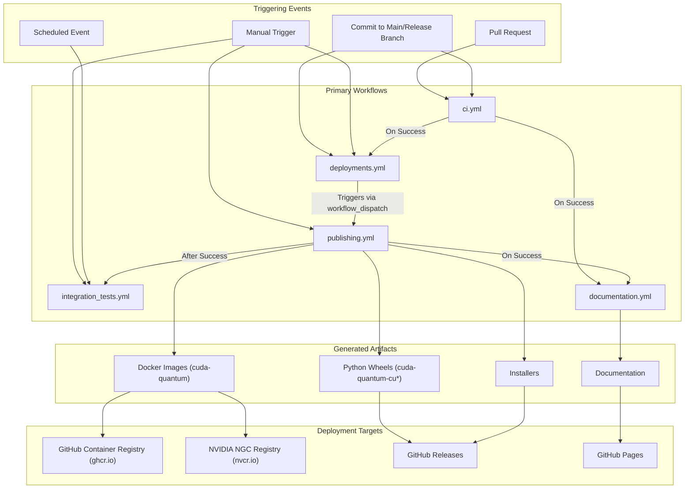

Sources: [.github/workflows/ci.yml:20-26](), [.github/workflows/deployments.yml:1-43](), [.github/workflows/publishing.yml:1-41](), [.github/workflows/integration_tests.yml:1-16](), [.github/workflows/documentation.yml:1-33]()

## Core Workflows

The CI/CD system consists of several interconnected GitHub Actions workflows that handle different aspects of the build, test, and deployment process.

### CI Workflow

The CI workflow validates code changes by building CUDA Quantum with various toolchains and configurations and running comprehensive tests.

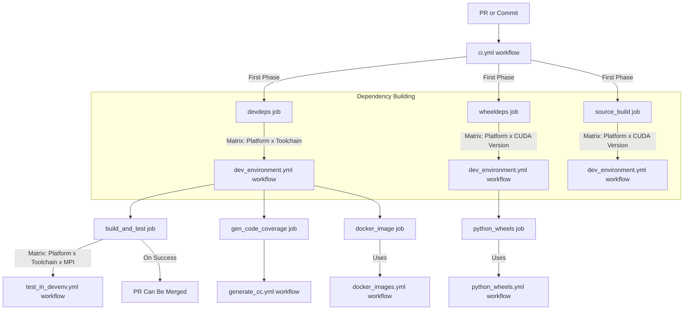

Sources: [.github/workflows/ci.yml:78-252](), [.github/workflows/test_in_devenv.yml:1-284](), [.github/workflows/generate_cc.yml:1-162](), [.github/workflows/docker_images.yml:1-630](), [.github/workflows/python_wheels.yml:1-361]()

### Deployments Workflow

The Deployments workflow runs after PR merges to the main branch or on push to release branches to prepare artifacts for deployment.

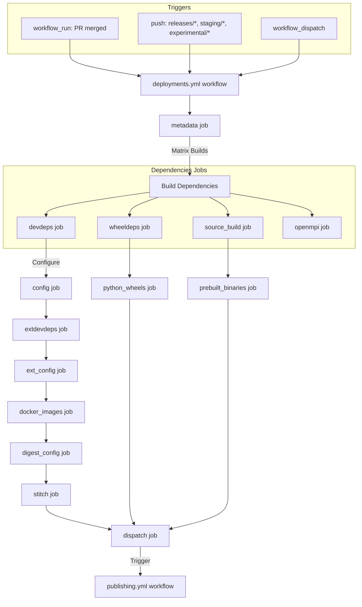

Sources: [.github/workflows/deployments.yml:48-453](), [.github/workflows/deployments.yml:1-43]()

### Publishing Workflow

The Publishing workflow creates and publishes artifacts to various registries and repositories.

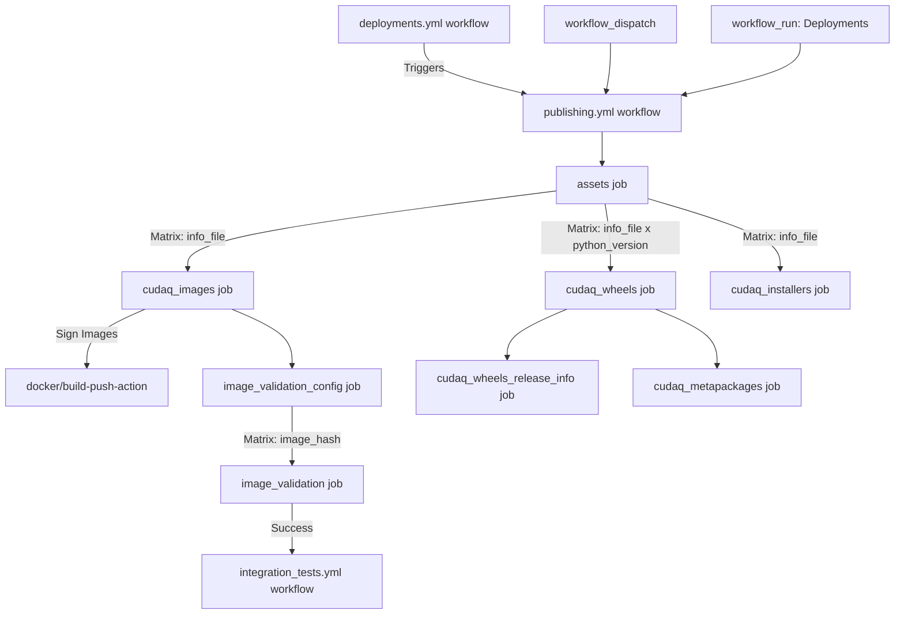

Sources: [.github/workflows/publishing.yml:1-41](), [.github/workflows/publishing.yml:41-774](), [.github/workflows/publishing.yml:332-517](), [.github/workflows/publishing.yml:526-637](), [.github/workflows/publishing.yml:638-778](), [.github/workflows/publishing.yml:779-826](), [.github/workflows/publishing.yml:811-826]()

### Integration Tests Workflow

The Integration Tests workflow validates CUDA-Q with various quantum hardware providers through nightly testing and manual triggers.

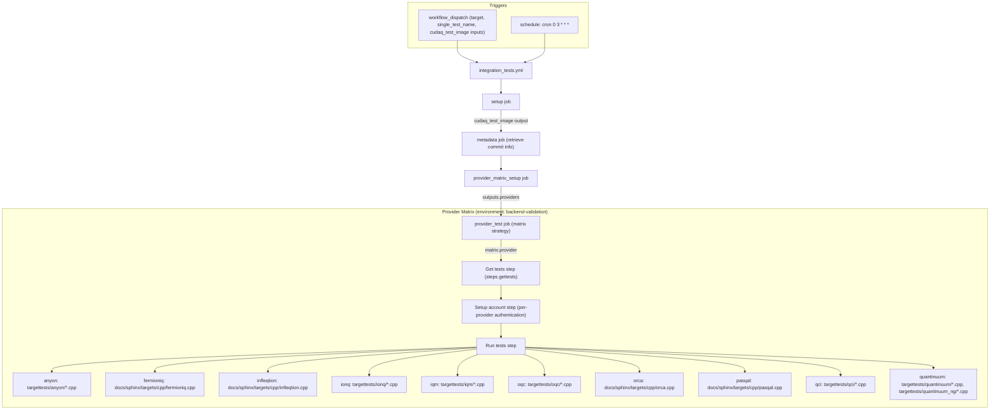

**Provider Authentication**: Each provider test uses environment-specific secrets stored in the `backend-validation` environment:
- **Anyon**: `ANYON_USERNAME`, `ANYON_PASSWORD` → creates `~/.anyon_config`
- **FermionIQ**: `FERMIONIQ_ACCESS_TOKEN_ID`, `FERMIONIQ_ACCESS_TOKEN_SECRET`
- **Infleqtion**: `SUPERSTAQ_API_KEY`
- **IonQ**: `IONQ_API_KEY`
- **IQM**: `IQM_TOKEN` → creates `IQM_TOKENS_FILE`
- **OQC**: `OQC_URL`, `OQC_EMAIL`, `OQC_DEVICE`, `OQC_AUTH_TOKEN`
- **ORCA**: `ORCA_ACCESS_URL`
- **Pasqal**: `PASQAL_USERNAME`, `PASQAL_PASSWORD`, `PASQAL_PROJECT_ID`
- **QCI**: `QCI_AUTH_TOKEN`
- **Quantinuum**: `BACKEND_LOGIN_EMAIL`, `QUANTINUUM_NEXUS_PASSWORD` → creates `~/.quantinuum_config`

Sources: [.github/workflows/integration_tests.yml:1-61](), [.github/workflows/integration_tests.yml:65-184](), [.github/workflows/integration_tests.yml:186-376](), [.github/workflows/integration_tests.yml:378-674]()

## Artifact Building Process

### Docker Image Building

The Docker image building process creates container images for different platforms and CUDA versions.

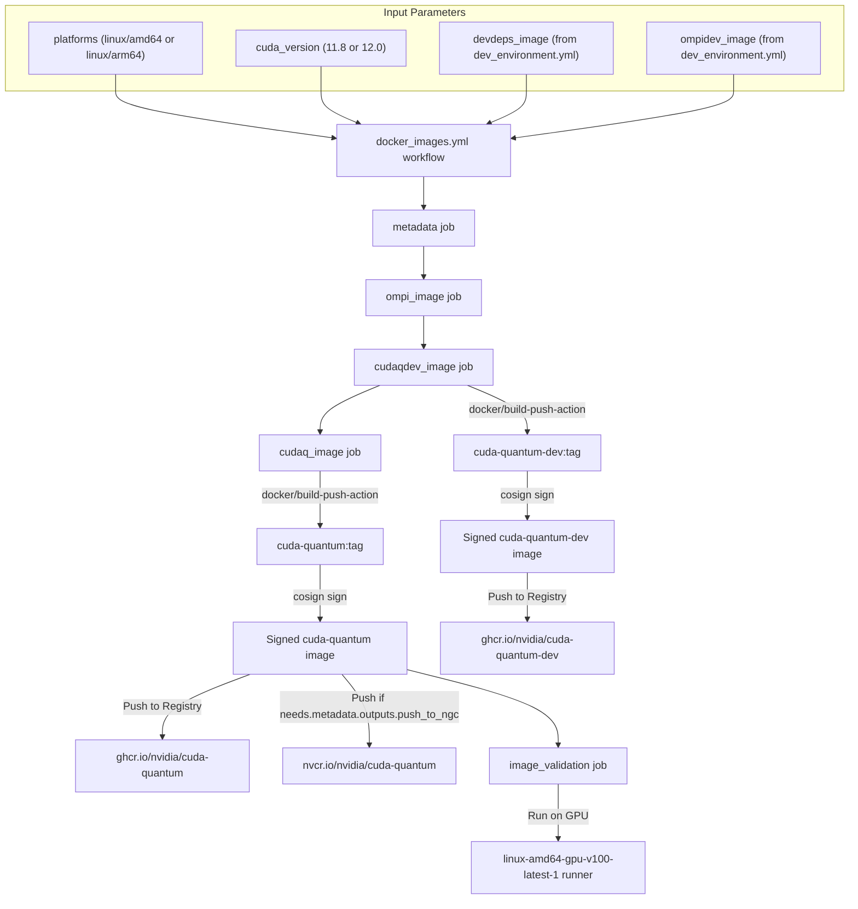

Sources: [.github/workflows/docker_images.yml:1-83](), [.github/workflows/docker_images.yml:83-206](), [.github/workflows/docker_images.yml:207-376](), [.github/workflows/docker_images.yml:377-630](), [.github/workflows/docker_images.yml:631-826]()

### Python Wheel Building

The Python wheel building process creates wheels for different platforms, Python versions, and CUDA versions.

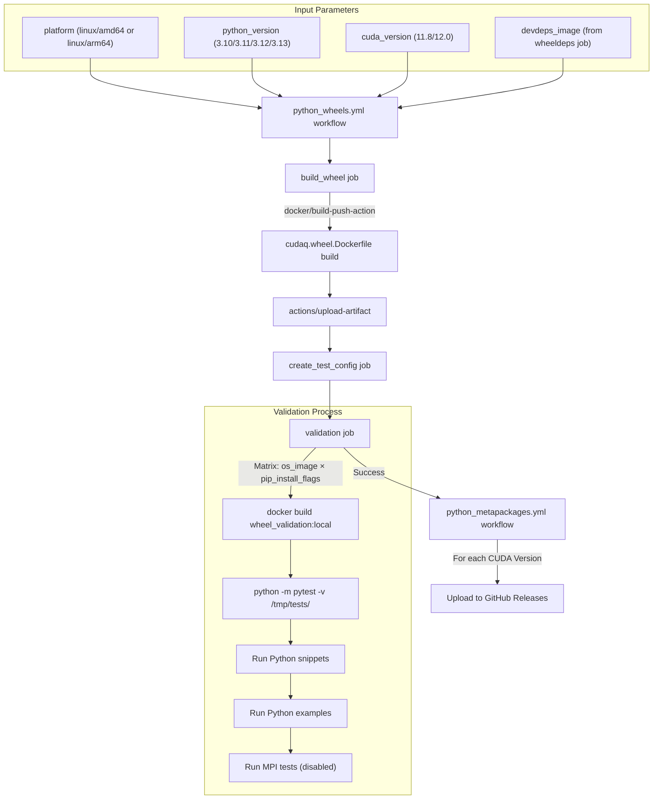

Sources: [.github/workflows/python_wheels.yml:1-40](), [.github/workflows/python_wheels.yml:41-156](), [.github/workflows/python_wheels.yml:157-176](), [.github/workflows/python_wheels.yml:177-361](), [.github/workflows/publishing.yml:779-789]()

### Installer Building

The installer building process creates platform-specific installers for CUDA Quantum.

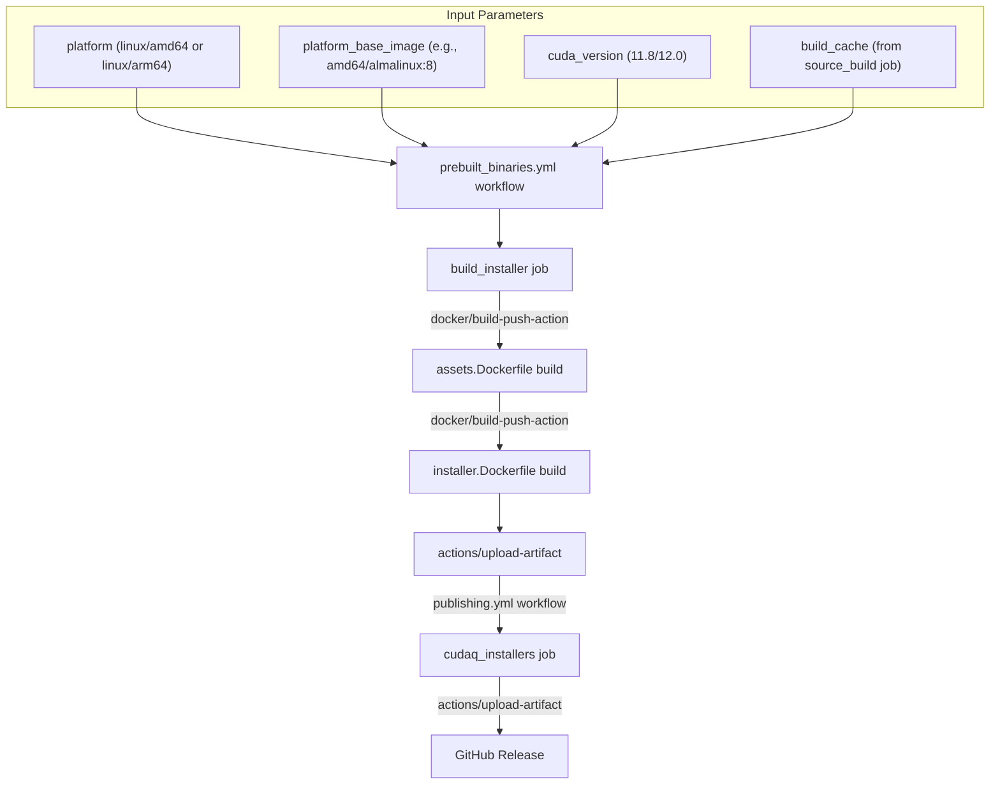

Sources: [.github/workflows/prebuilt_binaries.yml:1-35](), [.github/workflows/prebuilt_binaries.yml:36-277](), [.github/workflows/publishing.yml:526-637]()

## Deployment and Release Process

The deployment and release process involves coordinated execution of several workflows to build, publish, and validate CUDA Quantum artifacts.

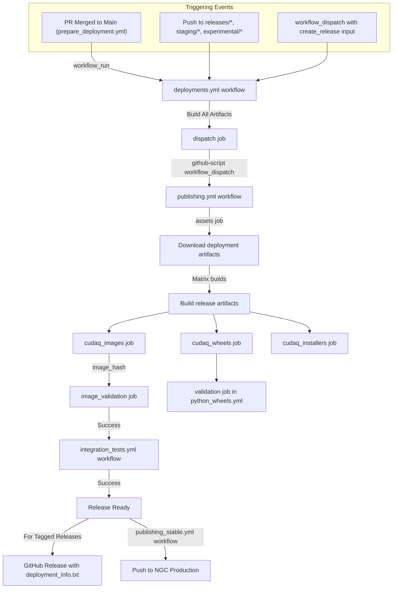

Sources: [.github/workflows/prepare_deployment.yml:1-28](), [.github/workflows/deployments.yml:1-43](), [.github/workflows/deployments.yml:288-354](), [.github/workflows/publishing.yml:1-41](), [.github/workflows/publishing.yml:41-774](), [.github/workflows/publishing_stable.yml:1-35](), [.github/workflows/publishing_stable.yml:36-273]()

## Registry and Environment Management

CUDA Quantum uses multiple registries and environments for different stages of the deployment process.

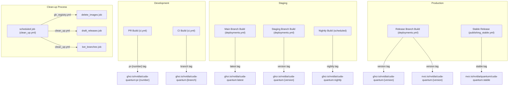

Sources: [.github/workflows/gh_registry.yml:1-7](), [.github/workflows/gh_registry.yml:8-265](), [.github/workflows/clean_up.yml:1-20](), [.github/workflows/clean_up.yml:21-67](), [.github/workflows/clean_up.yml:68-154](), [.github/workflows/publishing_stable.yml:1-35]()

## Integration Testing Details

### Provider Test Execution

The `provider_test` job executes tests in a matrix strategy across all configured providers. Test execution varies by provider and file type:

| Provider | Compilation | Execution | Test Files |
|----------|------------|-----------|------------|
| Anyon | `nvq++ --target anyon --anyon-machine telegraph-8q` | `./a.out` | `targettests/anyon/*.cpp` |
| FermionIQ | `nvq++ --target fermioniq` or `python3` | `./a.out` or direct | C++/Python files in docs |
| Infleqtion | `nvq++ --target infleqtion` or `python3` | `./a.out` or direct | C++/Python files in docs |
| IonQ | `nvq++ --target ionq` | `./a.out` | `targettests/ionq/*.cpp` |
| IQM | `nvq++ --target iqm` | `./a.out` | `targettests/iqm/*.cpp` |
| OQC | `nvq++ --target oqc` | `./a.out` | `targettests/oqc/*.cpp` |
| ORCA | `nvq++ --target orca --orca-url` or `python3` | `./a.out` or direct | C++/Python files in docs |
| Pasqal | `nvq++ --target pasqal --pasqal-machine` or `python3` | `./a.out` or direct | C++/Python files in docs |
| QCI | `nvq++ --target qci` | `./a.out` | `targettests/qci/*.cpp` |
| Quantinuum | `nvq++ --target quantinuum --quantinuum-machine` or `python3` | `./a.out` or direct | `targettests/quantinuum/*.cpp`, `targettests/quantinuum_ng/*.cpp` |

### Provider Test Configuration

The `provider_matrix_setup` job determines which providers to test based on the trigger:

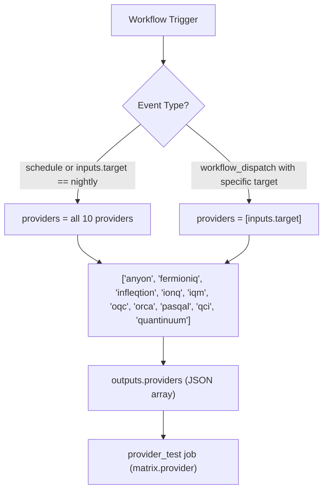

### Test Selection Logic

Within each provider test, the `gettests` step determines which tests to run:

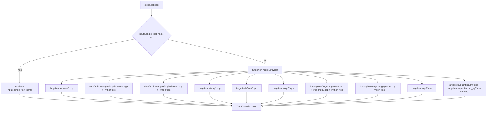

Sources: [.github/workflows/integration_tests.yml:166-184](), [.github/workflows/integration_tests.yml:204-257](), [.github/workflows/integration_tests.yml:379-674]()

## Advanced Features

### Caching System

CUDA Quantum uses a multi-layered caching system to improve build performance. The `dev_environment.yml` workflow implements the caching logic through the `cache` step in the `build` job.

```mermaid
flowchart TD
    subgraph "Cache Configuration (steps.cache)"
        BuildConfigID["build_config_id (e.g., clang16, cu12.6-gcc11)"]
        ImageID["image_id (e.g., devdeps, devdeps.manylinux)"]
        PlatformID["platform_id (amd64 or arm64)"]
        
        BuildConfigID --> CacheID["cache_id = image_id + build_config_id"]
        ImageID --> CacheID
        PlatformID --> CacheKey["Cache key components"]
        CacheID --> CacheKey
    end
    
    subgraph "Cache Types and Locations"
        RegistryCache["type=registry,ref=ghcr.io/.../buildcache-cuda-quantum-{cache_id}-{platform_id}:{branch}"]
        LocalBuildCache["type=local,src=/tmp/.buildcache.{image_id}"]
        
        RegistryCache --> |"cache-from"| DockerBuild["docker/build-push-action"]
        LocalBuildCache --> |"cache-from"| DockerBuild
        
        DockerBuild --> |"cache-to (if update_registry_cache)"| UpdateRegistry["type=registry,mode=max"]
        DockerBuild --> |"cache-to (if create_local_cache)"| UpdateLocal["type=local,dest=/tmp/.buildcache.{image_id}-new"]
    end
    
    subgraph "Cache Hierarchy"
        PRCache["PR Cache: pull-request-{pr_number}"]
        BranchCache["Branch Cache: {branch_name}"]
        MainCache["Main Cache: main"]
        NvidiaCache["NVIDIA Cache: ghcr.io/nvidia/buildcache-cuda-quantum-*"]
        
        PRCache --> |"Fallback"| BranchCache
        BranchCache --> |"Fallback"| MainCache
        MainCache --> |"Fallback"| NvidiaCache
    end
    
    subgraph "Cache Management"
        ActionsCache["actions/cache/restore and actions/cache/save"]
        ActionsCache --> |"Key: {branch}-cuda-quantum-{cache_id}-{platform_id}-{commit}"| LocalStorage["/tmp/.buildcache.{image_id}"]
        
        GHRegistry["gh_registry.yml (daily cleanup)"]
        GHRegistry --> |"delete-package-versions"| CleanOld["Remove old untagged versions"]
    end
```

**Cache Key Structure**: The cache system uses hierarchical keys to enable fallback to parent branch caches:
- Local GitHub Actions cache: `{branch}/merge-cuda-quantum-{cache_id}-{platform_id}-{commit_sha}`
- Registry cache: `ghcr.io/{owner}/buildcache-cuda-quantum-{cache_id}-{platform_id}:{branch}`

**Cache Update Flow**: When `update_registry_cache` is set, the workflow only updates the cache and terminates without creating artifacts. This is used during the deployment workflow to prepare caches for release builds.

Sources: [.github/workflows/dev_environment.yml:82-83](), [.github/workflows/dev_environment.yml:186-376](), [.github/workflows/dev_environment.yml:240-309](), [.github/workflows/gh_registry.yml:1-265]()

### Documentation Publishing

The documentation workflow builds and publishes CUDA Quantum documentation.

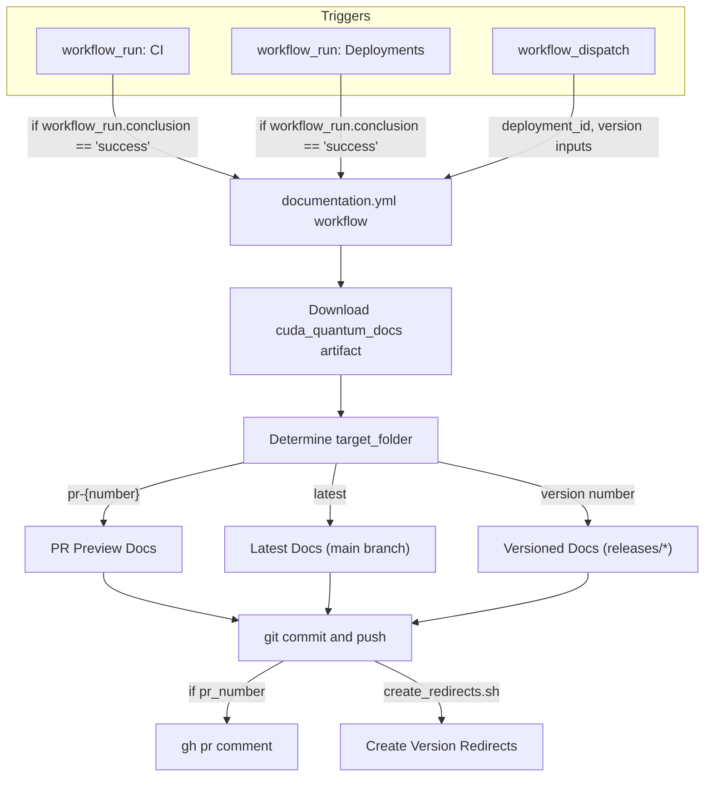

Sources: [.github/workflows/documentation.yml:1-33](), [.github/workflows/documentation.yml:36-198]()

## Maintenance and Cleanup

CUDA Quantum includes automated processes for cleaning up resources to maintain the health of the CI/CD system.

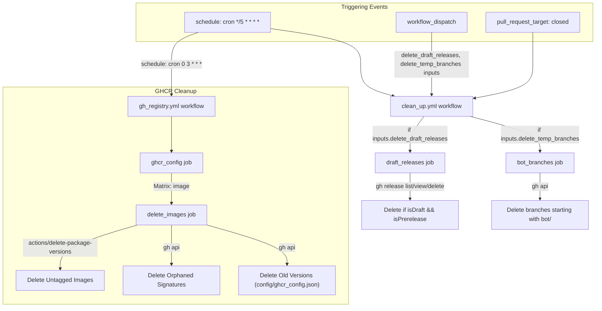

Sources: [.github/workflows/clean_up.yml:1-20](), [.github/workflows/clean_up.yml:21-67](), [.github/workflows/gh_registry.yml:1-7](), [.github/workflows/gh_registry.yml:8-265](), [.github/workflows/config/ghcr_config.json:1-22]()

This comprehensive CI/CD system ensures that CUDA Quantum is continuously built, tested, and deployed with high quality across multiple platforms, Python versions, and CUDA versions.

---

