<!-- source: DeepWiki mcp.deepwiki.com · repo NVIDIA/cuda-quantum · page 8.1 GitHub Actions Workflows · fetched 2026-10-26 -->

# GitHub Actions Workflows

<details>
<summary>Relevant source files</summary>

The following files were used as context for generating this wiki page:

- [.gitattributes](.gitattributes)
- [.github/workflows/ci.yml](.github/workflows/ci.yml)
- [.github/workflows/clean_up.yml](.github/workflows/clean_up.yml)
- [.github/workflows/create_cache_command.yml](.github/workflows/create_cache_command.yml)
- [.github/workflows/deployments.yml](.github/workflows/deployments.yml)
- [.github/workflows/dev_environment.yml](.github/workflows/dev_environment.yml)
- [.github/workflows/docker_images.yml](.github/workflows/docker_images.yml)
- [.github/workflows/documentation.yml](.github/workflows/documentation.yml)
- [.github/workflows/generate_cc.yml](.github/workflows/generate_cc.yml)
- [.github/workflows/gh_registry.yml](.github/workflows/gh_registry.yml)
- [.github/workflows/integration_tests.yml](.github/workflows/integration_tests.yml)
- [.github/workflows/prebuilt_binaries.yml](.github/workflows/prebuilt_binaries.yml)
- [.github/workflows/prepare_deployment.yml](.github/workflows/prepare_deployment.yml)
- [.github/workflows/publishing.yml](.github/workflows/publishing.yml)
- [.github/workflows/publishing_stable.yml](.github/workflows/publishing_stable.yml)
- [.github/workflows/python_wheels.yml](.github/workflows/python_wheels.yml)
- [.github/workflows/test_in_devenv.yml](.github/workflows/test_in_devenv.yml)
- [runtime/cudaq/remote_capabilities.h](runtime/cudaq/remote_capabilities.h)

</details>


This document describes the GitHub Actions workflow infrastructure that orchestrates CUDA-Q's continuous integration, deployment, and release processes. These workflows handle building Docker images, Python wheels, C++ installers, running tests, and publishing artifacts to multiple distribution channels.

For information about the Docker build system itself, see [Docker Build System](#7.1). For details on validation scripts and testing strategies, see [Testing and Validation Infrastructure](#8.2). For the release process, see [Release and Publishing Process](#8.4).

## Overview

The CUDA-Q CI/CD system consists of interconnected workflows that handle different aspects of the build, test, and deployment pipeline. Workflows are categorized into:

- **Entry point workflows**: Triggered by GitHub events (`ci.yml`, `deployments.yml`, `integration_tests.yml`)
- **Reusable workflows**: Called by other workflows to perform specific tasks (`dev_environment.yml`, `docker_images.yml`, `python_wheels.yml`, etc.)
- **Publishing workflows**: Handle artifact distribution (`publishing.yml`, `publishing_stable.yml`)
- **Maintenance workflows**: Clean up resources and manage registries (`clean_up.yml`, `gh_registry.yml`)

Sources: [.github/workflows/integration_tests.yml:1-675](), [.github/workflows/publishing.yml:1-716](), [.github/workflows/deployments.yml:1-643](), [.github/workflows/ci.yml:1-300]()

## Workflow Trigger Architecture

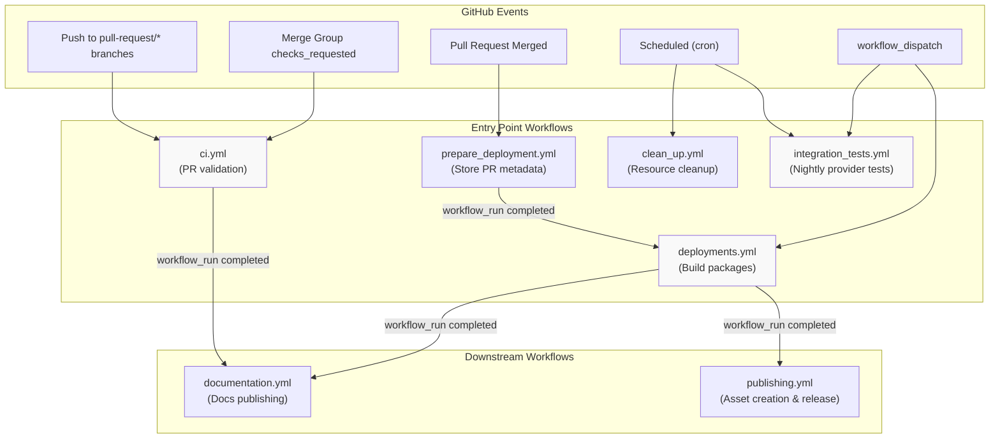

**Workflow Event Mapping:**

| Workflow | Triggers | Typical Frequency |
|----------|----------|-------------------|
| `ci.yml` | Push to `pull-request/*`, merge_group | Per PR commit |
| `deployments.yml` | `workflow_run` (PR merged), `workflow_dispatch`, push to `releases/*`, `staging/*`, `experimental/*` | Post-merge, on-demand |
| `integration_tests.yml` | `workflow_dispatch`, `schedule` (daily 3 AM UTC) | Nightly + on-demand |
| `publishing.yml` | `workflow_run` (Deployments completed), `workflow_dispatch` | Post-deployment |
| `documentation.yml` | `workflow_run` (CI/Deployments completed), `workflow_dispatch` | Per build |
| `clean_up.yml` | `schedule` (every 5 min), `workflow_dispatch`, `pull_request_target` closed | Continuous |

Sources: [.github/workflows/ci.yml:1-26](), [.github/workflows/deployments.yml:1-46](), [.github/workflows/integration_tests.yml:1-60](), [.github/workflows/publishing.yml:1-38](), [.github/workflows/documentation.yml:1-28](), [.github/workflows/clean_up.yml:1-19]()

## CI Workflow Pipeline

The `ci.yml` workflow orchestrates PR validation by building dependencies, compiling CUDA-Q, running tests, and creating Python wheels.

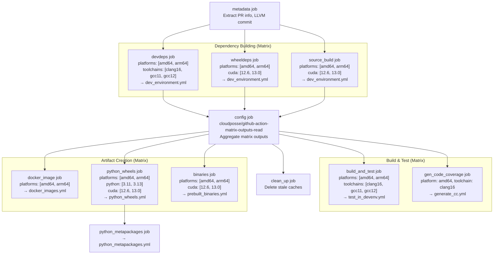

**Job Descriptions:**

- **metadata**: Extracts PR number, base branch, LLVM commit hash [.github/workflows/ci.yml:29-77]()
- **devdeps/wheeldeps/source_build**: Build development dependencies using `dev_environment.yml` with different toolchains and CUDA versions [.github/workflows/ci.yml:79-153]()
- **config**: Aggregates matrix job outputs using `cloudposse/github-action-matrix-outputs-read@1.0.0` [.github/workflows/ci.yml:159-171]()
- **build_and_test**: Compiles CUDA-Q in debug mode, runs C++ tests (ctest, llvm-lit) and Python tests [.github/workflows/ci.yml:173-194]()
- **docker_image**: Creates `cuda-quantum-dev` (debug) and `cuda-quantum` (release) images [.github/workflows/ci.yml:214-229]()
- **python_wheels**: Builds Python wheels for specified Python versions and CUDA versions [.github/workflows/ci.yml:231-250]()
- **binaries**: Creates C++ installers for specified platforms and CUDA versions [.github/workflows/ci.yml:262-279]()

Sources: [.github/workflows/ci.yml:28-285]()

## Reusable Workflow: dev_environment.yml

The `dev_environment.yml` workflow is a core reusable component that builds and caches Docker images with development dependencies.

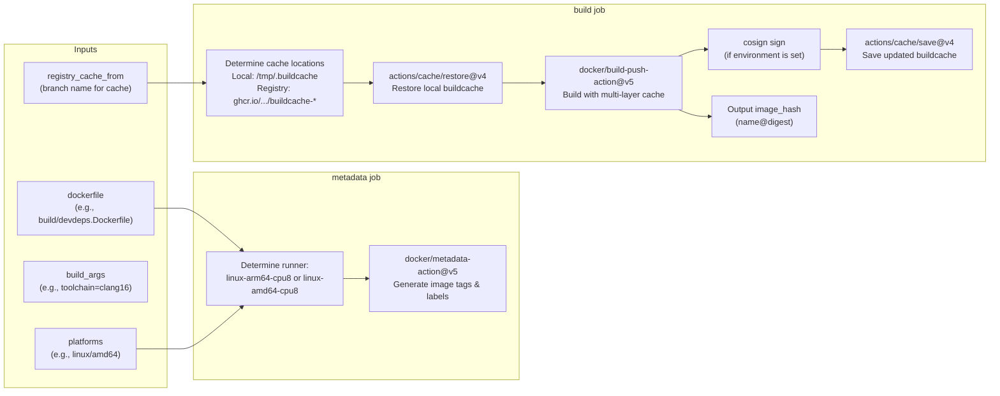

**Key Features:**

1. **Multi-tier Caching**: Uses both GitHub Actions cache (local) and container registry cache [.github/workflows/dev_environment.yml:240-308]()
   - Local cache: `/tmp/.buildcache` restored/saved via `actions/cache`
   - Registry cache: `ghcr.io/nvidia/buildcache-cuda-quantum-{image_id}-{platform_id}:{branch}`

2. **Cache Key Hierarchy** [.github/workflows/dev_environment.yml:251-293]():
   ```
   type=local,src=/tmp/.buildcache
   type=registry,ref=ghcr.io/.../buildcache-*-{platform}:pull-request-{pr_number}
   type=registry,ref=ghcr.io/.../buildcache-*-{platform}:{base_branch}
   type=registry,ref=ghcr.io/nvidia/buildcache-*-{platform}:{base_branch}
   ```

3. **Dynamic Runner Selection**: Chooses `linux-arm64-cpu8` or `linux-amd64-cpu8` based on platform [.github/workflows/dev_environment.yml:119-129]()

4. **Image Signing**: Uses Cosign with GitHub OIDC tokens when `environment` is set [.github/workflows/dev_environment.yml:344-349]()

Sources: [.github/workflows/dev_environment.yml:1-415]()

## Deployments Workflow

The `deployments.yml` workflow builds production packages after PRs are merged or on-demand for releases.

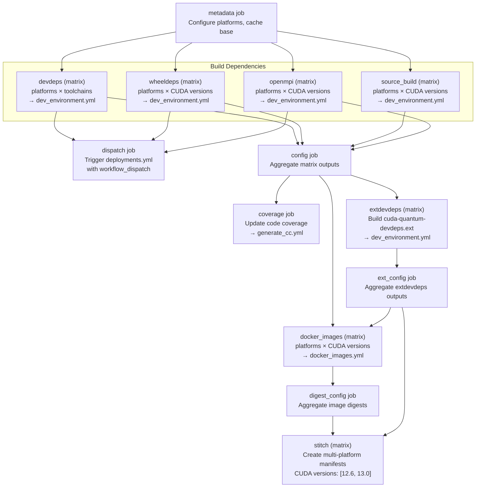

**Multi-Platform Image Stitching:**

The `stitch` job creates unified multi-platform Docker manifests from individual platform images using `docker buildx imagetools create` [.github/workflows/deployments.yml:494-567]():

```
# For each CUDA version:
# 1. Collect platform-specific images
refs="$arm64_image $amd64_image"

# 2. Create multi-platform tag
docker buildx imagetools create --tag "cuda-quantum-devdeps:cu12-latest" $refs

# 3. Push to NGC if configured
```

**Environment Configuration:**

- `inputs.update_registry_cache=false` and `environment='ghcr-deployment'`: Push images to GHCR
- `needs.metadata.outputs.push_to_ngc == 'true'`: Also push to NGC (nvcr.io) [.github/workflows/deployments.yml:68-69]()

Sources: [.github/workflows/deployments.yml:1-643]()

## Publishing Workflow

The `publishing.yml` workflow creates final release artifacts and publishes them to NGC, PyPI, and GitHub Releases.

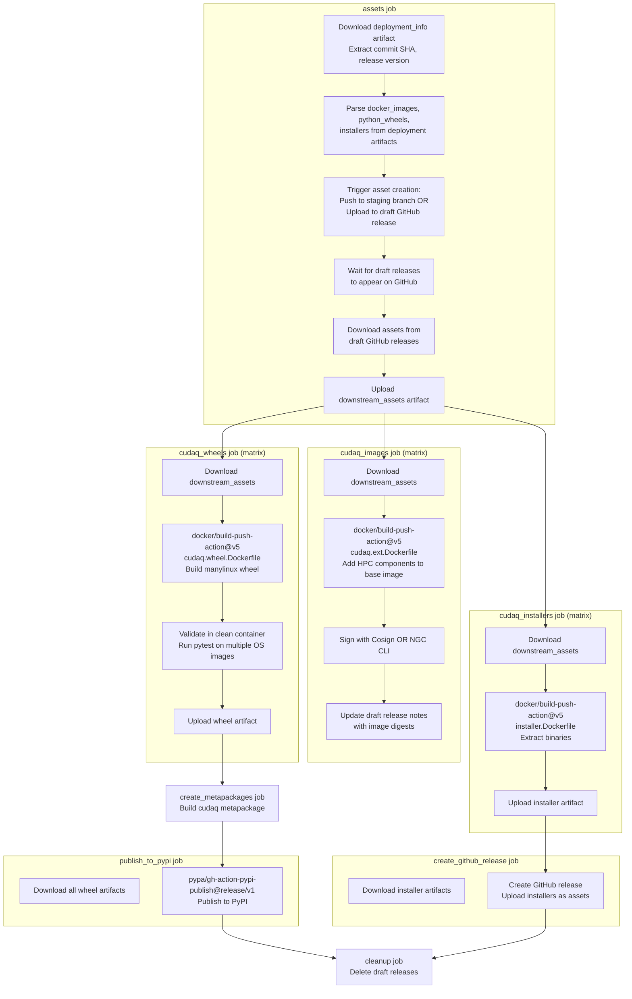

**Asset Creation Process:**

The workflow handles two asset creation modes [.github/workflows/publishing.yml:162-243]():

1. **Automated (default)**: Pushes staging commits to trigger GitLab pipelines that build additional components (e.g., nvidia-mgpu backend)
2. **Manual (`inputs.manual_assets_creation`)**: Uses pre-built assets from a specified draft release

**Draft Release Management:**

Each platform/CUDA combination gets its own draft release with ID `{workflow_run_id}_{info_file}` [.github/workflows/publishing.yml:115-119](). This prevents race conditions when building assets concurrently.

**NGC vs GHCR Publishing:**

Determined by `vars.registry` and `secrets.NGC_CREDENTIALS` [.github/workflows/publishing.yml:405-408]():
- GHCR: Default for development, signed with Cosign
- NGC: Production releases, signed with NGC CLI

Sources: [.github/workflows/publishing.yml:1-1100]()

## Integration Testing Workflow

The `integration_tests.yml` workflow runs nightly tests against live quantum hardware providers.

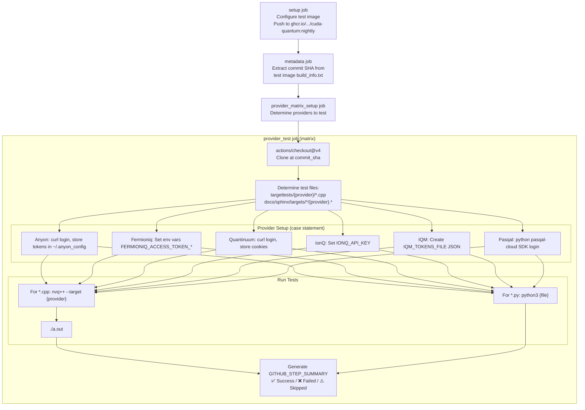

**Provider Configuration:**

Each provider requires specific authentication setup [.github/workflows/integration_tests.yml:260-376]():

| Provider | Authentication Method | Environment Variables |
|----------|----------------------|----------------------|
| Anyon | REST API login → `~/.anyon_config` | `ANYON_USERNAME`, `ANYON_PASSWORD` |
| Fermioniq | Access tokens | `FERMIONIQ_ACCESS_TOKEN_ID`, `FERMIONIQ_ACCESS_TOKEN_SECRET`, `FERMIONIQ_PROJECT_ID` |
| Quantinuum | Cookie-based auth → `~/.quantinuum_config` | `BACKEND_LOGIN_EMAIL`, `QUANTINUUM_NEXUS_PASSWORD` |
| IonQ | API key | `IONQ_API_KEY` |
| IQM | Token file | `IQM_TOKENS_FILE`, `IQM_SERVER_URL` |
| OQC | Direct auth | `OQC_URL`, `OQC_EMAIL`, `OQC_DEVICE`, `OQC_AUTH_TOKEN` |
| Pasqal | Python SDK | `PASQAL_AUTH_TOKEN`, `PASQAL_USERNAME`, `PASQAL_PROJECT_ID` |

**Test Execution Logic:**

Tests are run in a loop with status tracking [.github/workflows/integration_tests.yml:379-674]():

```bash
for filename in $testlist; do
  case "$provider" in
    anyon)
      nvq++ -v $filename -DSYNTAX_CHECK --target anyon --anyon-machine telegraph-8q
      ./a.out
      ;;
    quantinuum)
      if [[ "$filename" == *"quantinuum_ng/"* ]]; then
        nvq++ --target quantinuum --quantinuum-machine Helios-1E ...
      else
        nvq++ --target quantinuum --quantinuum-machine H2-1SC ...
      fi
      ./a.out
      ;;
  esac
done
```

**Manual Testing Options:**

The workflow supports manual execution with specific parameters [.github/workflows/integration_tests.yml:10-57]():
- `target`: Choose specific provider or "nightly" for all
- `single_test_name`: Run a single test file
- `target_machine`: Override target machine
- `cudaq_test_image`: Use specific CUDA-Q image
- `python_version`: Select Python version (3.11, 3.12, 3.13)

Sources: [.github/workflows/integration_tests.yml:1-675]()

## Docker Image Build Workflow

The `docker_images.yml` reusable workflow creates production Docker images with optimization and release configurations.

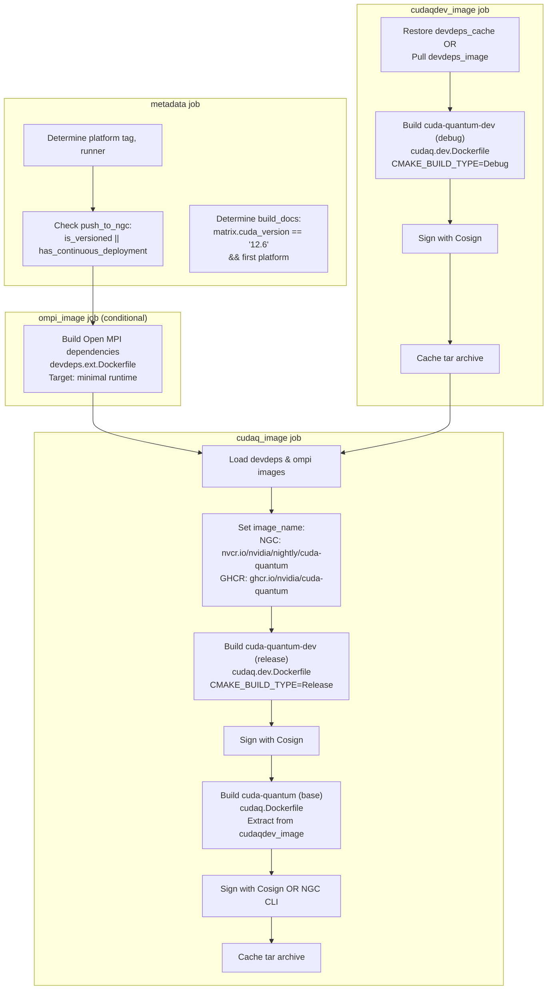

**Image Tag Strategy** [.github/workflows/docker_images.yml:495-517]():

```
Tag Format: {platform_tag}-{cuda_major}-{ref_identifier}

Examples:
- PR: amd64-cu12-pr-1234
- Main: cu12-latest (no platform tag for multi-platform)
- Release: cu12-0.9.0
- Feature: cu12-experimental-feature-name
```

**NGC vs GHCR Decision Tree** [.github/workflows/docker_images.yml:68-69]():

```
push_to_ngc = (environment is set) 
              && (secrets.NGC_CREDENTIALS exists)
              && (is_versioned || has_continuous_deployment)

where:
  is_versioned = tag || starts_with(branch, 'releases/') || starts_with(branch, 'staging/')
  has_continuous_deployment = starts_with(branch, 'experimental/') || branch == 'main'
```

**Build Stages:**

1. **Open MPI Image** (conditional): Minimal runtime with MPI support [.github/workflows/docker_images.yml:83-206]()
2. **cuda-quantum-dev (debug)**: Debug build for development [.github/workflows/docker_images.yml:207-375]()
3. **cuda-quantum-dev (release)**: Release build with optimizations [.github/workflows/docker_images.yml:553-568]()
4. **cuda-quantum (base)**: Minimal production image [.github/workflows/docker_images.yml:608-626]()

Sources: [.github/workflows/docker_images.yml:1-1346]()

## Python Wheel Build and Validation

The `python_wheels.yml` workflow builds manylinux-compatible Python wheels and validates them across multiple operating systems.

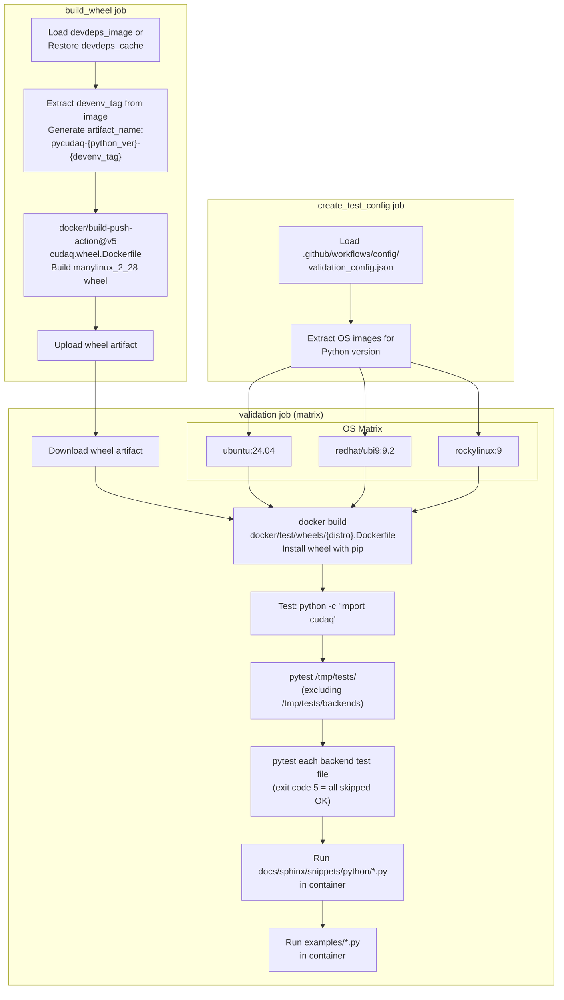

**Validation Matrix** [.github/workflows/python_wheels.yml:188-192]():

The workflow tests each wheel against:
- Multiple OS images (ubuntu, redhat, rockylinux)
- Multiple pip install modes (`--user` flag vs. system-wide)

**Wheel Filename Convention:**

```
cuda_quantum_cu{cuda_major}-{version}-{python_tag}-{abi_tag}-manylinux_2_28_{arch}.whl

Example:
cuda_quantum_cu12-0.9.0-cp311-cp311-manylinux_2_28_x86_64.whl
```

**Test Execution Flow** [.github/workflows/python_wheels.yml:241-264]():

1. Install wheel in clean container
2. Verify `import cudaq` succeeds
3. Run core pytest suite
4. Run backend-specific tests (allowing exit code 5 for "all skipped")
5. Validate Python snippets from documentation
6. Validate example scripts

**MPI Plugin Test** (currently disabled) [.github/workflows/python_wheels.yml:269-319]():

Validates the conda-based MPI installation workflow:
```bash
conda install -c conda-forge openmpi openmpi-mpicc mpi4py
python -m pip install cuda-quantum-cu12
source $CUDAQ_INSTALL_PREFIX/distributed_interfaces/activate_custom_mpi.sh
mpirun -np 4 python -m pytest test_mpi_api.py
```

Sources: [.github/workflows/python_wheels.yml:1-445]()

## Build Cache Strategy

CUDA-Q uses a multi-tier caching system to optimize build times across workflows.

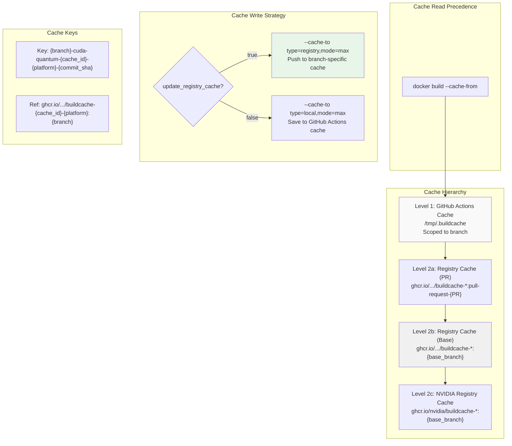

**Cache Key Components** [.github/workflows/dev_environment.yml:242-308]():

| Component | Description | Example |
|-----------|-------------|---------|
| `cache_id` | `{image_id}-{build_config_id}` with dots→hyphens | `devdeps-clang16` |
| `platform_id` | Platform without `linux/` prefix, commas→hyphens | `amd64` or `amd64-arm64` |
| `branch_name` | Branch with slashes→hyphens | `pull-request-123` or `main` |
| `commit_sha` | Full git commit hash | `a1b2c3d4...` |

**Cache Update Logic** [.github/workflows/dev_environment.yml:261-272]():

```yaml
if update_registry_cache is set:
  cache_to: type=registry,ref={registry_cache},mode=max
  # Builds push cache to registry but don't push image
elif create_local_cache is true:
  cache_to: type=local,dest=/tmp/.buildcache-new,mode=max
  # Save to GitHub Actions cache after build
else:
  cache_to: (empty)
  # Read-only mode, no cache updates
```

**Deployments Workflow Cache Strategy** [.github/workflows/deployments.yml:225-232]():

After PRs are merged, the `deployments.yml` workflow:
1. Reads cache from `registry_cache_from: {pr_base_branch}`
2. Writes cache to `update_registry_cache: {branch_name}` (only for dependency builds)

This ensures main branch cache is always up-to-date while PR caches remain isolated.

**Cache Cleanup:**

The `clean_up.yml` workflow deletes stale caches [.github/workflows/ci.yml:281-300]():
```yaml
- Delete PR branch caches when PR is closed
- Delete local GitHub Actions caches after 7 days (GitHub default)
- Keep registry caches (deleted via actions/delete-package-versions in clean_up.yml)
```

Sources: [.github/workflows/dev_environment.yml:240-308](), [.github/workflows/deployments.yml:191-232](), [.github/workflows/ci.yml:281-300]()

## Test Execution in Development Environments

The `test_in_devenv.yml` workflow runs comprehensive testing within Docker development environments.

```mermaid
graph TB
    subgraph "build_and_test job"
        RestoreDevDeps1["Restore devdeps_cache OR<br/>Pull devdeps_image"]
        BuildDebug["DOCKER_BUILDKIT=1 docker build<br/>cudaq.dev.Dockerfile<br/>CMAKE_BUILD_TYPE=Debug<br/>Tag: cuda-quantum-dev:local"]
        
        subgraph "Test Execution (run-in-docker action)"
            InstallIQM["pip install iqm-client==28.0.0"]
            PyInterop["pytest build/python/tests/interop/"]
            CTest["ctest --test-dir build<br/>(exclude ctest-nvqpp, ctest-targettests)"]
            LLVMLit["llvm-lit build/test<br/>llvm-lit build/targettests<br/>llvm-lit build/python/tests/mlir"]
        end
        
        subgraph "MPI Plugin Test"
            DetectMPI["Detect OMPI or MPICH<br/>Set MPI_PATH"]
            ActivateMPI["source activate_custom_mpi.sh"]
            RunMPITest["ctest -R MPIApiTest"]
        end
        
        ExportDebug["Export container as tar<br/>(if export_environment)"]
    end
    
    subgraph "build_and_test_python job"
        RestoreDevDeps2["Restore devdeps_cache OR<br/>Pull devdeps_image"]
        BuildPython["DOCKER_BUILDKIT=1 docker build<br/>cudaq.dev.Dockerfile<br/>(no CMAKE_BUILD_TYPE arg)<br/>Tag: dev_env:local"]
        
        subgraph "Python Build & Test"
            CreateVenv["python -m venv --system-site-packages"]
            PipInstall["pip install . -vvv"]
            PyTest["pytest python/tests/<br/>(exclude backends)<br/>pytest python/tests/backends/*.py"]
        end
        
        ExportPython["Export container as tar<br/>(if export_environment)"]
    end
    
    RestoreDevDeps1 --> BuildDebug
    BuildDebug --> InstallIQM
    InstallIQM --> PyInterop --> CTest --> LLVMLit
    LLVMLit --> DetectMPI --> ActivateMPI --> RunMPITest
    RunMPITest --> ExportDebug
    
    RestoreDevDeps2 --> BuildPython
    BuildPython --> CreateVenv
    CreateVenv --> PipInstall --> PyTest --> ExportPython
```

**Test Categories:**

1. **C++ Tests** [.github/workflows/test_in_devenv.yml:101-113]():
   - `ctest`: Unit tests (excluding lit-based tests)
   - `llvm-lit build/test`: MLIR transformation tests
   - `llvm-lit build/targettests`: Target-specific tests
   - `llvm-lit build/python/tests/mlir`: Python MLIR tests

2. **Python Tests** [.github/workflows/test_in_devenv.yml:252-269]():
   - Core tests: `python/tests/` (excluding backends)
   - Backend tests: Each file in `python/tests/backends/*.py` run separately
   - Exit code 5 (no tests collected) is allowed for backend tests

3. **Interop Tests** [.github/workflows/test_in_devenv.yml:94-100]():
   - Python-to-C++ interoperability tests
   - Requires `iqm-client==28.0.0` for IQM integration tests

**MPI Plugin Validation** [.github/workflows/test_in_devenv.yml:115-143]():

Tests the activation script for custom MPI installations:
```bash
# Determine MPI type and path
has_ompiinfo=$(which ompi_info || true)
if [[ ! -z $has_ompiinfo ]]; then
  export MPI_PATH="/usr/lib/$(uname -m)-linux-gnu/openmpi/"
else
  export MPI_PATH="/usr/lib/$(uname -m)-linux-gnu/mpich/"
fi

# Activate plugin
source $CUDAQ_INSTALL_PREFIX/distributed_interfaces/activate_custom_mpi.sh

# Run MPI-specific test
ctest --test-dir build -R MPIApiTest -V
```

**Environment Export** [.github/workflows/test_in_devenv.yml:145-166]():

When `export_environment: true`, containers are exported as tar archives:
```bash
docker run --name cuda-quantum-dev cuda-quantum-dev:local
docker export cuda-quantum-dev > ${platform_id}_debug_build.tar
```

This allows inspection or reuse of the built environment outside the workflow.

Sources: [.github/workflows/test_in_devenv.yml:1-293]()

## Documentation Publishing

The `documentation.yml` workflow publishes generated documentation to GitHub Pages.

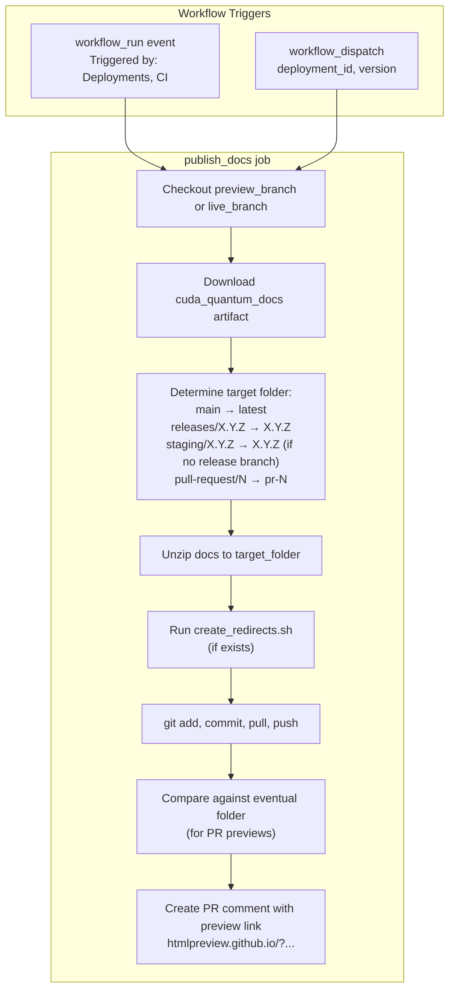

**Branch Strategy:**

- **CI workflow**: Publishes to `preview_branch` (e.g., `docs-preview`) [.github/workflows/documentation.yml:55]()
- **Deployments workflow**: Publishes to `live_branch` (e.g., `gh-pages`) [.github/workflows/documentation.yml:55]()

**Folder Structure:**

```
{live_branch}/
├── latest/           # From main branch
├── 0.9.0/           # From releases/0.9.0 or staging/0.9.0
├── 0.8.0/           # Previous version
└── pr-123/          # PR preview (only in preview_branch)
```

**Version Resolution Logic** [.github/workflows/documentation.yml:104-136]():

| Branch Pattern | Target Folder | Condition |
|---------------|---------------|-----------|
| `main` | `latest` | Always |
| `releases/X.Y.Z` | `X.Y.Z` | Always |
| `staging/X.Y.Z` | `X.Y.Z` | No `releases/X.Y.Z` exists |
| `experimental/*` | None | Not published |
| `features/*` | None | Not published |
| PR (CI only) | `pr-{number}` | Always |

**PR Preview Comments** [.github/workflows/documentation.yml:178-189]():

For PRs, the workflow posts a comment with a preview link:
```
**CUDA Quantum Docs Bot:** A preview of the documentation can be found here:
https://htmlpreview.github.io/?https://github.com/{repo}/blob/{branch}/pr-123/index.html
```

If no documentation changes are detected, it posts:
```
**CUDA Quantum Docs Bot:** This PR contains no documentation changes.
```

Sources: [.github/workflows/documentation.yml:1-202]()

## Resource Cleanup Workflows

### Clean Up Workflow

The `clean_up.yml` workflow runs periodically and on PR closure to manage resources.

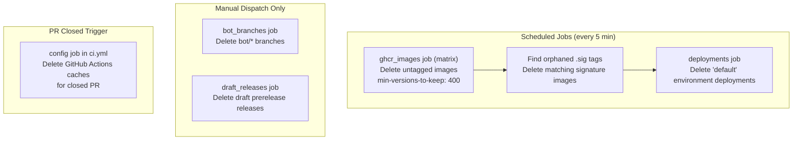

**GHCR Image Cleanup** [.github/workflows/clean_up.yml:68-141]():

For each image (`cuda-quantum`, `cuda-quantum-dev`, `cuda-quantum-devdeps`, `cuda-quantum-assets`, `open-mpi`):

1. Delete untagged images, keeping 400 most recent [.github/workflows/clean_up.yml:80-86]()
2. Find signature tags (`sha256-{digest}.sig`) without matching images [.github/workflows/clean_up.yml:96-114]()
3. Delete orphaned signature images [.github/workflows/clean_up.yml:134-140]()

**Default Environment Cleanup** [.github/workflows/clean_up.yml:147-177]():

Deletes unwanted deployment entries created for the `default` environment (a GitHub limitation workaround):

```javascript
const deployments = await github.rest.repos.listDeployments({
  owner: context.repo.owner,
  repo: context.repo.repo,
  environment: 'default'
});
// Set status to inactive and delete
```

**Manual Cleanup Operations** [.github/workflows/clean_up.yml:23-66]():

- `delete_temp_branches=true`: Deletes all `bot/*` branches (used for publishing staging commits)
- `delete_draft_releases=true`: Deletes all draft prerelease releases

Sources: [.github/workflows/clean_up.yml:1-177]()

### GitHub Container Registry Maintenance

The `gh_registry.yml` workflow maintains external images on GHCR (daily at 3 AM UTC).

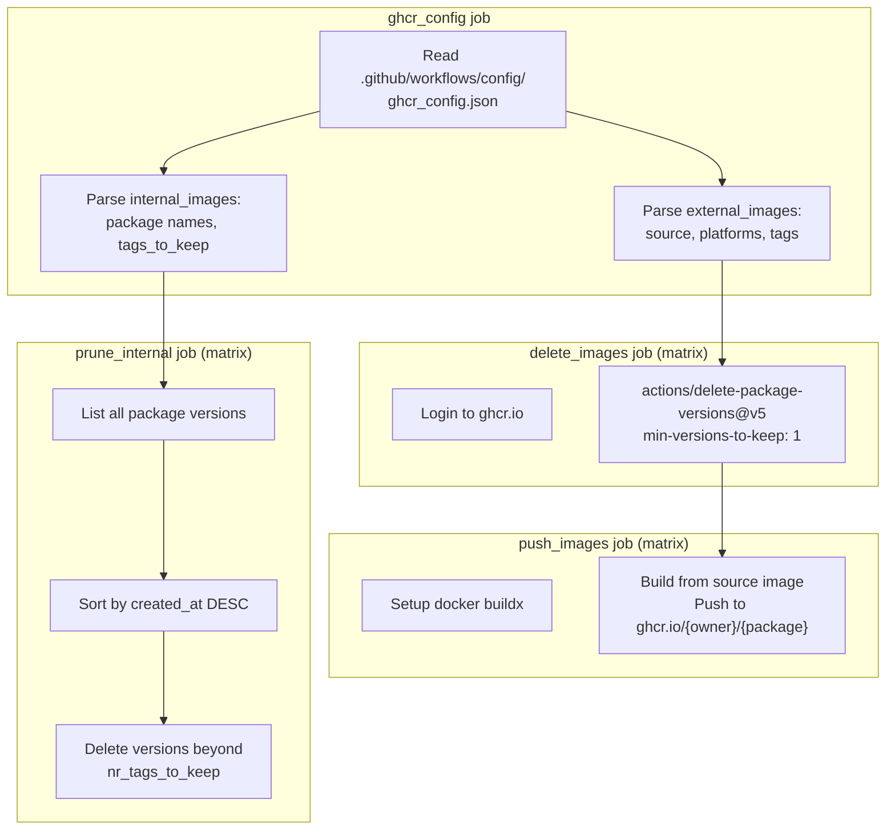

**Configuration Format** [.github/workflows/gh_registry.yml:23-58]():

```json
{
  "external_images": [
    {
      "source": "ubuntu:24.04",
      "platforms": "linux/amd64,linux/arm64",
      "tags": ["24.04"]
    }
  ],
  "internal_images": [
    {
      "name": "cuda-quantum",
      "tags_to_keep": 50
    }
  ]
}
```

**Purpose:**

- **External images**: Mirrors public images (Ubuntu, RedHat, etc.) to GHCR to avoid Docker Hub rate limits during validation
- **Internal images**: Manages retention of CUDA-Q's own images

Sources: [.github/workflows/gh_registry.yml:1-223]()

## Workflow Orchestration Patterns

### Matrix Job Output Aggregation

CUDA-Q uses the `cloudposse/github-action-matrix-outputs-write` and `cloudposse/github-action-matrix-outputs-read` actions to pass outputs from matrix jobs to downstream jobs.

**Write Pattern** [.github/workflows/docker_images.yml:348-355]():

```yaml
- name: Write matrix outputs
  uses: cloudposse/github-action-matrix-outputs-write@1.0.0
  with:
    matrix-step-name: docker_images
    matrix-key: ${{ needs.metadata.outputs.platform_tag }}-cu${{ inputs.cuda_version }}-dev-image
    outputs: |
      digest: ${{ steps.docker_build.outputs.digest }}
      image_tag: ${{ steps.metadata.outputs.tags }}
```

**Read Pattern** [.github/workflows/ci.yml:168-171]():

```yaml
- uses: cloudposse/github-action-matrix-outputs-read@1.0.0
  id: read_json
  with:
    matrix-step-name: dev_environment

- name: Use outputs
  run: |
    image=${{ fromJson(needs.config.outputs.json).image_hash['amd64-clang16'] }}
```

This pattern is used in:
- `ci.yml`: `config` job aggregates `devdeps`, `wheeldeps`, `source_build` outputs
- `deployments.yml`: `config`, `ext_config`, `digest_config` jobs
- `python_wheels.yml`: Validation job uses matrix outputs

Sources: [.github/workflows/ci.yml:159-171](), [.github/workflows/docker_images.yml:348-355](), [.github/workflows/deployments.yml:316-397]()

### Workflow Run Chaining

Workflows trigger each other using `workflow_run` events.

**Pattern** [.github/workflows/publishing.yml:28-37]():

```yaml
on:
  workflow_run:
    workflows:
      - Deployments
    types:
      - completed
    branches:
      - 'main'
      - 'releases/*'
```

**Conditional Execution** [.github/workflows/documentation.yml:39]():

```yaml
if: github.event_name == 'workflow_dispatch' 
    || github.event.workflow_run.name == 'CI' 
    || (github.event.workflow_run.conclusion == 'success' 
        && github.event.workflow_run.actor.id == '135836288')
```

This ensures workflows only run on successful upstream completion and only for specific actors (bot ID 135836288).

Sources: [.github/workflows/publishing.yml:28-37](), [.github/workflows/documentation.yml:36-39]()

### Artifact Passing Between Workflows

**Upload in Source Workflow** [.github/workflows/deployments.yml:145-151]():

```yaml
- name: Upload deployment info
  uses: actions/upload-artifact@v4
  with:
    name: deployment_info
    path: deployment_info.txt
    retention-days: 30
```

**Download in Downstream Workflow** [.github/workflows/publishing.yml:74-92]():

```yaml
- name: Download build info
  run: |
    artifacts_url=${{ github.event.workflow_run.artifacts_url }}
    artifacts=$(gh api $artifacts_url --paginate -q '.artifacts[]')
    for artifact in `echo "$artifacts"`; do
      name=`echo $artifact | jq -r '.name'`
      if [ "$name" == "deployment_info" ]; then
        url=`echo $artifact | jq -r '.url'`
        gh api $url > deployment_info.zip
        unzip -d info deployment_info.zip
      fi
    done
```

Sources: [.github/workflows/deployments.yml:145-151](), [.github/workflows/publishing.yml:74-140]()

### Environment-Based Deployment

Workflows use GitHub environments to control deployment permissions and secrets.

**Environment Declaration** [.github/workflows/docker_images.yml:393-395]():

```yaml
environment:
  name: ghcr-deployment
  url: ${{ vars.deployment_url }}
```

**Conditional Behavior** [.github/workflows/docker_images.yml:624]():

```yaml
push: ${{ inputs.environment != '' }}
```

When `environment` is set:
- Images are pushed to registry
- Signatures are created
- Deployment URLs are generated

When `environment` is empty (CI):
- Images are saved as tar archives
- Cached for downstream jobs
- Not pushed to public registries

Sources: [.github/workflows/docker_images.yml:393-395](), [.github/workflows/docker_images.yml:624]()

## Build Configuration Management

### Platform and Architecture Handling

**Platform ID Mapping** [.github/workflows/docker_images.yml:72-81]():

```yaml
if [ -n "$(echo ${{ inputs.platforms }} | grep ',')" ]; then
  # Multi-platform: no platform tag
  echo "runner=linux-amd64-cpu16" >> $GITHUB_OUTPUT
elif [ -n "$(echo ${{ inputs.platforms }} | grep -i arm)" ]; then
  platform_tag=`echo ${{ inputs.platforms }} | sed 's/linux\///g' | tr -d ' '`
  echo "runner=linux-arm64-cpu16" >> $GITHUB_OUTPUT
else
  platform_tag=`echo ${{ inputs.platforms }} | sed 's/linux\///g' | tr -d ' '`
  echo "runner=linux-amd64-cpu16" >> $GITHUB_OUTPUT
fi
```

**Runner Selection:**

| Input Platform | Resolved Tag | Runner |
|---------------|--------------|--------|
| `linux/amd64` | `amd64` | `linux-amd64-cpu8` or `linux-amd64-cpu16` |
| `linux/arm64` | `arm64` | `linux-arm64-cpu8` or `linux-arm64-cpu16` |
| `linux/amd64,linux/arm64` | (none) | `linux-amd64-cpu16` |

Sources: [.github/workflows/docker_images.yml:60-81](), [.github/workflows/dev_environment.yml:119-130]()

### CUDA Version Matrix

Most workflows that build CUDA-dependent artifacts use a matrix across CUDA versions.

**Standard Matrix** [.github/workflows/ci.yml:237-239]():

```yaml
matrix:
  platform: [amd64, arm64]
  python_version: ['3.11', '3.13']
  cuda_version: ["12.6", "13.0"]
```

**Version Extraction in Downstream Jobs** [.github/workflows/python_wheels.yml:687]():

```yaml
cuda_major_version=$(echo ${{ inputs.cuda_version }} | cut -d . -f1)
```

This allows tagging artifacts as `cu12` or `cu13` consistently across the pipeline.

Sources: [.github/workflows/ci.yml:237-239](), [.github/workflows/python_wheels.yml:687]()

### Validation Configuration

Operating system images for validation are defined in JSON configuration files.

**Configuration Structure** [.github/workflows/python_wheels.yml:172-175]():

```yaml
- id: config
  run: |
    python_config=`cat .github/workflows/config/validation_config.json | jq ".python"`
    operating_systems=`echo "$python_config" | jq '.[] | select(.version=="${{ inputs.python_version }}").operating_systems'`
```

The configuration file maps Python versions to compatible OS images for wheel validation, allowing centralized management of test matrices.

Sources: [.github/workflows/python_wheels.yml:168-175]()

## Summary

The CUDA-Q GitHub Actions infrastructure is a sophisticated multi-tier system that:

1. **Separates concerns**: Reusable workflows handle specific tasks (building images, wheels, installers) while entry-point workflows orchestrate them
2. **Optimizes build times**: Multi-tier caching (local, PR-specific, branch-specific, NVIDIA fallback) minimizes rebuild overhead
3. **Supports multiple distributions**: Docker images to NGC, Python wheels to PyPI, C++ installers to GitHub Releases
4. **Validates extensively**: Tests run against multiple toolchains, platforms, CUDA versions, and OS distributions
5. **Maintains quality**: Nightly integration tests against live quantum hardware, code coverage tracking, documentation validation
6. **Cleans automatically**: Periodic cleanup of caches, images, branches, and deployments prevents resource exhaustion

The workflows leverage GitHub Actions' native features (matrix jobs, artifacts, environments, caching) along with third-party actions (Docker Buildx, Cosign, CloudPosse matrix outputs) to create a reproducible and scalable build system.

Sources: [.github/workflows/ci.yml:1-300](), [.github/workflows/deployments.yml:1-643](), [.github/workflows/publishing.yml:1-1100](), [.github/workflows/integration_tests.yml:1-675](), [.github/workflows/docker_images.yml:1-1346](), [.github/workflows/dev_environment.yml:1-415]()

---

