<!-- source: DeepWiki mcp.deepwiki.com · repo NVIDIA/cuda-quantum · page 8.2 Testing and Validation Infrastructure · fetched 2026-10-26 -->

# Testing and Validation Infrastructure

<details>
<summary>Relevant source files</summary>

The following files were used as context for generating this wiki page:

- [.devcontainer/devcontainer.json](.devcontainer/devcontainer.json)
- [.gitattributes](.gitattributes)
- [.github/actions/run-in-docker/action.yml](.github/actions/run-in-docker/action.yml)
- [.github/codecov.yml](.github/codecov.yml)
- [.github/workflows/ci.yml](.github/workflows/ci.yml)
- [.github/workflows/clean_up.yml](.github/workflows/clean_up.yml)
- [.github/workflows/config/gitlab_commits.txt](.github/workflows/config/gitlab_commits.txt)
- [.github/workflows/create_cache_command.yml](.github/workflows/create_cache_command.yml)
- [.github/workflows/deployments.yml](.github/workflows/deployments.yml)
- [.github/workflows/dev_environment.yml](.github/workflows/dev_environment.yml)
- [.github/workflows/docker_images.yml](.github/workflows/docker_images.yml)
- [.github/workflows/documentation.yml](.github/workflows/documentation.yml)
- [.github/workflows/generate_cc.yml](.github/workflows/generate_cc.yml)
- [.github/workflows/gh_registry.yml](.github/workflows/gh_registry.yml)
- [.github/workflows/integration_tests.yml](.github/workflows/integration_tests.yml)
- [.github/workflows/prebuilt_binaries.yml](.github/workflows/prebuilt_binaries.yml)
- [.github/workflows/prepare_deployment.yml](.github/workflows/prepare_deployment.yml)
- [.github/workflows/publishing.yml](.github/workflows/publishing.yml)
- [.github/workflows/publishing_stable.yml](.github/workflows/publishing_stable.yml)
- [.github/workflows/python_metapackages.yml](.github/workflows/python_metapackages.yml)
- [.github/workflows/python_wheels.yml](.github/workflows/python_wheels.yml)
- [.github/workflows/test_in_devenv.yml](.github/workflows/test_in_devenv.yml)
- [docker/build/assets.Dockerfile](docker/build/assets.Dockerfile)
- [docker/build/devdeps.Dockerfile](docker/build/devdeps.Dockerfile)
- [docker/build/devdeps.ext.Dockerfile](docker/build/devdeps.ext.Dockerfile)
- [docker/build/devdeps.manylinux.Dockerfile](docker/build/devdeps.manylinux.Dockerfile)
- [docker/release/cudaq.Dockerfile](docker/release/cudaq.Dockerfile)
- [docker/release/cudaq.ext.Dockerfile](docker/release/cudaq.ext.Dockerfile)
- [docker/release/cudaq.wheel.Dockerfile](docker/release/cudaq.wheel.Dockerfile)
- [docker/test/installer/runtime_dependencies.sh](docker/test/installer/runtime_dependencies.sh)
- [docs/notebook_validation.py](docs/notebook_validation.py)
- [docs/sphinx/applications/python/hybrid_quantum_neural_networks.ipynb](docs/sphinx/applications/python/hybrid_quantum_neural_networks.ipynb)
- [docs/sphinx/applications/python/quantum_pagerank.ipynb](docs/sphinx/applications/python/quantum_pagerank.ipynb)
- [docs/sphinx/applications/python/unitary_compilation_diffusion_models.ipynb](docs/sphinx/applications/python/unitary_compilation_diffusion_models.ipynb)
- [docs/sphinx/examples/python/dynamics/dynamics_intro_2.ipynb](docs/sphinx/examples/python/dynamics/dynamics_intro_2.ipynb)
- [docs/sphinx/using/backends/circuitsimulators.png](docs/sphinx/using/backends/circuitsimulators.png)
- [docs/sphinx/using/backends/sims/svsims.rst](docs/sphinx/using/backends/sims/svsims.rst)
- [pyproject.toml](pyproject.toml)
- [pyproject.toml.cu12](pyproject.toml.cu12)
- [pyproject.toml.cu13](pyproject.toml.cu13)
- [python/metapackages/setup.py](python/metapackages/setup.py)
- [runtime/cudaq/remote_capabilities.h](runtime/cudaq/remote_capabilities.h)
- [scripts/build_llvm.sh](scripts/build_llvm.sh)
- [scripts/configure_build.sh](scripts/configure_build.sh)
- [scripts/generate_cc.sh](scripts/generate_cc.sh)
- [scripts/install_toolchain.sh](scripts/install_toolchain.sh)
- [scripts/validate_container.sh](scripts/validate_container.sh)
- [scripts/validate_pycudaq.sh](scripts/validate_pycudaq.sh)

</details>


This document explains CUDA-Q's validation infrastructure, which ensures that built artifacts (Docker images, Python wheels, installers) work correctly across different platforms and backends. The validation system consists of three main scripts that test containers, Python packages, and notebooks.

## Overview

CUDA-Q uses three validation scripts to verify functionality before distribution:

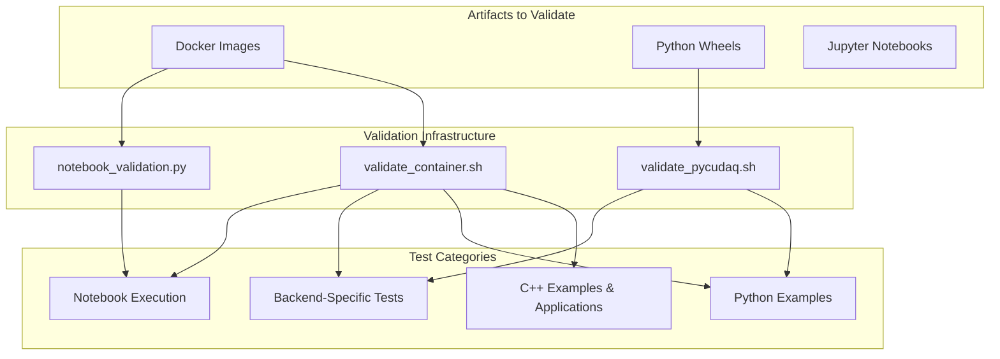

Sources: [scripts/validate_container.sh:1-50](), [scripts/validate_pycudaq.sh:1-31](), [docs/notebook_validation.py:1-20]()
</thinking>

## Container Validation

The `validate_container.sh` script validates CUDA-Q Docker images by testing C++ and Python examples against available backends.

### Validation Script Architecture

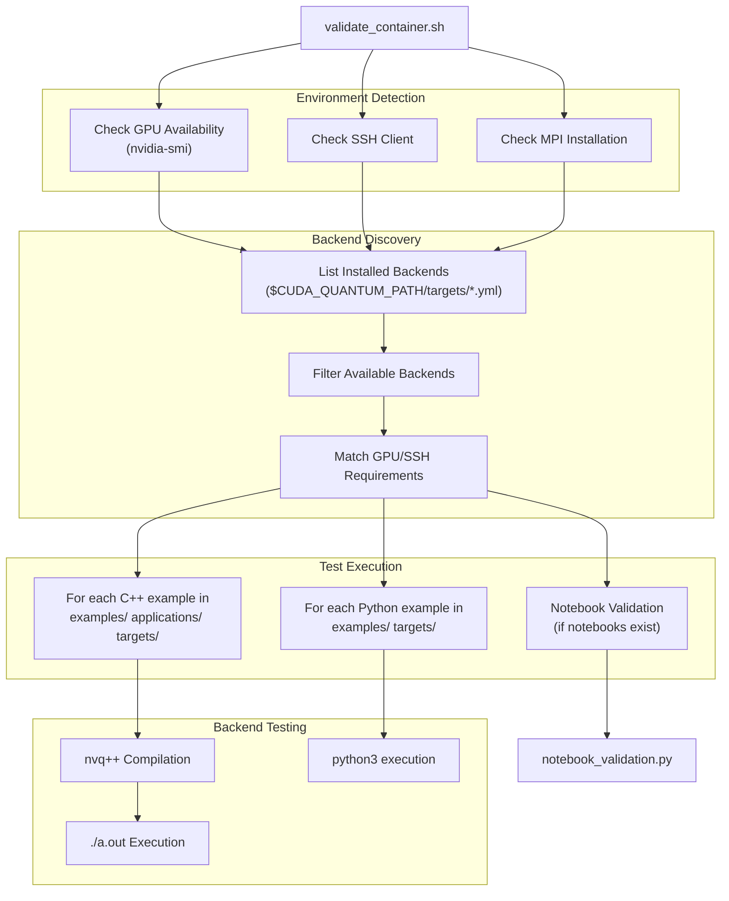

Sources: [scripts/validate_container.sh:21-50](), [scripts/validate_container.sh:51-131](), [scripts/validate_container.sh:142-277]()

### Backend Filtering Logic

The script filters backends based on platform capabilities and configuration:

| Filter Criteria | Implementation | File Reference |
|----------------|----------------|----------------|
| GPU Availability | Check `nvidia-smi` output | [scripts/validate_container.sh:21-24]() |
| Backend Type | Skip `remote_rest`, `fermioniq`, `orca`, `pasqal`, `quera` | [scripts/validate_container.sh:83-86]() |
| GPU Requirements | Read `gpu-requirements` from YAML config | [scripts/validate_container.sh:82-87]() |
| Photonics Backend | Skip if `library-mode-execution-manager: photonics` | [scripts/validate_container.sh:70-72]() |
| Stim Backend | Skip if `nvqir-simulation-backend: stim` | [scripts/validate_container.sh:77-79]() |

Sources: [scripts/validate_container.sh:66-90]()

### C++ Example Testing

The script tests C++ examples by compiling with `nvq++` and executing the binary:

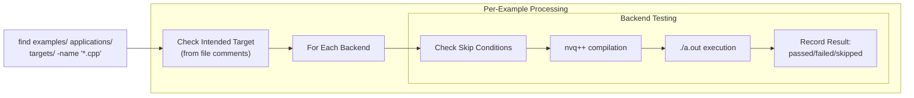

The script handles special cases for different backends:

| Backend | Special Handling |
|---------|------------------|
| `default` | No target flag needed |
| `density-matrix-cpu` | Only test noise examples |
| `tensornet`, `tensornet-mps` | Skip long-running tests |
| `remote-mqpu` | Skip variational optimization tests, requires SSH |
| `nvidia` | Test multiple options: `fp32`, `fp64`, `mqpu`, `mgpu` |

Sources: [scripts/validate_container.sh:146-277](), [scripts/validate_container.sh:177-221](), [scripts/validate_container.sh:226-254]()

### Python Example Testing

Python examples are tested by direct execution:

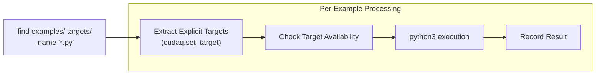

Sources: [scripts/validate_container.sh:302-345]()

### Notebook Validation

If notebooks exist, the script creates a virtual environment and runs `notebook_validation.py`:

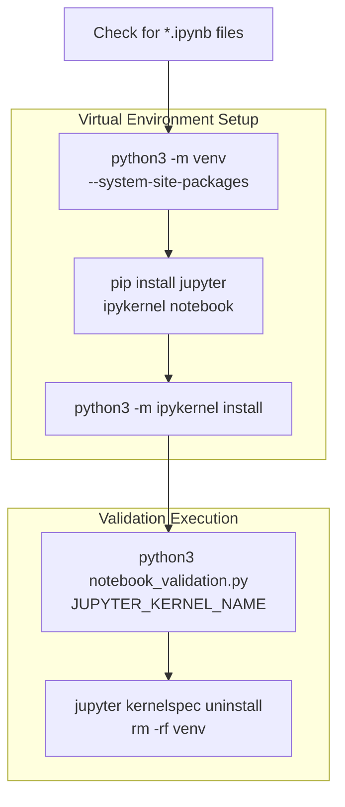

Sources: [scripts/validate_container.sh:347-400]()

## Python Wheel Validation

The `validate_pycudaq.sh` script validates Python wheels across different Python versions and operating systems.

### Wheel Validation Architecture

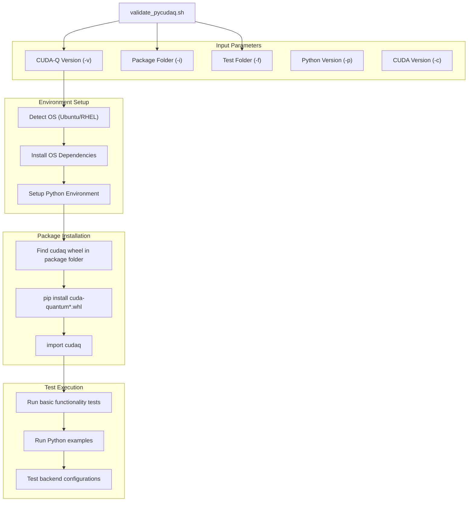

Sources: [scripts/validate_pycudaq.sh:17-31](), [scripts/validate_pycudaq.sh:33-113]()

### Platform-Specific Installation

The script handles installation for different Linux distributions:

| Distribution | Package Manager | Dependencies |
|--------------|----------------|--------------|
| Ubuntu/Debian | `apt-get` | `wget`, `ca-certificates`, `python3`, `python3-pip` |
| RHEL/CentOS | `yum` / `dnf` | `wget`, `ca-certificates`, `python3`, `python3-pip` |

Sources: [scripts/validate_pycudaq.sh:38-79]()

### GPU Target Testing

For GPU-enabled systems, the script tests GPU-accelerated backends:

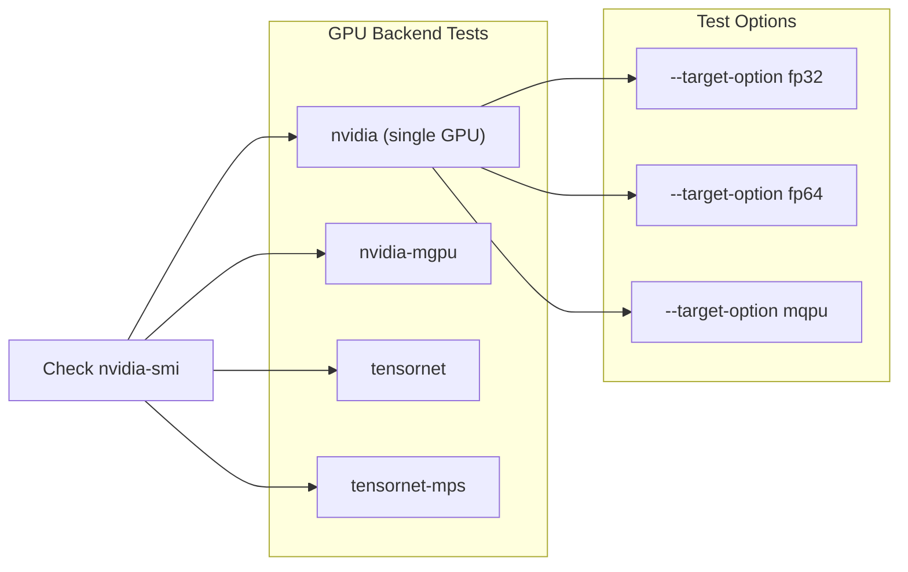

Sources: [scripts/validate_pycudaq.sh:178-258]()

### MPI Testing

If MPI is available, the script tests distributed computing features:

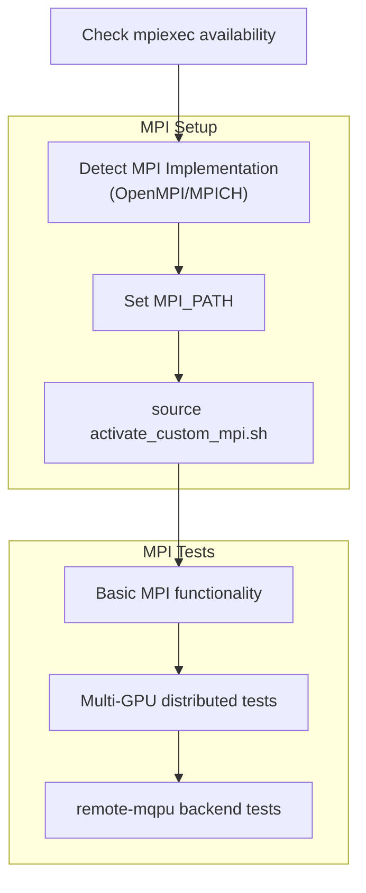

Sources: [scripts/validate_pycudaq.sh:260-324]()

## Notebook Validation

The `notebook_validation.py` script validates Jupyter notebooks by executing them with proper backend configuration.

### Notebook Validation Flow

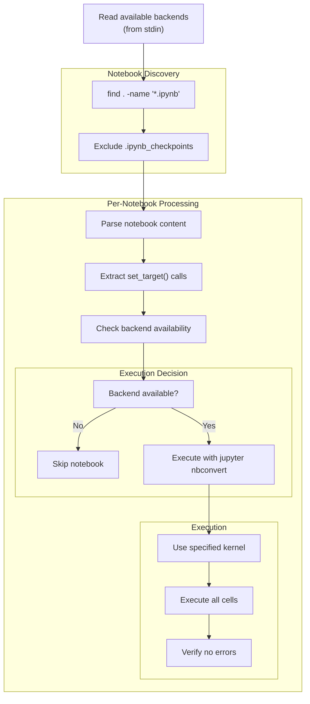

Sources: [docs/notebook_validation.py:22-60](), [docs/notebook_validation.py:62-91]()

### Backend Extraction Logic

The script uses regular expressions to extract backend targets from notebook cells:

```python
# Pattern matches various set_target() formats
pattern = r"set_target\(\s*(\\?['\"])([^'\"]+)\1(?:\s*,\s*option\s*=\s*(\\?['\"])([^'\"]+)\3)?\)"
```

This matches:
- `set_target("abc")`
- `set_target("abc", option="xyz")`
- Both single and double quotes
- Escaped quotes within strings

Sources: [docs/notebook_validation.py:28-41](), [docs/notebook_validation.py:44-59]()

### Execution with Jupyter

Notebooks are executed using `jupyter nbconvert`:

```bash
jupyter nbconvert --to notebook --execute \
    --ExecutePreprocessor.kernel_name KERNEL_NAME \
    notebook.ipynb
```

The script:
1. Sets the appropriate Jupyter kernel
2. Executes all cells in order
3. Captures execution time
4. Reports success or failure
5. Cleans up converted notebooks

Sources: [docs/notebook_validation.py:62-91]()

## Integration with CI/CD Workflows

The validation scripts are integrated into CUDA-Q's CI/CD pipelines at multiple stages.

### Publishing Workflow Validation

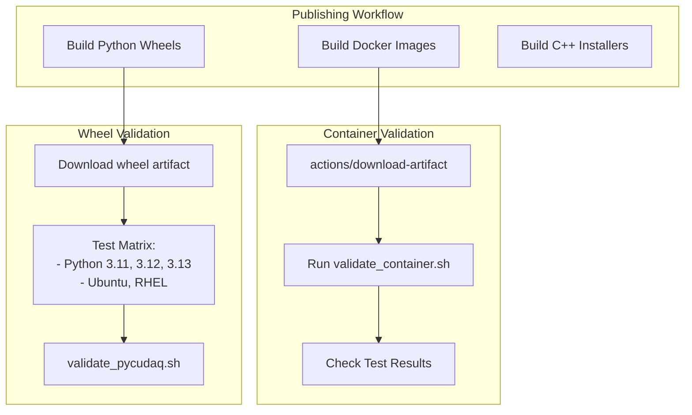

Sources: [.github/workflows/publishing.yml:332-525](), [.github/workflows/python_wheels.yml:177-265]()

### Container Validation in Publishing

The publishing workflow validates Docker images using `validate_container.sh`:

| Validation Stage | Script Invocation | Test Coverage |
|------------------|-------------------|---------------|
| CUDA-Q Image | `bash validate_container.sh` | All available backends |
| Platform-Specific | Backend list passed as arguments | Selected backends only |
| Multi-Platform | Separate jobs per platform (amd64/arm64) | Platform-specific binaries |

Sources: [.github/workflows/publishing.yml:518-525]()

### Python Wheel Validation Matrix

Python wheels are validated across multiple configurations:

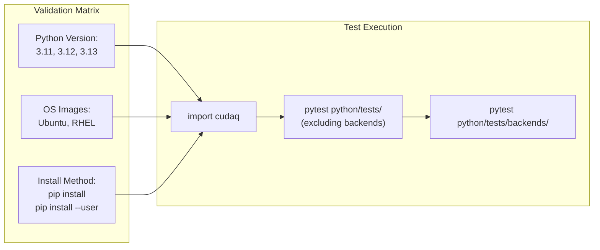

Sources: [.github/workflows/python_wheels.yml:188-265]()

## Testing Strategies Across Platforms

CUDA-Q employs different testing strategies depending on the platform and deployment target.

### Multi-Platform Build and Test Strategy

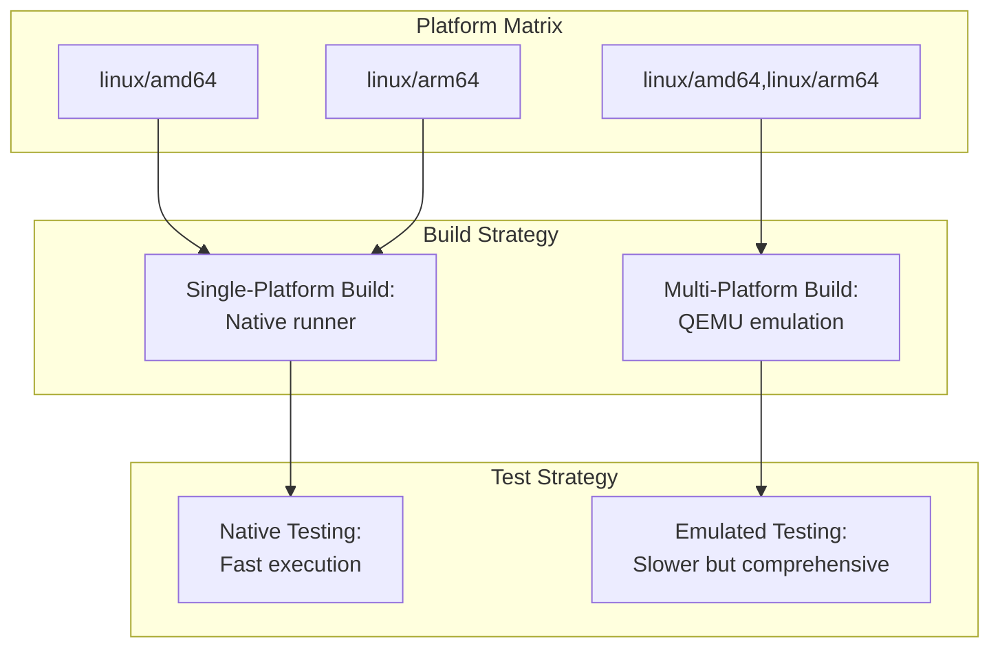

Sources: [.github/workflows/docker_images.yml:60-81](), [.github/workflows/deployments.yml:100-125]()

### Backend-Specific Test Configuration

Different backends require different test configurations:

| Backend | GPU Required | MPI Required | SSH Required | Special Env Vars |
|---------|--------------|--------------|--------------|------------------|
| `qpp-cpu` | No | No | No | - |
| `nvidia` | Yes | No | No | - |
| `nvidia-mgpu` | Yes | Yes | Yes | `CUDAQ_MGPU_*` |
| `tensornet` | Yes | No | No | `CUDAQ_TENSORNET_*` |
| `tensornet-mps` | Yes | No | No | `CUDAQ_MPS_*` |
| `remote-mqpu` | No | Yes | Yes | - |
| `density-matrix-cpu` | No | No | No | - |

Sources: [scripts/validate_container.sh:188-221](), [docs/sphinx/using/backends/sims/svsims.rst:81-153]()

### GPU Detection and Testing

The validation scripts detect GPU availability and adjust test execution:

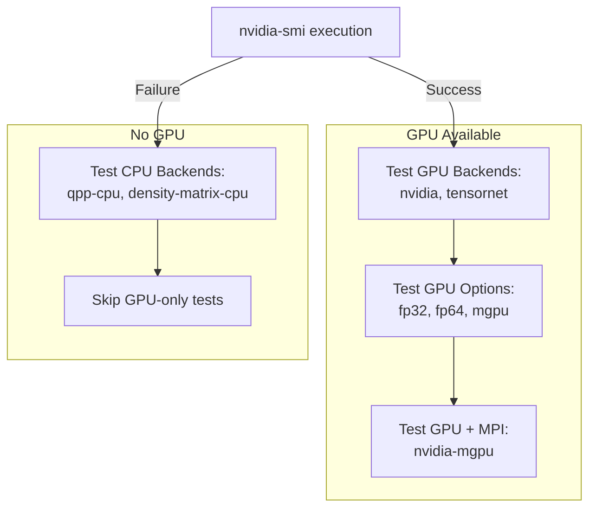

Sources: [scripts/validate_container.sh:21-29](), [scripts/validate_container.sh:82-90]()

### Skip Conditions and Test Filtering

Tests are skipped based on various conditions:

| Skip Condition | Reason | Implementation |
|----------------|--------|----------------|
| Intended target mismatch | Example requires specific backend | Parse `--target` from file comments |
| Long-running test | Performance/timeout concerns | Hardcoded test list |
| Missing dependencies | SSH, MPI not available | Runtime detection |
| GPU requirement | Backend needs GPU | Check `gpu-requirements` in YAML |
| Noise-only test | Only for density matrix backend | Check example path contains "nois" |

Sources: [scripts/validate_container.sh:157-221](), [scripts/validate_container.sh:133-139]()

## Validation Result Reporting

Validation results are aggregated and reported in multiple formats:

### GitHub Actions Summary

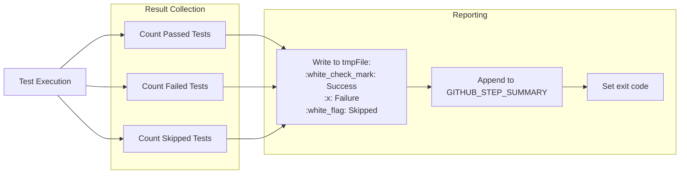

The scripts write formatted results to temporary files that are then displayed in the GitHub Actions summary interface.

Sources: [scripts/validate_container.sh:268-273](), [scripts/validate_container.sh:401-409]()

### Exit Status Codes

| Exit Code | Meaning | Action Taken |
|-----------|---------|--------------|
| 0 | All tests passed | Workflow continues |
| 1 | One or more tests failed | Workflow fails |
| Exit on missing backend | Required backend not found | Workflow aborts early |

Sources: [scripts/validate_container.sh:126-130](), [scripts/validate_container.sh:668-671]()

## Conclusion

CUDA-Q's validation infrastructure ensures that all distributed artifacts work correctly across different platforms, Python versions, and hardware configurations. The three validation scripts (`validate_container.sh`, `validate_pycudaq.sh`, `notebook_validation.py`) provide comprehensive testing of Docker images, Python wheels, and Jupyter notebooks, while the CI/CD integration ensures validation occurs automatically during the release process.

Sources: [scripts/validate_container.sh:1-50](), [scripts/validate_pycudaq.sh:1-31](), [docs/notebook_validation.py:1-20]()

## Unit Testing Framework

The unit testing framework is built using GoogleTest and organized by simulators and functionality domains.

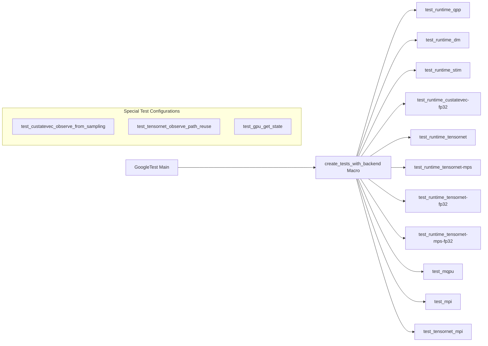

Sources: [unittests/CMakeLists.txt:16-47](), [unittests/CMakeLists.txt:52-113](), [unittests/CMakeLists.txt:114-237]()

Unit tests are defined in `unittests/CMakeLists.txt` which creates test executables for each backend simulator. The framework handles different backend-specific tests including:

| Test Type | Purpose | Test Name |
|-----------|---------|-----------|
| CPU Simulator | Test CPU-based state vector simulation | `test_runtime_qpp` |
| Density Matrix | Test density matrix simulation | `test_runtime_dm` |
| Stabilizer | Test Clifford circuit simulation | `test_runtime_stim` |
| GPU State Vector (FP32) | Test cuStateVec-based simulation with single precision | `test_runtime_custatevec-fp32` |
| Tensor Network | Test tensor network simulation | `test_runtime_tensornet` |
| MPS | Test matrix product state simulation | `test_runtime_tensornet-mps` |
| Tensor Network (FP32) | Test tensor network with single precision | `test_runtime_tensornet-fp32` |
| MPS (FP32) | Test MPS with single precision | `test_runtime_tensornet-mps-fp32` |
| Multi-QPU | Test multi-quantum processor execution | `test_mqpu` |
| MPI | Test distributed computing capabilities | `test_mpi` |
| TensorNet MPI | Test tensor network with MPI | `test_tensornet_mpi` |
| GPU State Access | Test GPU state vector access | `test_gpu_get_state` |

The macro that creates the tests is defined as:

```cmake
macro (create_tests_with_backend NVQIR_BACKEND EXTRA_BACKEND_TESTER)
  set(TEST_EXE_NAME "test_runtime_${NVQIR_BACKEND}")
  string(REPLACE "-" "_" NVQIR_BACKEND_OUT ${NVQIR_BACKEND})
  add_executable(${TEST_EXE_NAME} main.cpp ${CUDAQ_RUNTIME_TEST_SOURCES} ${EXTRA_BACKEND_TESTER})
  target_compile_definitions(${TEST_EXE_NAME} PRIVATE -DNVQIR_BACKEND_NAME=${NVQIR_BACKEND_OUT})
  target_compile_definitions(${TEST_EXE_NAME} PRIVATE __MATH_LONG_DOUBLE_CONSTANTS)
  target_include_directories(${TEST_EXE_NAME} PRIVATE .)
  
  # Backend-specific configurations
  if (${NVQIR_BACKEND} STREQUAL "qpp")
    target_compile_definitions(${TEST_EXE_NAME} PRIVATE -DCUDAQ_SIMULATION_SCALAR_FP64)
  endif()
  if (${NVQIR_BACKEND} STREQUAL "tensornet")
    target_compile_definitions(${TEST_EXE_NAME} PRIVATE -DCUDAQ_BACKEND_TENSORNET -DCUDAQ_SIMULATION_SCALAR_FP64)
    set(TEST_LABELS "gpu_required")
  endif()
  # ... other backend configurations ...
  
  gtest_discover_tests(${TEST_EXE_NAME})
endmacro()
```

Sources: [unittests/CMakeLists.txt:52-113](), [unittests/CMakeLists.txt:114-237]()

## Integration Tests

The integration tests verify the full CUDA-Q workflow by testing across different hardware providers and services.

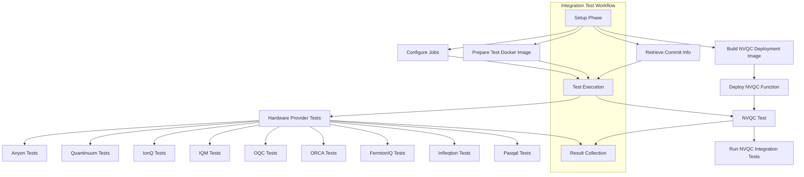

Sources: [.github/workflows/integration_tests.yml:76-177](), [.github/workflows/integration_tests.yml:177-305](), [.github/workflows/integration_tests.yml:306-708]()

### Integration Test Triggers

Integration tests can be run in several ways:
1. **Scheduled (Nightly)**: Runs daily at 3 AM UTC
2. **Manual Trigger**: Using GitHub workflow dispatch with configurable options
3. **Post-deployment**: After new releases are published

The trigger mechanism is defined in the workflow file:

```yaml
on:
  workflow_dispatch:
    inputs:
      target:
        description: 'Target (choose nightly to run like nightly tests)'
        required: true
        default: 'nightly'
        type: choice
        options:
          - nightly
          - anyon
          - infleqtion
          - ionq
          - iqm
          - oqc
          - pasqal
          - quantinuum
          - nvqc
          - orca
          - fermioniq
      single_test_name:
        type: string
        required: false
        description: 'Single test (e.g., targettests/quantinuum/load_value.cpp). Runs default tests if left blank'
      target_machine:
        type: string
        required: false
        description: 'Target machine (e.g., H1-1E).'
      cudaq_test_image:
        type: string
        required: false
        default: '' # picked up from repo variable if not provided
        description: 'CUDA Quantum image to run the tests in. Default to the latest CUDA Quantum nightly image'
      python_version:
        type: choice
        required: true
        description: 'Python version to run wheel test'
        options:
        - '3.10'
        - '3.11'
        - '3.12'
        - '3.13'
  schedule:
    - cron: 0 3 * * *
```

Sources: [.github/workflows/integration_tests.yml:8-66]()

### Hardware Provider Testing

Hardware provider tests verify that CUDA-Q can correctly target quantum hardware providers. This includes:

1. **Authentication** with the provider
2. **QIR Syntax Check** to validate program compatibility
3. **Execution Test** to verify proper execution
4. **Python API Tests** for providers with Python-specific functionality

Each hardware provider has a dedicated test section in the workflow. For example, the Quantinuum tests:

```yaml
- name: Setup quantinum account
  if: (success() || failure()) && (github.event_name == 'schedule' || inputs.target == 'nightly' || inputs.target == 'quantinuum')
  run: |
    echo "### Setup Quantinuum account" >> $GITHUB_STEP_SUMMARY
    curl -c ~/.quantinuum_cookies.txt -X POST https://nexus.quantinuum.com/auth/login -H "Content-Type: application/json" -d '{ "email":"${{ secrets.BACKEND_LOGIN_EMAIL }}","password":"${{ secrets.QUANTINUUM_NEXUS_PASSWORD }}" }' >/dev/null
    awk '$6 == "myqos_oat" {refresh=$7} $6 == "myqos_id" {key=$7} END {print "key: " key "\nrefresh: " refresh}' ~/.quantinuum_cookies.txt > ~/.quantinuum_config
    rm ~/.quantinuum_cookies.txt

- name: QIR syntax check (Quantinuum)
  if: (success() || failure()) && (github.event_name == 'schedule' || inputs.target == 'nightly')
  run: |
    echo "### QIR syntax check (Quantinuum)" >> $GITHUB_STEP_SUMMARY
    export CUDAQ_LOG_LEVEL="info"
    set +e # Allow script to keep going through errors
    test_err_sum=0
    for filename in ${{ steps.gettests.outputs.testlist }}; do
      case $filename in
        targettests/quantinuum/*)
          [ -e "$filename" ] || echo "::error::Couldn't find files ($filename)"
          nvq++ -v $filename -DSYNTAX_CHECK --target quantinuum --quantinuum-machine H1-1SC --quantinuum-project ${{ secrets.QUANTINUUM_NEXUS_PROJECT_ID }}
          # Test execution steps follow...
```

The workflow also includes Python-specific tests for providers:

```yaml
python_tests="docs/sphinx/targets/python/quantinuum.py"
for filename in $python_tests; do
  [ -e "$filename" ] || echo "::error::Couldn't find file ($filename)"
  QUANTINUUM_NEXUS_PROJECT=${{ secrets.QUANTINUUM_NEXUS_PROJECT_ID }} python3 $filename 1> /dev/null
  test_status=$?
  if [ $test_status -eq 0 ]; then
    echo ":white_check_mark: Successfully ran test: $filename" >> $GITHUB_STEP_SUMMARY
  else
    echo ":x: Test failed (failed to execute): $filename" >> $GITHUB_STEP_SUMMARY
    test_err_sum=$((test_err_sum+1))
  fi
done
```

Sources: [.github/workflows/integration_tests.yml:391-445](), [.github/workflows/integration_tests.yml:446-708]()

### NVQC Testing

NVQC (NVIDIA Quantum Cloud) testing verifies that CUDA-Q works correctly with the NVQC cloud service:

1. **Build NVQC Image**: Build a Docker image with NVQC support
2. **Deploy NVQC Function**: Deploy the function to NVQC service
3. **Run Integration Tests**: Test functionality with NVQC

The NVQC deployment process is defined in the workflow:

```yaml
- name: Deploy NVQC Function
  id: deploy
  env:
    NGC_CLI_API_KEY: ${{ secrets.NGC_CREDENTIALS }}
    NGC_CLI_ORG: ${{ env.NGC_QUANTUM_ORG }}
    NGC_CLI_TEAM: cuda-quantum
  run: |
    # We run with CUDAQ_SER_CODE_EXEC set. The final NVQC deployment may
    # or may not have this set, but since we run the client with
    # CUDAQ_CLIENT_REMOTE_CAPABILITY_OVERRIDE=1 (below), we need to run
    # the CI with CUDAQ_SER_CODE_EXEC=1.
    create_function_result=$(ngc-cli/ngc cloud-function function create \
      --container-image nvcr.io/${{ env.NGC_QUANTUM_ORG }}/${{ env.NGC_QUANTUM_TEAM }}/cuda-quantum:nightly \
      --container-environment-variable NUM_GPUS:1 \
      --container-environment-variable NVQC_REST_PAYLOAD_VERSION:1.1 \
      --container-environment-variable RUN_AS_NOBODY:1 \
      --container-environment-variable CUDAQ_SER_CODE_EXEC:1 \
      --api-body-format CUSTOM \
      --inference-port 3030 \
      --health-uri / \
      --inference-url /job \
      --name cudaq-nightly-integration-test \
      $NVQC_FUNCTION_ID)
    version_id=$(echo "$create_function_result" | grep 'Version: \S*' | head -1 | cut -d ':' -f 2 | tr -d ' ')
    echo "Create version Id: $version_id"
    echo "nvqc_function_version_id=$version_id" >> $GITHUB_OUTPUT
    # Deploy it
    ngc-cli/ngc cloud-function function deploy create --deployment-specification $NGC_NVQC_DEPLOYMENT_SPEC $NVQC_FUNCTION_ID:$version_id
```

The NVQC test workflow tests both Docker-based execution and Python wheel functionality:

```yaml
- name: Submit to NVQC
  run: |
    echo "### Submit to NVQC" >> $GITHUB_STEP_SUMMARY
    export NVQC_API_KEY="${{ secrets.NVQC_PROD_SERVICE_KEY }}"
    export CUDAQ_CLIENT_REMOTE_CAPABILITY_OVERRIDE=1
    export NVQC_FUNCTION_ID="$NVQC_FUNCTION_ID"
    export NVQC_FUNCTION_VERSION_ID="${{ needs.deploy_nvqc_test_function.outputs.nvqc_function_version_id }}"
    # Test execution steps follow...
```

Sources: [.github/workflows/integration_tests.yml:235-304](), [.github/workflows/nvqc_regression_tests.yml:103-241]()

## NVQC Regression Tests

A dedicated workflow for NVQC regression testing ensures all features work correctly with the NVIDIA Quantum Cloud service.

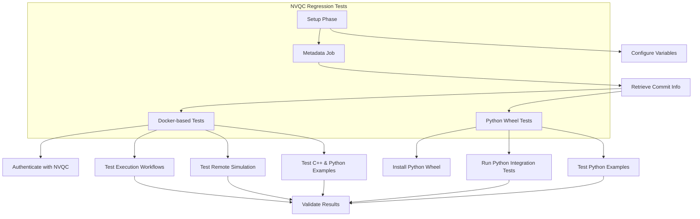

Sources: [.github/workflows/nvqc_regression_tests.yml:40-72](), [.github/workflows/nvqc_regression_tests.yml:73-81](), [.github/workflows/nvqc_regression_tests.yml:82-241](), [.github/workflows/nvqc_regression_tests.yml:243-358]()

The regression tests run against the production NVQC service:

```yaml
- name: Submit to NVQC
  run: |
    echo "### Submit to NVQC" >> $GITHUB_STEP_SUMMARY
    export NVQC_API_KEY="${{ secrets.NVQC_PROD_SERVICE_KEY }}"
    set +e # Allow script to keep going through errors
    test_err_sum=0
    # Test all NVQPP execution tests
    for filename in `find targettests/execution/ -name '*.cpp'`; do
      echo "$filename"
      # Only run tests that require execution (not a syntax-only check)
      if grep -q "ifndef SYNTAX_CHECK" "$filename"; then
        nvq++ -v $filename --target nvqc
        test_status=$?
        if [ $test_status -eq 0 ]; then
          ./a.out
          test_status=$?
          if [ $test_status -eq 0 ]; then
            echo ":white_check_mark: Successfully ran test: $filename" >> $GITHUB_STEP_SUMMARY
          else
            echo ":x: Test failed (failed to execute): $filename" >> $GITHUB_STEP_SUMMARY
            test_err_sum=$((test_err_sum+1))
          fi
        else
          echo ":x: Test failed (failed to compile): $filename" >> $GITHUB_STEP_SUMMARY
          test_err_sum=$((test_err_sum+1))
        fi
      fi
    done
```

The workflow also tests Python wheel functionality with NVQC:

```yaml
- name: Test Python wheel with NVQC
  run: |
    echo "### Test Python wheel with NVQC" >> $GITHUB_STEP_SUMMARY
    export NVQC_API_KEY="${{ secrets.NVQC_PROD_SERVICE_KEY }}"
    export CUDAQ_CLIENT_REMOTE_CAPABILITY_OVERRIDE=1
    set +e # Allow script to keep going through errors
    test_err_sum=0
    
    # Install the wheel
    pip install cuda_quantum*-manylinux_*_$(uname -m).whl
    
    # Run Python tests
    python -m pytest -v python/tests/backends/test_nvqc.py
    test_status=$?
    if [ $test_status -eq 0 ]; then
      echo ":white_check_mark: Successfully ran NVQC Python tests" >> $GITHUB_STEP_SUMMARY
    else
      echo ":x: NVQC Python tests failed with status $test_status" >> $GITHUB_STEP_SUMMARY
      test_err_sum=$((test_err_sum+1))
    fi
```

Sources: [.github/workflows/nvqc_regression_tests.yml:103-241](), [.github/workflows/nvqc_regression_tests.yml:243-358]()

## CI/CD Pipeline

CUDA-Q uses a comprehensive CI/CD pipeline to ensure code quality and automate the build and release process.

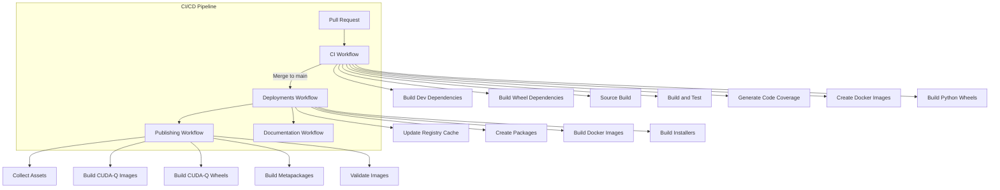

Sources: [.github/workflows/ci.yml:1-284](), [.github/workflows/deployments.yml:1-543](), [.github/workflows/publishing.yml:1-778](), [.github/workflows/documentation.yml:1-156]()

## Repository Quality Checks

The repository quality checks ensure code quality and consistency across the codebase. These checks run on pull requests and merge groups.

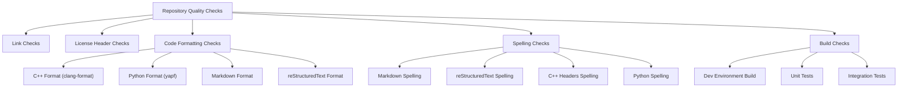

Sources: [.github/workflows/repo_checks.yml:102-256](), [.github/workflows/ci.yml:28-284]()

### File Filtering

The quality checks use file filtering to apply appropriate checks to different file types:

```yaml
create_output cxx '*.cpp *.h *.hpp :!:test :!:targettests :!:tpls :!:**/nlopt-src/*'
create_output cxx_headers '*.h *.hpp :!:test :!:targettests :!:tpls :!:**/nlopt-src/*'
create_output cxx_examples 'docs/sphinx/examples/**/*.cpp' 'docs/sphinx/applications/cpp/*.cpp' 'docs/sphinx/targets/cpp/*.cpp'
create_output python '*.py :!:python/tests :!:test :!:targettests :!:tpls :!:docs/sphinx/conf.py'
create_output markdown '*.md :!:tpls'
create_output rst '*.rst :!:tpls :!:docs/sphinx/_templates/**/*.rst'
```

Sources: [.github/workflows/repo_checks.yml:94-100]()

### Formatting Checks

The formatting checks ensure consistent code style:

```yaml
- name: C++
  run: |
    echo "## C++ Formatting" >> $GITHUB_STEP_SUMMARY
    files=(${{ join(fromJSON(needs.filters.outputs.json).files.cxx, ' ') }})

    if [ "${#files[@]}" -gt "0" ]; then
      wget -qO- https://apt.llvm.org/llvm-snapshot.gpg.key | sudo tee /etc/apt/trusted.gpg.d/apt.llvm.org.asc
      sudo add-apt-repository "deb http://apt.llvm.org/jammy/ llvm-toolchain-jammy-16 main"
      sudo apt-get update && sudo apt-get install -y --no-install-recommends clang-format-16

      echo ${files[@]} | xargs clang-format-16 -i
      echo ${{ join(fromJSON(needs.filters.outputs.json).patterns.cxx, ' ') }} \
      | xargs git diff --diff-filter=d -- > /tmp/clang-format.patch
    else
      echo "No files to check." >> $GITHUB_STEP_SUMMARY
      exit 0
    fi
```

Sources: [.github/workflows/repo_checks.yml:112-138]()

### Code Coverage Analysis

CUDA-Q includes code coverage analysis as part of its CI pipeline:

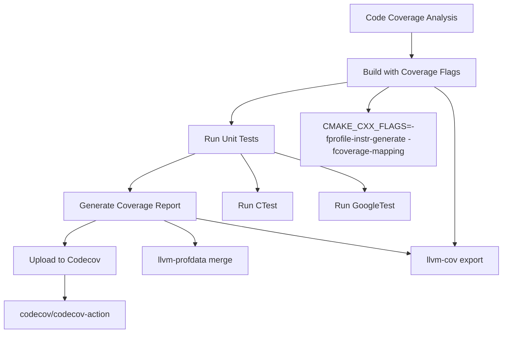

Sources: [.github/workflows/generate_cc.yml:1-166](), [.github/workflows/ci.yml:196-212]()

## Docker Registry Management

CUDA-Q uses GitHub Container Registry (GHCR) to store Docker images for development, testing, and deployment. The registry management ensures that images are properly maintained and cleaned up.

```mermaid
flowchart TD
    subgraph "Docker Registry Management"
        GHCRConfig["GHCR Configuration"]
        CleanUp["Clean Up Workflow"]
        GHRegistry["GitHub Registry Workflow"]
        Publishing["Publishing Workflow"]
    end
    
    GHCRConfig --> ExternalImages["External Images Config"]
    GHCRConfig --> InternalImages["Internal Images Config"]
    
    CleanUp --> DeleteDraftReleases["Delete Draft Releases"]
    CleanUp --> DeleteTempBranches["Delete Temporary Branches"]
    CleanUp --> CleanGHCRImages["Clean GHCR Images"]
    CleanUp --> CleanSignatures["Clean Signatures"]
    
    GHRegistry --> ReadConfig["Read GHCR Config"]
    ReadConfig --> DeleteOldImages["Delete Old Images"]
    ReadConfig --> PushNewImages["Push New Images"]
    ReadConfig --> CleanInternalImages["Clean Up Internal Images"]
    
    Publishing --> BuildImages["Build Docker Images"]
    Publishing --> PushToRegistry["Push to Registry"]
    Publishing --> SignImages["Sign Images"]
    Publishing --> ValidateImages["Validate Images"]
```

Sources: [.github/workflows/gh_registry.yml:1-187](), [.github/workflows/clean_up.yml:1-167](), [.github/workflows/config/ghcr_config.json:1-30](), [.github/workflows/publishing.yml:1-778]()

The configuration for the registry is defined in a JSON file:

```json
{
    "internal_images":
    [
        {
            "name": "cuda-quantum",
            "tags_to_keep": 6
        },
        {
            "name": "cuda-quantum-dev",
            "tags_to_keep": 50
        },
        {
            "name": "cuda-quantum-assets",
            "tags_to_keep": 6
        }
    ]
}
```

Sources: [.github/workflows/config/ghcr_config.json:1-30]()

## Tensor Network Testing Framework

Special testing infrastructure exists for the tensor network simulators, which are implemented in the `nvqir/cutensornet` directory.

```mermaid
flowchart TD
    subgraph "Tensor Network Testing"
        TNTest["Tensor Network Tests"]
        TNBase["SimulatorTensorNetBase<ScalarType>"]
        TNState["TensorNetState<ScalarType>"]
        MPSState["MPSSimulationState<ScalarType>"]
        TNSimState["TNSimulationState<ScalarType>"]
    end
    
    TNTest --> TNBase
    TNBase --> |"Inherits"| CircuitSimBase["CircuitSimulatorBase<ScalarType>"]
    TNBase --> |"Uses"| TNState
    
    TNState --> |"Specializes"| MPSState
    TNState --> |"Specializes"| TNSimState
    
    TNState --> MPSTensor["MPSTensor"]
    TNState --> NoiseChannelData["NoiseChannelData"]
    TNState --> ObserveResult["ObserveResult"]
    
    MPSState --> SVDAlgo["SVD Algorithm"]
    MPSState --> Truncation["Truncation Parameters"]
    MPSState --> BondDimension["Bond Dimension Control"]
    
    TNSimState --> TensorContraction["Tensor Contraction"]
    TNSimState --> PathFinding["Path Finding Algorithm"]
    TNSimState --> MemoryOptimization["Memory Optimization"]
```

Sources: [runtime/nvqir/cutensornet/simulator_cutensornet.h:15-57](), [runtime/nvqir/cutensornet/tensornet_state.h:20-33](), [runtime/nvqir/cutensornet/mps_simulation_state.h:1-10](), [runtime/nvqir/cutensornet/tn_simulation_state.h:1-10]()

The tensor network simulators are built on top of NVIDIA's cuTensorNet library and provide different simulation approaches:

```mermaid
flowchart LR
    subgraph "Tensor Network Simulator Hierarchy"
        CircuitSim["CircuitSimulator"]
        CircuitSimBase["CircuitSimulatorBase<ScalarType>"]
        TNBase["SimulatorTensorNetBase<ScalarType>"]
        TNSim["TensorNetSimulator<ScalarType>"]
        MPSSim["MPSSimulator<ScalarType>"]
    end
    
    CircuitSim --> |"Base Interface"| CircuitSimBase
    CircuitSimBase --> |"Inherits"| TNBase
    TNBase --> |"Implements"| TNSim
    TNBase --> |"Implements"| MPSSim
    
    TNSim --> |"FP64"| TNFP64["TensorNetSimulator<double>"]
    TNSim --> |"FP32"| TNFP32["TensorNetSimulator<float>"]
    
    MPSSim --> |"FP64"| MPSFP64["MPSSimulator<double>"]
    MPSSim --> |"FP32"| MPSFP32["MPSSimulator<float>"]
    
    TNFP64 --> |"Creates"| test_runtime_tensornet
    TNFP32 --> |"Creates"| test_runtime_tensornet_fp32
    MPSFP64 --> |"Creates"| test_runtime_tensornet_mps
    MPSFP32 --> |"Creates"| test_runtime_tensornet_mps_fp32
```

Sources: [runtime/nvqir/cutensornet/CMakeLists.txt:1-24](), [unittests/CMakeLists.txt:207-213]()

### Tensor Network Simulator Environment Variables

The tensor network simulators support several environment variables that control test behavior:

| Environment Variable | Purpose | Default |
|----------------------|---------|---------|
| `CUDAQ_TENSORNET_CONTROLLED_RANK` | Controls tensor expansion | 1 |
| `CUDAQ_TENSORNET_OBSERVE_CONTRACT_PATH_REUSE` | Controls path reuse | `OFF` |
| `CUDAQ_TENSORNET_NUM_HYPER_SAMPLES` | Path finder samples | 8 |
| `CUDAQ_MPS_MAX_BOND` | Maximum bond dimension | 64 |
| `CUDAQ_MPS_ABS_CUTOFF` | Absolute cutoff threshold | 1e-5 |
| `CUDAQ_MPS_RELATIVE_CUTOFF` | Relative cutoff threshold | 1e-5 |
| `CUDAQ_MPS_SVD_ALGO` | SVD algorithm | `GESVDJ` |
| `CUDAQ_TENSORNET_SCRATCH_SIZE_PERCENTAGE` | GPU memory percentage | 50% |

Special test configurations are created to test specific features:

```yaml
# Test CUDAQ_TENSORNET_OBSERVE_CONTRACT_PATH_REUSE=ON mode
add_executable(test_tensornet_observe_path_reuse
  integration/builder_tester.cpp
  integration/deuteron_variational_tester.cpp
  integration/observe_result_tester.cpp
  integration/noise_tester.cpp
)
target_include_directories(test_tensornet_observe_path_reuse PRIVATE .)
target_compile_definitions(test_tensornet_observe_path_reuse
                           PRIVATE -DNVQIR_BACKEND_NAME=tensornet)
target_link_libraries(test_tensornet_observe_path_reuse
  PRIVATE
  cudaq
  cudaq-builder
  cudaq-platform-default
  nvqir-tensornet
  gtest)
# Run this test with "CUDAQ_TENSORNET_OBSERVE_CONTRACT_PATH_REUSE=1"
gtest_discover_tests(test_tensornet_observe_path_reuse TEST_SUFFIX _PathReuse PROPERTIES ENVIRONMENT "CUDAQ_TENSORNET_OBSERVE_CONTRACT_PATH_REUSE=1" PROPERTIES LABELS "gpu_required")
```

Sources: [docs/sphinx/using/backends/sims/tnsims.rst:81-153](), [runtime/nvqir/cutensornet/tensornet_utils.h:15-18](), [unittests/CMakeLists.txt:238-266]()

## Bug Reporting and Feature Requests

The project includes templates for bug reports and feature requests:

- Bug Report Template: `.github/ISSUE_TEMPLATE/bug_report.yaml`
- Feature Request Template: `.github/ISSUE_TEMPLATE/feature_request.yaml`

These templates ensure that issues contain all necessary information for developers to address them.

Sources: [.github/ISSUE_TEMPLATE/bug_report.yaml:1-87](), [.github/ISSUE_TEMPLATE/feature_request.yaml:1-22]()

## Conclusion

The CUDA Quantum testing infrastructure is a comprehensive system that ensures code quality, functional correctness, and compatibility with quantum hardware providers. It includes unit tests, integration tests, hardware provider tests, NVQC regression tests, and repository quality checks. This multi-layered approach maintains the reliability and robustness of the CUDA Quantum platform.

---

