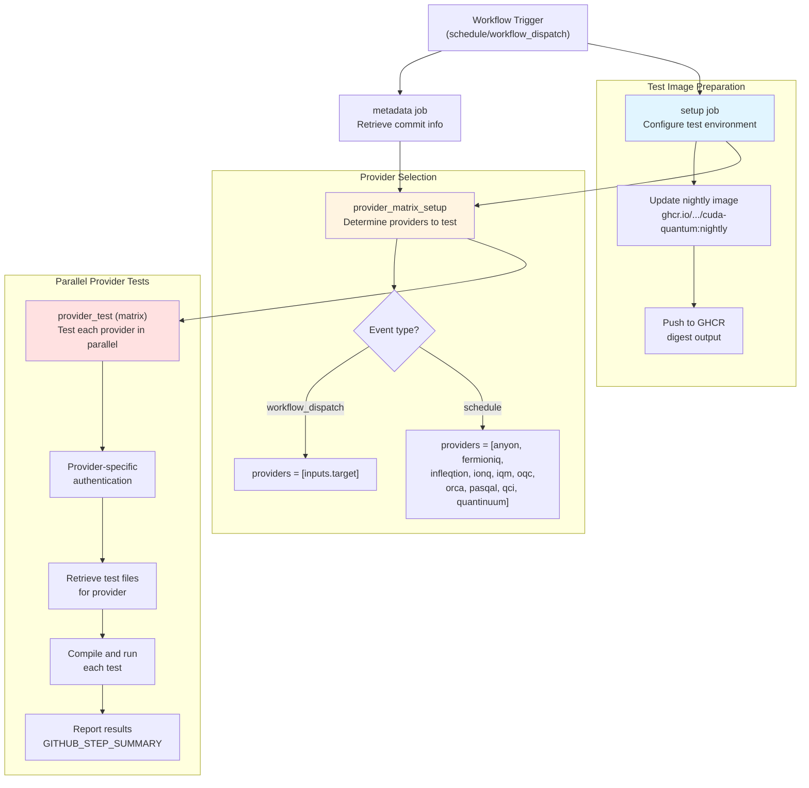
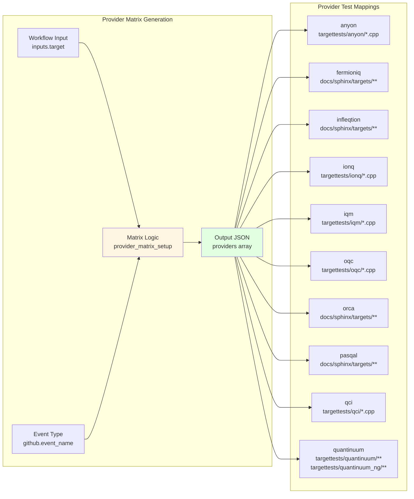
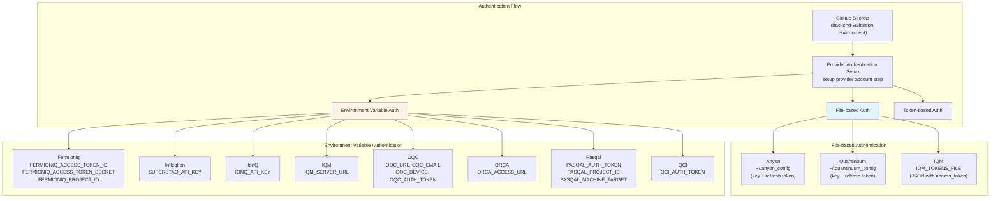
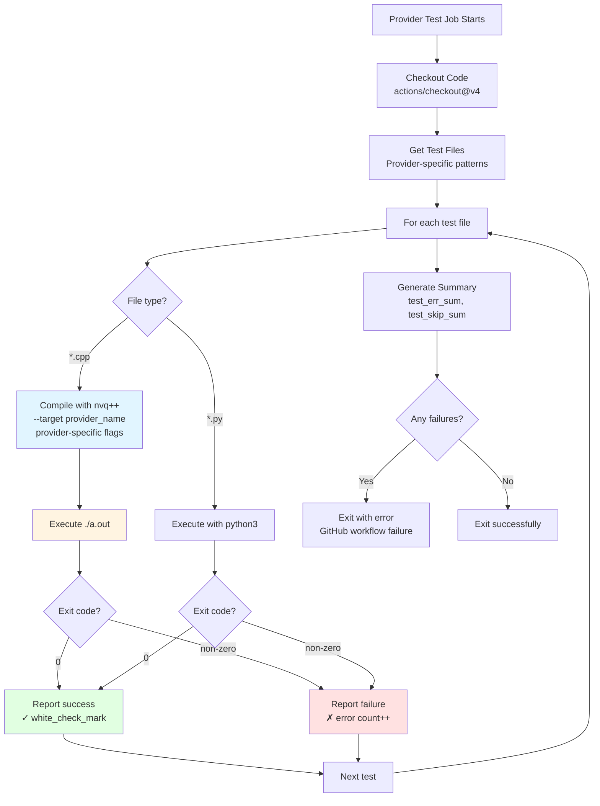
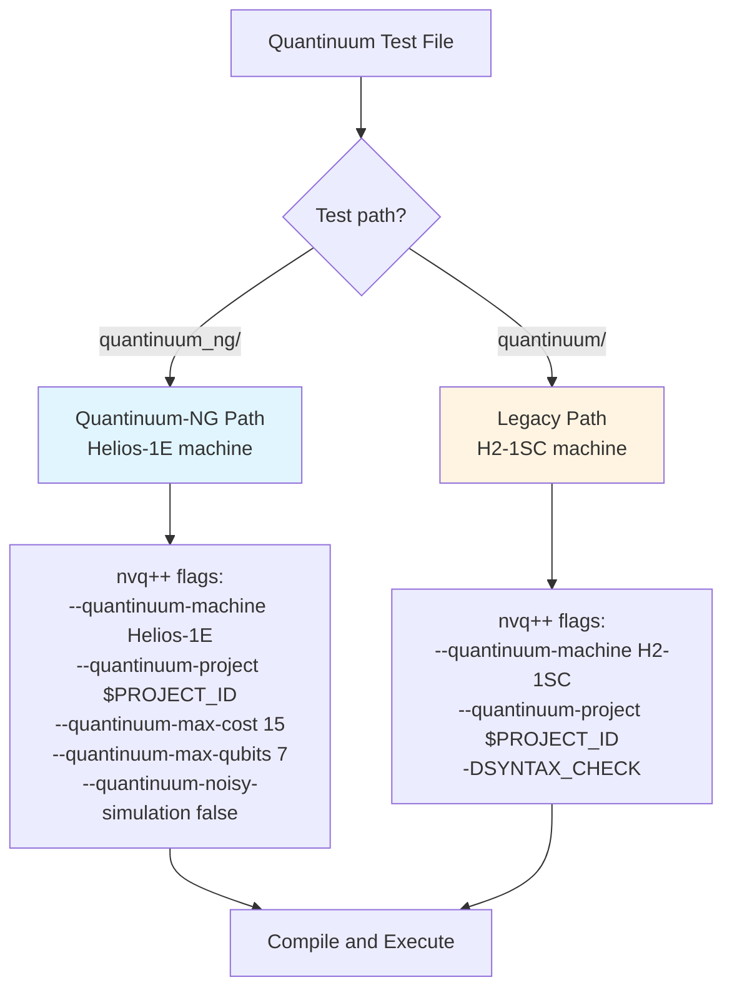
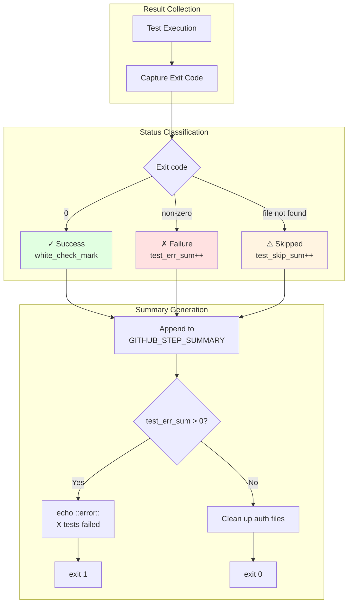

<!-- source: DeepWiki mcp.deepwiki.com · repo NVIDIA/cuda-quantum · page 8.3 Integration Testing with Quantum Providers · fetched 2026-10-26 -->

# Integration Testing with Quantum Providers

<details>
<summary>Relevant source files</summary>

The following files were used as context for generating this wiki page:

- [.gitattributes](.gitattributes)
- [.github/workflows/ci.yml](.github/workflows/ci.yml)
- [.github/workflows/clean_up.yml](.github/workflows/clean_up.yml)
- [.github/workflows/create_cache_command.yml](.github/workflows/create_cache_command.yml)
- [.github/workflows/deployments.yml](.github/workflows/deployments.yml)
- [.github/workflows/dev_environment.yml](.github/workflows/dev_environment.yml)
- [.github/workflows/docker_images.yml](.github/workflows/docker_images.yml)
- [.github/workflows/documentation.yml](.github/workflows/documentation.yml)
- [.github/workflows/generate_cc.yml](.github/workflows/generate_cc.yml)
- [.github/workflows/gh_registry.yml](.github/workflows/gh_registry.yml)
- [.github/workflows/integration_tests.yml](.github/workflows/integration_tests.yml)
- [.github/workflows/prebuilt_binaries.yml](.github/workflows/prebuilt_binaries.yml)
- [.github/workflows/prepare_deployment.yml](.github/workflows/prepare_deployment.yml)
- [.github/workflows/publishing.yml](.github/workflows/publishing.yml)
- [.github/workflows/publishing_stable.yml](.github/workflows/publishing_stable.yml)
- [.github/workflows/python_wheels.yml](.github/workflows/python_wheels.yml)
- [.github/workflows/test_in_devenv.yml](.github/workflows/test_in_devenv.yml)
- [runtime/cudaq/remote_capabilities.h](runtime/cudaq/remote_capabilities.h)

</details>


This document describes the automated integration testing infrastructure that validates CUDA-Q functionality against multiple quantum hardware providers on a nightly basis. The system ensures that quantum program compilation, submission, and execution workflows remain functional across diverse backend targets.

For information about local simulation backends, see [Simulator Backends](#5). For details on the production deployment pipeline that packages and publishes tested artifacts, see [Release and Publishing Process](#8.4).

## Overview

The integration testing system validates CUDA-Q against 10+ quantum hardware providers through automated nightly workflows. Tests compile quantum kernels with provider-specific compilation flags, submit jobs to remote systems, and verify successful execution. Each provider requires distinct authentication mechanisms, compilation targets, and API interactions.

**Key capabilities:**
- Automated nightly execution at 3 AM UTC with manual trigger support
- Matrix-based parallel testing across multiple providers
- Provider-specific authentication and configuration
- Both C++ and Python test execution
- Detailed step-by-step result reporting
- Individual provider test isolation

Sources: [.github/workflows/integration_tests.yml:1-675]()

## Workflow Architecture



**Workflow Inputs:**

| Input | Type | Description |
|-------|------|-------------|
| `target` | choice | Provider to test (or 'nightly' for all) |
| `single_test_name` | string | Optional: specific test file to run |
| `target_machine` | string | Optional: specific machine (e.g., 'H2-1E') |
| `cudaq_test_image` | string | Docker image for testing (defaults to nightly) |
| `commit_sha` | string | Commit to test (defaults to image commit) |
| `workflow_id` | string | Workflow ID for Python wheel retrieval |
| `python_version` | choice | Python version (3.11, 3.12, 3.13) |

Sources: [.github/workflows/integration_tests.yml:8-64]()

## Provider Configuration Matrix

The workflow dynamically generates a test matrix based on the trigger type and configuration. Each provider requires specific setup and test file mappings.



**Provider Test File Locations:**

| Provider | Test Files | Language Support |
|----------|-----------|------------------|
| Anyon | `targettests/anyon/*.cpp` | C++ |
| Fermioniq | `docs/sphinx/targets/**` | C++, Python |
| Infleqtion | `docs/sphinx/targets/**` | C++, Python |
| IonQ | `targettests/ionq/*.cpp` | C++ |
| IQM | `targettests/iqm/*.cpp` | C++ |
| OQC | `targettests/oqc/*.cpp` | C++ |
| ORCA | `docs/sphinx/targets/**` | C++, Python |
| Pasqal | `docs/sphinx/targets/**` | C++, Python |
| QCI | `targettests/qci/*.cpp` | C++ |
| Quantinuum | `targettests/quantinuum/*.cpp`<br/>`targettests/quantinuum_ng/*.cpp` | C++, Python |

Sources: [.github/workflows/integration_tests.yml:166-257]()

## Authentication Mechanisms

Each provider implements a distinct authentication flow. The workflow securely manages credentials through GitHub Secrets and configures provider-specific authentication files or environment variables.



**Authentication Implementation Examples:**

**Anyon** (file-based with curl authentication):
```bash
# Creates temporary netrc file for authentication
# Posts credentials to obtain id_token and refresh_token
# Stores tokens in ~/.anyon_config
```

**Quantinuum** (file-based with cookie-based login):
```bash
# Uses curl to POST credentials to Nexus API
# Extracts myqos_oat and myqos_id from cookies
# Writes to ~/.quantinuum_config
```

**Pasqal** (hybrid: SDK-based token generation, environment variables):
```bash
# Uses pasqal-cloud SDK to authenticate
# Generates auth token via Python script
# Exports PASQAL_AUTH_TOKEN and project configuration
```

Sources: [.github/workflows/integration_tests.yml:260-376]()

## Test Execution Flow

Each provider test follows a consistent pattern: authentication setup, test file retrieval, compilation with provider-specific flags, execution, and result reporting.



**Compilation Flags by Provider:**

| Provider | nvq++ Flags | Special Options |
|----------|-------------|-----------------|
| Anyon | `--target anyon --anyon-machine telegraph-8q` | Uses `-DSYNTAX_CHECK` |
| Fermioniq | `--target fermioniq --fermioniq-project-id $PROJECT_ID` | Project ID required |
| Infleqtion | `--target infleqtion` | - |
| IonQ | `--target ionq` | - |
| IQM | `--target iqm` | Uses `-DSYNTAX_CHECK` |
| OQC | `--target oqc` | Uses `-DSYNTAX_CHECK` |
| ORCA | `--target orca --orca-url $ORCA_ACCESS_URL` | URL configuration |
| Pasqal | `--target pasqal --pasqal-machine $MACHINE_TARGET` | Machine target selection |
| QCI | `--target qci` | - |
| Quantinuum | `--target quantinuum --quantinuum-machine H2-1SC` | Legacy tests |
| Quantinuum NG | `--quantinuum-machine Helios-1E --quantinuum-project $PROJECT_ID` | Cost/qubit limits |

Sources: [.github/workflows/integration_tests.yml:378-674]()

## Provider-Specific Test Execution

### Quantinuum Dual-Path Testing

Quantinuum uses two separate test paths for legacy and next-generation APIs:



Sources: [.github/workflows/integration_tests.yml:620-658]()

### Pasqal Python SDK Integration

Pasqal requires Python SDK installation and token generation:

```bash
# Install pasqal-cloud Python package
python3 -m pip install pasqal-cloud

# Generate authentication token using SDK
sdk = SDK(username=os.environ['PASQAL_USER'], 
          password=os.environ['PASQAL_PASS'])
PASQAL_AUTH_TOKEN = str(sdk.user_token())

# Configure environment
PASQAL_PROJECT_ID=<project_id>
PASQAL_MACHINE_TARGET=EMU_FREE
```

Sources: [.github/workflows/integration_tests.yml:328-360]()

### IQM JSON Token File

IQM uses a JSON token file approach:

```bash
# Create temporary JSON file with access token
IQM_TOKEN_FILE="$(mktemp --suffix=.json)"
printf '{ "access_token": "%s" }' "$IQM_TOKEN" > "$IQM_TOKEN_FILE"
chmod 600 "$IQM_TOKEN_FILE"

# Export environment variables
export IQM_TOKENS_FILE=$IQM_TOKEN_FILE
export IQM_SERVER_URL=https://cocos.resonance.meetiqm.com/pyrite:test
```

Sources: [.github/workflows/integration_tests.yml:303-311]()

## Result Reporting System

The workflow generates detailed test result summaries using GitHub Actions step summaries with emoji indicators for quick status assessment.



**Result Summary Format:**

Each provider test generates a summary like:
```
### Testing quantinuum
✓ Successfully ran test: targettests/quantinuum/load_value.cpp
✗ Test failed (failed to compile): targettests/quantinuum/invalid_test.cpp
⚠ Test skipped (file not found): targettests/quantinuum/missing.cpp

2 tests passed, 1 failed, 1 skipped
```

The summary is visible in the GitHub Actions UI for quick diagnostics.

Sources: [.github/workflows/integration_tests.yml:379-674]()

## Container Environment

Tests execute within a containerized environment using the latest CUDA-Q nightly image:

**Container Configuration:**

```yaml
container:
  image: ${{ needs.setup.outputs.cudaq_test_image }}
  options: --user root
  credentials:
    username: ${{ github.actor }}
    password: ${{ github.token }}
```

The container provides:
- CUDA-Q installation at `$CUDA_QUANTUM_PATH`
- `nvq++` compiler in PATH
- Python with `cudaq` module
- Build info at `$CUDA_QUANTUM_PATH/build_info.txt`

**Image Selection:**

| Source | Default Image |
|--------|--------------|
| Manual trigger | `inputs.cudaq_test_image` or `vars.cudaq_test_image` |
| Scheduled run | `ghcr.io/nvidia/cuda-quantum:nightly` |
| Commit SHA | Extracted from `build_info.txt` |

Sources: [.github/workflows/integration_tests.yml:66-163]()

## Manual Test Execution

The workflow supports manual triggering for debugging individual providers or tests:

**Workflow Dispatch Parameters:**

```yaml
target: 'quantinuum'                      # Test single provider
single_test_name: 'targettests/quantinuum/load_value.cpp'  # Specific test
target_machine: 'H2-1E'                   # Specific machine
cudaq_test_image: 'ghcr.io/.../cuda-quantum@sha256:...'    # Custom image
commit_sha: 'abc123...'                   # Specific commit
workflow_id: '12345678'                   # Python wheel workflow
python_version: '3.12'                    # Python version
```

**Example Manual Trigger:**

To test a single file against Quantinuum:
1. Navigate to Actions → "Nightly integration tests"
2. Click "Run workflow"
3. Select:
   - target: `quantinuum`
   - single_test_name: `targettests/quantinuum/load_value.cpp`
   - target_machine: `H2-1E` (optional)
4. Run workflow

Sources: [.github/workflows/integration_tests.yml:10-57]()

## Concurrency Control

The workflow implements strict concurrency control to prevent race conditions with the shared nightly test image:

```yaml
concurrency:
  group: ${{ github.workflow }}${{ github.event.workflow_run.name }}
  cancel-in-progress: false
```

Only one integration test workflow runs at a time. Subsequent triggers wait for completion rather than canceling the running workflow. This ensures:
- Consistent test image state
- No conflicts updating the `nightly` tag
- Sequential test execution for deterministic results

Sources: [.github/workflows/integration_tests.yml:3-6]()

## Environment Protection

Provider credentials are stored in a protected GitHub environment named `backend-validation`:

**Secret Management:**

| Provider | Required Secrets |
|----------|-----------------|
| Anyon | `ANYON_USERNAME`, `ANYON_PASSWORD` |
| Fermioniq | `FERMIONIQ_ACCESS_TOKEN_ID`, `FERMIONIQ_ACCESS_TOKEN_SECRET` |
| Infleqtion | `SUPERSTAQ_API_KEY` |
| IonQ | `IONQ_API_KEY` |
| IQM | `IQM_TOKEN` |
| OQC | `OQC_URL`, `OQC_DEVICE`, `OQC_AUTH_TOKEN`, `BACKEND_LOGIN_EMAIL` |
| ORCA | `ORCA_ACCESS_URL` |
| Pasqal | `PASQAL_USERNAME`, `PASQAL_PASSWORD`, `PASQAL_PROJECT_ID` |
| QCI | `QCI_AUTH_TOKEN` |
| Quantinuum | `BACKEND_LOGIN_EMAIL`, `QUANTINUUM_NEXUS_PASSWORD`, `QUANTINUUM_NEXUS_PROJECT_ID` |

The `backend-validation` environment requires manual approval for production use and automatically masks sensitive values in logs.

Sources: [.github/workflows/integration_tests.yml:195-196]()

---

