<!-- source: DeepWiki mcp.deepwiki.com · repo NVIDIA/cuda-quantum · page 8.4 Release and Publishing Process · fetched 2026-10-26 -->

# Release Process

<details>
<summary>Relevant source files</summary>

The following files were used as context for generating this wiki page:

- [.gitattributes](.gitattributes)
- [.github/workflows/ci.yml](.github/workflows/ci.yml)
- [.github/workflows/clean_up.yml](.github/workflows/clean_up.yml)
- [.github/workflows/command_dispatch.yml](.github/workflows/command_dispatch.yml)
- [.github/workflows/config/spellcheck_config.yml](.github/workflows/config/spellcheck_config.yml)
- [.github/workflows/config/spelling_allowlist.txt](.github/workflows/config/spelling_allowlist.txt)
- [.github/workflows/create_cache_command.yml](.github/workflows/create_cache_command.yml)
- [.github/workflows/deployments.yml](.github/workflows/deployments.yml)
- [.github/workflows/dev_environment.yml](.github/workflows/dev_environment.yml)
- [.github/workflows/docker_images.yml](.github/workflows/docker_images.yml)
- [.github/workflows/documentation.yml](.github/workflows/documentation.yml)
- [.github/workflows/generate_cc.yml](.github/workflows/generate_cc.yml)
- [.github/workflows/gh_registry.yml](.github/workflows/gh_registry.yml)
- [.github/workflows/integration_tests.yml](.github/workflows/integration_tests.yml)
- [.github/workflows/prebuilt_binaries.yml](.github/workflows/prebuilt_binaries.yml)
- [.github/workflows/prepare_deployment.yml](.github/workflows/prepare_deployment.yml)
- [.github/workflows/publishing.yml](.github/workflows/publishing.yml)
- [.github/workflows/publishing_stable.yml](.github/workflows/publishing_stable.yml)
- [.github/workflows/python_wheels.yml](.github/workflows/python_wheels.yml)
- [.github/workflows/repo_checks.yml](.github/workflows/repo_checks.yml)
- [.github/workflows/test_in_devenv.yml](.github/workflows/test_in_devenv.yml)
- [SECURITY.md](SECURITY.md)
- [docs/sphinx/releases.rst](docs/sphinx/releases.rst)
- [docs/sphinx/using/backends/cloud.rst](docs/sphinx/using/backends/cloud.rst)
- [runtime/cudaq/remote_capabilities.h](runtime/cudaq/remote_capabilities.h)

</details>


This page documents the release process used for building and publishing CUDA Quantum (CUDA-Q) components, including Docker images, Python wheels, and platform-specific installers. This process is designed to ensure consistent and reproducible releases across different platforms and deployment environments.

For information about installing CUDA-Q releases, see [Building and Installing](#8).

## Release Process Overview

The CUDA-Q release process consists of two primary stages:
1. **Deployments Workflow**: Builds all necessary dependencies and generates release artifacts
2. **Publishing Workflow**: Processes artifacts and publishes them to their respective destinations

The process supports both scheduled releases and manual trigger options, with validation steps to ensure quality.

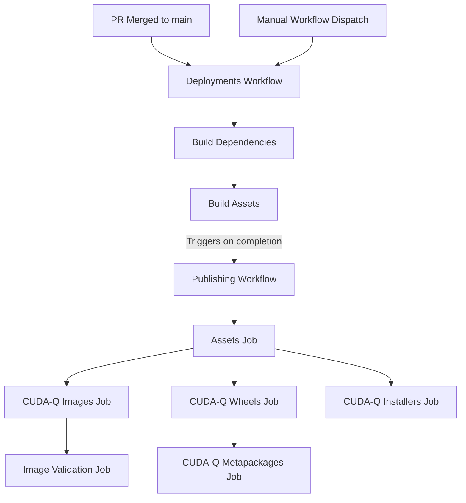

Sources: [.github/workflows/deployments.yml:1-453](), [.github/workflows/publishing.yml:1-516]()

## Deployment Stage

The deployment stage is implemented in the `deployments.yml` workflow, which builds all necessary dependencies and generates the artifacts needed for publishing.

### Deployment Triggering Mechanisms

The deployment workflow can be triggered in three ways:
- **Workflow Dispatch**: Manual trigger with configurable parameters
- **Workflow Run**: Automatically triggered after a PR is merged
- **Push to Specific Branches**: Triggered on pushes to release, staging, experimental, or feature branches

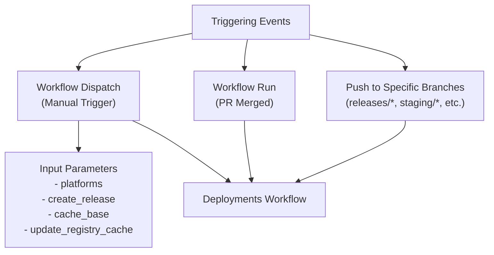

Sources: [.github/workflows/deployments.yml:1-44]()

### Dependency Building Process

The deployment workflow builds several types of dependencies needed for different release artifacts:

1. **Development Dependencies**: Base libraries and tools needed for building CUDA-Q
2. **Wheel Dependencies**: Dependencies for Python wheel creation 
3. **Source Build**: Cross-platform dependencies for installers
4. **OpenMPI**: MPI libraries for distributed computing support

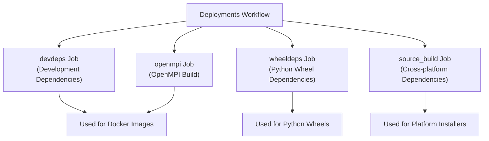

Sources: [.github/workflows/deployments.yml:171-288](), [docker/build/devdeps.Dockerfile:1-175](), [docker/build/devdeps.manylinux.Dockerfile:1-35]()

### Asset Building Process

After dependencies are built, the workflow creates three types of release assets:

1. **Docker Images**: CUDA-Q container images with different configurations
2. **Python Wheels**: Python packages for various platforms and Python versions
3. **Platform Installers**: Native installers for different operating systems

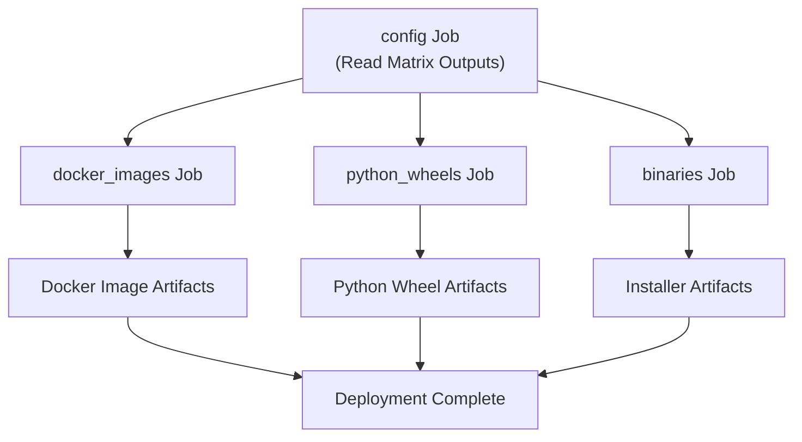

Sources: [.github/workflows/deployments.yml:316-452](), [.github/workflows/docker_images.yml:1-759](), [.github/workflows/python_wheels.yml:1-434](), [.github/workflows/prebuilt_binaries.yml:1-128]()

## Publishing Stage

The publishing stage is implemented in the `publishing.yml` workflow, which processes the artifacts from the deployment stage and publishes them to their respective destinations.

### Publishing Trigger Mechanisms

The publishing workflow can be triggered in two ways:
- **Workflow Dispatch**: Manual trigger with configurable parameters
- **Workflow Run**: Automatically triggered after the Deployments workflow completes

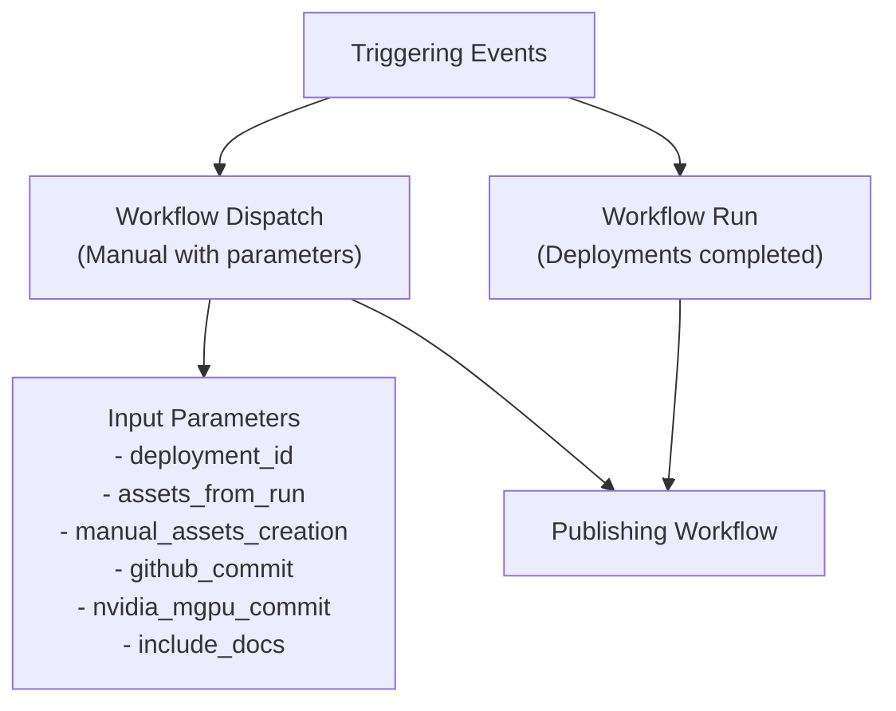

Sources: [.github/workflows/publishing.yml:1-39]()

### Assets Collection and Preparation

The publishing workflow starts with collecting assets from the deployment stage:

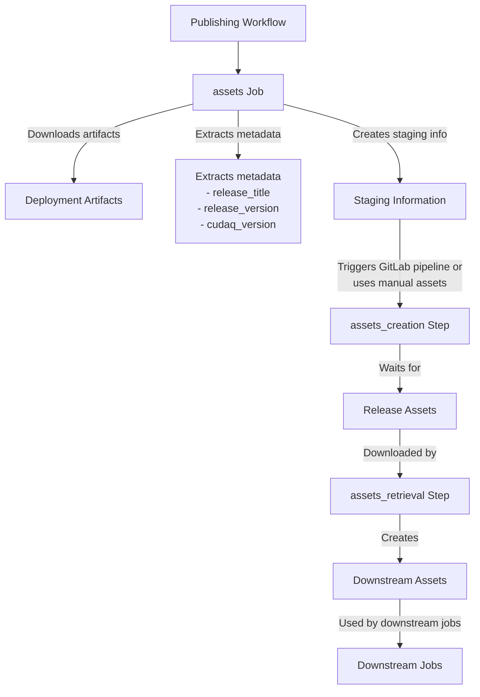

Sources: [.github/workflows/publishing.yml:42-330]()

### Docker Image Publishing

The Docker image publishing process:

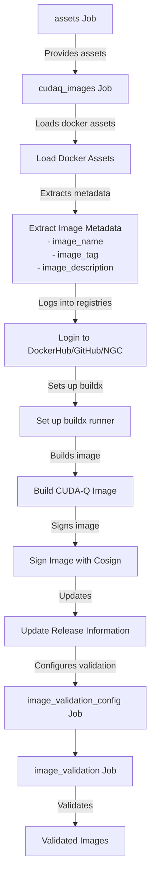

Sources: [.github/workflows/publishing.yml:332-516](), [docker/release/cudaq.ext.Dockerfile:1-76]()

### Python Wheel Publishing

The Python wheel publishing process:

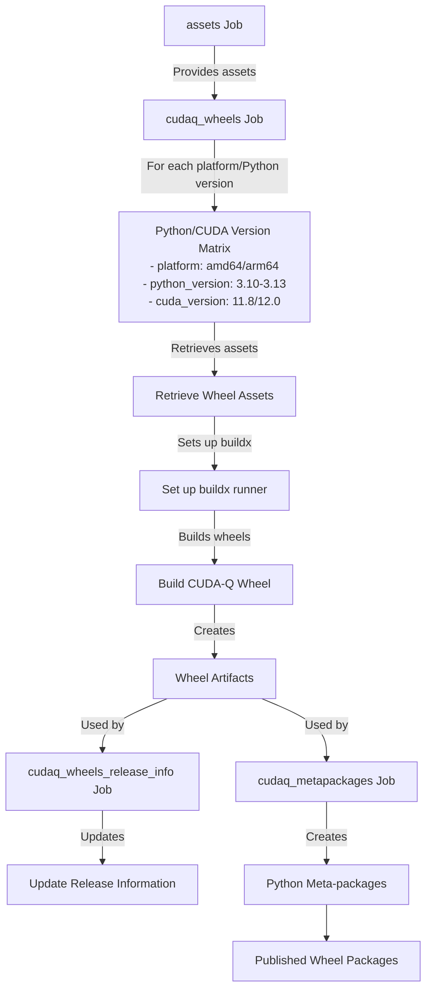

Sources: [.github/workflows/publishing.yml:638-786](), [docker/release/cudaq.wheel.Dockerfile:1-40](), [pyproject.toml:1-84]()

### Installer Publishing

The installer publishing process:

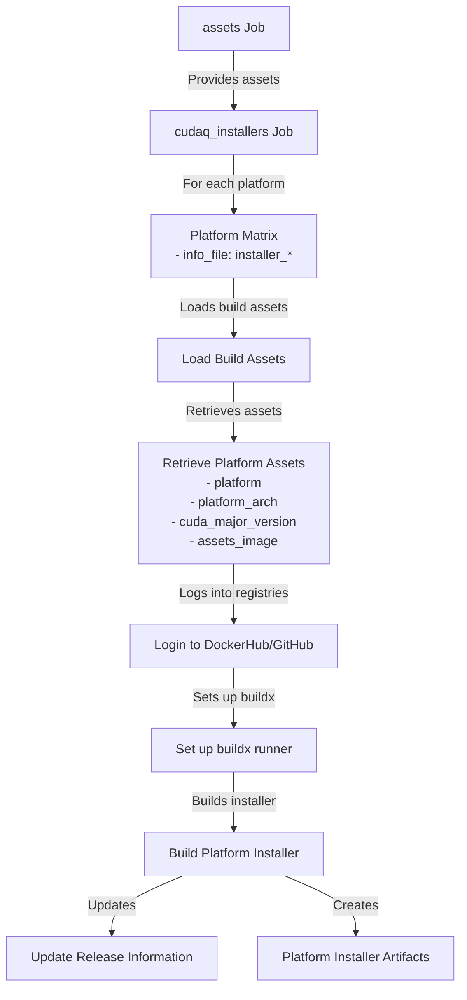

Sources: [.github/workflows/publishing.yml:526-636](), [docker/release/installer.Dockerfile]()

## Release Validation and Cleanup

After publishing, the artifacts are validated and older artifacts are cleaned up.

### Image Validation

Docker images are validated to ensure they function correctly:

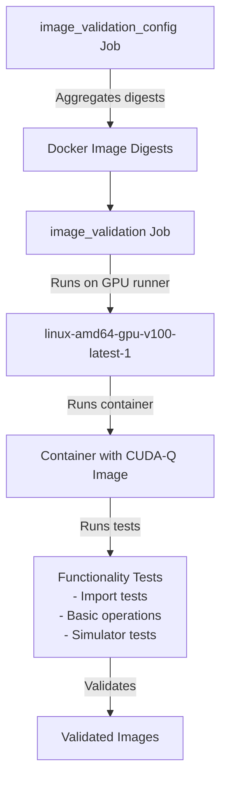

Sources: [.github/workflows/publishing.yml:790-835]()

### Release Cleanup

Cleanup processes maintain repository and registry hygiene:

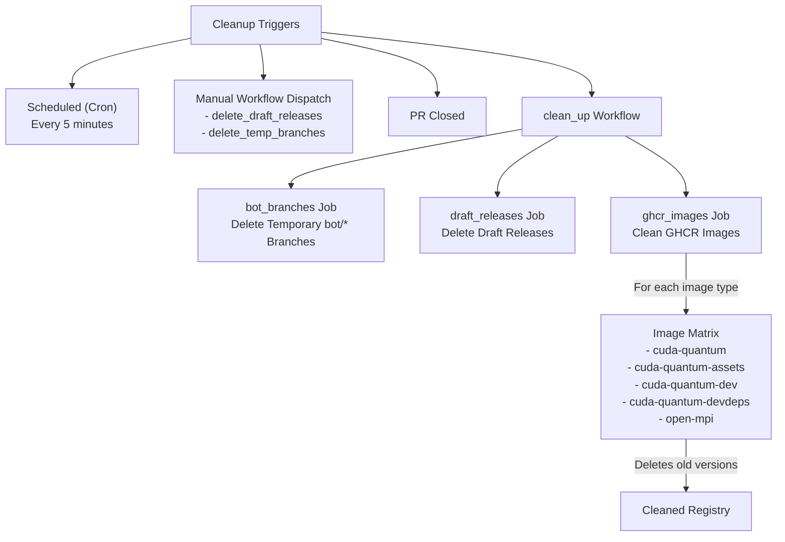

Sources: [.github/workflows/clean_up.yml:1-77]()

## Version Naming and Release Types

CUDA-Q releases follow semantic versioning with specific naming conventions for different types of releases.

| Release Type | Branch Pattern | Version Format | Purpose |
|--------------|----------------|----------------|---------|
| Main         | `main`         | `latest`       | Development builds, nightly releases |
| Release      | `releases/*`   | `X.Y.Z`        | Stable releases |
| Staging      | `staging/*`    | `X.Y.Z`        | Pre-release validation |
| Experimental | `experimental/*` | `latest-[name]` | Feature previews |

Sources: [.github/workflows/deployments.yml:68-147](), [.github/workflows/docker_images.yml:484-499]()

## Hardware Support and Multi-platform Builds

CUDA-Q builds support multiple hardware platforms:

| Platform | Architecture | Base Image | CUDA Support |
|----------|--------------|------------|--------------|
| x86_64   | `linux/amd64` | Various Ubuntu/RHEL | CUDA 11.8+, CUDA 12.x |
| ARM64    | `linux/arm64` | Various Ubuntu/RHEL | CUDA 11.8+, CUDA 12.x |

Multi-platform images are built by combining these architectures into a single Docker manifest.

Sources: [.github/workflows/deployments.yml:92-147](), [.github/workflows/docker_images.yml:59-81]()

## Manual Release Triggers

For manually triggering release processes, different workflows can be used:

| Workflow | Purpose | Key Parameters |
|----------|---------|----------------|
| Deployments | Build artifacts | `platforms`, `create_release`, `cache_base`, `update_registry_cache` |
| Publishing | Publish artifacts | `deployment_id`, `assets_from_run`, `manual_assets_creation`, `github_commit`, `nvidia_mgpu_commit`, `include_docs` |
| Documentation | Publish documentation | `deployment_id`, `version`, `github_repository` |
| Integration Tests | Test with hardware providers | `target`, `single_test_name`, `target_machine`, `cudaq_test_image`, `commit_sha`, `python_version` |
| NVQC Regression Tests | Test NVQC functionality | `cudaq_test_image`, `commit_sha`, `workflow_id`, `python_version` |

Sources: [.github/workflows/deployments.yml:6-40](), [.github/workflows/publishing.yml:2-27](), [.github/workflows/documentation.yml:2-16](), [.github/workflows/integration_tests.yml:10-63](), [.github/workflows/nvqc_regression_tests.yml:8-32]()

## Release Process File Structure

The release process is implemented across several workflow files and Dockerfiles:

```
.github/workflows/
├── deployments.yml           # Main deployment workflow
├── publishing.yml            # Publishing workflow
├── docker_images.yml         # Docker image building workflow
├── python_wheels.yml         # Python wheel building workflow
├── python_metapackages.yml   # Python metapackage building workflow
├── prebuilt_binaries.yml     # Installer building workflow
├── clean_up.yml              # Cleanup workflow
├── documentation.yml         # Documentation publishing workflow
├── integration_tests.yml     # Hardware provider integration tests
├── nvqc_regression_tests.yml # NVQC regression tests
└── publishing_stable.yml     # Stable release publishing workflow

docker/
├── build/
│   ├── devdeps.Dockerfile          # Development dependencies
│   ├── devdeps.ext.Dockerfile      # Extended development dependencies
│   ├── devdeps.manylinux.Dockerfile # Python wheel dependencies
│   ├── devdeps.ompi.Dockerfile     # OpenMPI dependencies
│   └── assets.Dockerfile           # Cross-platform build dependencies
└── release/
    ├── cudaq.Dockerfile            # Base CUDA-Q image
    ├── cudaq.ext.Dockerfile        # Extended CUDA-Q image
    ├── cudaq.wheel.Dockerfile      # Python wheel building
    ├── cudaq.nvqc.Dockerfile       # NVQC deployment image
    └── installer.Dockerfile        # Installer building
```

Sources: Files listed above

## Conclusion

The CUDA-Q release process is a sophisticated pipeline that ensures consistent, tested, and validated releases across multiple platforms and package formats. The process combines GitHub Actions workflows with Docker builds to create a reproducible release process that can be triggered both automatically and manually.

---

