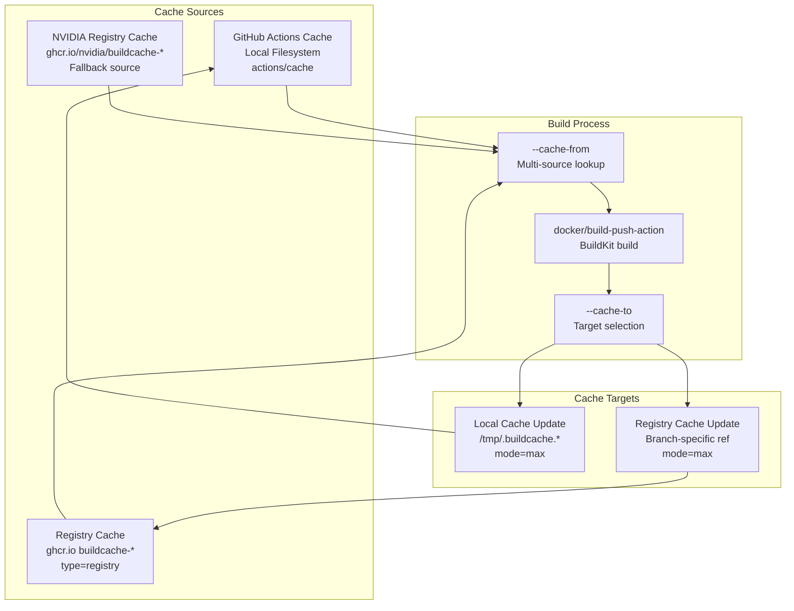
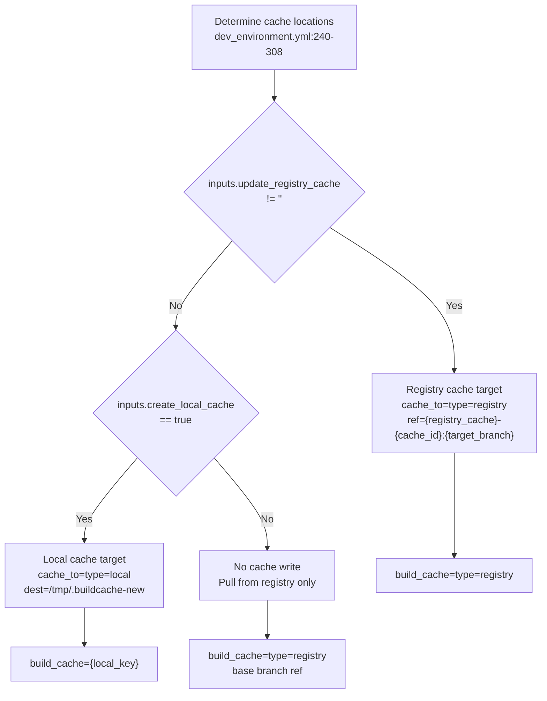
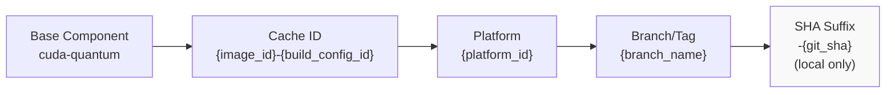
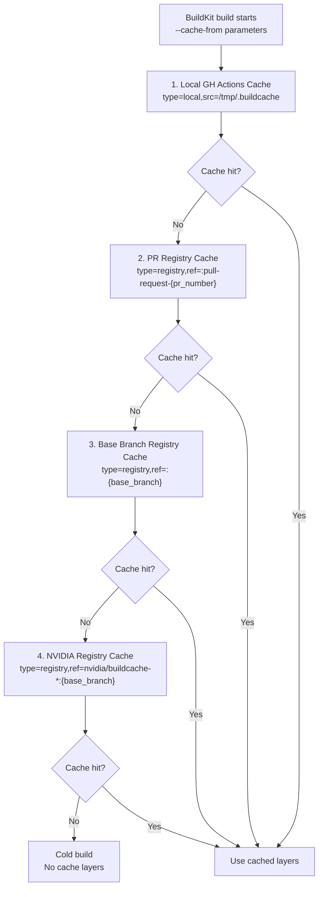
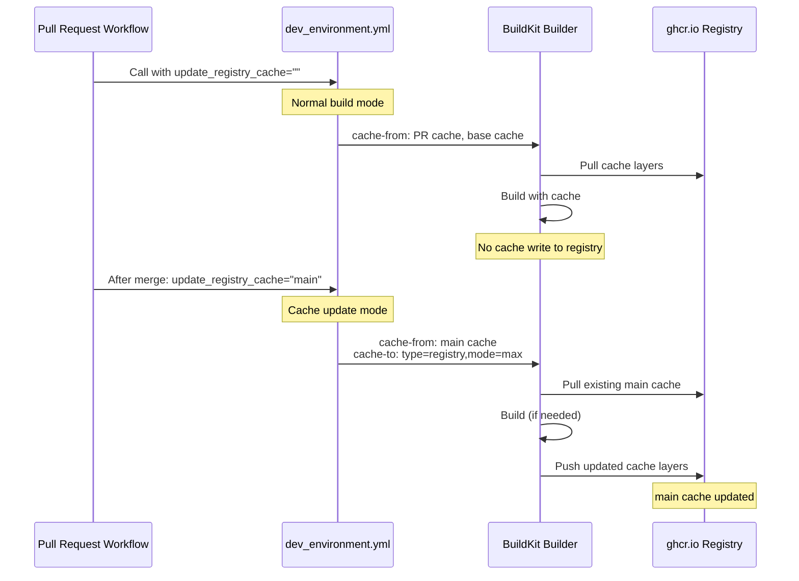
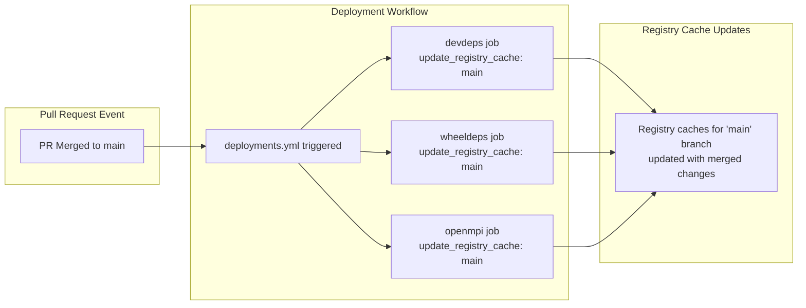
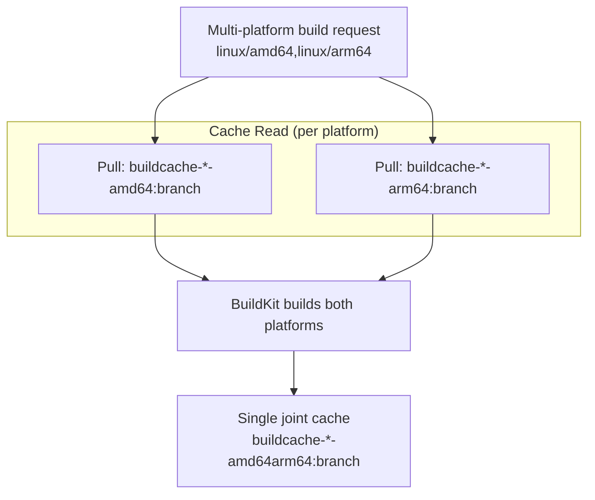
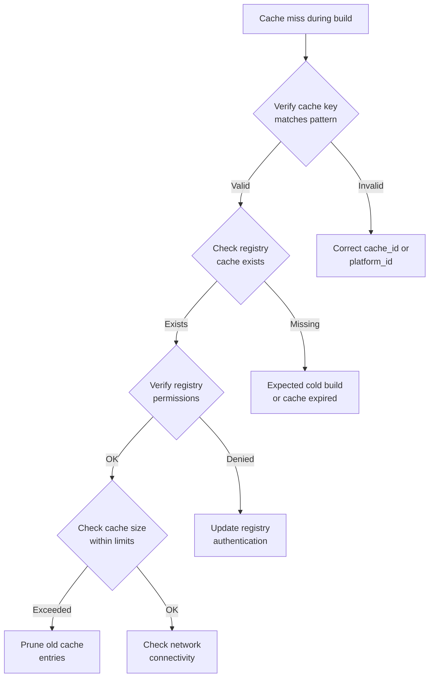

<!-- source: DeepWiki mcp.deepwiki.com · repo NVIDIA/cuda-quantum · page 8.5 Build Caching Strategy · fetched 2026-10-26 -->

# Build Caching Strategy

<details>
<summary>Relevant source files</summary>

The following files were used as context for generating this wiki page:

- [.gitattributes](.gitattributes)
- [.github/workflows/ci.yml](.github/workflows/ci.yml)
- [.github/workflows/clean_up.yml](.github/workflows/clean_up.yml)
- [.github/workflows/create_cache_command.yml](.github/workflows/create_cache_command.yml)
- [.github/workflows/deployments.yml](.github/workflows/deployments.yml)
- [.github/workflows/dev_environment.yml](.github/workflows/dev_environment.yml)
- [.github/workflows/docker_images.yml](.github/workflows/docker_images.yml)
- [.github/workflows/documentation.yml](.github/workflows/documentation.yml)
- [.github/workflows/generate_cc.yml](.github/workflows/generate_cc.yml)
- [.github/workflows/gh_registry.yml](.github/workflows/gh_registry.yml)
- [.github/workflows/integration_tests.yml](.github/workflows/integration_tests.yml)
- [.github/workflows/prebuilt_binaries.yml](.github/workflows/prebuilt_binaries.yml)
- [.github/workflows/prepare_deployment.yml](.github/workflows/prepare_deployment.yml)
- [.github/workflows/publishing.yml](.github/workflows/publishing.yml)
- [.github/workflows/publishing_stable.yml](.github/workflows/publishing_stable.yml)
- [.github/workflows/python_wheels.yml](.github/workflows/python_wheels.yml)
- [.github/workflows/test_in_devenv.yml](.github/workflows/test_in_devenv.yml)
- [runtime/cudaq/remote_capabilities.h](runtime/cudaq/remote_capabilities.h)

</details>


## Purpose and Scope

This document describes the multi-tier caching strategy used in CUDA-Q's CI/CD infrastructure to optimize Docker image builds and reduce build times. The caching system leverages Docker BuildKit's cache capabilities, GitHub Actions cache storage, and container registry-based caching to efficiently reuse build artifacts across workflows, pull requests, and deployments.

For information about the overall CI/CD workflow orchestration, see [GitHub Actions Workflows](#8.1). For Docker image building processes, see [Docker Build System](#7.1).

## Cache Architecture Overview

CUDA-Q's build caching strategy employs a three-tier architecture combining registry caches, local GitHub Actions caches, and BuildKit inline caches to maximize cache hit rates while maintaining isolation between branches and build configurations.

**Cache Architecture and Flow**



Sources: [.github/workflows/dev_environment.yml:240-308](), [.github/workflows/dev_environment.yml:330-336]()

## Cache Types and Storage

CUDA-Q utilizes three distinct cache storage mechanisms, each serving specific purposes in the build pipeline:

| Cache Type | Storage Location | Scope | Retention | Purpose |
|------------|------------------|-------|-----------|---------|
| **Registry Cache** | `ghcr.io/{owner}/buildcache-cuda-quantum-{cache_id}-{platform}:{branch}` | Cross-workflow, persistent | Indefinite | Primary cache for deployments and merged branches |
| **Local GitHub Actions Cache** | GitHub Actions storage<br/>`{pr_number}/merge-cuda-quantum-{cache_id}-{platform}` | Workflow-specific | 7 days | Fast cache for CI runs on PRs |
| **Inline BuildKit Cache** | Docker image layers | Image-specific | Until image deletion | Automatic layer caching |

The cache selection logic is implemented in the `dev_environment.yml` workflow:

**Cache Location Determination Logic**



Sources: [.github/workflows/dev_environment.yml:240-308](), [.github/workflows/dev_environment.yml:260-272]()

## Cache Key Hierarchy

Cache keys follow a hierarchical naming convention that enables precise cache isolation and efficient lookup:

**Cache Key Structure**



The `cache_id` construction combines the dockerfile target and build configuration:

```
cache_id = {image_id}-{build_config_id}
  where:
    image_id = basename(dockerfile).replace('.', '-')
    build_config_id = toolchain identifier (e.g., "gcc11", "clang16", "cu12.6-gcc11")
```

**Registry Cache Path Examples:**

| Build Type | Registry Path |
|------------|---------------|
| Dev dependencies (amd64, clang16) | `ghcr.io/nvidia/buildcache-cuda-quantum-devdeps-clang16-amd64:main` |
| Wheel dependencies (arm64, CUDA 12.6) | `ghcr.io/nvidia/buildcache-cuda-quantum-devdeps-manylinux-cu12-6-gcc11-arm64:main` |
| PR build cache | `ghcr.io/nvidia/buildcache-cuda-quantum-devdeps-gcc11-amd64:pull-request-123` |

Sources: [.github/workflows/dev_environment.yml:240-273](), [.github/workflows/dev_environment.yml:116-166]()

## Cache Fallback Strategy

The cache lookup implements a multi-source fallback strategy to maximize cache hit rates while respecting branch isolation:

**Cache Source Priority Chain**



The cache-from configuration for multi-platform builds generates separate cache references for each platform:

Sources: [.github/workflows/dev_environment.yml:277-293](), [.github/workflows/dev_environment.yml:329-336]()

## Registry Cache Management

Registry caches are managed through branch-specific cache references and lifecycle policies:

**Registry Cache Update Workflow**



The registry cache update is controlled by the `update_registry_cache` input parameter. When set, the workflow writes cache to the registry with `mode=max` to capture all intermediate layers:

Sources: [.github/workflows/dev_environment.yml:260-272](), [.github/workflows/deployments.yml:125-128]()

## Local GitHub Actions Cache

Local caching uses GitHub Actions cache storage for fast access within workflow runs:

**Local Cache Lifecycle**

```mermaid
stateDiagram-v2
    [*] --> CheckCache: Workflow starts
    CheckCache --> CacheRestore: actions/cache/restore
    CacheRestore --> CacheMiss: key not found
    CacheRestore --> CacheHit: key exists
    
    CacheMiss --> Build: Build from registry cache
    CacheHit --> Build: Build with local cache
    
    Build --> UpdateLocal: inputs.create_local_cache=true
    Build --> SkipLocal: inputs.create_local_cache=false
    
    UpdateLocal --> SaveCache: actions/cache/save
    SaveCache --> [*]
    SkipLocal --> [*]
    
    note right of CacheRestore: Restore key pattern:<br/>{pr_number}/merge-cuda-quantum-{cache_id}-{platform}<br/>Restore keys include SHA-less prefix
    
    note right of SaveCache: Save key includes SHA:<br/>{pr_number}/merge-cuda-quantum-{cache_id}-{platform}-{git_sha}
```

The local cache uses a key suffix with the git SHA to invalidate caches on source changes, while the restore operation uses a prefix match to find the most recent valid cache:

**Local Cache Key Configuration:**

```
Restore key:  {pr_number}/merge-cuda-quantum-{cache_id}-{platform}-{git_sha}
Restore prefix: {pr_number}/merge-cuda-quantum-{cache_id}-{platform}
```

This pattern allows the workflow to use the most recent cache from the same PR even after new commits, while maintaining separate caches per commit for reproducibility.

Sources: [.github/workflows/dev_environment.yml:294-308](), [.github/workflows/dev_environment.yml:310-316](), [.github/workflows/dev_environment.yml:360-365]()

## Cache Update Workflows

Different workflows employ different caching strategies based on their execution context:

### CI Workflow Cache Strategy

The CI workflow (`ci.yml`) primarily relies on registry caches without updating them, as CI runs should not modify shared cache state:

**CI Cache Configuration:**

| Component | Cache Source | Cache Target | Update Strategy |
|-----------|--------------|--------------|-----------------|
| devdeps | `registry_cache_from: {pr_base}` | None (read-only) | No updates during CI |
| wheeldeps | `registry_cache_from: {pr_base}` | None (read-only) | No updates during CI |
| source_build | `registry_cache_from: {pr_base}` | None (read-only) | No updates during CI |

Sources: [.github/workflows/ci.yml:80-153]()

### Deployment Workflow Cache Strategy

The deployment workflow (`deployments.yml`) updates registry caches for merged branches to serve as the base for future builds:

**Deployment Cache Update Flow**



Sources: [.github/workflows/deployments.yml:171-287]()

### Publishing Workflow Cache Strategy

The publishing workflow leverages existing build artifacts and caches from the deployment workflow without creating new caches:

Sources: [.github/workflows/publishing.yml:162-254]()

## Cache Optimization Techniques

### BuildKit Cache Mode

All cache writes use `mode=max` to capture the maximum number of cache layers, including intermediate build stages:

```
cache-to: type=registry,ref={cache_ref},mode=max,ignore-error=false
```

The `mode=max` setting ensures that:
- All intermediate build stages are cached
- Multi-stage builds benefit from full layer caching
- Subsequent builds can skip unchanged stages

Sources: [.github/workflows/dev_environment.yml:264]()

### Platform-Specific Cache Isolation

Caches are isolated by platform (amd64/arm64) to prevent architecture conflicts:

**Platform Cache Separation:**



When multiple platforms are requested, BuildKit:
1. Pulls separate platform-specific caches
2. Builds all platforms in parallel
3. Writes a single joint cache reference

Sources: [.github/workflows/dev_environment.yml:274-293]()

### Cache Cleanup Strategy

Old cache entries are automatically cleaned up to prevent storage exhaustion:

**GHCR Cache Cleanup:**

| Image Type | Cleanup Policy | Retention |
|------------|---------------|-----------|
| Untagged manifests | Delete after 400 versions kept | Automatic via `actions/delete-package-versions` |
| Orphaned signatures | Delete when image missing | Scheduled cleanup job |
| BuildKit caches | Delete with branch | Manual cleanup |

Sources: [.github/workflows/clean_up.yml:68-140]()

## Cache Troubleshooting

### Common Cache Issues

**Cache Miss Diagnosis:**



### Cache Invalidation

Caches are automatically invalidated when:

1. Source code changes (for local caches with SHA suffix)
2. Base images are updated (triggers full rebuild)
3. Build arguments change (new cache_id)
4. Dockerfile changes (new image_id)

Manual cache invalidation can be triggered by:
- Running the `create_cache_command.yml` workflow to create fresh caches
- Deleting registry cache tags manually
- Updating the `registry_cache_from` parameter to a different branch

Sources: [.github/workflows/dev_environment.yml:294-308](), [.github/workflows/create_cache_command.yml:84-153]()

## Performance Characteristics

### Cache Performance Metrics

Typical cache hit rates and build time improvements:

| Scenario | Cache Hit Rate | Build Time (Cold) | Build Time (Cached) | Improvement |
|----------|---------------|-------------------|---------------------|-------------|
| Dev dependencies (no changes) | ~95% | 45-60 min | 2-5 min | ~10-20x |
| Dev dependencies (minor changes) | ~80% | 45-60 min | 10-15 min | ~4-5x |
| CUDA Quantum dev build | ~90% | 30-40 min | 5-8 min | ~5-6x |
| Python wheels | ~85% | 20-30 min | 3-5 min | ~6-8x |

### Cache Storage Utilization

Approximate cache sizes by component:

| Component | Cache Size | Compression Ratio |
|-----------|------------|-------------------|
| devdeps (single platform) | 2-3 GB | ~3:1 |
| wheeldeps (single platform) | 1-2 GB | ~3:1 |
| cuda-quantum build | 1.5-2.5 GB | ~4:1 |
| Multi-platform joint cache | 4-6 GB | ~3:1 |

Sources: [.github/workflows/dev_environment.yml:1-424](), [.github/workflows/docker_images.yml:1-1360]()

---

