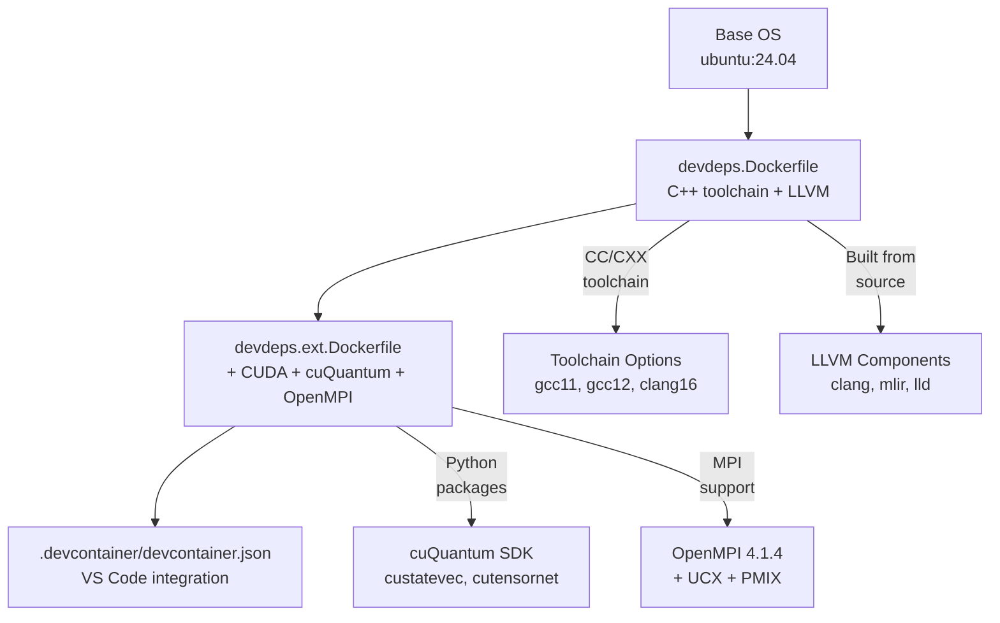
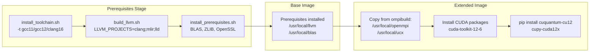
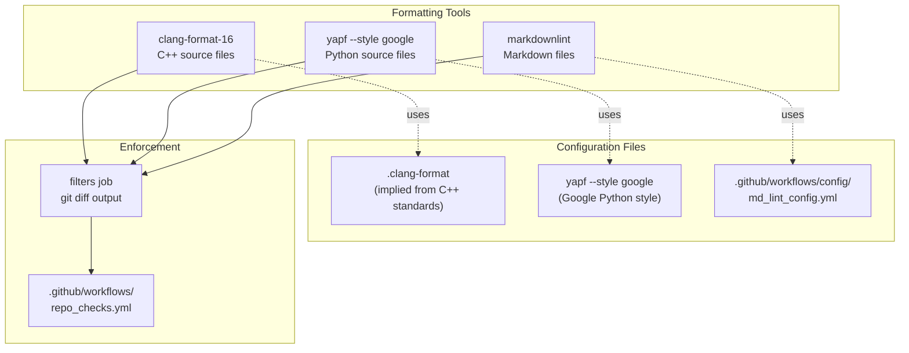
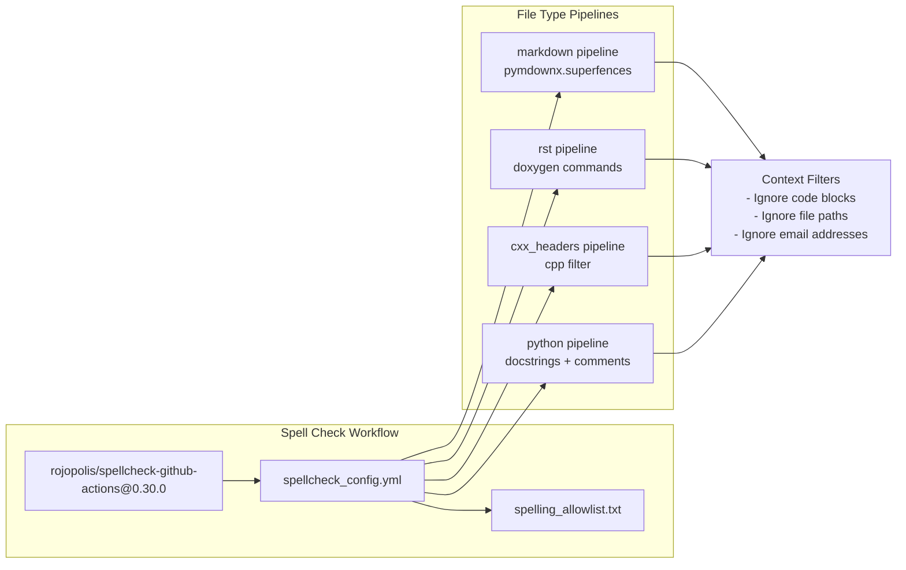
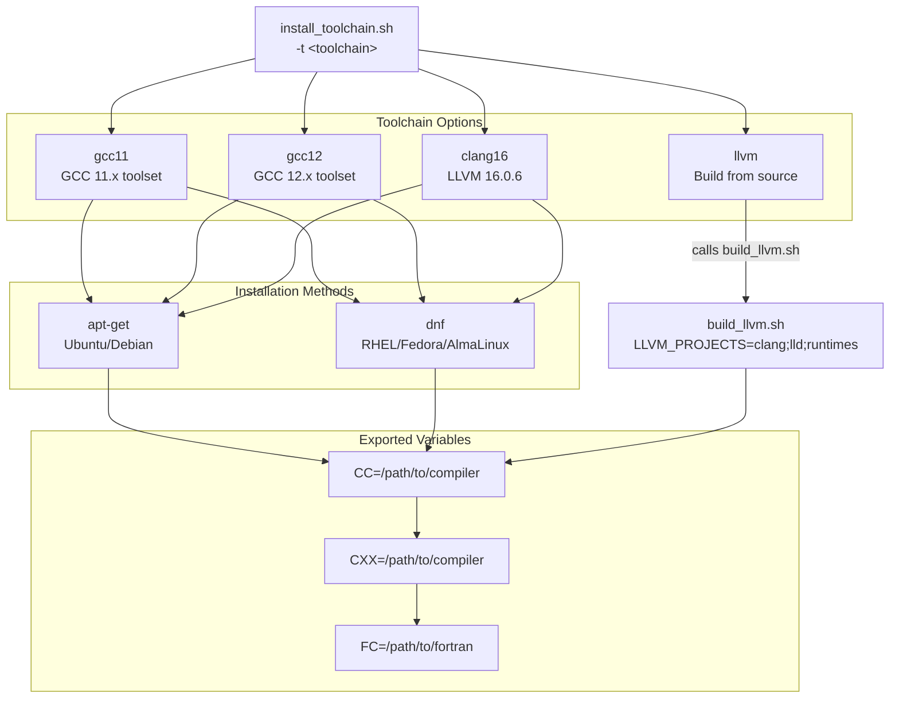
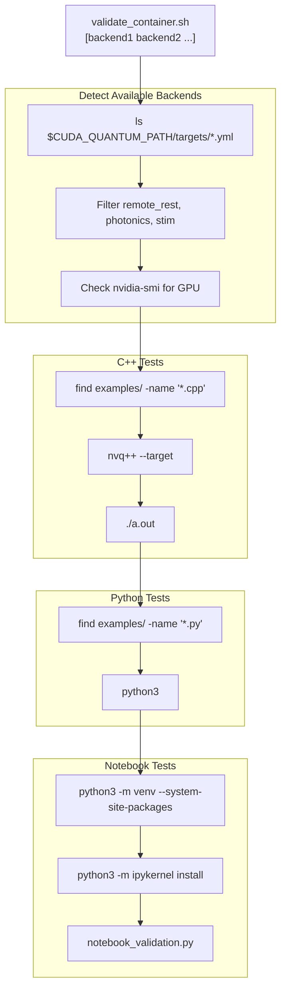
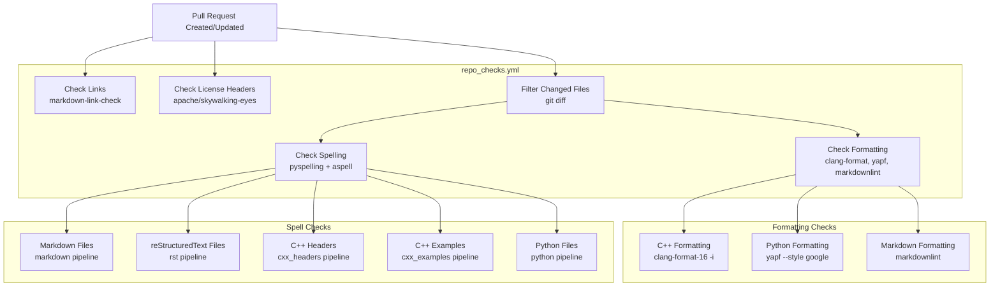

<!-- source: DeepWiki mcp.deepwiki.com · repo NVIDIA/cuda-quantum · page 9 Development Environment · fetched 2026-10-26 -->

# Development Environment

<details>
<summary>Relevant source files</summary>

The following files were used as context for generating this wiki page:

- [.devcontainer/devcontainer.json](.devcontainer/devcontainer.json)
- [.github/actions/run-in-docker/action.yml](.github/actions/run-in-docker/action.yml)
- [.github/codecov.yml](.github/codecov.yml)
- [.github/workflows/command_dispatch.yml](.github/workflows/command_dispatch.yml)
- [.github/workflows/config/spellcheck_config.yml](.github/workflows/config/spellcheck_config.yml)
- [.github/workflows/config/spelling_allowlist.txt](.github/workflows/config/spelling_allowlist.txt)
- [.github/workflows/repo_checks.yml](.github/workflows/repo_checks.yml)
- [SECURITY.md](SECURITY.md)
- [docker/build/assets.Dockerfile](docker/build/assets.Dockerfile)
- [docker/build/devdeps.Dockerfile](docker/build/devdeps.Dockerfile)
- [docker/build/devdeps.ext.Dockerfile](docker/build/devdeps.ext.Dockerfile)
- [docker/build/devdeps.manylinux.Dockerfile](docker/build/devdeps.manylinux.Dockerfile)
- [docker/release/cudaq.Dockerfile](docker/release/cudaq.Dockerfile)
- [docker/release/cudaq.ext.Dockerfile](docker/release/cudaq.ext.Dockerfile)
- [docker/release/cudaq.wheel.Dockerfile](docker/release/cudaq.wheel.Dockerfile)
- [docker/test/installer/runtime_dependencies.sh](docker/test/installer/runtime_dependencies.sh)
- [docs/sphinx/releases.rst](docs/sphinx/releases.rst)
- [docs/sphinx/using/backends/cloud.rst](docs/sphinx/using/backends/cloud.rst)
- [pyproject.toml](pyproject.toml)
- [scripts/build_llvm.sh](scripts/build_llvm.sh)
- [scripts/configure_build.sh](scripts/configure_build.sh)
- [scripts/generate_cc.sh](scripts/generate_cc.sh)
- [scripts/install_toolchain.sh](scripts/install_toolchain.sh)
- [scripts/validate_container.sh](scripts/validate_container.sh)

</details>


## Purpose and Scope

This document describes the development environment setup for building and contributing to CUDA-Q. It covers the Docker-based development containers, code quality tools, toolchain installation, and validation infrastructure. For information about building CUDA-Q from source and distribution packaging, see [Building and Distribution](#7). For information about CI/CD workflows and automated testing, see [CI/CD Infrastructure](#8).

## Development Container Overview

CUDA-Q provides a multi-stage Docker-based development environment that includes all necessary build dependencies, compilers, and development tools. The container hierarchy consists of base development images and extended images with GPU support.

### Development Image Hierarchy



Sources: [docker/build/devdeps.Dockerfile:1-175](), [docker/build/devdeps.ext.Dockerfile:1-203](), [.devcontainer/devcontainer.json:1-272]()

### Base Development Dependencies Image

The `devdeps.Dockerfile` builds a minimal development environment containing only the compiler toolchain and LLVM dependencies. This image is suitable for building CUDA-Q without GPU backend support.

**Key Components:**
- **Toolchain Installation**: Supports `gcc11`, `gcc12`, `clang16`, or building `llvm` from source
- **LLVM Build**: Includes `clang`, `lld`, `mlir`, and `python-bindings` projects
- **Build Tools**: CMake 3.28.4, Ninja, Git, Python 3 development headers
- **Documentation Tools**: Doxygen 1.9.7, Sphinx, Breathe, pandoc

**Environment Variables:**
- `LLVM_INSTALL_PREFIX=/usr/local/llvm`
- `CUDAQ_INSTALL_PREFIX=/usr/local/cudaq`
- `CC` and `CXX` point to wrapper scripts in `$LLVM_INSTALL_PREFIX/bootstrap/`

Sources: [docker/build/devdeps.Dockerfile:25-175](), [scripts/install_toolchain.sh:1-187]()

### Extended Development Dependencies Image

The `devdeps.ext.Dockerfile` extends the base image with CUDA, cuQuantum, and MPI support for building GPU-accelerated simulators and multi-node execution.

**Added Components:**

| Component | Version | Purpose |
|-----------|---------|---------|
| CUDA Toolkit | 12.6 or 13.x | GPU compilation and runtime |
| cuQuantum | 25.09.1 | cuStateVec, cuTensorNet libraries |
| cuTensor | 2.3.1.0 | Tensor operations |
| OpenMPI | 4.1.4 | Multi-node MPI support |
| UCX | Latest | High-performance communication |
| GDRCOPY | Latest | GPU Direct RDMA |

**Installation Locations:**
```
CUDA_INSTALL_PREFIX=/usr/local/cuda-${CUDA_VERSION}
CUQUANTUM_INSTALL_PREFIX=/usr/local/lib/python3.12/dist-packages/cuquantum
CUTENSOR_INSTALL_PREFIX=/usr/local/lib/python3.12/dist-packages/cutensor
OPENMPI_INSTALL_PREFIX=/usr/local/openmpi
```

Sources: [docker/build/devdeps.ext.Dockerfile:19-203](), [scripts/configure_build.sh:26-148]()

### Container Build Process



Sources: [docker/build/devdeps.Dockerfile:63-90](), [docker/build/devdeps.ext.Dockerfile:22-203]()

## Code Quality and Style Tools

CUDA-Q enforces code quality through automated formatting, spell checking, and repository checks integrated into the CI/CD pipeline.

### Formatting Tools



Sources: [.github/workflows/repo_checks.yml:103-171]()

**Formatting Commands:**

For C++ files:
```bash
clang-format-16 -i <file.cpp>
```

For Python files:
```bash
yapf --style google --recursive -i <file.py>
```

The CI checks formatting by running these tools and comparing the output with `git diff`. If differences are detected, the check fails and displays the required patch.

Sources: [.github/workflows/repo_checks.yml:113-164]()

### Spell Checking Infrastructure

CUDA-Q uses `pyspelling` with `aspell` to check spelling across multiple file types. The configuration supports C++, Python, Markdown, reStructuredText, and HTML files.

**Spell Check Configuration:**



Sources: [.github/workflows/repo_checks.yml:172-258](), [.github/workflows/config/spellcheck_config.yml:1-286]()

**Spell Check Allowlists:**

The project maintains two allowlists:
- `spelling_allowlist.txt`: General technical terms (309 entries including "CUDA", "quantum", "cudaq", "MLIR")
- `spelling_allowlist_cxx.txt`: Additional C++ specific terms

Both lists must be kept in alphabetical order. The allowlist includes:
- Technical terms: `MLIR`, `LLVM`, `QPU`, `QIR`, `cuQuantum`
- Programming terms: `namespace`, `callable`, `iterable`, `templated`
- Domain-specific terms: `qubit`, `hamiltonian`, `ansatz`, `variational`

Sources: [.github/workflows/config/spelling_allowlist.txt:1-383](), [.github/workflows/repo_checks.yml:182-190]()

**Context Filters:**

The spell checker applies context-aware filtering to avoid false positives:

| Filter | Pattern | Purpose |
|--------|---------|---------|
| Word prefixes | `[a-z]+-` | Ignore hyphenated prefixes like "pre-computed" |
| Apostrophe-s | `\u0027s` | Ignore possessives like "NVIDIA's" |
| File paths | `([A-Za-z_\\/]+\.)+\S+?` | Ignore file extensions |
| Doxygen commands | `[\\@]\w+` | Ignore `@param`, `\code` tags |
| C++ identifiers | `::\w+` | Ignore namespace qualifiers |
| CamelCase | `[a-zA-Z0-9]+[A-Z0-9_]` | Ignore mixed-case identifiers |

Sources: [.github/workflows/config/spellcheck_config.yml:28-197]()

### VS Code Dev Container Integration

The `.devcontainer/devcontainer.json` configures VS Code for seamless integration with the CUDA-Q development environment.

**Installed Extensions:**

| Extension | Purpose |
|-----------|---------|
| `ms-vscode.cpptools` | C++ IntelliSense, debugging |
| `ms-vscode.cmake-tools` | CMake project integration |
| `llvm-vs-code-extensions.vscode-mlir` | MLIR syntax highlighting |
| `cschlosser.doxdocgen` | Doxygen comment generation |
| `streetsidesoftware.code-spell-checker` | Real-time spell checking |
| `davidanson.vscode-markdownlint` | Markdown linting |

**Key Settings:**

```json
{
  "mlir.server_path": "cudaq-lsp-server",
  "C_Cpp.default.configurationProvider": "ms-vscode.cmake-tools",
  "C_Cpp.default.compileCommands": "${workspaceFolder}/build/compile_commands.json",
  "psi-header.config": {
    "license": "Apache-2.0",
    "company": "NVIDIA",
    "copyrightHolder": "NVIDIA Corporation & Affiliates"
  }
}
```

**File Associations:**

- `*.td` → TableGen
- `*.qke`, `*.qtx` → MLIR
- `*.cmake.in` → CMake
- `*.h.in` → C++

Sources: [.devcontainer/devcontainer.json:21-272]()

**GPU Support:**

The dev container automatically detects available GPUs when the NVIDIA container runtime is installed:

```json
{
  "hostRequirements": {
    "gpu": "optional"
  }
}
```

For manual GPU enablement:
```json
{
  "runArgs": [ "--gpus=all" ]
}
```

Sources: [.devcontainer/devcontainer.json:9-14]()

## Toolchain Installation and Management

CUDA-Q requires a specific C++ toolchain to build LLVM and the CUDA-Q binaries. The `install_toolchain.sh` script automates toolchain installation and configuration.

### Supported Toolchains



Sources: [scripts/install_toolchain.sh:1-187]()

**Usage:**

```bash
# Install GCC 11 toolchain
source scripts/install_toolchain.sh -t gcc11

# Install Clang 16 toolchain
source scripts/install_toolchain.sh -t clang16

# Build LLVM toolchain from source
source scripts/install_toolchain.sh -t llvm

# Export configuration for reuse
source scripts/install_toolchain.sh -t gcc12 -e /path/to/export/dir
```

The `-e` option creates an `init_command.sh` file that can be sourced to reinstall the same toolchain configuration.

Sources: [scripts/install_toolchain.sh:13-21]()

### LLVM Build Process

When building LLVM from source, the `build_llvm.sh` script handles the complete build and installation process.

**Build Configuration:**

```bash
# Environment variables
export LLVM_INSTALL_PREFIX=/usr/local/llvm
export LLVM_PROJECTS='clang;lld;mlir;python-bindings'
export LLVM_SOURCE=/path/to/llvm-project
export LLVM_CMAKE_CACHE=/path/to/LLVM.cmake

# Build command
bash scripts/build_llvm.sh -c Release -v
```

**LLVM Component Selection:**

| Project | Components | Purpose |
|---------|------------|---------|
| `clang` | Compiler, headers, libraries | C/C++ compilation |
| `lld` | Linker | Fast linking with compressed debug symbols |
| `mlir` | MLIR core, TableGen, Python bindings | Quantum IR representation |
| `openmp` | Runtime, headers | Parallel execution support |
| `runtimes` | libc++, libc++abi, libunwind, compiler-rt | C++ standard library and runtime |

The build process creates a distribution with only the required components to minimize installation size:

```bash
# Installation targets
install-distribution-stripped  # Minimal installation
install-runtimes              # C++ runtime libraries
```

Sources: [scripts/build_llvm.sh:135-208](), [cmake/caches/LLVM.cmake]() (referenced but not provided)

**LLVM Patches:**

CUDA-Q applies custom patches to LLVM during the build. The patches are stored in `tpls/customizations/llvm/` and automatically applied by the build script:

```bash
for patch in $(find "$LLVM_CMAKE_PATCHES"/* -type f -name '*.diff'); do
  git apply "$patch" --ignore-whitespace
done
```

Sources: [scripts/build_llvm.sh:98-123]()

### Build Configuration Script

The `configure_build.sh` script provides helper functions for installing build dependencies and configuring the build environment.

**Available Functions:**

```bash
# Install CUDA Toolkit
bash scripts/configure_build.sh install-cuda

# Install CUDA runtime only
bash scripts/configure_build.sh install-cudart

# Install cuQuantum SDK
bash scripts/configure_build.sh install-cuquantum

# Install cuTensor library
bash scripts/configure_build.sh install-cutensor

# Install GCC toolchain
bash scripts/configure_build.sh install-gcc

# Build OpenMPI from source
bash scripts/configure_build.sh build-openmpi
```

**Installation Locations:**

All installations use standard prefixes defined as environment variables:

```bash
export CUDAQ_INSTALL_PREFIX=/usr/local/cudaq
export LLVM_INSTALL_PREFIX=/usr/local/llvm
export CUDA_INSTALL_PREFIX=/usr/local/cuda-${CUDA_VERSION}
export CUQUANTUM_INSTALL_PREFIX=/usr/local/cuquantum
export OPENMPI_INSTALL_PREFIX=/usr/local/openmpi
```

Sources: [scripts/configure_build.sh:1-150]()

## Validation Infrastructure

CUDA-Q includes comprehensive validation scripts to verify correct installation and functionality of built artifacts.

### Container Validation

The `validate_container.sh` script tests C++ examples, Python examples, and Jupyter notebooks across all available backends.

**Validation Workflow:**



Sources: [scripts/validate_container.sh:1-454]()

**Backend Selection:**

The script automatically detects installed backends by scanning YAML configuration files:

```bash
installed_backends=$(
  for file in $(ls $CUDA_QUANTUM_PATH/targets/*.yml); do
    basename $file | cut -d "." -f 1
  done
)

available_backends=$(
  # Filter out remote_rest, photonics, stim backends
  # Check GPU requirements match available hardware
)
```

Backends are tested based on:
- Platform QPU type (excludes `remote_rest`, `fermioniq`, `orca`, `pasqal`, `quera`)
- GPU requirements (skips GPU backends if no GPU available)

Sources: [scripts/validate_container.sh:56-130]()

**Target-Specific Options:**

For backends that support multiple configurations, the script tests all options:

```bash
declare -A target_options=(
  [nvidia]="fp32 fp64 fp32,mqpu fp64,mqpu fp32,mgpu fp64,mgpu"
  [tensornet]="fp32 fp64"
  [tensornet-mps]="fp32 fp64"
)
```

Sources: [scripts/validate_container.sh:225-253]()

**Skipped Tests:**

Certain tests are skipped for performance or compatibility reasons:

| Backend | Skipped Tests | Reason |
|---------|---------------|--------|
| `tensornet`, `tensornet-mps` | VQE H2, QAOA MaxCut, builder examples | Long-running, issue #884 |
| `density-matrix-cpu` | All non-noise examples | Performance optimization |
| `remote-mqpu` | VQE, QAOA, gradients, Grover, phase estimation | Performance, callable kernel parameters |

Sources: [scripts/validate_container.sh:133-221]()

**Notebook Validation:**

Notebooks are validated in an isolated virtual environment to ensure reproducibility:

```bash
# Create venv that inherits system packages (including cudaq)
NOTEBOOK_VENV="/tmp/cudaq_notebook_validation_venv"
python3 -m venv --system-site-packages "$NOTEBOOK_VENV"
source "$NOTEBOOK_VENV/bin/activate"

# Install Jupyter infrastructure
pip install jupyter ipykernel notebook -q

# Register as Jupyter kernel
JUPYTER_KERNEL_NAME="cudaq_nb_validation_container"
python3 -m ipykernel install --user --name="$JUPYTER_KERNEL_NAME"

# Run validation
echo "$available_backends" | python3 notebook_validation.py "$JUPYTER_KERNEL_NAME"
```

Sources: [scripts/validate_container.sh:347-402]()

### Code Coverage Generation

The `generate_cc.sh` script generates code coverage reports for both C++ and Python code using LLVM coverage tools.

**Coverage Workflow:**

```mermaid
graph LR
    subgraph "Setup"
        EnableCC["export CUDAQ_ENABLE_CC=ON"]
        LinkClangRT["Link libclang_rt.profile.a"]
        SetProfile["LLVM_PROFILE_FILE=<path>"]
    end
    
    subgraph "Build and Test"
        BuildCudaq["bash build_cudaq.sh"]
        RunCTests["ctest --test-dir build"]
        RunLit["llvm-lit build/test"]
        RunPytest["pytest python/tests/"]
    end
    
    subgraph "Generate Report"
        MergeProfiles["llvm-profdata merge *.profraw"]
        ExtractObjects["Extract binaries from build logs"]
        GenReport["llvm-cov show -format=html"]
    end
    
    EnableCC --> LinkClangRT
    LinkClangRT --> SetProfile
    SetProfile --> BuildCudaq
    BuildCudaq --> RunCTests
    RunCTests --> RunLit
    RunLit --> RunPytest
    RunPytest --> MergeProfiles
    MergeProfiles --> ExtractObjects
    ExtractObjects --> GenReport
```



Sources: [scripts/generate_cc.sh:1-194]()

**Usage:**

```bash
# Generate C++ coverage
bash scripts/generate_cc.sh -c

# Generate Python coverage
bash scripts/generate_cc.sh -p

# Generate both in codecov format
bash scripts/generate_cc.sh -c -p -v
```

**C++ Coverage Process:**

1. Enable coverage compilation:
   ```bash
   export CUDAQ_ENABLE_CC=ON
   export LLVM_PROFILE_FILE=${repo_root}/build/tmp/cudaq-cc/profile-%9m.profraw
   ```

2. Build and run all tests (ctest, llvm-lit, pytest)

3. Merge profile data:
   ```bash
   llvm-profdata merge -sparse build/tmp/cudaq-cc/profile-*.profraw -o build/coverage.profdata
   ```

4. Generate HTML report:
   ```bash
   llvm-cov show -format=html -object <binary1> -object <binary2> ... \
     -instr-profile=build/coverage.profdata \
     --ignore-filename-regex="tpls/*" \
     --ignore-filename-regex="build/*" \
     -o build/ccoverage
   ```

Sources: [scripts/generate_cc.sh:66-177]()

**Python Coverage Process:**

Python coverage uses `pytest-cov` to generate reports:

```bash
pip install pytest-cov
pytest -v python/tests/ --ignore python/tests/backends \
  --cov=cudaq \
  --cov-report=html:build/pycoverage \
  --cov-append
```

Sources: [scripts/generate_cc.sh:180-192]()

## Repository Checks Workflow

The CI/CD system enforces code quality through the `repo_checks.yml` workflow, which runs on pull requests and merge groups.

**Check Pipeline:**



Sources: [.github/workflows/repo_checks.yml:1-258]()

**Link Checking:**

Markdown and reStructuredText files are checked for broken links:

```yaml
- name: Convert reStructuredText files to Markdown
  run: |
    pip install "rst-to-myst[sphinx]==0.4.0"
    find docs/sphinx/ -type f -name "*.rst" -print0 | xargs -0 rst2myst convert

- name: Check links in Markdown files
  uses: gaurav-nelson/github-action-markdown-link-check@v1
  with:
    config-file: ".github/workflows/config/md_link_check_config.json"
```

Sources: [.github/workflows/repo_checks.yml:15-34]()

**License Header Checking:**

The workflow uses Apache Skywalking Eyes to verify license headers:

```yaml
- uses: apache/skywalking-eyes/header@v0.4.0
  with:
    config: .licenserc.yaml
```

Sources: [.github/workflows/repo_checks.yml:36-47]()

**File Filtering:**

For pull requests, only changed files are checked to improve performance:

```yaml
- id: files
  run: |
    if ${{ github.event_name == 'pull_request' }}; then
      diff_base=${{ github.event.pull_request.base.sha }}
      list_files="git diff --diff-filter=d --name-only $diff_base --"
    else
      list_files="git ls-files"
    fi
```

The filter creates JSON output categorizing files by type:
- `cxx`: C++ source and headers (excluding tests and tpls)
- `python`: Python files (excluding tests and tpls)
- `markdown`: Markdown files
- `rst`: reStructuredText files

Sources: [.github/workflows/repo_checks.yml:49-101]()

---

