<!-- source: DeepWiki mcp.deepwiki.com · repo NVIDIA/cuda-quantum · page 9.1 VS Code Dev Containers · fetched 2026-10-26 -->

# VS Code Dev Containers

<details>
<summary>Relevant source files</summary>

The following files were used as context for generating this wiki page:

- [.devcontainer/devcontainer.json](.devcontainer/devcontainer.json)
- [.github/actions/run-in-docker/action.yml](.github/actions/run-in-docker/action.yml)
- [.github/codecov.yml](.github/codecov.yml)
- [docker/build/assets.Dockerfile](docker/build/assets.Dockerfile)
- [docker/build/devdeps.Dockerfile](docker/build/devdeps.Dockerfile)
- [docker/build/devdeps.ext.Dockerfile](docker/build/devdeps.ext.Dockerfile)
- [docker/build/devdeps.manylinux.Dockerfile](docker/build/devdeps.manylinux.Dockerfile)
- [docker/release/cudaq.Dockerfile](docker/release/cudaq.Dockerfile)
- [docker/release/cudaq.ext.Dockerfile](docker/release/cudaq.ext.Dockerfile)
- [docker/release/cudaq.wheel.Dockerfile](docker/release/cudaq.wheel.Dockerfile)
- [docker/test/installer/runtime_dependencies.sh](docker/test/installer/runtime_dependencies.sh)
- [pyproject.toml](pyproject.toml)
- [scripts/build_llvm.sh](scripts/build_llvm.sh)
- [scripts/configure_build.sh](scripts/configure_build.sh)
- [scripts/generate_cc.sh](scripts/generate_cc.sh)
- [scripts/install_toolchain.sh](scripts/install_toolchain.sh)
- [scripts/validate_container.sh](scripts/validate_container.sh)

</details>


## Purpose and Scope

This document describes the VS Code Dev Container configuration for CUDA-Q development. The dev container provides a pre-configured, containerized development environment that includes all necessary toolchains, dependencies, and VS Code extensions for building and testing CUDA-Q. This eliminates the need for developers to manually install and configure LLVM, CUDA, and other build dependencies on their host systems.

For information about the Docker images that form the base of the dev container, see [Docker Build System](#7.1). For general development workflows and code quality tools, see [Code Quality and Style](#9.2).

## Dev Container Architecture

The dev container system integrates VS Code's Remote-Containers extension with CUDA-Q's Docker build infrastructure to provide an isolated, reproducible development environment.

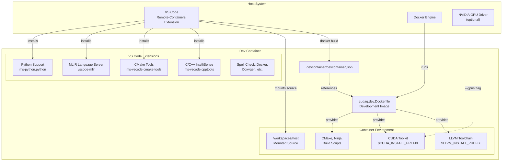

Sources: [.devcontainer/devcontainer.json:1-272]()

## Configuration File Structure

The `.devcontainer/devcontainer.json` file defines the complete dev container configuration. It specifies the Docker image, runtime arguments, and VS Code customizations.

### Base Image Configuration

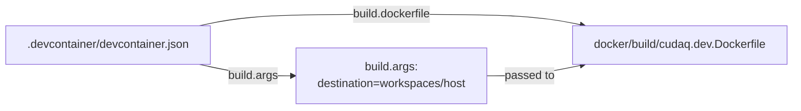

| Configuration Key | Value | Purpose |
|------------------|-------|---------|
| `name` | `"cuda-quantum-dev"` | Container display name in VS Code |
| `build.dockerfile` | `"../docker/build/cudaq.dev.Dockerfile"` | Development image Dockerfile path |
| `build.args.destination` | `"workspaces/host"` | Source code mount point in container |
| `hostRequirements.gpu` | `"optional"` | Enables automatic GPU detection |

Sources: [.devcontainer/devcontainer.json:1-14]()

### GPU Passthrough Configuration

The dev container automatically detects and enables GPU support when the NVIDIA Container Toolkit is installed on the host system.

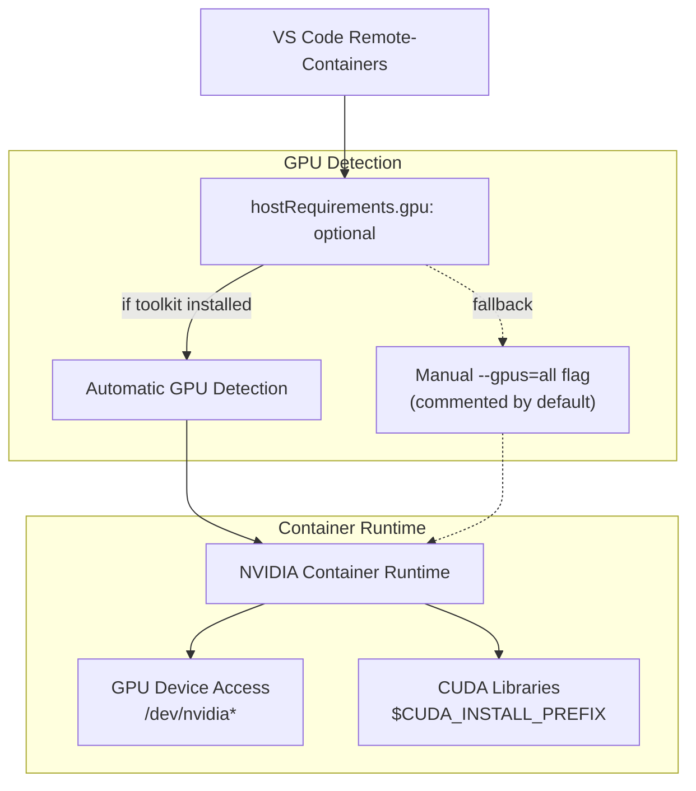

The configuration includes a commented-out `runArgs` line that can be manually enabled if automatic GPU detection fails:

```json
// "runArgs": [ "--gpus=all" ],
```

Sources: [.devcontainer/devcontainer.json:9-14]()

## Development Tools and Extensions

The dev container pre-installs a comprehensive set of VS Code extensions tailored for CUDA-Q development.

### Core Development Extensions

| Extension ID | Purpose | Configuration |
|-------------|---------|---------------|
| `ms-vscode.cpptools` | C++ IntelliSense, debugging | Uses `compile_commands.json` from build directory |
| `ms-vscode.cmake-tools` | CMake integration | Provides configuration to `cpptools` |
| `llvm-vs-code-extensions.vscode-mlir` | MLIR syntax highlighting, LSP | Server path: `cudaq-lsp-server` |
| `ms-python.python` | Python development | Auto-formatting on type |
| `twxs.cmake` | CMake syntax highlighting | - |

Sources: [.devcontainer/devcontainer.json:23-28](), [.devcontainer/devcontainer.json:49-50]()

### Documentation and Code Quality Extensions

| Extension ID | Purpose |
|-------------|---------|
| `streetsidesoftware.code-spell-checker` | Spell checking with CUDA-Q vocabulary |
| `cschlosser.doxdocgen` | Doxygen comment generation |
| `psioniq.psi-header` | Automatic copyright header insertion |
| `davidanson.vscode-markdownlint` | Markdown linting |
| `takumii.markdowntable` | Markdown table formatting |

Sources: [.devcontainer/devcontainer.json:28-33]()

### File Associations

The dev container configures VS Code to recognize CUDA-Q-specific file types:

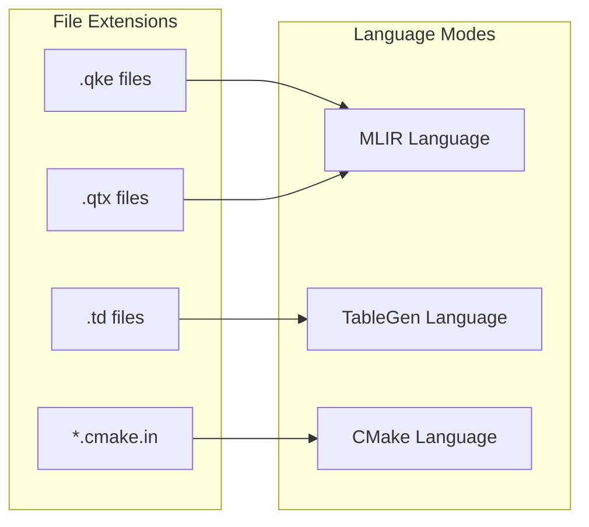

Sources: [.devcontainer/devcontainer.json:40-48]()

## C++ Development Configuration

The dev container sets up C++ IntelliSense with paths to CUDA-Q's build artifacts and LLVM installation.

### Include Path Resolution

The `C_Cpp.default.includePath` setting configures IntelliSense to search the following locations:

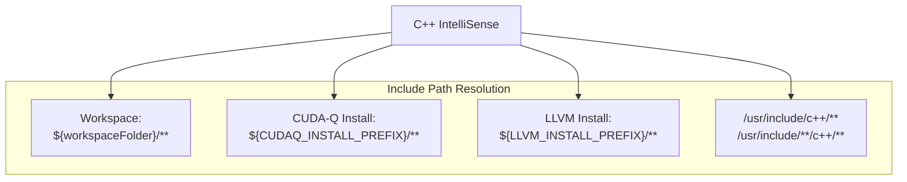

| Environment Variable | Typical Value | Purpose |
|---------------------|---------------|---------|
| `${CUDAQ_INSTALL_PREFIX}` | `/usr/local/cudaq` | CUDA-Q headers and libraries |
| `${LLVM_INSTALL_PREFIX}` | `/usr/local/llvm` | LLVM/MLIR headers |
| `${workspaceFolder}` | `/workspaces/host` | Source code directory |

Sources: [.devcontainer/devcontainer.json:247-253]()

### Compile Commands Integration

The C++ extension uses `compile_commands.json` generated by CMake for accurate code navigation:

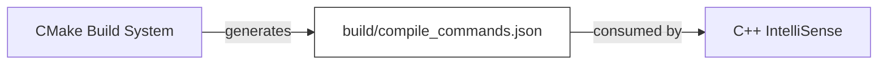

Configuration:
- `C_Cpp.default.compileCommands`: `"${workspaceFolder}/build/compile_commands.json"`
- `C_Cpp.default.configurationProvider`: `"ms-vscode.cmake-tools"`

Sources: [.devcontainer/devcontainer.json:245-246]()

## MLIR Language Server Configuration

The dev container integrates the MLIR language server (`cudaq-lsp-server`) for Quake and CC dialect support.

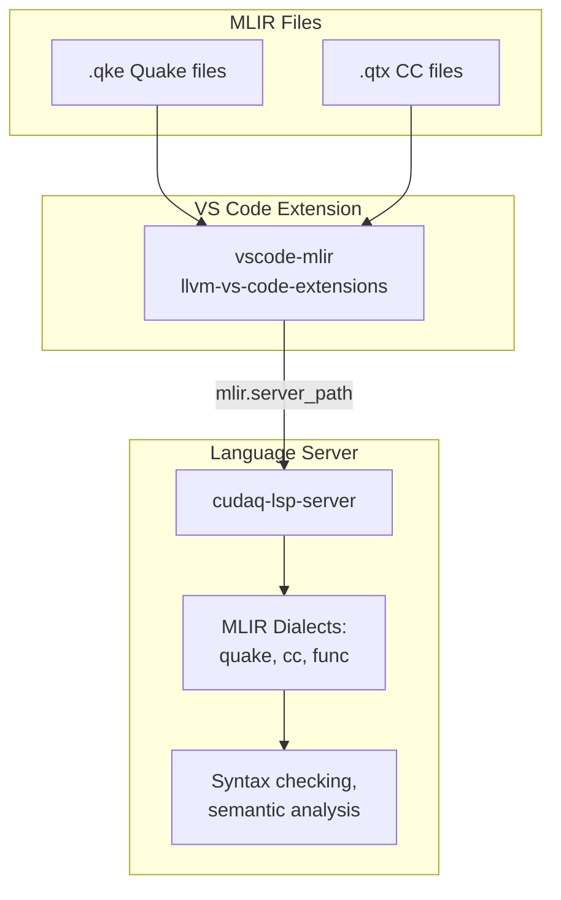

Configuration settings:
- `mlir.server_path`: `"cudaq-lsp-server"` - Path to language server executable
- `mlir.onSettingsChanged`: `"restart"` - Restart LSP on config changes

Sources: [.devcontainer/devcontainer.json:49-50]()

## Debugging Configuration

The dev container includes optional security settings for advanced debugging tools like `rr` (record-and-replay debugger).

### Security Capabilities

By default, enhanced debugging capabilities are disabled for security reasons. To enable them, uncomment the following lines:

```json
// "capAdd": ["SYS_PTRACE"],
// "securityOpt": [ "seccomp=unconfined" ],
```

| Capability | Purpose | Security Implications |
|-----------|---------|----------------------|
| `SYS_PTRACE` | Enables process tracing for debuggers | Allows process inspection across container boundaries |
| `seccomp=unconfined` | Disables seccomp filtering | Removes syscall restrictions |

**Warning**: These settings reduce container isolation and should only be enabled in trusted development environments.

Sources: [.devcontainer/devcontainer.json:15-20]()

## Code Quality Automation

The dev container configures automatic code formatting and linting for multiple languages.

### Python Configuration

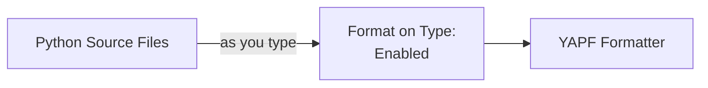

Sources: [.devcontainer/devcontainer.json:72-74]()

### Markdown Configuration

Markdown linting is enabled with specific rule configurations:

| Rule | Configuration | Purpose |
|------|--------------|---------|
| `MD013` | `tables: false, code_blocks: false` | Disable line length checks for tables and code |
| `MD033` | `allowed_elements: ["br"]` | Allow `<br>` HTML tags |
| Run Mode | `onSave` | Lint when files are saved |

Sources: [.devcontainer/devcontainer.json:51-60]()

### Spell Checking

The spell checker includes CUDA-Q-specific vocabulary:

```
"cSpell.userWords": [
    "MLIR", "LLVM", "bitcode",
    "Quake", "QTX",
    "CUDA", "cuQuantum",
    "qubit", "qubits"
]
```

Sources: [.devcontainer/devcontainer.json:61-71]()

## Copyright Header Management

The `psi-header` extension automatically maintains copyright headers in source files.

### Header Configuration

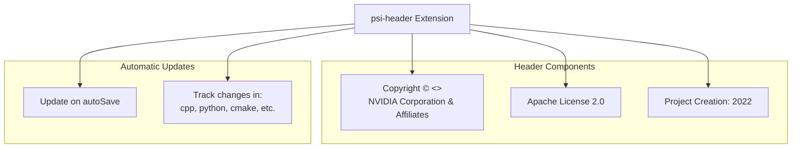

| Configuration Key | Value | Purpose |
|------------------|-------|---------|
| `psi-header.config.license` | `"Apache-2.0"` | License identifier |
| `psi-header.config.company` | `"NVIDIA"` | Company name |
| `psi-header.config.copyrightHolder` | `"NVIDIA Corporation & Affiliates"` | Copyright holder |
| `psi-header.variables.projectCreationYear` | `"2022"` | Initial project year |

Sources: [.devcontainer/devcontainer.json:75-84]()

### Language-Specific Header Formats

Different header styles are configured for different file types:

| Language | Begin Delimiter | Prefix | End Delimiter |
|----------|----------------|--------|---------------|
| Shell, CMake, Python | `# ===...===` | `# ` | `# ===...===` |
| C++, C | `/****...****/` | ` * ` | ` /****...****/` |
| MLIR | `// ========= //` | `// ` | `// ========= //` |
| TableGen | `/***-*- tablegen -*-***/` | ` * ` | ` /****...****/` |

Sources: [.devcontainer/devcontainer.json:112-227]()

## Development Workflow Integration

The dev container integrates with CUDA-Q's build and test infrastructure through environment variables and path configurations.

### Build System Integration

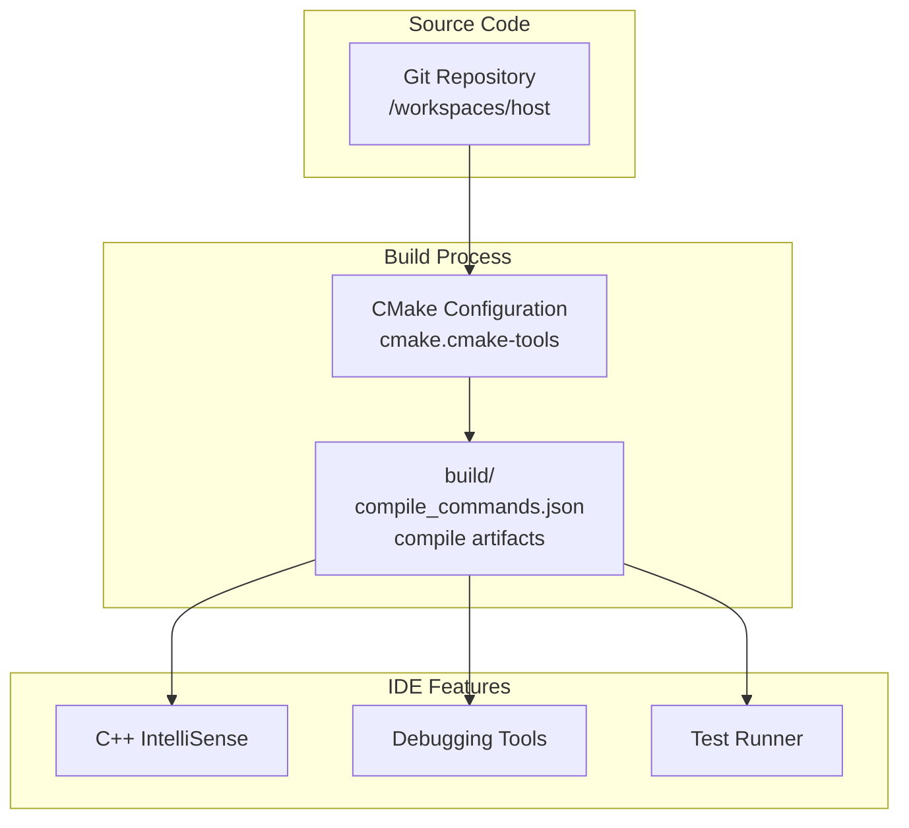

### Environment Variables

The dev container environment includes all necessary paths for CUDA-Q development:

| Variable | Purpose | Defined In |
|----------|---------|------------|
| `LLVM_INSTALL_PREFIX` | LLVM toolchain location | devdeps base image |
| `CUDAQ_INSTALL_PREFIX` | CUDA-Q installation path | devdeps base image |
| `CUDA_INSTALL_PREFIX` | CUDA toolkit location | devdeps.ext image |
| `CUQUANTUM_INSTALL_PREFIX` | cuQuantum libraries | devdeps.ext image |

Sources: [docker/build/devdeps.Dockerfile:44-55](), [docker/build/devdeps.ext.Dockerfile:165-202]()

## Doxygen Documentation Generation

The dev container includes Doxygen with automatic comment generation configured.

### Doxygen Style Configuration

| Setting | Value | Purpose |
|---------|-------|---------|
| `doxdocgen.c.triggerSequence` | `"///"` | Trigger character sequence |
| `doxdocgen.c.commentPrefix` | `"/// "` | Comment line prefix |
| `doxdocgen.generic.order` | `brief, tparam, param, return, exception` | Documentation element order |

Sources: [.devcontainer/devcontainer.json:254-268]()

## Container Validation

The dev container can be validated using the same scripts that test release containers.

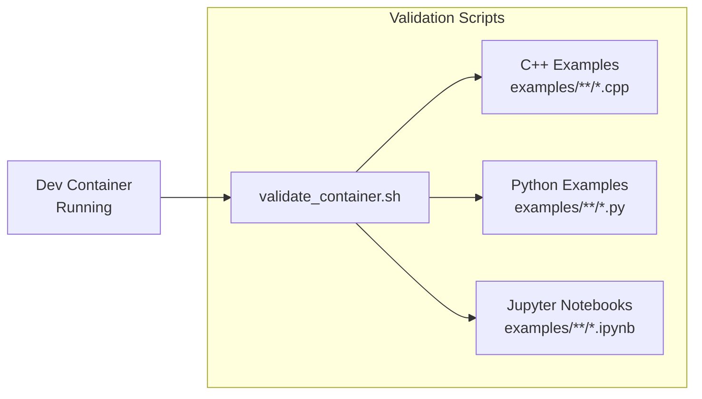

The validation script tests compilation and execution across multiple backend targets, using the same infrastructure as CI/CD validation.

Sources: [scripts/validate_container.sh:1-454]()

---

