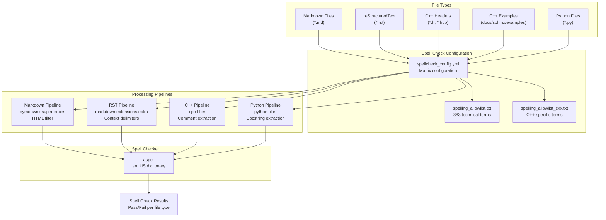
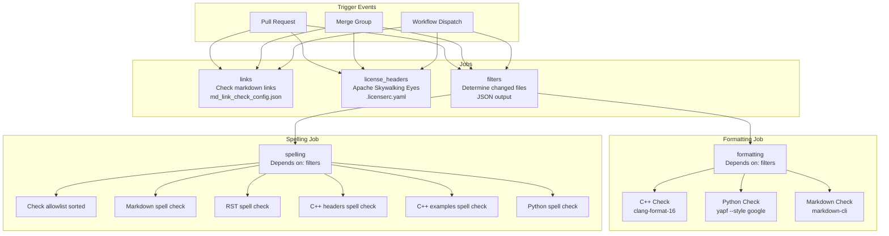

<!-- source: DeepWiki mcp.deepwiki.com · repo NVIDIA/cuda-quantum · page 9.2 Code Quality and Style · fetched 2026-10-26 -->

# Code Quality and Style

<details>
<summary>Relevant source files</summary>

The following files were used as context for generating this wiki page:

- [.github/workflows/command_dispatch.yml](.github/workflows/command_dispatch.yml)
- [.github/workflows/config/spellcheck_config.yml](.github/workflows/config/spellcheck_config.yml)
- [.github/workflows/config/spelling_allowlist.txt](.github/workflows/config/spelling_allowlist.txt)
- [.github/workflows/repo_checks.yml](.github/workflows/repo_checks.yml)
- [SECURITY.md](SECURITY.md)
- [docs/sphinx/releases.rst](docs/sphinx/releases.rst)
- [docs/sphinx/using/backends/cloud.rst](docs/sphinx/using/backends/cloud.rst)

</details>


## Purpose and Scope

This page documents the code quality and style enforcement mechanisms in the CUDA-Q codebase. It covers the automated tools and CI/CD checks that maintain consistent formatting, spelling, and licensing across Python, C++, Markdown, and reStructuredText files. For information about the broader CI/CD infrastructure and testing system, see [CI/CD Infrastructure](#8). For development environment setup including VS Code configuration, see [VS Code Dev Containers](#9.1).

---

## Code Formatting Standards

CUDA-Q enforces consistent code formatting through automated tools that run both locally and in CI. All formatting checks are executed via the `repo_checks.yml` workflow.

### C++ Code Formatting

C++ source files are formatted using **clang-format version 16** with project-specific style rules. The formatting check applies to:
- All `.cpp`, `.h`, and `.hpp` files
- Excludes: test directories, third-party libraries (`tpls`), and nlopt source

The CI workflow installs clang-format-16 from the LLVM APT repository and processes files in batches:

```
clang-format-16 -i <files>
```

If formatting violations are detected, the workflow generates a patch file showing required changes and fails the check.

**Sources:** [.github/workflows/repo_checks.yml:113-139]()

### Python Code Formatting

Python files use **yapf** (Yet Another Python Formatter) with Google style configuration. The check covers:
- All `.py` files
- Excludes: test directories, third-party libraries, and `docs/sphinx/conf.py`

The yapf tool is applied recursively with inline modifications:

```
yapf --style google --recursive -i <files>
```

Similar to C++, any formatting discrepancies result in a patch file and CI failure.

**Sources:** [.github/workflows/repo_checks.yml:141-164]()

### Markdown Formatting

Markdown files are validated using the `nosborn/github-action-markdown-cli` action with custom configuration from `.github/workflows/config/md_lint_config.yml`. This ensures consistent document structure and formatting across all `.md` files excluding third-party libraries.

**Sources:** [.github/workflows/repo_checks.yml:166-170]()

---

## Spell Checking System

The spell checking infrastructure uses **pyspelling** with **aspell** as the backend engine. The system checks technical documentation across multiple file formats while accounting for domain-specific terminology.

### Spell Check Architecture



**Sources:** [.github/workflows/config/spellcheck_config.yml:1-286](), [.github/workflows/repo_checks.yml:172-257]()

### Spell Check Configuration by File Type

The spell checking system uses a matrix configuration that defines processing pipelines for each file type:

| File Type | Pipeline Filters | Special Handling |
|-----------|-----------------|------------------|
| **Markdown** | `pyspelling.filters.markdown`<br/>`pyspelling.filters.html` | Ignores code blocks, paths, email addresses |
| **reStructuredText** | `pyspelling.filters.markdown`<br/>`pyspelling.filters.html`<br/>Context delimiters | Ignores directive blocks, `:directive:` syntax |
| **C++ Headers** | `pyspelling.filters.cpp`<br/>URL filter<br/>Context delimiters | Extracts comments only, ignores namespaces, camelCase/snake_case |
| **C++ Examples** | `pyspelling.filters.cpp`<br/>Context delimiters | Focuses on documentation comments |
| **Python** | `pyspelling.filters.python`<br/>URL filter | Extracts docstrings and comments only |

**Sources:** [.github/workflows/config/spellcheck_config.yml:4-286]()

### Technical Terminology Allowlist

The spell checker maintains a sorted allowlist of 383 technical terms at [.github/workflows/config/spelling_allowlist.txt:1-383](). This includes:

- **Quantum computing terms:** qubit, qubits, qudit, qudits, qumode, qumodes, Hamiltonian, unitarity, QAOA, VQE, UCCSD
- **Product and vendor names:** NVIDIA, CUDA, cuQuantum, cuStateVec, Quantinuum, IonQ, IQM, OQC, Pasqal, QuEra
- **Technology stack:** MLIR, LLVM, QIR, OpenQASM, PyPI, NGC, MPI, MPICH, OpenMPI
- **Programming constructs:** ansatz, bitstring, callable, deallocate, eigenvalue, eigenvector, parameterization

The CI enforces that this allowlist remains alphabetically sorted:

```bash
sorted_allowlist=`cat $file | sort`
if [ "$sorted_allowlist" != "$(cat $file)" ]; then
  echo "Expecting spelling allowlist in $file to be sorted."
  exit 1
fi
```

**Sources:** [.github/workflows/config/spelling_allowlist.txt:1-383](), [.github/workflows/repo_checks.yml:182-190]()

### Context Delimiters and Filters

The spell checker uses sophisticated context delimiters to ignore code-specific patterns:

**For Markdown/RST:**
- Word prefixes: `pre-computed`, `multi-platform`
- Apostrophe-s endings: `NVIDIA's`, `QPU's`
- File paths: `path/to/file.cpp`
- Email addresses: `user@domain.com`

**For C++ code:**
- Namespace annotations: `// namespace cudaq`
- Doxygen commands: `@param`, `@tparam`, `\code ... \endcode`
- Qualified identifiers: `cudaq::qubit`, `mlir::OpBuilder`
- Mixed-case identifiers: `camelCase`, `PascalCase`, `MACRO_NAMES`

**For Python code:**
- Lowercase role markers: `:func:`, `:class:`, `:mod:`
- Backtick-enclosed code: `` `variable_name` ``
- Mixed-case identifiers: `_private_var`, `ClassName`

**Sources:** [.github/workflows/config/spellcheck_config.yml:28-286]()

---

## Repository Checks Workflow

The `repo_checks.yml` workflow orchestrates all quality checks and runs on pull requests, merge groups, and manual dispatch.

### Workflow Structure



**Sources:** [.github/workflows/repo_checks.yml:1-258]()

### File Filtering Logic

The workflow includes a `filters` job that determines which files need checking based on pull request changes. For PRs, it computes the diff against the base branch:

```bash
diff_base=${{ github.event.pull_request.base.sha }}
list_files="git diff --diff-filter=d --name-only $diff_base --"
```

The filter creates JSON output categorizing files by type:
- `cxx`: All C++ source and headers (excluding tests, third-party code)
- `cxx_headers`: Only header files
- `cxx_examples`: Documentation examples in `docs/sphinx/examples/**/*.cpp`
- `python`: Python files (excluding tests, `conf.py`)
- `python_spell`: Python files for spell checking
- `markdown`: Markdown files (excluding third-party code)
- `rst`: reStructuredText files (excluding templates)

**Sources:** [.github/workflows/repo_checks.yml:49-101]()

### Concurrency Control

The workflow implements concurrency control to prevent redundant checks:

```yaml
concurrency:
  group: ${{ github.workflow }}-${{ github.event.pull_request.number || github.ref }}
  cancel-in-progress: true
```

This ensures that when new commits are pushed to a PR, previous runs of `repo_checks.yml` are automatically cancelled.

**Sources:** [.github/workflows/repo_checks.yml:10-12]()

---

## License Header Verification

CUDA-Q uses the **Apache Skywalking Eyes** tool to enforce consistent license headers across all source files. The configuration is stored in `.licenserc.yaml` and the check runs with:

```yaml
uses: apache/skywalking-eyes/header@v0.4.0
with:
  config: .licenserc.yaml
```

This job validates that all applicable files contain proper Apache 2.0 license headers or are explicitly exempted in the configuration.

**Sources:** [.github/workflows/repo_checks.yml:36-47]()

---

## Link Validation

The workflow checks for broken links in documentation by:

1. Converting all reStructuredText files to Markdown using `rst-to-myst`:
   ```bash
   rst2myst convert --raise-on-warning
   ```

2. Running link validation with `gaurav-nelson/github-action-markdown-link-check`:
   ```yaml
   uses: gaurav-nelson/github-action-markdown-link-check@v1
   with:
     config-file: ".github/workflows/config/md_link_check_config.json"
   ```

This ensures all internal and external links in documentation remain valid.

**Sources:** [.github/workflows/repo_checks.yml:15-34]()

---

## Developer Workflow Integration

### Running Checks Locally

Developers can run formatting and spell checks before pushing code:

**C++ formatting:**
```bash
clang-format-16 -i <file.cpp>
```

**Python formatting:**
```bash
yapf --style google --recursive -i <file.py>
```

**Spell checking:**
```bash
pyspelling -c .github/workflows/config/spellcheck_config.yml
```

### Adding Technical Terms to Allowlist

When introducing new technical terminology:

1. Add the term to [.github/workflows/config/spelling_allowlist.txt]() in alphabetical order
2. If the term is C++-specific (e.g., class names, function names), consider adding to the C++-specific allowlist
3. Ensure the allowlist remains sorted (enforced by CI)

### Understanding CI Feedback

When the `repo_checks` workflow fails:

- **Formatting failures:** The GitHub Actions summary displays a patch showing exact formatting changes needed
- **Spelling failures:** The summary lists each misspelled word by file and line number
- **Link failures:** The output shows which links are broken and in which files

All check results are written to `$GITHUB_STEP_SUMMARY` for easy debugging.

**Sources:** [.github/workflows/repo_checks.yml:103-257]()

---

## Configuration Files Reference

| Configuration File | Purpose | Location |
|-------------------|---------|----------|
| `spellcheck_config.yml` | Spell checker matrix configuration | [.github/workflows/config/spellcheck_config.yml]() |
| `spelling_allowlist.txt` | Technical terms allowlist (383 entries) | [.github/workflows/config/spelling_allowlist.txt]() |
| `spelling_allowlist_cxx.txt` | C++-specific terms allowlist | [.github/workflows/config/spelling_allowlist_cxx.txt]() |
| `md_link_check_config.json` | Link checker configuration | [.github/workflows/config/md_link_check_config.json]() |
| `md_lint_config.yml` | Markdown linting rules | [.github/workflows/config/md_lint_config.yml]() |
| `.licenserc.yaml` | License header configuration | [.licenserc.yaml]() |

**Sources:** [.github/workflows/repo_checks.yml:1-258](), [.github/workflows/config/spellcheck_config.yml:1-286]()

---

