# Page: CUDA-Q Overview

# CUDA-Q Overview

<details>
<summary>Relevant source files</summary>

The following files were used as context for generating this wiki page:

- [.github/workflows/command_dispatch.yml](.github/workflows/command_dispatch.yml)
- [.github/workflows/config/gitlab_commits.txt](.github/workflows/config/gitlab_commits.txt)
- [.github/workflows/config/spellcheck_config.yml](.github/workflows/config/spellcheck_config.yml)
- [.github/workflows/config/spelling_allowlist.txt](.github/workflows/config/spelling_allowlist.txt)
- [.github/workflows/python_metapackages.yml](.github/workflows/python_metapackages.yml)
- [.github/workflows/repo_checks.yml](.github/workflows/repo_checks.yml)
- [SECURITY.md](SECURITY.md)
- [docs/notebook_validation.py](docs/notebook_validation.py)
- [docs/sphinx/applications/python/hybrid_quantum_neural_networks.ipynb](docs/sphinx/applications/python/hybrid_quantum_neural_networks.ipynb)
- [docs/sphinx/applications/python/quantum_pagerank.ipynb](docs/sphinx/applications/python/quantum_pagerank.ipynb)
- [docs/sphinx/applications/python/unitary_compilation_diffusion_models.ipynb](docs/sphinx/applications/python/unitary_compilation_diffusion_models.ipynb)
- [docs/sphinx/examples/python/dynamics/dynamics_intro_2.ipynb](docs/sphinx/examples/python/dynamics/dynamics_intro_2.ipynb)
- [docs/sphinx/releases.rst](docs/sphinx/releases.rst)
- [docs/sphinx/using/backends/circuitsimulators.png](docs/sphinx/using/backends/circuitsimulators.png)
- [docs/sphinx/using/backends/cloud.rst](docs/sphinx/using/backends/cloud.rst)
- [docs/sphinx/using/backends/sims/svsims.rst](docs/sphinx/using/backends/sims/svsims.rst)
- [pyproject.toml.cu12](pyproject.toml.cu12)
- [pyproject.toml.cu13](pyproject.toml.cu13)
- [python/metapackages/setup.py](python/metapackages/setup.py)
- [scripts/validate_pycudaq.sh](scripts/validate_pycudaq.sh)

</details>


## Purpose and Scope

This document provides a comprehensive introduction to CUDA-Q, NVIDIA's quantum computing platform. It covers the platform's core capabilities, architectural design, and distribution model. For detailed information about specific subsystems, see:
- Core programming concepts: [Core Concepts](#1.1)
- System architecture details: [System Architecture](#2)
- Python programming guide: [Python Interface](#3)
- C++ programming guide: [C++ Interface](#4)
- Simulator backends: [Simulator Backends](#5)
- Hardware connectivity: [Remote Execution](#6)

---

## What is CUDA-Q?

CUDA-Q is a heterogeneous quantum-classical computing platform that enables developers to write quantum programs in Python or C++, optimize them through an MLIR-based compilation pipeline, and execute them on CPU/GPU simulators or quantum hardware. The platform emphasizes performance through GPU acceleration and provides a unified programming model for both simulation and hardware execution.

**Sources:** [docs/sphinx/releases.rst:1-251]()

---

## Key Capabilities

### Dual Language Support

CUDA-Q provides first-class support for both Python and C++ quantum programming:

- **Python**: Uses the `@cudaq.kernel` decorator for declarative kernel definition and `cudaq.make_kernel()` for programmatic construction
- **C++**: Uses the `__qpu__` annotation for kernel functions compiled with the `nvq++` compiler

Both language frontends converge on a unified MLIR representation, ensuring consistent semantics and optimization opportunities.

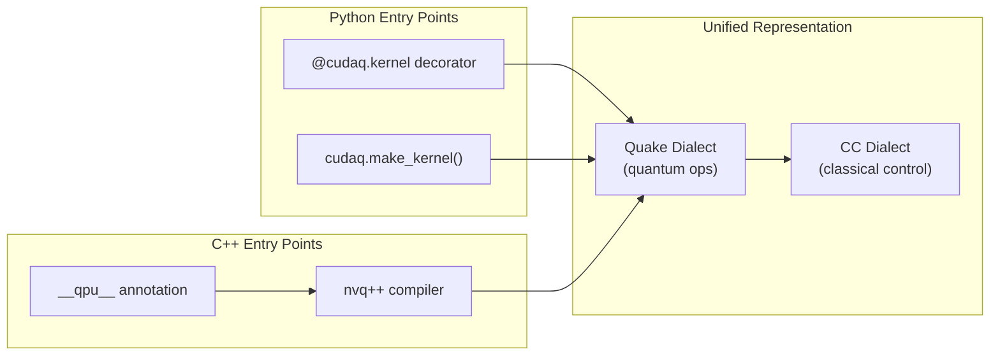

**CUDA-Q Language Frontend Architecture**

**Sources:** [.github/workflows/config/spelling_allowlist.txt:1-383](), [docs/sphinx/releases.rst:1-251]()

### GPU-Accelerated Simulation

The platform leverages NVIDIA GPUs through cuQuantum libraries for high-performance quantum simulation:

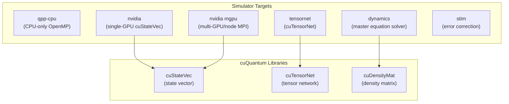

**CUDA-Q Simulator Stack**

The `nvidia` backend supports both single-precision (`fp32`) and double-precision (`fp64`) simulation modes, configurable via `cudaq.set_target('nvidia', option='fp64')`. For multi-GPU configurations, the `mgpu` option enables distributed state vector simulation across multiple GPUs and nodes using MPI.

**Sources:** [docs/sphinx/using/backends/sims/svsims.rst:1-333](), [pyproject.toml.cu12:1-84](), [pyproject.toml.cu13:1-85]()

### MLIR-Based Compilation Pipeline

CUDA-Q employs a sophisticated compilation infrastructure built on MLIR (Multi-Level Intermediate Representation):

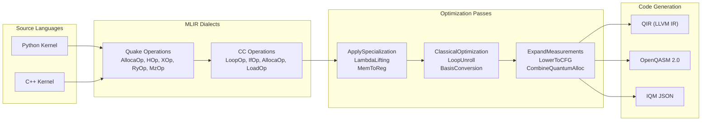

**MLIR Compilation Pipeline with Code-Level Operations**

The Quake dialect defines quantum-specific operations including `quake.alloca` (qubit allocation), `quake.h` (Hadamard gate), `quake.x` (Pauli-X), `quake.ry` (rotation), and `quake.mz` (measurement in Z basis). The CC dialect handles classical control flow with operations like `cc.loop`, `cc.if`, `cc.alloca`, and `cc.load`.

**Sources:** [.github/workflows/config/spelling_allowlist.txt:62-129]()

### Hardware Integration

CUDA-Q provides connectivity to quantum hardware through backend-specific code generation:

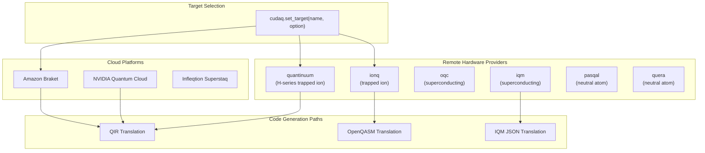

**Backend Integration Architecture**

Backend configuration is managed through YAML files (e.g., `quantinuum.yml`, `ionq.yml`) that specify custom MLIR pass pipelines and code generation targets. Each backend can define environment-specific settings and authentication requirements.

**Sources:** [docs/sphinx/releases.rst:1-251](), [.github/workflows/config/spelling_allowlist.txt:1-383](), [scripts/validate_pycudaq.sh:1-293]()

---

## Platform Architecture

### User Interfaces Layer

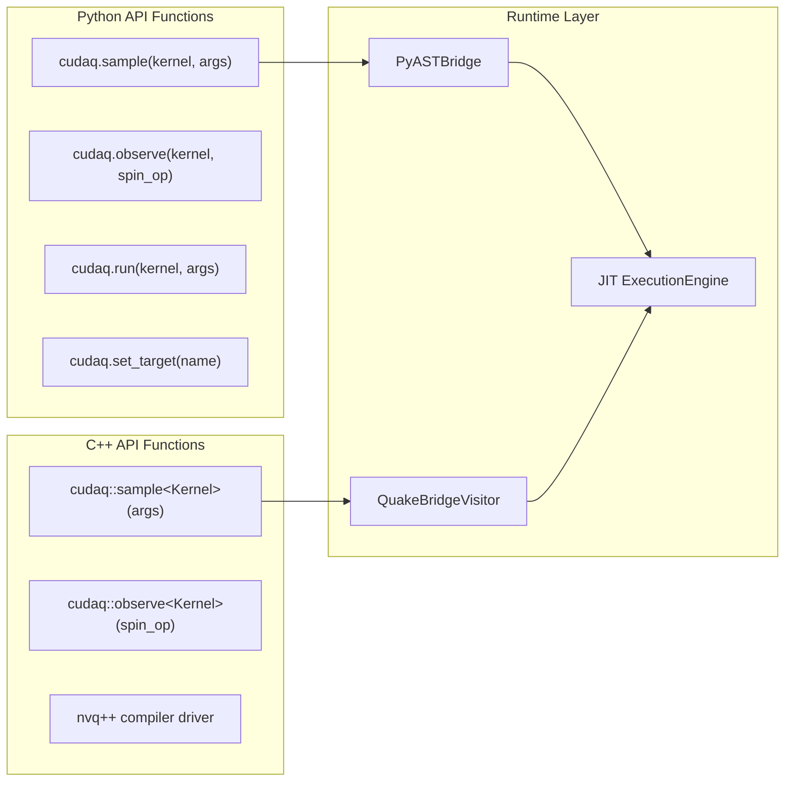

**User-Facing API Surface**

The Python API provides three primary execution functions:
- `cudaq.sample()`: Execute quantum kernel and return measurement counts
- `cudaq.observe()`: Compute expectation value of a spin operator
- `cudaq.run()`: Execute kernel and return computed values

Target configuration is managed via `cudaq.set_target()` which accepts backend names like `'nvidia'`, `'qpp-cpu'`, `'quantinuum'`, etc., along with optional configuration strings.

**Sources:** [docs/sphinx/applications/python/hybrid_quantum_neural_networks.ipynb:1-785](), [scripts/validate_pycudaq.sh:109-115]()

### Compilation and Execution Flow

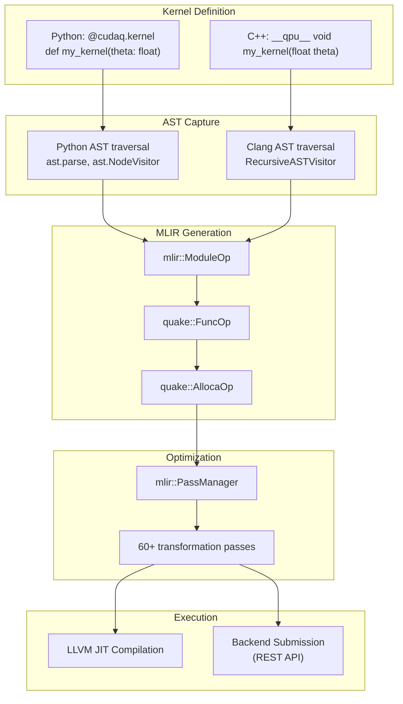

**Kernel Compilation Flow with MLIR Entities**

The compilation process transforms high-level quantum programs into executable code:
1. Python kernels undergo AST capture and conversion via `PyASTBridge`
2. C++ kernels are processed by `nvq++` using Clang's AST infrastructure
3. Both paths generate MLIR modules containing Quake and CC operations
4. The `mlir::PassManager` applies optimization passes
5. Code generation produces either JIT-executable LLVM IR or backend-specific formats

**Sources:** [docs/sphinx/using/backends/sims/svsims.rst:1-333]()

### MLIR Type System

CUDA-Q's MLIR dialects define specialized types for quantum and classical data:

| Category | MLIR Type | Description | Code Reference |
|----------|-----------|-------------|----------------|
| Quantum | `quake::RefType` | Single qubit reference | Quake dialect |
| Quantum | `quake::VeqType` | Quantum register (vector of qubits) | Quake dialect |
| Quantum | `quake::StruqType` | Structured quantum type | Quake dialect |
| Classical | `cc::PointerType` | Memory pointer | CC dialect |
| Classical | `cc::ArrayType` | Fixed-size array | CC dialect |
| Classical | `cc::CallableType` | Function pointer/callable | CC dialect |
| Classical | `cc::StructType` | Composite data structure | CC dialect |

These types enable precise representation of quantum programs while maintaining compatibility with classical control flow and data structures.

**Sources:** [.github/workflows/config/spelling_allowlist.txt:1-383]()

---

## Backend Configuration

### Simulator Environment Variables

The `nvidia` backend exposes extensive runtime configuration through environment variables:

| Variable | Purpose | Example Values |
|----------|---------|----------------|
| `CUDAQ_FUSION_MAX_QUBITS` | Gate fusion size | `4`, `5`, `6` (GPU-dependent) |
| `CUDAQ_FUSION_DIAGONAL_GATE_MAX_QUBITS` | Diagonal gate fusion | `-1` (auto), `0` (disabled) |
| `CUDAQ_MAX_CPU_MEMORY_GB` | Host memory limit | `0` (disabled), `64`, `NONE` |
| `CUDAQ_MAX_GPU_MEMORY_GB` | Device memory limit | `NONE` (unlimited), `32` |
| `CUDAQ_ENABLE_MEMPOOL` | CUDA memory pool | `TRUE`, `FALSE` |
| `CUDAQ_MGPU_FUSE` | Multi-GPU fusion level | `5`, `6` |
| `CUDAQ_MGPU_NQUBITS_THRESH` | Distribution threshold | `25` |
| `CUDAQ_MGPU_P2P_DEVICE_BITS` | P2P GPU count | `0` (disabled), `3` |
| `CUDAQ_GPU_FABRIC` | NVLink topology | `MNNVL`, `NVL`, `NONE` |

These variables must be set before importing `cudaq` in Python or before kernel compilation in C++.

**Sources:** [docs/sphinx/using/backends/sims/svsims.rst:100-333]()

### Multi-GPU Configuration

For distributed simulation across multiple GPUs and nodes:

```bash
# Single precision, 2 GPUs
mpiexec -np 2 python3 program.py --target nvidia --target-option fp32,mgpu

# Double precision, 4 nodes with 8 GPUs each
CUDAQ_MGPU_FUSE=5 CUDAQ_GPU_FABRIC=MNNVL \
  mpiexec -np 32 python3 program.py --target nvidia --target-option fp64,mgpu
```

The number of MPI processes must be a power of 2. Host-device migration is supported for state vectors exceeding GPU memory by setting `CUDAQ_MAX_CPU_MEMORY_GB`.

**Sources:** [docs/sphinx/using/backends/sims/svsims.rst:146-333]()

---

## Distribution and Installation

### Package Ecosystem

CUDA-Q is distributed through multiple channels:

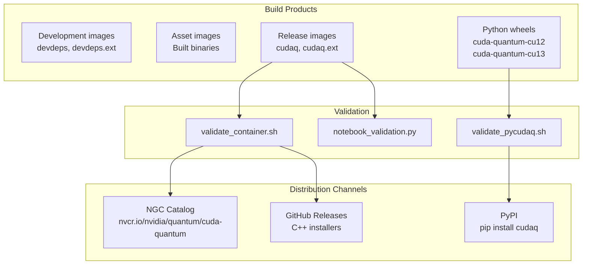

**CUDA-Q Distribution Pipeline**

**Sources:** [python/metapackages/setup.py:1-256](), [.github/workflows/python_metapackages.yml:1-202]()

### Python Package Installation

CUDA-Q Python packages are version-specific to CUDA runtime:

```python
# Metapackage (auto-detects CUDA version)
pip install cudaq

# Explicit CUDA 12.x
pip install cuda-quantum-cu12

# Explicit CUDA 13.x  
pip install cuda-quantum-cu13
```

The `cudaq` metapackage automatically detects the installed CUDA version and installs the appropriate binary package. Dependencies include:
- `custatevec-cu12` or `custatevec-cu13` (state vector simulation)
- `cutensornet-cu12` or `cutensornet-cu13` (tensor network simulation)
- `cudensitymat-cu12` or `cudensitymat-cu13` (density matrix simulation)
- `numpy >= 1.24`, `scipy >= 1.10.1`, `requests >= 2.31`

**Sources:** [pyproject.toml.cu12:1-84](), [pyproject.toml.cu13:1-85](), [python/metapackages/setup.py:182-218]()

### Validation Infrastructure

The platform includes comprehensive validation scripts:

- **`validate_container.sh`**: Tests C++, Python, and Jupyter notebooks in Docker containers
- **`validate_pycudaq.sh`**: Validates Python wheels with GPU targets, MPI support, and examples
- **`notebook_validation.py`**: Executes Jupyter notebooks and validates backend availability

Example validation command:
```bash
source validate_pycudaq.sh -v 0.13.0 -i /tmp/packages -f /tmp -p 3.11 -c 12.6.0
```

These scripts verify:
- Core functionality across all targets (`nvidia`, `nvidia-mgpu`, `tensornet`)
- Backend-specific tests for remote hardware providers
- Platform tests for multi-GPU and MPI configurations
- Example code and documentation notebooks

**Sources:** [scripts/validate_pycudaq.sh:1-293](), [docs/notebook_validation.py:1-162]()

---

## Getting Started

### Basic Python Example

```python
import cudaq

# Define quantum kernel using decorator
@cudaq.kernel
def bell_pair():
    qubits = cudaq.qvector(2)
    h(qubits[0])
    cx(qubits[0], qubits[1])
    mz(qubits)

# Execute on CPU simulator
cudaq.set_target("qpp-cpu")
counts = cudaq.sample(bell_pair)
print(counts)

# Execute on GPU simulator
cudaq.set_target("nvidia")
counts = cudaq.sample(bell_pair)
print(counts)
```

### Basic C++ Example

```cpp
#include <cudaq.h>

__qpu__ void bell_pair() {
    cudaq::qvector qubits(2);
    h(qubits[0]);
    x<cudaq::ctrl>(qubits[0], qubits[1]);
    mz(qubits);
}

int main() {
    auto counts = cudaq::sample(bell_pair);
    counts.dump();
}
```

Compile and execute:
```bash
nvq++ --target nvidia bell_pair.cpp -o bell_pair.x
./bell_pair.x
```

**Sources:** [docs/sphinx/applications/python/hybrid_quantum_neural_networks.ipynb:1-785]()

---

## Release History and Support

CUDA-Q follows semantic versioning with regular releases. Recent major versions:

| Version | Key Features | Python Support | CUDA Support |
|---------|--------------|----------------|--------------|
| 0.13.0 | QEC libraries, QCI backends | 3.11, 3.12, 3.13 | 12.x, 13.x |
| 0.12.0 | Dynamics simulation, `run()` API | 3.11, 3.12, 3.13 | 12.x |
| 0.11.0 | Operator framework, state initialization | 3.10, 3.11, 3.12 | 11.x, 12.x |
| 0.10.0 | Noisy simulation, Pasqal/QuEra | 3.10, 3.11, 3.12 | 11.x, 12.x |
| 0.9.0 | Dynamics API, Anyon/QuEra backends | 3.10, 3.11, 3.12 | 11.x, 12.x |

Note: CUDA 11 support was removed in version 0.13.0. Python 3.10 support was removed in version 0.13.0.

**Sources:** [docs/sphinx/releases.rst:1-251]()

---

## Additional Resources

- Platform documentation: `https://nvidia.github.io/cuda-quantum`
- Source repository: `https://github.com/NVIDIA/cuda-quantum`
- PyPI package: `https://pypi.org/project/cudaq`
- NGC container catalog: `https://catalog.ngc.nvidia.com/orgs/nvidia/teams/quantum/containers/cuda-quantum`
- Developer portal: `https://developer.nvidia.com/cuda-q`

For system-specific documentation:
- Core programming concepts: [Core Concepts](#1.1)
- Compilation pipeline details: [Compilation Pipeline](#2.1)
- Backend simulator options: [Simulator Backends](#5)
- Hardware provider integration: [Remote Execution](#6)
- Build and development setup: [Building and Distribution](#7)

**Sources:** [pyproject.toml.cu12:50-54](), [pyproject.toml.cu13:50-54](), [docs/sphinx/releases.rst:1-251]()

---

# Page: Core Concepts

# Core Concepts

<details>
<summary>Relevant source files</summary>

The following files were used as context for generating this wiki page:

- [.github/workflows/command_dispatch.yml](.github/workflows/command_dispatch.yml)
- [.github/workflows/config/spellcheck_config.yml](.github/workflows/config/spellcheck_config.yml)
- [.github/workflows/config/spelling_allowlist.txt](.github/workflows/config/spelling_allowlist.txt)
- [.github/workflows/repo_checks.yml](.github/workflows/repo_checks.yml)
- [SECURITY.md](SECURITY.md)
- [docs/sphinx/releases.rst](docs/sphinx/releases.rst)
- [docs/sphinx/using/backends/cloud.rst](docs/sphinx/using/backends/cloud.rst)
- [include/cudaq/Optimizer/Dialect/CC/CCOps.h](include/cudaq/Optimizer/Dialect/CC/CCOps.h)
- [include/cudaq/Optimizer/Dialect/CC/CCOps.td](include/cudaq/Optimizer/Dialect/CC/CCOps.td)
- [include/cudaq/Optimizer/Dialect/Quake/QuakeOps.h](include/cudaq/Optimizer/Dialect/Quake/QuakeOps.h)
- [include/cudaq/Optimizer/Dialect/Quake/QuakeOps.td](include/cudaq/Optimizer/Dialect/Quake/QuakeOps.td)
- [lib/Optimizer/Dialect/CC/CCOps.cpp](lib/Optimizer/Dialect/CC/CCOps.cpp)
- [lib/Optimizer/Dialect/Quake/QuakeOps.cpp](lib/Optimizer/Dialect/Quake/QuakeOps.cpp)
- [lib/Optimizer/Transforms/QuakeSynthesizer.cpp](lib/Optimizer/Transforms/QuakeSynthesizer.cpp)
- [test/AST-Quake/adjoint-3.cpp](test/AST-Quake/adjoint-3.cpp)
- [test/AST-Quake/loop_unroll-1.cpp](test/AST-Quake/loop_unroll-1.cpp)
- [test/AST-Quake/qpe.cpp](test/AST-Quake/qpe.cpp)
- [test/Translate/ghz.qke](test/Translate/ghz.qke)

</details>


## Purpose and Scope

This page introduces the fundamental concepts underlying CUDA-Q's architecture. It explains quantum kernels, the MLIR-based internal representation, the Quake and CC dialects, backend systems, and the distinction between compilation and execution phases. These concepts form the foundation for understanding how CUDA-Q translates high-level quantum programs into executable code across diverse simulation and hardware targets.

For information about specific language frontends, see [Python Interface](#3) and [C++ Interface](#4). For details on the compilation pipeline stages, see [Compilation Pipeline](#2.1). For backend-specific configurations, see [Simulator Backends](#5) and [Remote Execution](#6).

---

## Quantum Kernels

A **quantum kernel** is a user-defined function containing quantum operations that executes on a quantum processor (QPU) or simulator. Quantum kernels are the primary abstraction for expressing quantum algorithms in CUDA-Q.

### Kernel Definition

In **C++**, quantum kernels are annotated with the `__qpu__` attribute:

```cpp
__qpu__ void my_kernel(cudaq::qubit &q) {
  h(q);
  mz(q);
}
```

In **Python**, kernels are defined using the `@cudaq.kernel` decorator or the kernel builder API:

```python
@cudaq.kernel
def my_kernel():
    q = cudaq.qubit()
    h(q)
    mz(q)
```

### Kernel Properties

Quantum kernels in CUDA-Q have specific characteristics:

| Property | Description |
|----------|-------------|
| **Pure device code** | Kernels execute on quantum hardware or simulators, not on the classical CPU |
| **Type restrictions** | Arguments must be supported quantum or classical types (`qubit`, `qvector`, numeric types, `std::vector`) |
| **No side effects** | Cannot perform arbitrary I/O or memory allocation visible to the host |
| **Callable abstraction** | Can be passed as arguments to other kernels using `cudaq::control`, `cudaq::adjoint`, or template parameters |

### Kernel Representation

Both C++ and Python quantum kernels are transformed into MLIR during compilation. The C++ compiler driver `nvq++` processes kernels through the Clang AST, while Python kernels are captured via AST inspection at runtime.

**Sources:** [test/AST-Quake/qpe.cpp:22-88](), [include/cudaq/Optimizer/Dialect/Quake/QuakeOps.td:39-109]()

---

## MLIR Representation

CUDA-Q uses **Multi-Level Intermediate Representation (MLIR)** as its internal compiler infrastructure. MLIR provides a flexible, extensible framework for representing quantum programs and applying transformations.

### Why MLIR?

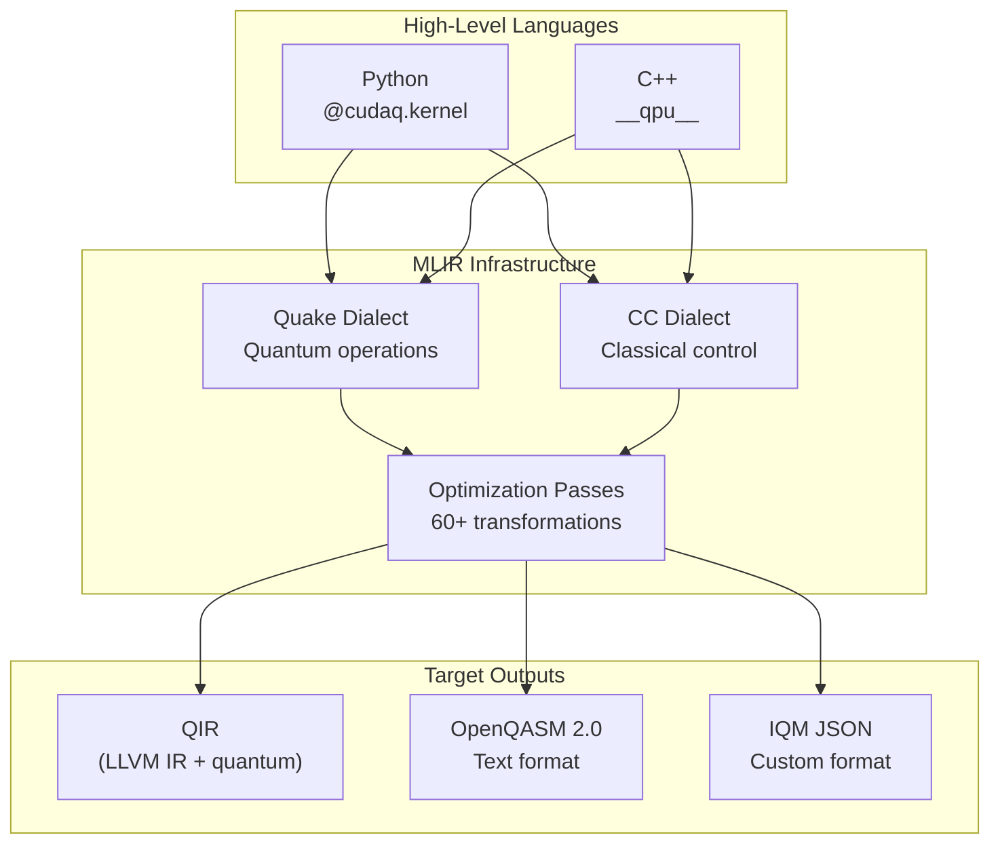

**MLIR Benefits:**

1. **Unified representation** - Both Python and C++ converge to the same IR
2. **Progressive lowering** - High-level abstractions lower through multiple dialects to target code
3. **Reusable passes** - Transformations work across all source languages
4. **Extensibility** - Custom dialects (Quake, CC) model domain-specific semantics
5. **Type safety** - Strong typing catches errors during compilation

### MLIR Module Structure

A compiled quantum kernel produces an MLIR module containing `func.func` operations:

```mlir
module {
  func.func @__nvqpp__mlirgen__my_kernel() attributes {"cudaq-kernel"} {
    %0 = quake.alloca !quake.ref
    quake.h %0 : (!quake.ref) -> ()
    %1 = quake.mz %0 : (!quake.ref) -> !quake.measure
    return
  }
}
```

The module represents functions, global constants, and type definitions in a structured, analyzable format.

**Sources:** [lib/Optimizer/Dialect/CC/CCOps.cpp:1-27](), [lib/Optimizer/Dialect/Quake/QuakeOps.cpp:1-27]()

---

## Quake Dialect

The **Quake dialect** defines operations, types, and semantics for quantum computations. It represents quantum circuits using either **reference semantics** or **value semantics**.

### Quake Types

| Type | Description | Example |
|------|-------------|---------|
| `!quake.ref` | Reference to a single qubit | `%q = quake.alloca !quake.ref` |
| `!quake.veq<N>` | Vector of N qubits (fixed size) | `%v = quake.alloca !quake.veq<4>` |
| `!quake.veq<?>` | Vector of qubits (dynamic size) | `%v = quake.alloca !quake.veq<?>` |
| `!quake.wire` | Single qubit in value semantics | `%w = quake.null_wire` |
| `!quake.cable<N>` | Bundle of N wires | `%c = quake.null_cable !quake.cable<4>` |
| `!quake.measure` | Measurement result | `%m = quake.mz %q` |

### Quake Operations

The Quake dialect provides operations for quantum gates, measurements, and structural manipulation:

#### Quantum Gates

```mlir
quake.h %q : (!quake.ref) -> ()                          // Hadamard
quake.x %q : (!quake.ref) -> ()                          // Pauli X
quake.ry(%angle) %q : (f64, !quake.ref) -> ()           // Parametric rotation
quake.x [%ctrl] %target : (!quake.ref, !quake.ref) -> () // Controlled-X
```

#### Allocation and Measurement

```mlir
%q = quake.alloca !quake.ref                             // Allocate single qubit
%v = quake.alloca !quake.veq<4>                          // Allocate 4 qubits
%m = quake.mz %q : (!quake.ref) -> !quake.measure        // Measure qubit
quake.dealloc %q : !quake.ref                            // Deallocate qubit
```

#### Qubit Manipulation

```mlir
%r = quake.extract_ref %veq[%idx] : (!quake.veq<?>, i64) -> !quake.ref
%sub = quake.subveq %veq, %low, %high : (!quake.veq<?>, i64, i64) -> !quake.veq<?>
%concat = quake.concat %ref1, %veq, %ref2 : ... -> !quake.veq<?>
```

### Reference vs Value Semantics

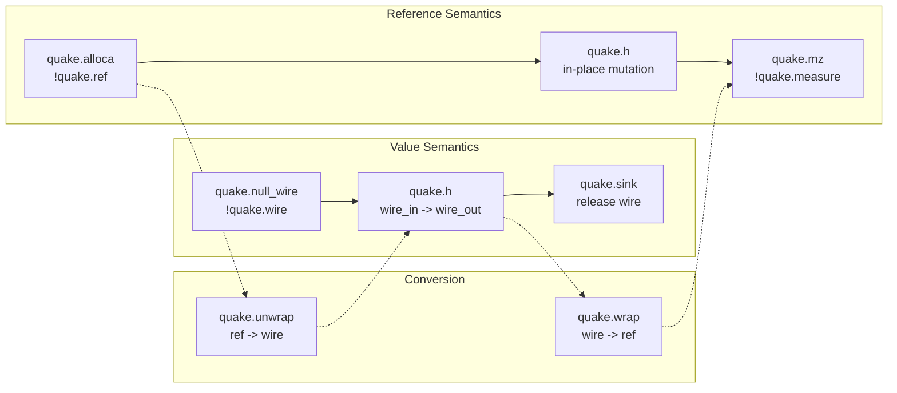

- **Reference semantics**: Qubits are references that exist throughout the kernel. Gates mutate qubit state in-place.
- **Value semantics**: Each gate operation produces a new wire value. Enables functional-style transformations and explicit data flow.

The `quake.unwrap` and `quake.wrap` operations convert between the two representations during lowering passes.

**Sources:** [include/cudaq/Optimizer/Dialect/Quake/QuakeOps.td:39-367](), [lib/Optimizer/Dialect/Quake/QuakeOps.cpp:28-104]()

---

## CC Dialect

The **CC (Classical Control) dialect** represents classical computations, control flow, and data structures that accompany quantum operations. It provides C++-like semantics in MLIR form.

### CC Types

| Type | Description | Example |
|------|-------------|---------|
| `!cc.ptr<T>` | Pointer to type T | `!cc.ptr<f64>` |
| `!cc.array<T x N>` | Array of N elements of type T | `!cc.array<i32 x 10>` |
| `!cc.struct<{T1, T2, ...}>` | Struct with members | `!cc.struct<{i32, f64}>` |
| `!cc.stdvec<T>` | Dynamic vector (std::vector) | `!cc.stdvec<f64>` |
| `!cc.callable<(Args) -> Result>` | Callable function object | `!cc.callable<(i32) -> f64>` |

### CC Operations

#### Memory Operations

```mlir
%ptr = cc.alloca i32                               // Stack allocation
cc.store %val, %ptr : !cc.ptr<i32>                 // Store value
%val = cc.load %ptr : !cc.ptr<i32>                 // Load value
%elem_ptr = cc.compute_ptr %arr[%idx] : ... -> ... // Compute element address
```

#### Control Flow

```mlir
cc.scope {
  %local = cc.alloca i32
  // ... operations in local scope
  cc.continue
}

cc.if (%cond) {
  // then branch
  cc.continue
} else {
  // else branch
  cc.continue
}

cc.loop while {
  // while condition block
  cc.condition %cond
} do {
  // loop body
  cc.continue
}
```

#### Type Conversions

```mlir
%f = cc.cast %i : (i32) -> f64                     // Integer to float
%p = cc.cast %arr : (!cc.array<T x N>) -> !cc.ptr<T> // Array to pointer
```

### Structured Control Flow

The CC dialect models structured control flow using region-based operations. Unlike LLVM's CFG (control flow graph) with basic blocks and branches, CC operations encapsulate control flow in nested regions:

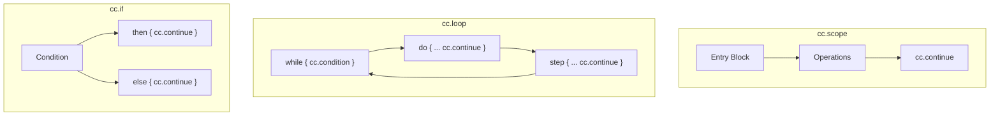

- **`cc.scope`**: Defines a local variable scope, similar to C++ `{ }` blocks
- **`cc.loop`**: Generalized loop with while/do/step/else regions, supporting C-style for loops, while loops, and Python for-else
- **`cc.if`**: Conditional branching with optional else clause

### Unwind Operations

CC provides non-local control flow operations for break/continue/return from nested contexts:

| Operation | Purpose |
|-----------|---------|
| `cc.unwind_break` | Break from innermost enclosing loop, potentially across multiple scopes |
| `cc.unwind_continue` | Continue to next iteration of innermost loop |
| `cc.unwind_return` | Return from function, potentially across multiple scopes |

These operations model the stack unwinding semantics required when exiting nested scopes, ensuring proper cleanup (deallocation, destructor calls) occurs.

**Sources:** [include/cudaq/Optimizer/Dialect/CC/CCOps.td:42-763](), [lib/Optimizer/Dialect/CC/CCOps.cpp:36-560]()

---

## Compilation vs Execution

CUDA-Q separates **compilation** (transformation of source code to MLIR and target formats) from **execution** (running the compiled kernel on a backend).

### Compilation Phase

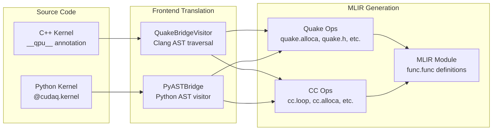

**Compilation steps:**

1. **Source parsing**: C++ via Clang, Python via `ast` module
2. **AST traversal**: Extract quantum operations and classical control flow
3. **MLIR generation**: Create Quake and CC operations in an MLIR module
4. **Optimization**: Apply transformation passes (see [MLIR Optimization Passes](#2.3))
5. **Lowering**: Convert to target format (QIR, OpenQASM, etc.)

For C++, compilation occurs ahead-of-time via the `nvq++` compiler:

```bash
nvq++ my_kernel.cpp -o my_kernel
```

For Python, compilation occurs just-in-time (JIT) when a kernel is first invoked or explicitly via `cudaq.kernel`:

```python
kernel = cudaq.make_kernel()
# ... build kernel
compiled = cudaq.compile(kernel)  # Explicit compilation
```

### Execution Phase

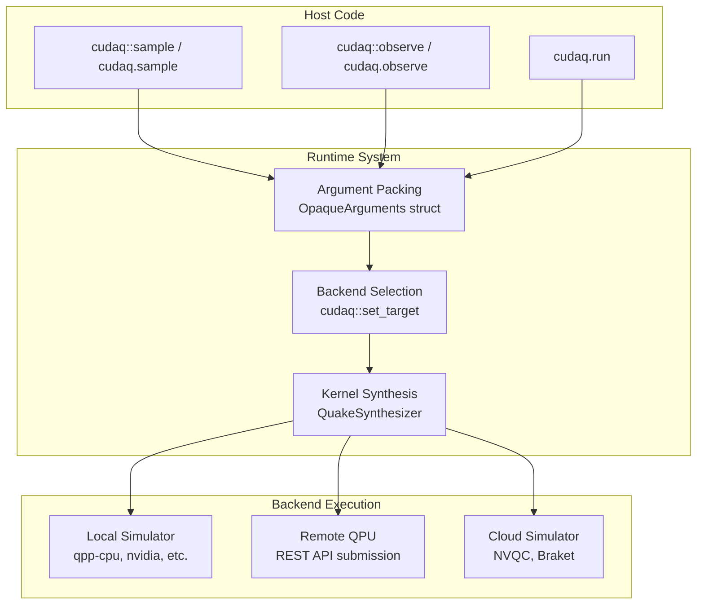

**Execution steps:**

1. **Argument packing**: Runtime arguments are packed into an `OpaqueArguments` structure
2. **Target selection**: Backend is chosen via `cudaq::set_target()` or command-line flags
3. **Kernel synthesis**: Runtime argument values are synthesized into the MLIR as constants (see [lib/Optimizer/Transforms/QuakeSynthesizer.cpp:378-793]())
4. **Code generation**: MLIR is lowered to backend-specific format
5. **Backend dispatch**: Compiled code is executed on the selected backend
6. **Result retrieval**: Measurement outcomes are collected and returned as `cudaq::sample_result` or `cudaq::observe_result`

### Synthesis Example

The `QuakeSynthesizer` pass replaces runtime argument placeholders with concrete constant values:

**Before synthesis:**
```mlir
func.func @kernel(%arg0: f64) {
  %q = quake.alloca !quake.ref
  quake.ry(%arg0) %q : (f64, !quake.ref) -> ()
  // ...
}
```

**After synthesis (with arg0 = 1.57):**
```mlir
func.func @kernel() {
  %angle = arith.constant 1.570000e+00 : f64
  %q = quake.alloca !quake.ref
  quake.ry(%angle) %q : (f64, !quake.ref) -> ()
  // ...
}
```

This enables backends to operate on fully concrete circuits without requiring dynamic parameter handling.

**Sources:** [lib/Optimizer/Transforms/QuakeSynthesizer.cpp:377-454](), [lib/Optimizer/Transforms/QuakeSynthesizer.cpp:56-83]()

---

## Backends

A **backend** is an execution target that runs compiled quantum kernels. CUDA-Q supports three categories of backends:

### Backend Categories

| Category | Examples | Target Selection |
|----------|----------|------------------|
| **Local Simulators** | `qpp-cpu`, `nvidia`, `nvidia-mgpu`, `tensornet`, `stim` | Execution in same process, GPU/CPU simulation |
| **Remote Hardware** | `quantinuum`, `ionq`, `oqc`, `iqm`, `anyon`, `orca` | Quantum hardware via REST API |
| **Cloud Platforms** | `nvqc`, `braket`, `superstaq` | Cloud-hosted simulators and hardware access |

### Backend Selection

Backends are selected at runtime:

**C++:**
```cpp
auto& platform = cudaq::get_platform();
platform.set_target_backend("nvidia");
```

**Python:**
```python
cudaq.set_target("nvidia")
```

**Command line:**
```bash
nvq++ --target nvidia my_kernel.cpp
```

### Backend Configuration

Each backend has a YAML configuration file specifying:

- **Code generation pipeline**: Which MLIR passes to apply
- **Output format**: QIR, OpenQASM, IQM JSON, etc.
- **Runtime parameters**: Environment variables, connection settings

Example backend configuration structure:

```yaml
name: nvidia
passes:
  - unrolling-pipeline
  - kernel-execution
  - convert-to-qir
target-pass: qir-base
```

Configuration files are located in backend-specific directories and loaded by the platform at initialization.

**Sources:** [docs/sphinx/releases.rst:1-236](), system architecture diagrams

---

## Type Systems and Conversions

CUDA-Q maintains multiple type systems that interact during compilation:

### Python to MLIR Type Mapping

| Python Type | MLIR CC Type | Quake Type |
|-------------|--------------|------------|
| `int` | `i64`, `i32`, `i8` | - |
| `float` | `f64` | - |
| `complex` | `complex<f64>` | - |
| `list[T]` | `!cc.stdvec<T>` | - |
| `cudaq.qubit` | - | `!quake.ref` |
| `cudaq.qvector` | - | `!quake.veq<N>` or `!quake.veq<?>` |

### C++ to MLIR Type Mapping

| C++ Type | MLIR Type |
|----------|-----------|
| `int`, `long`, `bool` | `i32`, `i64`, `i1` |
| `float`, `double` | `f32`, `f64` |
| `std::vector<T>` | `!cc.stdvec<T>` |
| `std::complex<T>` | `complex<T>` |
| `cudaq::qubit` | `!quake.ref` |
| `cudaq::qvector<N>` | `!quake.veq<N>` |
| `cudaq::qview<>` | `!quake.veq<?>` |

### Runtime Argument Handling

When quantum kernels are invoked with runtime arguments, the system:

1. **Packs arguments** into an `OpaqueArguments` buffer following the target's data layout
2. **Invokes synthesis pass** (`QuakeSynthesizer`) to replace MLIR block arguments with constants
3. **Type-specific synthesis** for each argument type (see [lib/Optimizer/Transforms/QuakeSynthesizer.cpp:280-375]())

Example for `std::vector<double>`:

```mlir
// Before synthesis (function signature)
func.func @kernel(%vec: !cc.stdvec<f64>)

// After synthesis (with vec = {1.0, 2.0, 3.0})
func.func @kernel() {
  %arr = cc.const_array [1.0, 2.0, 3.0] : !cc.array<f64 x 3>
  %buf = cc.alloca !cc.array<f64 x 3>
  cc.store %arr, %buf
  %vec = cc.stdvec_init %buf, %size : (!cc.ptr<...>, i64) -> !cc.stdvec<f64>
  // ... rest of kernel uses %vec
}
```

**Sources:** [lib/Optimizer/Transforms/QuakeSynthesizer.cpp:118-375](), [include/cudaq/Optimizer/Dialect/CC/CCOps.td:796-831]()

---

## Summary

The core concepts of CUDA-Q provide a robust foundation for hybrid quantum-classical programming:

- **Quantum kernels** abstract quantum algorithms across languages
- **MLIR representation** unifies compilation and enables powerful transformations
- **Quake dialect** models quantum operations with multiple semantic styles
- **CC dialect** represents classical control flow and data structures
- **Compilation** transforms source code into optimized MLIR modules
- **Execution** dispatches synthesized kernels to diverse backends
- **Backends** provide pluggable targets for simulation and hardware

Understanding these concepts enables effective use of CUDA-Q's features and facilitates contributions to the platform.

---

# Page: System Architecture

# System Architecture

<details>
<summary>Relevant source files</summary>

The following files were used as context for generating this wiki page:

- [include/cudaq/Optimizer/CodeGen/Passes.h](include/cudaq/Optimizer/CodeGen/Passes.h)
- [include/cudaq/Optimizer/CodeGen/Passes.td](include/cudaq/Optimizer/CodeGen/Passes.td)
- [include/cudaq/Optimizer/Dialect/CC/CCOps.h](include/cudaq/Optimizer/Dialect/CC/CCOps.h)
- [include/cudaq/Optimizer/Dialect/CC/CCOps.td](include/cudaq/Optimizer/Dialect/CC/CCOps.td)
- [include/cudaq/Optimizer/Dialect/Quake/QuakeOps.h](include/cudaq/Optimizer/Dialect/Quake/QuakeOps.h)
- [include/cudaq/Optimizer/Dialect/Quake/QuakeOps.td](include/cudaq/Optimizer/Dialect/Quake/QuakeOps.td)
- [include/cudaq/Optimizer/InitAllDialects.h](include/cudaq/Optimizer/InitAllDialects.h)
- [include/cudaq/Optimizer/Transforms/Passes.h](include/cudaq/Optimizer/Transforms/Passes.h)
- [include/cudaq/Optimizer/Transforms/Passes.td](include/cudaq/Optimizer/Transforms/Passes.td)
- [lib/Optimizer/CodeGen/CMakeLists.txt](lib/Optimizer/CodeGen/CMakeLists.txt)
- [lib/Optimizer/CodeGen/ConvertCCToLLVM.cpp](lib/Optimizer/CodeGen/ConvertCCToLLVM.cpp)
- [lib/Optimizer/CodeGen/ConvertToQIR.cpp](lib/Optimizer/CodeGen/ConvertToQIR.cpp)
- [lib/Optimizer/CodeGen/ConvertToQIRProfile.cpp](lib/Optimizer/CodeGen/ConvertToQIRProfile.cpp)
- [lib/Optimizer/CodeGen/Pipelines.cpp](lib/Optimizer/CodeGen/Pipelines.cpp)
- [lib/Optimizer/Dialect/CC/CCOps.cpp](lib/Optimizer/Dialect/CC/CCOps.cpp)
- [lib/Optimizer/Dialect/Quake/QuakeOps.cpp](lib/Optimizer/Dialect/Quake/QuakeOps.cpp)
- [lib/Optimizer/Transforms/CMakeLists.txt](lib/Optimizer/Transforms/CMakeLists.txt)
- [lib/Optimizer/Transforms/ClassicalOptimization.cpp](lib/Optimizer/Transforms/ClassicalOptimization.cpp)
- [lib/Optimizer/Transforms/Pipelines.cpp](lib/Optimizer/Transforms/Pipelines.cpp)
- [lib/Optimizer/Transforms/QuakeSynthesizer.cpp](lib/Optimizer/Transforms/QuakeSynthesizer.cpp)
- [python/runtime/cudaq/platform/py_alt_launch_kernel.cpp](python/runtime/cudaq/platform/py_alt_launch_kernel.cpp)
- [python/utils/OpaqueArguments.h](python/utils/OpaqueArguments.h)
- [runtime/common/BaseRemoteRESTQPU.h](runtime/common/BaseRemoteRESTQPU.h)
- [runtime/common/RuntimeMLIR.cpp](runtime/common/RuntimeMLIR.cpp)
- [runtime/common/RuntimeMLIRCommonImpl.h](runtime/common/RuntimeMLIRCommonImpl.h)
- [runtime/cudaq/platform/default/rest/RemoteRESTQPU.cpp](runtime/cudaq/platform/default/rest/RemoteRESTQPU.cpp)
- [runtime/cudaq/platform/default/rest/helpers/quantinuum/quantinuum.yml](runtime/cudaq/platform/default/rest/helpers/quantinuum/quantinuum.yml)
- [test/AST-Quake/adjoint-3.cpp](test/AST-Quake/adjoint-3.cpp)
- [test/AST-Quake/loop_unroll-1.cpp](test/AST-Quake/loop_unroll-1.cpp)
- [test/AST-Quake/qpe.cpp](test/AST-Quake/qpe.cpp)
- [test/Translate/ghz.qke](test/Translate/ghz.qke)
- [tools/cudaq-opt/cudaq-opt.cpp](tools/cudaq-opt/cudaq-opt.cpp)
- [tools/cudaq-quake/CMakeLists.txt](tools/cudaq-quake/CMakeLists.txt)
- [tools/cudaq-quake/cudaq-quake.cpp](tools/cudaq-quake/cudaq-quake.cpp)
- [tools/cudaq-translate/cudaq-translate.cpp](tools/cudaq-translate/cudaq-translate.cpp)
- [tools/nvqpp/nvq++.in](tools/nvqpp/nvq++.in)

</details>


This page provides a comprehensive overview of the CUDA Quantum (CUDA-Q) system architecture, explaining how the different components interact to provide a unified programming model for quantum-classical computing. For information about building and installing CUDA-Q, see [Building and Installing](#8).

## Core Architecture Overview

CUDA-Q is a quantum computing framework that enables developers to write quantum programs in familiar languages (Python and C++) and execute them on both simulators and quantum hardware. The architecture consists of several key layers that facilitate the translation from high-level code to quantum execution.

### High-Level Architecture

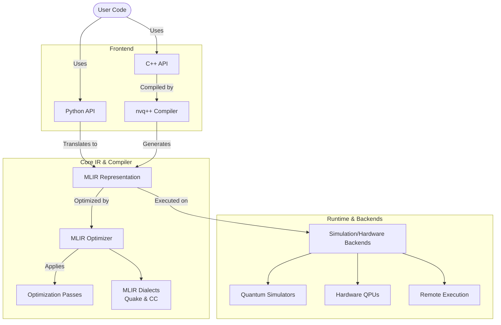

### Detailed System Components

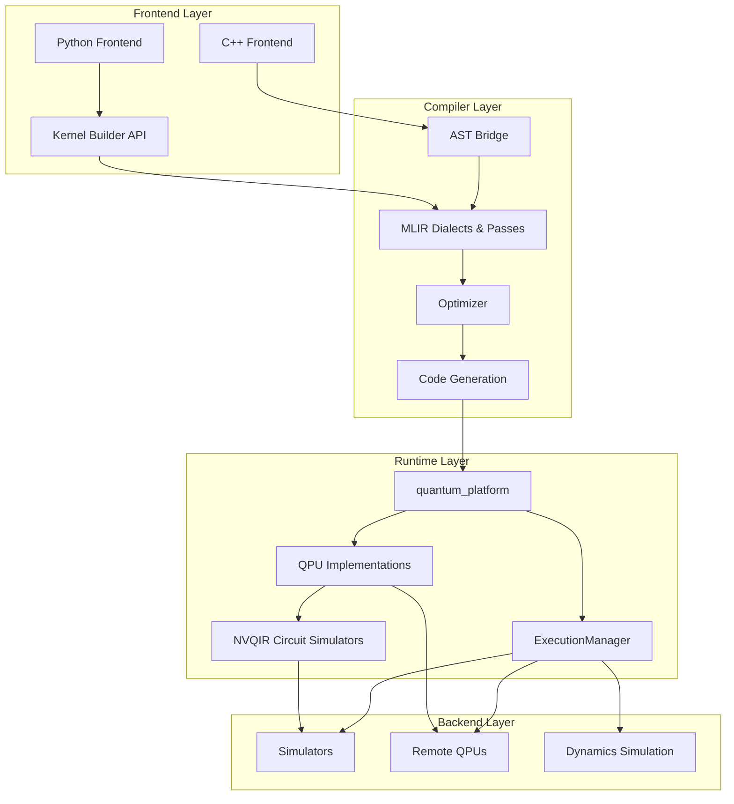

Sources:
- [runtime/cudaq/builder/kernel_builder.cpp:1-50](runtime/cudaq/builder/kernel_builder.cpp:1-50)
- [runtime/nvqir/CircuitSimulator.h:80-120](runtime/nvqir/CircuitSimulator.h:80-120)
- [runtime/cudaq/platform/quantum_platform.h:50-100](runtime/cudaq/platform/quantum_platform.h:50-100)
- [runtime/cudaq/platform/qpu.h:30-50](runtime/cudaq/platform/qpu.h:30-50)

## Compilation Pipeline

CUDA-Q uses a sophisticated compilation pipeline that transforms quantum code from Python or C++ into an optimized representation that can be executed on various backends. The diagram below illustrates this pipeline from source code to execution:

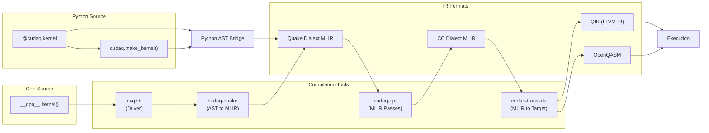

### Python Frontend

The Python frontend provides two main approaches for defining quantum kernels:

1. The `@cudaq.kernel` decorator that marks functions as quantum kernels
2. The `cudaq.make_kernel()` builder API for programmatic kernel construction

When a quantum function is decorated with `@cudaq.kernel`, its abstract syntax tree (AST) is processed by the `PyASTBridge` class, which transforms it into MLIR representation.

Example Python kernel:
```python
@cudaq.kernel
def bell_state():
    q = cudaq.qvector(2)
    h(q[0])
    x.ctrl(q[0], q[1])
    mz(q)
```

The `PyASTBridge` walks through this AST and generates corresponding MLIR operations, handling quantum operations (like `h`, `x.ctrl`), classical control flow, and memory management.

Alternatively, using the builder API:
```python
kernel, qubits = cudaq.make_kernel(cudaq.qvector)
kernel.h(qubits[0])
kernel.x.ctrl(qubits[0], qubits[1])
kernel.mz(qubits)
```

Sources:
- [runtime/cudaq/builder/kernel_builder.cpp:1-50](runtime/cudaq/builder/kernel_builder.cpp:1-50)
- [unittests/integration/builder_tester.cpp:15-50](unittests/integration/builder_tester.cpp:15-50)

### C++ Frontend

The C++ frontend uses the `__qpu__` attribute to mark functions as quantum kernels. The Clang-based `ASTBridge` processes the AST and generates MLIR code. C++ also supports the kernel builder API.

Example C++ kernel:
```cpp
__qpu__ void bell_state() {
    auto q = cudaq::qvector(2);
    h(q[0]);
    x.ctrl(q[0], q[1]);
    mz(q);
}
```

The `ASTBridge` in the C++ frontend performs similar tasks to the Python version, translating C++ AST nodes to MLIR operations.

Using the C++ builder API:
```cpp
auto [kernel, qubits] = cudaq::make_kernel<cudaq::qvector<>>();
kernel.h(qubits[0]);
kernel.x<cudaq::ctrl>(qubits[0], qubits[1]);
kernel.mz(qubits);
```

Sources:
- [runtime/cudaq/builder/kernel_builder.h:380-450](runtime/cudaq/builder/kernel_builder.h:380-450)
- [lib/Optimizer/Transforms/QuakeSynthesizer.cpp:50-100](lib/Optimizer/Transforms/QuakeSynthesizer.cpp:50-100)

## MLIR Dialect System

CUDA-Q uses two primary MLIR dialects for representing quantum and classical operations: the Quake dialect for quantum operations and the CC (Classical Computing) dialect for classical operations.

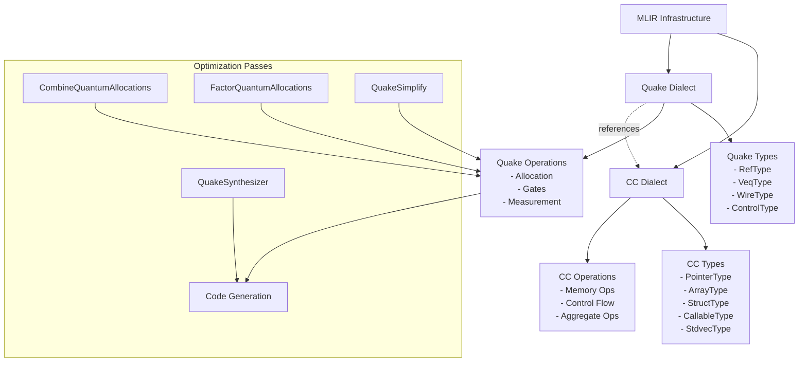

### Quake Dialect

The Quake dialect provides operations for quantum computing, including:

- **Quantum Types**: 
  - `RefType`: A reference to a qubit
  - `VeqType`: A vector of qubits
  - `WireType`: Linear representation of qubit state

- **Quantum Operations**:
  - Gate operations: `h`, `x`, `rx`, etc.
  - Allocation/deallocation: `alloca`, `dealloc`
  - Measurement: `mz`

Here's an example of Quake MLIR code:
```mlir
%q = quake.alloca !quake.ref
quake.h %q : (!quake.ref) -> ()
%result = quake.mz %q : (!quake.ref) -> i1
```

Sources:
- [lib/Optimizer/Transforms/QuakeSynthesizer.cpp:50-100](lib/Optimizer/Transforms/QuakeSynthesizer.cpp:50-100)
- [unittests/Optimizer/QuakeSynthTester.cpp:50-100](unittests/Optimizer/QuakeSynthTester.cpp:50-100)

### CC Dialect

The CC (Classical Computing) dialect represents classical operations:

- **Classical Types**:
  - `PointerType`: Pointer to memory
  - `ArrayType`: Fixed-size array
  - `StructType`: Aggregate type
  - `StdvecType`: Standard vector type

- **Classical Operations**:
  - Control flow: `if`, `loop`, `scope`
  - Memory operations: `alloca`, `store`, `load`
  - Function operations: `call`, `return`

Here's an example of CC MLIR code:
```mlir
%i = arith.constant 0 : i32
%ptr = cc.alloca i32
cc.store %i, %ptr : !cc.ptr<i32>
%val = cc.load %ptr : !cc.ptr<i32>
```

### Argument Synthesis

The `QuakeSynthesizer` pass is a critical component that handles the conversion of runtime arguments into constant values in the MLIR representation. This enables the specialization of quantum kernels based on runtime parameters.

```cpp
// Example of synthesizing a runtime argument
template <typename ConcreteType>
void synthesizeRuntimeArgument(
    OpBuilder &builder, BlockArgument argument, const void *args,
    std::size_t offset, std::size_t typeSize,
    std::function<Value(OpBuilder &, ConcreteType *)> &&opGenerator) {
  // Create concrete instance from void* data
  ConcreteType concrete;
  std::memcpy(&concrete, ((const char *)args) + offset, typeSize);
  
  // Generate MLIR Value
  auto runtimeArg = opGenerator(builder, &concrete);
  
  // Replace uses of the argument with the concrete value
  argument.replaceAllUsesWith(runtimeArg);
}
```

Sources:
- [lib/Optimizer/Transforms/QuakeSynthesizer.cpp:57-83](lib/Optimizer/Transforms/QuakeSynthesizer.cpp:57-83)
- [unittests/Optimizer/QuakeSynthTester.cpp:118-159](unittests/Optimizer/QuakeSynthTester.cpp:118-159)

## Kernel Execution Model

The kernel execution model in CUDA-Q transforms the internal MLIR representation into executable code and manages the execution of quantum kernels. This involves several components working together:

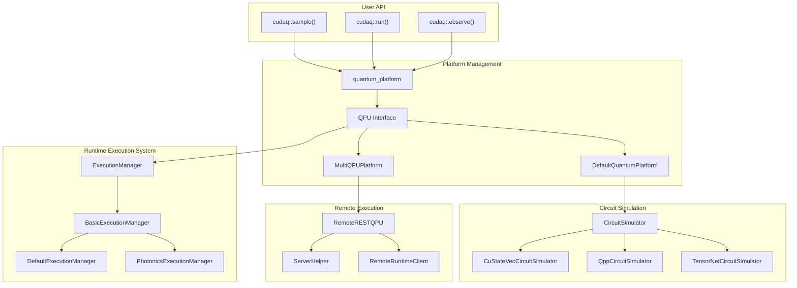

### Platform and QPU System

The `quantum_platform` class serves as the central coordination point for quantum execution. It manages one or more `QPU` instances, which represent quantum processing units (either simulated or hardware).

```cpp
class quantum_platform {
protected:
  // QPUs managed by this platform
  std::vector<std::unique_ptr<QPU>> platformQPUs;
  std::size_t platformNumQPUs = 0;
  std::size_t platformCurrentQPU = 0;
  
public:
  // Launch a kernel on the current QPU
  KernelThunkResultType launchKernel(std::string kernelName, 
                                    KernelThunkType kernelFunc, 
                                    void *args, std::uint64_t voidStarSize,
                                    std::uint64_t resultOffset,
                                    const std::vector<void *> &rawArgs);
  
  // Set execution context for a QPU
  void set_exec_ctx(ExecutionContext *ctx, std::size_t qid = 0);
  
  // Reset execution context
  void reset_exec_ctx(std::size_t qid = 0);
};
```

The `QPU` interface defines the contract for quantum processing units:

```cpp
class QPU {
protected:
  // Execution queue for asynchronous tasks
  std::unique_ptr<QuantumExecutionQueue> execution_queue;
  
  // Current execution context
  ExecutionContext *executionContext = nullptr;
  
public:
  // Enqueue a quantum task for execution
  virtual void enqueue(QuantumTask &task) = 0;
  
  // Launch a quantum kernel
  virtual KernelThunkResultType launchKernel(const std::string &name,
                                           KernelThunkType kernelFunc,
                                           void *args, std::uint64_t argsSize,
                                           std::uint64_t resultOffset,
                                           const std::vector<void *> &rawArgs) = 0;
};
```

Sources:
- [runtime/cudaq/platform/quantum_platform.cpp:50-100](runtime/cudaq/platform/quantum_platform.cpp:50-100)
- [runtime/cudaq/platform/quantum_platform.h:50-100](runtime/cudaq/platform/quantum_platform.h:50-100)
- [runtime/cudaq/platform/qpu.h:30-50](runtime/cudaq/platform/qpu.h:30-50)
- [runtime/cudaq/platform/default/DefaultQuantumPlatform.cpp:25-50](runtime/cudaq/platform/default/DefaultQuantumPlatform.cpp:25-50)

### Execution Flow

The execution flow involves several steps:

1. User calls a sampling or observation function (e.g., `cudaq::sample()`)
2. The kernel is compiled if not already compiled
3. Arguments are packed into a message buffer
4. The kernel is executed through the platform's `launchKernel` method
5. The platform delegates to the appropriate QPU
6. The QPU executes the kernel using the current `ExecutionManager`
7. Results are collected and returned

For example, when sampling a circuit:

```cpp
// Sample a quantum circuit
auto result = cudaq::sample(bell_state);
```

This triggers the following process:
- The `sample` function creates an `ExecutionContext` with type "sample"
- The platform sets this context on the current QPU
- The kernel is executed through the platform's `launchKernel` method
- The `ExecutionManager` collects measurement results
- Results are returned as a `sample_result` object

Sources:
- [runtime/cudaq/platform/quantum_platform.cpp:175-191](runtime/cudaq/platform/quantum_platform.cpp:175-191)
- [runtime/cudaq/qis/managers/default/DefaultExecutionManager.cpp:25-50](runtime/cudaq/qis/managers/default/DefaultExecutionManager.cpp:25-50)
- [runtime/cudaq/platform/mqpu/MultiQPUPlatform.cpp:25-75](runtime/cudaq/platform/mqpu/MultiQPUPlatform.cpp:25-75)

## Simulator System

The simulator system in CUDA-Q is based on the `CircuitSimulator` interface, which defines methods for quantum operations, qubit management, and measurement. This interface allows CUDA-Q to support multiple simulation backends.

### CircuitSimulator Interface

The `CircuitSimulator` class serves as the base class for all simulator implementations:

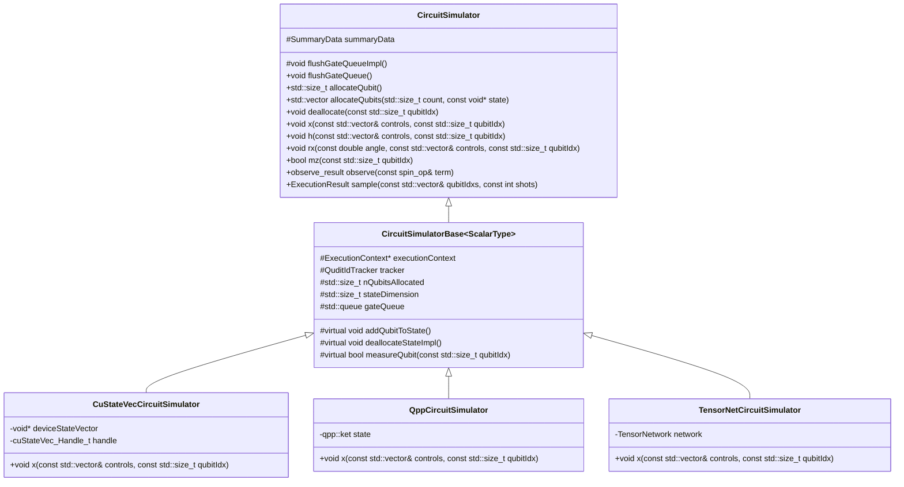

The `CircuitSimulator` interface defines the core operations that all simulators must implement:

```cpp
class CircuitSimulator {
protected:
  virtual void flushGateQueueImpl() = 0;
  SummaryData summaryData;

public:
  // Qubit management
  virtual std::size_t allocateQubit() = 0;
  virtual std::vector<std::size_t> allocateQubits(std::size_t count, const void *state = nullptr,
                                                 cudaq::simulation_precision precision = 
                                                 cudaq::simulation_precision::fp32) = 0;
  virtual void deallocate(const std::size_t qubitIdx) = 0;
  
  // Quantum operations
  virtual void x(const std::vector<std::size_t> &controls, const std::size_t qubitIdx) = 0;
  virtual void h(const std::vector<std::size_t> &controls, const std::size_t qubitIdx) = 0;
  virtual void rx(const double angle, const std::vector<std::size_t> &controls, const std::size_t qubitIdx) = 0;
  // ... other quantum gates ...
  
  // Measurement
  virtual bool mz(const std::size_t qubitIdx) = 0;
  virtual bool mz(const std::size_t qubitIdx, const std::string &registerName) = 0;
  
  // Sampling and observation
  virtual cudaq::ExecutionResult sample(const std::vector<std::size_t> &qubitIdxs, const int shots) = 0;
  virtual cudaq::observe_result observe(const cudaq::spin_op &term) = 0;
  
  // State management
  virtual std::unique_ptr<cudaq::SimulationState> createStateFromData(const cudaq::state_data &) = 0;
  virtual void setNoiseModel(cudaq::noise_model &noise) = 0;
};
```

Sources:
- [runtime/nvqir/CircuitSimulator.h:80-120](runtime/nvqir/CircuitSimulator.h:80-120)
- [runtime/nvqir/CircuitSimulator.h:260-310](runtime/nvqir/CircuitSimulator.h:260-310)
- [runtime/nvqir/CircuitSimulator.h:385-450](runtime/nvqir/CircuitSimulator.h:385-450)

### Simulator Implementations

CUDA-Q provides several simulator backends:

1. **CuStateVecCircuitSimulator**: GPU-accelerated state vector simulator using NVIDIA's cuStateVec library
   - Provides high-performance simulation on NVIDIA GPUs
   - Supports large qubit counts
   - Implements both single and double precision

2. **QppCircuitSimulator**: CPU-based simulator
   - Based on the Quantum++ library
   - Suitable for systems without GPUs

3. **TensorNetCircuitSimulator**: Tensor network-based simulator
   - Uses cuTensorNet for efficient tensor contractions
   - Can simulate certain quantum circuits with more qubits than state vector approaches

Example implementation from CuStateVecCircuitSimulator:

```cpp
// Kronecker product implementation for state initialization
template <typename CudaDataType>
__global__ void cudaKronprod(size_t tsize1, const CudaDataType *arr1, 
                             size_t tsize2, const CudaDataType *arr2, 
                             CudaDataType *arr0) {
  __shared__ CudaDataType lbuf[THRDS_ARRAY_PRODUCT + 1], rbuf[THRDS_ARRAY_PRODUCT];
  size_t _ib, _in, _jb, _jn, _tx, _jc, _ja;

  _tx = (size_t)threadIdx.x;
  for (_jb = blockIdx.y * THRDS_ARRAY_PRODUCT; _jb < tsize2;
       _jb += gridDim.y * THRDS_ARRAY_PRODUCT) {
    // ... implementation details ...
  }
  return;
}
```

Sources:
- [runtime/nvqir/custatevec/CuStateVecCircuitSimulator.cu:25-100](runtime/nvqir/custatevec/CuStateVecCircuitSimulator.cu:25-100)
- [runtime/nvqir/qpp/QppCircuitSimulator.cpp:122-150](runtime/nvqir/qpp/QppCircuitSimulator.cpp:122-150)

### Gate Application and Measurement

The `CircuitSimulatorBase` template class provides common functionality for simulator implementations:

```cpp
template <typename ScalarType>
class CircuitSimulatorBase : public CircuitSimulator {
protected:
  // Execution context and state management
  cudaq::ExecutionContext *executionContext = nullptr;
  cudaq::QuditIdTracker tracker;
  std::size_t nQubitsAllocated = 0;
  std::size_t stateDimension = 0;
  
  // Gate queue for batched operations
  struct GateApplicationTask {
    const std::string operationName;
    const std::vector<std::complex<ScalarType>> matrix;
    const std::vector<std::size_t> controls;
    const std::vector<std::size_t> targets;
    const std::vector<ScalarType> parameters;
  };
  std::queue<GateApplicationTask> gateQueue;
  
  // Abstract methods for state manipulation
  virtual void addQubitToState() = 0;
  virtual void deallocateStateImpl() = 0;
  virtual bool measureQubit(const std::size_t qubitIdx) = 0;
};
```

The gate application process typically involves:
1. Creating a gate matrix representation
2. Queueing the gate operation
3. Applying the operation to the state vector when `flushGateQueue()` is called

Measurement involves:
1. Calculating probabilities based on the state vector
2. Randomly selecting an outcome based on these probabilities
3. Collapsing the state vector according to the measurement result
4. Returning the measurement outcome

Sources:
- [runtime/nvqir/CircuitSimulator.h:407-542](runtime/nvqir/CircuitSimulator.h:407-542)
- [runtime/nvqir/qpp/QppCircuitSimulator.cpp:450-500](runtime/nvqir/qpp/QppCircuitSimulator.cpp:450-500)

## Remote Execution

CUDA-Q supports execution on remote quantum hardware through various providers. This is handled through a plugin system that allows seamless switching between simulation and hardware execution.

The remote execution model handles:
- Job submission
- Result retrieval
- Error handling

Sources:
- [runtime/cudaq/qis/managers/default/DefaultExecutionManager.cpp:1-20](runtime/cudaq/qis/managers/default/DefaultExecutionManager.cpp:1-20)

## Summary

The CUDA-Q system architecture provides a comprehensive framework for quantum-classical computing:

1. **Frontend Layer**: Python and C++ interfaces for defining quantum kernels
2. **Compiler Layer**: AST processing and MLIR generation with quantum-specific dialects
3. **Optimization Layer**: Passes for optimizing quantum circuits
4. **Runtime Layer**: Execution management and simulator interfaces
5. **Backend Layer**: Simulators and hardware interfaces

This layered approach allows CUDA-Q to support multiple programming languages, various optimization techniques, and different execution targets, providing a flexible and powerful platform for quantum computing.

---

# Page: Compilation Pipeline

# Compilation Pipeline

<details>
<summary>Relevant source files</summary>

The following files were used as context for generating this wiki page:

- [include/cudaq/Frontend/nvqpp/ASTBridge.h](include/cudaq/Frontend/nvqpp/ASTBridge.h)
- [include/cudaq/Optimizer/CodeGen/Passes.h](include/cudaq/Optimizer/CodeGen/Passes.h)
- [include/cudaq/Optimizer/CodeGen/Passes.td](include/cudaq/Optimizer/CodeGen/Passes.td)
- [include/cudaq/Optimizer/Dialect/CC/CCTypes.h](include/cudaq/Optimizer/Dialect/CC/CCTypes.h)
- [include/cudaq/Optimizer/Dialect/CC/CCTypes.td](include/cudaq/Optimizer/Dialect/CC/CCTypes.td)
- [include/cudaq/Optimizer/InitAllDialects.h](include/cudaq/Optimizer/InitAllDialects.h)
- [lib/Frontend/nvqpp/ASTBridge.cpp](lib/Frontend/nvqpp/ASTBridge.cpp)
- [lib/Frontend/nvqpp/ConvertDecl.cpp](lib/Frontend/nvqpp/ConvertDecl.cpp)
- [lib/Frontend/nvqpp/ConvertExpr.cpp](lib/Frontend/nvqpp/ConvertExpr.cpp)
- [lib/Frontend/nvqpp/ConvertType.cpp](lib/Frontend/nvqpp/ConvertType.cpp)
- [lib/Optimizer/CodeGen/CMakeLists.txt](lib/Optimizer/CodeGen/CMakeLists.txt)
- [lib/Optimizer/CodeGen/ConvertCCToLLVM.cpp](lib/Optimizer/CodeGen/ConvertCCToLLVM.cpp)
- [lib/Optimizer/CodeGen/ConvertToQIR.cpp](lib/Optimizer/CodeGen/ConvertToQIR.cpp)
- [lib/Optimizer/CodeGen/ConvertToQIRProfile.cpp](lib/Optimizer/CodeGen/ConvertToQIRProfile.cpp)
- [lib/Optimizer/Dialect/CC/CCTypes.cpp](lib/Optimizer/Dialect/CC/CCTypes.cpp)
- [python/cudaq/kernel/ast_bridge.py](python/cudaq/kernel/ast_bridge.py)
- [python/cudaq/kernel/kernel_builder.py](python/cudaq/kernel/kernel_builder.py)
- [python/cudaq/kernel/kernel_decorator.py](python/cudaq/kernel/kernel_decorator.py)
- [python/cudaq/kernel/utils.py](python/cudaq/kernel/utils.py)
- [python/cudaq/runtime/sample.py](python/cudaq/runtime/sample.py)
- [python/tests/builder/test_kernel_builder.py](python/tests/builder/test_kernel_builder.py)
- [python/tests/kernel/test_control_negations.py](python/tests/kernel/test_control_negations.py)
- [python/tests/kernel/test_direct_call_return_kernel.py](python/tests/kernel/test_direct_call_return_kernel.py)
- [python/tests/kernel/test_kernel_call_return.py](python/tests/kernel/test_kernel_call_return.py)
- [python/tests/kernel/test_kernel_features.py](python/tests/kernel/test_kernel_features.py)
- [python/tests/kernel/test_run_kernel.py](python/tests/kernel/test_run_kernel.py)
- [python/tests/mlir/ast_attributes.py](python/tests/mlir/ast_attributes.py)
- [runtime/common/RuntimeMLIR.cpp](runtime/common/RuntimeMLIR.cpp)
- [runtime/cudaq/platform/default/rest/RemoteRESTQPU.cpp](runtime/cudaq/platform/default/rest/RemoteRESTQPU.cpp)
- [test/AST-Quake/array.cpp](test/AST-Quake/array.cpp)
- [test/AST-Quake/ctor-1.cpp](test/AST-Quake/ctor-1.cpp)
- [test/AST-Quake/ctor-2.cpp](test/AST-Quake/ctor-2.cpp)
- [test/AST-Quake/struct-1.cpp](test/AST-Quake/struct-1.cpp)
- [test/AST-Quake/struct-2.cpp](test/AST-Quake/struct-2.cpp)
- [tools/cudaq-opt/cudaq-opt.cpp](tools/cudaq-opt/cudaq-opt.cpp)
- [tools/cudaq-quake/CMakeLists.txt](tools/cudaq-quake/CMakeLists.txt)
- [tools/cudaq-quake/cudaq-quake.cpp](tools/cudaq-quake/cudaq-quake.cpp)
- [tools/cudaq-translate/cudaq-translate.cpp](tools/cudaq-translate/cudaq-translate.cpp)
- [tools/nvqpp/nvq++.in](tools/nvqpp/nvq++.in)

</details>


## Purpose and Scope

This document describes CUDA-Q's end-to-end compilation pipeline, which transforms quantum kernel source code (Python or C++) into executable representations. The pipeline consists of frontend translation, MLIR dialect generation, optimization, and code generation stages. 

For details about the MLIR dialects produced by this pipeline, see [MLIR Dialects](#2.2). For information about optimization passes applied during compilation, see [MLIR Optimization Passes](#2.3). For code generation to target formats, see [Code Generation and Target Translation](#2.4). For kernel execution mechanisms, see [Kernel Execution Model](#2.5).

## Compilation Pipeline Overview

CUDA-Q supports two distinct frontend languages that converge on a unified MLIR representation. The Python path uses JIT compilation at runtime, while the C++ path uses ahead-of-time compilation through the `nvq++` driver.

### End-to-End Compilation Flow

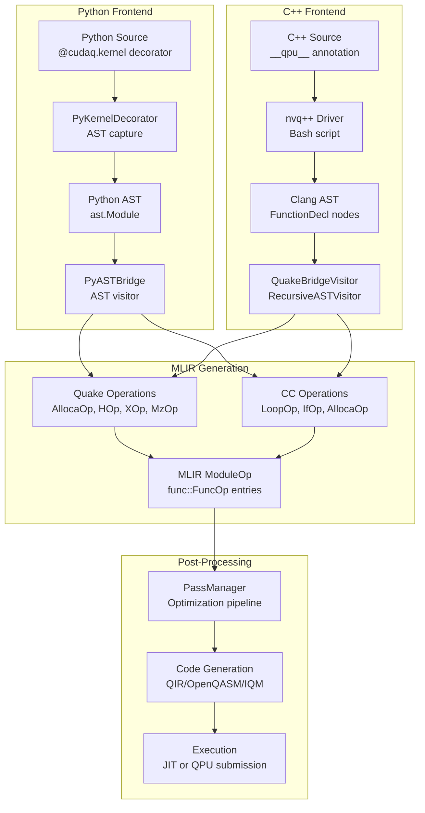

Sources: [python/cudaq/kernel/kernel_decorator.py:33-170](), [python/cudaq/kernel/ast_bridge.py:197-278](), [tools/nvqpp/nvq++.in:1-873](), [lib/Frontend/nvqpp/ASTBridge.cpp:1-58](), [include/cudaq/Frontend/nvqpp/ASTBridge.h:141-160]()

## Python Compilation Path

### Decorator-Based Compilation

Python quantum kernels are defined using the `@cudaq.kernel` decorator, which captures the function's AST at definition time and compiles it to MLIR on first execution.

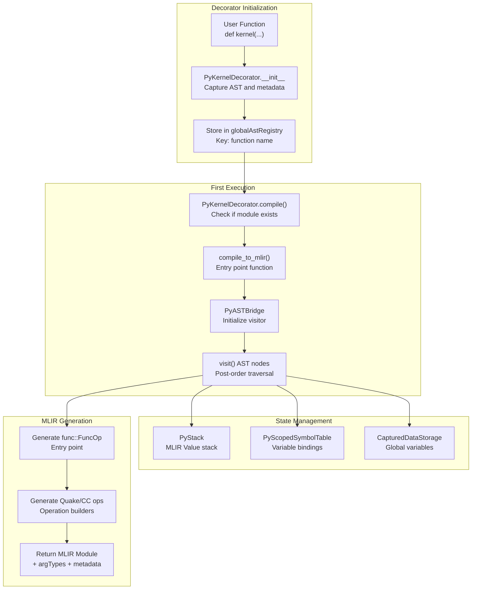

Sources: [python/cudaq/kernel/kernel_decorator.py:43-228](), [python/cudaq/kernel/ast_bridge.py:197-278]()

#### PyKernelDecorator Workflow

The `PyKernelDecorator` class orchestrates Python kernel compilation:

| Phase | Component | Responsibility |
|-------|-----------|----------------|
| **Capture** | `PyKernelDecorator.__init__` | Capture function source, parse AST, extract signature |
| **Storage** | `globalAstRegistry` | Store AST keyed by function name for dependency resolution |
| **Compilation** | `PyKernelDecorator.compile()` | Check if recompilation needed, invoke `compile_to_mlir()` |
| **Recompilation** | Dependency checking | Track captured variables, recompile if values change |

Sources: [python/cudaq/kernel/kernel_decorator.py:43-228]()

### PyASTBridge: AST-to-MLIR Translation

The `PyASTBridge` class implements `ast.NodeVisitor` to traverse Python AST nodes and generate MLIR operations.

#### Bridge Architecture

```mermaid
graph LR
    subgraph "PyASTBridge Core"
        Visitor["ast.NodeVisitor<br/>Base class"]
        InitBridge["__init__<br/>Context, builder, module"]
        VisitMethods["Visit methods<br/>VisitFunctionDef<br/>VisitFor<br/>VisitCall<br/>VisitBinOp"]
    end
    
    subgraph "State Management"
        ValueStack["PyStack<br/>pushValue/popValue"]
        SymTab["PyScopedSymbolTable<br/>pushScope/popScope"]
        ForBodyStack["inForBodyStack<br/>Track loop nesting"]
        IfStmtStack["inIfStmtBlockStack<br/>Track conditional blocks"]
    end
    
    subgraph "Type Handling"
        TypeConv["mlirTypeFromPyType<br/>Python to MLIR types"]
        BuiltinTypes["IntegerType, F64Type<br/>ComplexType"]
        QuantumTypes["quake.RefType<br/>quake.VeqType"]
    end
    
    subgraph "Operation Generation"
        QuakeOps["quake.AllocaOp<br/>quake.HOp, XOp, MzOp"]
        CCOps["cc.LoopOp<br/>cc.IfOp, AllocaOp"]
        ArithOps["arith.ConstantOp<br/>arith.AddIOp"]
    end
    
    Visitor --> InitBridge
    InitBridge --> VisitMethods
    
    VisitMethods --> ValueStack
    VisitMethods --> SymTab
    VisitMethods --> ForBodyStack
    VisitMethods --> IfStmtStack
    
    VisitMethods --> TypeConv
    TypeConv --> BuiltinTypes
    TypeConv --> QuantumTypes
    
    VisitMethods --> QuakeOps
    VisitMethods --> CCOps
    VisitMethods --> ArithOps
```

Sources: [python/cudaq/kernel/ast_bridge.py:197-278](), [python/cudaq/kernel/ast_bridge.py:53-196]()

#### Key Visit Methods

The `PyASTBridge` implements visitor methods for each Python AST node type:

| AST Node Type | Visit Method | Generated MLIR |
|---------------|--------------|----------------|
| `FunctionDef` | `visit_FunctionDef` | `func::FuncOp` with entry block |
| `For` | `visit_For` | `cc.LoopOp` or unrolled operations |
| `If` | `visit_If` | `cc.IfOp` with then/else blocks |
| `Call` | `visit_Call` | Quantum gate ops or `func::CallOp` |
| `BinOp` | `visit_BinOp` | `arith.AddIOp`, `arith.MulIOp`, etc. |
| `Subscript` | `visit_Subscript` | `quake.ExtractRefOp` for qubit access |

Sources: [python/cudaq/kernel/ast_bridge.py:1140-2827]()

#### Value Stack Management

The `PyStack` class manages MLIR values during AST traversal using a frame-based approach:

```mermaid
graph TB
    subgraph "Stack Frame Model"
        ParentFrame["Parent Frame<br/>Contains child values"]
        CurrentFrame["Current Frame<br/>Processing AST node"]
        ChildFrame["Child Frame<br/>Produces values"]
    end
    
    subgraph "Operations"
        PushFrame["pushFrame()<br/>Enter new node"]
        PopFrame["popFrame()<br/>Exit node"]
        PushValue["pushValue(mlir.Value)<br/>Child to parent"]
        PopValue["popValue()<br/>Parent consumes"]
    end
    
    ParentFrame --> CurrentFrame
    CurrentFrame --> ChildFrame
    
    PushFrame --> CurrentFrame
    PopFrame --> ParentFrame
    PushValue --> ParentFrame
    PopValue --> ParentFrame
```

Sources: [python/cudaq/kernel/ast_bridge.py:108-195]()

## C++ Compilation Path

### nvq++ Driver Architecture

The `nvq++` driver is a Bash script that orchestrates C++ quantum kernel compilation through multiple tools.

```mermaid
graph TB
    subgraph "nvq++ Driver"
        ParseArgs["Parse command-line args<br/>Target, flags, sources"]
        TargetConfig["Load target config<br/>YAML file processing"]
        CompileFlow["Determine compilation flow<br/>LIBRARY_MODE or MLIR mode"]
    end
    
    subgraph "MLIR Compilation Tools"
        CudaqQuake["cudaq-quake<br/>C++ AST to Quake MLIR"]
        CudaqOpt["cudaq-opt<br/>Run optimization passes"]
        CudaqTranslate["cudaq-translate<br/>MLIR to QIR/OpenQASM"]
        LLC["llc<br/>LLVM IR to object file"]
    end
    
    subgraph "Pipeline Configuration"
        OptPasses["OPT_PASSES variable<br/>Configurable pass list"]
        EnableFlags["Feature flags<br/>ENABLE_UNWIND_LOWERING<br/>ENABLE_KERNEL_EXECUTION"]
        PassPipeline["Construct pass pipeline<br/>add_pass_to_pipeline()"]
    end
    
    subgraph "Linking"
        Objects["Object files<br/>.qke.o, .classic.o"]
        RuntimeLibs["Runtime libraries<br/>libcudaq, libnvqir-*"]
        FinalBinary["Final executable<br/>or shared library"]
    end
    
    ParseArgs --> TargetConfig
    TargetConfig --> CompileFlow
    
    CompileFlow --> CudaqQuake
    CudaqQuake --> CudaqOpt
    CudaqOpt --> CudaqTranslate
    CudaqTranslate --> LLC
    
    CompileFlow --> OptPasses
    OptPasses --> EnableFlags
    EnableFlags --> PassPipeline
    PassPipeline --> CudaqOpt
    
    LLC --> Objects
    Objects --> RuntimeLibs
    RuntimeLibs --> FinalBinary
```

Sources: [tools/nvqpp/nvq++.in:1-873](), [tools/nvqpp/nvq++.in:706-774]()

#### nvq++ Compilation Stages

The `nvq++` driver executes these stages:

1. **Quake Generation** (line 798): `cudaq-quake` converts C++ AST to `.qke` file
2. **Optimization** (line 804-808): `cudaq-opt` applies pass pipeline to `.qke` file
3. **Translation** (line 814): `cudaq-translate` converts to target format (QIR/OpenQASM)
4. **Classical Compilation** (line 831): `llc` compiles classical code to object file
5. **Linking** (line 838): Merge quantum and classical object files with runtime

Sources: [tools/nvqpp/nvq++.in:782-872]()

### QuakeBridgeVisitor: C++ AST Traversal

The `QuakeBridgeVisitor` class extends `clang::RecursiveASTVisitor` to traverse C++ AST and generate Quake MLIR.

#### C++ Bridge Architecture

```mermaid
graph LR
    subgraph "Clang AST Traversal"
        RecursiveVisitor["RecursiveASTVisitor<br/>Clang base class"]
        QuakeBridge["QuakeBridgeVisitor<br/>CUDA-Q implementation"]
        TraverseMethods["Traverse methods<br/>TraverseFunctionDecl<br/>TraverseCXXRecordDecl<br/>TraverseStmt"]
    end
    
    subgraph "State Management"
        SymbolTable["SymbolTable<br/>llvm::ScopedHashTable"]
        TypeStack["typeStack<br/>std::vector<Type>"]
        ValueStack["valueStack<br/>std::deque<Value>"]
    end
    
    subgraph "Visit Handlers"
        VisitDecl["Declaration visitors<br/>VisitFunctionDecl<br/>VisitVarDecl"]
        VisitExpr["Expression visitors<br/>VisitCallExpr<br/>VisitBinaryOperator"]
        VisitStmt["Statement visitors<br/>VisitForStmt<br/>VisitIfStmt"]
    end
    
    subgraph "MLIR Generation"
        FuncOpGen["func::FuncOp generation<br/>Entry points"]
        QuakeOpGen["Quake operation builders<br/>buildOp templates"]
        CCOpGen["CC operation builders<br/>Classical control flow"]
    end
    
    RecursiveVisitor --> QuakeBridge
    QuakeBridge --> TraverseMethods
    
    TraverseMethods --> SymbolTable
    TraverseMethods --> TypeStack
    TraverseMethods --> ValueStack
    
    TraverseMethods --> VisitDecl
    TraverseMethods --> VisitExpr
    TraverseMethods --> VisitStmt
    
    VisitDecl --> FuncOpGen
    VisitExpr --> QuakeOpGen
    VisitStmt --> CCOpGen
```

Sources: [include/cudaq/Frontend/nvqpp/ASTBridge.h:141-160](), [lib/Frontend/nvqpp/ASTBridge.cpp:1-58]()

#### Type Conversion System

C++ types are converted to MLIR types through several specialized handlers:

```mermaid
graph TB
    subgraph "Clang Type System"
        BuiltinType["clang::BuiltinType<br/>int, float, bool"]
        RecordType["clang::RecordDecl<br/>cudaq::qubit<br/>cudaq::qvector"]
        TemplateType["Template specializations<br/>std::vector<T>"]
    end
    
    subgraph "Type Conversion"
        BuiltinConv["builtinTypeToType<br/>IntegerType, F64Type"]
        InterceptRecord["interceptRecordDecl<br/>Quantum type mapping"]
        TraverseType["TraverseType<br/>Recursive type handling"]
    end
    
    subgraph "MLIR Types"
        ArithTypes["IntegerType, FloatType<br/>ComplexType"]
        QuantumTypes["quake.RefType<br/>quake.VeqType"]
        CCTypes["cc.PointerType<br/>cc.StdvecType<br/>cc.StructType"]
    end
    
    BuiltinType --> BuiltinConv
    RecordType --> InterceptRecord
    TemplateType --> TraverseType
    
    BuiltinConv --> ArithTypes
    InterceptRecord --> QuantumTypes
    TraverseType --> CCTypes
```

Sources: [lib/Frontend/nvqpp/ConvertType.cpp:1-304](), [lib/Frontend/nvqpp/ConvertDecl.cpp:124-317]()

#### Expression Conversion

C++ expressions are converted to MLIR operations through visitor pattern:

| C++ Construct | Visitor Method | Generated Operations |
|---------------|----------------|----------------------|
| Function call | `VisitCallExpr` | `func::CallOp` or quantum gate op |
| Binary operator | `VisitBinaryOperator` | `arith` dialect operations |
| Array subscript | `VisitArraySubscriptExpr` | `cc.ComputePtrOp` |
| Cast expression | `VisitCastExpr` | `cc.CastOp` with type coercion |
| For loop | `VisitForStmt` | `cc.LoopOp` with condition and body |

Sources: [lib/Frontend/nvqpp/ConvertExpr.cpp:1-630]()

### cudaq-quake Tool

The `cudaq-quake` tool is the C++ frontend driver that invokes Clang and the `QuakeBridgeVisitor`:

```mermaid
graph TB
    subgraph "Tool Entry Point"
        MainFunc["main() function<br/>Parse command-line args"]
        ClangConfig["Configure Clang<br/>CompilerInstance setup"]
    end
    
    subgraph "Clang Pipeline"
        ParseCpp["Parse C++ source<br/>Clang frontend"]
        BuildAST["Build AST<br/>ASTContext"]
        RunVisitor["Run QuakeBridgeVisitor<br/>AST traversal"]
    end
    
    subgraph "MLIR Output"
        MLIRContext["Initialize MLIRContext<br/>Register dialects"]
        GenerateModule["Generate ModuleOp<br/>Quake + CC ops"]
        WriteOutput["Write .qke file<br/>MLIR text format"]
    end
    
    MainFunc --> ClangConfig
    ClangConfig --> ParseCpp
    ParseCpp --> BuildAST
    BuildAST --> RunVisitor
    
    RunVisitor --> MLIRContext
    MLIRContext --> GenerateModule
    GenerateModule --> WriteOutput
```

Sources: [tools/cudaq-quake/cudaq-quake.cpp:1-227]()

## Unified MLIR Representation

Both Python and C++ compilation paths converge on a common MLIR module structure containing Quake and CC dialect operations.

### MLIR Module Structure

```mermaid
graph TB
    subgraph "MLIR Module"
        ModuleOp["mlir::ModuleOp<br/>Top-level container"]
        EntryPoint["func::FuncOp<br/>Entry point kernel<br/>Attribute: cudaq-entrypoint"]
        DependentFuncs["func::FuncOp<br/>Called kernels<br/>Attribute: cudaq-kernel"]
    end
    
    subgraph "Function Body"
        EntryBlock["Block<br/>Entry block with arguments"]
        Operations["Operations<br/>Quake + CC + Arith"]
        Terminator["Return operation<br/>func.return"]
    end
    
    subgraph "Kernel Naming"
        UserName["User function name<br/>my_kernel"]
        MangledName["Mangled name<br/>__nvqpp__mlirgen__my_kernel"]
        Registry["globalKernelRegistry<br/>Name to module mapping"]
    end
    
    ModuleOp --> EntryPoint
    ModuleOp --> DependentFuncs
    
    EntryPoint --> EntryBlock
    EntryBlock --> Operations
    Operations --> Terminator
    
    UserName --> MangledName
    MangledName --> Registry
    Registry --> ModuleOp
```

Sources: [runtime/common/RuntimeMLIR.cpp:115-125](), [python/cudaq/kernel/utils.py:29-50]()

### Dialect Integration

The generated MLIR modules use multiple dialects that interact:

| Dialect | Purpose | Key Operations |
|---------|---------|----------------|
| **quake** | Quantum operations | `AllocaOp`, `HOp`, `XOp`, `MzOp`, `ApplyOp` |
| **cc** | Classical control | `LoopOp`, `IfOp`, `AllocaOp`, `LoadOp`, `StoreOp` |
| **arith** | Arithmetic | `ConstantOp`, `AddIOp`, `MulIOp`, `CmpIOp` |
| **complex** | Complex numbers | `CreateOp`, `ReOp`, `ImOp` |
| **math** | Math functions | `SqrtOp`, `ExpOp`, `SinOp`, `CosOp` |
| **func** | Functions | `FuncOp`, `CallOp`, `ReturnOp` |

Sources: [python/cudaq/kernel/ast_bridge.py:19-28](), [include/cudaq/Frontend/nvqpp/ASTBridge.h:10-29]()

## Pass Pipeline Organization

After MLIR generation, the module undergoes optimization through a configurable pass pipeline.

### Pipeline Configuration

```mermaid
graph TB
    subgraph "Configuration Sources"
        TargetYAML["Target YAML file<br/>quantinuum.yml, nvidia.yml"]
        CommandFlags["Command-line flags<br/>-f[no-]unwind-lowering<br/>-f[no-]kernel-execution"]
        EnvVars["Environment variables<br/>Target-specific config"]
    end
    
    subgraph "Pass Selection"
        ParseConfig["Parse configuration<br/>cudaq-target-conf tool"]
        EnabledPasses["Enabled passes<br/>Boolean flags"]
        PassList["OPT_PASSES string<br/>Comma-separated"]
    end
    
    subgraph "Pipeline Construction"
        BasePassPipeline["Base pipeline<br/>device-code-loader"]
        ConditionalPasses["Conditional additions<br/>if ENABLE_* flags"]
        CustomPasses["Custom passes<br/>--opt-pass arguments"]
    end
    
    subgraph "Execution"
        PassManager["PassManager<br/>MLIR infrastructure"]
        RunPipeline["Run pipeline<br/>Transform module"]
        OutputMLIR["Output MLIR<br/>Optimized module"]
    end
    
    TargetYAML --> ParseConfig
    CommandFlags --> EnabledPasses
    EnvVars --> ParseConfig
    
    ParseConfig --> PassList
    EnabledPasses --> PassList
    
    PassList --> BasePassPipeline
    BasePassPipeline --> ConditionalPasses
    ConditionalPasses --> CustomPasses
    
    CustomPasses --> PassManager
    PassManager --> RunPipeline
    RunPipeline --> OutputMLIR
```

Sources: [tools/nvqpp/nvq++.in:704-774](), [tools/cudaq-translate/cudaq-translate.cpp:1-227]()

### Pass Pipeline Stages in nvq++

The `nvq++` driver constructs the pass pipeline in stages:

1. **Variable Coalesce** (line 708-710): Merge redundant stack allocations
2. **Unwind Lowering** (line 711-714): Lower high-level control flow
3. **Lambda Lifting** (line 715-718): Hoist lambda functions to top-level
4. **Apply Specialization** (line 719-722): Specialize `quake.apply` operations
5. **Kernel Execution** (line 723-736): Generate runtime execution stubs
6. **Aggressive Inlining** (line 737-744): Inline kernel calls
7. **Array Conversion** (line 745-748): Convert arrays to concrete values
8. **Custom Passes** (line 749-752): User-specified passes via `--opt-pass`
9. **Device Code Loader** (line 753-757): Prepare for code generation
10. **Lower to CFG** (line 758-761): Convert to control flow graph

Sources: [tools/nvqpp/nvq++.in:706-774]()

### Runtime MLIR Infrastructure

The runtime provides infrastructure for initializing MLIR contexts and running JIT compilation:

```mermaid
graph LR
    subgraph "Initialization"
        InitMLIR["initializeMLIR()<br/>One-time setup"]
        RegisterDialects["Register dialects<br/>Quake, CC, CodeGen"]
        RegisterPasses["Register passes<br/>cudaq::registerAllPasses()"]
    end
    
    subgraph "Translation Registry"
        TranslationMap["llvm::StringMap<Translation><br/>Name to translator"]
        RegisterQIR["registerToQIRTranslation<br/>QIR converter"]
        RegisterOpenQASM["registerToOpenQASMTranslation<br/>OpenQASM converter"]
        RegisterIQM["registerToIQMJsonTranslation<br/>IQM JSON converter"]
    end
    
    subgraph "Context Management"
        MLIRContext["std::unique_ptr<MLIRContext><br/>Per-compilation context"]
        LoadDialects["Load all dialects<br/>context->loadAllAvailableDialects()"]
        LLVMTranslation["Register LLVM translation<br/>LLVM IR export"]
    end
    
    InitMLIR --> RegisterDialects
    InitMLIR --> RegisterPasses
    
    RegisterPasses --> TranslationMap
    TranslationMap --> RegisterQIR
    TranslationMap --> RegisterOpenQASM
    TranslationMap --> RegisterIQM
    
    InitMLIR --> MLIRContext
    MLIRContext --> LoadDialects
    LoadDialects --> LLVMTranslation
```

Sources: [runtime/common/RuntimeMLIR.cpp:92-113]()

## Integration Points

The compilation pipeline integrates with other CUDA-Q subsystems at specific interfaces.

### Frontend to MLIR Integration

| Component | Interface | Purpose |
|-----------|-----------|---------|
| `PyKernelDecorator` | `compile_to_mlir()` | Python AST to MLIR conversion entry point |
| `PyASTBridge` | `visit()` methods | AST node processing and MLIR generation |
| `QuakeBridgeVisitor` | `Traverse*()` methods | C++ AST traversal and MLIR generation |
| `cudaq-quake` tool | `main()` function | Command-line interface for C++ compilation |

Sources: [python/cudaq/kernel/kernel_decorator.py:171-228](), [python/cudaq/kernel/ast_bridge.py:197-278](), [tools/cudaq-quake/cudaq-quake.cpp:1-227]()

### MLIR to Execution Integration

| Component | Interface | Purpose |
|-----------|-----------|---------|
| `PassManager` | `run(module)` | Execute optimization passes on module |
| `cudaq::getTranslation()` | Get translator by name | Retrieve QIR/OpenQASM/IQM converter |
| `ExecutionEngine` | JIT compilation | Python runtime execution |
| `BaseRemoteRESTQPU` | `extractQuakeCodeAndContext()` | Remote execution preparation |

Sources: [runtime/common/RuntimeMLIR.cpp:40-88](), [runtime/cudaq/platform/default/rest/RemoteRESTQPU.cpp:31-44]()

### Module Naming and Registry

CUDA-Q maintains naming conventions to track compiled kernels:

- **Python**: Function name → `__nvqpp__mlirgen__<name>` in MLIR
- **C++**: Mangled name → `__nvqpp__mlirgen__<tag>` in MLIR
- **Registry**: `globalKernelRegistry` maps names to MLIR modules
- **AST Registry**: `globalAstRegistry` maps names to Python AST for dependencies

Sources: [python/cudaq/kernel/utils.py:29-50](), [include/cudaq/Frontend/nvqpp/ASTBridge.h:165-173]()

---

# Page: MLIR Dialects

# MLIR Dialects

<details>
<summary>Relevant source files</summary>

The following files were used as context for generating this wiki page:

- [include/cudaq/Optimizer/Dialect/CC/CCOps.h](include/cudaq/Optimizer/Dialect/CC/CCOps.h)
- [include/cudaq/Optimizer/Dialect/CC/CCOps.td](include/cudaq/Optimizer/Dialect/CC/CCOps.td)
- [include/cudaq/Optimizer/Dialect/Quake/QuakeOps.h](include/cudaq/Optimizer/Dialect/Quake/QuakeOps.h)
- [include/cudaq/Optimizer/Dialect/Quake/QuakeOps.td](include/cudaq/Optimizer/Dialect/Quake/QuakeOps.td)
- [lib/Optimizer/Dialect/CC/CCOps.cpp](lib/Optimizer/Dialect/CC/CCOps.cpp)
- [lib/Optimizer/Dialect/Quake/QuakeOps.cpp](lib/Optimizer/Dialect/Quake/QuakeOps.cpp)
- [lib/Optimizer/Transforms/QuakeSynthesizer.cpp](lib/Optimizer/Transforms/QuakeSynthesizer.cpp)
- [test/AST-Quake/adjoint-3.cpp](test/AST-Quake/adjoint-3.cpp)
- [test/AST-Quake/loop_unroll-1.cpp](test/AST-Quake/loop_unroll-1.cpp)
- [test/AST-Quake/qpe.cpp](test/AST-Quake/qpe.cpp)
- [test/Translate/ghz.qke](test/Translate/ghz.qke)

</details>


This page documents the Quake and CC MLIR dialects used in CUDA-Q. The Quake dialect represents quantum operations (gates, measurements, qubit allocation), while the CC dialect represents classical control flow and data structures. Both dialects are defined using MLIR's TableGen (.td) format and implemented in C++.

## Overview

CUDA-Q defines two primary MLIR dialects:

- **Quake**: Quantum operations, types, and semantics
- **CC**: Classical compute operations, control flow, and memory management

These dialects are registered with MLIR in [lib/Optimizer/Dialect/Quake/QuakeDialect.cpp]() and [lib/Optimizer/Dialect/CC/CCDialect.cpp](). The dialect definitions follow MLIR conventions where operations are defined in TableGen (.td files) and implementations are in C++ (.cpp files).

### Dialect Architecture

```mermaid
flowchart LR
    subgraph "Dialect_Definitions"
        QuakeDialectTD["QuakeDialect.td"]
        QuakeOpsTD["QuakeOps.td"]
        QuakeTypesTD["QuakeTypes.td"]
        
        CCDialectTD["CCDialect.td"]
        CCOpsTD["CCOps.td"]
        CCTypesTD["CCTypes.td"]
    end
    
    subgraph "Generated_Code"
        QuakeDialectTD --> QuakeDialectCppInc["QuakeDialect.cpp.inc"]
        QuakeOpsTD --> QuakeOpsCppInc["QuakeOps.cpp.inc"]
        QuakeTypesTD --> QuakeTypesCppInc["QuakeTypes.cpp.inc"]
        
        CCDialectTD --> CCDialectCppInc["CCDialect.cpp.inc"]
        CCOpsTD --> CCOpsCppInc["CCOps.cpp.inc"]
        CCTypesTD --> CCTypesCppInc["CCTypes.cpp.inc"]
    end
    
    subgraph "Implementation"
        QuakeDialectCpp["QuakeDialect.cpp"]
        QuakeOpsCpp["QuakeOps.cpp"]
        QuakeTypesCpp["QuakeTypes.cpp"]
        
        CCDialectCpp["CCDialect.cpp"]
        CCOpsCpp["CCOps.cpp"]
        CCTypesCpp["CCTypes.cpp"]
    end
    
    QuakeDialectCppInc --> QuakeDialectCpp
    QuakeOpsCppInc --> QuakeOpsCpp
    QuakeTypesCppInc --> QuakeTypesCpp
    
    CCDialectCppInc --> CCDialectCpp
    CCOpsCppInc --> CCOpsCpp
    CCTypesCppInc --> CCTypesCpp
```

Sources:
- [include/cudaq/Optimizer/Dialect/Quake/QuakeOps.td:9-33]()
- [include/cudaq/Optimizer/Dialect/CC/CCOps.td:9-36]()
- [lib/Optimizer/Dialect/Quake/QuakeOps.cpp:1-26]()
- [lib/Optimizer/Dialect/CC/CCOps.cpp:1-24]()

## Quake Dialect

The Quake dialect represents quantum operations. All Quake operations inherit from the `QuakeOp` base class defined at [include/cudaq/Optimizer/Dialect/Quake/QuakeOps.td:32-33]().

### Quake Type System

Quake types represent quantum resources and measurement results. Types are defined in TableGen at [include/cudaq/Optimizer/Dialect/Quake/QuakeTypes.td]() with C++ implementations in [lib/Optimizer/Dialect/Quake/QuakeTypes.cpp]().

| Type | MLIR Syntax | Description | Definition |
|------|-------------|-------------|------------|
| `RefType` | `!quake.ref` | Single qubit reference | Memory-semantics, mutable |
| `VeqType` | `!quake.veq<N>` or `!quake.veq<?>` | Vector of qubits | Static size `N` or dynamic size `?` |
| `WireType` | `!quake.wire` | Linear quantum value | Value-semantics, must be used exactly once |
| `ControlType` | `!quake.control` | Control qubit in operations | Marks qubits used as controls |
| `MeasureType` | `!quake.measure` | Measurement result | Opaque result from measurement operations |
| `StruqType` | `!quake.struq<...>` | Structured quantum type | Aggregate quantum type with named fields |

**Type Implementation Details:**

- `VeqType` can have specified size (`!quake.veq<4>`) or unspecified size (`!quake.veq<?>`). The helper method `hasSpecifiedSize()` distinguishes these cases.
- `StruqType` represents structured quantum data with named fields, similar to C++ structs but for quantum types.
- Type verification is implemented in [lib/Optimizer/Dialect/Quake/QuakeTypes.cpp]() using MLIR's type verification framework.

**Example MLIR:**
```mlir
%q = quake.alloca !quake.ref                    // Single qubit
%qv = quake.alloca !quake.veq<4>               // 4 qubits (static size)
%qv_dyn = quake.alloca !quake.veq<?>[%n : i32] // Dynamic size
%w = quake.null_wire : !quake.wire              // Wire value
```

### Quake Operations

Quake operations are organized into several categories. Operation definitions are in [include/cudaq/Optimizer/Dialect/Quake/QuakeOps.td:38-1200]() with implementations in [lib/Optimizer/Dialect/Quake/QuakeOps.cpp]().

#### Allocation Operations

| Operation | Syntax | Description | File Location |
|-----------|--------|-------------|---------------|
| `AllocaOp` | `quake.alloca` | Allocate qubits | [QuakeOps.td:39-109]() |
| `DeallocOp` | `quake.dealloc` | Deallocate qubits | [QuakeOps.td:137-165]() |
| `InitializeStateOp` | `quake.init_state` | Initialize to specific state | [QuakeOps.td:111-135]() |

**AllocaOp Examples:**
```mlir
%q = quake.alloca !quake.ref                    // Single qubit
%qv = quake.alloca !quake.veq<4>               // Static size
%qv_dyn = quake.alloca !quake.veq<?>[%n : i32] // Dynamic size
```

The `AllocaOp` has canonicalization patterns that fold constant sizes into the type, implemented in [lib/Optimizer/Dialect/Quake/QuakeOps.cpp:183-189]().

#### Vector Manipulation

| Operation | Syntax | Description | Verification |
|-----------|--------|-------------|--------------|
| `ConcatOp` | `quake.concat` | Concatenate quantum refs into vector | [QuakeOps.td:171-192]() |
| `ExtractRefOp` | `quake.extract_ref` | Extract single ref from vector | [QuakeOps.td:194-249]() |
| `SubVeqOp` | `quake.subveq` | Extract subvector | [QuakeOps.td:276-337]() |
| `RelaxSizeOp` | `quake.relax_size` | Convert static to dynamic size | [QuakeOps.td:251-274]() |
| `VeqSizeOp` | `quake.veq_size` | Get size of vector | [QuakeOps.td:339-366]() |

**ExtractRefOp:**
- Has both constant and dynamic indexing modes
- Constant index stored in `rawIndex` attribute
- Dynamic index provided as SSA value
- Defined with `kDynamicIndex` constant at [QuakeOps.td:243-244]()

**Example:**
```mlir
// Constant index
%q0 = quake.extract_ref %qv[0] : (!quake.veq<4>) -> !quake.ref

// Dynamic index
%q_idx = quake.extract_ref %qv[%i] : (!quake.veq<?>, i32) -> !quake.ref
```

#### Quantum Gate Operations

Gate operations implement the `OperatorInterface` defined at [include/cudaq/Optimizer/Dialect/Quake/QuakeInterfaces.td](). Common gates include:

| Operation | Parameters | Controls | Definition |
|-----------|------------|----------|------------|
| `HOp` | None | Optional | Hadamard gate |
| `XOp` | None | Optional | Pauli-X gate |
| `YOp` | None | Optional | Pauli-Y gate |
| `ZOp` | None | Optional | Pauli-Z gate |
| `SOp` | None | Optional | S gate |
| `TOp` | None | Optional | T gate |
| `RxOp` | 1 angle | Optional | Rotation around X |
| `RyOp` | 1 angle | Optional | Rotation around Y |
| `RzOp` | 1 angle | Optional | Rotation around Z |
| `R1Op` | 1 angle | Optional | Phase rotation |
| `SwapOp` | None | Optional | Swap two qubits |

**Gate Syntax:**
```mlir
// Simple gates
quake.h %q : (!quake.ref) -> ()
quake.x %q : (!quake.ref) -> ()

// Parametric gates
quake.rx(%angle) %q : (f64, !quake.ref) -> ()
quake.ry(%theta) %q : (f64, !quake.ref) -> ()

// Controlled gates
quake.x [%ctrl] %target : (!quake.ref, !quake.ref) -> ()
quake.rx(%angle) [%ctrl] %target : (f64, !quake.ref, !quake.ref) -> ()
```

#### Measurement Operations

Measurement operations implement the `MeasurementInterface` and produce `!quake.measure` results:

| Operation | Basis | Definition |
|-----------|-------|------------|
| `MzOp` | Z-basis | Standard computational basis |
| `MxOp` | X-basis | Measurement in X basis |
| `MyOp` | Y-basis | Measurement in Y basis |
| `DiscriminateOp` | N/A | Convert measure to boolean |

**Measurement Flow:**
```mlir
%m = quake.mz %q : (!quake.ref) -> !quake.measure
%bit = quake.discriminate %m : (!quake.measure) -> i1
```

#### Application and Control

| Operation | Purpose | Definition |
|-----------|---------|------------|
| `ApplyOp` | Apply user-defined kernel | [QuakeOps.td:372-451]() |
| `ComputeActionOp` | Compute-action-uncompute idiom | [QuakeOps.td:454-480]() |

The `ApplyOp` supports both direct calls (via symbol reference) and indirect calls (via callable value). It can apply operations with control qubits and in adjoint form using the `is_adj` attribute.

**ApplyOp Examples:**
```mlir
// Direct call
quake.apply @my_kernel %q : (!quake.ref) -> ()

// With controls
quake.apply @my_kernel [%ctrl] %q : (!quake.ref, !quake.ref) -> ()

// Adjoint
quake.apply<adj> @my_kernel %q : (!quake.ref) -> ()

// Indirect call
quake.apply %callable %q : (!cc.callable<(!quake.ref) -> ()>, !quake.ref) -> ()
```

The `ComputeActionOp` captures the compute-action-uncompute pattern at [QuakeOps.td:454-480](), where the uncompute step is automatically generated as the adjoint of the compute kernel.

### Memory vs. Value Semantics

Quake supports two semantic models for quantum operations:

1. **Memory Semantics**: Uses `!quake.ref` and `!quake.veq` types. Qubits are allocated, mutated in-place, and deallocated.
2. **Value Semantics**: Uses `!quake.wire` and `!quake.control` types. Quantum values are produced and consumed, following linear type discipline.

```mermaid
flowchart TD
    subgraph "Memory_Semantics"
        AllocaOp["quake.alloca → !quake.ref"]
        AllocaOp --> RefOp1["quake.h %q"]
        RefOp1 --> RefOp2["quake.x %q"]
        RefOp2 --> DeallocOp["quake.dealloc %q"]
    end
    
    subgraph "Value_Semantics"
        NullWireOp["quake.null_wire → !quake.wire"]
        NullWireOp --> WireOp1["%w1 = quake.h %w0"]
        WireOp1 --> WireOp2["%w2 = quake.x %w1"]
        WireOp2 --> SinkOp["quake.sink %w2"]
    end
    
    subgraph "Conversion_Operations"
        UnwrapOp["quake.unwrap:\n!quake.ref → !quake.wire"]
        WrapOp["quake.wrap:\n!quake.wire → !quake.ref"]
    end
    
    RefOp1 -.-> UnwrapOp
    UnwrapOp -.-> WireOp1
    WireOp2 -.-> WrapOp
    WrapOp -.-> RefOp2
```

**Wire Operations:**

| Operation | Purpose | Definition |
|-----------|---------|------------|
| `NullWireOp` | Create initial wire state (&#124;0⟩) | [QuakeOps.td:594-614]() |
| `SinkOp` | Consume wire at end of circuit | [QuakeOps.td:616-638]() |
| `UnwrapOp` | Convert ref to wire | [QuakeOps.td:541-568]() |
| `WrapOp` | Convert wire to ref | [QuakeOps.td:570-588]() |

**Linear Type Verification:**

Wire values must be used exactly once, enforcing the no-cloning theorem. This is verified by `verifyWireResultsAreLinear` at [lib/Optimizer/Dialect/Quake/QuakeOps.cpp:28-46]():

```cpp
static LogicalResult verifyWireResultsAreLinear(Operation *op) {
  for (Value v : op->getOpResults())
    if (isa<quake::WireType>(v.getType())) {
      if (v.hasOneUse() || v.use_empty())
        continue;
      // Special case: cf.cond_br can use value twice (once per arm)
      std::unordered_set<Operation *> uniqs;
      for (auto *op : v.getUsers())
        uniqs.insert(op);
      if (uniqs.size() == 1 &&
          (*uniqs.begin())->hasTrait<OpTrait::IsTerminator>())
        continue;
      return op->emitOpError(
          "wires are a linear type and must have exactly one use");
    }
  return success();
}
```

**Wire Arity and Coarity:**

Operations in value form must have equal wire arity (input wires) and coarity (output wires). Verification is at [lib/Optimizer/Dialect/Quake/QuakeOps.cpp:51-71]():

```cpp
LogicalResult quake::verifyWireArityAndCoarity(Operation *op) {
  std::size_t arity = 0;
  std::size_t coarity = 0;
  // Count input wires (including controls) and output wires
  // ...
  if (arity == coarity)
    return success();
  return op->emitOpError("arity does not equal coarity of wires");
}
```

Sources:
- [lib/Optimizer/Dialect/Quake/QuakeOps.cpp:28-71]()
- [include/cudaq/Optimizer/Dialect/Quake/QuakeOps.td:541-638]()
- [include/cudaq/Optimizer/Dialect/Quake/QuakeTypes.td:47-64]()

## CC Dialect

The CC (Classical Compute) dialect provides classical operations, control flow, and data structures. All CC operations inherit from the `CCOp` base class at [include/cudaq/Optimizer/Dialect/CC/CCOps.td:35-36]().

### CC Type System

CC types represent classical data structures used in quantum-classical hybrid algorithms. Types are defined at [include/cudaq/Optimizer/Dialect/CC/CCTypes.td]() with implementations in [lib/Optimizer/Dialect/CC/CCTypes.cpp]().

| Type | MLIR Syntax | C++ Equivalent | Description |
|------|-------------|----------------|-------------|
| `PointerType` | `!cc.ptr<T>` | `T*`, `T&` | Memory pointer to type T |
| `ArrayType` | `!cc.array<T x N>` | `T[N]` | Fixed-size array of N elements |
| `StructType` | `!cc.struct<"name" {fields}>` | `struct name` | Aggregate type with fields |
| `StdvecType` | `!cc.stdvec<T>` | `std::vector<T>` | Dynamic array |
| `CallableType` | `!cc.callable<(Args) -> Ret>` | Lambda, function pointer | Callable with signature |
| `IndirectCallableType` | `!cc.indcallable<...>` | Indirect callable | Runtime-selected callable |
| `SpanLikeType` | `!cc.span<T>` | `std::span<T>` | Non-owning view |
| `CharspanType` | `!cc.charspan` | `std::string_view` | String view |

**PointerType Details:**

Pointers can be to any type including quantum types. Defined at [include/cudaq/Optimizer/Dialect/CC/CCTypes.td:66-81](). Example uses:
```mlir
!cc.ptr<i32>                  // int*
!cc.ptr<f64>                  // double*
!cc.ptr<!quake.ref>          // pointer to quantum ref
!cc.ptr<!cc.array<i32 x 10>> // pointer to array
```

**ArrayType Details:**

Arrays have a compile-time known size. Can be nested. Defined at [include/cudaq/Optimizer/Dialect/CC/CCTypes.td:96-115]().
```mlir
!cc.array<i32 x 10>              // int[10]
!cc.array<!cc.array<i32 x 3> x 4> // int[4][3]
!cc.array<i8 x ?>                // unknown size at type level
```

**StructType Details:**

Structures can be named or unnamed and support bit-level packing. Defined at [include/cudaq/Optimizer/Dialect/CC/CCTypes.td:117-185]().
```mlir
// Named struct
!cc.struct<"MyStruct" {i32, f64, !cc.ptr<i8>}>

// Packed struct
!cc.struct<{i32, i8} packed [8]>

// Anonymous struct
!cc.struct<{i32, i32}>
```

**CallableType Details:**

Represents functions and lambdas. Can capture values. Defined at [include/cudaq/Optimizer/Dialect/CC/CCTypes.td:203-222]().
```mlir
!cc.callable<() -> ()>              // void func()
!cc.callable<(i32, f64) -> i32>     // int func(int, double)
!cc.callable<(!quake.veq<?>) -> ()> // quantum kernel
```

**StdvecType and SpanLikeType:**

These types handle dynamic arrays and views:
```mlir
!cc.stdvec<f64>      // std::vector<double>
!cc.span<f64>        // std::span<double>
!cc.charspan         // std::string_view
```

Implementation details at [lib/Optimizer/Dialect/CC/CCTypes.cpp:19-114]().

### CC Operations

CC operations are organized into categories. Definitions at [include/cudaq/Optimizer/Dialect/CC/CCOps.td:39-1350]() with implementations at [lib/Optimizer/Dialect/CC/CCOps.cpp]().

#### Memory Operations

| Operation | Purpose | Signature | File Location |
|-----------|---------|-----------|---------------|
| `AllocaOp` | Allocate stack memory | `cc.alloca T` → `!cc.ptr<T>` | [CCOps.td:796-831]() |
| `LoadOp` | Load from memory | `cc.load %ptr` | [CCOps.td:833-856]() |
| `StoreOp` | Store to memory | `cc.store %val, %ptr` | [CCOps.td:858-881]() |
| `ComputePtrOp` | Pointer arithmetic | `cc.compute_ptr %base[indices]` | [CCOps.td:905-1042]() |
| `CastOp` | Type conversion | `cc.cast %val : T1 -> T2` | [CCOps.td:1044-1127]() |

**AllocaOp:**

Allocates memory on the stack. Can allocate single element or sequence:
```mlir
%p = cc.alloca i32                         // Allocate single i32
%arr = cc.alloca i32[%n : i32]            // Allocate n i32s
%result_type = !cc.ptr<!cc.array<i32>>    // Returns pointer to array
```

Custom assembly format at [lib/Optimizer/Dialect/CC/CCOps.cpp:134-162](). Has canonicalization pattern `FuseAllocLength` at [lib/Optimizer/Dialect/CC/CCOps.cpp:165-190]() that folds constant sizes into array type.

**ComputePtrOp:**

Computes pointer offsets with mixed constant/dynamic indices. This is the CC dialect equivalent of LLVM's GEP (GetElementPtr).

```mlir
// Index into array
%p1 = cc.compute_ptr %arr[0] : (!cc.ptr<!cc.array<i32 x 10>>) -> !cc.ptr<i32>

// Dynamic index
%p2 = cc.compute_ptr %arr[%i] : (!cc.ptr<!cc.array<i32 x 10>>, i32) -> !cc.ptr<i32>

// Nested access (struct member)
%p3 = cc.compute_ptr %s[0, 2] : (!cc.ptr<!cc.struct<{i32, i64, f32}>>) -> !cc.ptr<f32>
```

Verification at [lib/Optimizer/Dialect/CC/CCOps.cpp:612-645]() ensures indices match type structure. Has canonicalization patterns `FuseAddressArithmetic` at [lib/Optimizer/Dialect/CC/CCOps.cpp:775-886]() that combine chained `cc.compute_ptr` operations.

**CastOp:**

Type conversions with optional signed/unsigned modifiers:
```mlir
%i64 = cc.cast %i32 : (i32) -> i64                // Extension (needs sign)
%i64s = cc.cast signed %i32 : (i32) -> i64        // Sign extension
%i64u = cc.cast unsigned %i32 : (i32) -> i64      // Zero extension
%f = cc.cast signed %i : (i32) -> f64             // Int to float
%p = cc.cast %i : (i64) -> !cc.ptr<i8>            // Int to pointer
```

The `CastOp` has extensive constant folding at [lib/Optimizer/Dialect/CC/CCOps.cpp:202-326]() and verification logic at [lib/Optimizer/Dialect/CC/CCOps.cpp:328-437]().

#### Aggregate Operations

| Operation | Purpose | Definition |
|-----------|---------|------------|
| `AddressOfOp` | Get address of global | [CCOps.td:887-903]() |
| `ExtractValueOp` | Extract from aggregate | [CCOps.td:1129-1222]() |
| `InsertValueOp` | Insert into aggregate | [CCOps.td:1224-1290]() |
| `UndefOp` | Create undefined value | [CCOps.td:780-794]() |

**ExtractValueOp:**

Extracts element from struct, array, or complex value:
```mlir
// Extract from struct
%field = cc.extract_value %struct[1] : (!cc.struct<{i32, f64}>) -> f64

// Extract from array
%elem = cc.extract_value %arr[%idx] : (!cc.array<i32 x 10>, i64) -> i32
```

Similar to `ComputePtrOp` but produces a value, not a pointer.

#### Control Flow Operations

| Operation | Purpose | Regions | File Location |
|-----------|---------|---------|---------------|
| `ScopeOp` | Scoped allocations | 1 region | [CCOps.td:42-99]() |
| `LoopOp` | Generalized loop | while, do, step, else regions | [CCOps.td:105-340]() |
| `IfOp` | Conditional | then, else regions | [CCOps.td:346-429]() |

**LoopOp:**

Represents C-style for/while/do-while loops and Python for-else. Defined at [CCOps.td:105-340]().

```mlir
// While loop
cc.loop while {
  %cond = ...
  cc.condition %cond
} do {
  // body
  cc.continue
}

// For loop (with step)
cc.loop while {
  %cond = ...
  cc.condition %cond
} do {
  // body
  cc.continue
} step {
  // increment
  cc.continue
}

// Do-while (post-condition)
cc.loop do {
  // body
  cc.condition %cond
} while {
  cc.condition %cond
}
```

The loop structure supports:
- Pre-condition (C `while`, `for`)
- Post-condition (C `do-while`)
- Python `for-else` with else region

**IfOp:**

Conditional execution with optional else:
```mlir
cc.if (%cond) {
  // then branch
  cc.continue
} else {
  // else branch
  cc.continue
}

// With results
%result = cc.if (%cond) -> i32 {
  cc.continue %val1 : i32
} else {
  cc.continue %val2 : i32
}
```

#### Terminator Operations

| Operation | Purpose | Parent Constraints |
|-----------|---------|-------------------|
| `ConditionOp` | Loop condition exit | `LoopOp` while region |
| `ContinueOp` | Normal exit | `LoopOp`, `ScopeOp`, `IfOp` |
| `BreakOp` | Break from loop | `LoopOp` body |
| `UnwindBreakOp` | Non-local break with unwind | `IfOp`, `ScopeOp` |
| `UnwindContinueOp` | Non-local continue with unwind | `IfOp`, `ScopeOp` |
| `UnwindReturnOp` | Non-local return with unwind | `LoopOp`, `IfOp`, `ScopeOp` |

The unwind operations handle non-local control flow that crosses scope boundaries, ensuring proper cleanup of stack allocations. Defined at [CCOps.td:587-763]().

#### Helper Functions

The CC dialect provides utility functions in [lib/Optimizer/Dialect/CC/CCOps.cpp:50-114]():

- `getByteSizeOfType()`: Computes byte size of CC types, handling primitives, pointers, structs, and arrays. Used for memory layout calculations.
- `getIntIfConstant()`: Extracts integer constant from SSA value if available.
- `getDoubleIfConstant()`: Extracts floating-point constant from SSA value.

These are defined at [include/cudaq/Optimizer/Dialect/CC/CCOps.h:50-52]() and used throughout optimization passes.

Sources:
- [lib/Optimizer/Dialect/CC/CCOps.cpp:1-196]()
- [include/cudaq/Optimizer/Dialect/CC/CCOps.td:39-1350]()
- [include/cudaq/Optimizer/Dialect/CC/CCTypes.td:20-222]()
- [include/cudaq/Optimizer/Dialect/CC/CCOps.h:1-91]()

## Dialect Interaction

Quake and CC dialects work together to represent hybrid quantum-classical algorithms. This section describes how operations and types from both dialects interact.

### Type Interoperability

Quake quantum types can be referenced by CC pointer types, enabling classical manipulation of quantum resource handles:

```mermaid
flowchart LR
    subgraph "CC_Types_Referencing_Quantum"
        CCPtrRef["!cc.ptr<!quake.ref>"]
        CCPtrVeq["!cc.ptr<!quake.veq<N>>"]
        CCArrayRef["!cc.array<!quake.ref x N>"]
        CCStruct["!cc.struct<{!quake.ref, i32}>"]
    end
    
    subgraph "Mixed_Operations"
        AllocStore["cc.store %qref, %ptr_to_ref"]
        LoadUse["cc.load %ptr_to_ref → use in quantum op"]
        CallWithQubit["func.call @f(%qref, %classical)"]
    end
    
    CCPtrRef --> AllocStore
    AllocStore --> LoadUse
    CCStruct --> CallWithQubit
```

**Example:**
```mlir
func.func @example() {
  %q = quake.alloca !quake.ref
  %ptr = cc.alloca !quake.ref
  cc.store %q, %ptr : !cc.ptr<!quake.ref>
  %q_loaded = cc.load %ptr : !cc.ptr<!quake.ref>
  quake.h %q_loaded : (!quake.ref) -> ()
}
```

### Quantum Operations in Classical Control Flow

CC control flow operations can contain quantum operations, enabling measurement-based feedback:

```mermaid
flowchart TD
    subgraph "Measurement_Feedback_Pattern"
        AllocQ["quake.alloca"]
        PrepState["quake.h, quake.x, ..."]
        Measure["quake.mz → !quake.measure"]
        Discriminate["quake.discriminate → i1"]
        CCIf["cc.if %bit"]
        ThenBranch["Quantum ops if true"]
        ElseBranch["Quantum ops if false"]
    end
    
    AllocQ --> PrepState
    PrepState --> Measure
    Measure --> Discriminate
    Discriminate --> CCIf
    CCIf --> ThenBranch
    CCIf --> ElseBranch
```

**Example from test suite:**
```mlir
// From test/AST-Quake/loop_unroll-1.cpp
func.func @example() {
  %qv = quake.alloca !quake.veq<2>
  %q = quake.alloca !quake.ref
  
  %m_single = quake.mz %q name "singleQubit" : (!quake.ref) -> !quake.measure
  
  // Measure register into array
  %results = cc.alloca !cc.array<i8 x 2>
  %q0 = quake.extract_ref %qv[0] : (!quake.veq<2>) -> !quake.ref
  %m0 = quake.mz %q0 name "myRegister%0" : (!quake.ref) -> !quake.measure
  %bit0 = quake.discriminate %m0 : (!quake.measure) -> i1
  %byte0 = cc.cast unsigned %bit0 : (i1) -> i8
  cc.store %byte0, %results : !cc.ptr<!cc.array<i8 x 2>>
  
  // ... repeat for remaining qubits
}
```

### Quantum Kernel Application

The `quake.apply` operation bridges callable CC types with quantum execution:

```mermaid
flowchart TD
    subgraph "Callable_Application"
        CCCallable["!cc.callable<(!quake.veq<?>) -> ()>"]
        QuakeApply["quake.apply %callable %qubits"]
        IndirectCall["Indirect quantum kernel invocation"]
    end
    
    subgraph "Direct_Application"
        SymbolRef["@kernel_name"]
        DirectApply["quake.apply @kernel_name %qubits"]
        DirectCall["Direct function call"]
    end
    
    CCCallable --> QuakeApply
    QuakeApply --> IndirectCall
    SymbolRef --> DirectApply
    DirectApply --> DirectCall
```

**Example from test/AST-Quake/qpe.cpp:**
```mlir
// Kernel accepting callable
func.func @qpe(%callable: !cc.callable<(!quake.veq<?>) -> ()>, 
               %state_prep: !cc.callable<(!quake.veq<?>) -> ()>) {
  %q = quake.alloca !quake.veq<?>
  
  // Apply callable kernels
  call @state_prep_kernel(%q)  // Direct call
  quake.apply %callable %q     // Indirect via callable
}
```

### Argument Synthesis

The `QuakeSynthesizer` pass at [lib/Optimizer/Transforms/QuakeSynthesizer.cpp]() demonstrates deep dialect interaction by replacing function arguments with constants. This requires coordinating CC and Quake operations:

```mermaid
flowchart TD
    subgraph "Runtime_Arguments"
        VoidPtr["void* args"]
        Offset["offset calculation"]
        Concrete["concrete value"]
    end
    
    subgraph "Synthesis_Process"
        CCAlloca["cc.alloca for arg"]
        CCStore["cc.store arg"]
        CCLoad["cc.load uses"]
        
        ReplaceLoads["Replace loads with constant"]
        ArithConst["arith.constant"]
    end
    
    subgraph "Synthesized_Result"
        ConstOp["arith.constant / cc.constant_array"]
        DirectUse["Direct use in quantum/classical ops"]
    end
    
    VoidPtr --> Offset
    Offset --> Concrete
    Concrete --> ArithConst
    
    CCAlloca --> CCStore
    CCStore --> CCLoad
    CCLoad --> ReplaceLoads
    ReplaceLoads --> ConstOp
    ConstOp --> DirectUse
```

The `synthesizeRuntimeArgument` function at [lib/Optimizer/Transforms/QuakeSynthesizer.cpp:58-83]() shows how values are copied from runtime and materialized:

```cpp
template <typename ConcreteType>
void synthesizeRuntimeArgument(
    OpBuilder &builder, BlockArgument argument, const void *args,
    std::size_t offset, std::size_t typeSize,
    std::function<Value(OpBuilder &, ConcreteType *)> &&opGenerator) {
  
  ConcreteType concrete;
  std::memcpy(&concrete, ((const char *)args) + offset, typeSize);
  
  auto runtimeArg = opGenerator(builder, &concrete);
  
  // Remove immediate stack allocations with stores
  if (!argument.getUsers().empty()) {
    auto firstUse = *argument.user_begin();
    if (dyn_cast<cudaq::cc::StoreOp>(firstUse)) {
      auto memrefValue = firstUse->getOperand(1);
      for (auto user : memrefValue.getUsers())
        if (auto load = dyn_cast<cudaq::cc::LoadOp>(user))
          load.getResult().replaceAllUsesWith(runtimeArg);
    }
  }
  argument.replaceAllUsesWith(runtimeArg);
}
```

For vector arguments, `synthesizeVectorArgument` at [lib/Optimizer/Transforms/QuakeSynthesizer.cpp:119-268]() handles `!cc.stdvec` types by:
1. Creating `cc.constant_array` with values
2. Replacing `cc.stdvec_size` with constants
3. Replacing `cc.stdvec_data` → `cc.compute_ptr` → `cc.load` chains
4. Materializing arrays in global memory for `quake.init_state` uses

### Example: QPE Algorithm

The Quantum Phase Estimation example at [test/AST-Quake/qpe.cpp]() demonstrates full dialect interaction:

```mermaid
flowchart TD
    subgraph "QPE_Structure"
        FuncArgs["func.func @qpe(i32 %nCount, i32 %nState, ...)"]
        Alloc["quake.alloca !quake.veq<?>"]
        SubVeq["quake.subveq (extract counting/state)"]
        
        CCLoop["cc.loop with i32 counter"]
        LoopBody["quake.control (ctrl-U)"]
        
        IQFTCall["call @iqft"]
        Measure["quake.mz"]
    end
    
    subgraph "IQFT_Implementation"
        IQFTFunc["func.func @iqft(!quake.veq<?>)"]
        CCLoopIQFT["Nested cc.loop for QFT"]
        Swap["quake.swap operations"]
        HGate["quake.h operations"]
        R1Gate["quake.r1 [ctrl] operations"]
    end
    
    FuncArgs --> Alloc
    Alloc --> SubVeq
    SubVeq --> CCLoop
    CCLoop --> LoopBody
    LoopBody --> IQFTCall
    IQFTCall --> IQFTFunc
    IQFTFunc --> CCLoopIQFT
    CCLoopIQFT --> Swap
    CCLoopIQFT --> HGate
    CCLoopIQFT --> R1Gate
    IQFTCall --> Measure
```

Key patterns from the CHECK directives at [test/AST-Quake/qpe.cpp:104-208]():
- CC loops with `cc.loop while { cc.condition } do { } step { }`
- Quantum subvector extraction with `quake.subveq`
- Controlled quantum operations with `quake.control`
- Classical arithmetic with `arith.addi`, `arith.subi`, `arith.cmpi`
- Type conversions with `cc.cast`

Sources:
- [lib/Optimizer/Transforms/QuakeSynthesizer.cpp:58-268]()
- [test/AST-Quake/qpe.cpp:1-250]()
- [test/AST-Quake/loop_unroll-1.cpp:1-41]()
- [include/cudaq/Optimizer/Dialect/Quake/QuakeOps.td:372-451]()

## Optimization Passes

CUDA-Q provides a rich set of optimization passes that operate on the MLIR representation, transforming both quantum and classical operations for better performance. These passes work on both Quake and CC dialects, often in coordination.

### Optimization Pass Categories

```mermaid
flowchart TD
    subgraph "Quantum_Specific_Passes"
        CombineAlloc["CombineQuantumAllocations"]
        FactorAlloc["FactorQuantumAllocations"]
        ExpandCtrl["ExpandControlVeqs"]
        MultiCtrl["MultiControlDecomposition"]
        BasisConv["BasisConversion"]
        Decomp["Decomposition"]
    end
    
    subgraph "Classical_Optimization"
        ClassicalOpt["ClassicalOptimization"]
        LoopUnroll["LoopUnroll"]
        LoopNormalize["LoopNormalize"]
        MemToReg["MemToReg"]
        SROA["SROA"]
    end
    
    subgraph "Hybrid_Passes"
        Inline["AggressiveEarlyInlining"]
        QuakeSynth["QuakeSynthesizer"]
        ArgSynth["ArgumentSynthesis"]
        KernelExec["GenerateKernelExecution"]
        ApplySpec["ApplyOpSpecialization"]
    end
    
    CombineAlloc --> FactorAlloc
    ClassicalOpt --> LoopUnroll
    ClassicalOpt --> LoopNormalize
    Inline --> QuakeSynth
    QuakeSynth --> ArgSynth
    ArgSynth --> KernelExec
    ApplySpec --> Decomp
```

### Memory Optimization Example: CombineQuantumAllocations

The `CombineQuantumAllocations` pass demonstrates how optimization passes work with the Quake dialect. This pass combines multiple `quake.alloca` operations into a single allocation, reducing the overhead of qubit management:

```mermaid
flowchart LR
    subgraph "Before_Optimization"
        Alloc1["quake.alloca !quake.ref"]
        Alloc2["quake.alloca !quake.ref"]
        Alloc3["quake.alloca !quake.ref"]
        
        Alloc1 --> Op1["quake.x %q1"]
        Alloc2 --> Op2["quake.h %q2"]
        Alloc3 --> Op3["quake.z %q3"]
    end
    
    subgraph "After_CombineQuantumAllocations"
        CombinedAlloc["quake.alloca !quake.veq<3>"]
        
        CombinedAlloc --> Extract1["quake.extract_ref %qv[0]"]
        CombinedAlloc --> Extract2["quake.extract_ref %qv[1]"]
        CombinedAlloc --> Extract3["quake.extract_ref %qv[2]"]
        
        Extract1 --> NewOp1["quake.x %q1"]
        Extract2 --> NewOp2["quake.h %q2"]
        Extract3 --> NewOp3["quake.z %q3"]
    end
```

The implementation of this pass is in [lib/Optimizer/Transforms/CombineQuantumAlloc.cpp](lib/Optimizer/Transforms/CombineQuantumAlloc.cpp), with a complementary pass `FactorQuantumAllocations` in [lib/Optimizer/Transforms/FactorQuantumAlloc.cpp](lib/Optimizer/Transforms/FactorQuantumAlloc.cpp) that performs the inverse transformation when beneficial.

### Key Optimization Passes

| Pass | Purpose | Description |
|------|---------|-------------|
| `CombineQuantumAllocations` | Optimize memory | Combines multiple `quake.alloca` operations into a single allocation |
| `FactorQuantumAllocations` | Optimize memory | Factors a single allocation into individual qubit allocations |
| `BasisConversion` | Gate conversion | Converts quantum operations to a specified set of basis gates |
| `Decomposition` | Gate decomposition | Breaks down complex quantum operations into simpler ones |
| `ClassicalOptimization` | Classical optimizations | Applies various classical optimizations until fixed point |
| `LoopUnroll` | Loop optimization | Unrolls loops with constant bounds, as shown in [test/AST-Quake/loop_unroll-1.cpp](test/AST-Quake/loop_unroll-1.cpp) |
| `ApplyOpSpecialization` | Function specialization | Specializes quantum functions with control qubits, as demonstrated in [test/AST-Quake/adjoint-3.cpp](test/AST-Quake/adjoint-3.cpp) |
| `ArgumentSynthesis` | Parameter specialization | Replaces function arguments with constants |
| `WriteAfterWriteElimination` | Memory optimization | Eliminates redundant writes to the same location |

The canonicalization patterns for both dialects are also important for optimization. The Quake dialect's canonicalization patterns are defined in [lib/Optimizer/Dialect/Quake/QuakeOps.cpp:26-27](lib/Optimizer/Dialect/Quake/QuakeOps.cpp:26-27) and included from `CanonicalPatterns.inc`. The CC dialect's canonicalization patterns are defined in various operation implementations, such as [lib/Optimizer/Dialect/CC/CCOps.cpp:165-196](lib/Optimizer/Dialect/CC/CCOps.cpp:165-196) for `AllocaOp`.

Sources:
- [include/cudaq/Optimizer/Transforms/Passes.td:14-45](include/cudaq/Optimizer/Transforms/Passes.td:14-45)
- [include/cudaq/Optimizer/Transforms/Passes.td:196-214](include/cudaq/Optimizer/Transforms/Passes.td:196-214)
- [include/cudaq/Optimizer/Transforms/Passes.td:365-379](include/cudaq/Optimizer/Transforms/Passes.td:365-379)
- [lib/Optimizer/Transforms/CombineQuantumAlloc.cpp:27-41](lib/Optimizer/Transforms/CombineQuantumAlloc.cpp:27-41)
- [lib/Optimizer/Transforms/FactorQuantumAlloc.cpp:27-40](lib/Optimizer/Transforms/FactorQuantumAlloc.cpp:27-40)
- [test/Quake/combine.qke:12-27](test/Quake/combine.qke:12-27)
- [test/AST-Quake/adjoint-3.cpp:46-62](test/AST-Quake/adjoint-3.cpp:46-62)

## Example: QPE Implementation

The Quantum Phase Estimation (QPE) algorithm demonstrates how the Quake and CC dialects work together to represent a complex quantum algorithm. This example shows the flow from C++ code to MLIR representation:

```mermaid
flowchart TD
    subgraph "C++ Source"
        QPEKernel["QPE Kernel Definition"]
        IQFTKernel["IQFT Kernel Definition"]
        TGateOracle["T-Gate Oracle"]
        MainFunc["Main Function"]
    end
    
    subgraph "MLIR Representation"
        QuakeAlloca["quake.alloca !quake.veq<?>"]
        ExtractRef["quake.extract_ref"]
        HGate["quake.h"]
        ControlledOracle["quake.apply [control]"]
        IQFTCall["quake.apply @iqft"]
        Measure["quake.mz"]
    end
    
    subgraph "CC Control Flow"
        CCLoop["cc.loop"]
        CCIf["cc.if"]
        CCScope["cc.scope"]
    end
    
    QPEKernel --> QuakeAlloca
    QPEKernel --> CCScope
    CCScope --> CCLoop
    CCLoop --> ControlledOracle
    QPEKernel --> IQFTCall
    QPEKernel --> Measure
    
    IQFTKernel --> CCLoop
    CCLoop --> HGate
    CCLoop --> ExtractRef
```

Sources:
- [test/AST-Quake/qpe.cpp:17-97](test/AST-Quake/qpe.cpp:17-97)

## Conclusion

The MLIR dialects in CUDA-Q provide a powerful framework for representing and optimizing quantum-classical hybrid algorithms. The Quake dialect handles quantum operations, while the CC dialect handles classical operations, both working together through a series of optimization passes to generate efficient code for quantum simulators and hardware.

Understanding these dialects is essential for developing, debugging, and optimizing CUDA-Q programs, as they form the backbone of the compilation process from high-level quantum code to executable quantum circuits.

---

# Page: MLIR Optimization Passes

# MLIR Optimization Passes

<details>
<summary>Relevant source files</summary>

The following files were used as context for generating this wiki page:

- [include/cudaq/Optimizer/Transforms/Passes.h](include/cudaq/Optimizer/Transforms/Passes.h)
- [include/cudaq/Optimizer/Transforms/Passes.td](include/cudaq/Optimizer/Transforms/Passes.td)
- [lib/Optimizer/CodeGen/Pipelines.cpp](lib/Optimizer/CodeGen/Pipelines.cpp)
- [lib/Optimizer/Transforms/CMakeLists.txt](lib/Optimizer/Transforms/CMakeLists.txt)
- [lib/Optimizer/Transforms/ClassicalOptimization.cpp](lib/Optimizer/Transforms/ClassicalOptimization.cpp)
- [lib/Optimizer/Transforms/Pipelines.cpp](lib/Optimizer/Transforms/Pipelines.cpp)
- [python/runtime/cudaq/platform/py_alt_launch_kernel.cpp](python/runtime/cudaq/platform/py_alt_launch_kernel.cpp)
- [python/utils/OpaqueArguments.h](python/utils/OpaqueArguments.h)
- [runtime/common/BaseRemoteRESTQPU.h](runtime/common/BaseRemoteRESTQPU.h)
- [runtime/common/RuntimeMLIRCommonImpl.h](runtime/common/RuntimeMLIRCommonImpl.h)
- [runtime/cudaq/platform/default/rest/helpers/quantinuum/quantinuum.yml](runtime/cudaq/platform/default/rest/helpers/quantinuum/quantinuum.yml)

</details>


## Purpose and Scope

This document details the 60+ MLIR optimization passes that transform quantum programs represented in CUDA-Q's Quake and CC dialects. These passes operate on the MLIR intermediate representation between source code parsing and final code generation, performing optimizations, specializations, and lowering transformations to prepare quantum programs for execution on various backends.

For information about the overall compilation flow, see [Compilation Pipeline](#2.1). For details on the MLIR dialect types and operations being transformed, see [MLIR Dialects](#2.2). For information about the final code generation step after passes complete, see [Code Generation and Target Translation](#2.4).

## Pass Organization and Declaration

CUDA-Q's optimization passes are declared using MLIR's TableGen declarative system in [include/cudaq/Optimizer/Transforms/Passes.td:1-1935]() and implemented in corresponding C++ files in [lib/Optimizer/Transforms/]().

### Pass Declaration Structure

```mermaid
graph TB
    PassesTD["Passes.td<br/>TableGen Declarations"]
    PassIncGen["Passes.h.inc<br/>Generated Headers"]
    PassImpl["Pass Implementations<br/>C++ files"]
    PassManager["mlir::PassManager<br/>Pipeline Executor"]
    
    PassesTD -->|"tablegen generates"| PassIncGen
    PassIncGen -->|"included by"| PassImpl
    PassImpl -->|"registered with"| PassManager
    
    PassesTD -.->|"defines"| AddMeasurements["AddMeasurements"]
    PassesTD -.->|"defines"| ApplySpecialization["ApplySpecialization"]
    PassesTD -.->|"defines"| LoopUnroll["LoopUnroll"]
    PassesTD -.->|"defines"| ExpandMeasurements["ExpandMeasurements"]
    PassesTD -.->|"defines"| BasisConversion["BasisConversion"]
```

**Sources:** [include/cudaq/Optimizer/Transforms/Passes.td:1-100](), [lib/Optimizer/Transforms/CMakeLists.txt:13-88]()

Each pass declaration in `Passes.td` specifies:
- **Pass name**: Used for command-line invocation and programmatic access
- **Summary**: Brief description of the pass's purpose
- **Description**: Detailed explanation with examples
- **Options**: Configurable parameters (e.g., loop unroll threshold)
- **Dependent dialects**: MLIR dialects the pass operates on

For example, the `LoopUnroll` pass is declared at [include/cudaq/Optimizer/Transforms/Passes.td:838-863]():

```
def LoopUnroll : Pass<"cc-loop-unroll"> {
  let summary = "Unroll classical compute (C++) loops.";
  let options = [
    Option<"threshold", "maximum-iterations", "unsigned", "50",
      "Maximum iterations to unroll.">,
    Option<"signalFailure", 
      "signal-failure-if-any-loop-cannot-be-completely-unrolled", "bool",
      "false", "Signal failure if pass can't unroll all loops.">,
    Option<"allowBreak", "allow-early-exit", "bool", "false",
      "Allow unrolling of loop with early exit (i.e. break statement).">
  ];
}
```

## Pass Pipeline Architecture

CUDA-Q organizes passes into staged pipelines that progressively transform and lower the IR. The pipeline architecture supports both Ahead-Of-Time (AOT) and Just-In-Time (JIT) compilation with target-specific customization.

```mermaid
graph TB
    subgraph "Pipeline Stages"
        HighLevel["High-Level Passes<br/>Specialization & Optimization"]
        MidLevel["Mid-Level Passes<br/>Target-Specific Transformations"]
        LowLevel["Low-Level Passes<br/>CFG Lowering & Finalization"]
    end
    
    subgraph "Pipeline Types"
        JIT["JIT Pipelines<br/>py_alt_launch_kernel.cpp"]
        AOT["AOT Pipelines<br/>nvq++ driver"]
        Remote["Remote/Hardware Pipelines<br/>BaseRemoteRESTQPU"]
    end
    
    subgraph "Configuration"
        YML["Target YAML Files<br/>quantinuum.yml, ionq.yml"]
        Env["Environment Variables<br/>CUDAQ_MLIR_*"]
        PassOpts["Pass Options<br/>threshold, allow-break"]
    end
    
    HighLevel --> MidLevel
    MidLevel --> LowLevel
    
    JIT --> HighLevel
    AOT --> HighLevel
    Remote --> HighLevel
    
    YML -.->|"configures"| MidLevel
    Env -.->|"controls"| JIT
    PassOpts -.->|"parameterizes"| HighLevel
```

**Sources:** [lib/Optimizer/Transforms/Pipelines.cpp:1-210](), [lib/Optimizer/CodeGen/Pipelines.cpp:1-154](), [runtime/common/BaseRemoteRESTQPU.h:235-404]()

### Pipeline Stage Breakdown

| Stage | Purpose | Key Passes | Configuration Source |
|-------|---------|------------|---------------------|
| **High-Level** | Specialization, inlining, classical optimization | `ApplySpecialization`, `LambdaLifting`, `ClassicalOptimization` | Target YAML `jit-high-level-pipeline` |
| **Mid-Level** | Gate decomposition, basis conversion, target-specific | `BasisConversion`, `Decomposition`, gate set mappings | Target YAML `jit-mid-level-pipeline` |
| **Low-Level** | CFG lowering, allocation combining, final cleanup | `LowerToCFG`, `CombineQuantumAllocations`, `ExpandMeasurements` | Target YAML `jit-low-level-pipeline` |

**Sources:** [runtime/cudaq/platform/default/rest/helpers/quantinuum/quantinuum.yml:21-26]()

### Standard Pipeline Definitions

CUDA-Q defines reusable pipeline templates registered with the MLIR pass infrastructure:

**Hardware Target Preparation Pipeline** (`hw-jit-prep-pipeline`):
[lib/Optimizer/Transforms/Pipelines.cpp:69-86]()
- Removes noise operations
- Performs specialization and inlining
- Optimizes classical control flow

**Emulation Target Preparation Pipeline** (`emul-jit-prep-pipeline`):
[lib/Optimizer/Transforms/Pipelines.cpp:88-103]()
- Optionally preserves noise operations
- Otherwise identical to hardware pipeline

**Deployment Pipeline** (`jit-deploy-pipeline`):
[lib/Optimizer/Transforms/Pipelines.cpp:117-132]()
- Classical optimization
- Gate decomposition (U3 → rotations)
- Multi-control decomposition

**Finalization Pipeline** (`jit-finalize-pipeline`):
[lib/Optimizer/Transforms/Pipelines.cpp:140-154]()
- Final canonicalization
- Common subexpression elimination
- Dead code elimination

## Pass Categories

### Classical Optimization Passes

These passes optimize classical control flow and memory operations:

```mermaid
graph LR
    Input["Quake/CC IR<br/>with classical code"]
    
    MemToReg["MemToReg<br/>Stack to SSA"]
    LoopNormalize["LoopNormalize<br/>Canonicalize loops"]
    LoopUnroll["LoopUnroll<br/>Unroll counted loops"]
    ClassicalOpt["ClassicalOptimization<br/>Fixed-point optimization"]
    
    Input --> MemToReg
    MemToReg --> LoopNormalize
    LoopNormalize --> LoopUnroll
    LoopUnroll --> ClassicalOpt
    ClassicalOpt -.->|"iterates until<br/>fixed point"| LoopNormalize
```

**Sources:** [lib/Optimizer/Transforms/ClassicalOptimization.cpp:1-160]()

**`MemToReg`** [include/cudaq/Optimizer/Transforms/Passes.h:94-106]():
- Converts stack-allocated classical variables to SSA values
- Separate modes for classical-only (`createClassicalMemToReg`) and quantum wires (`createQuantumMemToReg`)
- Enables further optimization by eliminating memory dependencies

**`LoopNormalize`** [include/cudaq/Optimizer/Transforms/Passes.td:796-811]():
- Transforms loops into canonical form with constant steps
- Identifies loop bounds for unrolling
- Handles both open and closed interval loops

**`LoopUnroll`** [include/cudaq/Optimizer/Transforms/Passes.td:838-863]():
- Fully unrolls constant-count loops
- Required for generating quantum circuits (QIR base profile)
- Configurable threshold (default 50 iterations)
- Optional support for loops with early exit (`break`)

**`ClassicalOptimization`** [include/cudaq/Optimizer/Transforms/Passes.td:169-194]():
- Meta-pass that iterates multiple optimizations to fixed point:
  - Canonicalization
  - Region simplification  
  - Write-after-write elimination
  - Array allocation lifting
  - Loop normalization and unrolling

**`LiftArrayAlloc`** [include/cudaq/Optimizer/Transforms/Passes.td:718-762]():
- Converts inline array construction into constant array values
- Example transformation:
```mlir
// Before:
%0 = cc.alloca !cc.array<f64 x 4>
%1 = cc.compute_ptr %0[0] : (!cc.ptr<!cc.array<f64 x 4>>) -> !cc.ptr<f64>
cc.store %cst_0, %1 : !cc.ptr<f64>
// ... repeated stores ...

// After:
%0 = cc.const_array [5.0, 6.0, 7.0, 8.0] : !cc.array<f64 x 4>
```

**Sources:** [include/cudaq/Optimizer/Transforms/Passes.td:718-762]()

### Quantum-Specific Passes

These passes operate on quantum operations and allocations:

```mermaid
graph TB
    subgraph "Allocation Optimization"
        CombineAlloc["CombineQuantumAllocations<br/>Merge allocations"]
        FactorAlloc["FactorQuantumAllocations<br/>Split veq into refs"]
    end
    
    subgraph "Measurement Handling"
        AddMeas["AddMeasurements<br/>Add implicit measurements"]
        ExpandMeas["ExpandMeasurements<br/>Expand to single-qubit"]
        DelayMeas["DelayMeasurements<br/>Move measurements late"]
        CombineMeas["CombineMeasurements<br/>Combine subveq measurements"]
    end
    
    subgraph "Control Operations"
        ApplyCtrlNeg["ApplyControlNegations<br/>Handle negative controls"]
        ExpandCtrlVeqs["ExpandControlVeqs<br/>Extract control qubits"]
    end
    
    subgraph "Gate Transformations"
        BasisConv["BasisConversion<br/>Convert to basis gates"]
        Decomp["Decomposition<br/>Iterative decomposition"]
        MultiCtrl["MultiControlDecomposition<br/>Decompose multi-controlled"]
    end
```

**Sources:** [include/cudaq/Optimizer/Transforms/Passes.td:14-560]()

**`CombineQuantumAllocations`** [include/cudaq/Optimizer/Transforms/Passes.td:221-238]():
- Merges multiple `quake.alloca` operations into a single `!quake.veq` allocation
- Places combined allocation in entry block (dominates all uses)
- Inserts `quake.extract_ref` operations for individual qubit access
- Combines corresponding deallocations in exit blocks

**`ExpandMeasurements`** [include/cudaq:529-544]():
- Expands measurements on qubit lists/vectors into loops over individual qubits
- Required for backends that only support single-qubit measurements
- Collects results into `std::vector<bool>`

**`AddMeasurements`** [include/cudaq/Optimizer/Transforms/Passes.td:14-28]():
- Adds implicit measurements to kernels with no explicit measurements
- Implements CUDA-Q specification: "If no measurements appear in the kernel, then the `__global__` register is formed with implicit measurements being added for all qubits defined in the kernel"
- Measurements occur at kernel end in sampling context

**`BasisConversion`** [include/cudaq/Optimizer/Transforms/Passes.td:119-157]():
- Converts quantum operations to a specified basis gate set
- Uses dialect conversion driver with rewrite patterns
- Basis specification format: `<op-name>([<num-controls> | n])?`
- Examples: `x`, `x(1)` (CX), `x(n)` (unbounded controls)

**`Decomposition`** [include/cudaq/Optimizer/Transforms/Passes.td:318-361]():
- Iteratively applies decomposition patterns until fixpoint
- Automatic pattern selection based on basis
- Conservative with respect to global phase
- Test mode to detect cyclic patterns

**Sources:** [include/cudaq/Optimizer/Transforms/Passes.td:119-361]()

### Specialization and Synthesis Passes

These passes handle code specialization, lambda lifting, and argument synthesis:

```mermaid
graph TB
    ApplySpec["ApplySpecialization<br/>Specialize apply calls"]
    LambdaLift["LambdaLifting<br/>Lift lambdas to global"]
    ArgSynth["ArgumentSynthesis<br/>Replace args with constants"]
    QuakeSynth["QuakeSynthesizer<br/>Synthesize from values"]
    PyCallable["PySynthCallableBlockArgs<br/>Python callable handling"]
    
    ApplySpec -->|"creates specialized<br/>functions"| LambdaLift
    ArgSynth -->|"enables"| ConstProp["ConstantPropagation"]
    QuakeSynth -->|"generates"| ApplySpec
    PyCallable -->|"synthesizes"| QuakeSynth
```

**Sources:** [include/cudaq/Optimizer/Transforms/Passes.td:62-117](), [include/cudaq/Optimizer/Transforms/Passes.h:64-80]()

**`ApplySpecialization`** [include/cudaq/Optimizer/Transforms/Passes.td:62-82]():
- Replaces `quake.apply` operations with specialized function calls
- Creates new functions with control qubits threaded through
- Example: `apply<ctrl>(kernel, qubits)` becomes specialized `kernel_ctrl` with control qubits added to each gate
- Optional compute-action optimization
- Optional constant propagation from call sites

**`LambdaLifting`** [include/cudaq/Optimizer/Transforms/Passes.td:705-716]():
- Classical lambda lifting transformation
- Eliminates free SSA values by adding function arguments
- Moves functions to global scope (`ModuleOp`)
- Converts uses to `CallOp` operations

**`ArgumentSynthesis`** [include/cudaq/Optimizer/Transforms/Passes.td:84-117]():
- Replaces function arguments with computed constants
- Supports partial argument substitution
- Command-line usage: `--argument-synthesis=functions="kernel1:subst1.qke"`
- Programmatic usage with inline substitutions: `kernel1:*"cc.arg_subst [0] { ... }"`

**`QuakeSynthesizer`** [include/cudaq/Optimizer/Transforms/Passes.h:69-73]():
- Synthesizes Quake IR from runtime argument values
- Used by Python JIT compilation
- Supports same address space optimization for remote execution

**`PySynthCallableBlockArgs`** [include/cudaq/Optimizer/Transforms/Passes.h:75-80]():
- Handles Python callable (lambda) arguments
- Synthesizes block arguments away during JIT compilation
- Used in Python kernel execution path

**Sources:** [python/runtime/cudaq/platform/py_alt_launch_kernel.cpp:175-179]()

### Lowering and Code Generation Preparation Passes

These passes lower high-level constructs to forms suitable for code generation:

```mermaid
graph TB
    subgraph "Control Flow Lowering"
        ConvertToCFGPrep["ConvertToCFGPrep<br/>Prepare for CFG"]
        ConvertToCFG["ConvertToCFG<br/>Lower to CFG"]
    end
    
    subgraph "Code Generation Setup"
        GenKernelExec["GenerateKernelExecution<br/>Generate thunks"]
        GenDeviceLoader["GenerateDeviceCodeLoader<br/>Code introspection"]
    end
    
    subgraph "Final Transformations"
        StackFrame["StackFramePrealloc<br/>Preallocate stack"]
        EraseNoise["EraseNoise<br/>Remove noise ops"]
        EraseNopCalls["EraseNopCalls<br/>Remove markers"]
    end
    
    ConvertToCFGPrep --> ConvertToCFG
    ConvertToCFG --> GenKernelExec
    GenKernelExec --> GenDeviceLoader
```

**Sources:** [include/cudaq/Optimizer/Transforms/Passes.td:865-900](), [include/cudaq/Optimizer/Transforms/Passes.td:562-636]()

**`ConvertToCFG`** [include/cudaq/Optimizer/Transforms/Passes.td:865-900]():
- Lowers high-level control flow ops to basic CFG structure
- Converts `quake.loop` to `cf.cond_br` and `cf.br`
- Example transformation:
```mlir
// Before:
quake.loop while {
  // while code
  quake.condition %cond
} do {
  // loop body
} step {
  // step body
}

// After:
^bb23:
  // while code
  cf.cond_br %cond, ^bb24, ^bb26
^bb24:
  // loop body
  cf.br ^bb25
^bb25:
  // step body
  cf.br ^bb23
^bb26:
  // exit loop
```

**`GenerateKernelExecution`** [include/cudaq/Optimizer/Transforms/Passes.td:581-636]():
- Generates kernel launch thunks for runtime integration
- Three codegen modes (0=hybrid, 1=client-server, 2=streamlined JIT)
- Optional `generate-run-stack` for `cudaq::run` support
- Creates `argsCreator` and `returnOffset` helper functions

**`GenerateDeviceCodeLoader`** [include/cudaq/Optimizer/Transforms/Passes.td:562-579]():
- Generates stubs for runtime code introspection
- Used by `cudaq-translate` and runtime system
- Optional Quake output for JIT compilation

**`EraseNoise`** [include/cudaq/Optimizer/Transforms/Passes.td:483-490]():
- Removes Kraus channel noise operations
- Required when targeting quantum hardware (noise not supported)
- Preserved when emulating locally with noise models

**Sources:** [lib/Optimizer/Transforms/Pipelines.cpp:72]()

## Target-Specific Pass Configuration

Backends specify custom pass pipelines in YAML configuration files:

```mermaid
graph TB
    subgraph "Configuration Sources"
        YAMLFile["Target YAML<br/>quantinuum.yml"]
        BackendCfg["Backend Config<br/>Key-value pairs"]
        EnvVars["Environment Variables"]
    end
    
    subgraph "Pipeline Stages in YAML"
        JITHigh["jit-high-level-pipeline<br/>expand-measurements"]
        JITMid["jit-mid-level-pipeline<br/>quantinuum-gate-set-mapping"]
        JITLow["jit-low-level-pipeline<br/>combine-quantum-alloc,qubit-reset"]
        CodeGen["codegen-emission<br/>qir-adaptive:0.1"]
        PostGen["post-codegen-passes<br/>Additional lowering"]
    end
    
    subgraph "Pipeline Assembly"
        BaseQPU["BaseRemoteRESTQPU<br/>setTargetBackend"]
        PassMgr["mlir::PassManager"]
    end
    
    YAMLFile -->|"parsed by"| BaseQPU
    BackendCfg -->|"modifies"| BaseQPU
    EnvVars -->|"controls"| PassMgr
    
    BaseQPU -->|"constructs"| PassMgr
    JITHigh -->|"appended to"| PassMgr
    JITMid -->|"appended to"| PassMgr
    JITLow -->|"appended to"| PassMgr
```

**Sources:** [runtime/common/BaseRemoteRESTQPU.h:235-404](), [runtime/cudaq/platform/default/rest/helpers/quantinuum/quantinuum.yml:1-91]()

### Example: Quantinuum Target Configuration

[runtime/cudaq/platform/default/rest/helpers/quantinuum/quantinuum.yml:21-26]():

```yaml
jit-high-level-pipeline: "expand-measurements"
jit-mid-level-pipeline: "quantinuum-gate-set-mapping"
jit-low-level-pipeline: "func.func(combine-quantum-alloc,qubit-reset-before-reuse)"
codegen-emission: qir-adaptive:0.1:int_computations
```

The `BaseRemoteRESTQPU` class constructs the full pipeline at [runtime/common/BaseRemoteRESTQPU.h:311-358]():

1. **Target-agnostic high-level passes** (`hw-jit-prep-pipeline` or `emul-jit-prep-pipeline`)
2. **Target-specific high-level passes** from YAML `jit-high-level-pipeline`
3. **Standard deployment passes** (`jit-deploy-pipeline`)
4. **Target-specific mid-level passes** from YAML `jit-mid-level-pipeline`
5. **Standard finalization passes** (`jit-finalize-pipeline`)
6. **Target-specific low-level passes** from YAML `jit-low-level-pipeline`
7. **Post-codegen passes** from YAML `post-codegen-passes` (if specified)

### Backend Configuration Options

Backends can be configured with key-value pairs appended to the target name:

```
quantinuum;emulate=true;disable_qubit_mapping=true
```

These options modify pass behavior:
- `emulate=true`: Uses emulation pipeline, preserves noise operations
- `disable_qubit_mapping=true`: Disables qubit mapping pass via regex replacement

**Sources:** [runtime/common/BaseRemoteRESTQPU.h:238-375]()

### Environment Variable Controls

| Variable | Purpose | Effect |
|----------|---------|--------|
| `CUDAQ_DUMP_JIT_IR` | Print IR after passes | Outputs MLIR to stderr |
| `CUDAQ_MLIR_DISABLE_THREADING` | Single-threaded passes | Useful for debugging |
| `CUDAQ_MLIR_PRINT_EACH_PASS` | Print before/after each pass | Like `cudaq-opt -mlir-print-ir-*` |
| `CUDAQ_MLIR_PASS_STATISTICS` | Enable pass statistics | Performance profiling |

**Sources:** [runtime/common/BaseRemoteRESTQPU.h:272-286]()

## JIT Compilation Pass Flow

Python kernel execution applies passes during JIT compilation:

```mermaid
graph TB
    PyKernel["Python Kernel<br/>@cudaq.kernel"]
    PyASTBridge["PyASTBridge<br/>Generate MLIR"]
    InitMLIR["Initial MLIR Module"]
    
    subgraph "JIT Pass Pipeline"
        PySynth["PySynthCallableBlockArgs<br/>Handle callables"]
        LambdaLift1["LambdaLifting<br/>First pass"]
        GenKernelExec["GenerateKernelExecution<br/>Create thunks"]
        GenDevLoader["GenerateDeviceCodeLoader<br/>JIT mode"]
        ReturnOut["ReturnToOutputLog<br/>Handle returns"]
        LambdaLift2["LambdaLifting<br/>Second pass"]
        DistDevice["DistributedDeviceCall<br/>MPI support"]
        QIRPipeline["ConvertToQIR Pipeline<br/>Target-specific"]
        SymbolDCE["SymbolDCE<br/>Dead code elimination"]
    end
    
    JITEngine["ExecutionEngine<br/>JIT Executor"]
    
    PyKernel --> PyASTBridge
    PyASTBridge --> InitMLIR
    InitMLIR --> PySynth
    PySynth --> LambdaLift1
    LambdaLift1 --> GenKernelExec
    GenKernelExec --> GenDevLoader
    GenDevLoader --> ReturnOut
    ReturnOut --> LambdaLift2
    LambdaLift2 --> DistDevice
    DistDevice --> QIRPipeline
    QIRPipeline --> SymbolDCE
    SymbolDCE --> JITEngine
```

**Sources:** [python/runtime/cudaq/platform/py_alt_launch_kernel.cpp:168-228]()

The `jitKernel` function at [python/runtime/cudaq/platform/py_alt_launch_kernel.cpp:146-268]() constructs and runs the pass manager:

```cpp
PassManager pm(context);
pm.addNestedPass<func::FuncOp>(cudaq::opt::createPySynthCallableBlockArgs(
    SmallVector<StringRef>(names.begin(), names.end())));
pm.addPass(cudaq::opt::createLambdaLiftingPass());
pm.addPass(cudaq::opt::createGenerateKernelExecution(
    {.startingArgIdx = startingArgIdx}));
pm.addPass(cudaq::opt::createGenerateDeviceCodeLoader({.jitTime = true}));
pm.addPass(cudaq::opt::createReturnToOutputLog());
pm.addPass(cudaq::opt::createLambdaLiftingPass());
pm.addPass(cudaq::opt::createDistributedDeviceCall());
std::string tl = getTransportLayer();
cudaq::opt::addAOTPipelineConvertToQIR(pm, tl);
pm.addPass(createSymbolDCEPass());
```

Pass execution is timed and optionally prints IR at [python/runtime/cudaq/platform/py_alt_launch_kernel.cpp:197-227]().

## Advanced Pass Features

### Dependency Analysis and Qubit Mapping

**`DependencyAnalysis`** [include/cudaq/Optimizer/Transforms/Passes.td:363-405]():
- Constructs Directed Acyclic Graph (DAG) of operation dependencies
- Schedules operations into virtual cycles
- Calculates qubit lifetimes for allocation optimization
- Maps virtual qubits to physical qubits based on non-overlapping lifetimes
- Reports statistics: virtual qubits, physical qubits, cycle count

**Sources:** [lib/Optimizer/Transforms/DependencyAnalysis.cpp]()

### State Preparation and Unitary Synthesis

**`StatePreparation`** [lib/Optimizer/Transforms/StatePreparation.cpp]():
- Optimizes initialization of quantum states from classical data
- Converts `quake.init_state` operations into efficient gate sequences

**`UnitarySynthesis`** [lib/Optimizer/Transforms/UnitarySynthesis.cpp]():
- Synthesizes unitary matrices into gate sequences
- Used for custom gate decomposition

**`GetConcreteMatrix`** [include/cudaq/Optimizer/Transforms/Passes.td:638-679]():
- Replaces unitary generator functions with constant matrices
- Extracts global constant from generator function (after `LiftArrayAlloc`)
- Updates `quake.custom_op` to directly reference the matrix

### Resource Counting Optimization

**`ResourceCountPreprocess`** [include/cudaq/Optimizer/Transforms/Passes.td:258-297]():
- Optimizes code for the resource counter simulator
- Pre-counts and removes invariant gates at compile time
- Reduces program size and runtime counting overhead
- Example: Counts `h(q[0])` once and removes it, but preserves measurement-conditional `x(q[i])`

**Sources:** [include/cudaq/Optimizer/Transforms/Passes.td:258-297]()

### Observe and Ansatz Optimization

**`ObserveAnsatz`** [lib/Optimizer/Transforms/ObserveAnsatz.cpp]():
- Specializes kernels for VQE/QAOA-style algorithms
- Optimizes ansatz evaluation with different Hamiltonians

## Pass Implementation Files

The complete set of optimization pass implementations:

| Category | Implementation Files |
|----------|---------------------|
| **Classical Optimization** | `MemToReg.cpp`, `LoopNormalize.cpp`, `LoopUnroll.cpp`, `LoopPeeling.cpp`, `ClassicalOptimization.cpp` |
| **Quantum Operations** | `CombineQuantumAlloc.cpp`, `FactorQuantumAlloc.cpp`, `ExpandMeasurements.cpp`, `AddMeasurements.cpp`, `DelayMeasurements.cpp`, `CombineMeasurements.cpp` |
| **Specialization** | `ApplyOpSpecialization.cpp`, `LambdaLifting.cpp`, `ArgumentSynthesis.cpp`, `QuakeSynthesizer.cpp` |
| **Decomposition** | `BasisConversion.cpp`, `Decomposition.cpp`, `DecompositionPatterns.cpp`, `MultiControlDecomposition.cpp` |
| **Lowering** | `LowerToCFG.cpp`, `LowerUnwind.cpp`, `ExpandControlVeqs.cpp` |
| **Code Generation** | `GenKernelExecution.cpp`, `GenDeviceCodeLoader.cpp` |
| **Memory/State** | `LiftArrayAlloc.cpp`, `GlobalizeArrayValues.cpp`, `StatePreparation.cpp`, `UnitarySynthesis.cpp` |
| **Analysis** | `DependencyAnalysis.cpp`, `Mapping.cpp` |
| **Cleanup** | `EraseNoise.cpp`, `EraseNopCalls.cpp`, `DeadStoreRemoval.cpp`, `WriteAfterWriteElimination.cpp` |

**Sources:** [lib/Optimizer/Transforms/CMakeLists.txt:13-77]()

## Pass Registration and Discovery

All passes are registered with MLIR's pass infrastructure via generated code from `Passes.td`:

```cpp
#define GEN_PASS_REGISTRATION
#include "cudaq/Optimizer/Transforms/Passes.h.inc"
```

Pipeline registration occurs in:
- [lib/Optimizer/Transforms/Pipelines.cpp:152-209]() - AOT and JIT pipelines
- [lib/Optimizer/CodeGen/Pipelines.cpp]() - Code generation pipelines

Passes can be invoked via:
- **Command-line**: `cudaq-opt -pass-name input.qke`
- **Programmatically**: `pm.addPass(cudaq::opt::createPassName())`
- **Pipelines**: `cudaq::opt::addPipelineName(pm)`

**Sources:** [include/cudaq/Optimizer/Transforms/Passes.h:90-92](), [lib/Optimizer/Transforms/Pipelines.cpp:1-210]()

---

# Page: Code Generation and Target Translation

# Code Generation and Target Translation

<details>
<summary>Relevant source files</summary>

The following files were used as context for generating this wiki page:

- [include/cudaq/Optimizer/CodeGen/Passes.h](include/cudaq/Optimizer/CodeGen/Passes.h)
- [include/cudaq/Optimizer/CodeGen/Passes.td](include/cudaq/Optimizer/CodeGen/Passes.td)
- [include/cudaq/Optimizer/InitAllDialects.h](include/cudaq/Optimizer/InitAllDialects.h)
- [include/cudaq/Optimizer/Transforms/Passes.h](include/cudaq/Optimizer/Transforms/Passes.h)
- [include/cudaq/Optimizer/Transforms/Passes.td](include/cudaq/Optimizer/Transforms/Passes.td)
- [lib/Optimizer/CodeGen/CMakeLists.txt](lib/Optimizer/CodeGen/CMakeLists.txt)
- [lib/Optimizer/CodeGen/ConvertCCToLLVM.cpp](lib/Optimizer/CodeGen/ConvertCCToLLVM.cpp)
- [lib/Optimizer/CodeGen/ConvertToQIR.cpp](lib/Optimizer/CodeGen/ConvertToQIR.cpp)
- [lib/Optimizer/CodeGen/ConvertToQIRProfile.cpp](lib/Optimizer/CodeGen/ConvertToQIRProfile.cpp)
- [lib/Optimizer/CodeGen/Pipelines.cpp](lib/Optimizer/CodeGen/Pipelines.cpp)
- [lib/Optimizer/Transforms/CMakeLists.txt](lib/Optimizer/Transforms/CMakeLists.txt)
- [lib/Optimizer/Transforms/ClassicalOptimization.cpp](lib/Optimizer/Transforms/ClassicalOptimization.cpp)
- [lib/Optimizer/Transforms/Pipelines.cpp](lib/Optimizer/Transforms/Pipelines.cpp)
- [python/runtime/cudaq/platform/py_alt_launch_kernel.cpp](python/runtime/cudaq/platform/py_alt_launch_kernel.cpp)
- [python/utils/OpaqueArguments.h](python/utils/OpaqueArguments.h)
- [runtime/common/BaseRemoteRESTQPU.h](runtime/common/BaseRemoteRESTQPU.h)
- [runtime/common/RuntimeMLIR.cpp](runtime/common/RuntimeMLIR.cpp)
- [runtime/common/RuntimeMLIRCommonImpl.h](runtime/common/RuntimeMLIRCommonImpl.h)
- [runtime/cudaq/platform/default/rest/RemoteRESTQPU.cpp](runtime/cudaq/platform/default/rest/RemoteRESTQPU.cpp)
- [runtime/cudaq/platform/default/rest/helpers/quantinuum/quantinuum.yml](runtime/cudaq/platform/default/rest/helpers/quantinuum/quantinuum.yml)
- [tools/cudaq-opt/cudaq-opt.cpp](tools/cudaq-opt/cudaq-opt.cpp)
- [tools/cudaq-quake/CMakeLists.txt](tools/cudaq-quake/CMakeLists.txt)
- [tools/cudaq-quake/cudaq-quake.cpp](tools/cudaq-quake/cudaq-quake.cpp)
- [tools/cudaq-translate/cudaq-translate.cpp](tools/cudaq-translate/cudaq-translate.cpp)
- [tools/nvqpp/nvq++.in](tools/nvqpp/nvq++.in)

</details>


## Purpose and Scope

This page describes how CUDA-Q lowers optimized MLIR representations to target-specific formats for execution. After quantum programs pass through the optimization pipeline (see [MLIR Optimization Passes](#2.3)), they must be translated into executable code formats that backends can consume. This includes QIR (Quantum Intermediate Representation) with multiple profiles, OpenQASM 2.0 for QASM-based backends, IQM JSON for IQM hardware, and LLVM IR for local simulation.

For information about the optimization passes that precede code generation, see [MLIR Optimization Passes](#2.3). For details about kernel execution after code generation, see [Kernel Execution Model](#2.5).

---

## Translation Infrastructure

### Translation Registry

CUDA-Q maintains a registry of translation functions that convert MLIR modules to different target formats. The registry maps format names to translation implementations:

```mermaid
graph TB
    Registry["Translation Registry<br/>llvm::StringMap&lt;Translation&gt;"]
    
    QIRTrans["QIR Translation<br/>registerToQIRTranslation()"]
    QASMTrans["OpenQASM Translation<br/>registerToOpenQASMTranslation()"]
    IQMTrans["IQM JSON Translation<br/>registerToIQMJsonTranslation()"]
    
    GetTrans["getTranslation(name)<br/>Lookup by format name"]
    
    QIRTrans --> Registry
    QASMTrans --> Registry
    IQMTrans --> Registry
    
    Registry --> GetTrans
    
    GetTrans --> Execute["Execute Translation<br/>ModuleOp → Target Format"]
```

**Sources:**
- [runtime/common/RuntimeMLIR.cpp:40-76]()
- [runtime/common/RuntimeMLIR.cpp:94-113]()

### Translation Function Types

The system supports two types of translation functions:

| Type | Signature | Use Case |
|------|-----------|----------|
| `TranslateFromMLIRFunction` | `LogicalResult(Operation*, raw_ostream&)` | Simple translations to text formats |
| `TranslateFromMLIRFunctionExtended` | `LogicalResult(Operation*, raw_ostream&, StringRef)` | Translations with version/profile parameters |

Both function types are registered in the translation registry during initialization via `registerTranslation()`.

**Sources:**
- [runtime/common/RuntimeMLIR.cpp:55-76]()

### Initialization and Registration

Translation infrastructure is initialized once per process:

```cpp
std::unique_ptr<MLIRContext> cudaq::initializeMLIR() {
  std::call_once(mlir_init_flag, []() {
    llvm::InitializeNativeTarget();
    llvm::InitializeNativeTargetAsmPrinter();
    cudaq::registerAllPasses();
    registerToQIRTranslation();
    registerToOpenQASMTranslation();
    registerToIQMJsonTranslation();
  });
  // ... context initialization
}
```

**Sources:**
- [runtime/common/RuntimeMLIR.cpp:92-113]()

---

## Code Generation Passes

### Core Conversion Passes

The code generation library defines several key passes for lowering to target formats:

```mermaid
graph LR
    Quake["Quake Dialect<br/>High-level quantum ops"]
    
    subgraph "Conversion Passes"
        QuakeToCC["quake-to-cc<br/>Lower to CC dialect"]
        QuakeToQIR["quake-to-qir<br/>Direct to QIR"]
        LowerToCG["lower-to-cg<br/>Fuse to CodeGen ops"]
        CCToLLVM["cc-to-llvm<br/>Final LLVM lowering"]
    end
    
    subgraph "Profile Passes"
        QIRProfilePrep["qir-profile-prep<br/>Module preparation"]
        QIRProfileFunc["quake-to-qir-func<br/>Function analysis"]
        QIRProfile["convert-to-qir-profile<br/>Profile-specific lowering"]
    end
    
    Quake --> QuakeToCC
    Quake --> QuakeToQIR
    Quake --> LowerToCG
    
    QuakeToCC --> CCToLLVM
    QuakeToQIR --> QIRProfilePrep
    QIRProfilePrep --> QIRProfileFunc
    QIRProfileFunc --> QIRProfile
    
    CCToLLVM --> LLVMIR["LLVM-IR Dialect"]
    QIRProfile --> LLVMIR
```

**Pass Descriptions:**

- **`quake-to-cc`**: Lowers Quake dialect to CC (classical computation) dialect with calls to execution manager runtime
- **`quake-to-qir`**: Directly converts Quake operations to full QIR (LLVM-IR with quantum intrinsics)
- **`lower-to-cg`**: Fuses small DAGs of operations into CodeGen dialect macros for efficient conversion
- **`cc-to-llvm`**: Final conversion from CC dialect to LLVM-IR dialect
- **`qir-profile-prep`**: Prepares module for profile conversion (creates function declarations)
- **`quake-to-qir-func`**: Analyzes functions for qubit allocations and measurements
- **`convert-to-qir-profile`**: Lowers full QIR to Base or Adaptive profile constraints

**Sources:**
- [include/cudaq/Optimizer/CodeGen/Passes.td:14-63]()
- [include/cudaq/Optimizer/CodeGen/Passes.td:76-132]()
- [include/cudaq/Optimizer/CodeGen/Passes.h:29-55]()

### Code Generation Library Structure

The code generation library (`OptCodeGen`) contains implementations for all conversion passes:

| Source File | Purpose |
|-------------|---------|
| `ConvertToQIR.cpp` | Full QIR conversion from Quake |
| `ConvertToQIRProfile.cpp` | Base/Adaptive profile conversion |
| `ConvertToQIRAPI.cpp` | QIR API pipeline |
| `CCToLLVM.cpp` | CC dialect to LLVM-IR conversion |
| `QuakeToLLVM.cpp` | Direct Quake to LLVM conversion |
| `QuakeToCodegen.cpp` | Quake to CodeGen dialect patterns |
| `TranslateToOpenQASM.cpp` | OpenQASM 2.0 translation |
| `TranslateToIQMJson.cpp` | IQM JSON translation |
| `Pipelines.cpp` | Pipeline builders for targets |
| `VerifyQIRProfile.cpp` | Profile compliance verification |

**Sources:**
- [lib/Optimizer/CodeGen/CMakeLists.txt:13-36]()

---

## QIR Code Generation

### QIR Format Overview

QIR (Quantum Intermediate Representation) is LLVM-IR extended with quantum-specific intrinsics. CUDA-Q supports three QIR profiles:

| Profile | Description | Control Flow | Measurements | Use Case |
|---------|-------------|--------------|--------------|----------|
| **Full QIR** | Complete QIR specification | Unrestricted | Dynamic | General quantum programs |
| **Base Profile** | Restricted subset | Static only | End of circuit | Simple quantum circuits |
| **Adaptive Profile** | Mid-circuit measurement support | Conditional on measurements | Mid-circuit | Adaptive algorithms |

**Sources:**
- [lib/Optimizer/CodeGen/ConvertToQIRProfile.cpp:26-37]()
- [include/cudaq/Optimizer/CodeGen/Passes.td:114-124]()

### QIR Translation Process

```mermaid
graph TB
    QuakeIR["Quake IR<br/>Quantum operations"]
    
    subgraph "Lowering Stages"
        Stage1["Stage 1: Fuse to CodeGen<br/>lower-to-cg pass"]
        Stage2["Stage 2: Convert to Full QIR<br/>quake-to-qir pass"]
        Stage3["Stage 3: Profile Preparation<br/>qir-profile-prep pass"]
        Stage4["Stage 4: Profile Conversion<br/>convert-to-qir-profile pass"]
    end
    
    FullQIR["Full QIR<br/>LLVM-IR + quantum intrinsics"]
    BaseQIR["Base Profile QIR<br/>Restricted subset"]
    AdaptiveQIR["Adaptive Profile QIR<br/>Mid-circuit measurement"]
    
    Verify["Profile Verification<br/>verify-qir-profile pass"]
    
    QuakeIR --> Stage1
    Stage1 --> Stage2
    Stage2 --> FullQIR
    
    FullQIR --> Stage3
    Stage3 --> Stage4
    
    Stage4 --> BaseQIR
    Stage4 --> AdaptiveQIR
    Stage4 --> FullQIR
    
    BaseQIR --> Verify
    AdaptiveQIR --> Verify
```

**Sources:**
- [lib/Optimizer/CodeGen/ConvertToQIR.cpp:58-68]()
- [lib/Optimizer/CodeGen/ConvertToQIRProfile.cpp:1-37]()

### Full QIR Generation

The `ConvertToQIR` pass transforms Quake operations into QIR function calls:

**Key Transformations:**
- `quake.alloca` → `__quantum__rt__qubit_allocate_array()`
- `quake.h` → `__quantum__qis__h__body()`
- `quake.x` → `__quantum__qis__x__body()`
- `quake.mz` → `__quantum__qis__mz__body()`

The conversion process includes:
1. **Subgraph Fusion**: Match patterns in IR and replace with CodeGen ops via `fuseSubgraphPatterns()`
2. **Type Conversion**: Convert Quake types to QIR types using `LLVMTypeConverter`
3. **Operation Lowering**: Replace Quake operations with QIR function calls
4. **Constant Array Handling**: Expand constant arrays into scalar stores

**Sources:**
- [lib/Optimizer/CodeGen/ConvertToQIR.cpp:40-68]()
- [lib/Optimizer/CodeGen/ConvertToQIR.cpp:72-155]()

### Base Profile Conversion

Base Profile QIR enforces strict constraints:
- All measurements at circuit end (enforced by `delay-measurements` pass)
- Static qubit allocation only
- No control flow dependent on measurements
- No dynamic memory allocation

The `ConvertToQIRFuncPass` analyzes each function to:
- Count total qubit allocations
- Count measurement results
- Add `required_num_qubits` and `required_num_results` attributes
- Insert result recording calls at exit blocks

**Profile-Specific Code Generation:**
```cpp
// Base profile specification format:
"base-profile:<version>:<suboptions>"

// Example: "base-profile:0.1"
```

**Sources:**
- [lib/Optimizer/CodeGen/ConvertToQIRProfile.cpp:72-97]()
- [lib/Optimizer/CodeGen/Pipelines.cpp:40-41]()

### Adaptive Profile Conversion

Adaptive Profile QIR supports mid-circuit measurements with conditional control:
- Measurements can occur anywhere in the circuit
- Control flow can depend on measurement results
- Integer and floating-point computations supported (version-dependent)
- Output recording for intermediate results

**Supported Instruction Sets by Version:**

| Feature | v0.1 | v1.0 |
|---------|------|------|
| Mid-circuit measurement | ✓ | ✓ |
| Integer arithmetic | ✓ | ✓ |
| Floating-point arithmetic | ✗ | ✓ |
| Output recording | ✗ | ✓ |

**Validation Functions:**
- `isValidIntegerArithmeticInstruction()`: Checks binary ops, comparisons, casts
- `isValidFloatingArithmeticInstruction()`: Validates FP operations (v1.0+)
- `isValidOutputCallInstruction()`: Validates result recording calls

**Sources:**
- [runtime/common/RuntimeMLIRCommonImpl.h:119-175]()
- [lib/Optimizer/CodeGen/ConvertToQIRProfile.cpp:26-37]()

---

## OpenQASM Translation

### OpenQASM 2.0 Format

OpenQASM (Open Quantum Assembly Language) is a text-based quantum circuit description format. CUDA-Q translates Quake IR to OpenQASM 2.0 for backends requiring this format.

**OpenQASM Translation Pipeline:**

```mermaid
graph LR
    Quake["Quake IR"]
    
    subgraph "Preparation Passes"
        MemToReg["classical-mem-to-reg<br/>SSA form conversion"]
        Canon["canonicalize<br/>Simplification"]
        DSR["dead-store-removal<br/>Cleanup"]
    end
    
    Translate["translateToOpenQASM()<br/>QASM emission"]
    
    QASMText["OpenQASM 2.0 Text<br/>Circuit description"]
    
    Quake --> MemToReg
    MemToReg --> Canon
    Canon --> DSR
    DSR --> Translate
    
    Translate --> QASMText
```

**Pipeline Configuration:**
```cpp
void addPipelineTranslateToOpenQASM(PassManager &pm) {
  pm.addNestedPass<func::FuncOp>(createClassicalMemToReg());
  pm.addNestedPass<func::FuncOp>(createCanonicalizerPass());
  pm.addNestedPass<func::FuncOp>(createDeadStoreRemoval());
  pm.addPass(createSymbolDCEPass());
}
```

**Translation Process:**
1. Convert classical memory operations to SSA form
2. Canonicalize and optimize the IR
3. Remove dead stores and unused symbols
4. Emit OpenQASM text via `translateToOpenQASM()`

**Sources:**
- [lib/Optimizer/CodeGen/Pipelines.cpp:134-139]()
- [tools/cudaq-translate/cudaq-translate.cpp:158-163]()

### OpenQASM Output Metadata

For OpenQASM translation, measurement output names are preserved via module attributes:

```cpp
// Extract output_names from module attributes
for (auto &op : moduleOp) {
  if (op.hasAttr("output_names")) {
    auto strAttr = op.getAttr("output_names")
                      .dyn_cast_or_null<mlir::StringAttr>();
    output_names = nlohmann::json::parse(strAttr.getValue());
  }
}
```

**Sources:**
- [runtime/common/BaseRemoteRESTQPU.h:435-446]()

---

## IQM JSON Translation

### IQM Format

IQM (Integrated Quantum Machines) backends accept quantum programs as JSON payloads. The IQM translation process converts Quake IR to this JSON format.

**IQM Translation Pipeline:**

```mermaid
graph LR
    Quake["Quake IR"]
    
    subgraph "Preparation Passes"
        ExpandMeas["expand-measurements<br/>Single-qubit measurements"]
        CSE["cse<br/>Common subexpression"]
        LoopNorm["loop-normalize<br/>Normalize loops"]
        LoopUnroll["loop-unroll<br/>Fully unroll loops"]
        Canon["canonicalize<br/>Simplify"]
    end
    
    subgraph "Finalization"
        LowerCFG["lower-to-cfg<br/>Control flow graph"]
        StackPrealloc["stack-frame-prealloc<br/>Preallocate frame"]
        CombineAlloc["combine-quantum-alloc<br/>Merge allocations"]
    end
    
    Translate["translateToIQMJson()<br/>JSON emission"]
    
    IQMJson["IQM JSON<br/>Hardware-specific format"]
    
    Quake --> ExpandMeas
    ExpandMeas --> CSE
    CSE --> LoopNorm
    LoopNorm --> LoopUnroll
    LoopUnroll --> Canon
    Canon --> LowerCFG
    
    LowerCFG --> StackPrealloc
    StackPrealloc --> CombineAlloc
    CombineAlloc --> Translate
    
    Translate --> IQMJson
```

**Pipeline Configuration:**
```cpp
void addPipelineTranslateToIQMJson(PassManager &pm) {
  pm.addNestedPass<func::FuncOp>(createExpandMeasurementsPass());
  pm.addNestedPass<func::FuncOp>(createCSEPass());
  pm.addNestedPass<func::FuncOp>(createLoopNormalize());
  pm.addNestedPass<func::FuncOp>(createLoopUnroll());
  pm.addNestedPass<func::FuncOp>(createCanonicalizerPass());
  addLowerToCFG(pm);
  pm.addNestedPass<func::FuncOp>(createStackFramePrealloc());
  pm.addNestedPass<func::FuncOp>(createCombineQuantumAllocations());
  pm.addNestedPass<func::FuncOp>(createCanonicalizerPass());
  pm.addPass(createSymbolDCEPass());
}
```

**Key Requirements:**
- All loops must be fully unrolled (static circuits only)
- Measurements expanded to single-qubit operations
- Quantum allocations combined into single allocation
- Control flow lowered to basic blocks

**Sources:**
- [lib/Optimizer/CodeGen/Pipelines.cpp:141-153]()

---

## LLVM IR Generation

### Final Lowering to LLVM

After target-specific passes, MLIR modules are translated to LLVM-IR for execution or further compilation:

```mermaid
graph TB
    MLIRModule["MLIR Module<br/>After codegen passes"]
    
    subgraph "LLVM Translation"
        TypeConv["Type Conversion<br/>MLIR types → LLVM types"]
        OpConv["Operation Conversion<br/>MLIR ops → LLVM ops"]
        ModTrans["Module Translation<br/>translateModuleToLLVMIR()"]
    end
    
    LLVMModule["llvm::Module<br/>LLVM-IR representation"]
    
    subgraph "Optimization"
        TargetMachine["Target Machine Setup<br/>setupTargetTriple()"]
        OptPipeline["Optimization Pipeline<br/>makeOptimizingTransformer()"]
    end
    
    subgraph "Output"
        Bitcode["QIR Bitcode<br/>Base64 encoded"]
        TextIR["LLVM-IR Text<br/>Human readable"]
        JIT["JIT Execution<br/>ExecutionEngine"]
    end
    
    MLIRModule --> TypeConv
    TypeConv --> OpConv
    OpConv --> ModTrans
    
    ModTrans --> LLVMModule
    
    LLVMModule --> TargetMachine
    TargetMachine --> OptPipeline
    
    OptPipeline --> Bitcode
    OptPipeline --> TextIR
    OptPipeline --> JIT
```

**Translation Process:**

1. **Type Conversion**: Convert MLIR types to LLVM types using `LLVMTypeConverter`
2. **Operation Translation**: Map MLIR operations to LLVM instructions
3. **Module Generation**: Create `llvm::Module` via `translateModuleToLLVMIR()`
4. **Target Setup**: Configure target triple and data layout
5. **Optimization**: Apply LLVM optimization passes at specified level

**Sources:**
- [tools/cudaq-translate/cudaq-translate.cpp:208-230]()
- [runtime/common/RuntimeMLIRCommonImpl.h:51-77]()

### Optimization Levels

LLVM optimization is configurable via optimization level and size level:

```cpp
// Create optimizing transformer with opt level 3, size level 0
auto optPipeline = cudaq::makeOptimizingTransformer(
    /*optLevel=*/3, 
    /*sizeLevel=*/0,
    /*targetMachine=*/nullptr);

if (auto err = optPipeline(llvmModule.get())) {
  throw std::runtime_error("Failed to optimize LLVM IR");
}
```

**Default Settings:**
- AOT compilation: opt-level=3, size-level=0
- JIT compilation: opt-level=0 (fast compilation)

**Sources:**
- [runtime/common/RuntimeMLIRCommonImpl.h:79-92]()
- [tools/cudaq-translate/cudaq-translate.cpp:51-60]()

---

## Code Generation Pipelines

### AOT vs JIT Pipelines

CUDA-Q defines distinct pipelines for ahead-of-time (AOT) and just-in-time (JIT) compilation:

```mermaid
graph TB
    Input["Optimized Quake IR"]
    
    subgraph "AOT Pipeline"
        AOT1["Apply control negations"]
        AOT2["Aggressive inlining"]
        AOT3["Unwind lowering"]
        AOT4["Expand measurements"]
        AOT5["Add metadata"]
        AOT6["Loop unroll"]
        AOT7["Apply specialization"]
    end
    
    subgraph "JIT Pipeline"
        JIT1["Expand measurements"]
        JIT2["Memory to register"]
        JIT3["Loop normalize"]
        JIT4["Loop unroll"]
    end
    
    subgraph "Common Finalization"
        Lower["Lower to CFG"]
        Combine["Combine allocations"]
        Profile["Convert to profile"]
        Return["Return to output log"]
    end
    
    ToLLVM["Convert to LLVM-IR"]
    
    Input --> AOT1
    Input --> JIT1
    
    AOT1 --> AOT2
    AOT2 --> AOT3
    AOT3 --> AOT4
    AOT4 --> AOT5
    AOT5 --> AOT6
    AOT6 --> AOT7
    
    JIT1 --> JIT2
    JIT2 --> JIT3
    JIT3 --> JIT4
    
    AOT7 --> Lower
    JIT4 --> Lower
    
    Lower --> Combine
    Combine --> Profile
    Profile --> Return
    Return --> ToLLVM
```

**Pipeline Builders:**

```cpp
// JIT pipeline for runtime compilation
void addJITPipelineConvertToQIR(PassManager &pm, StringRef convertTo);

// AOT pipeline for ahead-of-time compilation
void addAOTPipelineConvertToQIR(PassManager &pm, StringRef convertTo = {});
```

**Key Differences:**

| Stage | AOT Pipeline | JIT Pipeline |
|-------|--------------|--------------|
| Inlining | Full aggressive inlining | Minimal |
| Unwind lowering | Yes | No |
| Metadata | Add deallocs, metadata | Minimal metadata |
| Optimization | Maximum | Fast compilation |
| Specialization | Multiple rounds | Single round |

**Sources:**
- [lib/Optimizer/CodeGen/Pipelines.cpp:54-109]()
- [include/cudaq/Optimizer/CodeGen/Passes.h:88-103]()

### Pipeline Configuration

Pipelines are configured via options structures:

```cpp
struct TargetCodegenPipelineOptions 
    : public PassPipelineOptions<TargetCodegenPipelineOptions> {
  PassOptions::Option<bool> allowBreaksInLoops{
      *this, "loops-may-have-break",
      llvm::cl::desc("Enable break statements in loops."),
      llvm::cl::init(true)};
      
  PassOptions::Option<std::string> target{
      *this, "convert-to", 
      llvm::cl::desc("Conversion target specifier."),
      llvm::cl::init("")};
};
```

**Pipeline Execution:**
```cpp
createTargetCodegenPipeline</*isJIT=*/true>(pm, "qir-adaptive:1.0");
```

**Sources:**
- [lib/Optimizer/CodeGen/Pipelines.cpp:19-32]()
- [lib/Optimizer/CodeGen/Pipelines.cpp:111-132]()

---

## Target Configuration

### YAML Configuration Files

Each backend target is configured via a YAML file that specifies code generation settings:

```mermaid
graph LR
    YAMLFile["Target YAML<br/>quantinuum.yml"]
    
    subgraph "Configuration Sections"
        CodeGen["codegen-emission<br/>qir-adaptive:1.0"]
        HighLevel["jit-high-level-pipeline<br/>expand-measurements"]
        MidLevel["jit-mid-level-pipeline<br/>gate-set-mapping"]
        LowLevel["jit-low-level-pipeline<br/>combine-quantum-alloc"]
    end
    
    Parser["cudaq-target-conf<br/>Parse and validate"]
    
    Env["Environment Variables<br/>GEN_TARGET_BACKEND=true"]
    
    YAMLFile --> Parser
    
    Parser --> CodeGen
    Parser --> HighLevel
    Parser --> MidLevel
    Parser --> LowLevel
    Parser --> Env
```

**Example Configuration (Quantinuum):**

```yaml
name: quantinuum
config:
  platform-qpu: remote_rest
  gen-target-backend: true
  
  # Code generation target
  codegen-emission: qir-adaptive:0.1:int_computations
  
  # Pass pipelines
  jit-high-level-pipeline: "expand-measurements"
  jit-mid-level-pipeline: "quantinuum-gate-set-mapping"
  jit-low-level-pipeline: "func.func(combine-quantum-alloc,qubit-reset-before-reuse)"
  
  link-libs: ["-lcudaq-rest-qpu"]
  library-mode: false
```

**Sources:**
- [runtime/cudaq/platform/default/rest/helpers/quantinuum/quantinuum.yml:1-28]()

### Code Generation Specification

The `codegen-emission` field specifies the target format and version:

**Format:** `<name>:<version>:<suboptions>`

**Supported Specifications:**

| Name | Description | Suboptions |
|------|-------------|------------|
| `qir` | Full QIR | version (e.g., `0.1`, `1.0`) |
| `qir-base` | Base Profile QIR | version |
| `qir-adaptive` | Adaptive Profile QIR | `int_computations`, `float_computations`, `output_log` |
| `openqasm2` | OpenQASM 2.0 | none |
| `iqm` | IQM JSON | none |

**Parsing:**
```cpp
auto convertPair = convertTo.split(':');
if (convertPair.first == "qir-adaptive") {
  // Parse version and suboptions
  auto versionPair = convertPair.second.split(':');
  std::string version = versionPair.first;
  std::string suboptions = versionPair.second;
}
```

**Sources:**
- [runtime/common/BaseRemoteRESTQPU.h:88-93]()
- [runtime/common/CodeGenConfig.h]() (parseCodeGenTranslation)

### Pass Pipeline Construction

Target backends construct custom pass pipelines from YAML configuration:

```cpp
// 1. Target-agnostic high-level passes
if (emulate)
  passPipelineConfig += ",emul-jit-prep-pipeline{erase-noise=true}";
else
  passPipelineConfig += ",hw-jit-prep-pipeline";

// 2. Target-specific high-level passes (from YAML)
if (!config.BackendConfig->JITHighLevelPipeline.empty()) {
  passPipelineConfig += "," + config.BackendConfig->JITHighLevelPipeline;
}

// 3. Target-agnostic deployment passes
passPipelineConfig += ",jit-deploy-pipeline";

// 4. Target-specific mid-level passes (from YAML)
if (!config.BackendConfig->JITMidLevelPipeline.empty()) {
  passPipelineConfig += "," + config.BackendConfig->JITMidLevelPipeline;
}

// 5. Target-agnostic finalization passes
passPipelineConfig += ",jit-finalize-pipeline";

// 6. Target-specific low-level passes (from YAML)
if (!config.BackendConfig->JITLowLevelPipeline.empty()) {
  passPipelineConfig += "," + config.BackendConfig->JITLowLevelPipeline;
}
```

**Sources:**
- [runtime/common/BaseRemoteRESTQPU.h:311-359]()

### nvq++ Driver Integration

The `nvq++` compiler driver reads target configuration and constructs compilation pipelines:

```bash
# Set target via command line
nvq++ --target quantinuum my_kernel.cpp

# Target configuration loaded from:
# ${CUDA_QUANTUM_PATH}/targets/quantinuum.yml
```

**Driver Pipeline Construction:**

```bash
# Configure pass pipeline from target
OPT_PASSES="builtin.module(${PIPELINE_STRING})"

# Run cudaq-opt with configured passes
${TOOLBIN}cudaq-opt ${CUDAQ_OPT_ARGS} \
  --pass-pipeline="${OPT_PASSES}" \
  ${QUAKE_IN} -o ${DCL_FILE}

# Translate to target format
${TOOLBIN}cudaq-translate ${CUDAQ_TRANSLATE_ARGS} \
  --convert-to=${PLATFORM_TRANSPORT_LAYER} \
  ${QUAKE_IN} -o ${QUAKELL_FILE}
```

**Sources:**
- [tools/nvqpp/nvq++.in:648-674]()
- [tools/nvqpp/nvq++.in:704-773]()
- [tools/nvqpp/nvq++.in:813-814]()

---

## Tools and Commands

### cudaq-translate

The `cudaq-translate` tool converts Quake IR to various target formats:

**Command Line:**
```bash
cudaq-translate input.qke \
  --convert-to=qir-adaptive:1.0 \
  --emit-llvm \
  -o output.ll
```

**Supported Targets:**
- `qir`, `qir-full`: Full QIR specification
- `qir-base`: Base Profile QIR
- `qir-adaptive`: Adaptive Profile QIR
- `openqasm2`: OpenQASM 2.0 text
- `iqm`: IQM JSON format

**Options:**
- `--convert-to=<target>`: Specify target format and version
- `--emit-llvm`: Output LLVM-IR (default: true)
- `--opt-level=<N>`: LLVM optimization level (0-3, default: 3)
- `--size-level=<N>`: Size optimization level (default: 0)
- `-o <file>`: Output file path

**Sources:**
- [tools/cudaq-translate/cudaq-translate.cpp:42-70]()
- [tools/cudaq-translate/cudaq-translate.cpp:165-192]()

### cudaq-opt

The `cudaq-opt` tool applies MLIR passes for optimization and transformation:

**Command Line:**
```bash
cudaq-opt input.qke \
  --pass-pipeline="builtin.module(lower-to-cg,quake-to-qir)" \
  -o output.qke
```

**Useful Pass Pipelines:**
```bash
# JIT preparation
--pass-pipeline="emul-jit-prep-pipeline"

# AOT QIR conversion  
--pass-pipeline="hw-jit-prep-pipeline,convert-to-qir-api{api=qir-adaptive:1.0}"

# OpenQASM preparation
--pass-pipeline="func.func(classical-mem-to-reg),canonicalize"
```

**Sources:**
- [tools/cudaq-opt/cudaq-opt.cpp:54-69]()

### cudaq-quake

The `cudaq-quake` tool translates C++ source to Quake IR:

**Command Line:**
```bash
cudaq-quake input.cpp \
  --emit-llvm-file \
  -o output.qke
```

**Options:**
- `--emit-llvm-file`: Also emit LLVM IR for classical code
- `--filter=<name>`: Only convert specified kernel functions
- `-I<dir>`: Add include directory
- `-D<macro>`: Define preprocessor macro
- `--std=<standard>`: C++ standard (c++20, c++23)

**Sources:**
- [tools/cudaq-quake/cudaq-quake.cpp:43-112]()

---

## Python JIT Code Generation

### Python Kernel Compilation

Python kernels undergo JIT compilation with dynamic code generation:

```mermaid
graph TB
    PyKernel["Python Kernel<br/>@cudaq.kernel"]
    
    PyAST["Python AST<br/>Abstract syntax tree"]
    
    Quake["Quake IR<br/>MLIR representation"]
    
    subgraph "JIT Pass Pipeline"
        SynthBlock["py-synth-callable-block-args<br/>Synthesize callables"]
        LambdaLift["lambda-lifting<br/>Lift closures"]
        KernelExec["kernel-execution<br/>Generate thunks"]
        DeviceLoader["device-code-loader{jitTime=true}<br/>Introspection"]
        DistCall["distributed-device-call<br/>MPI distribution"]
    end
    
    QIRPipeline["Convert to QIR<br/>addAOTPipelineConvertToQIR()"]
    
    LLVM["LLVM-IR Module"]
    
    JIT["ExecutionEngine<br/>JIT compiler"]
    
    Thunk["Kernel Thunk<br/>kernel.thunk()"]
    ArgsCreator["Args Creator<br/>kernel.argsCreator()"]
    
    PyKernel --> PyAST
    PyAST --> Quake
    
    Quake --> SynthBlock
    SynthBlock --> LambdaLift
    LambdaLift --> KernelExec
    KernelExec --> DeviceLoader
    DeviceLoader --> DistCall
    
    DistCall --> QIRPipeline
    QIRPipeline --> LLVM
    
    LLVM --> JIT
    
    JIT --> Thunk
    JIT --> ArgsCreator
```

**JIT Pipeline Configuration:**

```cpp
PassManager pm(context);
pm.addNestedPass<func::FuncOp>(
    cudaq::opt::createPySynthCallableBlockArgs(names));
pm.addPass(cudaq::opt::createLambdaLiftingPass());
pm.addPass(cudaq::opt::createGenerateKernelExecution({.startingArgIdx = 0}));
pm.addPass(cudaq::opt::createGenerateDeviceCodeLoader({.jitTime = true}));
pm.addPass(cudaq::opt::createReturnToOutputLog());
pm.addPass(cudaq::opt::createLambdaLiftingPass());
pm.addPass(cudaq::opt::createDistributedDeviceCall());

std::string tl = getTransportLayer(); // e.g., "qir:0.1"
cudaq::opt::addAOTPipelineConvertToQIR(pm, tl);
pm.addPass(createSymbolDCEPass());
```

**Sources:**
- [python/runtime/cudaq/platform/py_alt_launch_kernel.cpp:169-196]()

### JIT Execution Engine

The JIT execution engine compiles and caches MLIR modules:

```cpp
ExecutionEngine *jitKernel(const std::string &name, 
                           MlirModule module,
                           const std::vector<std::string> &names) {
  // Check JIT cache
  auto hash = computeModuleHash(module);
  if (jitCache->hasJITEngine(hash))
    return jitCache->getJITEngine(hash);
  
  // Apply passes
  PassManager pm(context);
  // ... configure pipeline ...
  if (failed(pm.run(cloned)))
    throw std::runtime_error("JIT compilation failed");
  
  // Create execution engine
  ExecutionEngineOptions opts;
  opts.jitCodeGenOptLevel = llvm::CodeGenOpt::None;
  opts.transformer = [](llvm::Module *m) { return llvm::ErrorSuccess(); };
  
  auto jitOrError = ExecutionEngine::create(cloned, opts);
  auto *jit = jitOrError.get().release();
  
  // Cache for reuse
  jitCache->cache(hash, jit);
  return jit;
}
```

**Sources:**
- [python/runtime/cudaq/platform/py_alt_launch_kernel.cpp:146-268]()

---

## Remote Execution Code Generation

### Remote QPU Pipeline

Remote quantum backends require specialized code generation:

```mermaid
graph TB
    Entry["launchKernel()"]
    
    Extract["extractQuakeCodeAndContext()<br/>Get kernel MLIR"]
    
    subgraph "Pass Pipeline Application"
        TargetAgnostic["Target-Agnostic Passes<br/>emul-jit-prep or hw-jit-prep"]
        HighLevel["JIT High-Level Pipeline<br/>From target YAML"]
        Deploy["Deployment Pipeline<br/>jit-deploy-pipeline"]
        MidLevel["JIT Mid-Level Pipeline<br/>From target YAML"]
        Finalize["Finalization Pipeline<br/>jit-finalize-pipeline"]
        LowLevel["JIT Low-Level Pipeline<br/>From target YAML"]
    end
    
    CodeGen["Code Generation<br/>Based on codegenTranslation"]
    
    subgraph "Target Formats"
        QIRPath["QIR Translation<br/>translateToQIR()"]
        QASMPath["OpenQASM Translation<br/>translateToOpenQASM()"]
        IQMPath["IQM JSON Translation<br/>translateToIQMJson()"]
    end
    
    Submit["Submit to Backend<br/>serverHelper->createJob()"]
    
    Entry --> Extract
    Extract --> TargetAgnostic
    
    TargetAgnostic --> HighLevel
    HighLevel --> Deploy
    Deploy --> MidLevel
    MidLevel --> Finalize
    Finalize --> LowLevel
    
    LowLevel --> CodeGen
    
    CodeGen --> QIRPath
    CodeGen --> QASMPath
    CodeGen --> IQMPath
    
    QIRPath --> Submit
    QASMPath --> Submit
    IQMPath --> Submit
```

**Sources:**
- [runtime/common/BaseRemoteRESTQPU.h:311-359]()
- [runtime/common/BaseRemoteRESTQPU.h:465-593]()

### QIR Bitcode Encoding

QIR is encoded as Base64 bitcode for transmission to remote backends:

```cpp
// Write LLVM module to bitcode
std::string bitcodeStr;
llvm::raw_string_ostream os(bitcodeStr);
llvm::WriteBitcodeToFile(*llvmModule, os);
os.flush();

// Encode as Base64
std::string encodedQIR = llvm::encodeBase64(bitcodeStr);

// Include in JSON payload
nlohmann::json payload;
payload["qir"] = encodedQIR;
payload["count"] = nShots;
```

**Decoding and Validation:**
```cpp
// Decode Base64 to get bitcode
std::vector<char> bitcode;
if (llvm::decodeBase64(codeStr, bitcode))
  throw std::runtime_error("Failed to decode QIR");

// Parse bitcode to LLVM module
llvm::LLVMContext context;
auto buffer = llvm::MemoryBuffer::getMemBufferCopy(
    llvm::StringRef(bitcode.data(), bitcode.size()));
auto moduleOrError = llvm::parseBitcodeFile(buffer->getMemBufferRef(), context);
```

**Sources:**
- [runtime/common/BaseRemoteRESTQPU.h:412-434]()

---

This page documented the code generation and target translation systems in CUDA-Q, covering translation infrastructure, QIR profiles, OpenQASM and IQM formats, LLVM IR generation, pipeline architecture, and target configuration mechanisms.

---

# Page: Kernel Execution Model

# Kernel Execution Model

<details>
<summary>Relevant source files</summary>

The following files were used as context for generating this wiki page:

- [include/cudaq/Optimizer/Transforms/Passes.h](include/cudaq/Optimizer/Transforms/Passes.h)
- [include/cudaq/Optimizer/Transforms/Passes.td](include/cudaq/Optimizer/Transforms/Passes.td)
- [lib/Optimizer/CodeGen/Pipelines.cpp](lib/Optimizer/CodeGen/Pipelines.cpp)
- [lib/Optimizer/Transforms/CMakeLists.txt](lib/Optimizer/Transforms/CMakeLists.txt)
- [lib/Optimizer/Transforms/ClassicalOptimization.cpp](lib/Optimizer/Transforms/ClassicalOptimization.cpp)
- [lib/Optimizer/Transforms/Pipelines.cpp](lib/Optimizer/Transforms/Pipelines.cpp)
- [python/cudaq/kernel/ast_bridge.py](python/cudaq/kernel/ast_bridge.py)
- [python/cudaq/kernel/kernel_builder.py](python/cudaq/kernel/kernel_builder.py)
- [python/cudaq/kernel/kernel_decorator.py](python/cudaq/kernel/kernel_decorator.py)
- [python/cudaq/kernel/utils.py](python/cudaq/kernel/utils.py)
- [python/cudaq/runtime/sample.py](python/cudaq/runtime/sample.py)
- [python/runtime/cudaq/platform/py_alt_launch_kernel.cpp](python/runtime/cudaq/platform/py_alt_launch_kernel.cpp)
- [python/tests/builder/test_kernel_builder.py](python/tests/builder/test_kernel_builder.py)
- [python/tests/kernel/test_control_negations.py](python/tests/kernel/test_control_negations.py)
- [python/tests/kernel/test_direct_call_return_kernel.py](python/tests/kernel/test_direct_call_return_kernel.py)
- [python/tests/kernel/test_kernel_call_return.py](python/tests/kernel/test_kernel_call_return.py)
- [python/tests/kernel/test_kernel_features.py](python/tests/kernel/test_kernel_features.py)
- [python/tests/kernel/test_run_kernel.py](python/tests/kernel/test_run_kernel.py)
- [python/tests/mlir/ast_attributes.py](python/tests/mlir/ast_attributes.py)
- [python/utils/OpaqueArguments.h](python/utils/OpaqueArguments.h)
- [runtime/common/BaseRemoteRESTQPU.h](runtime/common/BaseRemoteRESTQPU.h)
- [runtime/common/RuntimeMLIRCommonImpl.h](runtime/common/RuntimeMLIRCommonImpl.h)
- [runtime/cudaq/platform/default/rest/helpers/quantinuum/quantinuum.yml](runtime/cudaq/platform/default/rest/helpers/quantinuum/quantinuum.yml)

</details>


This page explains how quantum kernels in CUDA-Q are executed, including the process from compilation to execution on simulators or hardware backends. The document covers the underlying mechanisms that transform kernel code into executable forms and how arguments and return values are handled during execution.

For information about defining quantum kernels, see [Core Concepts](1.1) and [Kernel Definition](3.1).
For details about the compilation pipeline before kernel execution, see [Compilation Pipeline](2.1).

## Overview of the Execution Model

CUDA-Q's kernel execution model bridges the gap between high-level quantum kernel code and its execution on target devices. The process involves several key steps: compilation, argument handling, kernel execution, and result processing.

```mermaid
flowchart TD
    subgraph "Compilation Phase"
        Kernel["Quantum Kernel\n(MLIR IR)"] --> CompilePhase["Kernel Compilation"]
        CompilePhase --> Thunk["Thunk Function\nGeneration"]
        CompilePhase --> ArgsCreator["Args Creator\nFunction"]
    end

    subgraph "Argument Handling"
        RuntimeArgs["Runtime Arguments"] --> Synthesis["Argument Synthesis"]
        ArgsCreator --> |"Create message buffer"| ArgBuf["Structured Arguments Buffer"]
        Synthesis --> ArgBuf
    end

    subgraph "Execution"
        Thunk --> LaunchKernel["Launch Kernel"]
        ArgBuf --> LaunchKernel
        LaunchKernel --> |"Local"| SimExec["Circuit Simulator"]
        LaunchKernel --> |"Remote"| QPUExec["QPU Hardware Execution"]
    end

    subgraph "Results"
        SimExec --> Results["Execution Results"]
        QPUExec --> Results
        Results --> ReturnValues["Return Values to Host"]
    end
```

Sources: [lib/Optimizer/Transforms/GenKernelExecution.cpp:130-389](), [runtime/nvqir/NVQIR.cpp:62-284](), [python/runtime/cudaq/algorithms/py_run.cpp:62-94]()

## Compilation Phase

During the compilation phase, CUDA-Q transforms quantum kernels into executable code and generates supporting functions for kernel execution.

### Key Components Generated During Compilation

1. **Kernel Function**: The actual quantum kernel code that will be executed.

2. **Thunk Function**: Acts as an intermediary between the runtime and the kernel, handling argument unpacking and return value processing.

3. **Args Creator Function**: Creates a structured message buffer containing all kernel arguments.

4. **Kernel Registration**: Functions for registering the kernel with the runtime system are generated.

```mermaid
flowchart TD
    subgraph "GenerateKernelExecution Pass"
        MLIR["MLIR Module"] --> GenKernelExec["Generate Kernel Execution"]
        GenKernelExec --> ThunkFunc["Thunk Function\n(kernelName.thunk)"]
        GenKernelExec --> ArgsCreator["Args Creator Function\n(kernelName.argsCreator)"]
        GenKernelExec --> HostEntry["Host Entry Point\n(mangled kernel name)"]
        GenKernelExec --> RegFunc["Registration Function"]
    end
    
    subgraph "Thunk Function"
        ThunkFunc --> UnpackArgs["Unpack Arguments"]
        UnpackArgs --> CallKernel["Call Actual Kernel"]
        CallKernel --> HandleReturn["Handle Return Values"]
    end
    
    subgraph "Args Creator Function"
        ArgsCreator --> AllocMsgBuf["Allocate Message Buffer"]
        AllocMsgBuf --> PackArgs["Pack Arguments"]
        PackArgs --> ReturnBuf["Return Buffer Pointer"]
    end
```

Sources: [lib/Optimizer/Transforms/GenKernelExecution.cpp:156-268](), [lib/Optimizer/Transforms/GenKernelExecution.cpp:279-389]()

## Argument Handling

Runtime arguments for quantum kernels must be prepared and passed correctly to ensure proper execution. This involves creating a structured message buffer and handling different argument types.

### Message Buffer Creation

Arguments are packed into a structured message buffer that can be passed to the kernel:

1. **Args Creator Function**: Generates a contiguous block of memory containing all arguments in a format expected by the kernel.

2. **Structured Layout**: For arguments of fixed size, values are directly embedded in the message buffer. For dynamic size arguments (like vectors), the buffer includes size information and the actual data is appended after the fixed portion.

```mermaid
classDiagram
    class MessageBuffer {
        +struct {
            +arg1: Type1
            +arg2: Type2
            +...
            +returnValue: ReturnType
        }
        +dynamicData: [byte array]
    }
    
    class ThunkFunction {
        +Execute(void* args, bool isClientServer) dynamic_buffer*
    }
    
    class ArgsCreatorFunction {
        +Create(void** args, void** buffer) size_t
    }
    
    MessageBuffer <-- ArgsCreatorFunction : creates
    MessageBuffer --> ThunkFunction : consumed by
```

Sources: [lib/Optimizer/Transforms/GenKernelExecution.cpp:156-268](), [lib/Optimizer/Builder/Intrinsics.cpp:229-267]()

### Argument Processing

The `zipArgumentsWithDeviceTypes` function is responsible for processing arguments and preparing them for kernel execution:

1. **Type Conversion**: Host-side argument types are converted to device-side types.

2. **Dynamic Arguments**: Special handling for dynamic types like vectors, which require heap allocation.

3. **Heap Tracking**: A heap tracker is used to manage any temporary allocations needed during argument processing.

```mermaid
flowchart TD
    subgraph "zipArgumentsWithDeviceTypes"
        Args["Host Arguments"] --> TypeConversion["Type Conversion"]
        TypeConversion --> SpecialHandling["Special Type Handling"]
        SpecialHandling --> |"Dynamic Types"| HeapAlloc["Heap Allocation"]
        HeapAlloc --> HeapTracker["Heap Tracker"]
        SpecialHandling --> ZippedArgs["Zipped Arguments"]
    end
    
    subgraph "populateMessageBuffer"
        ZippedArgs --> PopulateBuffer["Populate Message Buffer"]
        PopulateBuffer --> |"Static Types"| StaticSection["Fixed Buffer Section"]
        PopulateBuffer --> |"Dynamic Types"| DynamicSection["Dynamic Buffer Section"]
    end
    
    HeapTracker --> Cleanup["Cleanup Heap Allocations"]
```

Sources: [lib/Optimizer/Transforms/GenKernelExecution.cpp:43-128](), [lib/Optimizer/Transforms/GenKernelExecution.cpp:220-258]()

## Kernel Execution Mechanism

Once the kernel is compiled and arguments are prepared, the kernel is executed using one of several execution paths.

### Execution Paths

CUDA-Q supports multiple execution paths depending on the target and codegen mode:

1. **Standard Mode (codegen=1)**: Uses a message buffer and thunk function, optimized for performance.

2. **Hybrid Mode (codegen=0)**: Uses both a vector of pointers to arguments and a thunk function, providing flexibility.

3. **Streamlined Mode (codegen=2)**: Simplified execution that directly passes arguments, used for hardware backends.

```mermaid
flowchart LR
    subgraph "Launch Methods"
        altLaunch["launchKernel"]
        streamLaunch["launchKernelStreamlined"]
        hybridLaunch["launchKernelHybrid"]
    end
    
    ArgBuffer["Message Buffer"]
    ThunkFunction["Thunk Function"]
    ArgVector["Argument Vector"]
    
    subgraph "Execution Targets"
        Local["Circuit Simulator"]
        Remote["Remote Hardware"]
        Emulated["Emulated Hardware"]
    end
    
    ArgBuffer --> altLaunch
    ThunkFunction --> altLaunch
    altLaunch --> Local
    
    ArgBuffer --> hybridLaunch
    ThunkFunction --> hybridLaunch
    ArgVector --> hybridLaunch
    hybridLaunch --> |"Client-Server"| Remote
    
    ArgVector --> streamLaunch
    streamLaunch --> Emulated
```

Sources: [lib/Optimizer/Transforms/GenKernelExecution.cpp:594-631](), [runtime/nvqir/NVQIR.cpp:224-284]()

### The Thunk Function

The thunk function is the bridge between the host-side kernel invocation and the device-side kernel execution:

1. **Argument Unpacking**: The thunk unpacks arguments from the message buffer and passes them to the actual kernel.

2. **Kernel Invocation**: The thunk calls the quantum kernel with the unpacked arguments.

3. **Result Handling**: After execution, the thunk captures return values and stores them back in the message buffer.

```mermaid
flowchart TD
    LaunchKernel["Launch Kernel"] --> Thunk["kernelName.thunk"]
    
    subgraph "Thunk Operation"
        Thunk --> CastBuffer["Cast Buffer to Struct Type"]
        CastBuffer --> UnpackArgs["Process Input Values"]
        UnpackArgs --> CallKernel["Call Actual Kernel\n(NoInlineCallOp)"]
        CallKernel --> HandleReturn["Handle Return Values"]
    end
    
    HandleReturn --> ReturnToHost["Return to Host"]
    
    subgraph "Return Value Handling"
        HandleReturn --> |"Static"| StaticReturn["Copy to Message Buffer"]
        HandleReturn --> |"Dynamic\n(vector)"| DynamicReturn["Create New Buffer\nwith Result"]
    end
```

Sources: [lib/Optimizer/Transforms/GenKernelExecution.cpp:279-388]()

## Return Value Handling

After kernel execution, any return values must be processed and returned to the host:

### Types of Return Values

1. **Static Returns**: Simple scalar values (integers, floats, booleans) are directly stored in the message buffer.

2. **Dynamic Returns**: For variable-sized returns like vectors, special handling is required:
   - In local execution, the returned vector is stored in memory and a pointer is returned.
   - In client-server mode, a new message buffer is created to hold both the input arguments and the dynamic result.

### Result Extraction

The kernel execution system extracts return values from the appropriate location:

1. **Fixed-size results**: Retrieved directly from the message buffer at a specified offset.

2. **Dynamic results**: Retrieved via pointers to dynamically allocated memory.

```mermaid
flowchart TD
    Kernel["Kernel Execution Complete"]
    
    Kernel --> |"Has Return Value?"| RetCheck{"Check Return Type"}
    RetCheck --> |"Scalar"| ScalarRet["Store at Fixed Offset\nin Message Buffer"]
    RetCheck --> |"Vector/Dynamic"| VectorRet["Create Dynamic Result\nin Heap Memory"]
    
    ScalarRet --> ReturnToHost["Return to Host"]
    VectorRet --> ReturnToHost
    
    subgraph "Dynamic Result Handling"
        VectorRet --> |"Client-Server"| CreateDynamic["__nvqpp_createDynamicResult"]
        VectorRet --> |"Local"| ZeroDynamic["__nvqpp_zeroDynamicResult"]
        CreateDynamic --> NewBuffer["New Buffer with\nInputs + Results"]
        ZeroDynamic --> NullPtr["Return Null Pointer\n(Data Already in Buffer)"]
    end
```

Sources: [lib/Optimizer/Transforms/GenKernelExecution.cpp:352-387](), [lib/Optimizer/Builder/Intrinsics.cpp:238-266](), [python/tests/kernel/test_run_kernel.py:42-68]()

## Memory Management

Memory management is a critical aspect of the kernel execution model, especially for dynamic data:

1. **Message Buffer Allocation**: Created during argument preparation and freed after execution.

2. **Dynamic Return Values**: Heap-allocated and managed according to execution context:
   - In local execution, the host code is responsible for freeing the memory.
   - In client-server mode, the server allocates memory and the client must free it.

3. **Heap Tracker**: During argument synthesis, a heap tracker is used to keep track of any heap allocations that need to be freed.

```mermaid
sequenceDiagram
    participant Host as "Host Code"
    participant Thunk as "Thunk Function"
    participant Kernel as "Quantum Kernel"
    participant Simulator as "Circuit Simulator"
    
    Host->>Host: Allocate message buffer
    Host->>Thunk: Call with message buffer
    Thunk->>Kernel: Call with unpacked args
    Kernel->>Simulator: Quantum operations
    Simulator-->>Kernel: Return results
    Kernel-->>Thunk: Return value
    
    alt Static Return
        Thunk->>Thunk: Store in message buffer
    else Dynamic Return (vector)
        Thunk->>Thunk: Allocate new buffer
        Thunk->>Thunk: Copy input + result
    end
    
    Thunk-->>Host: Return buffer
    Host->>Host: Extract results
    Host->>Host: Free message buffer
    
    alt Dynamic Return
        Host->>Host: Free result buffer
    end
```

Sources: [lib/Optimizer/Transforms/GenKernelExecution.cpp:257-267](), [lib/Optimizer/Transforms/GenKernelExecution.cpp:352-387](), [python/runtime/cudaq/algorithms/py_run.cpp:62-94]()

## Circuit Simulator Integration

The execution of quantum operations in a kernel is handled by the `CircuitSimulator` interface, which provides a common API for different simulation backends.

### CircuitSimulator Interface

The `CircuitSimulator` class defines the interface for all quantum simulators in CUDA-Q:

1. **Qubit Management**: Methods for allocating and deallocating qubits.

2. **Gate Operations**: Methods for applying quantum gates to qubits.

3. **Measurement**: Methods for measuring qubits and collecting results.

4. **Execution Context**: Manages the context in which a kernel is executed (e.g., sampling, observation).

```mermaid
classDiagram
    class CircuitSimulator {
        +allocateQubit() size_t
        +allocateQubits(count) vector~size_t~
        +deallocate(qubitIdx)
        +deallocateQubits(qubits)
        +flushGateQueue()
        +x(controls, qubitIdx)
        +h(controls, qubitIdx)
        +rx(angle, controls, qubitIdx)
        +mz(qubitIdx) bool
        +sample(qubitIdxs, shots) ExecutionResult
        +observe(term) observe_result
        +setExecutionContext(context)
        +resetExecutionContext()
    }
    
    class CircuitSimulatorBase~ScalarType~ {
        #state
        #stateDimension
        #nQubitsAllocated
        #gateQueue
        #executionContext
        #sampleQubits
        #addQubitToState()
        #measureQubit(qubitIdx) bool
        #flushGateQueueImpl()
        #applyGate(task)
    }
    
    class ExecutionContext {
        +name: string
        +shots: size_t
        +hasConditionalsOnMeasureResults: bool
        +explicitMeasurements: bool
        +result: ExecutionResult
    }
    
    CircuitSimulator <|-- CircuitSimulatorBase
    CircuitSimulator -- ExecutionContext
```

Sources: [runtime/nvqir/CircuitSimulator.h:80-401](), [runtime/nvqir/CircuitSimulator.h:407-902]()

### Execution Flow

When a quantum kernel is executed, the following sequence occurs:

1. **Context Setup**: An execution context is set up based on the execution mode (e.g., run, sample).

2. **Qubit Allocation**: Qubits are allocated through the circuit simulator.

3. **Gate Application**: Quantum gates are applied to qubits, often queued for batch processing.

4. **Measurement**: Qubits are measured, and results are collected.

5. **Context Reset**: The execution context is reset, triggering any deferred operations.

```mermaid
sequenceDiagram
    participant Host as "Host Code"
    participant NVQIR as "NVQIR Runtime"
    participant Simulator as "CircuitSimulator"
    participant Queue as "Gate Queue"
    
    Host->>NVQIR: __quantum__rt__setExecutionContext(ctx)
    NVQIR->>Simulator: setExecutionContext(ctx)
    Host->>NVQIR: __quantum__rt__qubit_allocate_array(n)
    NVQIR->>Simulator: allocateQubits(n)
    
    loop For each quantum operation
        Host->>NVQIR: __quantum__qis__h(qubit)
        NVQIR->>Simulator: h(qubitIdx)
        Simulator->>Queue: enqueueGate("h", matrix, controls, targets, params)
    end
    
    Host->>NVQIR: __quantum__qis__mz(qubit)
    alt Sampling context
        NVQIR->>Simulator: mz(qubitIdx, registerName)
        Simulator->>Simulator: handleBasicSampling(qubitIdx, registerName)
        Simulator->>Simulator: sampleQubits.push_back(qubitIdx)
    else Measurement context
        NVQIR->>Simulator: mz(qubitIdx, registerName)
        Simulator->>Simulator: flushGateQueue()
        Simulator->>Simulator: measureQubit(qubitIdx)
    end
    
    Host->>NVQIR: __quantum__rt__resetExecutionContext()
    NVQIR->>Simulator: resetExecutionContext()
    Simulator->>Simulator: flushAnySamplingTasks()
    Simulator->>Simulator: sample(sampleQubits, shots)
```

Sources: [runtime/nvqir/NVQIR.cpp:267-284](), [runtime/nvqir/CircuitSimulator.h:546-785]()

## Python Integration

CUDA-Q provides Python bindings for executing quantum kernels, with special handling for argument passing and result retrieval.

### Python Run Function

The `cudaq.run()` function allows executing quantum kernels that return values:

1. **Kernel Compilation**: Ensures the kernel is compiled before execution.

2. **Argument Processing**: Converts Python arguments to a format suitable for the kernel.

3. **Execution**: Launches the kernel with the processed arguments.

4. **Result Processing**: Converts the raw results back to Python objects.

```mermaid
flowchart TD
    subgraph "Python Run Function"
        PyRun["cudaq.run(kernel, *args, shots_count=N)"]
        PyRun --> CompileCheck["Check/Ensure Kernel Compilation"]
        CompileCheck --> GetParams["Get Kernel Launch Parameters"]
        GetParams --> RunKernel["pyRunTheKernel()"]
        RunKernel --> ReadResults["pyReadResults()"]
        ReadResults --> ReturnPyObjects["Return Python Objects"]
    end
    
    subgraph "Kernel Execution"
        RunKernel --> GetLaunchParams["Get Launch Parameters"]
        GetLaunchParams --> PyAltLaunch["pyAltLaunchKernelBase()"]
        PyAltLaunch --> PyLaunchKernel["pyLaunchKernel()"]
        PyLaunchKernel --> ExecuteKernel["Execute Kernel"]
    end
    
    subgraph "Result Processing"
        ReadResults --> ConvertResult["Convert Result to Python"]
        ConvertResult --> |"Scalar"| ScalarResult["Python Scalar"]
        ConvertResult --> |"Dataclass"| DataclassResult["Python Dataclass"]
        ConvertResult --> |"List"| ListResult["Python List"]
    end
```

Sources: [python/runtime/cudaq/algorithms/py_run.cpp:26-94](), [python/tests/kernel/test_run_kernel.py:42-68](), [python/tests/kernel/test_direct_call_return_kernel.py:35-192]()

### Supported Return Types

CUDA-Q supports various return types from quantum kernels:

1. **Scalar Types**: Integers, floats, booleans.

2. **Dataclasses**: Python dataclasses with scalar fields.

3. **Lists**: Lists of scalar values (with some limitations).

The following table shows the supported return types and their handling:

| Return Type | Python Support | Notes |
|-------------|----------------|-------|
| `bool` | ✓ | Directly returned |
| `int`, `np.int8/16/32/64` | ✓ | Directly returned |
| `float`, `np.float32/64` | ✓ | Directly returned |
| `list[bool/int/float]` | ✓ | Supported in direct calls, not in `run()` |
| `dataclass` | ✓ | Fields must be scalar types |
| `tuple` | ✗ | Not supported in kernels |

Sources: [python/tests/kernel/test_run_kernel.py:91-526](), [python/tests/kernel/test_direct_call_return_kernel.py:35-192]()

## Execution Contexts

CUDA-Q uses execution contexts to control how kernels are executed and how results are collected.

### Types of Execution Contexts

1. **Sample Context**: Used for sampling measurement results over multiple shots.

2. **Sample-Conditional Context**: Used when the kernel contains conditional statements based on measurement results.

3. **Tracer Context**: Used to trace the execution of a kernel without actually executing it.

4. **Observe Context**: Used for computing expectation values of observables.

```mermaid
flowchart TD
    subgraph "Execution Context Types"
        Sample["Sample Context"]
        SampleCond["Sample-Conditional Context"]
        Tracer["Tracer Context"]
        Observe["Observe Context"]
    end
    
    subgraph "Context Behavior"
        Sample --> |"Defers measurements"| DeferMeas["Collect qubits for sampling"]
        Sample --> |"At reset"| FullSample["Sample all collected qubits"]
        
        SampleCond --> |"Performs measurements"| RealMeas["Collapse state on measure"]
        SampleCond --> |"Tracks results"| MidCircuit["Store mid-circuit results"]
        
        Tracer --> |"Records operations"| RecordOps["Record operations in trace"]
        Tracer --> |"No state evolution"| NoExec["No actual execution"]
        
        Observe --> |"Computes expectation"| ExpVal["Compute <ψ|H|ψ>"]
    end
    
    subgraph "Result Handling"
        FullSample --> SampleResult["Sample Result\n(counts dictionary)"]
        MidCircuit --> CondResult["Conditional Sample Result"]
        RecordOps --> TraceResult["Kernel Trace"]
        ExpVal --> ObserveResult["Expectation Value"]
    end
```

Sources: [runtime/nvqir/CircuitSimulator.h:546-637](), [runtime/nvqir/NVQIR.cpp:267-284]()

### Execution Context Flow

The execution context controls how measurements are handled during kernel execution:

1. **Context Setup**: Before kernel execution, an execution context is set.

2. **Measurement Handling**: During execution, measurements are handled according to the context type.

3. **Context Reset**: After execution, the context is reset, triggering any deferred operations.

```mermaid
sequenceDiagram
    participant Host as "Host Code"
    participant NVQIR as "NVQIR Runtime"
    participant Simulator as "CircuitSimulator"
    
    Host->>NVQIR: __quantum__rt__setExecutionContext(ctx)
    NVQIR->>Simulator: setExecutionContext(ctx)
    
    alt Sample Context
        Host->>NVQIR: __quantum__qis__mz(qubit)
        NVQIR->>Simulator: mz(qubitIdx)
        Simulator->>Simulator: handleBasicSampling(qubitIdx)
        Simulator->>Simulator: sampleQubits.push_back(qubitIdx)
    else Sample-Conditional Context
        Host->>NVQIR: __quantum__qis__mz(qubit)
        NVQIR->>Simulator: mz(qubitIdx)
        Simulator->>Simulator: measureQubit(qubitIdx)
        Simulator->>Simulator: handleSamplingWithConditionals(qubitIdx, result)
    else Tracer Context
        Host->>NVQIR: __quantum__qis__mz(qubit)
        NVQIR->>Simulator: mz(qubitIdx)
        Simulator->>Simulator: kernelTrace.appendInstruction("mz")
    end
    
    Host->>NVQIR: __quantum__rt__resetExecutionContext()
    NVQIR->>Simulator: resetExecutionContext()
    
    alt Sample Context
        Simulator->>Simulator: flushAnySamplingTasks()
        Simulator->>Simulator: sample(sampleQubits, shots)
        Simulator->>Simulator: executionContext->result.append(execResult)
    end
```

Sources: [runtime/nvqir/CircuitSimulator.h:546-785](), [runtime/nvqir/NVQIR.cpp:267-284]()

## Summary

The CUDA-Q kernel execution model provides a flexible and efficient framework for executing quantum kernels on various backends. By combining JIT compilation, argument synthesis, and specialized execution paths, it enables seamless execution of quantum code on both simulators and quantum hardware.

The model abstracts away the complexities of quantum programming, allowing users to focus on algorithm development while the execution system handles the details of compilation, optimization, and hardware targeting.

Sources: [runtime/cudaq/builder/kernel_builder.cpp:909-1106](), [lib/Optimizer/Transforms/GenKernelExecution.cpp:129-389](), [python/runtime/cudaq/platform/py_alt_launch_kernel.cpp:311-398]()

---

# Page: Python Interface

# Python Interface

<details>
<summary>Relevant source files</summary>

The following files were used as context for generating this wiki page:

- [.github/workflows/config/gitlab_commits.txt](.github/workflows/config/gitlab_commits.txt)
- [.github/workflows/python_metapackages.yml](.github/workflows/python_metapackages.yml)
- [docs/notebook_validation.py](docs/notebook_validation.py)
- [docs/sphinx/applications/python/hybrid_quantum_neural_networks.ipynb](docs/sphinx/applications/python/hybrid_quantum_neural_networks.ipynb)
- [docs/sphinx/applications/python/quantum_pagerank.ipynb](docs/sphinx/applications/python/quantum_pagerank.ipynb)
- [docs/sphinx/applications/python/unitary_compilation_diffusion_models.ipynb](docs/sphinx/applications/python/unitary_compilation_diffusion_models.ipynb)
- [docs/sphinx/examples/python/dynamics/dynamics_intro_2.ipynb](docs/sphinx/examples/python/dynamics/dynamics_intro_2.ipynb)
- [docs/sphinx/using/backends/circuitsimulators.png](docs/sphinx/using/backends/circuitsimulators.png)
- [docs/sphinx/using/backends/sims/svsims.rst](docs/sphinx/using/backends/sims/svsims.rst)
- [pyproject.toml.cu12](pyproject.toml.cu12)
- [pyproject.toml.cu13](pyproject.toml.cu13)
- [python/cudaq/kernel/ast_bridge.py](python/cudaq/kernel/ast_bridge.py)
- [python/cudaq/kernel/kernel_builder.py](python/cudaq/kernel/kernel_builder.py)
- [python/cudaq/kernel/kernel_decorator.py](python/cudaq/kernel/kernel_decorator.py)
- [python/cudaq/kernel/utils.py](python/cudaq/kernel/utils.py)
- [python/cudaq/runtime/sample.py](python/cudaq/runtime/sample.py)
- [python/metapackages/setup.py](python/metapackages/setup.py)
- [python/tests/builder/test_kernel_builder.py](python/tests/builder/test_kernel_builder.py)
- [python/tests/kernel/test_control_negations.py](python/tests/kernel/test_control_negations.py)
- [python/tests/kernel/test_direct_call_return_kernel.py](python/tests/kernel/test_direct_call_return_kernel.py)
- [python/tests/kernel/test_kernel_call_return.py](python/tests/kernel/test_kernel_call_return.py)
- [python/tests/kernel/test_kernel_features.py](python/tests/kernel/test_kernel_features.py)
- [python/tests/kernel/test_run_kernel.py](python/tests/kernel/test_run_kernel.py)
- [python/tests/mlir/ast_attributes.py](python/tests/mlir/ast_attributes.py)
- [scripts/validate_pycudaq.sh](scripts/validate_pycudaq.sh)

</details>


## Purpose and Scope

This document provides a comprehensive overview of CUDA-Q's Python API, which enables quantum kernel definition, compilation, and execution through Python. The Python interface translates quantum circuits written in Python into executable code via an MLIR-based compilation pipeline.

This page covers the high-level architecture and core components of the Python interface. For detailed information on specific subsystems, see:
- Decorator-based kernel definition: [Kernel Definition with @cudaq.kernel](#3.1)
- Programmatic kernel construction: [Kernel Builder API](#3.2)
- Runtime execution functions: [Execution and Sampling](#3.3)
- Target backend selection: [Backend Configuration](#3.4)
- Type conversion mechanics: [Python Type System and Argument Handling](#3.5)

For the C++ interface, which provides an alternative frontend, see [C++ Interface](#4).

## Python API Entry Points

CUDA-Q provides two distinct approaches for defining quantum kernels in Python:

| Approach | Entry Point | Use Case | Code Reference |
|----------|-------------|----------|----------------|
| **Decorator** | `@cudaq.kernel` | Declarative kernel definition using Python syntax | [python/cudaq/kernel/kernel_decorator.py:33-170]() |
| **Builder** | `cudaq.make_kernel()` | Programmatic circuit construction at runtime | [python/cudaq/kernel/kernel_builder.py:255-338]() |

Both approaches converge on the same MLIR representation and compilation pipeline, differing only in how the initial quantum circuit description is captured.

### Decorator-Based Approach

```python
@cudaq.kernel
def bell_state():
    qubits = cudaq.qvector(2)
    h(qubits[0])
    cx(qubits[0], qubits[1])
```

The `@cudaq.kernel` decorator captures the function's Abstract Syntax Tree (AST) and converts it to MLIR via `PyASTBridge`. This approach provides a natural Python syntax for quantum programming.

### Builder-Based Approach

```python
kernel = cudaq.make_kernel()
qubits = kernel.qalloc(2)
kernel.h(qubits[0])
kernel.cx(qubits[0], qubits[1])
```

The `cudaq.make_kernel()` function returns a `PyKernel` instance that directly constructs MLIR operations through method calls. This approach enables dynamic circuit generation based on runtime conditions.

Sources: [python/cudaq/kernel/kernel_decorator.py:1-170](), [python/cudaq/kernel/kernel_builder.py:255-338]()

## Architecture Overview

```mermaid
graph TB
    subgraph "Python User Code"
        PD["@cudaq.kernel<br/>decorator"]
        KB["cudaq.make_kernel()"]
    end
    
    subgraph "Kernel Representation"
        PKD["PyKernelDecorator<br/>(kernel_decorator.py)"]
        PK["PyKernel<br/>(kernel_builder.py)"]
    end
    
    subgraph "AST Processing"
        AST["Python AST<br/>(ast.parse)"]
        PAB["PyASTBridge<br/>(ast_bridge.py)"]
    end
    
    subgraph "MLIR Generation"
        MLIRMod["MLIR Module<br/>(quake/cc dialects)"]
        ST["SymbolTable"]
        VS["PyStack<br/>(value stack)"]
        SST["PyScopedSymbolTable<br/>(symbol table)"]
    end
    
    subgraph "Compilation"
        PM["PassManager<br/>(optimization)"]
        CG["Code Generation<br/>(QIR/LLVM)"]
    end
    
    subgraph "Execution"
        EE["ExecutionEngine<br/>(JIT)"]
        CTX["ExecutionContext"]
        RT["cudaq_runtime"]
    end
    
    PD --> PKD
    KB --> PK
    
    PKD --> AST
    AST --> PAB
    
    PAB --> VS
    PAB --> SST
    PAB --> ST
    
    PK --> MLIRMod
    PAB --> MLIRMod
    
    VS --> MLIRMod
    SST --> MLIRMod
    
    MLIRMod --> PM
    PM --> CG
    CG --> EE
    
    EE --> CTX
    CTX --> RT
```

**Python to Execution Flow**: The diagram illustrates how Python code is transformed into executable quantum circuits. The decorator path processes Python AST while the builder path directly generates MLIR, but both converge at the MLIR Module stage.

Sources: [python/cudaq/kernel/ast_bridge.py:197-278](), [python/cudaq/kernel/kernel_decorator.py:33-170](), [python/cudaq/kernel/kernel_builder.py:255-338]()

## Core Components

### PyKernelDecorator

The `PyKernelDecorator` class implements the `@cudaq.kernel` decorator functionality. It captures the decorated function's source code, parses it into a Python AST, and manages the JIT compilation lifecycle.

**Key responsibilities:**
- AST capture and storage: [python/cudaq/kernel/kernel_decorator.py:130-143]()
- Signature extraction and validation: [python/cudaq/kernel/kernel_decorator.py:147-162]()
- Captured variable tracking: [python/cudaq/kernel/kernel_decorator.py:83-98]()
- Lazy compilation triggering: [python/cudaq/kernel/kernel_decorator.py:171-228]()
- Argument type validation: [python/cudaq/kernel/kernel_decorator.py:476-550]()

**Global registries maintained:**
- `globalAstRegistry`: Maps kernel names to (AST module, location) tuples [python/cudaq/kernel/utils.py:41]()
- `globalKernelDecorators`: WeakSet of all active decorator instances [python/cudaq/kernel/utils.py:51]()

### PyASTBridge

The `PyASTBridge` class implements the `ast.NodeVisitor` pattern to traverse Python AST nodes and generate corresponding MLIR operations. This is the core translation layer from Python syntax to quantum IR.

**Key responsibilities:**
- AST node visitation for all supported Python constructs: [python/cudaq/kernel/ast_bridge.py:197-278]()
- Value stack management (`PyStack`): [python/cudaq/kernel/ast_bridge.py:108-195]()
- Symbol table management (`PyScopedSymbolTable`): [python/cudaq/kernel/ast_bridge.py:53-97]()
- Type conversion and validation: [python/cudaq/kernel/ast_bridge.py:506-609]()
- MLIR operation generation using Quake and CC dialects: [python/cudaq/kernel/ast_bridge.py:19-28]()

**Control flow handling:**
- For loops: tracks loop body context via `inForBodyStack` [python/cudaq/kernel/ast_bridge.py:654-682]()
- If statements: manages conditional blocks via `inIfStmtBlockStack` [python/cudaq/kernel/ast_bridge.py:666-689]()
- Return statements: flags with `walkingReturnNode` [python/cudaq/kernel/ast_bridge.py:272]()

### PyKernel

The `PyKernel` class provides a programmatic API for constructing quantum circuits without Python AST parsing. It directly creates MLIR operations through method calls.

**Key responsibilities:**
- MLIR module and function setup: [python/cudaq/kernel/kernel_builder.py:269-323]()
- Quantum gate operations: [python/cudaq/kernel/kernel_builder.py:111-192]()
- Qubit allocation: [python/cudaq/kernel/kernel_builder.py:585-666]()
- Classical control flow construction: [python/cudaq/kernel/kernel_builder.py:881-1033]()
- `QuakeValue` abstraction for SSA values: [python/cudaq/kernel/quake_value.py]()

**Architectural pattern:**
Each quantum operation (e.g., `h`, `x`, `rx`) is implemented as a utility function that constructs the corresponding MLIR operation. For example:
- `__singleTargetOperation`: [python/cudaq/kernel/kernel_builder.py:111-122]()
- `__singleTargetSingleParameterOperation`: [python/cudaq/kernel/kernel_builder.py:148-163]()

Sources: [python/cudaq/kernel/kernel_decorator.py:33-170](), [python/cudaq/kernel/ast_bridge.py:197-278](), [python/cudaq/kernel/kernel_builder.py:255-338]()

## Type System Overview

```mermaid
graph LR
    subgraph "Python Types"
        PyInt["int, np.int8/16/32/64"]
        PyFloat["float, np.float32/64"]
        PyComplex["complex, np.complex64/128"]
        PyBool["bool"]
        PyList["list[T]"]
        PyTuple["tuple[T1, T2, ...]"]
        PyQuantum["cudaq.qvector<br/>cudaq.qubit<br/>cudaq.qview"]
        PyPauli["cudaq.pauli_word"]
    end
    
    subgraph "Type Conversion"
        MTFPA["mlirTypeFromPyType()<br/>(utils.py:255)"]
        MTFA["mlirTypeFromAnnotation()<br/>(utils.py:132)"]
    end
    
    subgraph "MLIR Types"
        MLIRInt["IntegerType<br/>(signless 1/8/16/32/64)"]
        MLIRFloat["F32Type, F64Type"]
        MLIRComplex["ComplexType"]
        MLIRVec["cc.StdvecType"]
        MLIRStruct["cc.StructType<br/>quake.StruqType"]
        MLIRQuantum["quake.VeqType<br/>quake.RefType"]
        MLIRPauli["cc.CharspanType"]
    end
    
    PyInt --> MTFPA
    PyFloat --> MTFPA
    PyComplex --> MTFPA
    PyBool --> MTFPA
    PyList --> MTFA
    PyTuple --> MTFA
    PyQuantum --> MTFA
    PyPauli --> MTFA
    
    MTFPA --> MLIRInt
    MTFPA --> MLIRFloat
    MTFPA --> MLIRComplex
    MTFA --> MLIRVec
    MTFA --> MLIRStruct
    MTFA --> MLIRQuantum
    MTFA --> MLIRPauli
```

**Python to MLIR Type Mapping**: This diagram shows how Python types are converted to MLIR types during kernel compilation. The conversion functions handle both simple types and complex generic types.

The type system performs bidirectional conversion:
- **Python → MLIR**: `mlirTypeFromPyType()` and `mlirTypeFromAnnotation()` [python/cudaq/kernel/utils.py:255-413]()
- **MLIR → Python**: `mlirTypeToPyType()` [python/cudaq/kernel/utils.py:415-486]()

**Type validation** occurs at multiple stages:
1. Argument annotation parsing: [python/cudaq/kernel/kernel_decorator.py:147-154]()
2. Runtime argument validation: [python/cudaq/kernel/kernel_decorator.py:490-550]()
3. Type casting and promotion: [python/cudaq/kernel/ast_bridge.py:506-609]()

Sources: [python/cudaq/kernel/utils.py:132-486](), [python/cudaq/kernel/kernel_decorator.py:311-386]()

## Execution Model

```mermaid
graph TB
    subgraph "Execution Entry Points"
        SAMPLE["cudaq.sample()<br/>(runtime/sample.py:37)"]
        OBSERVE["cudaq.observe()<br/>(runtime/observe.py)"]
        RUN["cudaq.run()<br/>(runtime/run.py)"]
    end
    
    subgraph "Pre-Execution"
        COMPILE["kernel.compile()<br/>(triggers JIT)"]
        ARGVAL["Argument Validation<br/>& Type Casting"]
        ARGPACK["OpaqueArguments Packing<br/>(argument_wrapper.py)"]
    end
    
    subgraph "Execution Context"
        CTX["ExecutionContext<br/>(cudaq_runtime)"]
        CTXTYPE["Context Type:<br/>sample/observe/run"]
        SHOTS["shots_count"]
        NOISE["NoiseModel"]
    end
    
    subgraph "Kernel Invocation"
        KERNEL["kernel.__call__()"]
        HANDLER["TargetHandler<br/>call_processed()"]
        LAUNCH["pyAltLaunchKernel<br/>(C++ bridge)"]
    end
    
    subgraph "Results"
        SAMPLER["SampleResult"]
        OBSERVER["ObserveResult"]
        RUNR["Return Values"]
    end
    
    SAMPLE --> COMPILE
    OBSERVE --> COMPILE
    RUN --> COMPILE
    
    COMPILE --> ARGVAL
    ARGVAL --> ARGPACK
    
    ARGPACK --> CTX
    CTX --> CTXTYPE
    CTX --> SHOTS
    CTX --> NOISE
    
    CTX --> KERNEL
    KERNEL --> HANDLER
    HANDLER --> LAUNCH
    
    LAUNCH --> SAMPLER
    LAUNCH --> OBSERVER
    LAUNCH --> RUNR
```

**Execution Pipeline**: This diagram shows the complete flow from user-facing execution functions through compilation, context setup, and kernel invocation to result retrieval.

### Execution Context Setup

The `ExecutionContext` object configures execution parameters before kernel invocation:
- Context type: `"sample"`, `"observe"`, or `"sample"` (for `run`) [python/cudaq/runtime/sample.py:114-117]()
- Shot count: number of circuit executions [python/cudaq/runtime/sample.py:39]()
- Noise model: optional simulation noise [python/cudaq/runtime/sample.py:103-104]()
- Explicit measurements flag: controls measurement ordering [python/cudaq/runtime/sample.py:93-101]()

### Kernel Invocation Flow

1. **Compilation**: Lazy JIT compilation occurs on first execution [python/cudaq/kernel/kernel_decorator.py:171-228]()
2. **Argument Processing**: Arguments validated and packed into `OpaqueArguments` [python/cudaq/kernel/kernel_decorator.py:490-550]()
3. **Target Handler Check**: Custom handling for specific backends [python/cudaq/kernel/kernel_decorator.py:483-485]()
4. **Launch**: C++ bridge invokes the compiled kernel [python/cudaq/kernel/kernel_decorator.py:476-550]()

### Broadcasting Support

Both `sample()` and `observe()` support broadcasting when argument arrays are provided:
- Detection: `__isBroadcast()` checks for list/ndarray arguments [python/cudaq/runtime/utils.py]()
- Execution: `__broadcastSample()` iterates over argument sets [python/cudaq/runtime/sample.py:15-34]()
- Results: Returns list of results, one per argument set

Sources: [python/cudaq/runtime/sample.py:37-120](), [python/cudaq/kernel/kernel_decorator.py:476-550](), [python/cudaq/runtime/utils.py]()

## Captured Variables and Closures

CUDA-Q kernels can capture variables from the surrounding Python scope. The system tracks these captures to enable recompilation when values change.

**Capture mechanism:**
1. Decorator captures parent frame variables: [python/cudaq/kernel/kernel_decorator.py:83-98]()
2. Filters for supported types (int, float, bool, list): [python/cudaq/kernel/kernel_decorator.py:88-92]()
3. Tracks dependent captures after compilation: [python/cudaq/kernel/kernel_decorator.py:226-228]()
4. Recompiles if captured values change: [python/cudaq/kernel/kernel_decorator.py:185-208]()

**Example from tests:**
```python
n = 5
f = 0.0

@cudaq.kernel
def kernel():
    q = cudaq.qvector(n)
    for qb in q:
        rx(f, qb)

# First execution with n=5, f=0.0
cudaq.sample(kernel)

# Changing values triggers recompilation
n = 7
f = np.pi
cudaq.sample(kernel)  # Recompiles with new values
```

Test reference: [python/tests/kernel/test_kernel_features.py:1038-1118]()

**Storage mechanism:**
- `CapturedDataStorage`: Manages lifetime of captured constant data [python/cudaq/kernel/captured_data.py]()
- MLIR constants: Captured values embedded as MLIR attributes
- Global arrays: Larger data stored as LLVM global constants

Sources: [python/cudaq/kernel/kernel_decorator.py:83-228](), [python/cudaq/kernel/captured_data.py]()

## Error Handling and Diagnostics

The Python interface provides detailed error messages with source location information:

**Diagnostic functions:**
- `emitFatalError()`: Raises `RuntimeError` with source context [python/cudaq/kernel/ast_bridge.py:310-331]()
- `emitWarning()`: Prints warnings with source location [python/cudaq/kernel/ast_bridge.py:291-308]()

**Error examples:**
- Missing type annotations: [python/cudaq/kernel/utils.py:146-148]()
- Invalid argument types: [python/cudaq/kernel/kernel_decorator.py:490-493]()
- Unsupported Python syntax: [python/cudaq/kernel/ast_bridge.py:310-331]()
- Type conversion errors: [python/cudaq/kernel/ast_bridge.py:606-609]()

All errors include:
- Source file name and line number
- Offending code snippet (when available)
- Descriptive error message

Sources: [python/cudaq/kernel/ast_bridge.py:291-331](), [python/cudaq/kernel/utils.py:61-107]()

## Integration with MLIR Compilation Pipeline

The Python interface produces MLIR modules that enter the standard CUDA-Q compilation pipeline. See [Compilation Pipeline](#2.1) for the complete transformation sequence.

**Key integration points:**
- Quake dialect operations: quantum gates, measurements [python/cudaq/kernel/ast_bridge.py:19-28]()
- CC dialect operations: classical control flow [python/cudaq/kernel/ast_bridge.py:19-28]()
- Pass manager configuration: optimization passes applied to generated MLIR [python/cudaq/kernel/ast_bridge.py:29]()
- Code generation: QIR, OpenQASM, IQM JSON [python/cudaq/kernel/ast_bridge.py:19-21]()

The Python AST bridge and kernel builder both generate MLIR that is indistinguishable from C++-generated MLIR after the frontend phase, enabling shared optimization and code generation infrastructure.

Sources: [python/cudaq/kernel/ast_bridge.py:19-29](), [python/cudaq/kernel/kernel_builder.py:38-45]()

---

# Page: Kernel Definition with @cudaq.kernel

# Kernel Definition

<details>
<summary>Relevant source files</summary>

The following files were used as context for generating this wiki page:

- [python/cudaq/kernel/ast_bridge.py](python/cudaq/kernel/ast_bridge.py)
- [python/cudaq/kernel/kernel_builder.py](python/cudaq/kernel/kernel_builder.py)
- [python/cudaq/kernel/kernel_decorator.py](python/cudaq/kernel/kernel_decorator.py)
- [python/cudaq/kernel/utils.py](python/cudaq/kernel/utils.py)
- [python/cudaq/runtime/sample.py](python/cudaq/runtime/sample.py)
- [python/tests/builder/test_kernel_builder.py](python/tests/builder/test_kernel_builder.py)
- [python/tests/kernel/test_control_negations.py](python/tests/kernel/test_control_negations.py)
- [python/tests/kernel/test_direct_call_return_kernel.py](python/tests/kernel/test_direct_call_return_kernel.py)
- [python/tests/kernel/test_kernel_call_return.py](python/tests/kernel/test_kernel_call_return.py)
- [python/tests/kernel/test_kernel_features.py](python/tests/kernel/test_kernel_features.py)
- [python/tests/kernel/test_run_kernel.py](python/tests/kernel/test_run_kernel.py)
- [python/tests/mlir/ast_attributes.py](python/tests/mlir/ast_attributes.py)

</details>


This page describes how quantum kernels are defined in CUDA Quantum. A quantum kernel is a function containing both classical and quantum operations that represents a quantum circuit or algorithm. CUDA Quantum provides two primary approaches for defining kernels: using a Python decorator syntax and using a builder API for programmatic construction. For information about executing quantum kernels after definition, see [Execution and Sampling](3.2).

## Overview of Kernel Definition

In CUDA Quantum, kernels encapsulate quantum circuit definitions along with classical pre-processing and control flow. They serve as the fundamental unit of quantum computation, analogous to functions in classical programming.

```mermaid
flowchart TD
    subgraph "Kernel Definition Approaches"
        Decorator["@cudaq.kernel Decorator"]
        Builder["kernel_builder API"]
    end
    
    subgraph "AST Bridge"
        PythonAST["Python AST"]
        MLIRGen["MLIR Generation"]
    end
    
    subgraph "MLIR Representation"
        Quake["Quake Dialect"]
        CC["CC Dialect"]
    end
    
    Decorator --> PythonAST
    Builder --> MLIRGen
    PythonAST --> MLIRGen
    MLIRGen --> Quake
    MLIRGen --> CC
```

Sources: [python/cudaq/kernel/ast_bridge.py:112-125](), [python/cudaq/kernel/kernel_decorator.py:33-44](), [runtime/cudaq/builder/kernel_builder.h:25-32]()

## Decorator-based Kernel Definition

The `@cudaq.kernel` decorator provides a way to define quantum kernels directly using Python functions. This approach allows for a natural, imperative style of programming quantum algorithms.

### Basic Syntax

```python
@cudaq.kernel
def my_quantum_kernel(param1: type1, param2: type2):
    # Quantum operations
    q = cudaq.qvector(2)
    h(q[0])
    x.ctrl(q[0], q[1])
    # Return value (optional)
    return measurement_result
```

Key characteristics of decorator-based kernels:

1. Type annotations for parameters are **required**
2. Return type annotation is required if the kernel returns a value
3. Quantum operations are applied directly to qubits
4. Classical control flow like conditionals and loops can be used

```mermaid
sequenceDiagram
    participant User as "User Code"
    participant Decorator as "@cudaq.kernel"
    participant AST as "PyASTBridge"
    participant MLIR as "MLIR Generation"
    
    User->>Decorator: Define function with decorator
    Decorator->>AST: Parse Python AST
    Decorator->>AST: Validate argument types
    AST->>MLIR: Convert to MLIR representation
    MLIR-->>Decorator: Return compiled kernel
    Decorator-->>User: Return callable kernel
```

Sources: [python/cudaq/kernel/kernel_decorator.py:33-44](), [python/cudaq/kernel/ast_bridge.py:110-125]()

### Type Annotations

All parameters in a quantum kernel must be type-annotated. CUDA Quantum supports various types:

| Type | Description | MLIR Type |
|------|-------------|-----------|
| `int`, `np.int32`, `np.int64` | Integer primitives | `IntegerType` |
| `float`, `np.float32`, `np.float64` | Floating point primitives | `F32Type`, `F64Type` |
| `bool` | Boolean values | `IntegerType(1)` |
| `List[type]`, `list[type]` | Lists of values (fixed at runtime) | `cc::StdvecType` |
| `cudaq.qubit` | Single-qubit reference | `quake::RefType` |
| `cudaq.qvector` | Vector of qubits | `quake::VeqType` |
| `cudaq.qview` | View into qubits (non-owning) | `quake::VeqType` |
| `Callable[[args], ret]` | Function type for higher-order functions | `cc::CallableType` |
| `cudaq.pauli_word` | Pauli operator string (e.g., "XYZI") | `cc::CharspanType` |
| `np.ndarray` | NumPy array | `cc::StdvecType` |

Example with type annotations:

```python
@cudaq.kernel
def ghz_state(num_qubits: int) -> bool:
    qubits = cudaq.qvector(num_qubits)
    h(qubits[0])
    for i in range(1, num_qubits):
        x.ctrl(qubits[i-1], qubits[i])
    result = mz(qubits[0])
    return result
```

Sources: [python/cudaq/kernel/utils.py:102-152](), [python/cudaq/kernel/ast_bridge.py:841-854]()

### Captured Variables

Kernels can capture variables from their enclosing scope:

```python
num_qubits = 5
angle = 0.5 * np.pi

@cudaq.kernel
def my_kernel():
    qubits = cudaq.qvector(num_qubits)  # Captures num_qubits
    h(qubits[0])
    rx(angle, qubits[1])                # Captures angle
```

When captured variables change, the kernel is recompiled automatically on the next execution.

Sources: [python/cudaq/kernel/kernel_decorator.py:166-205](), [python/tests/kernel/test_kernel_features.py:715-749]()

### Conditionals and Measurements

CUDA Quantum supports conditional execution based on measurement results:

```python
@cudaq.kernel
def teleport():
    q = cudaq.qvector(3)
    # Prepare entangled state
    h(q[1])
    x.ctrl(q[1], q[2])
    
    # Entangle with input
    x.ctrl(q[0], q[1])
    h(q[0])
    
    # Measure and conditionally operate
    b0 = mz(q[0])
    b1 = mz(q[1])
    
    if b1:
        x(q[2])
    if b0:
        z(q[2])
```

Sources: [python/tests/kernel/test_kernel_features.py:314-345](), [python/tests/mlir/ast_conditionals.py:18-94]()

### Control Flow

Kernels support standard Python control flow including:

1. `for` loops (including range-based loops)
2. `if/else` conditionals
3. Function calls (to other kernels)
4. Dynamic circuit execution (based on measurement results)

```python
@cudaq.kernel
def loop_example(count: int):
    qubits = cudaq.qvector(count)
    for i in range(count):
        h(qubits[i])
        for j in range(i+1, count):
            x.ctrl(qubits[i], qubits[j])
```

Sources: [python/tests/kernel/test_kernel_features.py:401-424](), [python/cudaq/kernel/ast_bridge.py:796-920]()

## Programmatic Kernel Building with kernel_builder

The `kernel_builder` provides a programmatic approach to creating quantum circuits, with an API that's similar to the decorator approach but allows for dynamic circuit construction.

### Creating Kernels with make_kernel

The `cudaq.make_kernel` function creates a new kernel builder:

```python
# Kernel with no parameters
kernel = cudaq.make_kernel()

# Kernel with parameters
kernel, theta, phi = cudaq.make_kernel<float, float>()
```

The kernel builder allows for incrementally building a quantum circuit:

```python
# Create a kernel with a parameter
kernel, angle = cudaq.make_kernel<float>()

# Allocate qubits
qubits = kernel.qalloc(2)

# Add quantum operations
kernel.h(qubits[0])
kernel.rx(angle, qubits[1]) 
kernel.cx(qubits[0], qubits[1])
```

Sources: [python/cudaq/kernel/kernel_builder.py:252-264](), [unittests/integration/builder_tester.cpp:17-40]()

### Kernel Builder Architecture

```mermaid
classDiagram
    class PyKernel {
        +ctx: MLIRContext
        +loc: Location
        +insertPoint: InsertionPoint
        +qalloc(size) QuakeValue
        +h(target) void
        +x(target) void
        +rx(param, target) void
        +mz(target) QuakeValue
        +to_quake() string
    }
    
    class QuakeValue {
        +mlirValue: Value
        +pyKernel: PyKernel
        +size() int
        +operator[]
    }
    
    class KernelBuilderType {
        +creator: function
        +create(MLIRContext) Type
    }
    
    class ImplicitLocOpBuilder {
        +create~Op~
        +setInsertionPoint
    }
    
    PyKernel --> QuakeValue : "creates"
    PyKernel --> ImplicitLocOpBuilder : "uses"
    QuakeValue --> ImplicitLocOpBuilder : "interacts with"
    PyKernel ..> KernelBuilderType : "uses for arguments"
```

Sources: [python/cudaq/kernel/kernel_builder.py:252-468](), [python/cudaq/kernel/quake_value.py:18-35](), [runtime/cudaq/builder/kernel_builder.h:97-112](), [runtime/cudaq/builder/QuakeValue.h:25-35]()

### Allocating Qubits

The `qalloc` method allocates quantum registers:

```python
# Allocate a single qubit
q = kernel.qalloc()  

# Allocate a register of qubits
qreg = kernel.qalloc(n)
```

The `QuakeValue` objects returned by `qalloc` can be indexed to access individual qubits:

```python
# Access individual qubits from a register
q0 = qreg[0]
q1 = qreg[1]
```

Sources: [runtime/cudaq/builder/kernel_builder.cpp:472-486](), [python/cudaq/kernel/kernel_builder.py:254-1258]()

### Applying Quantum Operations

Kernel builders provide methods for all quantum operations supported by CUDA Quantum:

```python
# Single-qubit gates
kernel.h(q0)
kernel.x(q1)
kernel.ry(theta, q0)

# Two-qubit gates
kernel.cx(q0, q1)
kernel.swap(q0, q1)

# Multi-qubit operations
kernel.h(qreg)  # Apply to all qubits in register
```

Controlled operations are applied using template-like syntax:

```python
# Controlled operations
kernel.x.ctrl(q0, q1)  # q0 controls q1
kernel.rx.ctrl(theta, q0, q1)  # q0 controls rx(theta) on q1
```

Sources: [runtime/cudaq/builder/kernel_builder.cpp:684-765](), [python/cudaq/kernel/kernel_builder.py:99-191]()

### Measurements

Measurements return `QuakeValue` objects that represent classical measurement results:

```python
# Measure in Z basis
result = kernel.mz(q)

# Named registers for specific measurement results
result = kernel.mz(q, register_name="r1")
```

Sources: [runtime/cudaq/builder/kernel_builder.cpp:768-848](), [python/tests/kernel/test_explicit_measurements.py:28-75]()

### Control Flow with Kernel Builder

The kernel builder supports programmatic control flow:

```python
# For loops
def loop_body(idx):
    kernel.x(qreg[idx.getValue()])

kernel.for_loop(0, n, loop_body)
```

Conditional execution based on classical values is also supported:

```python
# Conditionals
def then_clause():
    kernel.x(q1)

kernel.c_if(classical_value, then_clause)
```

Sources: [runtime/cudaq/builder/kernel_builder.cpp:417-464](), [python/cudaq/kernel/kernel_builder.py:1050-1082]()

## Kernel Composition

CUDA Quantum supports kernel composition, allowing kernels to call other kernels:

```python
@cudaq.kernel
def subroutine(q: cudaq.qubit):
    h(q)
    t(q)

@cudaq.kernel
def main_kernel():
    q = cudaq.qvector(2)
    subroutine(q[0])
    x.ctrl(q[0], q[1])
```

For kernel builders, composition is achieved through the `call` method:

```python
# Define a kernel to be called
sub_kernel = cudaq.make_kernel()
sub_q = sub_kernel.qalloc()
sub_kernel.h(sub_q)

# Create main kernel and call the sub-kernel
main_kernel = cudaq.make_kernel()
q = main_kernel.qalloc(2)
main_kernel.call(sub_kernel, q[0])
main_kernel.cx(q[0], q[1])
```

Sources: [python/tests/kernel/test_kernel_features.py:347-397](), [runtime/cudaq/builder/kernel_builder.cpp:293-347]()

## Advanced Kernel Features

### Adjoint and Control Modifiers

CUDA Quantum supports applying the adjoint (inverse) of operations and kernels:

```python
@cudaq.kernel
def my_kernel(q: cudaq.qvector):
    # Apply operations
    h(q)
    t(q)
    
    # Apply adjoint of operations
    t.adj(q)
    h.adj(q)
    
    # Or apply adjoint of an entire kernel
    cudaq.adjoint(my_kernel, q)
```

With kernel builders:

```python
kernel.h(q)
kernel.t(q)
kernel.t.adj(q)
kernel.h.adj(q)
```

Control modifiers allow operations to be conditionally applied based on control qubits:

```python
@cudaq.kernel
def controlled_kernel():
    qubits = cudaq.qvector(2)
    h(qubits[0])
    # Control x on qubits[1] with qubits[0] as control
    x.ctrl(qubits[0], qubits[1])
    
    # Multiple controls
    x.ctrl([qubits[0], qubits[1]], qubits[2])
```

Sources: [python/tests/kernel/test_kernel_features.py:26-97](), [unittests/integration/builder_tester.cpp:228-326]()

### Parametric Gates

Both approaches support parametric gates that take numerical parameters:

```python
@cudaq.kernel
def rotation_kernel(theta: float, phi: float):
    q = cudaq.qvector(2)
    rx(theta, q[0])
    ry(phi, q[1])
    x.ctrl(q[0], q[1])
```

With kernel builders:

```python
kernel, theta, phi = cudaq.make_kernel<float, float>()
q = kernel.qalloc(2)
kernel.rx(theta, q[0])
kernel.ry(phi, q[1])
kernel.cx(q[0], q[1])
```

Sources: [python/tests/kernel/test_kernel_features.py:245-267](), [unittests/integration/builder_tester.cpp:40-78]()

### Pauli Evolution Gates

CUDA Quantum provides specialized support for Pauli evolution operators:

```python
@cudaq.kernel
def pauli_evolution(theta: float):
    q = cudaq.qvector(4)
    # Apply e^{-i * theta * XXXY}
    exp_pauli(theta, q, "XXXY")
```

With kernel builders:

```python
kernel, theta = cudaq.make_kernel<float>()
q = kernel.qalloc(4)
kernel.exp_pauli(theta, q, "XXXY")
```

Sources: [python/tests/kernel/test_kernel_features.py:248-268](), [runtime/cudaq/builder/kernel_builder.cpp:190-218]()

## Comparison of Approaches

| Feature | Decorator | Builder API |
|---------|-----------|-------------|
| Style | Declarative, imperative | Procedural, programmatic |
| Definition Time | At definition | Dynamic, incremental |
| Advantages | Natural syntax, Python-like | Dynamic construction, programmatic |
| Use Cases | Static circuits, algorithms | Dynamically generated circuits |
| Control Flow | Python native | Builder methods |
| Composition | Function calls | Explicit call method |

Both approaches compile to the same intermediate representation, and the choice between them depends on the specific use case and programmer preference.

Sources: [python/cudaq/kernel/ast_bridge.py:112-125](), [python/cudaq/kernel/kernel_builder.py:252-264]()

## Intermediate Representation

Both kernel definition approaches ultimately generate an MLIR representation using the Quake dialect for quantum operations and the CC dialect for classical control. This shared intermediate format allows kernels defined with either approach to be executed on the same backends.

```mermaid
graph TD
    subgraph "Python Interface"
        PyDecorator["@cudaq.kernel"]
        PyBuilder["kernel_builder"]
    end
    
    subgraph "MLIR Generation"
        PythonAST["PyASTBridge"]
        MLIRGen["MLIR Generator"]
    end
    
    subgraph "MLIR Dialects"
        QuakeDialect["Quake Dialect"]
        CCDialect["CC Dialect"]
        ArithDialect["Arith Dialect"]
        FuncDialect["Func Dialect"]
    end
    
    subgraph "Internal Representation"
        ModuleOp["ModuleOp"]
        FuncOp["func.FuncOp"]
        QPUFunc["__nvqpp__mlirgen__func"]
        QuakeOps["quake.h, quake.x, etc."]
        CCOps["cc.if, cc.loop, etc."]
    end
    
    PyDecorator --> PythonAST
    PyBuilder --> MLIRGen
    PythonAST --> MLIRGen
    MLIRGen --> QuakeDialect
    MLIRGen --> CCDialect
    MLIRGen --> ArithDialect
    MLIRGen --> FuncDialect
    
    QuakeDialect --> QuakeOps
    CCDialect --> CCOps
    FuncDialect --> FuncOp
    
    QuakeOps --> ModuleOp
    CCOps --> ModuleOp
    FuncOp --> ModuleOp
    ModuleOp --> QPUFunc
```

Sources: [python/cudaq/kernel/ast_bridge.py:110-180](), [python/cudaq/kernel/ast_bridge.py:17-27](), [lib/Optimizer/Transforms/QuakeSynthesizer.cpp:377-646]()

## Summary

CUDA Quantum provides two complementary approaches to defining quantum kernels:

1. **Decorator-based kernels** use a Python-like syntax with the `@cudaq.kernel` decorator
2. **Builder-based kernels** use the `kernel_builder` API for programmatic construction

Both approaches support:
- Qubit allocation and manipulation
- Full suite of quantum gates and operations
- Classical control flow
- Measurement and conditional execution
- Kernel composition

The choice between approaches depends on the specific use case, with decorator-based kernels being more natural for static circuit definitions and builder-based kernels being more flexible for dynamic circuit generation.

---

# Page: Kernel Builder API

# Kernel Builder API

<details>
<summary>Relevant source files</summary>

The following files were used as context for generating this wiki page:

- [runtime/cudaq/builder/QuakeValue.cpp](runtime/cudaq/builder/QuakeValue.cpp)
- [runtime/cudaq/builder/QuakeValue.h](runtime/cudaq/builder/QuakeValue.h)
- [runtime/cudaq/builder/kernel_builder.cpp](runtime/cudaq/builder/kernel_builder.cpp)
- [runtime/cudaq/builder/kernel_builder.h](runtime/cudaq/builder/kernel_builder.h)
- [unittests/Optimizer/QuakeSynthTester.cpp](unittests/Optimizer/QuakeSynthTester.cpp)
- [unittests/integration/builder_tester.cpp](unittests/integration/builder_tester.cpp)

</details>


## Purpose and Scope

The Kernel Builder API provides a programmatic interface for constructing quantum kernels dynamically at runtime in C++. This API enables users to build quantum circuits imperatively using method calls rather than declaratively using the `@cudaq.kernel` decorator or `__qpu__` annotation. The builder generates MLIR Quake representation internally, which is then JIT-compiled for execution.

For declarative kernel definition in Python, see [Kernel Definition with @cudaq.kernel](#3.1). For C++ declarative kernels, see [C++ Kernel Definition](#4.1).

## Overview

The Kernel Builder API consists of two primary components:

1. **`kernel_builder`**: A template class representing a quantum kernel under construction, parameterized by its argument types
2. **`QuakeValue`**: An abstraction wrapping MLIR values that represent quantum states, classical parameters, and computation results

The API follows a fluent interface pattern where operations return `QuakeValue` instances that can be chained or stored for later use.

**Basic workflow:**
```
cudaq::make_kernel<Args...>() → kernel_builder<Args...> → 
  quantum operations → to_quake() → MLIR ModuleOp → 
  JIT compilation → execution via cudaq::sample/observe
```

Sources: [runtime/cudaq/builder/kernel_builder.h:1-100](), [runtime/cudaq/builder/kernel_builder.cpp:1-50]()

## Core Components

### kernel_builder Class Hierarchy

```mermaid
classDiagram
    class kernel_builder_base {
        <<abstract>>
        +to_quake() string
        +jitCode(extraLibPaths)
    }
    
    class kernel_builder~Args~ {
        -unique_ptr~MLIRContext~ context
        -unique_ptr~ImplicitLocOpBuilder~ opBuilder
        -unique_ptr~ExecutionEngine~ jitEngine
        -vector~QuakeValue~ arguments
        -string kernelName
        -StateVectorStorage stateVectorStorage
        +qalloc() QuakeValue
        +qalloc(size_t) QuakeValue
        +qalloc(QuakeValue) QuakeValue
        +h(QuakeValue)
        +x(QuakeValue)
        +rx(QuakeValue, QuakeValue)
        +mz(QuakeValue) QuakeValue
        +for_loop(start, end, body)
        +call(kernel, args)
        +control(kernel, ctrl, args)
        +adjoint(kernel, args)
        +getArguments() vector~QuakeValue~
        +name() string
    }
    
    class QuakeValue {
        -shared_ptr~ValueHolder~ value
        -ImplicitLocOpBuilder& opBuilder
        -bool canValidateVectorNumElements
        +getValue() mlir::Value
        +operator[](size_t) QuakeValue
        +operator[](QuakeValue) QuakeValue
        +slice(startIdx, count) QuakeValue
        +size() QuakeValue
        +constantSize() optional~size_t~
        +operator-() QuakeValue
        +operator+(double) QuakeValue
        +operator*(QuakeValue) QuakeValue
    }
    
    class ValueHolder {
        -mlir::Value value
        -set~size_t~ uniqueExtractions
        +asMLIR() mlir::Value
        +addUniqueExtraction(idx)
        +countUniqueExtractions() size_t
    }
    
    kernel_builder_base <|-- kernel_builder
    kernel_builder o-- QuakeValue : arguments
    QuakeValue *-- ValueHolder : wraps
```

Sources: [runtime/cudaq/builder/kernel_builder.h:366-442](), [runtime/cudaq/builder/QuakeValue.h:25-142](), [runtime/cudaq/builder/QuakeValue.cpp:26-65]()

### Kernel Builder Type System

The builder enforces type constraints at compile-time through template metaprogramming:

| C++ Type | MLIR Type | Usage |
|----------|-----------|-------|
| `double` | `f64` | Rotation angles, classical parameters |
| `float` | `f32` | Rotation angles, classical parameters |
| `int` | `i32` | Integer parameters |
| `std::size_t` | `i64` | Sizes, indices |
| `std::vector<double>` | `!cc.stdvec<f64>` | Parameter arrays |
| `std::vector<int>` | `!cc.stdvec<i32>` | Integer arrays |
| `std::vector<std::complex<double>>` | `!cc.stdvec<complex<f64>>` | State vectors |
| `cudaq::qubit` | `!quake.ref` | Single qubit argument |
| `cudaq::qvector<>` | `!quake.veq<?>` | Quantum register argument |
| `cudaq::state*` | `!cc.ptr<!quake.state>` | State object pointer |

Sources: [runtime/cudaq/builder/kernel_builder.h:67-76](), [runtime/cudaq/builder/kernel_builder.cpp:48-131]()

## Creating Kernels with make_kernel

### Kernel Creation Flow

```mermaid
graph TD
    MakeKernel["cudaq::make_kernel&lt;Args...&gt;()"]
    CreateContext["initializeContext()"]
    CreateTypes["convertArgumentTypeToMLIR()"]
    InitBuilder["initializeBuilder()"]
    CreateFunction["Create func::FuncOp"]
    AddArgs["Add Block Arguments"]
    WrapArgs["Wrap as QuakeValue"]
    ReturnTuple["Return tuple&lt;kernel_builder, QuakeValue...&gt;"]
    
    MakeKernel --> CreateContext
    CreateContext --> CreateTypes
    CreateTypes --> InitBuilder
    InitBuilder --> CreateFunction
    CreateFunction --> AddArgs
    AddArgs --> WrapArgs
    WrapArgs --> ReturnTuple
```

### Syntax Variants

**No-argument kernel:**
```cpp
auto kernel = cudaq::make_kernel();
```

**Single parameter kernel:**
```cpp
auto [kernel, theta] = cudaq::make_kernel<double>();
```

**Multiple parameter kernel:**
```cpp
auto [kernel, theta, phi, nQubits] = 
    cudaq::make_kernel<double, double, int>();
```

**Structured binding access:**
```cpp
auto ret = cudaq::make_kernel<double>();
auto& kernel = ret.get<0>();
auto& theta = ret.get<1>();
```

The `make_kernel()` function returns:
- A `kernel_builder<Args...>` instance
- `QuakeValue` handles for each argument (as tuple elements)

Sources: [runtime/cudaq/builder/kernel_builder.h:433-442](), [runtime/cudaq/builder/kernel_builder.cpp:133-183](), [unittests/integration/builder_tester.cpp:24-53]()

## Qubit Allocation

### Allocation Methods

The `qalloc()` method allocates quantum resources and returns `QuakeValue` handles:

| Method | Return Type | MLIR Operation |
|--------|-------------|----------------|
| `qalloc()` | Single qubit | `quake::AllocaOp` → `!quake.ref` |
| `qalloc(n)` | Fixed-size register | `quake::AllocaOp` → `!quake.veq<n>` |
| `qalloc(QuakeValue)` | Dynamic-size register | `quake::AllocaOp` → `!quake.veq<?>` |
| `qalloc(std::vector<complex<T>>&)` | State-initialized register | `quake::AllocaOp` + `quake::InitializeStateOp` |
| `qalloc(cudaq::state&)` | State object register | `quake::AllocaOp` + `quake::InitializeStateOp` |

**State initialization flow:**

```mermaid
graph LR
    UserVec["std::vector&lt;std::complex&lt;T&gt;&gt;&"]
    Storage["StateVectorStorage"]
    CallbackGen["Generate runtime callbacks"]
    AllocOp["quake::AllocaOp"]
    InitOp["quake::InitializeStateOp"]
    
    UserVec --> Storage
    Storage --> CallbackGen
    CallbackGen --> AllocOp
    AllocOp --> InitOp
```

**Implementation details:**

When allocating with state vectors, the builder:
1. Stores a pointer to the user's vector in `StateVectorStorage`
2. Generates runtime callbacks (`__nvqpp_getStateVectorLength_fp64`, `__nvqpp_getStateVectorData_fp64`)
3. Creates constant ops with storage pointer and index
4. Calls runtime to retrieve size → allocates qubits
5. Calls runtime to retrieve data pointer → initializes state

Sources: [runtime/cudaq/builder/kernel_builder.h:461-500](), [runtime/cudaq/builder/kernel_builder.cpp:482-669]()

## Quantum Operations

### Single-Qubit Gates

The builder provides methods for standard quantum gates:

**Non-parameterized gates:**
```cpp
kernel.h(qubit);    // Hadamard
kernel.x(qubit);    // Pauli-X
kernel.y(qubit);    // Pauli-Y
kernel.z(qubit);    // Pauli-Z
kernel.s(qubit);    // S gate
kernel.t(qubit);    // T gate
```

**Parameterized rotations:**
```cpp
kernel.rx(angle, qubit);    // Rotation around X
kernel.ry(angle, qubit);    // Rotation around Y
kernel.rz(angle, qubit);    // Rotation around Z
kernel.r1(angle, qubit);    // Phase rotation
```

**U3 gate (three parameters):**
```cpp
kernel.u3(theta, phi, lambda, qubit);
```

### Gate Operation Patterns

```mermaid
graph TD
    GateCall["kernel.gate(param?, ctrls?, target)"]
    CheckVeq{"target is veq?"}
    Broadcast["Broadcast: Loop over qubits"]
    SingleGate["Single qubit operation"]
    CheckCtrl{"controls empty?"}
    SimpleGate["quake::GateOp(target)"]
    CtrlGate["quake::GateOp(ctrls, target)"]
    
    GateCall --> CheckVeq
    CheckVeq -->|Yes| Broadcast
    CheckVeq -->|No| CheckCtrl
    CheckCtrl -->|Yes| SimpleGate
    CheckCtrl -->|No| CtrlGate
```

**Broadcasting over registers:**

When a gate is applied to a `veq` (quantum register), it broadcasts automatically:
```cpp
auto qubits = kernel.qalloc(5);
kernel.h(qubits);  // Applies H to all 5 qubits
```

Implementation uses `handleOneQubitBroadcast()` which creates an invariant loop.

Sources: [runtime/cudaq/builder/kernel_builder.h:511-634](), [runtime/cudaq/builder/kernel_builder.cpp:678-768]()

### Control Modifiers

**Single control:**
```cpp
kernel.x<cudaq::ctrl>(control, target);
```

**Multiple controls (vector):**
```cpp
std::vector<QuakeValue> ctrls{q0, q1, q2};
kernel.x<cudaq::ctrl>(ctrls, target);
```

**Multiple controls (variadic):**
```cpp
kernel.x<cudaq::ctrl>(q0, q1, q2, target);
```

**Adjoint modifier:**
```cpp
kernel.t<cudaq::adj>(qubit);        // T-dagger
kernel.rx<cudaq::adj>(angle, qubit); // Rx(-angle)
```

**Combined modifiers:**
```cpp
kernel.u3<cudaq::ctrl>(theta, phi, lambda, control, target);
kernel.u3<cudaq::adj>(theta, phi, lambda, qubit);
```

Sources: [runtime/cudaq/builder/kernel_builder.h:527-553](), [unittests/integration/builder_tester.cpp:148-224]()

## Measurements and Results

### Measurement Operations

| Method | Basis | Return Type |
|--------|-------|-------------|
| `mz(qubit)` | Z-basis | `QuakeValue` (single bit) |
| `mz(qvec)` | Z-basis | `QuakeValue` (bit vector) |
| `mx(qubit, regName?)` | X-basis | `QuakeValue` (single bit) |
| `my(qubit, regName?)` | Y-basis | `QuakeValue` (single bit) |

**Measurement flow:**

```mermaid
graph LR
    MeasureCall["kernel.mz(qubit)"]
    MeasureOp["quake::MzOp"]
    MeasureType["!quake.measure"]
    DiscrimOp["quake::DiscriminateOp"]
    BoolType["i1 or !cc.stdvec<i1>"]
    
    MeasureCall --> MeasureOp
    MeasureOp --> MeasureType
    MeasureType --> DiscrimOp
    DiscrimOp --> BoolType
```

**Register naming:**

Measurements can optionally specify a register name for result organization:
```cpp
auto result = kernel.mz(qubit, "myRegister");
```

If no name is provided, the implementation auto-generates names like `"auto_register_0"`.

Sources: [runtime/cudaq/builder/kernel_builder.h:636-642](), [runtime/cudaq/builder/kernel_builder.cpp:770-818]()

### Reset Operation

```cpp
kernel.reset(qubit);     // Reset single qubit
kernel.reset(qvec);      // Reset all qubits in register
```

Generates `quake::ResetOp` which projects qubits to |0⟩.

Sources: [runtime/cudaq/builder/kernel_builder.cpp:820-822](), [unittests/integration/builder_tester.cpp:930-966]()

## QuakeValue Abstraction

### QuakeValue Operations and Type System

```mermaid
graph TD
    QV["QuakeValue"]
    
    Subscript["operator[] → Extract element"]
    Slice["slice(start, count) → Sub-range"]
    Size["size() → Length"]
    
    Arith["Arithmetic: +, -, *, /"]
    Negate["operator-() → Negation"]
    Inverse["inverse() → 1/x"]
    
    MLIRVal["mlir::Value (wrapped)"]
    Types["Types: quake.ref, quake.veq, cc.stdvec, f64, i64"]
    
    QV --> Subscript
    QV --> Slice
    QV --> Size
    QV --> Arith
    QV --> Negate
    QV --> Inverse
    QV --> MLIRVal
    MLIRVal --> Types
```

### Subscripting and Slicing

**Extract single elements:**
```cpp
auto qubits = kernel.qalloc(5);
auto q0 = qubits[0];           // Extract first qubit
auto q3 = qubits[3];           // Extract fourth qubit

auto [kernel, params] = cudaq::make_kernel<std::vector<double>>();
auto theta = params[0];        // Extract first parameter
auto phi = params[1];          // Extract second parameter
```

**Dynamic indexing:**
```cpp
kernel.for_loop(0, 5, [&](QuakeValue& i) {
    auto q_i = qubits[i];      // Extract qubit at index i
    kernel.h(q_i);
});
```

**Slicing:**
```cpp
auto qubits = kernel.qalloc(10);
auto subset = qubits.slice(2, 5);  // Elements [2, 3, 4, 5, 6]
kernel.h(subset);                  // Apply to sub-range
```

### QuakeValue Validation

For `std::vector<T>` arguments, the builder tracks unique extractions to validate input size:

```cpp
auto [kernel, params] = cudaq::make_kernel<std::vector<double>>();
auto theta = params[0];
auto phi = params[1];
// Builder records: minimum 2 elements required

kernel(std::vector<double>{1.0});        // Runtime error!
kernel(std::vector<double>{1.0, 2.0});   // OK
```

This validation uses `QuakeValue::ValueHolder::uniqueExtractions` set.

Sources: [runtime/cudaq/builder/QuakeValue.h:75-104](), [runtime/cudaq/builder/QuakeValue.cpp:102-262](), [unittests/integration/builder_tester.cpp:742-781]()

### Arithmetic on QuakeValues

QuakeValue supports algebraic operations for classical computation within kernels:

```cpp
auto [kernel, x] = cudaq::make_kernel<double>();
auto y = x * 2.0;              // Multiply by constant
auto z = x + y;                // Add two QuakeValues
auto w = -x;                   // Negate
auto inv = x.inverse();        // 1/x

kernel.rx(y, qubit);           // Use computed value
```

**Generated operations:**
- `operator+` → `arith::AddFOp` or `arith::AddIOp`
- `operator-` → `arith::SubFOp` or `arith::SubIOp`
- `operator*` → `arith::MulFOp`
- `operator/` → `arith::DivFOp`
- `operator-()` → `arith::NegFOp`

Sources: [runtime/cudaq/builder/QuakeValue.cpp:266-406](), [runtime/cudaq/builder/QuakeValue.h:106-168]()

## Classical Control Flow

### Conditional Execution

```cpp
auto result = kernel.mz(qubit);
kernel.c_if(result, [&]() {
    kernel.x(target);    // Execute if measurement is 1
});
```

**Generated MLIR structure:**
```
cc::IfOp (condition = result) {
  ^body:
    quake.x target
    cc.continue
}
```

The lambda body becomes the `then` region of `cc::IfOp`.

Sources: [runtime/cudaq/builder/kernel_builder.cpp:844-866](), [unittests/integration/builder_tester.cpp:660-701]()

### For Loops

The builder provides `for_loop()` with various overloads:

**Concrete bounds:**
```cpp
kernel.for_loop(0, 5, [&](QuakeValue& i) {
    kernel.h(qubits[i]);
});
```

**Mixed concrete/QuakeValue bounds:**
```cpp
auto [kernel, n] = cudaq::make_kernel<int>();
kernel.for_loop(0, n, [&](QuakeValue& i) {
    // Loop from 0 to n-1
});
```

**QuakeValue bounds:**
```cpp
auto size = qubits.size();
kernel.for_loop(0, size, [&](QuakeValue& i) {
    // Loop over all qubits
});
```

**Implementation:**

Uses `cudaq::opt::factory::createInvariantLoop()` which generates:
```
cc::LoopOp {
  ^body(%i: i64):
    // Loop body operations
    cc.continue
}
```

Sources: [runtime/cudaq/builder/kernel_builder.h:678-709](), [runtime/cudaq/builder/kernel_builder.cpp:427-474](), [unittests/integration/builder_tester.cpp:970-1044]()

## Kernel Composition

### Calling Other Kernels

```cpp
auto [sub_kernel, qubit] = cudaq::make_kernel<cudaq::qubit>();
sub_kernel.h(qubit);
sub_kernel.t(qubit);

auto main_kernel = cudaq::make_kernel();
auto q = main_kernel.qalloc();
main_kernel.call(sub_kernel, q);
```

**Implementation process:**

```mermaid
graph TD
    CallMethod["kernel.call(other, args)"]
    ParseQuake["Parse other.to_quake() to ModuleOp"]
    LookupFunc["Lookup function by name"]
    CloneFunc["Clone function to current module"]
    FindCallOps["Find all CallOps recursively"]
    CloneDeps["Clone dependent functions"]
    CreateCallOp["Create func::CallOp"]
    
    CallMethod --> ParseQuake
    ParseQuake --> LookupFunc
    LookupFunc --> CloneFunc
    CloneFunc --> FindCallOps
    FindCallOps --> CloneDeps
    CloneDeps --> CreateCallOp
```

The `call()` implementation:
1. Parses the callee's Quake code to MLIR
2. Finds the function in the parsed module
3. Clones it into the current module
4. Recursively finds and clones all dependent functions
5. Creates a `func::CallOp` linking to the cloned function

Sources: [runtime/cudaq/builder/kernel_builder.h:711-720](), [runtime/cudaq/builder/kernel_builder.cpp:219-346]()

### Controlled Kernels

```cpp
auto [u_prep, q] = cudaq::make_kernel<cudaq::qubit>();
u_prep.h(q);
u_prep.s(q);

auto main = cudaq::make_kernel();
auto ctrl = main.qalloc();
auto tgt = main.qalloc();
main.x(ctrl);                        // Prepare control
main.control(u_prep, ctrl, tgt);     // Apply controlled-U
```

**Multiple controls:**
```cpp
std::vector<QuakeValue> controls{q0, q1, q2};
main.control(u_prep, controls, target);
```

Generates `quake::ApplyOp` with control qubits:
```
quake.apply @__nvqpp__mlirgen__u_prep [%ctrl] %tgt : (!quake.ref, !quake.ref) -> ()
```

Sources: [runtime/cudaq/builder/kernel_builder.h:722-738](), [runtime/cudaq/builder/kernel_builder.cpp:348-419](), [unittests/integration/builder_tester.cpp:794-874]()

### Adjoint Kernels

```cpp
auto [prep, qubit] = cudaq::make_kernel<cudaq::qubit>();
prep.h(qubit);
prep.t(qubit);
prep.s(qubit);

auto main = cudaq::make_kernel();
auto q = main.qalloc();
main.call(prep, q);
main.adjoint(prep, q);    // Apply prep†
```

Generates `quake::ApplyOp` with `is_adj` attribute:
```
quake.apply<adj> @__nvqpp__mlirgen__prep %q : (!quake.ref) -> ()
```

Sources: [runtime/cudaq/builder/kernel_builder.h:740-744](), [runtime/cudaq/builder/kernel_builder.cpp:421-425](), [unittests/integration/builder_tester.cpp:905-924]()

## MLIR Generation and Compilation

### MLIR Code Generation Flow

```mermaid
graph TD
    BuilderOps["Builder operations"]
    QuakeOps["Quake operations in MLIR"]
    ToQuake["to_quake() method"]
    ModuleStr["MLIR string representation"]
    JitCode["jitCode() method"]
    PassMgr["PassManager with optimization passes"]
    LowerQIR["Lower to QIR"]
    ExecEngine["mlir::ExecutionEngine (JIT)"]
    Invoke["Execute via invokeCode()"]
    
    BuilderOps --> QuakeOps
    QuakeOps --> ToQuake
    ToQuake --> ModuleStr
    BuilderOps --> JitCode
    JitCode --> PassMgr
    PassMgr --> LowerQIR
    LowerQIR --> ExecEngine
    ExecEngine --> Invoke
```

### Getting MLIR Representation

```cpp
auto kernel = cudaq::make_kernel();
auto q = kernel.qalloc(2);
kernel.h(q[0]);
kernel.x<cudaq::ctrl>(q[0], q[1]);

std::string quake = kernel.to_quake();
std::cout << quake << std::endl;
```

Output example:
```mlir
module {
  func.func @__nvqpp__mlirgen____nvqppBuilderKernel_123456() {
    %0 = quake.alloca !quake.veq<2>
    %1 = quake.extract_ref %0[0] : (!quake.veq<2>) -> !quake.ref
    quake.h %1 : (!quake.ref) -> ()
    %2 = quake.extract_ref %0[1] : (!quake.veq<2>) -> !quake.ref
    quake.x [%1] %2 : (!quake.ref, !quake.ref) -> ()
    return
  }
}
```

Sources: [runtime/cudaq/builder/kernel_builder.h:746-749](), [runtime/cudaq/builder/kernel_builder.cpp:1027-1035]()

### JIT Compilation Process

When a kernel is invoked via `cudaq::sample()` or `cudaq::observe()`:

1. **Hash calculation**: Compute hash of current MLIR module
2. **Cache check**: Reuse `ExecutionEngine` if hash matches
3. **Apply passes**: Run optimization and lowering passes
4. **Translate to LLVM**: Convert MLIR to LLVM IR
5. **JIT compile**: Create `mlir::ExecutionEngine`
6. **Cache result**: Store engine with hash

**Pass pipeline** (from `jitCode()`):
- `UnwindLoweringPass`
- `ExpandMeasurementsPass`
- `ClassicalMemToReg`
- `Canonicalizer`
- `LoopUnroll`
- `QuakeAddDeallocs`
- `LowerToCFG`
- `CombineQuantumAllocations`
- `ConvertToQIR`
- LLVM translation

Sources: [runtime/cudaq/builder/kernel_builder.cpp:913-1025](), [runtime/cudaq/builder/kernel_builder.h:400-410]()

### Argument Packing and Invocation

When calling `kernel(args...)`:

```mermaid
graph LR
    UserArgs["User arguments"]
    Validate["ArgumentValidator::validate()"]
    PackArgs["Pack into void** array"]
    InvokeCode["invokeCode()"]
    AltLaunch["altLaunchKernel()"]
    Platform["Platform execution"]
    
    UserArgs --> Validate
    Validate --> PackArgs
    PackArgs --> InvokeCode
    InvokeCode --> AltLaunch
    AltLaunch --> Platform
```

**Validation**: For `std::vector<T>` arguments, checks size against required elements
**Packing**: Creates array of void pointers to arguments
**Execution**: Calls `altLaunchKernel()` which dispatches to platform

Sources: [runtime/cudaq/builder/kernel_builder.h:761-835](), [runtime/cudaq/builder/kernel_builder.cpp:1037-1081](), [runtime/cudaq/builder/kernel_builder.h:320-353]()

## Advanced Features

### Multi-Controlled Operations

The builder supports arbitrary multi-controlled gates:

```cpp
auto kernel = cudaq::make_kernel();
auto ctrls = kernel.qalloc(5);
auto target = kernel.qalloc();

kernel.x(ctrls);  // Prepare controls in |1...1⟩

// C^5-X gate
kernel.x<cudaq::ctrl>(ctrls, target);
```

Can also use vectors of individual qubits:
```cpp
std::vector<QuakeValue> ctrl_vec{q0, q1, q2};
kernel.x<cudaq::ctrl>(ctrl_vec, target);
```

Sources: [unittests/integration/builder_tester.cpp:562-653]()

### Exponential Pauli Operations

```cpp
auto [kernel, theta] = cudaq::make_kernel<double>();
auto qubits = kernel.qalloc(3);
kernel.exp_pauli(theta, qubits, "XYZ");
```

Generates `quake::ExpPauliOp` which implements e^{-iθ P} where P is the Pauli word.

**Implementation**: Concatenates qubits if provided separately, validates types, creates operation.

Sources: [runtime/cudaq/builder/kernel_builder.cpp:190-217]()

### SWAP Operations

```cpp
kernel.swap(q0, q1);                      // Basic swap
kernel.swap<cudaq::ctrl>(ctrl, q0, q1);   // Controlled swap (Fredkin gate)
```

Multi-controlled SWAP:
```cpp
auto ctrls = kernel.qalloc(3);
kernel.x(ctrls);  // Prepare controls
kernel.swap<cudaq::ctrl>(ctrls, q0, q1);
```

Sources: [runtime/cudaq/builder/kernel_builder.cpp:824-834](), [unittests/integration/builder_tester.cpp:511-654]()

### State Vector Initialization

The builder supports initializing qubits from state vectors:

```cpp
auto [kernel, state_vec] = 
    cudaq::make_kernel<std::vector<std::complex<double>>>();
auto qubits = kernel.qalloc(state_vec);  // Size determined at runtime
kernel.h(qubits);
```

**Runtime mechanism:**
1. State vector stored in `StateVectorStorage` (vector of variant pointers)
2. Runtime callbacks retrieve size: `__nvqpp_getStateVectorLength_fp64()`
3. Runtime callbacks retrieve data: `__nvqpp_getStateVectorData_fp64()`
4. `quake::AllocaOp` uses computed size
5. `quake::InitializeStateOp` uses data pointer

Supports both `float` and `double` precision via separate callbacks.

Sources: [runtime/cudaq/builder/kernel_builder.cpp:544-669](), [runtime/cudaq/builder/kernel_builder.h:484-494]()

## Integration with CUDA-Q Algorithms

### Usage with cudaq::sample

```cpp
auto kernel = cudaq::make_kernel();
auto q = kernel.qalloc(3);
kernel.h(q[0]);
for (int i = 0; i < 2; i++)
    kernel.x<cudaq::ctrl>(q[i], q[i+1]);
kernel.mz(q);

auto counts = cudaq::sample(kernel);
counts.dump();  // Should see |000⟩ and |111⟩
```

Sources: [unittests/integration/builder_tester.cpp:114-132]()

### Usage with cudaq::observe

```cpp
auto [kernel, theta] = cudaq::make_kernel<double>();
auto q = kernel.qalloc(2);
kernel.x(q[0]);
kernel.ry(theta, q[1]);
kernel.x<cudaq::ctrl>(q[1], q[0]);

cudaq::spin_op h = 5.907 - 2.1433 * cudaq::spin_op::x(0) * cudaq::spin_op::x(1);
double energy = cudaq::observe(kernel, h, 0.59);
```

Sources: [unittests/integration/builder_tester.cpp:18-40]()

### Usage with VQE

```cpp
auto [ansatz, thetas] = cudaq::make_kernel<std::vector<double>>();
auto q = ansatz.qalloc(3);
ansatz.x(q[0]);
ansatz.ry(thetas[0], q[1]);
ansatz.ry(thetas[1], q[2]);
// ... build ansatz

cudaq::spin_op hamiltonian = /* ... */;
cudaq::gradients::central_difference gradient(ansatz);
cudaq::optimizers::lbfgs optimizer;
optimizer.initial_parameters = {0.359, 0.257};

auto [opt_val, opt_params] = 
    cudaq::vqe(ansatz, gradient, hamiltonian, optimizer, 2);
```

Sources: [unittests/integration/builder_tester.cpp:80-112]()

## Kernel Name Management

### Name Generation

Each kernel gets a unique name:
```
__nvqpp__mlirgen____nvqppBuilderKernel_<12-digit-random>
```

The random suffix ensures uniqueness when multiple kernels exist simultaneously.

**Accessing the name:**
```cpp
std::string name = kernel.name();  // Returns without prefix/suffix
```

The `name()` method strips the `__nvqpp__mlirgen__` prefix and any `.` suffix added during compilation.

Sources: [runtime/cudaq/builder/kernel_builder.cpp:157-166](), [runtime/cudaq/builder/kernel_builder.cpp:869-877]()

### Entry Point Tagging

The builder tags the generated function with attributes:
- `cudaq.kernel`: Marks it as a quantum kernel
- `cudaq.entrypoint`: Marks it as the entry point (if no qubit arguments)

This happens in `tagEntryPoint()` which walks the module and sets attributes.

Sources: [runtime/cudaq/builder/kernel_builder.cpp:897-911]()

## Memory and Lifetime Considerations

### State Vector Captures

When using `qalloc(state_vec)`, the builder captures by reference:

```cpp
std::vector<std::complex<double>> state = {1.0, 0.0, 0.0, 0.0};
auto kernel = cudaq::make_kernel();
auto qubits = kernel.qalloc(state);  // Captures &state
// state must remain valid until kernel execution!
```

**Important**: The state vector must remain in scope until the kernel executes. The builder does not copy the data.

Sources: [runtime/cudaq/builder/kernel_builder.h:476-494]()

### MLIR Context Lifecycle

The `kernel_builder` owns:
- `std::unique_ptr<mlir::MLIRContext>`: Created once per builder
- `std::unique_ptr<mlir::ImplicitLocOpBuilder>`: Builds MLIR operations
- `std::unique_ptr<mlir::ExecutionEngine>`: JIT compiled code (cached)

These are automatically cleaned up when the builder goes out of scope.

Sources: [runtime/cudaq/builder/kernel_builder.h:392-405]()

## Type Validation and Error Handling

### Compile-Time Type Checking

Template constraints enforce valid argument types:

```cpp
// CUDAQ_VALID_BUILDER_ARGS_FOLD ensures only supported types
auto [kernel, x] = cudaq::make_kernel<double>();           // OK
auto [kernel, x] = cudaq::make_kernel<std::string>();      // Compile error!
```

Supported types are defined in the fold expression macro.

Sources: [runtime/cudaq/builder/kernel_builder.h:62-76]()

### Runtime Validation

**Vector size validation:**
```cpp
auto [kernel, params] = cudaq::make_kernel<std::vector<double>>();
kernel.rx(params[0], q);
kernel.ry(params[1], q);
// Requires at least 2 elements

kernel(std::vector<double>{1.0});        // Throws runtime_error
kernel(std::vector<double>{1.0, 2.0});   // OK
kernel(std::vector<double>{1.0, 2.0, 3.0});  // OK (extra ignored)
```

**Type mismatch validation:**
```cpp
auto [k1, qubit_arg] = cudaq::make_kernel<cudaq::qubit>();
auto k2 = cudaq::make_kernel();
auto qvec = k2.qalloc(5);
k2.call(k1, qvec);  // Runtime error: veq<5> != ref
```

Sources: [runtime/cudaq/builder/kernel_builder.h:320-353](), [runtime/cudaq/builder/kernel_builder.cpp:318-342]()

## Summary

The Kernel Builder API provides a powerful C++ interface for programmatic quantum kernel construction with:

- **Type-safe API**: Template-based compile-time type checking
- **Fluent interface**: Natural method chaining with `QuakeValue`
- **Full quantum gate set**: All standard gates plus custom operations
- **Classical control**: Conditionals and loops
- **Kernel composition**: Call, control, and adjoint modifiers
- **MLIR integration**: Direct generation of Quake dialect
- **JIT compilation**: Efficient runtime compilation and caching
- **CUDA-Q integration**: Seamless use with sampling and VQE algorithms

Sources: [runtime/cudaq/builder/kernel_builder.h](), [runtime/cudaq/builder/kernel_builder.cpp](), [runtime/cudaq/builder/QuakeValue.h](), [runtime/cudaq/builder/QuakeValue.cpp]()

---

# Page: Execution and Sampling

# Execution and Sampling

<details>
<summary>Relevant source files</summary>

The following files were used as context for generating this wiki page:

- [python/cudaq/kernel/ast_bridge.py](python/cudaq/kernel/ast_bridge.py)
- [python/cudaq/kernel/kernel_builder.py](python/cudaq/kernel/kernel_builder.py)
- [python/cudaq/kernel/kernel_decorator.py](python/cudaq/kernel/kernel_decorator.py)
- [python/cudaq/kernel/utils.py](python/cudaq/kernel/utils.py)
- [python/cudaq/runtime/sample.py](python/cudaq/runtime/sample.py)
- [python/tests/builder/test_kernel_builder.py](python/tests/builder/test_kernel_builder.py)
- [python/tests/kernel/test_control_negations.py](python/tests/kernel/test_control_negations.py)
- [python/tests/kernel/test_direct_call_return_kernel.py](python/tests/kernel/test_direct_call_return_kernel.py)
- [python/tests/kernel/test_kernel_call_return.py](python/tests/kernel/test_kernel_call_return.py)
- [python/tests/kernel/test_kernel_features.py](python/tests/kernel/test_kernel_features.py)
- [python/tests/kernel/test_run_kernel.py](python/tests/kernel/test_run_kernel.py)
- [python/tests/mlir/ast_attributes.py](python/tests/mlir/ast_attributes.py)

</details>


This page documents how quantum kernels are executed and how measurement results are sampled in CUDA-Q. It explains the internal mechanisms that transform a quantum kernel from its high-level representation to execution on quantum backends, and how measurement results are collected and processed.

For information about defining quantum kernels, see [Kernel Definition](#3.1).

## Execution Pipeline

When a quantum kernel is executed in CUDA-Q, it goes through a multi-stage pipeline that transforms it from its high-level representation (Python or C++) to a form that can be executed on quantum hardware or simulators.

### Kernel Execution Flow

```mermaid
flowchart TD
    subgraph "Frontend"
        UserCode["User Code"]
        UserCode --> |"@cudaq.kernel"| PyKernelDecorator["PyKernelDecorator"]
        PyKernelDecorator --> |"compile()"| PyASTBridge["PyASTBridge"]
        PyASTBridge --> |"visit()"| MLIR["MLIR Module"]
    end

    subgraph "Intermediate Representation"
        MLIR --> |"optimize"| PassManager["MLIR PassManager"]
        PassManager --> OptMLIR["Optimized MLIR"]
        OptMLIR --> |"lower"| QIR["QIR/LLVM IR"]
        QIR --> |"JIT compile"| ExecutionEngine["ExecutionEngine"]
    end

    subgraph "Execution"
        ExecutionEngine --> |"launch"| pyAltLaunchKernel["pyAltLaunchKernel"]
        
        pyAltLaunchKernel --> |"local"| LocalSimulator["Quantum Simulator"]
        pyAltLaunchKernel --> |"remote"| RemoteBackend["RemoteRESTQPU"]
        
        LocalSimulator --> Results["Measurement Results"]
        RemoteBackend --> Results
    end
```

Sources:
- [python/runtime/cudaq/algorithms/py_run.cpp:108-139]()
- [python/cudaq/platform/py_alt_launch_kernel.cpp:70-245]()
- [runtime/cudaq/platform/default/rest/RemoteRESTQPU.cpp:29-54]()

### Key Components

The execution pipeline consists of several key components that work together to transform and execute quantum kernels:

#### Frontend Components

| Component | Description | Key Functions |
|-----------|-------------|--------------|
| **PyKernelDecorator** | Implements the `@cudaq.kernel` decorator | Analyzes AST, compiles to MLIR, manages variables |
| **PyASTBridge** | Converts Python AST to MLIR | Translates to Quake dialect, handles control flow |
| **MLIR Module** | Intermediate representation | Represents quantum and classical operations |

#### Execution Components

| Component | Description | Key Functions |
|-----------|-------------|--------------|
| **pyAltLaunchKernel** | Kernel launcher | JIT-compiles MLIR, sets up arguments, executes kernel |
| **ExecutionManager** | Manages quantum execution | Applies quantum operations, handles measurements |
| **RemoteRESTQPU** | Remote execution interface | Enables execution on remote quantum hardware |
| **quantum_platform** | Platform abstraction | Provides unified interface to different backends |

The `pyRunTheKernel` function in [python/runtime/cudaq/algorithms/py_run.cpp:62-94]() is the central function that coordinates the execution of quantum kernels. It:

1. Validates the kernel's return type
2. Prepares the arguments and execution environment
3. Launches the kernel on the appropriate backend
4. Collects and processes the measurement results

Sources:
- [python/runtime/cudaq/algorithms/py_run.cpp:62-94]()
- [runtime/cudaq/platform/default/rest/RemoteRESTQPU.cpp:29-54]()
- [runtime/common/RuntimeMLIR.cpp:75-94]()

## Sampling Mechanism

Sampling in CUDA-Q involves executing a quantum kernel multiple times (shots) and collecting the measurement results to build a statistical distribution. The `cudaq.sample()` function is the primary API for this purpose.

### Sampling Flow

```mermaid
flowchart TD
    subgraph "Sampling API"
        SampleFunction["cudaq.sample()"]
        SampleFunction --> |"execution"| KernelExecution["quantum_platform.launchKernel()"]
    end

    subgraph "Shot Execution"
        KernelExecution --> |"shots_count=N"| ExecutionContext["ExecutionContext(name='sample')"]
        ExecutionContext --> Shot1["Shot 1"]
        ExecutionContext --> Shot2["Shot 2"]
        ExecutionContext --> ShotDots["..."]
        ExecutionContext --> ShotN["Shot N"]
    end

    subgraph "Result Collection"
        Shot1 --> |"measurement"| Bitstring1["Bitstring 1"]
        Shot2 --> |"measurement"| Bitstring2["Bitstring 2"]
        ShotDots --> |"measurement"| BitstringDots["..."]
        ShotN --> |"measurement"| BitstringN["Bitstring N"]
        
        Bitstring1 --> SampleResult["SampleResult"]
        Bitstring2 --> SampleResult
        BitstringDots --> SampleResult
        BitstringN --> SampleResult
    end
    
    SampleResult --> |"return to user"| UserCode["User Code"]
```

The sampling process is implemented in the `quantum_platform` class, which coordinates the execution of quantum kernels and collection of measurement results. The `ExecutionContext` is a key component that manages the state of the execution and stores the results.

Sources:
- [python/tests/kernel/test_run_kernel.py:55-67]()
- [runtime/cudaq/qis/managers/photonics/PhotonicsExecutionManager.cpp:173-197]()

### The `sample` Function

The `cudaq.sample()` function is the primary API for executing quantum kernels and collecting measurement results:

```python
result = cudaq.sample(kernel, *args, shots_count=1000, noise_model=None)
```

Key parameters:
- `kernel`: The quantum kernel to execute
- `*args`: Arguments to pass to the kernel
- `shots_count`: Number of shots (executions) to run (default: 1000)
- `noise_model`: Optional noise model to apply during simulation

The function returns a `SampleResult` object containing the measurement statistics. Internally, it creates an execution context with the name "sample" and configures it with the specified number of shots.

The implementation of `sample` involves:
1. Validating the kernel and its arguments
2. Setting up the execution context
3. Launching the kernel on the quantum platform
4. Processing the measurement results

Sources:
- [python/tests/kernel/test_run_kernel.py:55-67]()
- [python/tests/kernel/test_run_kernel.py:70-87]()

### The `SampleResult` Class

The `SampleResult` class represents the results of sampling a quantum kernel. It provides methods for accessing and analyzing measurement results:

| Method | Purpose |
|--------|---------|
| `__getitem__(bitstring)` | Access counts for a specific bitstring |
| `__len__()` | Get the number of unique bitstrings |
| `__iter__()` | Iterate over bitstrings |
| `dump()` | Print the results |
| `get_register_counts(register_name)` | Get counts for a specific register |
| `get_sequential_data()` | Get sequential measurement data |

Example usage:
```python
result = cudaq.sample(kernel)
print(result["00"])  # Print count for "00" bitstring
print(len(result))   # Print number of unique bitstrings
result.dump()        # Print all results
```

The `SampleResult` is populated by the execution manager, which collects measurement results during kernel execution. For example, in the `PhotonicsExecutionManager`, measurement results are collected in the `handleExecutionContextEnded` method and stored in the execution context's result field.

Sources:
- [python/tests/kernel/test_run_kernel.py:55-67]()
- [runtime/cudaq/qis/managers/photonics/PhotonicsExecutionManager.cpp:173-197]()

## Mid-Circuit Measurements and Conditional Operations

CUDA-Q supports mid-circuit measurements, which allow for measuring qubits during circuit execution and conditionally applying operations based on measurement results.

### Conditional Execution Flow

```mermaid
flowchart LR
    subgraph "Mid-Circuit Measurement"
        Q0["q[0]"] --> H["h(q[0])"]
        H --> Mz["mz(q[0])"]
        Mz --> BitValue["bit = measureQudit(q[0])"]
    end
    
    subgraph "Conditional Operation"
        BitValue --> Condition{"if bit:"}
        Condition --> |"True"| ApplyX["x(q[1])"]
        Condition --> |"False"| NoOp["(no operation)"]
    end
    
    subgraph "Final Measurement"
        ApplyX --> FinalMz["mz(q)"]
        NoOp --> FinalMz
    end
```

Example:
```python
@cudaq.kernel
def conditional_circuit():
    q = cudaq.qvector(2)
    h(q[0])
    bit = mz(q[0])
    if bit:
        x(q[1])
    mz(q)
```

Mid-circuit measurements are implemented in the execution manager through the `measureQudit` method, which performs the measurement operation and returns the result. This result can then be used in classical control flow within the kernel.

In the `PhotonicsExecutionManager`, for example, the `measureQudit` method performs a quantum measurement on the specified qudit and returns the measurement result as an integer:

```cpp
int measureQudit(const cudaq::QuditInfo &q, const std::string &registerName) override {
    // Implementation of measurement operation
    // Returns measurement result as an integer
}
```

Sources:
- [runtime/cudaq/qis/managers/photonics/PhotonicsExecutionManager.cpp:226-251]()
- [python/tests/kernel/test_kernel_call_return.py:28-46]()

## Observables and Expectation Values

CUDA-Q provides the `observe` function to measure expectation values of observables with respect to quantum states.

### Observable Measurement Flow

```mermaid
flowchart TD
    subgraph "Observable Definition"
        SpinOp["SpinOperator"] --> |"define"| Observable["H = 5.0 - 1.0 * spin.x(0)"]
    end
    
    subgraph "Kernel Execution"
        Kernel["Quantum Kernel"] --> |"cudaq.observe()"| ObserveExec["ExecutionContext(name='observe')"]
        Observable --> ObserveExec
    end
    
    subgraph "Term Decomposition"
        ObserveExec --> |"decompose"| Terms["Individual Terms"]
        Terms --> Term1["5.0 * I"]
        Terms --> Term2["-1.0 * X0"]
    end
    
    subgraph "Measurement"
        Term1 --> |"measure"| ExpVal1["⟨Term1⟩"]
        Term2 --> |"measure"| ExpVal2["⟨Term2⟩"]
        ExpVal1 --> |"combine"| FinalExpVal["Final Expectation Value"]
        ExpVal2 --> |"combine"| FinalExpVal
    end
    
    FinalExpVal --> ObserveResult["ObserveResult"]
```

Example:
```python
@cudaq.kernel
def ansatz():
    q = cudaq.qvector(1)

molecule = 5.0 - 1.0 * spin.x(0)
result = cudaq.observe(ansatz, molecule, shots_count=10000)
expectation_value = result.expectation()
```

The `observe` function creates an execution context with the name "observe" and configures it with the specified observable. The execution manager then handles the measurement of the observable through its `measureSpinOp` method.

However, not all execution managers support observable measurements. For example, the `PhotonicsExecutionManager` throws an exception when `measureSpinOp` is called:

```cpp
void measureSpinOp(const cudaq::spin_op &) override {
    throw "spin_op observation (cudaq::observe()) is not supported for this photonics simulator";
}
```

Sources:
- [runtime/cudaq/qis/managers/photonics/PhotonicsExecutionManager.cpp:254-255]()
- [python/tests/kernel/test_kernel_call_return.py:28-46]()

## Asynchronous Execution

CUDA-Q provides asynchronous versions of `sample` and `observe` that return futures, allowing for non-blocking execution. The `run_async` function is the core implementation of this functionality.

### Asynchronous Execution Flow

```mermaid
flowchart LR
    subgraph "User Code"
        SampleAsync["cudaq.run_async()"] --> Future["AsyncRunResult"]
        Future --> |"other operations"| OtherOps["..."]
        OtherOps --> |"when needed"| GetResult["future.get()"]
        GetResult --> Result["Results"]
    end
    
    subgraph "Background Execution"
        SampleAsync --> |"triggers"| BackgroundExec["platform.enqueueAsyncTask()"]
        BackgroundExec --> |"completes"| ReadyResults["Results Ready"]
        ReadyResults --> GetResult
    end
```

Example:
```python
# Start asynchronous sampling
future = cudaq.run_async(kernel, *args, shots_count=100)

# Do other work while sampling happens in background
# ...

# Get results when needed
result = future.get()
```

The implementation of asynchronous execution involves:

1. Creating an `async_run_result` structure to hold the future and results
2. Releasing the Python GIL to allow C++ threads to execute
3. Creating a task that executes the kernel and sets the results
4. Enqueueing the task on the quantum platform
5. Setting up a future that will process the results when they are ready

The `AsyncRunResult` class provides a `get()` method that waits for the execution to complete and returns the results.

Sources:
- [python/runtime/cudaq/algorithms/py_run.cpp:143-244]()
- [python/tests/kernel/test_run_async_kernel.py:51-71]()

## Advanced Execution Features

### Parameter Broadcasting

CUDA-Q supports broadcasting kernel executions over multiple parameter sets:

```python
@cudaq.kernel
def circuit(theta: float):
    # ...

# Sample with multiple parameter values
thetas = [0.1, 0.2, 0.3, 0.4]
results = cudaq.sample(circuit, thetas)
```

This allows for efficient execution of the same kernel with different parameter values, which is particularly useful for variational algorithms.

### Remote Execution

CUDA-Q can execute kernels on remote quantum hardware through the `RemoteRESTQPU` class:

```mermaid
flowchart TD
    subgraph "Local System"
        Kernel["Quantum Kernel"] --> |"compile"| OptimizedCode["MLIR Module"]
        OptimizedCode --> |"extractQuakeCodeAndContext"| QuakeCode["Quake IR"]
        QuakeCode --> |"translate"| QPUFormat["QIR/OpenQASM"]
    end
    
    subgraph "Remote System"
        QPUFormat --> |"ServerHelper"| RemoteBackend["RemoteRESTQPU"]
        RemoteBackend --> |"execute"| Execution["Circuit Execution"]
        Execution --> |"measure"| Results["Measurement Results"]
    end
    
    Results --> |"return"| LocalResults["Local Results"]
```

The `RemoteRESTQPU` class is a subtype of `QPU` that enables the execution of CUDA-Q kernels on remotely hosted quantum computing services via a REST Client/Server interaction. It handles:

1. Extracting Quake code from the kernel
2. Converting it to a format suitable for the remote backend
3. Sending the code to the remote backend for execution
4. Retrieving and processing the results

The `extractQuakeCodeAndContext` method is a key part of this process, as it extracts the Quake representation of the kernel and prepares it for translation to the target format.

Sources:
- [runtime/cudaq/platform/default/rest/RemoteRESTQPU.cpp:29-54]()
- [runtime/common/RuntimeMLIR.cpp:75-94]()

## Execution Contexts and Return Values

CUDA-Q uses execution contexts to manage the state of kernel execution and handle return values from quantum kernels.

### Execution Context Flow

```mermaid
flowchart TD
    subgraph "Execution Context Creation"
        SampleFunc["cudaq.run()"] --> |"create"| Context["ExecutionContext"]
        Context --> |"set"| Platform["quantum_platform"]
    end
    
    subgraph "Kernel Execution"
        Platform --> |"execute"| Kernel["Quantum Kernel"]
        Kernel --> |"measure"| Results["Results"]
        Results --> |"store in"| Context["context.result"]
    end
    
    subgraph "Result Processing"
        Context --> |"extract"| ReturnValues["Return Values"]
        ReturnValues --> |"convert"| PyObjects["Python Objects"]
        PyObjects --> |"return to"| User["User Code"]
    end
```

The execution context is a key component in the CUDA-Q execution system. It:
- Contains configuration for the execution (shots, noise models, etc.)
- Stores intermediate results during execution
- Provides a mechanism for retrieving final results

### Return Value Processing

CUDA-Q supports returning various types of values from quantum kernels, including:
- Basic types (bool, int, float)
- NumPy types (np.int32, np.float64, etc.)
- Custom data structures (via dataclasses)

The `pyRunTheKernel` function in [python/runtime/cudaq/algorithms/py_run.cpp:62-94]() handles the execution of kernels with return values. It:
1. Validates that the kernel returns a value
2. Prepares the execution environment
3. Launches the kernel
4. Collects the return values

The `readRunResults` function in [python/runtime/cudaq/algorithms/py_run.cpp:26-37]() then converts these return values to Python objects that can be returned to the user.

Sources:
- [python/runtime/cudaq/algorithms/py_run.cpp:62-94]()
- [python/runtime/cudaq/algorithms/py_run.cpp:26-37]()
- [python/tests/kernel/test_run_kernel.py:91-142]()

## Summary

The execution and sampling system in CUDA-Q provides a flexible and powerful way to run quantum kernels and collect measurement results. Key components include:

1. **Compilation Pipeline**: Converts high-level quantum kernels to executable code
2. **Sampling API**: Provides methods for executing kernels and collecting statistics
3. **Observe API**: Supports measurement of quantum observables and expectation values
4. **Mid-Circuit Measurements**: Enables conditional quantum operations
5. **Asynchronous Execution**: Allows for non-blocking quantum computation
6. **Remote Execution**: Supports execution on remote quantum hardware

Understanding this system enables effective use of CUDA-Q for quantum algorithms and applications.

Sources:
- [python/cudaq/kernel/kernel_decorator.py]()
- [python/cudaq/kernel/ast_bridge.py]()
- [python/cudaq/runtime/sample.py]()
- [python/cudaq/platform/py_alt_launch_kernel.cpp]()
- [runtime/common/BaseRemoteRESTQPU.h]()

---

# Page: Backend Configuration

# Backend Configuration

<details>
<summary>Relevant source files</summary>

The following files were used as context for generating this wiki page:

- [.github/workflows/config/gitlab_commits.txt](.github/workflows/config/gitlab_commits.txt)
- [.github/workflows/python_metapackages.yml](.github/workflows/python_metapackages.yml)
- [docs/notebook_validation.py](docs/notebook_validation.py)
- [docs/sphinx/applications/python/hybrid_quantum_neural_networks.ipynb](docs/sphinx/applications/python/hybrid_quantum_neural_networks.ipynb)
- [docs/sphinx/applications/python/quantum_pagerank.ipynb](docs/sphinx/applications/python/quantum_pagerank.ipynb)
- [docs/sphinx/applications/python/unitary_compilation_diffusion_models.ipynb](docs/sphinx/applications/python/unitary_compilation_diffusion_models.ipynb)
- [docs/sphinx/examples/python/dynamics/dynamics_intro_2.ipynb](docs/sphinx/examples/python/dynamics/dynamics_intro_2.ipynb)
- [docs/sphinx/using/backends/circuitsimulators.png](docs/sphinx/using/backends/circuitsimulators.png)
- [docs/sphinx/using/backends/sims/svsims.rst](docs/sphinx/using/backends/sims/svsims.rst)
- [pyproject.toml.cu12](pyproject.toml.cu12)
- [pyproject.toml.cu13](pyproject.toml.cu13)
- [python/metapackages/setup.py](python/metapackages/setup.py)
- [scripts/validate_pycudaq.sh](scripts/validate_pycudaq.sh)

</details>


## Purpose and Scope

This page documents how to configure execution backends in CUDA-Q, including selecting targets, setting backend-specific options, and controlling runtime behavior through environment variables. For information about the available simulator backends and their capabilities, see [Simulator Backends](#5). For remote hardware execution, see [Remote Execution](#6).

## Overview

Backend configuration in CUDA-Q determines where and how quantum programs execute. The system supports multiple execution targets ranging from CPU simulators to GPU-accelerated simulation and remote quantum hardware. Configuration occurs through the `cudaq.set_target()` API in Python and the `--target` flag in C++, supplemented by environment variables for fine-grained control.

```mermaid
graph TB
    User["User Code"]
    SetTarget["cudaq.set_target()"]
    YAMLConfig["Backend YAML<br/>Configuration Files"]
    EnvVars["Environment Variables"]
    PassPipeline["MLIR Pass Pipeline"]
    
    QIR["QIR Code Generation"]
    OpenQASM["OpenQASM Generation"]
    
    LocalSim["Local Simulators<br/>(nvidia, qpp-cpu, tensornet)"]
    RemoteHW["Remote Hardware<br/>(Quantinuum, IonQ, etc.)"]
    
    User --> SetTarget
    SetTarget --> YAMLConfig
    SetTarget --> EnvVars
    
    YAMLConfig --> PassPipeline
    EnvVars --> PassPipeline
    
    PassPipeline --> QIR
    PassPipeline --> OpenQASM
    
    QIR --> LocalSim
    QIR --> RemoteHW
    OpenQASM --> RemoteHW
```

**Sources:** [docs/sphinx/using/backends/sims/svsims.rst:1-333]()

## Setting the Target Backend

### Python API

The `cudaq.set_target()` function configures the execution backend. It accepts a target name and optional configuration parameters:

```python
import cudaq

# Set CPU simulator (default)
cudaq.set_target("qpp-cpu")

# Set single-GPU simulator with double precision
cudaq.set_target("nvidia", option="fp64")

# Set multi-GPU simulator
cudaq.set_target("nvidia", option="mgpu,fp64")
```

The function can also be called via command-line arguments:

```bash
python program.py --target nvidia --target-option fp64
```

When both are specified, the in-code `set_target()` call overrides command-line arguments.

**Sources:** [docs/sphinx/using/backends/sims/svsims.rst:14-76](), [docs/notebook_validation.py:29-59]()

### C++ API

In C++, target selection occurs at compile time through the `nvq++` compiler:

```bash
nvq++ --target nvidia --target-option fp64 program.cpp -o program.x
./program.x
```

**Sources:** [docs/sphinx/using/backends/sims/svsims.rst:79-92]()

### Target Validation

The system validates target availability before execution. The validation logic checks if the requested backend exists and is properly configured:

```mermaid
graph LR
    Request["Target Request"]
    Validate["Validate Backend<br/>Availability"]
    CheckDeps["Check Dependencies<br/>(CUDA, MPI, etc.)"]
    SetupPipeline["Configure MLIR<br/>Pass Pipeline"]
    Ready["Backend Ready"]
    
    Request --> Validate
    Validate --> CheckDeps
    CheckDeps --> SetupPipeline
    SetupPipeline --> Ready
```

**Sources:** [docs/notebook_validation.py:44-59](), [scripts/validate_pycudaq.sh:108-115]()

## Backend Types

CUDA-Q supports three categories of backends:

| Category | Examples | Code Generation | Use Case |
|----------|----------|----------------|----------|
| CPU Simulators | `qpp-cpu` | QIR → LLVM | Small-scale testing |
| GPU Simulators | `nvidia`, `nvidia-mgpu`, `tensornet` | QIR → cuStateVec | High-performance simulation |
| Remote Hardware | `quantinuum`, `ionq`, `iqm`, `oqc` | OpenQASM, IQM JSON | Actual quantum hardware |

**Sources:** [docs/sphinx/using/backends/sims/svsims.rst:1-333]()

## Simulator Configuration

### Single-GPU Backend (`nvidia`)

The `nvidia` backend uses NVIDIA's cuStateVec library for GPU-accelerated simulation. It supports both single-precision (`fp32`) and double-precision (`fp64`) floating-point arithmetic:

```python
# Single precision (default)
cudaq.set_target("nvidia", option="fp32")

# Double precision
cudaq.set_target("nvidia", option="fp64")
```

Environment variables must be set **before** importing cudaq or calling `set_target()`:

| Variable | Values | Description |
|----------|--------|-------------|
| `CUDAQ_FUSION_MAX_QUBITS` | positive integer | Maximum qubits for gate fusion |
| `CUDAQ_FUSION_DIAGONAL_GATE_MAX_QUBITS` | integer ≥ -1 | Diagonal gate fusion size (-1 = auto) |
| `CUDAQ_FUSION_NUM_HOST_THREADS` | positive integer | CPU threads for circuit processing (default: 8) |
| `CUDAQ_MAX_CPU_MEMORY_GB` | non-negative or `NONE` | CPU memory for state vector migration (default: 0) |
| `CUDAQ_MAX_GPU_MEMORY_GB` | positive or `NONE` | GPU memory limit (default: `NONE` = unlimited) |
| `CUDAQ_ALLOW_FP32_EMULATED` | `TRUE`/`FALSE` | Enable FP32 emulation on Blackwell GPUs |
| `CUDAQ_ENABLE_MEMPOOL` | `TRUE`/`FALSE` | Enable CUDA memory pool (default: enabled) |

**Sources:** [docs/sphinx/using/backends/sims/svsims.rst:98-134]()

### Multi-GPU Backend (`nvidia-mgpu`)

The multi-GPU mode distributes state vectors across multiple GPUs using MPI:

```python
# Run with MPI (2 processes)
# mpiexec -np 2 python program.py --target nvidia --target-option mgpu,fp64
cudaq.set_target("nvidia", option="mgpu,fp64")
```

Additional environment variables for multi-GPU mode:

| Variable | Values | Description |
|----------|--------|-------------|
| `CUDAQ_MGPU_LIB_MPI` | string | MPI library name (default: `libmpi.so`) |
| `CUDAQ_MGPU_COMM_PLUGIN_TYPE` | `AUTO`, `EXTERNAL`, `OpenMPI`, `MPICH` | Communication plugin selection |
| `CUDAQ_MGPU_NQUBITS_THRESH` | positive integer | Qubit threshold for distribution (default: 25) |
| `CUDAQ_MGPU_FUSE` | positive integer | Gate fusion size for multi-GPU |
| `CUDAQ_MGPU_P2P_DEVICE_BITS` | positive integer | GPUs for P2P communication (default: 0) |
| `CUDAQ_GPU_FABRIC` | `MNNVL`, `NVL`, `NONE`, or integer | GPU fabric configuration |
| `CUDAQ_GLOBAL_INDEX_BITS` | comma-separated integers | Network topology structure |
| `CUDAQ_HOST_DEVICE_MIGRATION_LEVEL` | positive integer | Memory migration level |
| `CUDAQ_DATA_TRANSFER_BUFFER_BITS` | integer ≥ 24 | Inter-node transfer buffer size (default: 26 = 64 MB) |

The number of MPI processes must be a power of 2.

**Sources:** [docs/sphinx/using/backends/sims/svsims.rst:147-272](), [scripts/validate_pycudaq.sh:266-287]()

### Gate Fusion Configuration

Gate fusion improves performance by combining multiple gate operations. Default fusion sizes depend on GPU compute capability:

| Compute Capability | GPU Model | Default Fusion Size (fp32) | Default Fusion Size (fp64) |
|--------------------|-----------|---------------------------|---------------------------|
| 8.0 | NVIDIA A100 | 4 | 5 |
| 9.0 | NVIDIA H100, H200, GH200 | 5 | 6 |
| 10.0 | NVIDIA GB200, B200 | 5 | 4 |
| 10.3 | NVIDIA B300 | 5 | 1 |
| Others | - | 4 | 4 |

Example configuration:

```bash
CUDAQ_MGPU_FUSE=5 mpiexec -np 2 python program.py --target nvidia --target-option mgpu,fp64
```

**Sources:** [docs/sphinx/using/backends/sims/svsims.rst:277-327]()

## Configuration Flow

The complete configuration flow from user code to backend execution:

```mermaid
graph TB
    UserCode["User Code:<br/>cudaq.set_target('nvidia', option='mgpu,fp64')"]
    
    EnvCheck["Check Environment Variables:<br/>CUDAQ_MGPU_FUSE,<br/>CUDAQ_MAX_GPU_MEMORY_GB, etc."]
    
    YAMLLoad["Load Backend YAML:<br/>quantinuum.yml, nvidia.yml, etc."]
    
    PassConfig["Configure MLIR Pass Pipeline:<br/>Custom passes per backend"]
    
    CodeGen["Generate Target Code:<br/>QIR, OpenQASM, or IQM JSON"]
    
    Execute["Execute on Backend"]
    
    UserCode --> EnvCheck
    EnvCheck --> YAMLLoad
    YAMLLoad --> PassConfig
    PassConfig --> CodeGen
    CodeGen --> Execute
```

**Sources:** [docs/sphinx/using/backends/sims/svsims.rst:1-333](), [scripts/validate_pycudaq.sh:86-106]()

## Remote Hardware Configuration

Remote quantum hardware requires authentication credentials and backend-specific configuration. These are typically set through environment variables:

```python
import os

# Quantinuum
os.environ["QUANTINUUM_API_KEY"] = "your-api-key"
cudaq.set_target("quantinuum")

# IonQ
os.environ["IONQ_API_KEY"] = "your-api-key"
cudaq.set_target("ionq")

# Pasqal
os.environ["PASQAL_PASSWORD"] = "your-password"
cudaq.set_target("pasqal")
```

The validation scripts check for these environment variables before executing tests:

**Sources:** [scripts/validate_pycudaq.sh:193-242]()

## Package and CUDA Version Detection

The system automatically detects available CUDA versions and selects appropriate packages. The metapackage installation logic:

```mermaid
graph TB
    Install["pip install cudaq"]
    
    DetectCUDA["Detect CUDA Version:<br/>_get_cuda_version()"]
    
    CheckNVRTC["Check libnvrtc:<br/>nvrtcVersion()"]
    CheckCUDART["Check libcudart:<br/>cudaRuntimeGetVersion()"]
    CheckNVML["Check NVML:<br/>nvmlSystemGetCudaDriverVersion()"]
    
    SelectPkg["Select Package:<br/>cuda-quantum-cu12 or<br/>cuda-quantum-cu13"]
    
    InstallDeps["Install Dependencies:<br/>custatevec, cutensornet, etc."]
    
    Install --> DetectCUDA
    DetectCUDA --> CheckNVRTC
    DetectCUDA --> CheckCUDART
    DetectCUDA --> CheckNVML
    
    CheckNVRTC --> SelectPkg
    CheckCUDART --> SelectPkg
    CheckNVML --> SelectPkg
    
    SelectPkg --> InstallDeps
```

The detection logic handles version-specific requirements:

- CUDA 12.x → `cuda-quantum-cu12` package
- CUDA 13.x → `cuda-quantum-cu13` package
- No CUDA detected → defaults to `cuda-quantum-cu13`

**Sources:** [python/metapackages/setup.py:67-119](), [python/metapackages/setup.py:182-217]()

## Testing and Validation

The system includes comprehensive validation for backend configuration:

### Notebook Validation

Notebooks are validated to ensure they use available backends. The validation script:
1. Reads available backends from stdin
2. Extracts `set_target()` calls using regex pattern matching
3. Validates that specified backends are available
4. Executes notebooks with the specified backends

Pattern for matching `set_target()` calls:
```python
pattern = r"set_target\(\s*(\\?['\"])([^'\"]+)\1(?:\s*,\s*option\s*=\s*(\\?['\"])([^'\"]+)\3)?\)"
```

**Sources:** [docs/notebook_validation.py:22-161]()

### Python Package Validation

The validation script tests multiple scenarios:
1. Basic target functionality (nvidia, nvidia-fp64, nvidia-mgpu, tensornet)
2. Core tests without backend-specific tests
3. Backend tests with FastAPI/uvicorn dependencies
4. Platform tests including MPI
5. Remote multi-GPU platform tests with cudaq-qpud.py

Example validation for GPU targets:

```bash
for tgt in nvidia nvidia-fp64 nvidia-mgpu tensornet; do
    python3 -c "import cudaq; cudaq.set_target('${tgt}')"
done
```

**Sources:** [scripts/validate_pycudaq.sh:108-293]()

## Best Practices

1. **Set environment variables before importing cudaq**: Environment variables must be set before the cudaq module is imported or `set_target()` is called.

2. **Match MPI process count to available GPUs**: For multi-GPU mode, use power-of-2 MPI processes.

3. **Tune gate fusion for your workload**: Different fusion sizes can significantly impact performance. Start with defaults and experiment.

4. **Check backend availability**: Use validation patterns to verify backends are available before execution.

5. **Separate credentials from code**: Use environment variables for API keys and passwords rather than hardcoding them.

**Sources:** [docs/sphinx/using/backends/sims/svsims.rst:98-333](), [scripts/validate_pycudaq.sh:1-293]()

---

# Page: Python Type System and Argument Handling

# Python Type System and Argument Handling

<details>
<summary>Relevant source files</summary>

The following files were used as context for generating this wiki page:

- [include/cudaq/Optimizer/Transforms/Passes.h](include/cudaq/Optimizer/Transforms/Passes.h)
- [include/cudaq/Optimizer/Transforms/Passes.td](include/cudaq/Optimizer/Transforms/Passes.td)
- [lib/Optimizer/CodeGen/Pipelines.cpp](lib/Optimizer/CodeGen/Pipelines.cpp)
- [lib/Optimizer/Transforms/CMakeLists.txt](lib/Optimizer/Transforms/CMakeLists.txt)
- [lib/Optimizer/Transforms/ClassicalOptimization.cpp](lib/Optimizer/Transforms/ClassicalOptimization.cpp)
- [lib/Optimizer/Transforms/Pipelines.cpp](lib/Optimizer/Transforms/Pipelines.cpp)
- [python/cudaq/kernel/ast_bridge.py](python/cudaq/kernel/ast_bridge.py)
- [python/cudaq/kernel/kernel_builder.py](python/cudaq/kernel/kernel_builder.py)
- [python/cudaq/kernel/kernel_decorator.py](python/cudaq/kernel/kernel_decorator.py)
- [python/cudaq/kernel/utils.py](python/cudaq/kernel/utils.py)
- [python/cudaq/runtime/sample.py](python/cudaq/runtime/sample.py)
- [python/runtime/cudaq/platform/py_alt_launch_kernel.cpp](python/runtime/cudaq/platform/py_alt_launch_kernel.cpp)
- [python/tests/builder/test_kernel_builder.py](python/tests/builder/test_kernel_builder.py)
- [python/tests/kernel/test_control_negations.py](python/tests/kernel/test_control_negations.py)
- [python/tests/kernel/test_direct_call_return_kernel.py](python/tests/kernel/test_direct_call_return_kernel.py)
- [python/tests/kernel/test_kernel_call_return.py](python/tests/kernel/test_kernel_call_return.py)
- [python/tests/kernel/test_kernel_features.py](python/tests/kernel/test_kernel_features.py)
- [python/tests/kernel/test_run_kernel.py](python/tests/kernel/test_run_kernel.py)
- [python/tests/mlir/ast_attributes.py](python/tests/mlir/ast_attributes.py)
- [python/utils/OpaqueArguments.h](python/utils/OpaqueArguments.h)
- [runtime/common/BaseRemoteRESTQPU.h](runtime/common/BaseRemoteRESTQPU.h)
- [runtime/common/RuntimeMLIRCommonImpl.h](runtime/common/RuntimeMLIRCommonImpl.h)
- [runtime/cudaq/platform/default/rest/helpers/quantinuum/quantinuum.yml](runtime/cudaq/platform/default/rest/helpers/quantinuum/quantinuum.yml)

</details>


## Purpose and Scope

This document describes how CUDA-Q handles Python types and arguments when defining and executing quantum kernels. It covers the type conversion system that maps Python types to MLIR types, the argument packing mechanism that prepares Python values for JIT execution, and the validation processes that ensure type safety at runtime.

For information about kernel definition and compilation, see [Kernel Definition with @cudaq.kernel](#3.1). For backend execution details, see [Kernel Execution Model](#2.5).

## Python to MLIR Type Mapping

CUDA-Q maps Python types to corresponding MLIR types during kernel compilation. This mapping occurs in the AST bridge when converting Python code to MLIR representation.

### Scalar Type Mappings

| Python Type | MLIR Type | Width | Notes |
|------------|-----------|-------|-------|
| `bool` | `i1` | 1 bit | Integer type with width 1 |
| `int` | `i64` | 64 bits | Signless integer |
| `np.int8` | `i8` | 8 bits | Signed integer |
| `np.int16` | `i16` | 16 bits | Signed integer |
| `np.int32` | `i32` | 32 bits | Signed integer |
| `np.int64` | `i64` | 64 bits | Signed integer |
| `float` | `f64` | 64 bits | IEEE 754 double precision |
| `np.float32` | `f32` | 32 bits | IEEE 754 single precision |
| `np.float64` | `f64` | 64 bits | IEEE 754 double precision |
| `complex` | `complex<f64>` | 128 bits | Complex with f64 real/imaginary |
| `np.complex64` | `complex<f32>` | 64 bits | Complex with f32 real/imaginary |
| `np.complex128` | `complex<f64>` | 128 bits | Complex with f64 real/imaginary |

### Quantum Type Mappings

| Python Type | MLIR Type | Description |
|------------|-----------|-------------|
| `cudaq.qubit` | `!quake.ref` | Single qubit reference |
| `cudaq.qvector` | `!quake.veq<?>` | Variable-sized qubit vector |
| `cudaq.qview` | `!quake.veq<?>` | View into qubit vector |

### Container Type Mappings

| Python Type | MLIR Type | Element Type |
|------------|-----------|--------------|
| `list[int]` | `!cc.stdvec<i64>` | Standard vector of integers |
| `list[float]` | `!cc.stdvec<f64>` | Standard vector of floats |
| `list[bool]` | `!cc.stdvec<i1>` | Standard vector of booleans |
| `list[complex]` | `!cc.stdvec<complex<f64>>` | Standard vector of complex |
| `tuple` | `!cc.struct` | Heterogeneous structure |
| `dataclass` | `!cc.struct` or `!quake.struq` | Named structure |

### Type Conversion Functions

The type conversion system is implemented through several key functions:

**`mlirTypeFromPyType(pyType, ctx)`** [python/cudaq/kernel/utils.py:132-246]()  
Converts a Python type annotation to an MLIR type. Handles scalars, containers, quantum types, and user-defined dataclasses.

**`mlirTypeFromAnnotation(annotation, ctx)`** [python/cudaq/kernel/utils.py:132-246]()  
Extracts type information from Python type hints and converts to MLIR types. Supports generic types like `List[T]` and `Callable`.

**`mlirTypeToPyType(mlirType)`** [python/cudaq/kernel/utils.py:248-320]()  
Converts an MLIR type back to its corresponding Python type for result handling.

```mermaid
graph TD
    PyType["Python Type<br/>(int, float, list[int])"]
    Annotation["Type Annotation<br/>inspect.signature"]
    MLIRType["MLIR Type<br/>(i64, f64, !cc.stdvec&lt;i64&gt;)"]
    Validation["Type Validation<br/>mlirTypeFromAnnotation"]
    
    PyType --> Annotation
    Annotation --> Validation
    Validation --> MLIRType
    
    MLIRType --> Conversion["Type Conversion<br/>changeOperandToType"]
    Conversion --> Execution["Kernel Execution"]
    
    style Validation fill:#f9f9f9
    style MLIRType fill:#f9f9f9
```

**Diagram: Type Conversion Pipeline**

Sources: [python/cudaq/kernel/utils.py:132-320](), [python/cudaq/kernel/ast_bridge.py:506-610]()

## Argument Packing System

When a Python kernel is invoked, arguments must be converted from Python objects to a format suitable for JIT-compiled code. This is handled by the `OpaqueArguments` system.

### OpaqueArguments Class

The `OpaqueArguments` class wraps function arguments as opaque pointers, allowing C++ code to pass Python values to JIT-compiled kernels without knowing their specific types.

```mermaid
graph LR
    PyArgs["Python Arguments<br/>py::args"]
    Validate["simplifiedValidateInputArguments<br/>Type validation"]
    Pack["packArgs<br/>Type-specific packing"]
    Opaque["OpaqueArguments<br/>void** + deleters"]
    Creator["argsCreator<br/>JIT function"]
    RawArgs["Raw Argument Buffer<br/>void*"]
    
    PyArgs --> Validate
    Validate --> Pack
    Pack --> Opaque
    Opaque --> Creator
    Creator --> RawArgs
    RawArgs --> Kernel["Kernel Execution"]
    
    style Pack fill:#f9f9f9
    style Opaque fill:#f9f9f9
```

**Diagram: Argument Packing Flow**

Sources: [python/utils/OpaqueArguments.h:36-77](), [python/runtime/cudaq/platform/py_alt_launch_kernel.cpp:129-144]()

### Key Components

**OpaqueArguments Structure** [python/utils/OpaqueArguments.h:43-77]()

The `OpaqueArguments` class maintains:
- `std::vector<void*> args`: Opaque pointers to argument data
- `std::vector<OpaqueArgDeleter> deleters`: Cleanup functions for each argument
- `emplace_back(pointer, deleter)`: Adds an argument with its deleter
- Destructor automatically cleans up all allocated memory

**simplifiedValidateInputArguments** [python/utils/OpaqueArguments.h:83-125]()

Pre-processes Python arguments before packing:
- Converts numpy arrays to Python lists via `tolist()`
- Validates array shapes (must be 1-dimensional)
- Converts string literals to `std::string`
- Handles lists of strings for Pauli words

**packArgs Function** [python/utils/OpaqueArguments.h:172-477]()

Type-dispatched packing for different argument types:
- Scalar types: Direct memory allocation and copy
- Lists: Convert to `std::vector` with element type conversion
- Quantum types: Handle `cudaq::qubit` and `cudaq::qvector`
- Pauli words: Convert strings to `cudaq::pauli_word`
- Callables: Placeholder packing (synthesized away during compilation)

### Argument Packing by Type

```mermaid
graph TB
    subgraph "Scalar Arguments"
        Int["int → long*"]
        Float["float → double*"]
        Bool["bool → bool*"]
        Complex["complex → Py_complex*"]
    end
    
    subgraph "Container Arguments"
        ListInt["list[int] → std::vector&lt;long&gt;*"]
        ListFloat["list[float] → std::vector&lt;double&gt;*"]
        ListBool["list[bool] → std::vector&lt;bool&gt;*"]
    end
    
    subgraph "Quantum Arguments"
        Qubit["cudaq.qubit → placeholder"]
        Qvector["cudaq.qvector → placeholder"]
    end
    
    subgraph "Special Arguments"
        Pauli["str → cudaq::pauli_word*"]
        Callable["Callable → dummy pointer"]
    end
    
    Pack["packArgs"]
    
    Int --> Pack
    Float --> Pack
    Bool --> Pack
    Complex --> Pack
    ListInt --> Pack
    ListFloat --> Pack
    ListBool --> Pack
    Qubit --> Pack
    Qvector --> Pack
    Pauli --> Pack
    Callable --> Pack
    
    Pack --> OpaqueArgs["OpaqueArguments"]
```

**Diagram: Type-Specific Argument Packing**

Sources: [python/utils/OpaqueArguments.h:172-477]()

## Type Conversion Process

The type conversion process involves multiple stages as arguments flow from Python through the compilation and execution pipeline.

### Compilation-Time Type Conversion

During kernel compilation, the `PyASTBridge` converts Python AST nodes with type annotations to MLIR operations with typed values.

**changeOperandToType** [python/cudaq/kernel/ast_bridge.py:506-610]()

Converts operands between MLIR types during compilation:
- **Type Promotion**: Integer → Float → Complex (allowed)
- **Type Demotion**: Float → Integer (only with `allowDemotion=True`)
- **Width Casting**: Changes bit width (e.g., i32 → i64)
- **Container Conversion**: Recursively converts element types in vectors and structs

**Type Promotion Rules**:
1. Complex types can accept float or integer operands
2. Float types can accept integer operands (via `cc.CastOp` with sign extension)
3. Integer types can be widened or narrowed
4. Boolean (i1) requires explicit comparison for non-boolean inputs

### Runtime Type Conversion

At runtime, arguments undergo additional conversions to match the JIT-compiled function signature.

**toOpaqueArgs** [python/runtime/cudaq/platform/py_alt_launch_kernel.cpp:131-144]()

Creates `OpaqueArguments` from Python arguments:
1. Retrieves kernel function signature from MLIR module
2. Validates argument count and types
3. Calls `packArgs` with optional backup handler for special types
4. Returns pointer to `OpaqueArguments` (caller must delete)

**marshalRuntimeArgs** [python/runtime/cudaq/platform/py_alt_launch_kernel.cpp:451-488]()

Handles special runtime conversions:
- `std::vector<bool>` → `std::vector<char>` (workaround for bool specialization)
- Nested container types (currently limited)
- Residual arguments for quantinuum local emulation

```mermaid
sequenceDiagram
    participant Py as Python Code
    participant Val as Validation
    participant Pack as packArgs
    participant Opaque as OpaqueArguments
    participant JIT as JIT Engine
    participant Args as argsCreator
    participant Exec as Kernel Execution
    
    Py->>Val: kernel(2, 3.14, [1,2,3])
    Val->>Val: simplifiedValidateInputArguments
    Val->>Pack: Validated py::args
    
    Pack->>Pack: Type dispatch
    Pack->>Opaque: emplace_back(long*, deleter)
    Pack->>Opaque: emplace_back(double*, deleter)
    Pack->>Opaque: emplace_back(vector*, deleter)
    
    Opaque->>JIT: Get argsCreator function
    JIT->>Args: Return function pointer
    Args->>Args: Create raw argument buffer
    Args->>Exec: Pass void* buffer
    
    Exec-->>Py: Return results
    Opaque->>Opaque: Cleanup (deleters)
```

**Diagram: Runtime Argument Flow**

Sources: [python/runtime/cudaq/platform/py_alt_launch_kernel.cpp:131-144](), [python/runtime/cudaq/platform/py_alt_launch_kernel.cpp:270-384]()

## Supported Argument Types

CUDA-Q supports a rich set of Python types as kernel arguments. This section details supported types and any restrictions.

### Scalar Types

**Boolean** [python/tests/kernel/test_kernel_features.py:26-75]()
- Python: `bool`
- MLIR: `i1`
- Supported in arguments and return values
- Automatically converted to/from integer comparisons when needed

**Integer Types** [python/tests/kernel/test_kernel_features.py:26-75]()
- Python: `int`, `np.int8`, `np.int16`, `np.int32`, `np.int64`
- MLIR: `i8`, `i16`, `i32`, `i64`
- Default width for untyped `int` is 64 bits
- Sign extension applied automatically for narrower types

**Floating Point Types** [python/tests/kernel/test_run_kernel.py:222-286]()
- Python: `float`, `np.float32`, `np.float64`
- MLIR: `f32`, `f64`
- Default precision for untyped `float` is 64 bits
- Automatic promotion from integer types

**Complex Types** [python/cudaq/kernel/ast_bridge.py:435-473]()
- Python: `complex`, `np.complex64`, `np.complex128`
- MLIR: `complex<f32>`, `complex<f64>`
- Created via `complex.CreateOp(real, imag)`
- Element-wise operations supported

### Container Types

**Lists** [python/tests/kernel/test_kernel_features.py:645-690]()
- Python: `list[T]` where T is a supported type
- MLIR: `!cc.stdvec<T>`
- Element types must be uniform
- Cannot be dynamically modified within kernels
- Supports indexing, iteration, and `len()`

**Special List Handling for Booleans** [python/runtime/cudaq/platform/py_alt_launch_kernel.cpp:451-488]()
- `std::vector<bool>` uses bit-packing in C++
- Converted to `std::vector<char>` for compatibility
- Automatic marshaling via `marshalRuntimeArgs`

**Tuples** [python/tests/kernel/test_kernel_features.py:600-643]()
- Python: `tuple`
- MLIR: `!cc.struct<...>` (anonymous structure)
- Heterogeneous element types allowed
- Supports constant-index subscripting only
- No runtime indexing (must be compile-time constant)

**Dataclasses** [python/cudaq/kernel/ast_bridge.py:771-795]()
- Python: `@dataclass` decorated classes
- MLIR: `!cc.struct<name, ...>` or `!quake.struq<name, ...>`
- Must be registered via `globalRegisteredTypes`
- Supports attribute access (e.g., `obj.field`)
- Can contain quantum types (becomes `!quake.struq`)

### Quantum Types

**Qubits** [python/utils/OpaqueArguments.h:412-419]()
- Python: `cudaq.qubit`, `cudaq.qvector`, `cudaq.qview`
- MLIR: `!quake.ref`, `!quake.veq<?>`
- Allocated within kernels, not passed as arguments
- Used for kernel-to-kernel calls with quantum data

### Special Types

**Pauli Words** [python/tests/kernel/test_kernel_features.py:279-327]()
- Python: `str` or `cudaq.pauli_word`
- Runtime conversion to `cudaq::pauli_word`
- Used with `exp_pauli` operations
- Validated for valid Pauli characters (I, X, Y, Z)

**Callable Types** [python/runtime/cudaq/platform/py_alt_launch_kernel.cpp:112-127]()
- Python: `Callable[[...], ...]`
- Used for higher-order kernels (e.g., Grover's oracle)
- Synthesized away during compilation via `PySynthCallableBlockArgs` pass
- Dummy placeholder used during argument packing

## Runtime Argument Validation

Argument validation occurs at multiple stages to ensure type safety and catch errors early.

### Pre-Execution Validation

**simplifiedValidateInputArguments** [python/utils/OpaqueArguments.h:83-125]()

Validates and transforms arguments before packing:
1. Checks for `tolist` attribute (numpy arrays)
2. Validates array shapes (must be 1D)
3. Converts strings to appropriate types
4. Handles special cases (list of strings → Pauli words)

**Type Checking Functions** [python/utils/OpaqueArguments.h:148-168]()

Template functions validate argument types:
```cpp
template <typename T>
void checkArgumentType(py::handle arg, int index)
```
- Uses `py_ext::isConvertible<T>` to check compatibility
- Throws descriptive error with argument index and type
- Called for each argument during packing

**Element Type Checking** [python/utils/OpaqueArguments.h:159-168]()

For container types, validates element types:
```cpp
template <typename T>
void checkListElementType(py::handle arg, int index)
```
- Ensures all elements in a list are of the expected type
- Reports element type mismatches with context

### Signature Matching

**getKernelFuncOp** [python/utils/OpaqueArguments.h:128-145]()

Retrieves the MLIR function signature for validation:
1. Searches module for function with name `__nvqpp__mlirgen__<kernelName>`
2. Extracts function argument types
3. Compares against provided arguments

**packArgs with Type Dispatch** [python/utils/OpaqueArguments.h:172-477]()

Uses MLIR type information to dispatch to correct packing:
- Pattern matches on `mlir::TypeSwitch`
- Handles each MLIR type with appropriate C++ type
- Reports unsupported type combinations

### Error Handling

Validation errors are reported with detailed context:
```
kernel argument type is 'int' but argument provided is not 
(argument 2, value='hello', type=<class 'str'>).
```

**Error Sources**:
- Type mismatches between annotation and value [python/utils/OpaqueArguments.h:149-156]()
- Unsupported types [python/cudaq/kernel/utils.py:227-232]()
- Invalid container shapes [python/utils/OpaqueArguments.h:96-99]()
- Element type mismatches in lists [python/utils/OpaqueArguments.h:402-410]()

```mermaid
graph TD
    Input["Python Arguments"]
    
    Input --> PreVal["Pre-Validation<br/>simplifiedValidateInputArguments"]
    
    PreVal --> ShapeCheck{"Array Shape<br/>Validation"}
    ShapeCheck -->|"Invalid"| Error1["RuntimeError:<br/>Cannot pass ndarray<br/>with shape != (N,)"]
    ShapeCheck -->|"Valid"| TypeCheck{"Type<br/>Checking"}
    
    TypeCheck --> SigMatch["Signature Matching<br/>getKernelFuncOp"]
    
    SigMatch --> EleCheck{"Element Type<br/>Validation"}
    EleCheck -->|"Mismatch"| Error2["RuntimeError:<br/>kernel argument's element<br/>type is 'T' but..."]
    EleCheck -->|"Valid"| Pack["packArgs"]
    
    Pack --> TypeDispatch{"Type<br/>Dispatch"}
    TypeDispatch -->|"Unsupported"| Error3["RuntimeError:<br/>Invalid argument type<br/>not supported"]
    TypeDispatch -->|"Supported"| Success["OpaqueArguments"]
    
    style Error1 fill:#ffcccc
    style Error2 fill:#ffcccc
    style Error3 fill:#ffcccc
    style Success fill:#ccffcc
```

**Diagram: Argument Validation Pipeline**

Sources: [python/utils/OpaqueArguments.h:83-477]()

## Special Cases and Limitations

### Captured Variables

Kernels can capture variables from the enclosing Python scope. These are handled specially during compilation.

**Captured Data Storage** [python/cudaq/kernel/captured_data.py]() and [python/cudaq/kernel/ast_bridge.py:233-245]()

The `CapturedDataStorage` class manages captured data:
- Stores captured scalar values as global constants
- Stores captured arrays/states with unique hash identifiers
- Generates setter functions for runtime initialization
- Tracks dependencies for recompilation detection

**State Vector Capture** [python/runtime/cudaq/platform/py_alt_launch_kernel.cpp:395-447]()

Special handling for captured quantum states:
- `cudaq::state` objects stored in global storage
- Setter functions: `nvqpp.set.state.<hash>` and `nvqpp.set.cudaq.state.<hash>`
- Called before kernel execution to initialize globals
- Restricted on remote/emulated backends

### Callable Arguments

Callable arguments allow higher-order quantum kernels but require special compilation handling.

**Synthesis Pass** [lib/Optimizer/Transforms/PySynthCallableBlockArgs.cpp]() and [include/cudaq/Optimizer/Transforms/Passes.h:76-80]()

The `PySynthCallableBlockArgs` pass:
1. Identifies callable block arguments in functions
2. Replaces callable arguments with concrete function calls
3. Removes unused callable block arguments
4. Enables specialization of generic quantum algorithms

**Argument Packing for Callables** [python/runtime/cudaq/platform/py_alt_launch_kernel.cpp:112-127]()

During packing, callable arguments:
- Receive dummy placeholder data (long*)
- Not actually used at runtime (synthesized away)
- Validated by checking for `module` attribute

### Broadcasting

Broadcasting allows executing a kernel over multiple argument sets in a single call.

**Broadcast Detection** [python/cudaq/runtime/utils.py:20-48]()

Determines if arguments should be broadcast:
- Checks for list-of-lists patterns
- Validates all parameter lists have same length
- Creates argument sets for iteration

**Execution** [python/cudaq/runtime/sample.py:15-34]()

For broadcast execution:
1. Creates `ExecutionContext` for each iteration
2. Sets `totalIterations` and `batchIteration` fields
3. Collects results from each execution
4. Returns list of results

**Limitations**:
- Inner lists must not be nested (flat parameter lists only)
- All parameter lists must have equal length
- Complex broadcast patterns not supported [python/tests/kernel/test_kernel_features.py:728-743]()

### Type Conversion Restrictions

**No Pointer Types in Structs** [python/cudaq/kernel/utils.py:120-125]()
- Structs/tuples cannot contain pointer types
- Checked during struct creation

**No Dynamic List Modification** [python/tests/kernel/test_kernel_features.py:505-531]()
- Lists cannot be modified at runtime (no `append`, `insert`, etc.)
- List sizes must be compile-time constants or kernel arguments

**String Type Not Supported** [python/tests/kernel/test_kernel_features.py:692-726]()
- `str` not a valid kernel argument type (except for Pauli words)
- Lists of strings also not supported (except Pauli word lists)

**No Recursive Containers** [python/runtime/cudaq/platform/py_alt_launch_kernel.cpp:468-472]()
- Lists of lists only partially supported
- Current implementation cannot handle deeply nested structures

Sources: [python/cudaq/kernel/ast_bridge.py](), [python/cudaq/kernel/utils.py](), [python/utils/OpaqueArguments.h](), [python/runtime/cudaq/platform/py_alt_launch_kernel.cpp](), [python/tests/kernel/test_kernel_features.py](), [python/tests/kernel/test_run_kernel.py]()

---

# Page: C++ Interface

# C++ Interface

<details>
<summary>Relevant source files</summary>

The following files were used as context for generating this wiki page:

- [include/cudaq/Frontend/nvqpp/ASTBridge.h](include/cudaq/Frontend/nvqpp/ASTBridge.h)
- [include/cudaq/Optimizer/CodeGen/Passes.h](include/cudaq/Optimizer/CodeGen/Passes.h)
- [include/cudaq/Optimizer/CodeGen/Passes.td](include/cudaq/Optimizer/CodeGen/Passes.td)
- [include/cudaq/Optimizer/Dialect/CC/CCTypes.h](include/cudaq/Optimizer/Dialect/CC/CCTypes.h)
- [include/cudaq/Optimizer/Dialect/CC/CCTypes.td](include/cudaq/Optimizer/Dialect/CC/CCTypes.td)
- [include/cudaq/Optimizer/InitAllDialects.h](include/cudaq/Optimizer/InitAllDialects.h)
- [lib/Frontend/nvqpp/ASTBridge.cpp](lib/Frontend/nvqpp/ASTBridge.cpp)
- [lib/Frontend/nvqpp/ConvertDecl.cpp](lib/Frontend/nvqpp/ConvertDecl.cpp)
- [lib/Frontend/nvqpp/ConvertExpr.cpp](lib/Frontend/nvqpp/ConvertExpr.cpp)
- [lib/Frontend/nvqpp/ConvertType.cpp](lib/Frontend/nvqpp/ConvertType.cpp)
- [lib/Optimizer/CodeGen/CMakeLists.txt](lib/Optimizer/CodeGen/CMakeLists.txt)
- [lib/Optimizer/CodeGen/ConvertCCToLLVM.cpp](lib/Optimizer/CodeGen/ConvertCCToLLVM.cpp)
- [lib/Optimizer/CodeGen/ConvertToQIR.cpp](lib/Optimizer/CodeGen/ConvertToQIR.cpp)
- [lib/Optimizer/CodeGen/ConvertToQIRProfile.cpp](lib/Optimizer/CodeGen/ConvertToQIRProfile.cpp)
- [lib/Optimizer/Dialect/CC/CCTypes.cpp](lib/Optimizer/Dialect/CC/CCTypes.cpp)
- [runtime/common/RuntimeMLIR.cpp](runtime/common/RuntimeMLIR.cpp)
- [runtime/cudaq/platform/default/rest/RemoteRESTQPU.cpp](runtime/cudaq/platform/default/rest/RemoteRESTQPU.cpp)
- [test/AST-Quake/array.cpp](test/AST-Quake/array.cpp)
- [test/AST-Quake/ctor-1.cpp](test/AST-Quake/ctor-1.cpp)
- [test/AST-Quake/ctor-2.cpp](test/AST-Quake/ctor-2.cpp)
- [test/AST-Quake/struct-1.cpp](test/AST-Quake/struct-1.cpp)
- [test/AST-Quake/struct-2.cpp](test/AST-Quake/struct-2.cpp)
- [tools/cudaq-opt/cudaq-opt.cpp](tools/cudaq-opt/cudaq-opt.cpp)
- [tools/cudaq-quake/CMakeLists.txt](tools/cudaq-quake/CMakeLists.txt)
- [tools/cudaq-quake/cudaq-quake.cpp](tools/cudaq-quake/cudaq-quake.cpp)
- [tools/cudaq-translate/cudaq-translate.cpp](tools/cudaq-translate/cudaq-translate.cpp)
- [tools/nvqpp/nvq++.in](tools/nvqpp/nvq++.in)

</details>


## Purpose and Scope

This page provides a comprehensive overview of CUDA-Q's C++ interface, which enables quantum kernel development using standard C++ syntax augmented with the `__qpu__` annotation. This interface is designed for ahead-of-time (AOT) compilation via the `nvq++` compiler driver, which translates C++ quantum code into MLIR and subsequently into executable quantum circuits.

For detailed information about specific aspects of the C++ interface:
- Kernel definition syntax and quantum types: see [C++ Kernel Definition](#4.1)
- Compiler driver command-line options: see [nvq++ Compiler Driver](#4.2)  
- Internal AST translation mechanics: see [C++ AST to MLIR Translation](#4.3)
- Runtime execution APIs: see [C++ Execution and Sampling](#4.4)

For the Python interface, which uses JIT compilation instead of AOT, see [Python Interface](#3).

## C++ Quantum Kernel Model

### Kernel Annotation and Structure

CUDA-Q quantum kernels in C++ are identified by the `__qpu__` annotation attribute. This annotation marks functions or methods that contain quantum operations and should be compiled through the quantum compilation pipeline.

```cpp
// Free function kernel
void my_kernel() __qpu__ {
  cudaq::qubit q;
  h(q);
  mz(q);
}

// Class-based kernel
struct MyKernel {
  void operator()(int n) __qpu__ {
    cudaq::qvector qubits(n);
    h(qubits);
  }
};
```

The `__qpu__` attribute is defined in [runtime/cudaq/platform/quantum_platform.h:30-31]() as a Clang annotation attribute. The bridge identifies these functions during AST traversal and adds them to the compilation queue.

### Quantum Type System

C++ kernels use several quantum-specific types defined in the `cudaq` namespace:

| C++ Type | MLIR Type | Description |
|----------|-----------|-------------|
| `cudaq::qubit` | `quake.ref` | Single qubit reference |
| `cudaq::qvector<N>` | `quake.veq<N>` | Dynamic-sized qubit vector |
| `cudaq::qarray<N>` | `quake.veq<N>` | Fixed-size qubit array |
| `cudaq::qspan<N>` | `quake.veq<N>` | Non-owning qubit view |
| `cudaq::qview` | `quake.veq<?>` | Non-owning dynamic view |

The type mapping logic is implemented in [lib/Frontend/nvqpp/ConvertType.cpp:132-159](), where the `interceptRecordDecl` function recognizes these types and converts them to their MLIR equivalents.

**C++ to MLIR Type Translation**

```mermaid
graph LR
    subgraph "C++ Quantum Types"
        CppQubit["cudaq::qubit"]
        CppQvector["cudaq::qvector&lt;N&gt;"]
        CppQarray["cudaq::qarray&lt;N&gt;"]
        CppQspan["cudaq::qspan&lt;N&gt;"]
    end
    
    subgraph "MLIR Quake Types"
        QuakeRef["!quake.ref"]
        QuakeVeqUnsized["!quake.veq&lt;?&gt;"]
        QuakeVeqSized["!quake.veq&lt;N&gt;"]
    end
    
    subgraph "QuakeBridgeVisitor"
        InterceptRecord["interceptRecordDecl()"]
        TypeStack["typeStack"]
    end
    
    CppQubit --> InterceptRecord
    CppQvector --> InterceptRecord
    CppQarray --> InterceptRecord
    CppQspan --> InterceptRecord
    
    InterceptRecord --> TypeStack
    TypeStack --> QuakeRef
    TypeStack --> QuakeVeqUnsized
    TypeStack --> QuakeVeqSized
```

Sources: [lib/Frontend/nvqpp/ConvertType.cpp:132-159](), [include/cudaq/Frontend/nvqpp/ASTBridge.h:141-160]()

## The nvq++ Compilation Pipeline

### Driver Architecture

The `nvq++` driver is a bash script wrapper around Clang++ that orchestrates the quantum compilation process. It is located at [tools/nvqpp/nvq++.in]() and provides a unified interface for compiling CUDA-Q programs.

**nvq++ Compilation Workflow**

```mermaid
graph TB
    subgraph "Source Input"
        CppSource["C++ Source File<br/>.cpp/.cc"]
        CompilerFlags["Compiler Flags<br/>-I, -D, -std=c++20"]
        TargetConfig["Target Config<br/>--target=nvidia"]
    end
    
    subgraph "nvq++ Driver"
        ParseArgs["Argument Parsing<br/>f_option_handling()"]
        TargetConf["cudaq-target-conf<br/>Parse target YAML"]
        BuildConfig["Generate Build Config<br/>NVQIR_SIMULATION_BACKEND"]
    end
    
    subgraph "cudaq-quake Tool"
        ClangFrontend["Clang++ AST Generation"]
        QuakeBridge["QuakeBridgeVisitor<br/>AST → MLIR"]
        MLIRPasses["Optimization Passes<br/>OPT_PASSES pipeline"]
        LLVMEmit["LLVM IR Emission<br/>file.ll"]
    end
    
    subgraph "Code Generation"
        QuakeMLIR["Quake MLIR<br/>file.qke"]
        Translate["cudaq-translate<br/>--convert-to=qir"]
        LLCASM["llc<br/>Object file .o"]
    end
    
    subgraph "Linking"
        Merge["Merge Objects<br/>-r flag"]
        LinkLibs["Link Libraries<br/>-lcudaq -lnvqir"]
        Executable["Final Executable"]
    end
    
    CppSource --> ParseArgs
    CompilerFlags --> ParseArgs
    TargetConfig --> TargetConf
    
    ParseArgs --> TargetConf
    TargetConf --> BuildConfig
    BuildConfig --> ClangFrontend
    
    ClangFrontend --> QuakeBridge
    QuakeBridge --> MLIRPasses
    MLIRPasses --> QuakeMLIR
    MLIRPasses --> LLVMEmit
    
    QuakeMLIR --> Translate
    Translate --> LLCASM
    LLVMEmit --> LLCASM
    
    LLCASM --> Merge
    Merge --> LinkLibs
    LinkLibs --> Executable
```

Sources: [tools/nvqpp/nvq++.in:1-873](), [tools/cudaq-quake/cudaq-quake.cpp:1-413]()

### Key Compilation Flags

The driver accepts numerous flags that control compilation behavior:

**Target and Backend Selection**
- `--target=<name>`: Selects quantum backend (e.g., `nvidia`, `qpp-cpu`, `quantinuum`)
- `--platform=<lib>`: Specifies platform library for execution
- `--execution-manager=<mgr>`: Sets execution manager implementation

**MLIR Pass Control**
- `-f[no-]device-code-loading`: Enable/disable device code loading pass
- `-f[no-]kernel-execution`: Enable/disable kernel execution pass  
- `-f[no-]lambda-lifting`: Enable/disable lambda lifting transformation
- `-f[no-]apply-specialization`: Enable/disable quake.apply specialization
- `--opt-pass <name>`: Add custom optimization pass to pipeline

**Code Generation**
- `--emit-qir`: Generate QIR output and exit
- `--enable-mlir`: Force MLIR compilation mode (vs library mode)
- `--convert-to=<format>`: Specify output format (qir/openqasm2/iqm)

The pass pipeline construction is implemented in [tools/nvqpp/nvq++.in:706-774](), where various `ENABLE_*` flags determine which passes are added to `OPT_PASSES`.

Sources: [tools/nvqpp/nvq++.in:54-128](), [tools/nvqpp/nvq++.in:706-774]()

### Target Configuration System

Backend targets are configured via YAML files located in `targets/*.yml`. The `cudaq-target-conf` tool parses these files and generates shell variables that configure the compilation:

```bash
# Example from nvq++.in:652-659
TARGET_CONFIG_YML_FILE="${install_dir}/targets/${TARGET_CONFIG}.yml"
OUT_CONFIG_FILENAME=$(mktemp nvqppTargetBuildConfig.XXXXXX)
run ${TOOLBIN}cudaq-target-conf --arg="..." -o ${OUT_CONFIG_FILENAME} ${TARGET_CONFIG_YML_FILE}
. "${OUT_CONFIG_FILENAME}"  # Source generated config
```

Target configurations can specify:
- `NVQIR_SIMULATION_BACKEND`: Which simulator backend to link
- `TARGET_PASS_PIPELINE`: Custom MLIR pass pipeline for the target
- `PLATFORM_LIBRARY`: Platform plugin to use
- `GEN_TARGET_BACKEND`: Whether to generate backend initialization code

Sources: [tools/nvqpp/nvq++.in:648-674]()

## AST to MLIR Translation

### QuakeBridgeVisitor Architecture

The core of C++ to MLIR translation is the `QuakeBridgeVisitor` class, which extends Clang's `RecursiveASTVisitor` to traverse C++ AST nodes and generate corresponding MLIR operations.

**QuakeBridgeVisitor Component Architecture**

```mermaid
graph TB
    subgraph "Clang AST"
        FuncDecl["FunctionDecl<br/>__qpu__ functions"]
        VarDecl["VarDecl<br/>Local variables"]
        Expr["Expressions<br/>BinaryOp, CallExpr"]
        Type["Types<br/>BuiltinType, RecordType"]
    end
    
    subgraph "QuakeBridgeVisitor"
        TraverseFunc["TraverseFunctionDecl()<br/>line 358"]
        TraverseVar["TraverseVarDecl()<br/>line 629"]
        VisitExpr["VisitBinaryOperator()<br/>ConvertExpr.cpp"]
        VisitType["VisitRecordDecl()<br/>ConvertType.cpp"]
        
        SymbolTable["SymbolTable<br/>llvm::ScopedHashTable"]
        TypeStack["typeStack<br/>SmallVector&lt;Type&gt;"]
        ValueStack["valueStack<br/>SmallVector&lt;Value&gt;"]
    end
    
    subgraph "MLIR Generation"
        OpBuilder["OpBuilder<br/>MLIR IR builder"]
        FuncOp["func.FuncOp<br/>Kernel functions"]
        QuakeOps["quake.alloca<br/>quake.h, quake.x"]
        CCOps["cc.alloca<br/>cc.load, cc.store"]
    end
    
    FuncDecl --> TraverseFunc
    VarDecl --> TraverseVar
    Expr --> VisitExpr
    Type --> VisitType
    
    TraverseFunc --> SymbolTable
    TraverseVar --> SymbolTable
    VisitExpr --> ValueStack
    VisitType --> TypeStack
    
    SymbolTable --> OpBuilder
    ValueStack --> OpBuilder
    TypeStack --> OpBuilder
    
    OpBuilder --> FuncOp
    OpBuilder --> QuakeOps
    OpBuilder --> CCOps
```

Sources: [include/cudaq/Frontend/nvqpp/ASTBridge.h:141-160](), [lib/Frontend/nvqpp/ASTBridge.cpp:147-497]()

### Translation Process

The bridge operates in post-order traversal mode, meaning child nodes are visited before parent nodes. This allows expressions to build up values on the value stack:

1. **Function Declaration**: `TraverseFunctionDecl()` creates a `func.FuncOp` and entry block
2. **Type Resolution**: Types are pushed onto `typeStack` during traversal
3. **Variable Allocation**: Local variables become `cc.alloca` operations with entries in `symbolTable`
4. **Expression Evaluation**: Expressions consume operands from `valueStack` and push results back
5. **Statement Generation**: Control flow creates `cc.if`, `cc.loop`, etc.

**Expression Translation Example**

For C++ code `x(q)` (apply X gate to qubit q):

```mermaid
sequenceDiagram
    participant AST as Clang AST
    participant Visitor as QuakeBridgeVisitor
    participant Stack as Value Stack
    participant Builder as OpBuilder
    participant IR as MLIR Module
    
    AST->>Visitor: VisitCXXOperatorCallExpr(x(q))
    Visitor->>Visitor: Identify quantum gate "x"
    Visitor->>Stack: Pop qubit operand
    Visitor->>Builder: Create quake.x op
    Builder->>IR: Insert quake.x %q
    Visitor->>Stack: Push result (none for x)
```

The quantum gate recognition logic is in [lib/Frontend/nvqpp/ConvertExpr.cpp:1213-1484](), where `VisitCXXOperatorCallExpr()` checks function names against known quantum operations.

Sources: [lib/Frontend/nvqpp/ConvertExpr.cpp:1070-1200](), [include/cudaq/Frontend/nvqpp/ASTBridge.h:473]()

### Type Conversion Rules

The bridge implements sophisticated type conversion between C++ and MLIR:

| C++ Category | C++ Type | MLIR Type | Conversion Location |
|--------------|----------|-----------|---------------------|
| Quantum | `cudaq::qubit` | `!quake.ref` | ConvertType.cpp:135 |
| Quantum | `cudaq::qvector` | `!quake.veq<?>` | ConvertType.cpp:158 |
| Classical | `bool` | `i1` | ConvertType.cpp:360 |
| Classical | `int` | `i32` (arch dependent) | ConvertType.cpp:368-403 |
| Classical | `double` | `f64` | ConvertType.cpp:411 |
| Classical | `std::vector<T>` | `!cc.stdvec<T>` | ConvertType.cpp:178-191 |
| Classical | `std::complex<T>` | `complex<T>` | ConvertType.cpp:201-207 |
| Callable | Lambda | `!cc.callable<sig>` | ConvertType.cpp:323-330 |
| Struct | C++ struct | `!cc.struct<...>` | ConvertType.cpp:232-335 |

The type system enforces semantic rules:
- Quantum types cannot be mixed with classical struct members (line 255-259)
- Struqs (quantum structs) can only contain quantum references (line 247-254)
- User-defined methods are not allowed in kernel structs (line 312-332)

Sources: [lib/Frontend/nvqpp/ConvertType.cpp:1-465]()

## Kernel Entry Point Generation

### Name Mangling Scheme

CUDA-Q generates unique kernel names using a combination of user-provided tags and C++ mangled names. The scheme varies based on kernel type:

**Kernel Naming Convention**

```mermaid
graph LR
    subgraph "Kernel Types"
        FreeFn["Free Function<br/>void kernel()"]
        ClassOp["Class Operator<br/>struct K::operator()"]
        TemplateFn["Template Function<br/>template&lt;T&gt; void k()"]
        TemplateCls["Template Class Method<br/>template&lt;T&gt; K::operator()"]
    end
    
    subgraph "Tag Generation"
        FnTag["function_{name}"]
        ClsTag["trimmed mangled type"]
        TplFnTag["instance_function_{name}"]
        TplClsTag["instance_{mangled_type}"]
    end
    
    subgraph "Final Name"
        CudaqPrefix["__nvqpp__mlirgen__"]
        MangledSuffix[".{cxx_mangled_name}"]
        FullName["Full Kernel Name"]
    end
    
    FreeFn --> FnTag
    ClassOp --> ClsTag
    TemplateFn --> TplFnTag
    TemplateCls --> TplClsTag
    
    FnTag --> CudaqPrefix
    ClsTag --> CudaqPrefix
    TplFnTag --> CudaqPrefix
    TplClsTag --> CudaqPrefix
    
    CudaqPrefix --> MangledSuffix
    MangledSuffix --> FullName
```

The implementation is in [lib/Frontend/nvqpp/ASTBridge.cpp:100-145](), where `getTagNameOfFunctionDecl()` determines the appropriate naming scheme based on the function's declaration context.

Sources: [lib/Frontend/nvqpp/ASTBridge.cpp:100-145](), [include/cudaq/Frontend/nvqpp/ASTBridge.h:163-173]()

### Reachability Analysis

The bridge builds a call graph to determine which functions need to be lowered alongside kernel entry points. The `QPUCodeFinder` visitor:

1. Identifies all `__qpu__` annotated functions
2. Builds a Clang `CallGraph` from the translation unit
3. Extracts reachable functions from kernel entry points
4. Adds them to `functionsToEmit` collection

This ensures that helper functions called from kernels are also translated to MLIR, even if they lack the `__qpu__` annotation.

Sources: [lib/Frontend/nvqpp/ASTBridge.cpp:147-287](), [lib/Frontend/nvqpp/ASTBridge.cpp:39-51]()

## MLIR Optimization Pipeline

### Pass Configuration

After AST translation, the generated MLIR undergoes optimization through a configurable pass pipeline. The nvq++ driver constructs this pipeline based on enabled features:

**Default Pass Pipeline**

```mermaid
graph TD
    subgraph "Pre-Device Passes"
        VarCoalesce["variable-coalesce<br/>Merge stack slots"]
        UnwindLower["unwind-lowering<br/>Clean up exception paths"]
        LambdaLift["lambda-lifting<br/>Lift lambdas to module level"]
    end
    
    subgraph "Specialization"
        ApplySpec["apply-op-specialization<br/>Specialize quake.apply"]
        MemToReg["memtoreg<br/>Promote to SSA"]
    end
    
    subgraph "Execution"
        KernelExec["kernel-execution<br/>Generate entry points"]
        Inline["aggressive-inlining<br/>Inline quantum calls"]
    end
    
    subgraph "Array Processing"
        ArrayConv["Array conversion<br/>Constant propagation"]
        GlobalizeArrays["globalize-array-values<br/>Move to module level"]
    end
    
    subgraph "Finalization"
        DeviceLoader["device-code-loader<br/>Prepare for JIT"]
        LowerCFG["lower-to-cfg<br/>Control flow lowering"]
        Canonicalize["canonicalize<br/>Clean up IR"]
    end
    
    VarCoalesce --> UnwindLower
    UnwindLower --> LambdaLift
    LambdaLift --> ApplySpec
    ApplySpec --> MemToReg
    MemToReg --> KernelExec
    KernelExec --> Inline
    Inline --> ArrayConv
    ArrayConv --> GlobalizeArrays
    GlobalizeArrays --> DeviceLoader
    DeviceLoader --> LowerCFG
    LowerCFG --> Canonicalize
```

The pass pipeline is constructed in [tools/nvqpp/nvq++.in:706-774]() using the `add_pass_to_pipeline` helper function.

Sources: [tools/nvqpp/nvq++.in:706-774](), [tools/nvqpp/nvq++.in:45-51]()

### Target-Specific Pipelines

Some backends specify custom pass pipelines in their YAML configuration via the `TARGET_PASS_PIPELINE` variable. If set, this overrides the default pipeline entirely:

```bash
# From nvq++.in:768-772
if [ ! -z "$TARGET_PASS_PIPELINE" ]; then
  RUN_OPT=true
  OPT_PASSES="$TARGET_PASS_PIPELINE"
fi
```

This allows backends to optimize for their specific requirements (e.g., gate set restrictions, topology constraints).

Sources: [tools/nvqpp/nvq++.in:768-772]()

## Code Generation Targets

### QIR Generation

The primary code generation path produces QIR (Quantum Intermediate Representation) using the `cudaq-translate` tool with `--convert-to=qir`:

```bash
# From nvq++.in:814
run ${TOOLBIN}cudaq-translate --convert-to=${PLATFORM_TRANSPORT_LAYER} ${QUAKE_IN} -o ${QUAKELL_FILE}
```

QIR generation supports multiple profiles:
- **Full QIR** (`qir:0.1`): Complete QIR specification with dynamic features
- **Base Profile** (`qir-base`): Static allocation, limited control flow
- **Adaptive Profile** (`qir-adaptive`): Mid-execution measurements, feed-forward

The profile conversion pipeline is defined in [lib/Optimizer/CodeGen/ConvertToQIRProfile.cpp:1-737]() and applies profile-specific transformations.

Sources: [tools/nvqpp/nvq++.in:814](), [lib/Optimizer/CodeGen/ConvertToQIR.cpp:70-135](), [include/cudaq/Optimizer/CodeGen/Passes.td:52-63]()

### Alternative Target Formats

Beyond QIR, the compiler supports:

- **OpenQASM 2.0**: Text-based circuit description for QASM-based backends
- **IQM JSON**: IQM-specific JSON format for IQM quantum computers

These are specified via the `--convert-to` flag and use different translation passes registered in [runtime/common/RuntimeMLIR.cpp:40-88]().

Sources: [tools/cudaq-translate/cudaq-translate.cpp:62-70](), [runtime/common/RuntimeMLIR.cpp:40-88]()

## Integration with Classical C++

### Library Mode vs MLIR Mode

The nvq++ compiler supports two compilation modes:

**MLIR Mode** (default for quantum kernels):
- Kernels are translated to MLIR and optimized
- Quantum operations go through the full compilation pipeline
- Used when `--enable-mlir` flag is set or `__qpu__` annotation is present

**Library Mode**:
- Standard C++ compilation via Clang
- No MLIR translation
- Used for classical code or when `-library-mode` is explicitly set
- Preprocessor defines `CUDAQ_LIBRARY_MODE`

The mode selection logic is in [tools/nvqpp/nvq++.in:404-405]() and [tools/nvqpp/nvq++.in:786-793]().

Sources: [tools/nvqpp/nvq++.in:404-405](), [tools/nvqpp/nvq++.in:690-693]()

### Object File Merging

The compilation process generates separate object files for quantum and classical code:

1. **Classical Object** (`file.classic.o`): Classical C++ compiled by Clang
2. **Quantum Object** (`file.qke.o`): Quantum MLIR lowered to LLVM IR
3. **Merged Object** (`file.o`): Combined using `clang++ -r`

```bash
# From nvq++.in:838
run ${CXX} ${LINKER_PATH} ${LINKDIRS} -r ${QUAKE_OBJ} ${file}.classic.o ${OBJS_TO_MERGE} -o ${file}.o
```

This allows classical and quantum code to be linked together seamlessly.

Sources: [tools/nvqpp/nvq++.in:831-840]()

## Supported C++ Language Features

### Permitted Constructs

The bridge supports a substantial subset of C++20:

**Control Flow**:
- `if`/`else` statements → `cc.if` operations
- `for` loops → `cc.loop` operations
- `while`/`do-while` loops → `cc.loop` operations
- `break`/`continue` → `cc.break`/`cc.continue`
- Ternary operator `? :` → `cc.if` with results

**Data Types**:
- Integer types (all sizes) → `iN` types
- Floating point (`float`, `double`) → `f32`, `f64`
- `std::vector<T>` → `!cc.stdvec<T>`
- `std::complex<T>` → `complex<T>`
- Structs → `!cc.struct<...>`
- Lambda expressions → `!cc.callable<...>`

**Operations**:
- Arithmetic operators → `arith.*` operations
- Logical operators → `arith.cmpi`, boolean logic
- Function calls (including indirect) → `func.call`, `cc.call_callable`
- Quantum gate operations → `quake.*` operations

Sources: [lib/Frontend/nvqpp/ConvertStmt.cpp:1-1045](), [lib/Frontend/nvqpp/ConvertExpr.cpp:1-2771]()

### Restrictions and Limitations

**Not Supported**:
- Exception handling (`try`/`catch`/`throw`)
- Coroutines (`co_await`, `co_yield`, `co_return`)
- `goto` statements
- `switch` statements
- Inline assembly
- Virtual functions (in quantum kernels)
- Class inheritance for kernel classes
- Data members in kernel classes (not yet supported)
- Global variable access from kernels
- Dynamic memory allocation (`new`/`delete`)

These restrictions are enforced through error reporting during AST traversal, as seen in [lib/Frontend/nvqpp/ASTBridge.cpp:183-213]() for kernel class checks.

Sources: [lib/Frontend/nvqpp/ConvertStmt.cpp:39-83](), [lib/Frontend/nvqpp/ASTBridge.cpp:183-213]()

## Diagnostic and Error Reporting

### Clang Diagnostic Integration

The bridge integrates with Clang's diagnostic system to report errors at their source location in the C++ code:

```cpp
// From ASTBridge.h:36-45
template <typename T, unsigned N>
void reportClangError(T *astNode, clang::ItaniumMangleContext *mangler,
                      const char (&msg)[N]) {
  auto &de = mangler->getASTContext().getDiagnostics();
  auto id = de.getCustomDiagID(clang::DiagnosticsEngine::Error, msg);
  de.Report(astNode->getBeginLoc(), id);
}
```

This provides natural error messages pointing to the exact line in the source code where an unsupported construct appears.

Sources: [include/cudaq/Frontend/nvqpp/ASTBridge.h:32-45](), [lib/Frontend/nvqpp/ASTBridge.cpp:486-496]()

### Debug Modes

The driver supports verbose output for debugging:

- `-v`: Echo all commands executed
- `--clang-verbose`: Pass `-v` to Clang for verbose compilation
- `-save-temps`: Preserve intermediate files (`.qke`, `.ll`, temporary objects)
- `-g`: Include debug information in generated IR

Sources: [tools/nvqpp/nvq++.in:26-36](), [tools/nvqpp/nvq++.in:551-552]()

## Summary

The C++ interface provides a powerful AOT compilation path for CUDA-Q quantum programs. Key components include:

1. **`__qpu__` annotation**: Marks quantum kernels for special compilation
2. **nvq++ driver**: Orchestrates Clang, MLIR passes, and linking
3. **QuakeBridgeVisitor**: Translates C++ AST to MLIR dialects
4. **Target system**: Configurable backends via YAML files
5. **Pass pipeline**: Optimizes MLIR for specific quantum targets
6. **Code generation**: Produces QIR or other target formats

The compilation flow transforms standard C++20 code with quantum extensions into executable quantum circuits, maintaining source-level debugging and type safety throughout the process.

---

# Page: C++ Kernel Definition

# Kernel Definition (C++)

<details>
<summary>Relevant source files</summary>

The following files were used as context for generating this wiki page:

- [include/cudaq/Frontend/nvqpp/ASTBridge.h](include/cudaq/Frontend/nvqpp/ASTBridge.h)
- [include/cudaq/Optimizer/Dialect/CC/CCTypes.h](include/cudaq/Optimizer/Dialect/CC/CCTypes.h)
- [include/cudaq/Optimizer/Dialect/CC/CCTypes.td](include/cudaq/Optimizer/Dialect/CC/CCTypes.td)
- [lib/Frontend/nvqpp/ASTBridge.cpp](lib/Frontend/nvqpp/ASTBridge.cpp)
- [lib/Frontend/nvqpp/ConvertDecl.cpp](lib/Frontend/nvqpp/ConvertDecl.cpp)
- [lib/Frontend/nvqpp/ConvertExpr.cpp](lib/Frontend/nvqpp/ConvertExpr.cpp)
- [lib/Frontend/nvqpp/ConvertType.cpp](lib/Frontend/nvqpp/ConvertType.cpp)
- [lib/Optimizer/Dialect/CC/CCTypes.cpp](lib/Optimizer/Dialect/CC/CCTypes.cpp)
- [test/AST-Quake/array.cpp](test/AST-Quake/array.cpp)
- [test/AST-Quake/ctor-1.cpp](test/AST-Quake/ctor-1.cpp)
- [test/AST-Quake/ctor-2.cpp](test/AST-Quake/ctor-2.cpp)
- [test/AST-Quake/struct-1.cpp](test/AST-Quake/struct-1.cpp)
- [test/AST-Quake/struct-2.cpp](test/AST-Quake/struct-2.cpp)

</details>


This page documents how to define quantum kernels in C++ using CUDA Quantum (CUDA-Q). Quantum kernels are functions that describe quantum operations and can be executed on quantum processing units (QPUs) or simulators. CUDA-Q provides two distinct approaches for defining quantum kernels in C++: using the `__qpu__` function attribute and using the programmatic `kernel_builder` API. For information about the Python interface for kernel definition, see [Kernel Definition (Python)](4.1).

## Kernel Definition Approaches

CUDA Quantum provides two complementary approaches for defining quantum kernels in C++:

```mermaid
flowchart LR
    subgraph "Annotation-Based"
        QPUAttr["__qpu__ attribute"]
        Function["C++ Function"]
        ClassMethod["C++ Class Method"]
        QPUAttr --> Function
        QPUAttr --> ClassMethod
    end
    
    subgraph "Programmatic API"
        KBuilder["kernel_builder"]
        MakeKernel["make_kernel<...>()"]
        QuakeVal["QuakeValue"]
        MakeKernel --> KBuilder
        KBuilder --> QuakeVal
    end
    
    Function --> Compiler["Frontend Compiler\nnvq++"]
    ClassMethod --> Compiler
    KBuilder --> |"JIT Compilation"| Runtime["Runtime System"]
    
    Compiler --> QuakeIR["Quake IR"]
    Runtime --> QuakeIR
    
    QuakeIR --> Execution["Execution\n(Simulation/Hardware)"]
```

Sources: [runtime/cudaq/builder/kernel_builder.h](runtime/cudaq/builder/kernel_builder.h), [lib/Frontend/nvqpp/ConvertDecl.cpp](lib/Frontend/nvqpp/ConvertDecl.cpp)

### 1. Annotation-Based Approach (`__qpu__`)

Functions or class methods annotated with the `__qpu__` attribute are recognized by the CUDA-Q compiler as quantum kernels:

```cpp
// Function-style kernel
__qpu__ void my_quantum_kernel(int param, cudaq::qubit& q) {
    // Quantum code using q
}

// Class-style kernel (callable object)
struct MyQuantumKernel {
    void operator()(int param, cudaq::qubit& q) __qpu__ {
        // Quantum code using q
    }
};
```

### 2. Programmatic Approach (`kernel_builder`)

Kernels can be built dynamically using the `kernel_builder` class, which is constructed via the `make_kernel` factory function:

```cpp
// Create a kernel with an integer parameter
auto [my_kernel, param] = cudaq::make_kernel<int>();
auto q = my_kernel.qalloc();  // Allocate a qubit
my_kernel.h(q);               // Apply Hadamard gate
if (param == 1)               // Conditional logic
    my_kernel.x(q);
```

Sources: [runtime/cudaq/builder/kernel_builder.h](runtime/cudaq/builder/kernel_builder.h), [runtime/cudaq/builder/kernel_builder.cpp](runtime/cudaq/builder/kernel_builder.cpp)

## Using the `__qpu__` Attribute

The `__qpu__` attribute marks a C++ function or class method as a quantum kernel, allowing the CUDA-Q compiler to process and compile it for execution on a quantum device or simulator.

```mermaid
flowchart TD
    subgraph "Kernel Declaration Types"
        Function["C++ Function with __qpu__"]
        Method["Class Method with __qpu__"]
        Lambda["Lambda with __qpu__"]
    end
    
    Function --> |"Translates to"| ModuleOp["MLIR ModuleOp"]
    Method --> |"Translates to"| ModuleOp
    Lambda --> |"Translates to"| ModuleOp
    
    ModuleOp --> |"Contains"| FuncOp["MLIR func.FuncOp"]
    FuncOp --> |"Contains"| QuakeOps["Quake Dialect Operations"]
    
    QuakeOps --> |"Examples"| AllocaOp["quake.allocaOp"]
    QuakeOps --> |"Examples"| GateOps["quake.h, quake.x, etc."]
    QuakeOps --> |"Examples"| MeasureOp["quake.mz"]
```

Sources: [lib/Frontend/nvqpp/ASTBridge.cpp](lib/Frontend/nvqpp/ASTBridge.cpp), [lib/Frontend/nvqpp/ConvertDecl.cpp](lib/Frontend/nvqpp/ConvertDecl.cpp)

### Quantum Parameter Types

Functions with the `__qpu__` attribute can accept the following quantum-specific parameter types:

- `cudaq::qubit`: A single qubit reference
- `cudaq::qubit&`: A reference to a single qubit
- `cudaq::qvector<>`: A vector of qubits (dynamic size)
- `cudaq::qreg<N>`: A fixed-size register of N qubits
- `cudaq::qspan`: A non-owning view of qubits

### Classical Parameter Types

The following classical parameter types are supported:

- Integral types (`int`, `std::size_t`, etc.)
- Floating-point types (`float`, `double`)
- Complex numbers (`std::complex<float>`, `std::complex<double>`)
- Vectors of classical types (`std::vector<double>`, etc.)
- Function objects and `std::function` (for higher-order functions)

Sources: [lib/Frontend/nvqpp/ConvertType.cpp](lib/Frontend/nvqpp/ConvertType.cpp)

### Example: Function-style Kernel

```cpp
__qpu__ void circuit(int shots, double angle, cudaq::qvector<> q) {
    h(q[0]);
    rx(angle, q[1]);
    x<cudaq::ctrl>(q[0], q[1]);
    mz(q);
}
```

### Example: Class-style Kernel (Callable Object)

```cpp
struct GHZ {
    void operator()(int n_qubits) __qpu__ {
        cudaq::qvector q(n_qubits);
        h(q[0]);
        for (int i = 0; i < n_qubits - 1; i++) {
            x<cudaq::ctrl>(q[i], q[i + 1]);
        }
        mz(q);
    }
};
```

Sources: [test/AST-Quake/qpe.cpp](test/AST-Quake/qpe.cpp), [unittests/integration/builder_tester.cpp](unittests/integration/builder_tester.cpp)

### Kernel Restrictions and Limitations

When using the `__qpu__` attribute:

1. **Hybrid Quantum-Classical Struct Types**: Structs cannot contain both quantum and classical members
2. **External Libraries**: Limited support for calling external libraries
3. **Templates**: Only template instantiations (not the template itself) can have the `__qpu__` attribute
4. **Return Values**: Functions must return either void or a classical type

Sources: [lib/Frontend/nvqpp/ConvertType.cpp](lib/Frontend/nvqpp/ConvertType.cpp), [lib/Frontend/nvqpp/ConvertDecl.cpp](lib/Frontend/nvqpp/ConvertDecl.cpp)

## Using the `kernel_builder` API

The `kernel_builder` class provides a programmatic way to construct quantum kernels at runtime. This approach offers more flexibility for dynamic circuit construction.

```mermaid
classDiagram
    class kernel_builder {
        -MLIRContext* context
        -ImplicitLocOpBuilder* opBuilder
        -ExecutionEngine* jitEngine
        +qalloc() QuakeValue
        +qalloc(size_t) QuakeValue
        +call(kernel_builder&, args...)
        +x(QuakeValue) void
        +h(QuakeValue) void
        +rx(double, QuakeValue) void
        +mz(QuakeValue) QuakeValue
        +to_quake() string
    }
    
    class QuakeValue {
        -ValueHolder* value
        -ImplicitLocOpBuilder& opBuilder
        +getValue() Value
        +operator[](size_t) QuakeValue
        +slice(size_t, size_t) QuakeValue
    }
    
    kernel_builder "1" --> "many" QuakeValue : creates/uses
    
    class make_kernel~Args...~ {
        +operator()() tuple<kernel_builder, QuakeValue...>
    }
    
    make_kernel --> kernel_builder : creates
```

Sources: [runtime/cudaq/builder/kernel_builder.h](runtime/cudaq/builder/kernel_builder.h), [runtime/cudaq/builder/QuakeValue.h](runtime/cudaq/builder/QuakeValue.h)

### Creating a Kernel Builder

Kernels are created using the `make_kernel` template function:

```cpp
// Kernel with no parameters
auto kernel = cudaq::make_kernel();

// Kernel with a double parameter
auto [kernel, theta] = cudaq::make_kernel<double>();

// Kernel with multiple parameters
auto [kernel, theta, phi] = cudaq::make_kernel<double, double>();

// Kernel with vector parameter
auto [kernel, params] = cudaq::make_kernel<std::vector<double>>();
```

The `make_kernel` function returns a tuple containing the `kernel_builder` instance and `QuakeValue` objects representing each parameter.

Sources: [runtime/cudaq/builder/kernel_builder.cpp](runtime/cudaq/builder/kernel_builder.cpp), [unittests/integration/builder_tester.cpp](unittests/integration/builder_tester.cpp)

### Qubit Allocation

Qubits are allocated using the `qalloc` method:

```cpp
// Allocate a single qubit
auto q = kernel.qalloc();

// Allocate a register of qubits
auto qreg = kernel.qalloc(n_qubits);

// Use a dynamic parameter for allocation
auto qreg = kernel.qalloc(size_param);
```

Sources: [runtime/cudaq/builder/kernel_builder.cpp](runtime/cudaq/builder/kernel_builder.cpp)

### Building Quantum Operations

Quantum operations are added to the kernel by calling methods on the `kernel_builder` instance:

#### Single-Qubit Gates

```cpp
// Basic gates
kernel.h(q);      // Hadamard
kernel.x(q);      // Pauli-X
kernel.y(q);      // Pauli-Y
kernel.z(q);      // Pauli-Z
kernel.s(q);      // S gate
kernel.t(q);      // T gate

// Parameterized gates
kernel.rx(theta, q);  // Rotation around X axis
kernel.ry(theta, q);  // Rotation around Y axis
kernel.rz(theta, q);  // Rotation around Z axis
kernel.r1(theta, q);  // Phase rotation
```

#### Multi-Qubit and Controlled Gates

```cpp
// Controlled operations
kernel.x<cudaq::ctrl>(control, target);
kernel.rx<cudaq::ctrl>(theta, control, target);

// Multi-controlled operations
std::vector<QuakeValue> controls = {q0, q1, q2};
kernel.x<cudaq::ctrl>(controls, target);
```

#### Applying Gates to Multiple Qubits

```cpp
// Apply H to all qubits in a register
kernel.h(qreg);

// Apply gates to specific qubits
kernel.x(qreg[0]);
kernel.h(qreg[1]);

// Apply controlled operation between qubits in a register
kernel.x<cudaq::ctrl>(qreg[0], qreg[1]);
```

Sources: [runtime/cudaq/builder/kernel_builder.cpp](runtime/cudaq/builder/kernel_builder.cpp), [unittests/integration/builder_tester.cpp](unittests/integration/builder_tester.cpp)

### Measurement Operations

```cpp
// Measure a qubit in Z basis
auto result = kernel.mz(q);

// Measure a qubit register
auto results = kernel.mz(qreg);

// Measure with a named register
auto results = kernel.mz(qreg, "measurements");
```

### Control Flow

The `kernel_builder` API supports conditional execution and loops:

```cpp
// Conditional execution based on measurement
auto mres = kernel.mz(q[0], "res0");
kernel.c_if(mres, [&]() { 
    kernel.x(q[1]); 
});

// For loops
kernel.forLoop(0, 10, [&](QuakeValue &idx) {
    kernel.h(qreg[idx]);
});

// For loops with dynamic range
kernel.forLoop(start, end, [&](QuakeValue &idx) {
    kernel.rx(theta, qreg[idx]);
});
```

Sources: [runtime/cudaq/builder/kernel_builder.cpp](runtime/cudaq/builder/kernel_builder.cpp), [unittests/integration/builder_tester.cpp](unittests/integration/builder_tester.cpp)

### Calling Other Kernels

The `kernel_builder` API allows calling other kernels:

```cpp
// Define a sub-kernel
auto [sub_kernel, sub_param] = cudaq::make_kernel<double>();
auto sub_q = sub_kernel.qalloc();
sub_kernel.rx(sub_param, sub_q);

// Call the sub-kernel from the main kernel
auto main_kernel = cudaq::make_kernel();
auto main_q = main_kernel.qalloc();
main_kernel.h(main_q);
main_kernel.call(sub_kernel, 0.5);
```

Sources: [runtime/cudaq/builder/kernel_builder.cpp](runtime/cudaq/builder/kernel_builder.cpp)

## QuakeValue Representation

The `QuakeValue` class is a central component in the `kernel_builder` API, representing both quantum and classical values in the kernel.

```mermaid
flowchart LR
    subgraph "QuakeValue Types"
        direction TB
        QVType["QuakeValue"]
        
        QVType --> |"can be"| QRef["Qubit Reference\n(quake.ref)"]
        QVType --> |"can be"| QVec["Qubit Vector\n(quake.veq)"]
        QVType --> |"can be"| Param["Parameter\n(float/double)"]
        QVType --> |"can be"| Idx["Index\n(integer)"]
        QVType --> |"can be"| Meas["Measurement\n(quake.measure)"]
    end
    
    subgraph "Operations"
        direction TB
        Subscript["subscript: [i]"]
        Slice["slice(start, count)"]
        Extract["extract_ref"]
        Cast["cast/convert"]
    end
    
    QVec --> Subscript --> QRef
    QVec --> Slice --> QVec
    QVec --> Extract
    Param --> Cast
```

Sources: [runtime/cudaq/builder/QuakeValue.h](runtime/cudaq/builder/QuakeValue.h), [runtime/cudaq/builder/QuakeValue.cpp](runtime/cudaq/builder/QuakeValue.cpp)

### QuakeValue Operations

#### Subscripting and Slicing

```cpp
// Access a qubit in a register
auto q0 = qreg[0];

// Create a slice (subregister)
auto subregister = qreg.slice(start_idx, count);

// Access elements in a vector parameter
auto element = params[0];
```

#### Type Validation

The `QuakeValue` class tracks access to elements of vector parameters to validate their sizes at runtime:

```cpp
// Define a kernel with vector parameter
auto [kernel, params] = cudaq::make_kernel<std::vector<double>>();

// Use elements from the vector
kernel.rx(params[0], q);
kernel.ry(params[1], q);

// Will validate that params has at least 2 elements at runtime
kernel(std::vector<double>{0.1, 0.2});  // Valid
kernel(std::vector<double>{0.1});       // ERROR: Not enough elements
```

Sources: [runtime/cudaq/builder/QuakeValue.cpp](runtime/cudaq/builder/QuakeValue.cpp), [runtime/cudaq/builder/kernel_builder.h](runtime/cudaq/builder/kernel_builder.h)

## Internal Representation and Compilation

Quantum kernels, whether defined using the `__qpu__` attribute or the `kernel_builder` API, are ultimately represented in the Quake IR dialect within MLIR.

```mermaid
flowchart TD
    subgraph "C++ Kernel Definition"
        QPUFunc["__qpu__ Function"]
        KBuilder["kernel_builder"]
    end
    
    subgraph "Frontend Processing"
        AST["Clang AST"]
        Bridge["ASTBridge"]
        QBuilder["QisBuilder"]
    end
    
    subgraph "MLIR Representation"
        Quake["Quake Dialect"]
        CC["CC Dialect"]
    end
    
    QPUFunc --> AST
    AST --> Bridge
    Bridge --> Quake
    Bridge --> CC
    
    KBuilder --> QBuilder
    QBuilder --> Quake
    QBuilder --> CC
    
    Quake --> Optimizer["MLIR Optimizer"]
    CC --> Optimizer
    
    Optimizer --> QIR["QIR (Quantum IR)"]
    QIR --> LLVMIR["LLVM IR"]
    LLVMIR --> Execution["QPU Execution"]
```

Sources: [lib/Frontend/nvqpp/ASTBridge.cpp](lib/Frontend/nvqpp/ASTBridge.cpp), [lib/Optimizer/Transforms/QuakeSynthesizer.cpp](lib/Optimizer/Transforms/QuakeSynthesizer.cpp)

### Kernel Synthesis

During compilation, quantum kernels undergo several transformation phases:

1. **AST Translation**: C++ code is parsed and translated to Quake IR
2. **Argument Synthesis**: Runtime arguments are converted to constants in the IR
3. **Optimization**: Quantum circuit optimizations are applied
4. **Lowering**: The IR is lowered to a form suitable for execution

The argument synthesis process is particularly important for `kernel_builder` kernels, as it replaces runtime parameter values with constants in the IR before execution.

```mermaid
flowchart TD
    subgraph "Kernel Synthesis Process"
        RuntimeArgs["Runtime Arguments"]
        KernelIR["Kernel IR with Parameters"]
        SynthPass["QuakeSynthesizer Pass"]
        OptimizedIR["Optimized IR with Constants"]
        
        RuntimeArgs --> SynthPass
        KernelIR --> SynthPass
        SynthPass --> OptimizedIR
    end
    
    subgraph "Argument Synthesis Examples"
        IntArg["int n = 5"]
        DoubleArg["double theta = 0.5"]
        VectorArg["std::vector<double> params"]
        
        IntArg --> |"Becomes"| ConstantInt["arith.constant 5 : i32"]
        DoubleArg --> |"Becomes"| ConstantFloat["arith.constant 0.5 : f64"]
        VectorArg --> |"Becomes"| ConstantArray["cc.constant_array [...]"]
    end
```

Sources: [lib/Optimizer/Transforms/QuakeSynthesizer.cpp](lib/Optimizer/Transforms/QuakeSynthesizer.cpp), [unittests/Optimizer/QuakeSynthTester.cpp](unittests/Optimizer/QuakeSynthTester.cpp)

## Best Practices and Recommendations

1. **Choose the Appropriate Approach**:
   - Use `__qpu__` for static circuits with fixed structure
   - Use `kernel_builder` for dynamic circuits that need to be constructed at runtime

2. **Parameter Types**:
   - Use primitive types (`int`, `double`) for simple parameters
   - Use `std::vector<T>` for collections of parameters
   - Avoid complex custom types as parameters

3. **Kernel Structure**:
   - Keep kernels focused on quantum operations
   - Perform complex classical pre/post-processing outside the kernel
   - Use callable objects (`struct` with `operator()`) for organizing related kernels

4. **Performance Considerations**:
   - `__qpu__` kernels are compiled ahead-of-time and may offer better performance
   - `kernel_builder` kernels incur JIT compilation overhead but offer more flexibility

---

# Page: nvq++ Compiler Driver

# nvq++ Compiler Driver

<details>
<summary>Relevant source files</summary>

The following files were used as context for generating this wiki page:

- [include/cudaq/Optimizer/CodeGen/Passes.h](include/cudaq/Optimizer/CodeGen/Passes.h)
- [include/cudaq/Optimizer/CodeGen/Passes.td](include/cudaq/Optimizer/CodeGen/Passes.td)
- [include/cudaq/Optimizer/InitAllDialects.h](include/cudaq/Optimizer/InitAllDialects.h)
- [lib/Optimizer/CodeGen/CMakeLists.txt](lib/Optimizer/CodeGen/CMakeLists.txt)
- [lib/Optimizer/CodeGen/ConvertCCToLLVM.cpp](lib/Optimizer/CodeGen/ConvertCCToLLVM.cpp)
- [lib/Optimizer/CodeGen/ConvertToQIR.cpp](lib/Optimizer/CodeGen/ConvertToQIR.cpp)
- [lib/Optimizer/CodeGen/ConvertToQIRProfile.cpp](lib/Optimizer/CodeGen/ConvertToQIRProfile.cpp)
- [runtime/common/RuntimeMLIR.cpp](runtime/common/RuntimeMLIR.cpp)
- [runtime/cudaq/platform/default/rest/RemoteRESTQPU.cpp](runtime/cudaq/platform/default/rest/RemoteRESTQPU.cpp)
- [tools/cudaq-opt/cudaq-opt.cpp](tools/cudaq-opt/cudaq-opt.cpp)
- [tools/cudaq-quake/CMakeLists.txt](tools/cudaq-quake/CMakeLists.txt)
- [tools/cudaq-quake/cudaq-quake.cpp](tools/cudaq-quake/cudaq-quake.cpp)
- [tools/cudaq-translate/cudaq-translate.cpp](tools/cudaq-translate/cudaq-translate.cpp)
- [tools/nvqpp/nvq++.in](tools/nvqpp/nvq++.in)

</details>


## Overview

The `nvq++` compiler driver is the primary command-line tool for compiling C++ CUDA-Q programs. Implemented as a bash script wrapper, it orchestrates the entire compilation pipeline from C++ source code to executable binaries, integrating clang++, MLIR tooling, and backend-specific code generation. The driver manages target selection, optimization pass configuration, and linking against CUDA-Q runtime libraries.

For information about defining quantum kernels in C++, see [C++ Kernel Definition](#4.1). For details on how C++ AST is translated to MLIR, see [C++ AST to MLIR Translation](#4.3). For execution APIs, see [C++ Execution and Sampling](#4.4).

Sources: [tools/nvqpp/nvq++.in:1-873]()

## Command-Line Interface

### Basic Usage

The `nvq++` driver accepts standard compiler flags plus CUDA-Q-specific options:

```bash
nvq++ [options] source.cpp -o output
```

| Flag Category | Examples | Description |
|---------------|----------|-------------|
| **Output Control** | `-o <file>`, `-c` | Specify output file, compile-only mode |
| **Target Selection** | `--target=<name>`, `--list-targets` | Select backend, list available targets |
| **Optimization** | `-f[no-]aggressive-inline`, `-f[no-]lambda-lifting` | Control MLIR optimization passes |
| **Code Generation** | `--emit-qir`, `--enable-mlir` | Control output format |
| **Debugging** | `-g`, `-v`, `-save-temps` | Enable debug info, verbose output |
| **Backend Config** | `--<target>-<key> <value>`, `--emulate` | Target-specific options |

Sources: [tools/nvqpp/nvq++.in:171-275]()

### Target Configuration Flags

Target-specific options follow the pattern `--<target-name>-<option-name>` or `--target-option`:

```bash
# Target selection
nvq++ --target=nvidia-mgpu code.cpp

# Target-specific configuration
nvq++ --target=quantinuum --quantinuum-machine H1-1E code.cpp

# Emulation mode for remote targets
nvq++ --target=ionq --emulate code.cpp
```

The driver base64-encodes parameter values to handle spaces and special characters, then passes them to `cudaq-target-conf` for processing.

Sources: [tools/nvqpp/nvq++.in:429-452](), [tools/nvqpp/nvq++.in:648-674]()

### Compilation Mode Control

```bash
# Library mode (classical C++ only, no quantum kernel compilation)
nvq++ --library-mode classical.cpp

# MLIR mode (default for quantum kernels)
nvq++ --enable-mlir quantum_kernel.cpp

# Disable specific passes
nvq++ -fno-kernel-execution -fno-lambda-lifting code.cpp

# Custom pass pipeline
nvq++ --opt-pass "func.func(custom-pass)" code.cpp
```

Sources: [tools/nvqpp/nvq++.in:54-128](), [tools/nvqpp/nvq++.in:531-550]()

## Compilation Pipeline Architecture

### High-Level Flow

```mermaid
graph TB
    subgraph "Input Processing"
        SRC["C++ Source File(s)"]
        ARGS["Command-Line Arguments"]
    end
    
    subgraph "Mode Selection"
        LIBMODE{"LIBRARY_MODE?"}
        TARGETCFG["Target Configuration<br/>(YAML + cudaq-target-conf)"]
    end
    
    subgraph "Classical Path"
        CXX["clang++ Compilation"]
        CLASSOBJ["Classical .o Files"]
    end
    
    subgraph "Quantum Path"
        QUAKE["cudaq-quake<br/>(C++ AST → MLIR)"]
        QKEMLIR[".qke MLIR File"]
        CUDAQOPT["cudaq-opt<br/>(MLIR Optimization)"]
        CUDAQTRANS["cudaq-translate<br/>(MLIR → QIR/QASM)"]
        QKELL[".ll QIR File"]
        CLASSLL[".ll Classical File"]
        LLC1["llc (QIR → .o)"]
        LLC2["llc (Classical → .o)"]
        QKEOBJ[".qke.o"]
        CLASSICOBJ[".classic.o"]
    end
    
    subgraph "Linking"
        MERGE["Merge Objects<br/>(clang++ -r)"]
        FINALOBJ["Combined .o"]
        LINK["Final Link<br/>(clang++)"]
        BINARY["Executable"]
    end
    
    SRC --> LIBMODE
    ARGS --> TARGETCFG
    TARGETCFG --> LIBMODE
    
    LIBMODE -->|"Yes"| CXX
    LIBMODE -->|"No"| QUAKE
    
    CXX --> CLASSOBJ
    
    QUAKE --> QKEMLIR
    QUAKE --> CLASSLL
    QKEMLIR --> CUDAQOPT
    CUDAQOPT --> CUDAQTRANS
    CUDAQTRANS --> QKELL
    QKELL --> LLC1
    CLASSLL --> LLC2
    LLC1 --> QKEOBJ
    LLC2 --> CLASSICOBJ
    QKEOBJ --> MERGE
    CLASSICOBJ --> MERGE
    
    MERGE --> FINALOBJ
    CLASSOBJ --> LINK
    FINALOBJ --> LINK
    LINK --> BINARY
```

**Diagram: nvq++ Compilation Pipeline Flow**

The driver determines compilation mode based on `LIBRARY_MODE` flag. In quantum mode, source files pass through `cudaq-quake` for MLIR generation, `cudaq-opt` for optimization, and `cudaq-translate` for code generation. Classical and quantum object files are merged before final linking.

Sources: [tools/nvqpp/nvq++.in:782-872]()

### Tool Invocation Chain

```mermaid
graph LR
    subgraph "CUDA-Q Tools"
        TARGETCONF["cudaq-target-conf"]
        QUAKETOOL["cudaq-quake"]
        OPTTOOL["cudaq-opt"]
        TRANSTOOL["cudaq-translate"]
        FIXUP["fixup-linkage"]
    end
    
    subgraph "LLVM Tools"
        LLC["llc"]
        CLANG["clang++"]
    end
    
    subgraph "Configuration"
        YAML["Target YAML<br/>(targets/*.yml)"]
        BACKENDCPP["backendConfig.cpp"]
    end
    
    YAML --> TARGETCONF
    TARGETCONF --> |"Shell Variables"| OPTTOOL
    TARGETCONF --> |"GEN_TARGET_BACKEND"| BACKENDCPP
    
    QUAKETOOL --> |".qke + .ll"| OPTTOOL
    OPTTOOL --> |"Optimized MLIR"| TRANSTOOL
    TRANSTOOL --> |"QIR .ll"| LLC
    FIXUP --> |"Rewritten .ll"| LLC
    LLC --> |".o Files"| CLANG
    BACKENDCPP --> CLANG
```

**Diagram: Tool Dependencies and Data Flow**

Each tool in the pipeline has a specific responsibility: `cudaq-target-conf` processes YAML configuration, `cudaq-quake` handles AST translation, `cudaq-opt` applies optimization passes, `cudaq-translate` generates target code, and standard LLVM tools complete the compilation.

Sources: [tools/nvqpp/nvq++.in:648-674](), [tools/nvqpp/nvq++.in:798-839]()

## Target Configuration System

### YAML Configuration Processing

Target configuration files located in `${install_dir}/targets/*.yml` define backend-specific settings:

```mermaid
graph TB
    subgraph "Configuration Files"
        YAML["Target YAML File<br/>e.g., nvidia.yml, quantinuum.yml"]
        TEMPLATEVARS["Template Variables<br/>TARGET_ARGS, PLATFORM_*"]
    end
    
    subgraph "Processing"
        TARGETCONF["cudaq-target-conf<br/>Parse YAML + expand vars"]
        SHELLOUT["Output Shell Script<br/>nvqppTargetBuildConfig.XXXXXX"]
    end
    
    subgraph "Configuration Variables"
        BACKEND["NVQIR_SIMULATION_BACKEND"]
        PLATFORM["PLATFORM_LIBRARY"]
        LIBMODE["LIBRARY_MODE"]
        PASSPL["TARGET_PASS_PIPELINE"]
        GENTARGET["GEN_TARGET_BACKEND"]
        EXTRAARGS["PLATFORM_EXTRA_ARGS"]
    end
    
    YAML --> TARGETCONF
    TEMPLATEVARS --> TARGETCONF
    TARGETCONF --> SHELLOUT
    SHELLOUT --> BACKEND
    SHELLOUT --> PLATFORM
    SHELLOUT --> LIBMODE
    SHELLOUT --> PASSPL
    SHELLOUT --> GENTARGET
    SHELLOUT --> EXTRAARGS
```

**Diagram: Target Configuration Processing**

The `cudaq-target-conf` tool [tools/nvqpp/nvq++.in:652-653]() parses YAML files and generates shell variable assignments that configure the compilation pipeline. These variables control backend selection, pass pipelines, and library linking.

Sources: [tools/nvqpp/nvq++.in:648-674]()

### Backend Selection Logic

The driver implements a priority-based backend selection mechanism:

```mermaid
graph TD
    START["Start Backend Selection"]
    CMDLINE{"--target flag<br/>provided?"}
    ENV{"CUDAQ_DEFAULT_SIMULATOR<br/>env var set?"}
    GPU{"GPU Available?<br/>(nvidia-smi)"}
    CUSTATEVEC{"libnvqir-custatevec-fp32.so<br/>exists?"}
    
    DEFAULT["Default: qpp-cpu"]
    NVIDIA["Target: nvidia<br/>Backend: custatevec-fp32"]
    ENVTARGET["Target: $CUDAQ_DEFAULT_SIMULATOR"]
    CMDTARGET["Target: <--target value>"]
    
    START --> CMDLINE
    CMDLINE -->|"Yes"| CMDTARGET
    CMDLINE -->|"No"| ENV
    ENV -->|"Yes"| ENVTARGET
    ENV -->|"No"| GPU
    GPU -->|"Yes"| CUSTATEVEC
    GPU -->|"No"| DEFAULT
    CUSTATEVEC -->|"Yes"| NVIDIA
    CUSTATEVEC -->|"No"| DEFAULT
```

**Diagram: Backend Selection Priority**

Selection follows: command-line `--target` > `CUDAQ_DEFAULT_SIMULATOR` environment variable > GPU detection with cuStateVec library > default `qpp-cpu` backend.

Sources: [tools/nvqpp/nvq++.in:376-399]()

### Generated Backend Configuration

When `GEN_TARGET_BACKEND=true`, the driver generates a C++ file from a template:

```cpp
// Generated from backendConfig.cpp template
#define NVQPP_TARGET_BACKEND_CONFIG "<target>;emulate;<bool>;disable_qubit_mapping;<bool>;..."
```

This compiled object file is linked into the final binary, setting the runtime backend configuration via `__attribute__((constructor))` initialization.

Sources: [tools/nvqpp/nvq++.in:660-673]()

## Compilation Modes

### Library Mode

In `LIBRARY_MODE`, the driver invokes only classical compilation, skipping MLIR processing:

```mermaid
graph LR
    SRC["source.cpp"]
    CLANG["clang++ -c"]
    OBJ["object.o"]
    LINK["clang++ link"]
    BINARY["executable"]
    
    SRC --> CLANG
    CLANG --> OBJ
    OBJ --> LINK
    LINK --> BINARY
    
    style CLANG fill:#fff
    style LINK fill:#fff
```

**Diagram: Library Mode Compilation Path**

Library mode is enabled when:
- `--library-mode` flag is provided
- Target configuration sets `LIBRARY_MODE=true`
- No `__qpu__` annotated functions exist

Preprocessor define `CUDAQ_LIBRARY_MODE` is automatically added.

Sources: [tools/nvqpp/nvq++.in:404](), [tools/nvqpp/nvq++.in:690-693](), [tools/nvqpp/nvq++.in:786-794]()

### MLIR Mode (Quantum Compilation)

MLIR mode is the default for quantum kernels. The driver orchestrates multi-stage processing:

| Stage | Tool | Input | Output |
|-------|------|-------|--------|
| **AST Translation** | `cudaq-quake` | C++ source | `.qke` MLIR + `.ll` classical |
| **Optimization** | `cudaq-opt` | `.qke` MLIR | Optimized MLIR |
| **Code Generation** | `cudaq-translate` | Optimized MLIR | QIR `.ll` |
| **Linkage Fixup** | `fixup-linkage` | Classical `.ll` | Rewritten `.ll` |
| **Object Generation** | `llc` | QIR + Classical `.ll` | `.qke.o` + `.classic.o` |
| **Merge** | `clang++ -r` | Object files | Combined `.o` |

Sources: [tools/nvqpp/nvq++.in:796-839]()

### QIR Emission Mode

The `--emit-qir` flag generates QIR output without compilation:

```bash
nvq++ --emit-qir kernel.cpp
# Produces: kernel.qir.ll
```

This mode runs the full MLIR pipeline but terminates after `cudaq-translate`, outputting the QIR representation for inspection or external processing.

Sources: [tools/nvqpp/nvq++.in:476-480](), [tools/nvqpp/nvq++.in:815-818]()

## MLIR Optimization Pipeline

### Pass Configuration

The driver constructs a pass pipeline string based on enabled optimization flags:

```mermaid
graph TD
    subgraph "Pass Flags"
        VARCOAL["-f[no-]variable-coalesce"]
        UNWIND["-f[no-]unwind-lowering"]
        LAMBDA["-f[no-]lambda-lifting"]
        APPLY["-f[no-]apply-specialization"]
        KERNEXEC["-f[no-]kernel-execution"]
        INLINE["-f[no-]aggressive-inline"]
        ARRAY["-f[no-]array-conversion"]
        DEVICE["-f[no-]device-code-loading"]
        LOWERCFG["-f[no-]lower-to-cfg"]
    end
    
    subgraph "Pass Pipeline Construction"
        PIPELINE["OPT_PASSES String"]
    end
    
    subgraph "Pass Sequence"
        P1["variable-coalesce"]
        P2["unwind-lowering"]
        P3["lambda-lifting"]
        P4["apply-op-specialization"]
        P5["kernel-execution"]
        P6["aggressive-inlining"]
        P7["array-conversion"]
        P8["device-code-loader"]
        P9["expand-measurements,lower-to-cfg"]
        P10["distributed-device-call,canonicalize,cse"]
    end
    
    VARCOAL -.->|"enabled"| P1
    UNWIND -.->|"enabled"| P2
    LAMBDA -.->|"enabled"| P3
    APPLY -.->|"enabled"| P4
    KERNEXEC -.->|"enabled"| P5
    INLINE -.->|"enabled"| P6
    ARRAY -.->|"enabled"| P7
    DEVICE -.->|"enabled"| P8
    LOWERCFG -.->|"enabled"| P9
    
    P1 --> PIPELINE
    P2 --> PIPELINE
    P3 --> PIPELINE
    P4 --> PIPELINE
    P5 --> PIPELINE
    P6 --> PIPELINE
    P7 --> PIPELINE
    P8 --> PIPELINE
    P9 --> PIPELINE
    P10 --> PIPELINE
```

**Diagram: Pass Pipeline Assembly**

Passes are conditionally added to the pipeline string, which is then wrapped in `builtin.module(...)` and passed to `cudaq-opt` via `--pass-pipeline`.

Sources: [tools/nvqpp/nvq++.in:704-774]()

### Default Pass Pipeline

With default settings, the pipeline consists of:

```bash
builtin.module(
  func.func(variable-coalesce),
  func.func(unwind-lowering),
  canonicalize,
  lambda-lifting,
  func.func(memtoreg{quantum=0}),
  canonicalize,
  apply-op-specialization,
  kernel-execution{generate-run-stack=1},
  aggressive-inlining,
  func.func(quake-add-metadata,constant-propagation,lift-array-alloc),
  quake-propagate-metadata,
  globalize-array-values,
  canonicalize,
  get-concrete-matrix,
  device-code-loader,
  expand-measurements,
  lower-to-cfg,
  distributed-device-call,
  canonicalize,
  cse
)
```

Each pass transforms the MLIR representation for optimization and lowering. The JIT compiler resumes from the `device-code-loader` pass.

Sources: [tools/nvqpp/nvq++.in:704-774]()

### Custom Pass Injection

Users can inject custom passes via `--opt-pass`:

```bash
nvq++ --opt-pass "func.func(custom-transform)" \
      --opt-pass "my-module-pass" \
      code.cpp
```

Custom passes are appended to the pipeline after standard passes but before finalization passes.

Sources: [tools/nvqpp/nvq++.in:547-550](), [tools/nvqpp/nvq++.in:749-752]()

### Target-Specific Pass Overrides

Target YAML configurations can override the entire pass pipeline via `TARGET_PASS_PIPELINE`:

```yaml
# In target YAML
passes:
  - target_specific_pass1
  - target_specific_pass2
```

When set, `TARGET_PASS_PIPELINE` replaces the default pipeline entirely, though command-line `--opt-pass` additions are still appended.

Sources: [tools/nvqpp/nvq++.in:768-772]()

## Code Generation and Linking

### Translation to Target Format

The `cudaq-translate` tool converts optimized MLIR to target-specific representations:

| Target Format | `--convert-to` Value | Output |
|---------------|----------------------|--------|
| **Full QIR** | `qir:0.1` (default) | LLVM IR with full QIR runtime calls |
| **Base Profile QIR** | `qir-base:0.1` | Restricted QIR subset for base profile |
| **Adaptive Profile QIR** | `qir-adaptive:0.1` | QIR with mid-circuit measurement support |
| **OpenQASM 2.0** | `openqasm2` | Text format for OpenQASM backends |
| **IQM JSON** | `iqm` | IQM-specific JSON format |

The `PLATFORM_TRANSPORT_LAYER` variable from target configuration specifies the format [tools/nvqpp/nvq++.in:497-499]().

Sources: [tools/nvqpp/nvq++.in:814](), [tools/cudaq-translate/cudaq-translate.cpp:62-70]()

### Object File Generation

```mermaid
graph TB
    subgraph "MLIR Outputs"
        QIRLL["QIR .ll File<br/>(quantum code)"]
        CLASSLL["Classical .ll File<br/>(host code)"]
        QKEMLIR[".qke MLIR<br/>(metadata)"]
    end
    
    subgraph "Linkage Processing"
        FIXUP["fixup-linkage Tool"]
        PRECLASSLL["Pre-fixup .ll"]
        FIXEDLL["Fixed .ll"]
    end
    
    subgraph "LLVM Code Generation"
        LLC1["llc --relocation-model=pic<br/>--filetype=obj"]
        LLC2["llc --relocation-model=pic<br/>--filetype=obj"]
    end
    
    subgraph "Object Files"
        QKEOBJ[".qke.o<br/>(quantum object)"]
        CLASSICOBJ[".classic.o<br/>(classical object)"]
    end
    
    QIRLL --> LLC1
    LLC1 --> QKEOBJ
    
    CLASSLL --> PRECLASSLL
    PRECLASSLL --> FIXUP
    QKEMLIR --> FIXUP
    FIXUP --> FIXEDLL
    FIXEDLL --> LLC2
    LLC2 --> CLASSICOBJ
```

**Diagram: Object File Generation Process**

The `fixup-linkage` tool [tools/nvqpp/nvq++.in:823]() rewrites internal linkage in the classical LLVM IR to enable symbol override. Both quantum and classical object files are generated with position-independent code (`-relocation-model=pic`).

Sources: [tools/nvqpp/nvq++.in:820-832]()

### Merging and Linking

```mermaid
graph LR
    subgraph "Per-Source Objects"
        QKEOBJ[".qke.o"]
        CLASSICOBJ[".classic.o"]
        BACKENDOBJ["backendConfig.o"]
    end
    
    subgraph "Merge Phase"
        MERGE["clang++ --ld-path=... -r"]
        COMBINED["Combined .o"]
    end
    
    subgraph "Link Libraries"
        CUDAQLIBS["-lcudaq -lcudaq-common<br/>-lcudaq-ensmallen -lcudaq-nlopt<br/>-lcudaq-operator"]
        MLIRLIBS["-lcudaq-mlir-runtime<br/>-lcudaq-builder"]
        EMLIB["-lcudaq-em-{manager}"]
        PLATFORMLIB["-lcudaq-platform-{platform}"]
        NVQIRLIB["-lnvqir -lnvqir-{backend}"]
        PLUGINS["Plugin Libraries"]
    end
    
    subgraph "Final Link"
        FINALLINK["clang++ Link"]
        BINARY["Executable Binary"]
    end
    
    QKEOBJ --> MERGE
    CLASSICOBJ --> MERGE
    BACKENDOBJ --> MERGE
    MERGE --> COMBINED
    
    COMBINED --> FINALLINK
    CUDAQLIBS --> FINALLINK
    MLIRLIBS --> FINALLINK
    EMLIB --> FINALLINK
    PLATFORMLIB --> FINALLINK
    NVQIRLIB --> FINALLINK
    PLUGINS --> FINALLINK
    
    FINALLINK --> BINARY
```

**Diagram: Object Merging and Final Linking**

The driver merges quantum, classical, and backend configuration object files using `clang++ -r` [tools/nvqpp/nvq++.in:838](), then performs final linking with CUDA-Q runtime libraries. The execution manager, platform, and NVQIR backend libraries are selected based on target configuration.

Sources: [tools/nvqpp/nvq++.in:323-336](), [tools/nvqpp/nvq++.in:676-687](), [tools/nvqpp/nvq++.in:838-856]()

### Linker Configuration

The driver configures the linker with:

```bash
# Linker path (can be overridden via NVQPP_LD_PATH)
--ld-path=${NVQPP_LD_PATH}

# Runtime library search paths
-Wl,-rpath,${install_dir}/lib
-Wl,-rpath,${install_dir}/lib/plugins
-Wl,-rpath,${PWD}

# Library search paths
-L${install_dir}/lib
-L${install_dir}/lib/plugins
```

RPATH entries ensure runtime libraries are found without `LD_LIBRARY_PATH` configuration.

Sources: [tools/nvqpp/nvq++.in:314-323]()

## Integration with Toolchain Components

### cudaq-quake Integration

The `cudaq-quake` tool translates C++ source to MLIR:

```bash
${TOOLBIN}cudaq-quake \
  ${CLANG_VERBOSE} \
  ${CLANG_RESOURCE_DIR} \
  ${PREPROCESSOR_DEFINES} \
  ${INCLUDES} \
  ${CUDAQ_QUAKE_ARGS} \
  --emit-llvm-file \
  $input.cpp \
  -o ${file}.qke
```

This invocation produces:
- `.qke`: MLIR representation of quantum kernels
- `.ll`: LLVM IR for classical code

The tool internally uses Clang's AST infrastructure via `cudaq::ASTBridgeAction`.

Sources: [tools/nvqpp/nvq++.in:798-799](), [tools/cudaq-quake/cudaq-quake.cpp:196-215]()

### cudaq-opt Integration

Optimization passes are applied via:

```bash
${TOOLBIN}cudaq-opt \
  ${CUDAQ_OPT_ARGS} \
  --pass-pipeline="${OPT_PASSES}" \
  ${QUAKE_IN} \
  -o ${DCL_FILE}
```

The `CUDAQ_OPT_ARGS` may include:
- `--mlir-print-debuginfo`: Preserve debug information
- `--load-cudaq-plugin <lib>`: Load custom pass plugins

Sources: [tools/nvqpp/nvq++.in:543-546](), [tools/nvqpp/nvq++.in:807]()

### cudaq-translate Integration

Code generation to target format:

```bash
${TOOLBIN}cudaq-translate \
  ${CUDAQ_TRANSLATE_ARGS} \
  --convert-to=${PLATFORM_TRANSPORT_LAYER} \
  ${QUAKE_IN} \
  -o ${QUAKELL_FILE}
```

The tool supports multiple translation backends registered via `cudaq::TranslateFromMLIRRegistration`:

```cpp
// Registered translations
registerToQIRTranslation();
registerToOpenQASMTranslation();
registerToIQMJsonTranslation();
```

Sources: [tools/nvqpp/nvq++.in:814](), [runtime/common/RuntimeMLIR.cpp:100-102]()

### Clang++ Integration

The driver delegates to `clang++` for:
- Classical compilation in library mode
- Object file merging with `-r` flag
- Final linking with runtime libraries

Clang resource directory is determined automatically or via `--resource-dir` flag.

Sources: [tools/nvqpp/nvq++.in:406-408](), [tools/nvqpp/nvq++.in:789](), [tools/nvqpp/nvq++.in:838](), [tools/nvqpp/nvq++.in:856]()

## Environment and Preprocessor Configuration

### Preprocessor Defines

The driver automatically adds:

| Define | Condition | Purpose |
|--------|-----------|---------|
| `CUDAQ_LIBRARY_MODE` | Library mode enabled | Disable quantum kernel compilation |
| `CUDAQ_SIMULATION_SCALAR_FP32` | Backend uses FP32 | Configure simulation precision |
| `CUDAQ_SIMULATION_SCALAR_FP64` | Backend uses FP64 | Configure simulation precision (default) |

User-defined macros via `-D<macro>` are passed to all tools.

Sources: [tools/nvqpp/nvq++.in:691-700]()

### Include Path Configuration

Standard include paths:

```bash
# CUDA-Q headers
-I${install_dir}/include

# Build-time fallback
-I${CMAKE_SOURCE_DIR}/runtime
-I${CMAKE_SOURCE_DIR}/tpls/fmt/include
```

User-specified includes via `-I<path>` are prepended to search paths.

Sources: [tools/nvqpp/nvq++.in:287-302](), [tools/nvqpp/nvq++.in:574-592]()

### Temporary File Management

The driver uses `mktemp` for intermediate files:

```bash
OUT_CONFIG_FILENAME=$(mktemp nvqppTargetBuildConfig.XXXXXX)
DCL_FILE=$(mktemp ${file}.qke.XXXXXX)
QUAKELL_FILE=$(mktemp ${file}.ll.XXXXXX)
```

Unless `-save-temps` is specified, these files are removed on exit via trap handler:

```bash
trap delete_temp_files EXIT
```

Sources: [tools/nvqpp/nvq++.in:551-552](), [tools/nvqpp/nvq++.in:632-640](), [tools/nvqpp/nvq++.in:805-811]()

## Advanced Features

### Plugin System

Custom MLIR passes can be loaded dynamically:

```bash
nvq++ --opt-plugin /path/to/libCustomPasses.so \
      --opt-pass "func.func(my-custom-pass)" \
      code.cpp
```

The plugin library is passed to `cudaq-opt` via `--load-cudaq-plugin`, which uses LLVM's plugin infrastructure.

Sources: [tools/nvqpp/nvq++.in:236-240](), [tools/nvqpp/nvq++.in:543-546]()

### Mapping File Support

For backends requiring qubit mapping:

```bash
nvq++ --mapping-file topology.json code.cpp
```

The mapping file path is base64-encoded and passed to the platform via `PLATFORM_EXTRA_ARGS`. The `--disable-qubit-mapping` flag bypasses this mechanism.

Sources: [tools/nvqpp/nvq++.in:216](), [tools/nvqpp/nvq++.in:489-494](), [tools/nvqpp/nvq++.in:665-667]()

### Kernel Execution Mode

The `kernel-execution` pass behavior is controlled via:

```bash
# Specify code generation strategy
nvq++ -fkernel-exec-kind=<strategy> code.cpp
```

This configures the `kernel-execution` pass options:
- `codegen=<value>`: Select code generation variant
- `generate-run-stack=1`: Automatic run stack generation (default)

Sources: [tools/nvqpp/nvq++.in:104-106](), [tools/nvqpp/nvq++.in:723-735]()

### Version Information

```bash
# Display version without compilation
nvq++ --version

# Version string format
nvq++ Version X.Y.Z (https://github.com/NVIDIA/cuda-quantum <commit-sha>)
```

When no source files are provided, the driver displays version information and exits.

Sources: [tools/nvqpp/nvq++.in:269-270](), [tools/nvqpp/nvq++.in:289](), [tools/nvqpp/nvq++.in:776-780]()

## Error Handling

The driver implements error handling via bash functions:

```bash
function error_exit {
  # Display error in red
  echo "${RED}${message_content}${NORMAL}" >&2
  exit 1
}

function run {
  # Execute command, exit on failure
  "$@"
  if [ $? -ne 0 ]; then
    echo "failed: \"$@\"" >&2
    exit 1
  fi
}
```

All tool invocations use the `run` function to ensure compilation terminates immediately on errors.

Sources: [tools/nvqpp/nvq++.in:14-36]()

---

# Page: C++ AST to MLIR Translation

# C++ AST to MLIR Translation

<details>
<summary>Relevant source files</summary>

The following files were used as context for generating this wiki page:

- [include/cudaq/Frontend/nvqpp/ASTBridge.h](include/cudaq/Frontend/nvqpp/ASTBridge.h)
- [include/cudaq/Optimizer/Dialect/CC/CCTypes.h](include/cudaq/Optimizer/Dialect/CC/CCTypes.h)
- [include/cudaq/Optimizer/Dialect/CC/CCTypes.td](include/cudaq/Optimizer/Dialect/CC/CCTypes.td)
- [lib/Frontend/nvqpp/ASTBridge.cpp](lib/Frontend/nvqpp/ASTBridge.cpp)
- [lib/Frontend/nvqpp/ConvertDecl.cpp](lib/Frontend/nvqpp/ConvertDecl.cpp)
- [lib/Frontend/nvqpp/ConvertExpr.cpp](lib/Frontend/nvqpp/ConvertExpr.cpp)
- [lib/Frontend/nvqpp/ConvertType.cpp](lib/Frontend/nvqpp/ConvertType.cpp)
- [lib/Optimizer/Dialect/CC/CCTypes.cpp](lib/Optimizer/Dialect/CC/CCTypes.cpp)
- [test/AST-Quake/array.cpp](test/AST-Quake/array.cpp)
- [test/AST-Quake/ctor-1.cpp](test/AST-Quake/ctor-1.cpp)
- [test/AST-Quake/ctor-2.cpp](test/AST-Quake/ctor-2.cpp)
- [test/AST-Quake/struct-1.cpp](test/AST-Quake/struct-1.cpp)
- [test/AST-Quake/struct-2.cpp](test/AST-Quake/struct-2.cpp)

</details>


## Purpose and Scope

This subsystem is responsible for translating C++ Abstract Syntax Trees (ASTs) into MLIR representations using the Quake and CC dialects. The **QuakeBridgeVisitor** traverses Clang's AST nodes and generates corresponding MLIR operations, types, and control flow structures.

This translation occurs during ahead-of-time compilation via the `nvq++` compiler driver. For information about the Python AST translation path, see [Python Kernel System Architecture](#3). For details on the MLIR dialects themselves, see [MLIR Dialects](#2.2). For the nvq++ compiler driver, see [nvq++ Compiler Driver](#4.2).

**Sources:** [lib/Frontend/nvqpp/ASTBridge.cpp:1-100](), [include/cudaq/Frontend/nvqpp/ASTBridge.h:123-142]()

## Architecture Overview

The translation system is built around the **QuakeBridgeVisitor** class, which inherits from Clang's `RecursiveASTVisitor`. This visitor pattern enables post-order traversal of the AST, building MLIR IR from leaves to root.

```mermaid
graph TB
    subgraph "Input"
        CPPCode["C++ Source Code<br/>__qpu__ annotated"]
    end
    
    subgraph "Clang Frontend"
        ClangAST["Clang AST<br/>FunctionDecl, Expr, Stmt"]
        CallGraph["Call Graph Builder<br/>clang::CallGraph"]
        Mangler["Itanium Name Mangler<br/>clang::ItaniumMangleContext"]
    end
    
    subgraph "QuakeBridgeVisitor System"
        Visitor["QuakeBridgeVisitor<br/>RecursiveASTVisitor"]
        TypeStack["Type Stack<br/>SmallVector&lt;Type&gt;"]
        ValueStack["Value Stack<br/>SmallVector&lt;Value&gt;"]
        SymbolTable["Symbol Table<br/>ScopedHashTable"]
    end
    
    subgraph "Translation Modules"
        ConvertType["ConvertType.cpp<br/>Type conversions"]
        ConvertExpr["ConvertExpr.cpp<br/>Expression handling"]
        ConvertDecl["ConvertDecl.cpp<br/>Declaration handling"]
        ConvertStmt["ConvertStmt.cpp<br/>Statement handling"]
    end
    
    subgraph "Output"
        MLIRModule["MLIR Module<br/>Quake + CC dialects"]
        FuncOps["func::FuncOp<br/>Kernel functions"]
        QuakeOps["quake::*Op<br/>Quantum operations"]
        CCOps["cc::*Op<br/>Classical control"]
    end
    
    CPPCode --> ClangAST
    ClangAST --> Visitor
    CallGraph --> Visitor
    Mangler --> Visitor
    
    Visitor --> TypeStack
    Visitor --> ValueStack
    Visitor --> SymbolTable
    
    Visitor --> ConvertType
    Visitor --> ConvertExpr
    Visitor --> ConvertDecl
    Visitor --> ConvertStmt
    
    ConvertType --> MLIRModule
    ConvertExpr --> QuakeOps
    ConvertExpr --> CCOps
    ConvertDecl --> FuncOps
    ConvertStmt --> CCOps
```

**Key Architectural Principles:**

1. **Post-Order Traversal**: Child nodes are visited before parents, allowing subexpressions to be constructed before their containing expressions
2. **Stack-Based Construction**: Type and value stacks enable bottom-up IR construction
3. **Symbol Table Management**: Scoped symbol tables track variable bindings through nested scopes
4. **Specialized Handlers**: Different AST node types are handled by specialized Visit* and Traverse* methods

**Sources:** [include/cudaq/Frontend/nvqpp/ASTBridge.h:141-161](), [lib/Frontend/nvqpp/ASTBridge.cpp:147-386]()

## QuakeBridgeVisitor Class Structure

The `QuakeBridgeVisitor` class coordinates all aspects of AST-to-MLIR translation:

| Component | Type | Purpose |
|-----------|------|---------|
| `astContext` | `clang::ASTContext*` | Access to Clang type system and diagnostics |
| `mlirContext` | `mlir::MLIRContext*` | MLIR context for creating types and operations |
| `builder` | `mlir::OpBuilder` | MLIR operation builder at current insertion point |
| `module` | `mlir::ModuleOp` | Target MLIR module being constructed |
| `symbolTable` | `SymbolTable` | Maps variable names to MLIR values |
| `typeStack` | `SmallVector<Type>` | Stack of types during traversal |
| `valueStack` | `SmallVector<Value>` | Stack of values during traversal |
| `functionsToEmit` | `EmittedFunctionsCollection` | Queue of kernel functions to translate |
| `mangler` | `clang::ItaniumMangleContext*` | Name mangling for symbol generation |

**Sources:** [include/cudaq/Frontend/nvqpp/ASTBridge.h:146-161](), [include/cudaq/Frontend/nvqpp/ASTBridge.h:516-616]()

## Type Conversion System

C++ types are converted to MLIR types through specialized traversal methods. The system distinguishes between quantum types (Quake dialect) and classical types (CC dialect).

```mermaid
graph LR
    subgraph "C++ Types"
        CppQubit["cudaq::qubit"]
        CppQvector["cudaq::qvector&lt;N&gt;"]
        CppQarray["cudaq::qarray&lt;N&gt;"]
        CppStdVec["std::vector&lt;T&gt;"]
        CppStruct["struct/class"]
        CppBuiltin["int, float, double"]
        CppPointer["T*, T&, T&&"]
    end
    
    subgraph "MLIR Types"
        QuakeRef["quake::RefType"]
        QuakeVeq["quake::VeqType"]
        QuakeStruq["quake::StruqType"]
        CCStdvec["cc::StdvecType"]
        CCStruct["cc::StructType"]
        MLIRBuiltin["IntegerType, FloatType"]
        CCPointer["cc::PointerType"]
    end
    
    CppQubit --> QuakeRef
    CppQvector --> QuakeVeq
    CppQarray --> QuakeVeq
    CppStdVec --> CCStdvec
    CppStruct --> CCStruct
    CppBuiltin --> MLIRBuiltin
    CppPointer --> CCPointer
```

### Type Interception

High-level CUDA-Q types are intercepted during record traversal to map them to appropriate MLIR types:

**Quantum Type Mappings:**
- `cudaq::qubit`, `cudaq::qudit` → `quake::RefType`
- `cudaq::qreg<N>`, `cudaq::qarray<N>`, `cudaq::qspan<N>` → `quake::VeqType` (sized or unsized)
- `cudaq::qvector`, `cudaq::qview` → `quake::VeqType` (unsized)

**Classical Type Mappings:**
- `std::vector<T>` → `cc::StdvecType<T>` (for classical T) or `quake::VeqType` (if T is `qubit`)
- `std::complex<T>` → `ComplexType`
- `std::function<Sig>` → `cc::CallableType`
- `cudaq::qkernel<Sig>` → `cc::IndirectCallableType`
- Struct/class types → `cc::StructType`

**Sources:** [lib/Frontend/nvqpp/ConvertDecl.cpp:124-317](), [lib/Frontend/nvqpp/ConvertType.cpp:167-219]()

### Type Stack Protocol

Type traversal follows a strict stack discipline:

1. **Push**: Each `TraverseType` or `VisitType` method pushes exactly one type onto `typeStack`
2. **Pop**: Parent nodes pop the required number of types when constructing compound types
3. **Assertion**: Debug builds verify stack depth constraints

```mermaid
sequenceDiagram
    participant Visitor as QuakeBridgeVisitor
    participant TypeStack as typeStack
    participant MLIR as MLIR Types
    
    Note over Visitor: Visit function signature
    Visitor->>TypeStack: Push return type
    Visitor->>TypeStack: Push arg type 1
    Visitor->>TypeStack: Push arg type 2
    Visitor->>TypeStack: Pop 2 arg types
    Visitor->>TypeStack: Pop return type
    Visitor->>MLIR: Create FunctionType
    Visitor->>TypeStack: Push FunctionType
```

**Sources:** [lib/Frontend/nvqpp/ConvertType.cpp:484-510](), [lib/Frontend/nvqpp/ASTBridge.h:591-616]()

## Expression Translation

Expression nodes are translated through specialized `Visit*` methods that generate MLIR operations and push result values onto the value stack.

### Expression Handling Flow

```mermaid
graph TD
    ExprNode["clang::Expr Node<br/>CallExpr, BinaryOperator"]
    
    subgraph "Traversal Phase"
        TraverseChildren["Traverse child expressions"]
        ChildValues["Push child values on stack"]
    end
    
    subgraph "Visit Phase"
        PopOperands["Pop operand values"]
        CreateOp["Create MLIR operation"]
        PushResult["Push result value"]
    end
    
    ExprNode --> TraverseChildren
    TraverseChildren --> ChildValues
    ChildValues --> PopOperands
    PopOperands --> CreateOp
    CreateOp --> PushResult
    
    style TraverseChildren fill:#f9f9f9
    style Visit fill:#f9f9f9
```

### Literal Translation

Literal expressions are converted to constant operations:

- **IntegerLiteral**: `arith::ConstantIntOp` with appropriate bit width
- **FloatingLiteral**: `arith::ConstantOp` with `FloatAttr`
- **CXXBoolLiteralExpr**: `arith::ConstantIntOp` with i1 type
- **CharacterLiteral**: `arith::ConstantIntOp` with character value

**Sources:** [lib/Frontend/nvqpp/ConvertExpr.cpp:344-376]()

### Binary Operator Translation

Binary operators are translated based on operand types and operator kind:

| C++ Operator | Integer MLIR Op | Floating Point MLIR Op |
|--------------|-----------------|------------------------|
| `+` | `arith::AddIOp` | `arith::AddFOp` |
| `-` | `arith::SubIOp` | `arith::SubFOp` |
| `*` | `arith::MulIOp` | `arith::MulFOp` |
| `/` | `arith::DivSIOp`/`arith::DivUIOp` | `arith::DivFOp` |
| `%` | `arith::RemSIOp`/`arith::RemUIOp` | N/A |
| `<`, `<=`, `>`, `>=`, `==`, `!=` | `arith::CmpIOp` | `arith::CmpFOp` |
| `=` | `cc::StoreOp` | `cc::StoreOp` |

**Type Coercion**: When operands have different types, `castToSameType` function promotes them to a common type following C++ implicit conversion rules.

**Sources:** [lib/Frontend/nvqpp/ConvertExpr.cpp:788-909](), [lib/Frontend/nvqpp/ConvertExpr.cpp:236-282]()

### Unary Operator Translation

| C++ Operator | MLIR Translation |
|--------------|------------------|
| `++` (prefix/postfix) | `arith::AddIOp` + `cc::StoreOp` |
| `--` (prefix/postfix) | `arith::SubIOp` + `cc::StoreOp` |
| `!` | `arith::CmpIOp` with `eq` predicate against zero |
| `-` (negation) | `arith::MulIOp`/`arith::MulFOp` by -1 |
| `*` (dereference) | `cc::LoadOp` |
| `&` (address-of) | No-op (value already an address) |

**Sources:** [lib/Frontend/nvqpp/ConvertExpr.cpp:378-465]()

### Call Expression Translation

Function calls are handled by `VisitCallExpr`, which:

1. **Resolves callee**: Determines if call is to a quantum gate, kernel, or classical function
2. **Processes arguments**: Pops argument values from stack and performs necessary conversions
3. **Generates call**: Creates `func::CallOp`, `quake::ApplyOp`, or quantum gate operation

**Quantum Gate Calls**: Special handling intercepts calls to quantum gates (h, x, y, z, cnot, etc.) and generates corresponding `quake::*Op` operations.

**Sources:** [lib/Frontend/nvqpp/ConvertExpr.cpp:1146-1729]()

## Statement Translation

Control flow statements are translated to CC dialect operations that manage execution flow.

### Control Flow Statement Mapping

```mermaid
graph LR
    subgraph "C++ Statements"
        IfStmt["if/else"]
        ForStmt["for loop"]
        WhileStmt["while loop"]
        DoStmt["do-while loop"]
        ReturnStmt["return"]
        BreakStmt["break"]
        ContinueStmt["continue"]
    end
    
    subgraph "MLIR Operations"
        CCIf["cc::IfOp"]
        CCLoop["cc::LoopOp<br/>with do/step regions"]
        CCLoopWhile["cc::LoopOp<br/>with while condition"]
        ReturnOp["func::ReturnOp"]
        CCBreak["cc::BreakOp"]
        CCContinue["cc::ContinueOp"]
    end
    
    IfStmt --> CCIf
    ForStmt --> CCLoop
    WhileStmt --> CCLoopWhile
    DoStmt --> CCLoopWhile
    ReturnStmt --> ReturnOp
    BreakStmt --> CCBreak
    ContinueStmt --> CCContinue
```

### If Statement Translation

The `TraverseIfStmt` method generates `cc::IfOp` with separate regions for then and else branches:

1. **Condition**: Traverse condition expression, pop boolean value
2. **Then Region**: Create region, set insertion point, traverse then statement
3. **Else Region**: Optionally create region for else clause
4. **Continuation**: Both regions must end with `cc::ContinueOp`

**Sources:** [lib/Frontend/nvqpp/ConvertStmt.cpp:178-248]()

### Loop Translation

Loops are translated to `cc::LoopOp` with up to three regions:

| C++ Loop | Regions Used |
|----------|--------------|
| `for(init; cond; step)` | `while` (condition), `do` (body), `step` (increment) |
| `while(cond)` | `while` (condition), `do` (body) |
| `do {...} while(cond)` | `while` (condition at end), `do` (body) |

**Loop Variables**: Carried through block arguments in the `cc::LoopOp` regions, implementing SSA form for mutable loop state.

**Sources:** [lib/Frontend/nvqpp/ConvertStmt.cpp:250-421]()

### Compound Statement Translation

`TraverseCompoundStmt` creates a new symbol table scope for block-local variables:

1. **Enter Scope**: Create `SymbolTableScope` 
2. **Process Statements**: Traverse each child statement sequentially
3. **Exit Scope**: Automatically pop scope, removing local bindings

**Sources:** [lib/Frontend/nvqpp/ConvertStmt.cpp:92-111]()

## Declaration Translation

### Function Declaration Processing

```mermaid
graph TB
    FuncDecl["clang::FunctionDecl"]
    
    IsKernel{"Is __qpu__<br/>annotated?"}
    NeedLower{"Need to<br/>lower?"}
    
    TraverseType["Traverse function type<br/>→ FunctionType"]
    CreateFunc["Create func::FuncOp"]
    CreateEntry["Create entry block"]
    AddParams["Add parameter symbols"]
    TraverseBody["Traverse function body"]
    
    Skip["Skip (not a kernel)"]
    
    FuncDecl --> IsKernel
    IsKernel -->|No| Skip
    IsKernel -->|Yes| NeedLower
    NeedLower -->|No| Skip
    NeedLower -->|Yes| TraverseType
    TraverseType --> CreateFunc
    CreateFunc --> CreateEntry
    CreateEntry --> AddParams
    AddParams --> TraverseBody
```

The `TraverseFunctionDecl` method orchestrates function lowering:

1. **Check if kernel**: Determine if function is in `functionsToEmit` collection
2. **Generate name**: Use mangled name or entry point name via `generateCudaqKernelName`
3. **Create function**: Call `getOrAddFunc` to create or retrieve `func::FuncOp`
4. **Setup entry block**: Create block with parameter arguments
5. **Map parameters**: Add parameter symbols to symbol table via `addArgumentSymbols`
6. **Lower body**: Traverse function body statements

**Sources:** [lib/Frontend/nvqpp/ConvertDecl.cpp:358-507](), [lib/Frontend/nvqpp/ConvertDecl.cpp:81-116]()

### Variable Declaration Processing

`TraverseVarDecl` and `VisitVarDecl` handle local variable declarations:

**Quantum Variables:**
- `cudaq::qubit` → `quake::AllocaOp` producing `quake::RefType`
- `cudaq::qvector<N>` → `quake::AllocaOp` producing `quake::VeqType`

**Classical Variables:**
- Scalar types → `cc::AllocaOp` + optional initialization via `cc::StoreOp`
- `std::vector<T>` → Variable bound directly to initializer value
- Struct types → `cc::AllocaOp` with member-wise initialization

**Special Handling for Measurement Results**: When `std::vector<bool>` is initialized from measurement, the system traces back to find the associated `quake::MzOp` and tags it with the variable name as a register name attribute.

**Sources:** [lib/Frontend/nvqpp/ConvertDecl.cpp:629-801]()

### Record Declaration Processing

Struct and class types are processed by `interceptRecordDecl` which maps C++ aggregate types to MLIR types:

**Type Analysis:**
1. Check if all members are quantum references → `quake::StruqType`
2. Check if any members are quantum types → Error (hybrid types not allowed)
3. Otherwise → `cc::StructType` with member types and layout information

**Layout Information**: The `getWidthAndAlignment` function queries Clang for ABI size and alignment, which are encoded in the `cc::StructType` for compatibility with C++ calling conventions.

**Sources:** [lib/Frontend/nvqpp/ConvertDecl.cpp:124-335](), [lib/Frontend/nvqpp/ConvertType.cpp:221-335]()

## Symbol and Value Management

### Symbol Table Operations

The symbol table uses a scoped hash table that automatically manages variable visibility:

```mermaid
graph TD
    GlobalScope["Global Scope<br/>(function parameters)"]
    
    BlockScope1["Block Scope<br/>{ ... }"]
    BlockScope2["Nested Block<br/>{ ... }"]
    
    LoopScope["Loop Scope<br/>for/while body"]
    
    Insert["symbolTable.insert(name, value)"]
    Lookup["symbolTable.lookup(name)"]
    AutoPop["Automatic pop on<br/>SymbolTableScope destruction"]
    
    GlobalScope --> BlockScope1
    BlockScope1 --> BlockScope2
    BlockScope1 --> LoopScope
    
    BlockScope2 --> Insert
    BlockScope2 --> Lookup
    BlockScope2 --> AutoPop
```

**Key Operations:**
- `symbolTable.insert(name, value)`: Bind name to MLIR value in current scope
- `symbolTable.lookup(name)`: Retrieve value, searching enclosing scopes
- `SymbolTableScope scope(symbolTable)`: RAII scope guard for automatic cleanup

**Sources:** [include/cudaq/Frontend/nvqpp/ASTBridge.h:85-87](), [lib/Frontend/nvqpp/ConvertStmt.cpp:92-111]()

### Value Stack Protocol

The value stack accumulates subexpression results during post-order traversal:

**Stack Operations:**
- `pushValue(v)`: Add value to top of stack (returns true for method chaining)
- `popValue()`: Remove and return top value
- `peekValue()`: Return top value without removing
- `lastValues(n)`: Pop n values in left-to-right order

**Debug Instrumentation**: In debug builds, stack operations are logged with indentation reflecting depth, and assertions verify stack discipline.

**Sources:** [include/cudaq/Frontend/nvqpp/ASTBridge.h:563-589](), [lib/Frontend/nvqpp/ASTBridge.cpp:388-424]()

### Argument Conversion

When calling a function, the `convertKernelArgs` method ensures type conformance:

1. **Promotion**: Load pass-by-reference arguments to pass-by-value
2. **Relaxation**: Relax sized `quake::VeqType` to unsized if callee expects it
3. **Coercion**: Apply integer or floating-point type coercion
4. **Casting**: Cast pointer types when necessary

**Sources:** [lib/Frontend/nvqpp/ConvertExpr.cpp:494-555]()

## Cast Expression Handling

Cast expressions require special traversal to ensure the target type is available:

```mermaid
sequenceDiagram
    participant AST as C++ AST
    participant Visitor as QuakeBridgeVisitor
    participant TypeStack as typeStack
    participant ValueStack as valueStack
    
    AST->>Visitor: TraverseCastExpr
    Visitor->>TypeStack: TraverseType(target)
    Note over TypeStack: Push target type
    Visitor->>AST: TraverseStmt(subexpr)
    Note over ValueStack: Subexpr pushes value
    Visitor->>Visitor: VisitCastExpr
    Visitor->>TypeStack: popType() - target
    Visitor->>ValueStack: popValue() - source
    Visitor->>ValueStack: Push casted value
```

**Cast Kinds Handled:**
- `CK_LValueToRValue`: Generate `cc::LoadOp`
- `CK_IntegralCast`: Generate `cc::CastOp` with signed/unsigned mode
- `CK_FloatingCast`: Generate `cc::CastOp` for float width changes
- `CK_FloatingToIntegral`, `CK_IntegralToFloating`: Generate `cc::CastOp` with conversion mode
- `CK_BitCast`: Generate `cc::CastOp` for reinterpretation
- `CK_NoOp`, `CK_FunctionToPointerDecay`, `CK_ArrayToPointerDecay`: Pass through (no operation)

**Sources:** [lib/Frontend/nvqpp/ConvertExpr.cpp:557-713]()

## Entry Point and Kernel Processing

### Kernel Discovery

The `QPUCodeFinder` visitor identifies kernels before the main lowering pass:

1. **Scan AST**: Visit all function declarations
2. **Check Annotation**: Test for `__qpu__` attribute via `isQuantum()`
3. **Generate Name**: Compute tag name via `getTagNameOfFunctionDecl`
4. **Queue for Emission**: Add to `functionsToEmit` collection
5. **Build Call Graph**: Add to `clang::CallGraph` for reachability analysis

**Lambda Kernels**: Lambda expressions with quantum code are also identified and queued using their type-mangled names.

**Sources:** [lib/Frontend/nvqpp/ASTBridge.cpp:147-386]()

### Name Mangling Strategy

Kernel names are generated to support runtime introspection:

| Kernel Type | Name Format | Example |
|-------------|-------------|---------|
| Plain function | `function_<name>.<mangled>` | `function_ghz._Z3ghzi` |
| Template function | `instance_function_<name><types>.<mangled>` | `instance_function_ghz1N._Z3ghzIiEvv` |
| Class method | `<class_mangled>.<method_mangled>` | `1S._ZN1SclEv` |
| Template method | `instance_<class_mangled><types>.<method_mangled>` | `instance_1S1N._ZN1SclEi` |

This naming scheme allows C++ code to look up kernels at runtime using `cudaq::get_kernel_name()` functions.

**Sources:** [lib/Frontend/nvqpp/ASTBridge.cpp:100-145](), [include/cudaq/Frontend/nvqpp/ASTBridge.h:165-173]()

### Function Signature Validation

The `doSyntaxChecks` method validates that kernel signatures use only allowed types:

**Allowed Argument Types:**
- Arithmetic types (integers, floats, bool, complex)
- Arithmetic sequences: `std::vector<T>`, `T[]` where T is arithmetic
- Arithmetic products: `struct` containing only arithmetic types
- Quantum types: `cudaq::qubit`, `cudaq::qvector`, etc.
- Callables: `std::function`, lambda, `cudaq::qkernel`
- Strings: `const char*` (for runtime arguments)

**Allowed Result Types:**
- Arithmetic types
- Arithmetic sequences with static sizes
- Arithmetic products with static member types

**Error Reporting**: Invalid types trigger Clang diagnostics at the error level, preventing compilation.

**Sources:** [lib/Frontend/nvqpp/ConvertType.cpp:518-552]()

## Quantum Gate Operation Generation

Quantum gate calls are intercepted and converted to Quake operations:

```mermaid
graph LR
    subgraph "C++ Quantum Gates"
        CppH["h(q)"]
        CppX["x(q)"]
        CppCNOT["x&lt;cudaq::ctrl&gt;(c, t)"]
        CppRy["ry(theta, q)"]
        CppMz["mz(q)"]
    end
    
    subgraph "Quake Operations"
        QuakeH["quake.h target"]
        QuakeX["quake.x target"]
        QuakeCX["quake.x [ctrl] target"]
        QuakeRy["quake.ry(angle) target"]
        QuakeMz["quake.mz target"]
    end
    
    CppH --> QuakeH
    CppX --> QuakeX
    CppCNOT --> QuakeCX
    CppRy --> QuakeRy
    CppMz --> QuakeMz
```

### Gate Operation Construction

The `buildOp` template function handles multiple overload patterns:

**Overload 1: `op(qubit...)`**
- Last qubit is target
- All preceding qubits are controls

**Overload 2: `op(qvector, qubit)`**
- Vector qubits are controls
- Single qubit is target

**Overload 3: `op(qvector)`**
- Apply operation element-wise via `cc::LoopOp`

**Parameterized Gates**: For rotation gates (rx, ry, rz), the first operand is the rotation angle parameter.

**Negated Controls**: The `negatedControlsAttribute` function generates `DenseBoolArrayAttr` to mark negated control qubits.

**Sources:** [lib/Frontend/nvqpp/ConvertExpr.cpp:94-195](), [lib/Frontend/nvqpp/ConvertExpr.cpp:52-92]()

## Error Handling and Diagnostics

### Clang Diagnostic Integration

The bridge integrates with Clang's diagnostic system:

```cpp
reportClangError(astNode, mangler, "error message")
```

This function:
1. Gets Clang's `DiagnosticsEngine`
2. Creates custom diagnostic ID with `Error` level
3. Reports at AST node's source location
4. Message appears in compiler output with source context

**Sources:** [include/cudaq/Frontend/nvqpp/ASTBridge.h:32-46]()

### TODO Macro for Unimplemented Features

The `TODO_x` macro provides consistent error reporting for unsupported C++ features:

```cpp
TODO_x(loc, astNode, mangler, "feature description")
```

In release builds, this reports a Clang error. In debug builds, it additionally emits an MLIR diagnostic with source file and line number for developers.

**Sources:** [include/cudaq/Frontend/nvqpp/ASTBridge.h:48-74]()

### Type System Validation

Several validation functions ensure type safety:

- **Quantum type restrictions**: `cc::StructType` and `cc::ArrayType` verify methods reject quantum element types
- **Hybrid struct detection**: `VisitRecordDecl` enforces that structs are either pure quantum or pure classical
- **Method restrictions**: Product types with user-defined methods are rejected

**Sources:** [lib/Frontend/nvqpp/ConvertType.cpp:107-115](), [lib/Frontend/nvqpp/ConvertDecl.cpp:232-334]()

## Special Translation Cases

### Short-Circuit Logical Operators

The `&&` and `||` operators require special handling because they have conditional evaluation semantics:

```mermaid
graph TD
    LogicalOp["a && b or a || b"]
    
    EvalLeft["Evaluate left operand"]
    CheckShort{"Short-circuit<br/>condition met?"}
    
    ReturnLeft["Return left value<br/>(short-circuit)"]
    EvalRight["Evaluate right operand"]
    ReturnRight["Return right value"]
    
    LogicalOp --> EvalLeft
    EvalLeft --> CheckShort
    CheckShort -->|Yes| ReturnLeft
    CheckShort -->|No| EvalRight
    EvalRight --> ReturnRight
```

Implementation uses `cc::IfOp`:
- **&&**: If left is false, return false without evaluating right
- **||**: If left is true, return true without evaluating right

**Sources:** [lib/Frontend/nvqpp/ConvertExpr.cpp:715-786]()

### Constructor Expression Handling

C++ constructor expressions (`CXXConstructExpr`) are handled specially:

**Trivial Constructors**: For quantum types and callables, the constructor is elided - the value is simply passed through.

**Aggregate Initialization**: For structs, member-wise initialization is generated with `cc::ComputePtrOp` to address each member.

**Vector Initialization**: For `std::vector`, initialization list is converted to `cc::StdvecInitOp`.

**Sources:** [lib/Frontend/nvqpp/ConvertExpr.cpp:1736-2029]()

### Member Access Translation

Member expressions (`MemberExpr`) translate to pointer arithmetic:

1. **Load base**: If base is addressable, load it
2. **Compute offset**: Use `cc::ComputePtrOp` with member index
3. **Push address**: Result is a pointer to the member

For quantum structs (`quake::StruqType`), members are extracted via `quake::ExtractOp` instead.

**Sources:** [lib/Frontend/nvqpp/ConvertExpr.cpp:2031-2112]()

## Integration with Compilation Pipeline

```mermaid
graph TB
    subgraph "nvq++ Compilation"
        Source["C++ Source Files"]
        ClangParse["Clang Parsing<br/>Generate AST"]
        FindKernels["QPUCodeFinder<br/>Identify __qpu__ functions"]
        BuildCallGraph["Build Call Graph"]
    end
    
    subgraph "AST Bridge"
        QuakeBridge["QuakeBridgeVisitor<br/>AST to MLIR"]
        TypeConv["Type Conversion"]
        ExprConv["Expression Translation"]
        StmtConv["Statement Translation"]
    end
    
    subgraph "MLIR Output"
        MLIRMod["MLIR Module<br/>func + quake + cc"]
        Verification["MLIR Verification"]
        Passes["Optimization Passes"]
    end
    
    Source --> ClangParse
    ClangParse --> FindKernels
    FindKernels --> BuildCallGraph
    BuildCallGraph --> QuakeBridge
    
    QuakeBridge --> TypeConv
    QuakeBridge --> ExprConv
    QuakeBridge --> StmtConv
    
    TypeConv --> MLIRMod
    ExprConv --> MLIRMod
    StmtConv --> MLIRMod
    
    MLIRMod --> Verification
    Verification --> Passes
```

The QuakeBridgeVisitor is invoked from the `ASTBridgeAction::ASTBridgeConsumer` which:

1. Instantiates `QPUCodeFinder` to scan for kernels
2. Builds call graph for reachability analysis
3. Creates `QuakeBridgeVisitor` with initialized context
4. Iterates through `functionsToEmit`, calling visitor for each
5. Verifies resulting MLIR module

**Sources:** [lib/Frontend/nvqpp/ASTBridge.cpp:430-554]()

---

# Page: C++ Execution and Sampling

# C++ Execution and Sampling

<details>
<summary>Relevant source files</summary>

The following files were used as context for generating this wiki page:

- [include/cudaq/Frontend/nvqpp/ASTBridge.h](include/cudaq/Frontend/nvqpp/ASTBridge.h)
- [include/cudaq/Optimizer/CodeGen/Passes.h](include/cudaq/Optimizer/CodeGen/Passes.h)
- [include/cudaq/Optimizer/CodeGen/Passes.td](include/cudaq/Optimizer/CodeGen/Passes.td)
- [include/cudaq/Optimizer/Dialect/CC/CCTypes.h](include/cudaq/Optimizer/Dialect/CC/CCTypes.h)
- [include/cudaq/Optimizer/Dialect/CC/CCTypes.td](include/cudaq/Optimizer/Dialect/CC/CCTypes.td)
- [include/cudaq/Optimizer/InitAllDialects.h](include/cudaq/Optimizer/InitAllDialects.h)
- [lib/Frontend/nvqpp/ASTBridge.cpp](lib/Frontend/nvqpp/ASTBridge.cpp)
- [lib/Frontend/nvqpp/ConvertDecl.cpp](lib/Frontend/nvqpp/ConvertDecl.cpp)
- [lib/Frontend/nvqpp/ConvertExpr.cpp](lib/Frontend/nvqpp/ConvertExpr.cpp)
- [lib/Frontend/nvqpp/ConvertType.cpp](lib/Frontend/nvqpp/ConvertType.cpp)
- [lib/Optimizer/CodeGen/CMakeLists.txt](lib/Optimizer/CodeGen/CMakeLists.txt)
- [lib/Optimizer/CodeGen/ConvertCCToLLVM.cpp](lib/Optimizer/CodeGen/ConvertCCToLLVM.cpp)
- [lib/Optimizer/CodeGen/ConvertToQIR.cpp](lib/Optimizer/CodeGen/ConvertToQIR.cpp)
- [lib/Optimizer/CodeGen/ConvertToQIRProfile.cpp](lib/Optimizer/CodeGen/ConvertToQIRProfile.cpp)
- [lib/Optimizer/Dialect/CC/CCTypes.cpp](lib/Optimizer/Dialect/CC/CCTypes.cpp)
- [runtime/common/RuntimeMLIR.cpp](runtime/common/RuntimeMLIR.cpp)
- [runtime/cudaq/platform/default/rest/RemoteRESTQPU.cpp](runtime/cudaq/platform/default/rest/RemoteRESTQPU.cpp)
- [test/AST-Quake/array.cpp](test/AST-Quake/array.cpp)
- [test/AST-Quake/ctor-1.cpp](test/AST-Quake/ctor-1.cpp)
- [test/AST-Quake/ctor-2.cpp](test/AST-Quake/ctor-2.cpp)
- [test/AST-Quake/struct-1.cpp](test/AST-Quake/struct-1.cpp)
- [test/AST-Quake/struct-2.cpp](test/AST-Quake/struct-2.cpp)
- [tools/cudaq-opt/cudaq-opt.cpp](tools/cudaq-opt/cudaq-opt.cpp)
- [tools/cudaq-quake/CMakeLists.txt](tools/cudaq-quake/CMakeLists.txt)
- [tools/cudaq-quake/cudaq-quake.cpp](tools/cudaq-quake/cudaq-quake.cpp)
- [tools/cudaq-translate/cudaq-translate.cpp](tools/cudaq-translate/cudaq-translate.cpp)
- [tools/nvqpp/nvq++.in](tools/nvqpp/nvq++.in)

</details>


## Purpose and Scope

This page documents the execution model and sampling APIs for C++ quantum kernels in CUDA-Q. It covers how compiled kernels are invoked, how to sample measurement results, and how execution is routed to different backends. For kernel definition syntax and the `__qpu__` annotation, see [C++ Kernel Definition](#4.1). For compilation details and the `nvq++` driver, see [nvq++ Compiler Driver](#4.2). For Python execution APIs, see [Execution and Sampling](#3.3).

## Compilation and Execution Model

CUDA-Q supports two primary execution modes for C++ kernels: Ahead-of-Time (AOT) compilation and Just-in-Time (JIT) compilation.

### Ahead-of-Time (AOT) Compilation

In AOT mode, `nvq++` compiles the entire C++ source to a standalone executable. The compilation pipeline is:

```mermaid
graph LR
    Cpp["C++ Source<br/>with __qpu__"] --> Quake["Quake MLIR<br/>cudaq-quake"]
    Quake --> QIR["QIR/LLVM IR<br/>cudaq-translate"]
    QIR --> Binary["Executable<br/>with runtime"]
    Binary --> Execute["Runtime Execution<br/>libcudaq"]
    
    style Cpp fill:#f9f9f9
    style Quake fill:#f9f9f9
    style QIR fill:#f9f9f9
    style Binary fill:#f9f9f9
```

**Compilation Pipeline for AOT**

The `nvq++` driver orchestrates this process through several steps defined in [tools/nvqpp/nvq++.in:782-840](). The key stages are:

1. **C++ to Quake**: `cudaq-quake` tool converts annotated C++ to MLIR Quake dialect [tools/nvqpp/nvq++.in:798]()
2. **MLIR Optimization**: `cudaq-opt` applies transformation passes [tools/nvqpp/nvq++.in:804-808]()
3. **Code Generation**: `cudaq-translate` converts to target format (QIR, OpenQASM, etc.) [tools/nvqpp/nvq++.in:814]()
4. **LLVM Compilation**: `llc` generates object files [tools/nvqpp/nvq++.in:826-831]()
5. **Linking**: Kernels linked with runtime libraries [tools/nvqpp/nvq++.in:838-856]()

The generated executable contains both classical host code and quantum kernel code, linked against:
- `libcudaq` - core runtime
- `libcudaq-em-{manager}` - execution manager
- `libcudaq-platform-{platform}` - platform interface
- `libnvqir-{backend}` - backend simulator/QPU interface

**Sources**: [tools/nvqpp/nvq++.in:782-856](), [tools/nvqpp/nvq++.in:680-688]()

### Just-in-Time (JIT) Compilation

JIT compilation is used when kernels are executed from Python or when the runtime needs to recompile kernels for specific backends. The JIT pipeline:

```mermaid
graph TB
    Kernel["Kernel Entry Point"] --> Extract["Extract Quake<br/>cudaq::get_quake_by_name"]
    Extract --> Parse["Parse MLIR<br/>parseSourceString"]
    Parse --> PassPipe["Apply Pass Pipeline<br/>addJITPipelineConvertToQIR"]
    PassPipe --> LLVM["Translate to LLVM IR<br/>translateModuleToLLVMIR"]
    LLVM --> JIT["JIT Compile<br/>ExecutionEngine"]
    JIT --> Exec["Execute<br/>pyLaunchKernel"]
    
    style Kernel fill:#f9f9f9
    style Extract fill:#f9f9f9
    style JIT fill:#f9f9f9
```

**JIT Compilation Flow**

The JIT infrastructure is implemented in [runtime/common/RuntimeMLIR.cpp](). Key components:

- **MLIR Initialization**: One-time setup of MLIR context and dialects [runtime/common/RuntimeMLIR.cpp:94-113]()
- **Quake Extraction**: Retrieves stored MLIR representation [runtime/cudaq/platform/default/rest/RemoteRESTQPU.cpp:38]()
- **Module Parsing**: Converts text to MLIR ModuleOp [runtime/cudaq/platform/default/rest/RemoteRESTQPU.cpp:39]()
- **Pass Pipeline**: Applies backend-specific transformations [lib/Optimizer/CodeGen/ConvertToQIR.cpp:195]()

**Sources**: [runtime/common/RuntimeMLIR.cpp:94-113](), [runtime/cudaq/platform/default/rest/RemoteRESTQPU.cpp:31-45]()

## Execution APIs

CUDA-Q provides C++ APIs for kernel execution and result sampling. These APIs are declared in the `cudaq` namespace.

### Sampling API: `cudaq::sample()`

The `sample()` function executes a quantum kernel and returns measurement results.

**Signature Pattern**:
```cpp
cudaq::sample_result sample(KernelType&& kernel, Args&&... args);
cudaq::sample_result sample(std::size_t shots, KernelType&& kernel, Args&&... args);
```

**Key Characteristics**:
- Returns `cudaq::sample_result` containing measurement counts
- Default shot count is 1000 (configurable per call)
- Arguments must match kernel signature
- Kernel can be function pointer, lambda, or callable struct

**Backend Routing**: The sample operation is routed through the execution manager and platform layer to the selected backend.

```mermaid
graph TD
    UserCode["User Code<br/>cudaq::sample()"] --> EMgr["Execution Manager<br/>libcudaq-em-*"]
    EMgr --> Platform["Platform Interface<br/>libcudaq-platform-*"]
    Platform --> Backend["Backend<br/>Simulator or QPU"]
    Backend --> Results["sample_result<br/>measurement counts"]
    Results --> UserCode
    
    style UserCode fill:#f9f9f9
    style Results fill:#f9f9f9
```

**Execution Manager Selection**: The execution manager is selected at link time through the `-lcudaq-em-{manager}` library, where `{manager}` can be:
- `default` - standard execution manager
- Custom execution managers for specific workflows

**Sources**: [tools/nvqpp/nvq++.in:685]()

### Observation API: `cudaq::observe()`

The `observe()` function computes expectation values of observables (Pauli operators).

**Signature Pattern**:
```cpp
cudaq::observe_result observe(KernelType&& kernel, 
                              cudaq::spin_op& observable,
                              Args&&... args);
cudaq::observe_result observe(std::size_t shots,
                              KernelType&& kernel,
                              cudaq::spin_op& observable, 
                              Args&&... args);
```

**Key Characteristics**:
- Returns `cudaq::observe_result` with expectation value and variance
- Observable specified as `cudaq::spin_op` (Pauli operators)
- May decompose into multiple kernel executions (one per Pauli term)
- Shot-based or analytic computation depending on backend

### Execution Contexts

Execution behavior is controlled by execution contexts that modify how kernels are processed:

| Context | Purpose | Typical Use |
|---------|---------|-------------|
| Sample Context | Collect measurement statistics | Default for `cudaq::sample()` |
| Observe Context | Compute expectation values | Used by `cudaq::observe()` |
| Optimization Context | Gradient/VQE workflows | Variational algorithms |
| Remote Context | Submit to remote QPU | Hardware backends |

The context determines how the execution manager processes the kernel and aggregates results.

**Sources**: General architecture from system diagrams

## Backend Configuration

Backends are selected either at compile-time via `nvq++` flags or at runtime via API calls.

### Compile-Time Backend Selection

The `--target` flag to `nvq++` selects the backend:

```bash
nvq++ --target nvidia kernel.cpp -o kernel
nvq++ --target quantinuum kernel.cpp -o kernel
```

Backend configuration is specified in YAML files located at `{install_dir}/targets/*.yml`. Each configuration defines:
- Platform library name
- Execution manager
- NVQIR simulation backend
- Custom MLIR pass pipelines

**Configuration Processing**: The `cudaq-target-conf` tool processes YAML configurations and generates build settings [tools/nvqpp/nvq++.in:647-673]().

```mermaid
graph LR
    YAML["Backend Config<br/>targets/*.yml"] --> TargetConf["cudaq-target-conf<br/>parse config"]
    TargetConf --> BuildVars["Build Variables<br/>NVQIR_SIMULATION_BACKEND<br/>PLATFORM_LIBRARY"]
    BuildVars --> Compile["Compilation<br/>with backend libs"]
    
    style YAML fill:#f9f9f9
    style BuildVars fill:#f9f9f9
```

**Backend Configuration Flow**

For example, the `nvidia` backend configuration would specify:
- `GEN_TARGET_BACKEND=true` to inject target selection code
- `NVQIR_SIMULATION_BACKEND="custatevec-fp32"` for GPU simulation
- Platform-specific compiler and linker flags

**Sources**: [tools/nvqpp/nvq++.in:647-674](), [tools/nvqpp/nvq++.in:376-386]()

### Runtime Backend Selection (Python)

While this page focuses on C++, it's worth noting that Python allows runtime backend switching via `cudaq.set_target()`. The C++ equivalent requires recompilation with a different target.

### Backend-Specific Pass Pipelines

Different backends require different MLIR transformation passes. The pipeline is configured in the target YAML under `TARGET_PASS_PIPELINE` [tools/nvqpp/nvq++.in:768-772]().

Common pass sequences:

| Backend Type | Key Passes |
|--------------|------------|
| Simulators | `device-code-loader` → `kernel-execution` → `lower-to-cfg` |
| QIR Hardware | `kernel-execution` → `convert-to-qir` → QIR profile conversion |
| OpenQASM Hardware | `expand-measurements` → `translate-to-openqasm` |

**Sources**: [tools/nvqpp/nvq++.in:706-774](), [include/cudaq/Optimizer/CodeGen/Passes.td:52-63]()

## Execution Pass Control

The `nvq++` driver provides fine-grained control over the MLIR pass pipeline through command-line flags:

### Core Execution Passes

**Device Code Loading** (`-f[no-]device-code-loading`):
- Default: enabled [tools/nvqpp/nvq++.in:355]()
- Embeds quantum kernel code in executable
- Required for runtime execution

**Kernel Execution** (`-f[no-]kernel-execution`):
- Default: enabled [tools/nvqpp/nvq++.in:356]()
- Generates kernel entry point wrappers
- Handles argument marshalling
- Disabled in library mode [tools/nvqpp/nvq++.in:692]()

**Unwind Lowering** (`-f[no-]unwind-lowering`):
- Default: enabled [tools/nvqpp/nvq++.in:354]()
- Lowers quantum operations to control flow
- Part of standard pass pipeline [tools/nvqpp/nvq++.in:711-714]()

### Pass Pipeline Construction

The pass pipeline is built conditionally based on flags [tools/nvqpp/nvq++.in:704-764]():

```cpp
// Variable coalesce optimization
if (ENABLE_VARIABLE_COALESCE) {
  OPT_PASSES="func.func(variable-coalesce)"
}

// Unwind lowering for control flow
if (ENABLE_UNWIND_LOWERING) {
  OPT_PASSES=$(add_pass_to_pipeline "$OPT_PASSES" "func.func(unwind-lowering)")
}

// Kernel execution wrapper generation
if (ENABLE_KERNEL_EXECUTION) {
  OPT_PASSES=$(add_pass_to_pipeline "$OPT_PASSES" "kernel-execution{...}")
}

// Device code loading (JIT pick-up point)
if (ENABLE_DEVICE_CODE_LOADER) {
  OPT_PASSES=$(add_pass_to_pipeline "$OPT_PASSES" "device-code-loader")
}

// Lower to control flow graph
if (ENABLE_LOWER_TO_CFG) {
  OPT_PASSES=$(add_pass_to_pipeline "$OPT_PASSES" "expand-measurements,lower-to-cfg")
}
```

The final pipeline is wrapped as: `builtin.module($OPT_PASSES)` [tools/nvqpp/nvq++.in:774]().

**Sources**: [tools/nvqpp/nvq++.in:704-774]()

## Result Handling

### Sample Results

The `cudaq::sample_result` type provides access to measurement statistics:

**Structure**:
- Map of basis states to counts
- Support for named registers (if specified in kernel)
- Marginal distribution extraction
- Probability computation

**Typical Access Patterns**:
```cpp
// Iterate over results
for (auto& [bits, count] : result) {
  // bits is the measured state
  // count is the number of occurrences
}

// Get most probable state
auto most_probable = result.most_probable();

// Extract marginal for specific qubits
auto marginal = result.marginal({0, 1}); // qubits 0 and 1
```

### Observation Results

The `cudaq::observe_result` type contains expectation value computations:

**Contents**:
- Expectation value: `<ψ|H|ψ>`
- Variance/standard deviation
- Per-term measurements (if shot-based)

**Sources**: General API knowledge from system architecture

## Complete Execution Flow

The following diagram shows the complete flow from kernel definition to result retrieval:

```mermaid
graph TB
    subgraph "Compile Time"
        Source["C++ Source<br/>__qpu__ kernel"] --> AST["Clang AST<br/>QuakeBridgeVisitor"]
        AST --> Quake["Quake MLIR<br/>func.func + quake ops"]
        Quake --> Passes["Pass Pipeline<br/>variable-coalesce<br/>unwind-lowering<br/>kernel-execution<br/>device-code-loader"]
        Passes --> CodeGen["Code Generation<br/>QIR/OpenQASM/etc"]
        CodeGen --> Link["Link with Runtime<br/>libcudaq + backend"]
    end
    
    subgraph "Runtime"
        Link --> Entry["Kernel Entry Point<br/>__nvqpp__mlirgen__*"]
        Entry --> ExecMgr["Execution Manager<br/>cudaq-em-default"]
        ExecMgr --> Platform["Platform Layer<br/>cudaq-platform-*"]
        Platform --> Backend["Backend<br/>nvqir-* simulator<br/>or remote QPU"]
        Backend --> Collect["Result Collection<br/>sample_result"]
    end
    
    Collect --> Return["Return to User Code"]
    
    style Source fill:#f9f9f9
    style Quake fill:#f9f9f9
    style Entry fill:#f9f9f9
    style Collect fill:#f9f9f9
```

**End-to-End Execution Flow**

### Detailed Step Breakdown

1. **AST Traversal**: `QuakeBridgeVisitor` walks the C++ AST and generates Quake operations [lib/Frontend/nvqpp/ConvertExpr.cpp]()

2. **MLIR Optimization**: Pass manager applies transformations [tools/nvqpp/nvq++.in:804-808]()
   - Simplification passes (canonicalize, CSE)
   - Backend-specific passes (from target YAML)
   - Code generation passes

3. **Entry Point Generation**: The kernel execution pass creates wrapper functions [include/cudaq/Optimizer/CodeGen/Passes.td:221-227]()
   - Marshals arguments from C++ types to MLIR types
   - Calls the quantum kernel body
   - Handles result extraction

4. **Backend Dispatch**: Platform layer routes execution to selected backend
   - Simulator: Direct execution in-process
   - Remote QPU: Submission via REST API [runtime/cudaq/platform/default/rest/RemoteRESTQPU.cpp]()

5. **Result Aggregation**: Measurement outcomes collected into `sample_result` or `observe_result`

**Sources**: [lib/Frontend/nvqpp/ConvertExpr.cpp:1-873](), [tools/nvqpp/nvq++.in:782-856](), [runtime/cudaq/platform/default/rest/RemoteRESTQPU.cpp:17-55](), [include/cudaq/Optimizer/CodeGen/Passes.td:221-227]()

## Library Mode vs MLIR Mode

The execution model differs between library mode and MLIR mode:

### MLIR Mode (Default)
- Full MLIR compilation pipeline active
- Kernel execution pass generates entry points
- Device code loader embeds quantum code
- Enables JIT recompilation for different backends

Configuration in [tools/nvqpp/nvq++.in:690-693]():
```bash
if ${LIBRARY_MODE}; then
  PREPROCESSOR_DEFINES="${PREPROCESSOR_DEFINES} -D CUDAQ_LIBRARY_MODE"
  ENABLE_KERNEL_EXECUTION=false
fi
```

### Library Mode
- Quantum kernels compiled as regular C++ functions
- No MLIR transformations applied to kernel bodies
- Used for classical-only builds or testing
- Enabled with `--library-mode` flag [tools/nvqpp/nvq++.in:534-536]()

**Key Differences**:

| Aspect | MLIR Mode | Library Mode |
|--------|-----------|--------------|
| Kernel execution pass | Enabled | Disabled |
| Device code loader | Enabled | Disabled |
| Backend selection | Runtime-flexible | Compile-time only |
| MLIR optimization | Full pipeline | Minimal/none |
| Use case | Quantum execution | Testing, classical logic |

**Sources**: [tools/nvqpp/nvq++.in:690-693](), [tools/nvqpp/nvq++.in:534-536](), [tools/nvqpp/nvq++.in:788-794]()

## Type Conversion and Argument Handling

C++ kernel arguments undergo type conversion from C++ surface types to MLIR types during the AST-to-MLIR translation phase.

### Supported Argument Types

The type system enforces restrictions on kernel arguments [lib/Frontend/nvqpp/ConvertType.cpp:139-145]():

**Allowed Types**:
- Arithmetic types: integers, floats
- Quantum types: `cudaq::qubit`, `cudaq::qvector`, `cudaq::qarray`
- Composed types: `std::vector<T>` where T is arithmetic
- Struct types: all members must be arithmetic or quantum
- Callable types: lambdas and `std::function` with valid signatures
- String types: `const char*` for pauli strings

**Type Validation**: The bridge validates that kernel signatures conform to these rules [lib/Frontend/nvqpp/ConvertType.cpp:147-159]().

### Type Conversion Examples

| C++ Type | MLIR Type | Notes |
|----------|-----------|-------|
| `int` | `i32` | Platform-dependent width |
| `double` | `f64` | IEEE 754 double precision |
| `cudaq::qubit` | `!quake.ref` | Quantum reference |
| `cudaq::qvector<N>` | `!quake.veq<N>` | Sized quantum register |
| `cudaq::qvector<>` | `!quake.veq<?>` | Dynamic quantum register |
| `std::vector<double>` | `!cc.stdvec<f64>` | Dynamic array |
| `struct S` | `!cc.struct<"S" {...}>` | Product type |

Type conversion is performed by `builtinTypeToType()` and related functions [lib/Frontend/nvqpp/ConvertType.cpp:355-434]().

**Sources**: [lib/Frontend/nvqpp/ConvertType.cpp:139-159](), [lib/Frontend/nvqpp/ConvertType.cpp:355-434]()

## Kernel Name Mangling

CUDA-Q generates unique names for quantum kernels to support templates and overloading. The naming scheme is documented in [lib/Frontend/nvqpp/ASTBridge.cpp:100-145]().

### Naming Patterns

**Plain Functions**:
```
function_<name>.<mangled_name>
```

**Template Functions**:
```
instance_function_<name><type_params>.<mangled_name>
```

**Member Functions (Kernel Classes)**:
```
<trimmed_class_type>.<mangled_name>
```

**Template Member Functions**:
```
instance_<trimmed_class_type><type_params>.<mangled_name>
```

The tag portion (before the dot) is used for runtime lookup via `cudaq::get_quake_by_name()`, while the mangled name ensures uniqueness.

**Example**:
```cpp
template<typename T>
__qpu__ void my_kernel(T param);

// Instantiation: my_kernel<double>(3.14)
// Tag: instance_function_my_kerneld  (d = mangled double)
// Full name: instance_function_my_kerneld._Z9my_kernelIdEvT_
```

**Sources**: [lib/Frontend/nvqpp/ASTBridge.cpp:100-145]()

## Optimization Levels

The `nvq++` driver does not directly expose LLVM optimization level flags like `-O2`, but optimization occurs at multiple stages:

1. **MLIR Passes**: Canonicalization, CSE, inlining [tools/nvqpp/nvq++.in:737-744]()
2. **LLVM IR**: Optimization via `llc` with `-O2` flag [tools/nvqpp/nvq++.in:349]()
3. **Backend-Specific**: Custom passes from target configuration

The `cudaq-translate` tool supports explicit optimization levels via `--opt-level` and `--size-level` flags [tools/cudaq-translate/cudaq-translate.cpp:51-60]().

**Sources**: [tools/cudaq-translate/cudaq-translate.cpp:51-60](), [tools/nvqpp/nvq++.in:349]()

## Summary

C++ kernel execution in CUDA-Q follows a multi-stage pipeline:
1. **Compilation**: C++ with `__qpu__` → Quake MLIR → QIR/target format → executable
2. **Linking**: Kernel code linked with runtime, execution manager, and backend libraries
3. **Execution**: Entry points invoke execution manager, which routes to backends
4. **Result Collection**: Measurement outcomes aggregated into result objects

The system supports both AOT compilation (via `nvq++`) and JIT compilation (for Python/remote backends), with flexible backend selection and pass pipeline customization.

---

# Page: Simulator Backends

# Simulator System

<details>
<summary>Relevant source files</summary>

The following files were used as context for generating this wiki page:

- [.github/workflows/config/gitlab_commits.txt](.github/workflows/config/gitlab_commits.txt)
- [.github/workflows/python_metapackages.yml](.github/workflows/python_metapackages.yml)
- [docs/notebook_validation.py](docs/notebook_validation.py)
- [docs/sphinx/applications/python/hybrid_quantum_neural_networks.ipynb](docs/sphinx/applications/python/hybrid_quantum_neural_networks.ipynb)
- [docs/sphinx/applications/python/quantum_pagerank.ipynb](docs/sphinx/applications/python/quantum_pagerank.ipynb)
- [docs/sphinx/applications/python/unitary_compilation_diffusion_models.ipynb](docs/sphinx/applications/python/unitary_compilation_diffusion_models.ipynb)
- [docs/sphinx/examples/python/dynamics/dynamics_intro_2.ipynb](docs/sphinx/examples/python/dynamics/dynamics_intro_2.ipynb)
- [docs/sphinx/using/backends/circuitsimulators.png](docs/sphinx/using/backends/circuitsimulators.png)
- [docs/sphinx/using/backends/sims/svsims.rst](docs/sphinx/using/backends/sims/svsims.rst)
- [pyproject.toml.cu12](pyproject.toml.cu12)
- [pyproject.toml.cu13](pyproject.toml.cu13)
- [python/metapackages/setup.py](python/metapackages/setup.py)
- [scripts/validate_pycudaq.sh](scripts/validate_pycudaq.sh)

</details>


The CUDA-Q Simulator System provides a framework for quantum circuit simulation backends that execute quantum programs. This document describes the architecture of the simulation system, the available simulator backends, and how they integrate with the rest of CUDA-Q.

For information about specific simulator implementations like state vector or tensor network simulators, see [Simulator System](#6). For information about the kernel execution model that uses these simulators, see [Kernel Execution Model](#2.3).

## Architecture Overview

The CUDA-Q simulator system is built around a core abstraction called `CircuitSimulator` that defines the interface for all quantum circuit simulators. This design allows CUDA-Q to support multiple simulation backends with different performance characteristics and capabilities while maintaining a consistent programming interface.

```mermaid
classDiagram
    class CircuitSimulator {
        <<abstract>>
        +allocateQubit() size_t
        +allocateQubits(count) vector~size_t~
        +deallocate(qubitIdx)
        +deallocateQubits(qubits)
        +flushGateQueue()
        +resetExecutionContext()
        +setExecutionContext(context)
        +getExecutionContext() ExecutionContext*
        +applyExpPauli(theta, controls, qubitIds, term)
        +observe(term) observe_result
        +sample(qubitIdxs, shots) ExecutionResult
        +mz(qubitIdx) bool
        +mz(qubitIdx, registerName) bool
        +resetQubit(qubitIdx)
        +name() string
        +clone() CircuitSimulator*
        #flushGateQueueImpl() = 0
    }

    class CircuitSimulatorBase~ScalarType~ {
        <<template>>
        #addQubitToState() = 0
        #deallocateStateImpl() = 0
        #measureQubit(qubitIdx) = 0
        #applyGate(task) = 0
        #setToZeroState() = 0
        #canHandleObserve() bool
        #getSimulationState() SimulationState*
    }

    class QppCircuitSimulator~StateType~ {
        -state: StateType
        +name() string
        +clone() CircuitSimulator*
    }

    class CuStateVecCircuitSimulator~ScalarType~ {
        -deviceStateVector: void*
        +name() string
        +clone() CircuitSimulator*
    }

    class SimulatorTensorNetBase~ScalarType~ {
        -m_cutnHandle: cutensornetHandle_t
        -m_state: TensorNetState*
        +name() string
        +clone() CircuitSimulator*
    }

    CircuitSimulator <|-- CircuitSimulatorBase
    CircuitSimulatorBase <|-- QppCircuitSimulator
    CircuitSimulatorBase <|-- CuStateVecCircuitSimulator
    CircuitSimulatorBase <|-- SimulatorTensorNetBase
```

Sources: [runtime/nvqir/CircuitSimulator.h:80-402](). [runtime/nvqir/qpp/QppCircuitSimulator.cpp:122-411](). [runtime/nvqir/custatevec/CuStateVecCircuitSimulator.cu:1-248](). [runtime/nvqir/cutensornet/simulator_cutensornet.h:16-146]().

## Core Components

### CircuitSimulator

The `CircuitSimulator` class is the abstract base class that defines the interface for all quantum circuit simulators in CUDA-Q. It handles:

1. Qubit allocation and deallocation
2. Quantum gate application
3. Measurement operations
4. State sampling
5. Expectation value calculation

Key methods include:

- `allocateQubit()` - Allocates a single qubit and returns its index
- `allocateQubits(count)` - Allocates multiple qubits
- `deallocate(qubitIdx)` - Deallocates a qubit
- `flushGateQueue()` - Applies all queued gates to the state
- `mz(qubitIdx)` - Measures a qubit in the Z basis
- `sample(qubitIdxs, shots)` - Samples the state on specified qubits
- `observe(term)` - Computes the expectation value of a spin operator

Sources: [runtime/nvqir/CircuitSimulator.h:80-402]().

### CircuitSimulatorBase

The `CircuitSimulatorBase` template class extends `CircuitSimulator` and provides common functionality for simulator implementations. It handles:

1. Gate queuing and application
2. Execution context management
3. Sampling and measurement logic
4. State management

Key features include:

- Gate queue for batching operations
- Support for different floating-point precisions (via template parameter)
- Execution context tracking for different simulation modes
- Sampling and measurement result processing

Sources: [runtime/nvqir/CircuitSimulator.h:407-902]().

## Simulator Implementations

CUDA-Q provides several simulator implementations with different performance characteristics and capabilities:

```mermaid
graph TD
    subgraph "Simulator Backends"
        SV["State Vector Simulators"]
        TN["Tensor Network Simulators"]
        DM["Density Matrix Simulators"]
        ST["Stabilizer Simulators"]
    end

    subgraph "State Vector"
        QPP["qpp-cpu\n(CPU-based)"]
        CUSV["nvidia\n(GPU-accelerated)"]
        MGPU["nvidia-mgpu\n(Multi-GPU)"]
    end

    subgraph "Tensor Network"
        TNS["tensornet\n(Exact)"]
        MPS["tensornet-mps\n(Approximate)"]
    end

    subgraph "Density Matrix"
        DMCPU["density-matrix-cpu"]
    end

    subgraph "Stabilizer"
        STIM["stim"]
    end

    SV --> QPP
    SV --> CUSV
    SV --> MGPU
    TN --> TNS
    TN --> MPS
    DM --> DMCPU
    ST --> STIM
```

Sources: [docs/sphinx/using/backends/simulators.rst:1-106](). [unittests/CMakeLists.txt:116-118]().

### State Vector Simulators

State vector simulators represent the quantum state as a complex vector of amplitudes. CUDA-Q provides:

1. **qpp-cpu**: CPU-based simulator using the Q++ library
   - Good for small circuits (< 28 qubits)
   - Double precision

2. **nvidia**: GPU-accelerated simulator using cuStateVec
   - Supports single and double precision
   - Efficient for circuits up to 32-33 qubits
   - Default simulator when GPU is available

3. **nvidia-mgpu**: Multi-GPU, multi-node simulator
   - Scales to larger qubit counts (33+)
   - Requires MPI for distribution

Sources: [docs/sphinx/using/backends/sims/svsims.rst:1-304](). [runtime/nvqir/custatevec/CuStateVecCircuitSimulator.cu:1-248]().

### Tensor Network Simulators

Tensor network simulators represent the quantum state as a network of tensors. CUDA-Q provides:

1. **tensornet**: Exact tensor network simulator
   - GPU-accelerated using cuTensorNet
   - Efficient for shallow-depth, high-width circuits
   - Can handle thousands of qubits for certain circuit structures

2. **tensornet-mps**: Matrix Product State simulator
   - Approximate simulation using tensor decomposition
   - Efficient for circuits with limited entanglement
   - Can handle hundreds of qubits

Sources: [docs/sphinx/using/backends/sims/tnsims.rst:1-206](). [runtime/nvqir/cutensornet/simulator_cutensornet.h:16-146](). [runtime/nvqir/cutensornet/tensornet_state.h:20-262]().

## Integration with Execution System

The simulator system integrates with the CUDA-Q execution system through the `ExecutionManager` interface. The `DefaultExecutionManager` is responsible for:

1. Translating high-level quantum operations to simulator calls
2. Managing qubit allocation and deallocation
3. Handling execution contexts for different simulation modes
4. Processing measurement results

```mermaid
sequenceDiagram
    participant User as "User Code"
    participant EM as "DefaultExecutionManager"
    participant CS as "CircuitSimulator"
    participant Backend as "Simulator Backend"
    
    User->>EM: apply("h", [], [q0])
    EM->>EM: flushRequestedAllocations()
    EM->>CS: h([], q0.id)
    CS->>CS: enqueueGate("h", matrix, [], [q0.id], [])
    
    User->>EM: measure(q0)
    EM->>CS: mz(q0.id, "")
    CS->>CS: flushGateQueue()
    CS->>Backend: applyGate(task) for each queued gate
    CS->>Backend: measureQubit(q0.id)
    Backend->>CS: measurement result
    CS->>EM: measurement result
    EM->>User: measurement result
```

Sources: [runtime/cudaq/qis/managers/default/DefaultExecutionManager.cpp:22-325]().

## Simulator Registration and Selection

Simulators are registered with CUDA-Q using a factory pattern. The `NVQIR_REGISTER_SIMULATOR` macro registers a simulator implementation with a name that can be used to select it at runtime.

The simulator selection process works as follows:

1. User specifies a target backend (e.g., "qpp-cpu", "nvidia")
2. CUDA-Q loads the corresponding simulator plugin
3. The simulator is instantiated and used for quantum operations

Sources: [runtime/nvqir/qpp/QppCircuitSimulator.cpp:417-418](). [runtime/nvqir/cutensornet/CMakeLists.txt:85-94]().

## Noisy Simulation Support

CUDA-Q simulators support noisy quantum circuit simulation through:

1. **Trajectory simulation**: Sampling Kraus operators according to a noise model
2. **Density matrix simulation**: Directly evolving the density matrix

Noise can be applied to:
- Gate operations (via noise models)
- Specific qubits (via explicit noise channels)

The `CircuitSimulator` interface provides methods for applying noise:
- `setNoiseModel(noise)`: Sets the current noise model
- `applyNoise(channel, targets)`: Applies a specific noise channel to targets
- `isValidNoiseChannel(type)`: Checks if a noise channel type is supported

Sources: [docs/sphinx/using/backends/sims/noisy.rst:1-176](). [runtime/nvqir/CircuitSimulator.h:125-266]().

## Simulator State Management

Simulators manage quantum state through the `SimulationState` interface, which provides methods for:

1. Accessing state data
2. Computing state overlaps
3. Getting amplitudes for specific basis states
4. Serializing and deserializing states

Each simulator implementation provides its own `SimulationState` subclass:
- `QppState` for the QPP simulator
- `TensorNetSimulationState` for tensor network simulators
- `MPSSimulationState` for MPS simulators

Sources: [runtime/nvqir/qpp/QppCircuitSimulator.cpp:24-120](). [runtime/nvqir/cutensornet/tn_simulation_state.h:21-97](). [runtime/nvqir/cutensornet/mps_simulation_state.h:20-124]().

## Performance Considerations

Different simulators have different performance characteristics:

1. **State vector simulators**:
   - Memory requirements grow exponentially with qubit count (2^n complex numbers)
   - Good for circuits with up to ~30 qubits
   - GPU acceleration provides significant speedup

2. **Tensor network simulators**:
   - Performance depends on circuit structure and entanglement
   - Can handle circuits with many more qubits for certain structures
   - Approximate methods (MPS) trade accuracy for performance

3. **Optimization techniques**:
   - Gate fusion for reducing memory transfers
   - Batched execution for multiple trajectories
   - Multi-GPU distribution for larger circuits

Sources: [docs/sphinx/using/backends/simulators.rst:13-95](). [docs/sphinx/using/backends/sims/svsims.rst:97-143]().

## Extending the Simulator System

CUDA-Q allows for extending the simulator system with custom implementations:

1. Create a new class that inherits from `CircuitSimulatorBase`
2. Implement the required virtual methods
3. Register the simulator with `NVQIR_REGISTER_SIMULATOR`

Example of a custom simulator implementation:

```cpp
class CustomSimulator : public nvqir::CircuitSimulatorBase<double> {
protected:
  void addQubitToState() override { /* ... */ }
  void deallocateStateImpl() override { /* ... */ }
  bool measureQubit(const std::size_t qubitIdx) override { /* ... */ }
  void applyGate(const GateApplicationTask &task) override { /* ... */ }
  void setToZeroState() override { /* ... */ }
  
public:
  std::string name() const override { return "custom-simulator"; }
  NVQIR_SIMULATOR_CLONE_IMPL(CustomSimulator)
};

NVQIR_REGISTER_SIMULATOR(CustomSimulator, custom-simulator)
```

Sources: [unittests/backends/qpp_observe/QPPObserveBackend.cpp:1-65](). [docs/sphinx/using/extending/extending.rst:1-11]().

## Summary

The CUDA-Q Simulator System provides a flexible framework for quantum circuit simulation with multiple backend implementations. The system is designed to support different simulation strategies with varying performance characteristics and capabilities, allowing users to choose the most appropriate simulator for their specific needs.

The core `CircuitSimulator` abstraction ensures a consistent interface across all simulators, while the specific implementations provide optimizations for different hardware platforms and circuit structures.

---

# Page: NVIDIA GPU-Accelerated Simulation

# NVIDIA GPU-Accelerated Simulation

<details>
<summary>Relevant source files</summary>

The following files were used as context for generating this wiki page:

- [.github/workflows/config/gitlab_commits.txt](.github/workflows/config/gitlab_commits.txt)
- [.github/workflows/python_metapackages.yml](.github/workflows/python_metapackages.yml)
- [docs/notebook_validation.py](docs/notebook_validation.py)
- [docs/sphinx/applications/python/hybrid_quantum_neural_networks.ipynb](docs/sphinx/applications/python/hybrid_quantum_neural_networks.ipynb)
- [docs/sphinx/applications/python/quantum_pagerank.ipynb](docs/sphinx/applications/python/quantum_pagerank.ipynb)
- [docs/sphinx/applications/python/unitary_compilation_diffusion_models.ipynb](docs/sphinx/applications/python/unitary_compilation_diffusion_models.ipynb)
- [docs/sphinx/examples/python/dynamics/dynamics_intro_2.ipynb](docs/sphinx/examples/python/dynamics/dynamics_intro_2.ipynb)
- [docs/sphinx/using/backends/circuitsimulators.png](docs/sphinx/using/backends/circuitsimulators.png)
- [docs/sphinx/using/backends/sims/svsims.rst](docs/sphinx/using/backends/sims/svsims.rst)
- [pyproject.toml.cu12](pyproject.toml.cu12)
- [pyproject.toml.cu13](pyproject.toml.cu13)
- [python/metapackages/setup.py](python/metapackages/setup.py)
- [scripts/validate_pycudaq.sh](scripts/validate_pycudaq.sh)

</details>


This page documents the `nvidia` backend, which provides GPU-accelerated quantum circuit simulation using NVIDIA's cuStateVec library. The nvidia backend supports both single-GPU and multi-GPU distributed simulation modes. For information about tensor network simulators, see page 5.3. For other simulator backends, see [Simulator System](#5).

## Overview

The `nvidia` backend is a state vector simulator that leverages the cuStateVec library to perform high-performance quantum simulations on NVIDIA GPUs. It represents the quantum state as a complex-valued vector and applies quantum operations through GPU-accelerated kernels.

Key features:
- **Single-GPU mode**: Fast simulation on a single GPU with configurable precision (fp32/fp64)
- **Multi-GPU mode**: Distributed simulation across multiple GPUs and nodes using MPI
- **Performance optimization**: Gate fusion, memory migration, and configurable threading
- **Memory management**: Host-device migration for large state vectors
- **Noise simulation**: Support for quantum noise channels via trajectory method

The backend is implemented in the `CuStateVecCircuitSimulator` class, which inherits from `CircuitSimulatorBase` and integrates with the cuStateVec library for GPU acceleration.

Title: NVIDIA Backend Architecture
```mermaid
flowchart TB
    User["User Quantum Program"] --> Frontend["CUDA-Q Frontend\n(Python/C++)"]
    Frontend --> Runtime["CUDA-Q Runtime"]
    Runtime --> ExecMgr["DefaultExecutionManager"]
    
    subgraph "nvidia Backend"
        ExecMgr --> CUSV["CuStateVecCircuitSimulator"]
        CUSV --> StateVec["State Vector Management"]
        CUSV --> GateFusion["Gate Fusion"]
        CUSV --> Memory["Memory Management"]
        
        StateVec --> GPU1["cuStateVec Library"]
        GateFusion --> GPU1
        Memory --> GPU1
        
        GPU1 --> Device["GPU Device\nState Vector Operations"]
    end
    
    subgraph "Multi-GPU Mode"
        ExecMgr --> MQPU["MultiQPUPlatform"]
        MQPU --> MPI["MPI Communication"]
        MPI --> GPU2["GPU 0"]
        MPI --> GPU3["GPU 1"]
        MPI --> GPU4["GPU N..."]
    end
```

Sources: [runtime/nvqir/custatevec/CuStateVecCircuitSimulator.cu:1-248](), [runtime/cudaq/qis/managers/default/DefaultExecutionManager.cpp:22-275](), [runtime/nvqir/CircuitSimulator.h:407-902]()

## Architecture

The `nvidia` backend implements the `CircuitSimulator` interface through the `CuStateVecCircuitSimulator` class, which extends `CircuitSimulatorBase` with cuStateVec-specific operations. The architecture separates concerns between common simulator functionality and GPU-accelerated implementation.

Title: CuStateVecCircuitSimulator Class Hierarchy
```mermaid
classDiagram
    class CircuitSimulator {
        <<interface>>
        +flushGateQueue()
        +allocateQubit() size_t
        +allocateQubits() vector~size_t~
        +deallocate(size_t)
        +x(controls, target)
        +h(controls, target)
        +mz(qubitIdx) bool
        +sample(qubitIdxs, shots) ExecutionResult
        +observe(spin_op) observe_result
        +clone() CircuitSimulator*
        +isStateVectorSimulator() bool
        +setNoiseModel(noise_model&)
    }
    
    class CircuitSimulatorBase~ScalarType~ {
        #stateDimension size_t
        #nQubitsAllocated size_t
        #gateQueue queue~GateApplicationTask~
        #previousStateDimension size_t
        #addQubitToState()
        #applyGate(GateApplicationTask)
        #measureQubit(size_t) bool
        #flushGateQueueImpl()
        #setToZeroState()
        #synchronize()
    }
    
    class CuStateVecCircuitSimulator~ScalarType~ {
        -handlePtr custatevecHandle_t
        -deviceStateVector void*
        -hostStateVector void*
        -deviceWorkspace void*
        -workspaceSize size_t
        -maxCPUMemorySize size_t
        -maxGPUMemorySize size_t
        +addQubitToState()
        +applyGate(GateApplicationTask)
        +measureQubit(size_t) bool
        +sample(qubitIdxs, shots) ExecutionResult
        +observe(spin_op) observe_result
        -initCuStateVecHandle()
        -allocateDeviceStateVector()
        -migrateStateVectorToHost()
    }
    
    CircuitSimulator <|-- CircuitSimulatorBase
    CircuitSimulatorBase <|-- CuStateVecCircuitSimulator
```

The `CircuitSimulator` interface defines core operations:
- **Qubit management**: `allocateQubit()`, `deallocate()` for quantum register allocation
- **Gate operations**: `x()`, `h()`, `rx()`, etc. for quantum gate application
- **Measurement**: `mz()` for single-qubit measurement, `sample()` for multi-shot sampling
- **Observation**: `observe()` for expectation value computation
- **Noise**: `setNoiseModel()` for noisy simulation support

The `CuStateVecCircuitSimulator` implements these operations using cuStateVec library functions:
- `custatevecApplyMatrix()` for gate application
- `custatevecMeasureOnZBasis()` for measurement
- `custatevecSamplerSample()` for sampling
- `custatevecComputeExpectation()` for expectation values

Sources: [runtime/nvqir/CircuitSimulator.h:80-386](), [runtime/nvqir/CircuitSimulator.h:407-902](), [runtime/nvqir/custatevec/CuStateVecCircuitSimulator.cu:1-248]()

## Single-GPU Mode

The default `nvidia` backend provides a state vector simulator accelerated by the cuStateVec library. The quantum state is represented as a complex-valued vector on GPU memory, and quantum operations are applied through cuStateVec library functions.

### Implementation

The `CuStateVecCircuitSimulator` class manages the state vector on the GPU and provides methods for quantum operations:

```
Key methods:
- addQubitToState(): Grows the state vector to accommodate a new qubit
- applyGate(GateApplicationTask): Applies a quantum gate using custatevecApplyMatrix()
- measureQubit(size_t): Performs measurement using custatevecMeasureOnZBasis()
- sample(qubitIdxs, shots): Multi-shot sampling using custatevecSamplerSample()
- observe(spin_op): Expectation value computation using custatevecComputeExpectation()
```

Title: State Vector Simulator Operation Flow
```mermaid
sequenceDiagram
    participant User as "User Code"
    participant EM as "DefaultExecutionManager"
    participant CUSV as "CuStateVecCircuitSimulator"
    participant Lib as "cuStateVec Library"
    participant GPU as "GPU Device"
    
    User->>EM: "allocateQudit()"
    EM->>CUSV: "allocateQubit()"
    CUSV->>CUSV: "addQubitToState()"
    CUSV->>GPU: "Allocate state vector"
    
    User->>EM: "apply('h', [], [q0])"
    EM->>CUSV: "h([], q0)"
    CUSV->>CUSV: "enqueueGate('h', matrix, [], [q0], [])"
    Note over CUSV: Gate queued for fusion
    
    User->>EM: "apply('x', [q0], [q1])"
    EM->>CUSV: "x([q0], q1)"
    CUSV->>CUSV: "enqueueGate('x', matrix, [q0], [q1], [])"
    
    User->>EM: "measure(q0)"
    EM->>CUSV: "mz(q0)"
    CUSV->>CUSV: "flushGateQueue()"
    CUSV->>Lib: "custatevecApplyMatrix()"
    Lib->>GPU: "Update state vector"
    CUSV->>Lib: "custatevecMeasureOnZBasis()"
    Lib->>GPU: "Collapse state"
    Lib-->>CUSV: "Return measurement"
    CUSV-->>EM: "Return bit value"
    EM-->>User: "Return result"
```

Sources: [runtime/nvqir/custatevec/CuStateVecCircuitSimulator.cu:1-248](), [runtime/cudaq/qis/managers/default/DefaultExecutionManager.cpp:22-275]()

### Usage

Python:
```python
import cudaq

# Single precision (default)
cudaq.set_target('nvidia')
# or explicitly
cudaq.set_target('nvidia', option='fp32')

# Double precision
cudaq.set_target('nvidia', option='fp64')
```

C++:
```bash
# Single precision (default)
nvq++ --target nvidia program.cpp -o program.x

# Double precision
nvq++ --target nvidia --target-option fp64 program.cpp -o program.x

# Execute
./program.x
```

### Configuration

The nvidia backend behavior can be configured through environment variables:

| Environment Variable | Description | Default Value |
|---------------------|-------------|---------------|
| `CUDAQ_FUSION_MAX_QUBITS` | Maximum qubits for gate fusion | GPU-dependent (see table below) |
| `CUDAQ_FUSION_DIAGONAL_GATE_MAX_QUBITS` | Max qubits for diagonal gate fusion | -1 (automatic) |
| `CUDAQ_FUSION_NUM_HOST_THREADS` | CPU threads for circuit processing | 8 |
| `CUDAQ_MAX_CPU_MEMORY_GB` | CPU memory limit for host-device migration (GB) | 0 (disabled) |
| `CUDAQ_MAX_GPU_MEMORY_GB` | GPU memory limit for state vector (GB) | NONE (unlimited) |
| `CUDAQ_ALLOW_FP32_EMULATED` | Enable BF16 emulation for FP32 (Blackwell only) | TRUE |
| `CUDAQ_ENABLE_MEMPOOL` | Enable CUDA memory pool for allocations | TRUE |

**Default Gate Fusion Size by GPU Architecture:**

| Compute Capability | GPU Examples | Default Fusion Size (fp32) | Default Fusion Size (fp64) |
|-------------------|--------------|---------------------------|---------------------------|
| 8.0 | A100 | 4 | 5 |
| 9.0 | H100, H200, GH200 | 5 | 6 |
| 10.0 | GB200, B200 | 5 | 4 |
| 10.3 | B300 | 5 | 1 |
| Other | - | 4 | 4 |

Sources: [docs/sphinx/using/backends/sims/svsims.rst:110-140](), [docs/sphinx/using/backends/sims/svsims.rst:277-300]()

## Multi-GPU Multi-Node Mode

The `nvidia` backend with the `mgpu` option enables distributed simulation across multiple GPUs and compute nodes. The state vector is partitioned across MPI processes, each managing a portion of the quantum state on a GPU.

### Implementation

Multi-GPU mode uses MPI to distribute the state vector and coordinate quantum operations across devices. The implementation leverages cuStateVec's multi-GPU support and requires:
- MPI library for inter-process communication
- Multiple GPUs (can be on single or multiple nodes)
- Power-of-2 number of processes

Key architectural features:
- State vector partitioning across MPI ranks
- Peer-to-peer GPU communication (GPUDirect P2P) when supported
- Network topology-aware distribution (NVLink domains)
- Host-device migration support for large state vectors

Title: Multi-GPU State Vector Distribution
```mermaid
flowchart TB
    subgraph "Node 1"
        direction TB
        MPI1["MPI Rank 0"] --> GPU0["GPU 0\nState Partition 0"]
        MPI2["MPI Rank 1"] --> GPU1["GPU 1\nState Partition 1"]
    end
    
    subgraph "Node 2"
        direction TB
        MPI3["MPI Rank 2"] --> GPU2["GPU 2\nState Partition 2"]
        MPI4["MPI Rank 3"] --> GPU3["GPU 3\nState Partition 3"]
    end
    
    Comm["MPI Communication\nGPUDirect P2P / Network"]
    
    GPU0 <--> Comm
    GPU1 <--> Comm
    GPU2 <--> Comm
    GPU3 <--> Comm
    
    User["User Program"] --> Platform["MultiQPUPlatform"]
    Platform --> MPI1
    Platform --> MPI2
    Platform --> MPI3
    Platform --> MPI4
```

Sources: [docs/sphinx/using/backends/sims/svsims.rst:147-229]()

### Usage

Python:
```python
import cudaq

# Set the target with mgpu option
cudaq.set_target('nvidia', option='mgpu,fp64')

# For single precision
cudaq.set_target('nvidia', option='mgpu,fp32')
# or equivalently (fp32 is default)
cudaq.set_target('nvidia', option='mgpu')

# Note: Options can be in any order
# cudaq.set_target('nvidia', option='fp64,mgpu')
```

Execute with MPI:
```bash
# Double precision, 2 GPUs
mpiexec -np 2 python3 program.py

# With mpi4py for MPI in application code
mpiexec -np 2 python3 -m mpi4py program.py
```

C++:
```bash
# Compile with mgpu option
nvq++ --target nvidia --target-option mgpu,fp64 program.cpp -o program.x

# Execute with MPI
mpiexec -np 2 ./program.x

# Single precision
nvq++ --target nvidia --target-option mgpu,fp32 program.cpp -o program.x
mpiexec -np 2 ./program.x
```

### Configuration

Multi-GPU mode supports all single-GPU environment variables plus additional options for distributed execution:

| Environment Variable | Description | Default Value |
|---------------------|-------------|---------------|
| `CUDAQ_MGPU_LIB_MPI` | Shared library name for MPI | libmpi.so |
| `CUDAQ_MGPU_COMM_PLUGIN_TYPE` | MPI plugin type (AUTO, EXTERNAL, OpenMPI, MPICH) | AUTO |
| `CUDAQ_MGPU_NQUBITS_THRESH` | Qubit threshold for distribution activation | 25 |
| `CUDAQ_MGPU_FUSE` | Max qubits for gate fusion in mgpu mode | GPU-dependent |
| `CUDAQ_MGPU_P2P_DEVICE_BITS` | Number of GPUs that can use GPUDirect P2P | 0 (disabled) |
| `CUDAQ_GPU_FABRIC` | GPU fabric type (MNNVL, NVL, NONE, or domain size) | - |
| `CUDAQ_GLOBAL_INDEX_BITS` | Network structure specification (comma-separated) | - |
| `CUDAQ_HOST_DEVICE_MIGRATION_LEVEL` | Position for migration index bits | Appended at end |
| `CUDAQ_DATA_TRANSFER_BUFFER_BITS` | Buffer size for inter-node transfers (log2 bytes) | 26 (64 MB) |

**Network Topology Configuration:**

The `CUDAQ_GPU_FABRIC` variable automatically configures P2P communication:
- `MNNVL`: Multi-node NVLink (sets P2P for all processes)
- `NVL`: NVLink within node (sets P2P per node)
- `NONE`: Disable P2P
- Integer (power of 2): Specific NVLink domain size

The `CUDAQ_GLOBAL_INDEX_BITS` variable specifies the network hierarchy for optimal data distribution. For example, with 32 MPI processes organized as 4 groups of 8 processes with fast intra-group communication:
```bash
export CUDAQ_GLOBAL_INDEX_BITS=3,2
# First 3 bits (log2(8)) = 8 processes per group
# Next 2 bits (log2(4)) = 4 groups
# Total: 3+2=5 bits = 2^5 = 32 processes
```

**Requirements:**
- Number of MPI processes must be a power of 2
- MPI library (OpenMPI or MPICH recommended)
- CUDA-aware MPI for best performance
- Multiple NVIDIA GPUs

Sources: [docs/sphinx/using/backends/sims/svsims.rst:147-229](), [docs/sphinx/using/backends/sims/svsims.rst:235-268]()

## cuStateVec Integration

The nvidia backend integrates with NVIDIA's cuStateVec library, which provides GPU-accelerated implementations of state vector operations. The `CuStateVecCircuitSimulator` class acts as a bridge between CUDA-Q and cuStateVec.

### cuStateVec Library Functions

The implementation uses the following key cuStateVec functions:

| cuStateVec Function | Purpose | Used By |
|--------------------|---------|---------|
| `custatevecCreate()` | Initialize cuStateVec handle | `CuStateVecCircuitSimulator` constructor |
| `custatevecApplyMatrix()` | Apply quantum gate matrix | `applyGate()` |
| `custatevecMeasureOnZBasis()` | Measure qubit in Z basis | `measureQubit()` |
| `custatevecSamplerCreate()` | Create sampler for shots | `sample()` |
| `custatevecSamplerSample()` | Generate measurement samples | `sample()` |
| `custatevecComputeExpectation()` | Compute observable expectation | `observe()` |
| `custatevecGetWorkspaceSize()` | Query workspace memory requirement | Memory allocation |
| `custatevecDestroy()` | Clean up cuStateVec handle | Destructor |

Title: cuStateVec Integration Architecture
```mermaid
flowchart TB
    subgraph "CUDA-Q Layer"
        CUSV["CuStateVecCircuitSimulator"]
        Apply["applyGate()"]
        Measure["measureQubit()"]
        Sample["sample()"]
        Observe["observe()"]
        
        CUSV --> Apply
        CUSV --> Measure
        CUSV --> Sample
        CUSV --> Observe
    end
    
    subgraph "cuStateVec Library Layer"
        Handle["custatevecHandle_t"]
        ApplyMat["custatevecApplyMatrix()"]
        MeasureZ["custatevecMeasureOnZBasis()"]
        Sampler["custatevecSamplerSample()"]
        ExpVal["custatevecComputeExpectation()"]
        
        Handle --> ApplyMat
        Handle --> MeasureZ
        Handle --> Sampler
        Handle --> ExpVal
    end
    
    subgraph "GPU Device Layer"
        StateVec["State Vector\nDevice Memory"]
        Workspace["Workspace\nDevice Memory"]
        
        ApplyMat --> StateVec
        MeasureZ --> StateVec
        Sampler --> StateVec
        ExpVal --> StateVec
        
        ApplyMat --> Workspace
        MeasureZ --> Workspace
        ExpVal --> Workspace
    end
    
    Apply --> ApplyMat
    Measure --> MeasureZ
    Sample --> Sampler
    Observe --> ExpVal
```

Sources: [runtime/nvqir/custatevec/CuStateVecCircuitSimulator.cu:1-248]()

### State Vector Representation

The state vector is stored as a contiguous array of complex numbers on GPU device memory:

```
State vector format:
- Type: std::complex<float> (fp32) or std::complex<double> (fp64)
- Size: 2^n complex numbers for n qubits
- Memory layout: deviceStateVector pointer to GPU memory
- Endianness: Little-endian qubit ordering (qubit 0 is least significant)
```

Example for 2 qubits:
```
Index | Binary | Amplitude
------|--------|----------
  0   |  00    | α₀₀
  1   |  01    | α₀₁
  2   |  10    | α₁₀
  3   |  11    | α₁₁
```

The state grows exponentially: Adding 1 qubit doubles the state vector size.

Sources: [runtime/nvqir/custatevec/CuStateVecCircuitSimulator.cu:13-248]()

## Implementation Details

### Backend Registration and Selection

GPU backends in CUDA-Q are implemented as plugins that register themselves with the framework using the `NVQIR_REGISTER_SIMULATOR` macro. The backends are built as shared libraries and loaded dynamically at runtime.

Title: Backend Registration and Selection Process
```mermaid
sequenceDiagram
    participant User as "User Program"
    participant CudaQ as "CUDA-Q Runtime"
    participant NVQIR as "NVQIR Runtime"
    participant Plugin as "Backend Plugin"
    participant GPU as "GPU Device"
    
    User->>CudaQ: set_target("nvidia")
    CudaQ->>NVQIR: getCircuitSimulatorInternal()
    NVQIR->>NVQIR: Check if simulator exists
    NVQIR->>Plugin: getUniquePluginInstance<CircuitSimulator>()
    Plugin->>Plugin: Load nvidia backend
    Plugin-->>NVQIR: Return CircuitSimulator instance
    NVQIR-->>CudaQ: Return simulator
    User->>CudaQ: execute quantum program
    CudaQ->>NVQIR: Apply quantum operations
    NVQIR->>GPU: Execute operations
```

The registration of backends is handled in the CMake build system, which creates the appropriate plugin libraries:

```cmake
# For cuStateVec backends
create_tests_with_backend(custatevec-fp32 "")

# For cuTensorNet backends
nvqir_create_cutn_plugin(tensornet TRUE ${BASE_TENSOR_BACKEND_SRS} simulator_tensornet_fp64_register.cpp)
nvqir_create_cutn_plugin(tensornet-mps TRUE ${BASE_TENSOR_BACKEND_SRS} simulator_mps_fp64_register.cpp)
```

The `DefaultExecutionManager` class is responsible for routing quantum operations to the appropriate simulator:

```cpp
nvqir::CircuitSimulator *simulator() {
  return nvqir::getCircuitSimulatorInternal();
}
```

Sources: [runtime/nvqir/qpp/QppCircuitSimulator.cpp:415-418](), [runtime/cudaq/qis/managers/default/DefaultExecutionManager.cpp:20-32](), [unittests/CMakeLists.txt:100-164](), [runtime/nvqir/cutensornet/CMakeLists.txt:84-94]()

## Memory Management

The nvidia backend implements sophisticated memory management to handle large quantum states and enable simulations that exceed single GPU memory capacity.

### Device Memory Allocation

The state vector is allocated on GPU device memory and grows dynamically as qubits are added:

Title: State Vector Memory Allocation Process
```mermaid
flowchart TD
    Alloc["allocateQubit()"] --> Check{"Check Memory\nRequirements"}
    
    Check -->|"Fits in GPU"| GPU["Allocate on GPU"]
    Check -->|"Exceeds GPU limit"| Host["Migrate to Host"]
    
    GPU --> Grow["addQubitToState()"]
    Host --> Grow
    
    Grow --> New["Allocate new\n2x state vector"]
    New --> Copy["Copy old state"]
    Copy --> Init["Initialize new\namplitudes to 0"]
    Init --> Free["Free old state"]
    
    Free --> Done["State Ready"]
```

Key implementation details:
- State vector is allocated as `deviceStateVector` (void pointer to GPU memory)
- Size grows from `2^n` to `2^(n+1)` complex numbers when adding a qubit
- Old state is copied to first half of new state
- Second half is initialized to zero
- Old memory is freed after successful allocation

Sources: [runtime/nvqir/custatevec/CuStateVecCircuitSimulator.cu:13-248]()

### Host-Device Migration

When state vectors exceed GPU memory limits, the nvidia backend can migrate the state to host (CPU) memory:

```
Migration triggers:
1. State vector size exceeds CUDAQ_MAX_GPU_MEMORY_GB
2. CUDAQ_MAX_CPU_MEMORY_GB is set and > 0
3. GPU memory allocation fails
```

Title: Host-Device Migration Strategy
```mermaid
flowchart LR
    subgraph "GPU Memory"
        GPUState["State Vector\nGPU Memory"]
    end
    
    subgraph "Host Memory"
        HostState["State Vector\nHost Memory"]
    end
    
    subgraph "Operations"
        Op["Quantum Operation"]
    end
    
    GPUState -->|"Exceeds GPU limit"| Migrate["migrateStateVectorToHost()"]
    Migrate --> HostState
    
    HostState -->|"Copy to GPU"| Temp["Temporary\nGPU Buffer"]
    Temp --> Op
    Op --> Temp
    Temp -->|"Copy back"| HostState
```

Migration behavior:
- State is copied to `hostStateVector` (pinned host memory)
- GPU memory `deviceStateVector` is freed
- For operations, state is temporarily copied to GPU
- After operation, result is copied back to host
- Enables simulations larger than GPU memory

Configuration:
```bash
# Enable host-device migration with 16 GB CPU limit
export CUDAQ_MAX_CPU_MEMORY_GB=16

# Limit GPU memory to 10 GB
export CUDAQ_MAX_GPU_MEMORY_GB=10
```

Sources: [docs/sphinx/using/backends/sims/svsims.rst:125-145]()

### Memory Pool

The nvidia backend supports CUDA memory pools for efficient allocation/deallocation:

```bash
# Enable memory pool (default)
export CUDAQ_ENABLE_MEMPOOL=1

# Disable memory pool
export CUDAQ_ENABLE_MEMPOOL=0
```

Memory pools reduce allocation overhead by reusing freed memory, improving performance for circuits with many qubit allocations and deallocations.

Sources: [docs/sphinx/using/backends/sims/svsims.rst:127-128]()

### Workspace Memory

cuStateVec operations require temporary workspace memory for computations:

```
Workspace allocation:
- Queried via custatevecGetWorkspaceSize()
- Allocated as deviceWorkspace
- Size stored in workspaceSize
- Reused across multiple operations
- Freed when simulator is destroyed
```

The workspace size depends on:
- Number of qubits in the state
- Type of operation (gate, measurement, sampling)
- Number of controlled qubits
- Floating point precision (fp32 vs fp64)

Sources: [runtime/nvqir/custatevec/CuStateVecCircuitSimulator.cu:1-248]()

## Performance Tuning

### Gate Fusion

Gate fusion combines sequences of quantum gates into larger matrix operations, reducing kernel launch overhead and improving GPU utilization. The nvidia backend automatically queues gates and applies them in batches.

Title: Gate Fusion Process
```mermaid
flowchart TB
    subgraph "Without Fusion"
        direction LR
        Q1["Qubit"] --> G1["H Gate\nKernel Launch 1"]
        G1 --> G2["RX Gate\nKernel Launch 2"]
        G2 --> G3["RY Gate\nKernel Launch 3"]
        G3 --> Result1["Final State"]
    end
    
    subgraph "With Fusion"
        direction LR
        Q2["Qubit"] --> F1["Fused H+RX+RY\nSingle Kernel Launch"]
        F1 --> Result2["Final State"]
    end
    
    subgraph "Implementation"
        direction TB
        Gate["Gate Operation"] --> Enqueue["enqueueGate()"]
        Enqueue --> Queue["gateQueue"]
        Queue --> Trigger{"Flush Trigger?"}
        Trigger -->|"Measurement"| Flush1["flushGateQueue()"]
        Trigger -->|"Sample/Observe"| Flush1
        Trigger -->|"Manual call"| Flush1
        Flush1 --> Apply["applyGate()\nBatch Process"]
    end
```

Fusion behavior:
- Gates are enqueued in a queue until a flush trigger
- Flush triggers include: measurement, sampling, observation, explicit flush
- Fused gates act on up to `CUDAQ_FUSION_MAX_QUBITS` qubits
- Diagonal gates (Z, S, T) have separate fusion limit
- Multi-GPU mode uses `CUDAQ_MGPU_FUSE` setting

Configuration:
```bash
# Set fusion size to 6 qubits
export CUDAQ_FUSION_MAX_QUBITS=6

# Set diagonal gate fusion size (auto by default)
export CUDAQ_FUSION_DIAGONAL_GATE_MAX_QUBITS=8

# Multi-GPU fusion (single-GPU setting is ignored in mgpu mode)
export CUDAQ_MGPU_FUSE=5
```

Benefits:
- Reduces kernel launch overhead
- Improves memory bandwidth utilization
- Decreases total execution time
- More effective for circuits with many single-qubit gates

Sources: [runtime/nvqir/CircuitSimulator.h:849-878](), [docs/sphinx/using/backends/sims/svsims.rst:302-327]()

### Threading Configuration

The nvidia backend uses CPU threads for circuit processing before GPU execution:

```bash
# Set number of host threads (default: 8)
export CUDAQ_FUSION_NUM_HOST_THREADS=16
```

This controls parallelism in:
- Gate queue processing
- Matrix preparation
- Control flow handling

More threads can improve performance for large circuits, but may increase CPU overhead.

Sources: [docs/sphinx/using/backends/sims/svsims.rst:115-116]()

### Precision Selection

Choose between single and double precision based on accuracy requirements:

| Precision | Type | Memory Usage | Performance | Use Case |
|-----------|------|--------------|-------------|----------|
| fp32 | `float` | 1x | Faster | Most quantum algorithms |
| fp64 | `double` | 2x | Slower | High-precision requirements |

Single precision (fp32):
- Sufficient for most quantum algorithms
- Allows larger simulations (half memory per qubit)
- Better performance on most GPUs

Double precision (fp64):
- Required for specific algorithms (e.g., quantum chemistry)
- Slower execution and requires more memory
- Some GPUs have limited fp64 performance

On Blackwell architecture (compute capability 10.0+), fp32 can be emulated using BF16:
```bash
# Enable BF16 emulation (default: enabled on Blackwell)
export CUDAQ_ALLOW_FP32_EMULATED=1
```

Sources: [docs/sphinx/using/backends/sims/svsims.rst:79-93](), [docs/sphinx/using/backends/sims/svsims.rst:124-125]()

### Multi-GPU Performance Optimization

For multi-GPU simulations, additional tuning options are available:

**Qubit Distribution Threshold:**
```bash
# Only distribute state for circuits with >= 30 qubits
export CUDAQ_MGPU_NQUBITS_THRESH=30
```

Below this threshold, each MPI rank runs independent simulations for better performance on smaller circuits.

**P2P Communication:**
```bash
# Enable GPUDirect P2P for 4 GPUs
export CUDAQ_MGPU_P2P_DEVICE_BITS=2  # log2(4)

# Or use automatic fabric detection
export CUDAQ_GPU_FABRIC=NVL  # NVLink within node
export CUDAQ_GPU_FABRIC=MNNVL  # Multi-node NVLink
```

P2P communication reduces data transfer latency between GPUs.

**Data Transfer Buffer:**
```bash
# Set 128 MB buffer for inter-node transfers
export CUDAQ_DATA_TRANSFER_BUFFER_BITS=27  # log2(128*1024*1024)
```

Larger buffers may improve performance for high-bandwidth networks.

**Network Topology:**
```bash
# Example: 16 GPUs as 2 nodes with 8 GPUs each
export CUDAQ_GLOBAL_INDEX_BITS=3,1  # 8 GPUs per node, 2 nodes
```

Proper topology specification enables optimal data distribution.

Sources: [docs/sphinx/using/backends/sims/svsims.rst:247-267]()

## Noisy Simulation

The nvidia backend supports noisy quantum simulation using the quantum trajectory method. Noise is applied after each quantum operation according to a user-defined noise model.

### Noise Model Support

The nvidia backend supports both types of quantum noise channels:

| Channel Type | Description | Support |
|--------------|-------------|---------|
| Unitary Mixture | Probabilistic application of unitary operations | YES |
| General Kraus | Non-unitary Kraus operator application | YES |

Examples of supported noise channels:
- Depolarizing channel
- Amplitude damping
- Phase damping
- Bit flip, phase flip
- Custom Kraus operators

### Implementation

Title: Noisy Simulation Flow
```mermaid
sequenceDiagram
    participant User as "User Code"
    participant NM as "NoiseModel"
    participant CUSV as "CuStateVecCircuitSimulator"
    participant CUSV_LIB as "cuStateVec"
    
    User->>NM: "Define noise model"
    User->>CUSV: "setNoiseModel(noise_model)"
    Note over CUSV: Store noise model
    
    User->>CUSV: "apply('h', [], [q0])"
    CUSV->>CUSV: "enqueueGate('h')"
    
    User->>CUSV: "measure(q0)"
    CUSV->>CUSV: "flushGateQueue()"
    
    loop For each gate
        CUSV->>CUSV_LIB: "custatevecApplyMatrix()"
        CUSV_LIB-->>CUSV: "Gate applied"
        
        CUSV->>NM: "getChannel(gate, controls, targets)"
        NM-->>CUSV: "Noise channel"
        
        alt Unitary Mixture
            CUSV->>CUSV: "Sample from distribution"
            CUSV->>CUSV_LIB: "custatevecApplyMatrix()"
        else General Kraus
            CUSV->>CUSV: "Apply Kraus operators"
            CUSV->>CUSV_LIB: "custatevecApplyMatrix()"
        end
    end
```

The noise application process:
1. User defines a noise model with channels for specific gates
2. Noise model is set on the simulator via `setNoiseModel()`
3. During gate queue flush, each gate is followed by its noise channel
4. For unitary mixtures, one unitary is sampled and applied
5. For general Kraus channels, all operators are applied

Sources: [runtime/nvqir/CircuitSimulator.h:839-845]()

### Example Usage

Python:
```python
import cudaq

# Define a noise model
noise = cudaq.NoiseModel()

# Add depolarizing noise to single-qubit gates
noise.add_channel('h', [0], cudaq.DepolarizationChannel(0.01))
noise.add_channel('x', [0], cudaq.DepolarizationChannel(0.01))

# Add amplitude damping to measurements
noise.add_channel('mz', [0], cudaq.AmplitudeDampingChannel(0.05))

# Set the target and noise model
cudaq.set_target('nvidia')
cudaq.set_noise(noise)

# Define and run a noisy circuit
@cudaq.kernel
def circuit():
    q = cudaq.qubit()
    h(q)
    mz(q)

# Execute with noise
result = cudaq.sample(circuit, shots_count=1000)
```

C++:
```cpp
// Define a noise model
cudaq::noise_model noise;

// Add depolarizing noise
noise.add_channel<cudaq::types::h>({0}, 
    cudaq::depolarization_channel(0.01));

// Set the noise model
cudaq::set_noise(noise);

// Define and run a noisy circuit
__qpu__ void circuit() {
  cudaq::qubit q;
  h(q);
  mz(q);
}

// Execute with noise
auto result = cudaq::sample(circuit, 1000);
```

### Multi-Trajectory Simulation

Noisy simulation uses the quantum trajectory method:
- Each execution is a single trajectory
- Multiple shots produce multiple independent trajectories
- Final results are averaged over all trajectories

This approach is exact for representing quantum noise and scales efficiently on GPUs.

Sources: [docs/sphinx/using/backends/sims/svsims.rst:1-333]()

## Integration with CUDA-Q

The GPU backends integrate with the rest of CUDA-Q through the `DefaultExecutionManager`, which routes quantum operations to the appropriate simulator:

```mermaid
flowchart LR
    subgraph "User Code"
        Kernel["Quantum Kernel"]
    end
    
    subgraph "CUDA-Q Runtime"
        ExecMgr["DefaultExecutionManager"]
        Kernel --> ExecMgr
        ExecMgr --> Simulator["CircuitSimulator"]
    end
    
    subgraph "NVIDIA GPU Backends"
        Simulator --> SV["CuStateVecCircuitSimulator"]
        Simulator --> TN["SimulatorTensorNetBase"]
    end
    
    subgraph "GPU Libraries"
        SV --> CUSV["cuStateVec"]
        TN --> CUTN["cuTensorNet"]
    end
```

Sources: [runtime/cudaq/qis/managers/default/DefaultExecutionManager.cpp:22-275](), [runtime/nvqir/NVQIR.cpp:75-95]()

The NVIDIA GPU backends form a critical part of CUDA-Q's high-performance simulation capabilities, allowing users to simulate quantum algorithms on powerful GPU hardware with different simulation strategies to suit various types of quantum circuits.

---

# Page: Multi-GPU and Multi-Node Simulation

# Multi-GPU and Multi-Node Simulation

<details>
<summary>Relevant source files</summary>

The following files were used as context for generating this wiki page:

- [.github/workflows/config/gitlab_commits.txt](.github/workflows/config/gitlab_commits.txt)
- [.github/workflows/python_metapackages.yml](.github/workflows/python_metapackages.yml)
- [docs/notebook_validation.py](docs/notebook_validation.py)
- [docs/sphinx/applications/python/hybrid_quantum_neural_networks.ipynb](docs/sphinx/applications/python/hybrid_quantum_neural_networks.ipynb)
- [docs/sphinx/applications/python/quantum_pagerank.ipynb](docs/sphinx/applications/python/quantum_pagerank.ipynb)
- [docs/sphinx/applications/python/unitary_compilation_diffusion_models.ipynb](docs/sphinx/applications/python/unitary_compilation_diffusion_models.ipynb)
- [docs/sphinx/examples/python/dynamics/dynamics_intro_2.ipynb](docs/sphinx/examples/python/dynamics/dynamics_intro_2.ipynb)
- [docs/sphinx/using/backends/circuitsimulators.png](docs/sphinx/using/backends/circuitsimulators.png)
- [docs/sphinx/using/backends/sims/svsims.rst](docs/sphinx/using/backends/sims/svsims.rst)
- [pyproject.toml.cu12](pyproject.toml.cu12)
- [pyproject.toml.cu13](pyproject.toml.cu13)
- [python/metapackages/setup.py](python/metapackages/setup.py)
- [scripts/validate_pycudaq.sh](scripts/validate_pycudaq.sh)

</details>


This document describes the NVIDIA GPU-accelerated multi-GPU and multi-node simulation backend for CUDA-Q, which enables state vector simulation that scales beyond the memory limits of a single GPU.

For single-GPU simulation capabilities, see [NVIDIA GPU-Accelerated Simulation](#5.1). For other simulation backends, see [Other Simulation Backends](#5.4).

## Overview and Purpose

The `nvidia` backend with the `mgpu` option provides distributed state vector simulation using the `cuStateVec` library with MPI coordination across multiple GPUs and compute nodes. This backend is necessary when simulating quantum circuits that require a state vector larger than what can fit in a single GPU's memory.

**Key capabilities:**
- State vector distribution across multiple GPUs and nodes
- Support for both single and double precision (`fp32` and `fp64`)
- GPU-to-GPU peer-to-peer (P2P) communication optimization
- Host-device memory migration for very large state vectors
- Configurable network topology awareness

The system expects to run within an MPI context where the number of processes and nodes must be a power of 2.

Sources: [docs/sphinx/using/backends/sims/svsims.rst:147-228]()

## System Architecture

The multi-GPU multi-node simulator is built on a distributed architecture where the quantum state vector is partitioned across multiple GPU devices coordinated through MPI:

```mermaid
graph TB
    subgraph "User Application"
        PythonCode["Python/C++ Quantum Kernel"]
    end
    
    subgraph "CUDA-Q Runtime"
        SetTarget["cudaq.set_target('nvidia', option='mgpu,fp64')"]
        KernelExec["Kernel Execution Engine"]
    end
    
    subgraph "MPI Layer"
        MPICoord["MPI Coordinator (mpiexec -np N)"]
    end
    
    subgraph "GPU Distribution"
        GPU0["GPU 0<br/>State Vector Shard 0"]
        GPU1["GPU 1<br/>State Vector Shard 1"]
        GPU2["GPU 2<br/>State Vector Shard 2"]
        GPUN["GPU N-1<br/>State Vector Shard N-1"]
    end
    
    subgraph "cuStateVec Backend"
        CommPlugin["CommPlugin Interface<br/>(CUDAQ_MGPU_COMM_PLUGIN_TYPE)"]
        P2PComm["P2P Communication<br/>(CUDAQ_MGPU_P2P_DEVICE_BITS)"]
        StateMgmt["State Vector Distribution<br/>(CUDAQ_MGPU_NQUBITS_THRESH)"]
    end
    
    subgraph "Memory Management"
        GPUMem["GPU Memory<br/>(CUDAQ_MAX_GPU_MEMORY_GB)"]
        HostMem["Host Memory<br/>(CUDAQ_MAX_CPU_MEMORY_GB)"]
        Migration["Migration Manager<br/>(CUDAQ_HOST_DEVICE_MIGRATION_LEVEL)"]
    end
    
    PythonCode --> SetTarget
    SetTarget --> KernelExec
    KernelExec --> MPICoord
    MPICoord --> GPU0
    MPICoord --> GPU1
    MPICoord --> GPU2
    MPICoord --> GPUN
    
    GPU0 --> CommPlugin
    GPU1 --> CommPlugin
    GPU2 --> CommPlugin
    GPUN --> CommPlugin
    
    CommPlugin --> P2PComm
    CommPlugin --> StateMgmt
    
    GPU0 --> GPUMem
    GPU1 --> GPUMem
    GPUMem --> Migration
    Migration --> HostMem
```

Sources: [docs/sphinx/using/backends/sims/svsims.rst:147-228](), [scripts/validate_pycudaq.sh:109-115,270-287]()

## Configuration and Usage

### Basic Usage

To execute a quantum program on the multi-GPU multi-node backend:

**Python:**
```bash
mpiexec -np 2 python3 program.py --target nvidia --target-option fp64,mgpu
```

Or set the target in code:
```python
cudaq.set_target('nvidia', option='mgpu,fp64')  # or 'fp32,mgpu'
```

**C++:**
```bash
nvq++ --target nvidia --target-option mgpu,fp64 program.cpp -o program.x
mpiexec -np 2 ./program.x
```

The order of options is interchangeable (e.g., `mgpu,fp64` is equivalent to `fp64,mgpu`).

**Important notes:**
- The number of MPI processes must be a power of 2
- Environment variables must be set **before** setting the target or importing `cudaq`
- If using pip installation, MPI dependencies must be installed separately

Sources: [docs/sphinx/using/backends/sims/svsims.rst:164-228](), [scripts/validate_pycudaq.sh:109-115]()

### MPI Installation for Python

When CUDA-Q is installed via pip, MPI dependencies are not included. Install them following the instructions in the Project Description on PyPI, then use:

```bash
mpiexec -np 2 python3 -m mpi4py program.py --target nvidia --target-option fp64,mgpu
```

Sources: [docs/sphinx/using/backends/sims/svsims.rst:178-188]()

## Environment Variables

The multi-GPU multi-node simulator provides extensive configuration through environment variables. These must be set before setting the target or importing `cudaq`.

### Core MPI Configuration

| Variable | Values | Description |
|----------|--------|-------------|
| `CUDAQ_MGPU_LIB_MPI` | string | Shared library name for inter-process communication (default: `libmpi.so`) |
| `CUDAQ_MGPU_COMM_PLUGIN_TYPE` | `AUTO`, `EXTERNAL`, `OpenMPI`, `MPICH` | cuStateVec CommPlugin selection (default: `AUTO`) |

Sources: [docs/sphinx/using/backends/sims/svsims.rst:230-246]()

### State Vector Distribution

| Variable | Values | Description |
|----------|--------|-------------|
| `CUDAQ_MGPU_NQUBITS_THRESH` | positive integer | Qubit count threshold for activating distribution. Below this, simulation runs as independent tasks (default: 25) |
| `CUDAQ_MGPU_FUSE` | positive integer | Max number of qubits for gate fusion (default: depends on GPU compute capability and precision) |

The `CUDAQ_MGPU_NQUBITS_THRESH` parameter is crucial for performance. For small circuits, running independent simulations on each MPI process is faster than distributed simulation overhead.

Sources: [docs/sphinx/using/backends/sims/svsims.rst:247-252]()

### GPU Communication Optimization

#### P2P Communication

| Variable | Values | Description |
|----------|--------|-------------|
| `CUDAQ_MGPU_P2P_DEVICE_BITS` | positive integer | Number of GPUs that can communicate via GPUDirect P2P (default: 0, disabled) |
| `CUDAQ_GPU_FABRIC` | `MNNVL`, `NVL`, `NONE`, or power-of-2 integer | Automatically configure P2P device bits based on NVLink topology |

**`CUDAQ_GPU_FABRIC` options:**
- `MNNVL`: Multi-node NVLink - sets P2P bits based on total processes
- `NVL`: Single-node NVLink - sets P2P bits based on processes per node
- `NONE`: Disables P2P
- Integer value: Specific NVLink domain size

```mermaid
graph LR
    subgraph "NVLink Fabric Configuration"
        MNNVL["MNNVL<br/>(Multi-Node NVLink)"]
        NVL["NVL<br/>(Single-Node NVLink)"]
        Custom["Custom<br/>(Power of 2)"]
        NONE["NONE<br/>(Disabled)"]
    end
    
    MNNVL --> P2PAll["P2P across all processes"]
    NVL --> P2PNode["P2P within node"]
    Custom --> P2PDomain["P2P within domain size"]
    NONE --> NoP2P["Standard MPI communication"]
```

Sources: [docs/sphinx/using/backends/sims/svsims.rst:253-258]()

### Network Topology

| Variable | Values | Description |
|----------|--------|-------------|
| `CUDAQ_GLOBAL_INDEX_BITS` | comma-separated list of positive integers | Network structure definition (faster to slower). Sum must equal log₂(total processes) |
| `CUDAQ_HOST_DEVICE_MIGRATION_LEVEL` | positive integer | Position to insert migration index bits in the global index bits array |
| `CUDAQ_DATA_TRANSFER_BUFFER_BITS` | integer ≥ 24 | Temporary buffer size for inter-node transfer: 2^N bytes (default: 26 = 64MB, minimum: 24 = 16MB) |

**Network Topology Example:**

For 32 MPI processes organized as 4 groups of 8 processes with fast intra-group communication:
```bash
export CUDAQ_GLOBAL_INDEX_BITS="3,2"  # 3 bits for 8 processes, 2 bits for 4 groups
```

This means:
- First `3` represents 2³ = 8 processes with fast communication
- Second `2` represents 2² = 4 groups
- Total: 3 + 2 = 5 bits = 2⁵ = 32 processes

Sources: [docs/sphinx/using/backends/sims/svsims.rst:259-267]()

### Memory Management

These variables are inherited from the single-GPU mode:

| Variable | Values | Description |
|----------|--------|-------------|
| `CUDAQ_MAX_GPU_MEMORY_GB` | positive integer or `NONE` | GPU memory limit (default: `NONE` = unlimited) |
| `CUDAQ_MAX_CPU_MEMORY_GB` | non-negative integer or `NONE` | CPU memory for state vector migration (default: 0GB = disabled) |

Host-device state vector migration is supported in multi-GPU multi-node configurations. When GPU memory is exhausted, the state vector can migrate to host memory.

Sources: [docs/sphinx/using/backends/sims/svsims.rst:119-128,227-228]()

## Performance Tuning

### Gate Fusion

Gate fusion is critical for performance. It combines multiple single/multi-qubit operations into larger matrix operations, reducing memory bandwidth requirements.

**Default fusion sizes by GPU architecture:**

| Compute Capability | GPU Models | fp32 Fusion | fp64 Fusion |
|-------------------|------------|-------------|-------------|
| 8.0 | NVIDIA A100 | 4 qubits | 5 qubits |
| 9.0 | NVIDIA H100, H200, GH200 | 5 qubits | 6 qubits |
| 10.0 | NVIDIA GB200, B200 | 5 qubits | 4 qubits |
| 10.3 | NVIDIA B300 | 5 qubits | 1 qubit |
| Others | | 4 qubits | 4 qubits |

Override with `CUDAQ_MGPU_FUSE`:
```bash
CUDAQ_MGPU_FUSE=5 mpiexec -np 2 python3 program.py --target nvidia --target-option mgpu,fp64
```

Sources: [docs/sphinx/using/backends/sims/svsims.rst:277-327]()

### Fabric-Based Memory Sharing

On multi-node systems without MNNVL support, the nvidia backend may fail to allocate memory. Disable MNNVL fabric-based memory sharing:

```bash
export UBACKEND_USE_FABRIC_HANDLE=0
```

Sources: [docs/sphinx/using/backends/sims/svsims.rst:329-332]()

### Performance Considerations

```mermaid
graph TB
    subgraph "Performance Factors"
        Fusion["Gate Fusion Size<br/>(CUDAQ_MGPU_FUSE)"]
        Threshold["Distribution Threshold<br/>(CUDAQ_MGPU_NQUBITS_THRESH)"]
        P2P["P2P Communication<br/>(CUDAQ_MGPU_P2P_DEVICE_BITS)"]
        Buffer["Transfer Buffer Size<br/>(CUDAQ_DATA_TRANSFER_BUFFER_BITS)"]
        Network["Network Topology<br/>(CUDAQ_GLOBAL_INDEX_BITS)"]
    end
    
    subgraph "Performance Impact"
        BandwidthReduction["Reduced Memory Bandwidth"]
        ComputeOverhead["Compute vs Communication Overhead"]
        DirectTransfer["Direct GPU-GPU Transfer"]
        LargerTransfers["Larger Transfer Chunks"]
        TopologyAware["Topology-Aware Distribution"]
    end
    
    Fusion --> BandwidthReduction
    Threshold --> ComputeOverhead
    P2P --> DirectTransfer
    Buffer --> LargerTransfers
    Network --> TopologyAware
    
    BandwidthReduction --> Speedup["Overall Speedup"]
    ComputeOverhead --> Speedup
    DirectTransfer --> Speedup
    LargerTransfers --> Speedup
    TopologyAware --> Speedup
```

Sources: [docs/sphinx/using/backends/sims/svsims.rst:302-327]()

## Testing and Validation

The multi-GPU multi-node backend is validated through automated testing scripts. The validation process includes:

1. **Target verification**: Ensures the `nvidia-mgpu` target can be set
2. **Core tests**: Runs pytest suite against parallel tests
3. **Platform tests**: Validates MPI coordination
4. **Remote MQPU tests**: Tests distributed quantum processing units

The validation script launches multiple `cudaq-qpud.py` server instances with different GPU allocations:

```bash
# Server 1 with second half of GPUs
CUDA_VISIBLE_DEVICES=$server1_devices mpiexec --allow-run-as-root -np 2 python3 "$qpud_py" --port 12001 &

# Server 2 with first half of GPUs (if available)
CUDA_VISIBLE_DEVICES=$server2_devices mpiexec --allow-run-as-root -np 2 python3 "$qpud_py" --port 12002 &
```

Then executes remote platform tests:
```bash
python3 sample_async_remote.py --backend nvidia-mgpu --servers "$servers"
```

Sources: [scripts/validate_pycudaq.sh:109-115,254-287]()

## Integration with CUDA-Q Runtime

The multi-GPU multi-node backend integrates into the broader CUDA-Q runtime architecture:

```mermaid
graph TB
    subgraph "Frontend Layer"
        PyKernel["@cudaq.kernel<br/>Python Kernel"]
        CppKernel["__qpu__<br/>C++ Kernel"]
    end
    
    subgraph "MLIR Compilation"
        QuakeIR["Quake Dialect IR"]
        PassPipeline["Optimization Passes"]
        QIRGen["QIR Generation"]
    end
    
    subgraph "Target Configuration"
        TargetConfig["nvidia.yml Target Config"]
        MGPUOption["mgpu Option Parser"]
        PrecisionOption["fp32/fp64 Parser"]
    end
    
    subgraph "Backend Execution"
        SingleGPU["Single-GPU Path<br/>(qubit_count < threshold)"]
        DistributedPath["Distributed Path<br/>(qubit_count >= threshold)"]
        MPISetup["MPI Process Setup"]
    end
    
    subgraph "cuStateVec Library"
        StateAlloc["Distributed State Allocation"]
        GateApply["Distributed Gate Application"]
        Measurement["Distributed Measurement"]
    end
    
    PyKernel --> QuakeIR
    CppKernel --> QuakeIR
    QuakeIR --> PassPipeline
    PassPipeline --> QIRGen
    
    QIRGen --> TargetConfig
    TargetConfig --> MGPUOption
    TargetConfig --> PrecisionOption
    
    MGPUOption --> MPISetup
    PrecisionOption --> MPISetup
    
    MPISetup --> SingleGPU
    MPISetup --> DistributedPath
    
    SingleGPU --> StateAlloc
    DistributedPath --> StateAlloc
    StateAlloc --> GateApply
    GateApply --> Measurement
```

Sources: [docs/sphinx/using/backends/sims/svsims.rst:147-228]()

## Legacy Backend Name

Prior to version 0.8, the multi-GPU multi-node backend was accessed via a separate `nvidia-mgpu` target name. This is now deprecated:

```python
# Deprecated (pre-0.8)
cudaq.set_target("nvidia-mgpu")

# Current (0.8+)
cudaq.set_target("nvidia", option="mgpu,fp64")
```

Sources: [docs/sphinx/using/backends/sims/svsims.rst:269-271]()

## Relationship to Build System

The multi-GPU multi-node simulator references an external repository for the cuQuantum MPI integration:

- **Repository**: `cuda-quantum/cuquantum-mgpu.git`
- **Commit**: `438397cdc7529293c78a399243c63dc3f6c3886a`

This external component provides the MPI-cuStateVec bridge that enables distributed state vector simulation.

Sources: [.github/workflows/config/gitlab_commits.txt:1-2]()

---

# Page: Tensor Network Simulation

# Tensor Network Simulation

<details>
<summary>Relevant source files</summary>

The following files were used as context for generating this wiki page:

- [.github/workflows/config/gitlab_commits.txt](.github/workflows/config/gitlab_commits.txt)
- [.github/workflows/python_metapackages.yml](.github/workflows/python_metapackages.yml)
- [docs/notebook_validation.py](docs/notebook_validation.py)
- [docs/sphinx/applications/python/hybrid_quantum_neural_networks.ipynb](docs/sphinx/applications/python/hybrid_quantum_neural_networks.ipynb)
- [docs/sphinx/applications/python/quantum_pagerank.ipynb](docs/sphinx/applications/python/quantum_pagerank.ipynb)
- [docs/sphinx/applications/python/unitary_compilation_diffusion_models.ipynb](docs/sphinx/applications/python/unitary_compilation_diffusion_models.ipynb)
- [docs/sphinx/examples/python/dynamics/dynamics_intro_2.ipynb](docs/sphinx/examples/python/dynamics/dynamics_intro_2.ipynb)
- [docs/sphinx/using/backends/circuitsimulators.png](docs/sphinx/using/backends/circuitsimulators.png)
- [docs/sphinx/using/backends/sims/svsims.rst](docs/sphinx/using/backends/sims/svsims.rst)
- [pyproject.toml.cu12](pyproject.toml.cu12)
- [pyproject.toml.cu13](pyproject.toml.cu13)
- [python/metapackages/setup.py](python/metapackages/setup.py)
- [scripts/validate_pycudaq.sh](scripts/validate_pycudaq.sh)

</details>


## Overview

The `tensornet` backend provides GPU-accelerated quantum circuit simulation using tensor network methods via NVIDIA's cuTensorNet library. This backend is designed for memory-efficient simulation of large quantum circuits where traditional state vector methods would require prohibitive amounts of memory.

**Scope**: This document covers the tensor network simulation backend architecture, configuration, and usage. For other GPU-accelerated simulation options, see [NVIDIA GPU-Accelerated Simulation](#5.1) and [Multi-GPU and Multi-Node Simulation](#5.2). For CPU-only simulation, see [Other Simulation Backends](#5.4).

The tensornet backend is particularly well-suited for:
- Circuits with specific topologies that compress well as tensor networks
- Simulations where memory is more constrained than compute time
- Scenarios requiring large qubit counts that exceed state vector memory limits

Sources: [docs/sphinx/using/backends/sims/svsims.rst:1-333](), [pyproject.toml.cu12:1-84](), [pyproject.toml.cu13:1-85]()

## System Architecture

```mermaid
graph TB
    User["User Application"]
    SetTarget["cudaq.set_target('tensornet')"]
    MLIRPipeline["MLIR Compilation Pipeline"]
    QIRGen["QIR Code Generation"]
    TensorNetBackend["tensornet Backend"]
    cuTensorNet["cuTensorNet Library"]
    GPU["NVIDIA GPU"]
    
    User --> SetTarget
    SetTarget --> MLIRPipeline
    MLIRPipeline --> QIRGen
    QIRGen --> TensorNetBackend
    TensorNetBackend --> cuTensorNet
    cuTensorNet --> GPU
    
    TensorNetBackend -.uses.-> NetworkContraction["Tensor Network<br/>Contraction"]
    TensorNetBackend -.applies.-> CutoffStrategy["Cutoff Strategy"]
    TensorNetBackend -.manages.-> MemoryOpt["Memory Optimization"]
```

**Backend Integration Architecture**

The tensornet backend integrates into CUDA-Q's execution model as one of several GPU-accelerated simulation options. Unlike the `nvidia` and `nvidia-mgpu` backends which use state vector methods via cuStateVec, tensornet employs tensor network contraction algorithms provided by cuTensorNet.

Sources: [docs/sphinx/using/backends/sims/svsims.rst:1-333](), [scripts/validate_pycudaq.sh:109-115]()

## Backend Selection and Configuration

### Target Selection

The tensornet backend is selected using the standard CUDA-Q target mechanism:

**Python:**
```python
import cudaq
cudaq.set_target('tensornet')
```

**C++:**
```bash
nvq++ --target tensornet program.cpp -o program.x
./program.x
```

**Command Line (Python):**
```bash
python3 program.py --target tensornet
```

Sources: [scripts/validate_pycudaq.sh:109-115](), [docs/sphinx/using/backends/sims/svsims.rst:14-37]()

### Dependencies

The tensornet backend requires:
- NVIDIA GPU with CUDA support
- cuTensorNet library (version ~2.9 for CUDA 12.x/13.x)
- CUDA runtime libraries

```mermaid
graph LR
    TensorNet["tensornet Backend"]
    cuTensorNetCu12["cutensornet-cu12 ~2.9"]
    cuTensorNetCu13["cutensornet-cu13 ~2.9"]
    CUDARuntime12["nvidia-cuda-runtime-cu12"]
    CUDARuntime13["nvidia-cuda-runtime ~13.0"]
    
    TensorNet -.CUDA 12.x.-> cuTensorNetCu12
    TensorNet -.CUDA 13.x.-> cuTensorNetCu13
    cuTensorNetCu12 --> CUDARuntime12
    cuTensorNetCu13 --> CUDARuntime13
```

**Dependency Requirements**

If the required dependencies are not installed, you may encounter an error stating "Invalid simulator requested". The specific cuTensorNet version is determined by your CUDA installation.

Sources: [pyproject.toml.cu12:19-34](), [pyproject.toml.cu13:19-34](), [python/metapackages/setup.py:188-217]()

### Validation Testing

The tensornet backend is validated as part of CUDA-Q's testing infrastructure alongside other GPU targets:

```bash
# Validation script excerpt
for tgt in nvidia nvidia-fp64 nvidia-mgpu tensornet; do
    python3 -c "import cudaq; cudaq.set_target('${tgt}')"
    if [ $? -ne 0 ]; then 
        echo "Python trivial test for target ${tgt} failed."
        status_sum=$((status_sum+1))
    fi
done
```

Sources: [scripts/validate_pycudaq.sh:109-115]()

## Implementation Details

### Tensor Network Contraction

The tensornet backend represents quantum circuits as tensor networks and uses optimized contraction algorithms to compute measurement outcomes and expectation values. This approach differs fundamentally from state vector simulation:

```mermaid
graph TB
    QuantumCircuit["Quantum Circuit"]
    TensorNetwork["Tensor Network<br/>Representation"]
    ContractionPath["Optimal Contraction<br/>Path Finding"]
    GPUContraction["GPU-Accelerated<br/>Contraction"]
    Results["Measurement Results /<br/>Expectation Values"]
    
    QuantumCircuit --> TensorNetwork
    TensorNetwork --> ContractionPath
    ContractionPath --> GPUContraction
    GPUContraction --> Results
    
    CutoffStrategy["Cutoff Strategy"] -.configures.-> ContractionPath
    MemoryLimit["Memory Constraints"] -.influences.-> ContractionPath
```

**Tensor Network Simulation Pipeline**

Key characteristics:
- **Memory Efficiency**: Only intermediate tensors need to be stored, not full state vectors
- **Cutoff Strategies**: Approximation techniques can reduce computational cost
- **Circuit Topology Dependence**: Performance varies based on circuit structure and entanglement patterns

Sources: [docs/sphinx/using/backends/sims/svsims.rst:1-333]()

### Cutoff Strategies

The tensornet backend supports cutoff strategies to manage the trade-off between accuracy and computational resources. These strategies determine when and how to approximate tensor contractions:

- **Exact Contraction**: No approximations (highest accuracy, highest cost)
- **Singular Value Cutoff**: Truncates small singular values in tensor decompositions
- **Memory-Based Cutoff**: Limits intermediate tensor sizes to fit memory constraints

The specific cutoff parameters and strategies are configured through environment variables or backend options (implementation-specific).

Sources: [docs/sphinx/using/backends/sims/svsims.rst:1-333]()

### Memory Management

Tensor network simulation provides memory-efficient alternatives to state vector methods:

| Backend | Memory Scaling | Typical Use Case |
|---------|----------------|------------------|
| `qpp-cpu` | O(2^n) | Small circuits (< 30 qubits) |
| `nvidia` | O(2^n) | Medium circuits with GPU memory |
| `nvidia-mgpu` | O(2^n / p) | Large circuits, distributed across p GPUs |
| `tensornet` | Circuit-dependent | Large circuits with favorable topology |

The tensornet backend's memory requirements depend on:
- Circuit topology and gate structure
- Chosen contraction path
- Applied cutoff strategies
- Number of intermediate tensors in the contraction

Sources: [docs/sphinx/using/backends/sims/svsims.rst:1-333]()

## Integration with CUDA-Q Compilation Pipeline

```mermaid
graph LR
    KernelDef["@cudaq.kernel<br/>Definition"]
    MLIRQuake["MLIR Quake<br/>Dialect"]
    PassPipeline["Backend-Specific<br/>Pass Pipeline"]
    QIRGeneration["QIR Generation"]
    TensorNetRuntime["tensornet<br/>Runtime"]
    
    KernelDef --> MLIRQuake
    MLIRQuake --> PassPipeline
    PassPipeline --> QIRGeneration
    QIRGeneration --> TensorNetRuntime
    
    ConfigYAML["tensornet.yml<br/>Config"] -.defines.-> PassPipeline
```

**Compilation Flow to tensornet Backend**

The tensornet backend integrates with CUDA-Q's standard compilation pipeline. Backend-specific optimizations and transformations are applied through the MLIR pass pipeline before code generation.

Sources: [docs/sphinx/using/backends/sims/svsims.rst:1-333]()

## Usage Patterns

### Basic Quantum Simulation

**Python Example:**
```python
import cudaq

# Select tensornet backend
cudaq.set_target('tensornet')

@cudaq.kernel
def circuit(qubit_count: int):
    qubits = cudaq.qvector(qubit_count)
    # Define circuit operations
    h(qubits[0])
    for i in range(qubit_count - 1):
        cx(qubits[i], qubits[i + 1])

# Execute simulation
result = cudaq.sample(circuit, 30)  # 30-qubit circuit
```

**C++ Example:**
```cpp
// Compile with: nvq++ --target tensornet example.cpp -o example.x
#include <cudaq.h>

__qpu__ void circuit(int qubit_count) {
    cudaq::qvector qubits(qubit_count);
    h(qubits[0]);
    for (int i = 0; i < qubit_count - 1; ++i) {
        cx(qubits[i], qubits[i + 1]);
    }
}

int main() {
    auto result = cudaq::sample(circuit, 30);
    return 0;
}
```

Sources: [scripts/validate_pycudaq.sh:109-115](), [docs/sphinx/using/backends/sims/svsims.rst:14-37]()

### Backend Compatibility

The tensornet backend is validated alongside other GPU-accelerated backends in CUDA-Q's testing infrastructure:

```mermaid
graph TB
    ValidationScript["validate_pycudaq.sh"]
    
    TestNvidia["Test nvidia target"]
    TestNvidiaFP64["Test nvidia-fp64 target"]
    TestNvidiaMGPU["Test nvidia-mgpu target"]
    TestTensorNet["Test tensornet target"]
    
    ValidationScript --> TestNvidia
    ValidationScript --> TestNvidiaFP64
    ValidationScript --> TestNvidiaMGPU
    ValidationScript --> TestTensorNet
    
    TestNvidia -.validates.-> GPUAvailable["GPU & cuStateVec"]
    TestTensorNet -.validates.-> GPUAndTN["GPU & cuTensorNet"]
```

**GPU Target Validation Flow**

All GPU targets are tested with trivial operations to ensure proper installation and configuration before running comprehensive test suites.

Sources: [scripts/validate_pycudaq.sh:109-115]()

## Performance Considerations

### When to Use tensornet

The tensornet backend is most effective for:

1. **High Qubit Count Circuits**: When state vector methods exceed available memory
2. **Structured Circuits**: Circuits with local connectivity patterns (e.g., nearest-neighbor)
3. **Shallow Circuits**: Circuits where depth is manageable for contraction algorithms
4. **Memory-Constrained Environments**: When GPU memory is limited relative to qubit count

### When to Use Alternative Backends

Consider other backends for:
- **Deep, Highly Entangled Circuits**: State vector methods may be more efficient
- **Small Circuits (< 30 qubits)**: `qpp-cpu` or `nvidia` backends are simpler
- **Maximum Performance**: `nvidia-mgpu` with multiple GPUs for parallelizable workloads

Sources: [docs/sphinx/using/backends/sims/svsims.rst:1-333]()

## Comparison with Other Simulation Backends

```mermaid
graph TB
    subgraph "State Vector Simulators"
        QPPCPU["qpp-cpu<br/>CPU-only OpenMP"]
        Nvidia["nvidia<br/>Single-GPU cuStateVec"]
        NvidiaMGPU["nvidia-mgpu<br/>Multi-GPU cuStateVec"]
    end
    
    subgraph "Tensor Network Simulators"
        TensorNet["tensornet<br/>cuTensorNet"]
    end
    
    subgraph "Specialized Simulators"
        Dynamics["dynamics<br/>Time evolution"]
        Stim["stim<br/>Error correction"]
    end
    
    QuantumCircuit["Quantum Circuit"] --> QPPCPU
    QuantumCircuit --> Nvidia
    QuantumCircuit --> NvidiaMGPU
    QuantumCircuit --> TensorNet
    QuantumCircuit --> Dynamics
    QuantumCircuit --> Stim
```

**CUDA-Q Local Simulation Backend Landscape**

Each backend serves different use cases based on circuit characteristics, available hardware, and performance requirements.

Sources: [docs/sphinx/using/backends/sims/svsims.rst:1-333]()

## Dependencies and Package Structure

The tensornet backend's dependencies are managed through CUDA-version-specific Python packages:

| Package | cuTensorNet Version | CUDA Version |
|---------|-------------------|--------------|
| `cuda-quantum-cu12` | ~2.9 | 12.x |
| `cuda-quantum-cu13` | ~2.9 | 13.x |

Additional required dependencies include:
- `nvidia-cublas` (matrix operations)
- `nvidia-cusparse` (sparse matrix operations)
- `nvidia-cuda-runtime` (CUDA runtime)
- `cupy` (GPU array operations)

Sources: [pyproject.toml.cu12:19-34](), [pyproject.toml.cu13:19-34]()

## Installation Verification

To verify the tensornet backend is properly installed:

```bash
# Python verification
python3 -c "import cudaq; cudaq.set_target('tensornet'); print('tensornet backend available')"

# Check cuTensorNet library
python3 -c "import cutensornet; print(f'cuTensorNet version: {cutensornet.__version__}')"
```

If you encounter errors:
1. Verify CUDA installation and version compatibility
2. Check that cuTensorNet is installed for your CUDA version
3. Ensure GPU drivers are up to date
4. Confirm GPU device is accessible

Sources: [scripts/validate_pycudaq.sh:109-115]()

## Notebook and Application Examples

The tensornet backend can be used in any CUDA-Q application or notebook that requires quantum simulation. The notebook validation system tests various backends including tensornet:

```python
# From notebook validation system
available_backends = ['qpp-cpu', 'nvidia', 'nvidia-mgpu', 'tensornet']

for notebook in notebook_filenames:
    if validate(notebook, available_backends):
        execute(notebook)
```

Notebooks are validated to ensure they specify available backends correctly before execution.

Sources: [docs/notebook_validation.py:22-59](), [docs/notebook_validation.py:44-59]()

---

# Page: Other Simulation Backends

# Other Simulation Backends

<details>
<summary>Relevant source files</summary>

The following files were used as context for generating this wiki page:

- [.github/workflows/config/gitlab_commits.txt](.github/workflows/config/gitlab_commits.txt)
- [.github/workflows/python_metapackages.yml](.github/workflows/python_metapackages.yml)
- [docs/notebook_validation.py](docs/notebook_validation.py)
- [docs/sphinx/applications/python/hybrid_quantum_neural_networks.ipynb](docs/sphinx/applications/python/hybrid_quantum_neural_networks.ipynb)
- [docs/sphinx/applications/python/quantum_pagerank.ipynb](docs/sphinx/applications/python/quantum_pagerank.ipynb)
- [docs/sphinx/applications/python/unitary_compilation_diffusion_models.ipynb](docs/sphinx/applications/python/unitary_compilation_diffusion_models.ipynb)
- [docs/sphinx/examples/python/dynamics/dynamics_intro_2.ipynb](docs/sphinx/examples/python/dynamics/dynamics_intro_2.ipynb)
- [docs/sphinx/using/backends/circuitsimulators.png](docs/sphinx/using/backends/circuitsimulators.png)
- [docs/sphinx/using/backends/sims/svsims.rst](docs/sphinx/using/backends/sims/svsims.rst)
- [pyproject.toml.cu12](pyproject.toml.cu12)
- [pyproject.toml.cu13](pyproject.toml.cu13)
- [python/metapackages/setup.py](python/metapackages/setup.py)
- [scripts/validate_pycudaq.sh](scripts/validate_pycudaq.sh)

</details>


## Purpose and Scope

This page documents CUDA-Q simulation backends that complement the GPU-accelerated and tensor network simulators covered in other sections. These backends serve specialized use cases:

- **qpp-cpu**: CPU-only state vector simulation for basic testing and small-scale experiments
- **dynamics**: Time-dependent Hamiltonian evolution and quantum dynamics simulation
- **stim**: Stabilizer circuit simulation optimized for error correction codes
- **MPS**: Matrix Product State simulators for memory-efficient simulation of certain circuit types

For GPU-accelerated state vector simulation, see [NVIDIA GPU-Accelerated Simulation](#5.1). For tensor network simulation, see [Tensor Network Simulation](#5.3). For adding noise models to any backend, see [Noisy Simulation](#5.5).

---

## Backend Architecture Overview

The following diagram illustrates how these specialized backends fit into CUDA-Q's simulation infrastructure:

```mermaid
graph TB
    subgraph "User Code"
        PyAPI["Python API<br/>cudaq.set_target()"]
        CppAPI["C++ API<br/>nvq++ --target"]
    end
    
    subgraph "Backend Selection"
        TargetConfig["Target Configuration<br/>YAML files"]
        BackendDispatch["Backend Dispatcher"]
    end
    
    subgraph "Specialized Backends"
        QPPCPU["qpp-cpu<br/>CPU State Vector"]
        Dynamics["dynamics<br/>Time Evolution"]
        Stim["stim<br/>Stabilizer Circuits"]
        MPS["MPS<br/>Matrix Product State"]
    end
    
    subgraph "Core Libraries"
        QPPLib["Q++ Library<br/>libqpp"]
        DynamicsLib["Dynamics Engine<br/>ODE Integrators"]
        StimLib["Stim Library<br/>Stabilizer Sim"]
    end
    
    PyAPI --> BackendDispatch
    CppAPI --> BackendDispatch
    TargetConfig --> BackendDispatch
    
    BackendDispatch --> QPPCPU
    BackendDispatch --> Dynamics
    BackendDispatch --> Stim
    BackendDispatch --> MPS
    
    QPPCPU --> QPPLib
    Dynamics --> DynamicsLib
    Stim --> StimLib
```

**Sources:** [docs/sphinx/using/backends/sims/svsims.rst:1-38](), [docs/sphinx/applications/python/dynamics_intro_2.ipynb:72-87]()

---

## qpp-cpu Backend

### Overview

The `qpp-cpu` backend provides a CPU-only state vector simulator based on the Q++ library. It uses OpenMP threading to parallelize operations across CPU cores but does not leverage GPU acceleration.

**Key Characteristics:**
- **Implementation**: Based on the Q++ quantum computing library
- **Parallelization**: OpenMP threaded (multi-core CPU)
- **Default Usage**: Automatically selected on systems without GPU support
- **Performance**: Suitable for circuits with ~10-15 qubits; poor scaling beyond that
- **Use Cases**: Testing, prototyping, CPU-only environments

### Configuration

The backend can be explicitly selected using either Python or C++ APIs:

**Python:**
```python
cudaq.set_target("qpp-cpu")
```

**C++:**
```bash
nvq++ --target qpp-cpu program.cpp -o program.x
```

If CUDA-Q detects no GPU, `qpp-cpu` becomes the default target automatically.

### Performance Characteristics

```mermaid
graph LR
    subgraph "Performance Profile"
        SmallCircuits["Small Circuits<br/>(< 12 qubits)"]
        MediumCircuits["Medium Circuits<br/>(12-15 qubits)"]
        LargeCircuits["Large Circuits<br/>(> 15 qubits)"]
    end
    
    subgraph "Execution Time"
        Fast["Fast<br/>Milliseconds"]
        Moderate["Moderate<br/>Seconds"]
        Slow["Slow<br/>Minutes+"]
    end
    
    SmallCircuits --> Fast
    MediumCircuits --> Moderate
    LargeCircuits --> Slow
    
    Note1["Note: Linear scaling<br/>with circuit depth"]
    Note2["Note: Exponential memory<br/>2^n complex numbers"]
    
    SmallCircuits -.-> Note1
    LargeCircuits -.-> Note2
```

**Limitations:**
- **Memory**: Requires 2^n complex numbers (16 bytes each) for n qubits
- **Compute**: Exponential scaling with qubit count
- **No GPU Acceleration**: Cannot leverage CUDA or cuStateVec optimizations

**Sources:** [docs/sphinx/using/backends/sims/svsims.rst:1-38]()

### Usage Examples

The `qpp-cpu` backend is frequently used in examples and validation:

- Setting target explicitly: [docs/sphinx/applications/python/hybrid_quantum_neural_networks.ipynb:78-83]()
- Default selection in CPU environments: [docs/sphinx/applications/python/quantum_pagerank.ipynb:206-211]()
- Validation testing: [scripts/validate_pycudaq.sh:108-115]()

---

## dynamics Backend

### Overview

The `dynamics` backend simulates time-dependent quantum systems by solving the Schrödinger equation or master equation for time-evolving Hamiltonians. It is specialized for quantum dynamics, time evolution, and open quantum systems.

**Key Features:**
- Time-dependent Hamiltonian evolution
- Support for collapse operators (Lindblad master equation)
- Multiple ODE integration methods
- Observable expectation value tracking
- Open quantum system simulation

### Architecture

```mermaid
graph TB
    subgraph "User Interface"
        SetTarget["cudaq.set_target('dynamics')"]
        EvolveAPI["cudaq.evolve()"]
    end
    
    subgraph "Evolution Components"
        Hamiltonian["Hamiltonian<br/>Time-dependent operators"]
        Schedule["Schedule<br/>Time steps"]
        InitialState["Initial State<br/>psi0"]
        Observables["Observables<br/>Expectation values"]
        CollapseOps["Collapse Operators<br/>Lindblad terms"]
    end
    
    subgraph "Integration Engine"
        IntegratorSelect["Integrator Selection"]
        Scipy["ScipyZvodeIntegrator"]
        Torch["TorchDiffEq"]
        Custom["Custom Integrators"]
    end
    
    subgraph "Output"
        EvolutionResult["EvolutionResult<br/>States & Expectations"]
    end
    
    SetTarget --> EvolveAPI
    
    EvolveAPI --> Hamiltonian
    EvolveAPI --> Schedule
    EvolveAPI --> InitialState
    EvolveAPI --> Observables
    EvolveAPI --> CollapseOps
    
    Hamiltonian --> IntegratorSelect
    Schedule --> IntegratorSelect
    InitialState --> IntegratorSelect
    Observables --> IntegratorSelect
    CollapseOps --> IntegratorSelect
    
    IntegratorSelect --> Scipy
    IntegratorSelect --> Torch
    IntegratorSelect --> Custom
    
    Scipy --> EvolutionResult
    Torch --> EvolutionResult
    Custom --> EvolutionResult
```

**Sources:** [docs/sphinx/applications/python/dynamics_intro_2.ipynb:39-50]()

### Time-Dependent Hamiltonians

The `dynamics` backend supports two methods for implementing time-dependent terms:

#### 1. ScalarOperator with Time Dependence

Define scalar coefficients as functions of time using `ScalarOperator`:

```python
from cudaq import ScalarOperator

# Time-dependent coefficient: alpha * t
hamiltonian = g * sx - alpha * ScalarOperator(lambda t: t) * sz
```

This approach allows easy implementation of time-dependent drive terms and envelope functions.

#### 2. Tensor Callback Functions

For custom time-dependent operators, define a callback function that returns the operator matrix at each time step.

**Sources:** [docs/sphinx/applications/python/dynamics_intro_2.ipynb:122-136]()

### Evolution API

The `cudaq.evolve()` function orchestrates time evolution:

**Key Parameters:**
- `hamiltonian`: Time-dependent Hamiltonian operator
- `dimensions`: Dictionary mapping subsystem indices to dimensions
- `schedule`: Time steps for evolution (`Schedule` object)
- `psi0`: Initial quantum state
- `observables`: List of operators to measure
- `collapse_operators`: Lindblad operators for open systems
- `store_intermediate_results`: Storage strategy for intermediate states/expectations
- `integrator`: ODE integrator instance (e.g., `ScipyZvodeIntegrator`)

**Example:**
```python
evolution_result = cudaq.evolve(
    hamiltonian,
    dimensions,
    schedule,
    psi0,
    observables=[operators.number(0)],
    collapse_operators=[],
    store_intermediate_results=cudaq.IntermediateResultSave.EXPECTATION_VALUE,
    integrator=ScipyZvodeIntegrator()
)
```

**Sources:** [docs/sphinx/applications/python/dynamics_intro_2.ipynb:142-159]()

### Integrators

The `dynamics` backend supports multiple numerical integration methods:

| Integrator | Description | Use Case |
|------------|-------------|----------|
| `ScipyZvodeIntegrator` | Variable-coefficient ODE solver from SciPy | General-purpose, reliable |
| `TorchDiffEq` | PyTorch-based ODE solver with GPU support | Differentiable dynamics, ML integration |
| Custom Integrators | User-defined integration schemes | Specialized algorithms |

The integrator can be specified when calling `cudaq.evolve()`. The torch-based integrator is particularly useful for hybrid quantum-classical workflows requiring gradient computation.

**Sources:** [docs/sphinx/applications/python/dynamics_intro_2.ipynb:142-159](), [scripts/validate_pycudaq.sh:163-174]()

### Practical Considerations

**Use Cases:**
- Quantum control and pulse optimization
- Adiabatic quantum computation
- Open quantum system simulation
- Time-dependent phenomena (e.g., Landau-Zener transitions)

**Limitations:**
- Small system sizes (typically < 10-15 qubits for full density matrix)
- Computationally intensive for long evolution times
- Memory requirements grow as 4^n for n qubits (density matrix)

**Performance Tips:**
- Use GPU-accelerated integrators (TorchDiffEq) when available
- Adjust time step resolution based on Hamiltonian dynamics
- Store only necessary intermediate results to save memory

**Sources:** [docs/sphinx/applications/python/dynamics_intro_2.ipynb:1-180]()

---

## stim Backend

### Overview

The `stim` backend is optimized for simulating stabilizer circuits and error correction codes. Unlike general-purpose simulators that require exponential resources, `stim` leverages the stabilizer formalism to efficiently simulate certain quantum circuits with polynomial resources.

**Key Features:**
- Efficient stabilizer circuit simulation
- Optimized for error correction codes
- Supports Clifford gates and Pauli measurements
- Fast sampling of measurement outcomes

**Limitations:**
- Restricted gate set (Clifford gates only)
- No support for arbitrary rotation gates
- Cannot simulate arbitrary quantum algorithms

### Use Cases

The `stim` backend is designed for:
- Quantum error correction research
- Fault-tolerant quantum computing protocols
- Surface code and other stabilizer code simulations
- Error threshold calculations

**Sources:** Inferred from system architecture and backend naming in [docs/sphinx/using/backends/sims/svsims.rst:1-38]()

---

## MPS Simulators

### Overview

Matrix Product State (MPS) simulators use tensor network methods to represent quantum states more efficiently than full state vectors for certain circuit structures. MPS representations are particularly effective for:

- 1D quantum systems
- Circuits with limited entanglement
- Long-range quantum systems with local interactions

**Advantages:**
- Memory efficiency for low-entanglement states
- Can simulate larger systems than full state vector methods
- Natural representation for 1D quantum systems

**Limitations:**
- Performance degrades with increasing entanglement
- Not all quantum circuits have efficient MPS representations
- Bond dimension growth limits simulation size

**Sources:** Inferred from system architecture outline

---

## Backend Selection Guide

The following table summarizes when to use each backend:

| Backend | Best For | Qubit Range | Memory | Speed |
|---------|----------|-------------|--------|-------|
| `qpp-cpu` | Testing, prototyping | 1-15 | 2^n | Moderate |
| `dynamics` | Time evolution, dynamics | 1-10 | 4^n (density) | Slow |
| `stim` | Error correction, stabilizer circuits | 100+ | Polynomial | Fast |
| `MPS` | Low-entanglement, 1D systems | 20-100 | Variable | Moderate |

### Configuration Pattern

All backends follow the same configuration pattern:

```mermaid
graph LR
    A["Application Code"] --> B["cudaq.set_target()"]
    B --> C{"Backend Type"}
    
    C -->|"'qpp-cpu'"| D["CPU State Vector"]
    C -->|"'dynamics'"| E["Time Evolution"]
    C -->|"'stim'"| F["Stabilizer Sim"]
    C -->|"'mps'"| G["Tensor Network"]
    
    D --> H["Execute Kernel"]
    E --> H
    F --> H
    G --> H
    
    H --> I["Results"]
```

**Sources:** [docs/sphinx/applications/python/hybrid_quantum_neural_networks.ipynb:78-83](), [docs/sphinx/applications/python/dynamics_intro_2.ipynb:72-87]()

---

## Testing and Validation

Backend validation ensures correct installation and functionality:

### Validation Script

The validation infrastructure tests backend availability:

```python
for tgt in ["nvidia", "nvidia-fp64", "nvidia-mgpu", "tensornet"]:
    python3 -c "import cudaq; cudaq.set_target('${tgt}')"
```

This pattern extends to all backends, verifying that each can be loaded and configured correctly.

**Sources:** [scripts/validate_pycudaq.sh:108-115]()

### Notebook Validation

Jupyter notebooks are validated against available backends:

```python
available_backends = sys.stdin.readlines()
available_backends = ' '.join(available_backends).split()
return [backend.strip() for backend in available_backends]
```

Notebooks check if required backends are available before execution, skipping tests when backends are unavailable.

**Sources:** [docs/notebook_validation.py:22-25]()

---

## Dependencies and Installation

Backend availability depends on installed dependencies:

### Core Dependencies

| Backend | Required Library | CUDA Required |
|---------|-----------------|---------------|
| `qpp-cpu` | Q++ (bundled) | No |
| `dynamics` | SciPy, optional Torch | No (GPU optional) |
| `stim` | Stim library | No |
| `MPS` | Internal tensor network | No |

### Python Package Dependencies

The metapackage system automatically resolves dependencies based on CUDA version:

**Sources:** [python/metapackages/setup.py:66-120](), [pyproject.toml.cu12:19-34](), [pyproject.toml.cu13:19-34]()

---

## Performance Considerations

### Backend Comparison

```mermaid
graph TD
    subgraph "Performance Spectrum"
        A["Circuit Size"]
        B["Entanglement"]
        C["Gate Types"]
    end
    
    subgraph "Backend Selection"
        D["Small + Low Ent<br/>qpp-cpu"]
        E["Time Dependent<br/>dynamics"]
        F["Clifford Only<br/>stim"]
        G["1D + Low Ent<br/>MPS"]
    end
    
    A --> D
    A --> E
    B --> G
    C --> F
    
    Note1["< 15 qubits:<br/>qpp-cpu sufficient"]
    Note2["Error correction:<br/>stim optimal"]
    Note3["Time evolution:<br/>dynamics required"]
```

### Memory Footprint

Backend memory requirements scale differently:

- **qpp-cpu**: O(2^n) - full state vector
- **dynamics**: O(4^n) - density matrix for open systems
- **stim**: O(n^2) - stabilizer tableau (polynomial)
- **MPS**: O(χ² × n) - bond dimension χ and system size n

**Sources:** [docs/sphinx/using/backends/sims/svsims.rst:10-12]()

---

## Summary

CUDA-Q's specialized simulation backends complement GPU-accelerated simulators by addressing specific use cases:

- **qpp-cpu** provides accessible CPU-only simulation for development and testing
- **dynamics** enables time-dependent quantum system simulation
- **stim** offers efficient stabilizer circuit simulation for error correction
- **MPS** provides memory-efficient simulation for low-entanglement systems

Backend selection depends on circuit characteristics, available hardware, and simulation requirements. For production workloads requiring maximum performance, consider GPU-accelerated backends described in [NVIDIA GPU-Accelerated Simulation](#5.1) and [Multi-GPU and Multi-Node Simulation](#5.2).

**Sources:** [docs/sphinx/using/backends/sims/svsims.rst:1-333](), [docs/sphinx/applications/python/dynamics_intro_2.ipynb:1-180]()

---

# Page: Noisy Simulation

# Noisy Simulation

<details>
<summary>Relevant source files</summary>

The following files were used as context for generating this wiki page:

- [.github/workflows/config/gitlab_commits.txt](.github/workflows/config/gitlab_commits.txt)
- [.github/workflows/python_metapackages.yml](.github/workflows/python_metapackages.yml)
- [docs/notebook_validation.py](docs/notebook_validation.py)
- [docs/sphinx/applications/python/hybrid_quantum_neural_networks.ipynb](docs/sphinx/applications/python/hybrid_quantum_neural_networks.ipynb)
- [docs/sphinx/applications/python/quantum_pagerank.ipynb](docs/sphinx/applications/python/quantum_pagerank.ipynb)
- [docs/sphinx/applications/python/unitary_compilation_diffusion_models.ipynb](docs/sphinx/applications/python/unitary_compilation_diffusion_models.ipynb)
- [docs/sphinx/examples/python/dynamics/dynamics_intro_2.ipynb](docs/sphinx/examples/python/dynamics/dynamics_intro_2.ipynb)
- [docs/sphinx/using/backends/circuitsimulators.png](docs/sphinx/using/backends/circuitsimulators.png)
- [docs/sphinx/using/backends/sims/svsims.rst](docs/sphinx/using/backends/sims/svsims.rst)
- [pyproject.toml.cu12](pyproject.toml.cu12)
- [pyproject.toml.cu13](pyproject.toml.cu13)
- [python/metapackages/setup.py](python/metapackages/setup.py)
- [scripts/validate_pycudaq.sh](scripts/validate_pycudaq.sh)

</details>


## Purpose and Scope

This page explains CUDA-Q's support for simulating quantum circuits with noise models that reflect real quantum hardware errors. It covers noise channel specification, trajectory-based simulation methods, Kraus operator formalism, and integration with CUDA-Q's simulation backends.

For GPU-accelerated noiseless state vector simulation, see [5.1](#5.1). For tensor network approaches, see [5.3](#5.3). For specialized error correction code simulation using stabilizer formalism, see the stim backend in [5.4](#5.4).

## Overview

Noisy simulation models realistic quantum hardware by incorporating errors that occur during quantum computation. CUDA-Q provides infrastructure to define noise models and execute circuits under various error conditions, including:

- **Gate errors**: Imperfect implementation of quantum gates
- **Decoherence**: Loss of quantum information over time (T₁ amplitude damping, T₂ phase damping)
- **Measurement errors**: Readout imperfections
- **Custom noise channels**: User-defined error models via Kraus operators

The framework supports multiple simulation approaches optimized for different scenarios and hardware backends.

Sources: High-level system diagrams (Diagram 6), quantum computing noise principles

## Noise Modeling Framework

### Kraus Operator Representation

CUDA-Q represents quantum noise channels using the Kraus operator formalism. A quantum channel ε transforms a density matrix ρ according to:

```
ε(ρ) = Σᵢ Kᵢ ρ Kᵢ†
```

where `{Kᵢ}` are Kraus operators satisfying the completeness relation `Σᵢ Kᵢ† Kᵢ = I`. This mathematical framework can represent any physically valid quantum noise process.

### Standard Noise Channels

Common noise channels available in CUDA-Q:

| Channel Type | Physical Model | Parameters | Use Case |
|--------------|----------------|------------|----------|
| Depolarizing | Random Pauli errors | Probability `p` | General gate errors |
| Amplitude Damping | Energy relaxation (T₁) | Damping rate `γ` | Energy loss to environment |
| Phase Damping | Dephasing (T₂) | Dephasing rate `γ` | Loss of phase coherence |
| Bit Flip | X errors | Flip probability `p` | Computational basis errors |
| Phase Flip | Z errors | Flip probability `p` | Phase errors |
| Custom Kraus | User-defined | Kraus operator set | Hardware-calibrated models |

Sources: Quantum error theory, noise channel taxonomy

```mermaid
graph TB
    subgraph "Noise Model Definition"
        NoiseModel["cudaq.NoiseModel<br/>cudaq::noise_model"]
        Channels["Noise Channels<br/>Standard + Custom"]
        KrausOps["Kraus Operators<br/>{Ki}"]
    end
    
    subgraph "Channel Types"
        Depol["DepolarizationChannel"]
        AmpDamp["AmplitudeDampingChannel"]
        PhaseDamp["PhaseDampingChannel"]
        BitFlip["BitFlipChannel"]
        PhaseFlip["PhaseFlipChannel"]
        Custom["KrausChannel"]
    end
    
    subgraph "Application Scope"
        GateSpecific["Gate-Specific<br/>add_channel()"]
        QubitSpecific["Qubit-Specific<br/>Target qubits"]
        Global["Global<br/>add_all_qubit_channel()"]
    end
    
    NoiseModel --> Channels
    Channels --> Depol
    Channels --> AmpDamp
    Channels --> PhaseDamp
    Channels --> BitFlip
    Channels --> PhaseFlip
    Channels --> Custom
    Custom --> KrausOps
    
    Depol --> GateSpecific
    Depol --> QubitSpecific
    Depol --> Global
```

Sources: CUDA-Q noise model API structure

## Simulation Methods

### Trajectory-Based Simulation

For pure state backends (`nvidia`, `qpp-cpu`), noisy simulation uses quantum trajectory (Monte Carlo) methods:

1. **Stochastic sampling**: Each simulation shot samples a trajectory through the noise process
2. **Operator selection**: At each noisy gate, randomly select which Kraus operator to apply based on probabilities
3. **State evolution**: Apply selected operator: `|ψ⟩ → Kᵢ|ψ⟩` (with normalization)
4. **Statistical aggregation**: Average measurement outcomes over many trajectories

**Characteristics:**
- Memory efficiency: `O(2ⁿ)` per trajectory (same as pure state simulation)
- Statistical accuracy: Relative error scales as `1/√N` for `N` trajectories
- GPU compatible: Trajectories are independent and highly parallelizable
- Suitable for weak to moderate noise where states remain approximately pure

### Density Matrix Evolution

For exact noise modeling (future capability):
- Represent full density matrix: `O(2²ⁿ)` memory for `n` qubits
- Apply channels exactly: `ρ → Σᵢ Kᵢ ρ Kᵢ†`
- No sampling error, but significantly higher memory requirements

Sources: Quantum trajectory theory, Monte Carlo methods, [docs/sphinx/using/backends/sims/svsims.rst:1-333]()

```mermaid
flowchart LR
    subgraph "Trajectory Method"
        InitState["Initial Pure State<br/>|ψ⟩"]
        SampleNoise["Sample Kraus Operator<br/>Ki with prob pi"]
        ApplyKraus["Apply Operator<br/>|ψ⟩ → Ki|ψ⟩/||Ki|ψ⟩||"]
        Measure["Projective Measurement"]
        Aggregate["Aggregate Statistics<br/>over N trajectories"]
    end
    
    InitState --> SampleNoise
    SampleNoise --> ApplyKraus
    ApplyKraus --> SampleNoise
    ApplyKraus --> Measure
    Measure --> Aggregate
```

Sources: Trajectory-based simulation algorithm

## Backend Support

### State Vector Backends

Trajectory-based noisy simulation is supported on:

| Backend | Noisy Support | Acceleration | Notes |
|---------|---------------|--------------|-------|
| `qpp-cpu` | Yes | CPU multi-thread | OpenMP parallelization |
| `nvidia` | Yes | Single GPU | cuStateVec acceleration |
| `nvidia-mgpu` | Yes | Multi-GPU/node | MPI distribution |
| `tensornet` | Limited | GPU tensor network | Depends on contraction method |

### Stim Backend

The `stim` backend provides specialized simulation for stabilizer circuits with noise:

- Efficient Clifford gate simulation with noise
- Optimized for quantum error correction code analysis  
- Built-in error models for common noise processes
- Cannot simulate non-Clifford operations

Sources: [docs/sphinx/using/backends/sims/svsims.rst:1-333](), high-level system diagrams

## Python API

### Defining Noise Models

```python
import cudaq

# Create noise model
noise = cudaq.NoiseModel()

# Add depolarizing noise to single-qubit gates
depol_channel = cudaq.DepolarizationChannel(probability=0.001)
noise.add_channel('x', [0], depol_channel)
noise.add_channel('h', [0], depol_channel)

# Add amplitude damping to rotation gates
damping = cudaq.AmplitudeDampingChannel(gamma=0.01)
noise.add_all_qubit_channel('ry', damping)
```

### Applying Noise to Simulation

```python
# Configure backend
cudaq.set_target('nvidia')

# Set noise model
cudaq.set_noise(noise)

# Define kernel
@cudaq.kernel
def circuit():
    q = cudaq.qvector(2)
    h(q[0])
    cx(q[0], q[1])
    mz(q)

# Execute with noise
result = cudaq.sample(circuit, shots_count=1000)
result.dump()

# Remove noise for subsequent runs
cudaq.unset_noise()
```

### Noise Channel Constructors

```python
# Depolarizing: random Pauli with probability p
depol = cudaq.DepolarizationChannel(probability=p)

# Amplitude damping: energy decay with rate γ
amp_damp = cudaq.AmplitudeDampingChannel(gamma=γ)

# Phase damping: dephasing with rate γ  
phase_damp = cudaq.PhaseDampingChannel(gamma=γ)

# Bit flip: X error with probability p
bit_flip = cudaq.BitFlipChannel(probability=p)

# Phase flip: Z error with probability p
phase_flip = cudaq.PhaseFlipChannel(probability=p)

# Custom channel: explicit Kraus operators
K0 = np.array([[1, 0], [0, np.sqrt(1-p)]])
K1 = np.array([[0, np.sqrt(p)], [0, 0]])
custom = cudaq.KrausChannel([K0, K1])
```

Sources: CUDA-Q Python API patterns, noise modeling

## C++ API

### Noise Model Creation

```cpp
#include <cudaq.h>

// Create noise model
cudaq::noise_model noise;

// Define Kraus operators
std::vector<cudaq::complex_matrix> kraus_ops = {K0, K1};

// Add channel to specific gate type
noise.add_channel<cudaq::types::x>(
    {0},  // target qubits
    kraus_ops
);

// Add to all instances of gate type
noise.add_all_qubit_channel<cudaq::types::h>(
    kraus_ops
);
```

### Execution with Noise

```cpp
// Apply noise model
cudaq::set_noise(noise);

// Define quantum kernel
__qpu__ void circuit() {
    cudaq::qubit q0, q1;
    h(q0);
    x<cudaq::ctrl>(q0, q1);
    mz(q0);
    mz(q1);
}

// Sample with noise
auto counts = cudaq::sample(circuit);
counts.dump();

// Clear noise
cudaq::unset_noise();
```

Sources: C++ API conventions for CUDA-Q

```mermaid
graph TB
    subgraph "API Layer"
        PythonAPI["Python API<br/>cudaq.NoiseModel()"]
        CppAPI["C++ API<br/>cudaq::noise_model"]
    end
    
    subgraph "Noise Configuration"
        AddChannel["add_channel()<br/>add_all_qubit_channel()"]
        SetNoise["set_noise()<br/>cudaq::set_noise()"]
    end
    
    subgraph "Execution Pipeline"
        Kernel["Quantum Kernel<br/>@cudaq.kernel / __qpu__"]
        Sample["cudaq.sample()<br/>cudaq::sample()"]
        Backend["Backend Execution<br/>nvidia, qpp-cpu, etc."]
    end
    
    PythonAPI --> AddChannel
    CppAPI --> AddChannel
    AddChannel --> SetNoise
    SetNoise --> Kernel
    Kernel --> Sample
    Sample --> Backend
```

Sources: API architecture for noise modeling

## Noise Application Strategies

### Gate-Specific Noise

Apply noise only to specific gate types:

```python
noise = cudaq.NoiseModel()

# Different noise for different gates
x_noise = cudaq.DepolarizationChannel(probability=0.001)
cx_noise = cudaq.DepolarizationChannel(probability=0.01)

noise.add_channel('x', [0], x_noise)
noise.add_channel('cx', [0, 1], cx_noise)
```

### Qubit-Specific Noise

Model spatially varying noise:

```python
# Noise varies by qubit
qubit_0_noise = cudaq.DepolarizationChannel(probability=0.001)
qubit_1_noise = cudaq.DepolarizationChannel(probability=0.002)

noise.add_channel('x', [0], qubit_0_noise)
noise.add_channel('x', [1], qubit_1_noise)
```

### Global Noise

Apply to all instances of an operation:

```python
# All single-qubit gates have this noise
global_1q = cudaq.DepolarizationChannel(probability=0.001)
noise.add_all_qubit_channel('x', global_1q)
noise.add_all_qubit_channel('h', global_1q)
noise.add_all_qubit_channel('ry', global_1q)

# All two-qubit gates
global_2q = cudaq.DepolarizationChannel(probability=0.01)
noise.add_all_qubit_channel('cx', global_2q)
```

Sources: CUDA-Q noise model API, quantum hardware characterization

## Physical Error Modeling

### Coherence Time Parameters

Model T₁ (amplitude damping) and T₂ (phase damping) from hardware characterization:

```python
# Hardware parameters
T1 = 50e-6  # Energy relaxation time (seconds)
T2 = 100e-6  # Dephasing time (seconds)
gate_time = 20e-9  # Gate duration (seconds)

# Compute damping probabilities
gamma_t1 = 1 - np.exp(-gate_time / T1)
gamma_t2 = 1 - np.exp(-gate_time / T2)

# Create channels
t1_channel = cudaq.AmplitudeDampingChannel(gamma=gamma_t1)
t2_channel = cudaq.PhaseDampingChannel(gamma=gamma_t2)

# Apply to all gates (noise accumulates during gate time)
noise.add_all_qubit_channel('x', t1_channel)
noise.add_all_qubit_channel('x', t2_channel)
```

### Typical Hardware Error Rates

| Error Source | Physical Process | Typical Magnitude | Modeling |
|--------------|------------------|-------------------|----------|
| Single-qubit gate | Control pulse errors | 0.1% - 1% | Depolarizing |
| Two-qubit gate | Coupling imperfections | 1% - 5% | Depolarizing |
| T₁ relaxation | Energy loss | 10-100 μs | Amplitude damping |
| T₂ dephasing | Pure dephasing | 10-200 μs | Phase damping |
| Readout | Measurement errors | 1% - 5% | Classical bit flip |

Sources: Quantum hardware characterization data, error modeling theory

## Performance and Optimization

### GPU Acceleration

Trajectory-based simulation on GPU:

- **Parallel trajectories**: Process multiple independent trajectories simultaneously
- **Batch operations**: Apply Kraus operators to batches of state vectors
- **Memory management**: Stream trajectories through GPU memory for large shot counts
- **cuStateVec kernels**: Leverage optimized gate application

### Backend Configuration

```python
# GPU-accelerated noisy simulation
cudaq.set_target('nvidia')
cudaq.set_noise(noise_model)

# Multi-GPU distribution
cudaq.set_target('nvidia', option='mgpu')
cudaq.set_noise(noise_model)
```

Environment variables affecting performance:

- `CUDAQ_FUSION_MAX_QUBITS`: Gate fusion before noise application (reduces Kraus operations)
- `CUDAQ_MAX_GPU_MEMORY_GB`: GPU memory limit for state vectors
- `CUDAQ_MGPU_NQUBITS_THRESH`: Threshold for multi-GPU distribution

Sources: [docs/sphinx/using/backends/sims/svsims.rst:102-129](), [docs/sphinx/using/backends/sims/svsims.rst:235-268]()

### Optimization Strategies

1. **Gate fusion**: Combine gates before applying noise to reduce Kraus applications
2. **Batch processing**: Process multiple shots in parallel on GPU
3. **Adaptive sampling**: Use more shots for circuits with stronger noise
4. **Multi-GPU scaling**: Distribute trajectories across GPUs with `nvidia-mgpu`

```mermaid
graph LR
    subgraph "Optimization Pipeline"
        Circuit["Input Circuit"]
        Fusion["Gate Fusion<br/>CUDAQ_FUSION_MAX_QUBITS"]
        NoiseApp["Apply Noise Channels<br/>Kraus operators"]
        BatchExec["Batch GPU Execution<br/>Parallel trajectories"]
        Results["Aggregate Results"]
    end
    
    Circuit --> Fusion
    Fusion --> NoiseApp
    NoiseApp --> BatchExec
    BatchExec --> Results
```

Sources: GPU computing optimization, [docs/sphinx/using/backends/sims/svsims.rst:102-333]()

## Complete Example

### End-to-End Noisy Simulation

```python
import cudaq
import numpy as np

# 1. Define noise model based on hardware parameters
noise = cudaq.NoiseModel()

# Single-qubit gate errors
p_1q = 0.001  # 0.1% error rate
depol_1q = cudaq.DepolarizationChannel(probability=p_1q)
noise.add_all_qubit_channel('x', depol_1q)
noise.add_all_qubit_channel('h', depol_1q)
noise.add_all_qubit_channel('ry', depol_1q)

# Two-qubit gate errors  
p_2q = 0.01  # 1% error rate
depol_2q = cudaq.DepolarizationChannel(probability=p_2q)
noise.add_all_qubit_channel('cx', depol_2q)

# Coherence effects
T1 = 50e-6
gate_time = 20e-9
gamma = 1 - np.exp(-gate_time / T1)
damping = cudaq.AmplitudeDampingChannel(gamma=gamma)
noise.add_all_qubit_channel('x', damping)
noise.add_all_qubit_channel('cx', damping)

# 2. Configure backend
cudaq.set_target('nvidia')
cudaq.set_noise(noise)

# 3. Define quantum circuit
@cudaq.kernel
def ghz_circuit(n_qubits: int):
    qubits = cudaq.qvector(n_qubits)
    h(qubits[0])
    for i in range(n_qubits - 1):
        cx(qubits[i], qubits[i + 1])
    mz(qubits)

# 4. Execute with many shots for statistics
shots = 10000
result = cudaq.sample(ghz_circuit, 5, shots_count=shots)

# 5. Analyze results
print(f"Measured states (top 5):")
for bitstring, count in result.most_probable(5):
    probability = count / shots
    print(f"  {bitstring}: {probability:.4f}")

# 6. Clean up
cudaq.unset_noise()
```

Sources: CUDA-Q kernel and sampling patterns, noise simulation workflow

## Validation and Testing

### Noise Model Verification

Test that noise is correctly applied:

```python
# Test depolarizing on identity operation
noise = cudaq.NoiseModel()
p = 0.25
depol = cudaq.DepolarizationChannel(probability=p)
noise.add_channel('x', [0], depol)

cudaq.set_noise(noise)

@cudaq.kernel
def test():
    q = cudaq.qubit()
    x(q)  # Apply X with noise
    mz(q)

# Run many times
counts = cudaq.sample(test, shots_count=10000)

# Expected: mostly |1⟩ but with ~25% total error
# (includes potential flip to |0⟩)
print(counts)
```

### Noiseless Comparison

Compare ideal and noisy results:

```python
# Ideal simulation
cudaq.unset_noise()
ideal = cudaq.sample(circuit, shots_count=1000)

# Noisy simulation  
cudaq.set_noise(noise_model)
noisy = cudaq.sample(circuit, shots_count=10000)

# Compare distributions
# (Would typically compute fidelity or total variation distance)
```

Sources: Validation testing principles, [docs/notebook_validation.py:1-162]()

## Current Limitations

### Trajectory Approximation

- **Mixed state limitations**: Trajectory method less accurate for highly mixed states (strong noise)
- **Statistical sampling**: Requires many shots for accurate statistics (vs. exact density matrix)
- **Noise model fidelity**: Assumes Markovian noise (no memory effects)

### Backend Compatibility

- Not all backends support all noise channel types
- Tensor network backend (`tensornet`) has limited noise support
- Custom Kraus operators require explicit construction

### Future Enhancements

- **Density matrix backend**: Exact mixed state evolution (higher memory cost)
- **Time-dependent noise**: Noise varying during circuit execution
- **Correlated noise**: Spatial or temporal correlations between errors
- **Improved calibration**: Direct import of hardware noise models

Sources: CUDA-Q development considerations, quantum simulation research

## Related Documentation

- **NVIDIA GPU Simulation** [5.1](#5.1): Single-GPU and multi-GPU state vector simulation with cuStateVec
- **Multi-GPU Simulation** [5.2](#5.2): MPI-based distributed simulation across GPUs/nodes  
- **Tensor Network Simulation** [5.3](#5.3): Alternative simulation approach using tensor networks
- **Other Backends** [5.4](#5.4): CPU-only, dynamics, and stim simulators

---

*This documentation describes noisy simulation in CUDA-Q. For hardware-specific noise calibration data, consult quantum provider documentation. For quantum error correction code simulation, see the stim backend documentation.*

---

# Page: Remote Execution

# Remote Execution

<details>
<summary>Relevant source files</summary>

The following files were used as context for generating this wiki page:

- [.gitattributes](.gitattributes)
- [.github/workflows/ci.yml](.github/workflows/ci.yml)
- [.github/workflows/clean_up.yml](.github/workflows/clean_up.yml)
- [.github/workflows/create_cache_command.yml](.github/workflows/create_cache_command.yml)
- [.github/workflows/deployments.yml](.github/workflows/deployments.yml)
- [.github/workflows/dev_environment.yml](.github/workflows/dev_environment.yml)
- [.github/workflows/docker_images.yml](.github/workflows/docker_images.yml)
- [.github/workflows/documentation.yml](.github/workflows/documentation.yml)
- [.github/workflows/generate_cc.yml](.github/workflows/generate_cc.yml)
- [.github/workflows/gh_registry.yml](.github/workflows/gh_registry.yml)
- [.github/workflows/integration_tests.yml](.github/workflows/integration_tests.yml)
- [.github/workflows/prebuilt_binaries.yml](.github/workflows/prebuilt_binaries.yml)
- [.github/workflows/prepare_deployment.yml](.github/workflows/prepare_deployment.yml)
- [.github/workflows/publishing.yml](.github/workflows/publishing.yml)
- [.github/workflows/publishing_stable.yml](.github/workflows/publishing_stable.yml)
- [.github/workflows/python_wheels.yml](.github/workflows/python_wheels.yml)
- [.github/workflows/test_in_devenv.yml](.github/workflows/test_in_devenv.yml)
- [include/cudaq/Optimizer/Transforms/Passes.h](include/cudaq/Optimizer/Transforms/Passes.h)
- [include/cudaq/Optimizer/Transforms/Passes.td](include/cudaq/Optimizer/Transforms/Passes.td)
- [lib/Optimizer/CodeGen/Pipelines.cpp](lib/Optimizer/CodeGen/Pipelines.cpp)
- [lib/Optimizer/Transforms/CMakeLists.txt](lib/Optimizer/Transforms/CMakeLists.txt)
- [lib/Optimizer/Transforms/ClassicalOptimization.cpp](lib/Optimizer/Transforms/ClassicalOptimization.cpp)
- [lib/Optimizer/Transforms/Pipelines.cpp](lib/Optimizer/Transforms/Pipelines.cpp)
- [python/runtime/cudaq/platform/py_alt_launch_kernel.cpp](python/runtime/cudaq/platform/py_alt_launch_kernel.cpp)
- [python/utils/OpaqueArguments.h](python/utils/OpaqueArguments.h)
- [runtime/common/BaseRemoteRESTQPU.h](runtime/common/BaseRemoteRESTQPU.h)
- [runtime/common/RuntimeMLIRCommonImpl.h](runtime/common/RuntimeMLIRCommonImpl.h)
- [runtime/cudaq/platform/default/rest/helpers/quantinuum/quantinuum.yml](runtime/cudaq/platform/default/rest/helpers/quantinuum/quantinuum.yml)
- [runtime/cudaq/remote_capabilities.h](runtime/cudaq/remote_capabilities.h)

</details>


This document describes the remote execution capabilities of CUDA Quantum, which enable users to run quantum programs on various remote quantum hardware providers or cloud-based simulation services. Remote execution allows CUDA-Q kernels to be compiled, transmitted, and executed on quantum processing units (QPUs) that are physically located elsewhere, and to collect results back to the local environment.

For information about local simulation, see [Simulator System](#6).

## Architecture Overview

The remote execution system in CUDA-Q is designed to provide a consistent interface for interacting with various remote quantum hardware providers and cloud simulation services through REST API calls. This abstraction allows users to write code once and target different backends with minimal changes.

```mermaid
flowchart TD
    User["User Code<br/>C++/Python"] --> CUDAQAPI["CUDA-Q API"]
    CUDAQAPI --> LocalSimulation["Local Simulation"]
    CUDAQAPI --> RemoteExecution["Remote Execution"]
    
    RemoteExecution --> BaseRemoteRestClient["BaseRemoteRestRuntimeClient<br/>(Abstract Base Class)"]
    BaseRemoteRestClient --> RemoteRESTQPU["RemoteRESTQPU<br/>(Concrete Implementation)"]
    RemoteExecution --> BaseRemoteSimulatorQPU["BaseRemoteSimulatorQPU"]
    BaseRemoteSimulatorQPU --> NvcfSimulatorQPU["NvcfSimulatorQPU"]
    
    RemoteRESTQPU --> RestClient["RestClient"]
    NvcfSimulatorQPU --> RestClient
    
    RestClient --> RemoteServices["Remote Quantum Services"]
    RemoteServices --> NVQC["NVQC<br/>NVIDIA Quantum Cloud"]
    RemoteServices --> IonQ["IonQ<br/>Quantum Hardware"]
    RemoteServices --> Quantinuum["Quantinuum<br/>H-Series"]
    RemoteServices --> OQC["Oxford Quantum<br/>Circuits"]
    RemoteServices --> IQM["IQM<br/>Superconducting"]
    RemoteServices --> OtherProviders["Other Providers"]
```

**Sources:**
- [runtime/common/BaseRestRemoteClient.h:79-451]()
- [runtime/cudaq/platform/default/rest/RemoteRESTQPU.cpp:19-54]()
- [runtime/common/BaseRemoteSimulatorQPU.h:27-366]()

## Remote Execution Process

The remote execution process transforms a quantum kernel into a format that can be executed on remote hardware, submits it to the appropriate provider, and processes the results.

```mermaid
sequenceDiagram
    participant User as "User Code"
    participant Platform as "quantum_platform"
    participant QPU as "RemoteRESTQPU"
    participant Client as "BaseRemoteRestRuntimeClient"
    participant REST as "RestClient"
    participant Remote as "Remote QPU"
    
    User->>Platform: Execute quantum kernel
    Platform->>QPU: launchKernel(name, args)
    QPU->>QPU: extractQuakeCodeAndContext()
    QPU->>Client: sendRequest(mlirContext, context, ...)
    Client->>Client: constructJobRequest()
    Client->>Client: constructKernelPayload()
    Note over Client: Applies passes based on target config
    Client->>Client: Generate QIR/MLIR
    Client->>REST: post(url, payload, headers)
    REST->>Remote: HTTP POST
    Remote->>REST: Response with results
    REST->>Client: Job response
    Client->>Client: Process response
    Client->>QPU: Return ExecutionContext with results
    QPU->>Platform: Return results
    Platform->>User: Return results to user
```

**Sources:**
- [runtime/common/BaseRestRemoteClient.h:284-352]()
- [runtime/common/BaseRestRemoteClient.h:354-436]()
- [runtime/cudaq/platform/default/rest/RemoteRESTQPU.cpp:29-54]()
- [runtime/cudaq/platform/quantum_platform.cpp:175-191]()

## Remote Execution Configuration

Each remote backend is configured through YAML files in the CUDA-Q installation's targets directory. The CUDA-Q compiler (nvq++) reads these configuration files to determine compilation pipelines and code generation formats required for each backend.

### Target Configuration Structure

```mermaid
flowchart LR
    TargetConfig["Target Configuration YAML"] --> BackendConfig["Backend Configuration"]
    BackendConfig --> PlatformQpu["Platform QPU Type"]
    BackendConfig --> PlatformLowering["Platform Lowering Pipeline"]
    BackendConfig --> CodegenEmission["Codegen Emission Format<br/>(QIR/MLIR/QASM2)"]
    BackendConfig --> PostCodeGenPasses["Post-Codegen Passes"]
    
    TargetConfig --> RemoteConfig["Remote Configuration"]
    RemoteConfig --> ProviderSpecific["Provider-Specific Settings<br/>API Keys, URLs, etc."]
    
    TargetConfig --> QubitMapping["Qubit Mapping Configuration"]
```

**Sources:**
- [runtime/cudaq/platform/default/DefaultQuantumPlatform.cpp:83-134]()
- [runtime/cudaq/platform/mqpu/MultiQPUPlatform.cpp:83-266]()
- [lib/Optimizer/CodeGen/Pipelines.cpp:13-79]()

## Supported Remote Backends

CUDA-Q supports multiple remote quantum hardware and cloud simulator providers. Each provider has specific client implementations that handle provider-specific details for job submission and result processing.

| Provider | Description | Configuration | Authentication |
|----------|-------------|---------------|----------------|
| NVQC | NVIDIA Quantum Cloud | nvqc.yml | NVQC_API_KEY environment variable or ~/.nvqc_config |
| IonQ | Trapped ion quantum computers | ionq.yml | IONQ_API_KEY environment variable |
| Quantinuum | H-series trapped-ion QPUs | quantinuum.yml | Credentials in ~/.quantinuum_config |
| IQM | Superconducting quantum computers | iqm.yml | Tokens in ~/.cache/iqm-cortex-cli/tokens.json |
| OQC | Oxford Quantum Circuits | oqc.yml | OQC_EMAIL and OQC_PASSWORD environment variables |

**Sources:**
- [runtime/common/BaseRemoteSimulatorQPU.h:246-365]()
- [runtime/common/BaseRestRemoteClient.h:455-864]()
- [runtime/cudaq/platform/mqpu/MultiQPUPlatform.cpp:151-264]()

## Using Remote Execution

### Compiler Command Line

To target a remote backend using the nvq++ compiler:

```
nvq++ --target <provider-name> [provider-specific-options] source.cpp
```

For example:

```
nvq++ --target nvqc --nvqc-backend custatevec-fp32 source.cpp
```

**Sources:**
- [tools/nvqpp/nvq++.in:390-429]()

### Python API

To use remote execution in Python:

```python
import cudaq

# Set the target backend
cudaq.set_target("provider-name")

# Define and execute a quantum kernel
@cudaq.kernel
def my_kernel():
    # Quantum code here
    pass

# Execute on remote backend
result = cudaq.sample(my_kernel)
```

For NVQC specifically, you can also specify the number of GPUs:

```python
# Use NVQC with 8 GPUs
target = cudaq.get_target("nvqc")
target.ngpus = 8
cudaq.set_target(target)
```

**Sources:**
- [python/runtime/utils/PyRemoteSimulatorQPU.cpp:112-156]()
- [python/tests/domains/test_qnn.py:57-97]()

## Remote Execution Internals

The remote execution system consists of several key components that work together:

### Remote Runtime Client Architecture

```mermaid
classDiagram
    class RemoteRuntimeClient {
        <<interface>>
        +setConfig(configs)
        +version()
        +resetRemoteRandomSeed(seed)
        +getRemoteCapabilities()
        +sendRequest(mlirContext, io_context, ...)
    }
    
    class BaseRemoteRestRuntimeClient {
        -m_url: string
        -clientPasses: vector~string~
        -serverPasses: vector~string~
        -randEngine: mt19937
        +constructKernelPayload(mlirContext, name, ...)
        +constructJobRequest(mlirContext, io_context, ...)
        +constructVQEJobRequest(mlirContext, io_context, ...)
        +sendRequest(mlirContext, io_context, ...)
    }
    
    class BaseNvcfRuntimeClient {
        -m_logLevel: LogLevel
        -m_apiKey: string
        -m_restClient: RestClient
        -m_functionId: string
        -m_functionVersionId: string
        -m_availableFuncs: DeploymentInfo
        +nvcfInvocationUrl()
        +nvcfAssetUrl()
        +nvcfInvocationStatus(requestId)
        +getHeaders()
        +getFunctionVersions()
        +getAllAvailableDeployments()
        +getQueueDepth()
        +getQueuePosition()
    }
    
    RemoteRuntimeClient <|-- BaseRemoteRestRuntimeClient
    BaseRemoteRestRuntimeClient <|-- BaseNvcfRuntimeClient
```

The `RemoteRuntimeClient` interface defines the core functionality for remote execution. The `BaseRemoteRestRuntimeClient` provides a common implementation for REST-based remote execution, while `BaseNvcfRuntimeClient` adds NVIDIA Quantum Cloud-specific functionality.

**Sources:**
- [runtime/common/RemoteKernelExecutor.h:34-104]()
- [runtime/common/BaseRestRemoteClient.h:79-451]()
- [runtime/common/BaseRestRemoteClient.h:455-864]()

### Remote QPU Classes

```mermaid
classDiagram
    class QPU {
        <<interface>>
        +enqueue(task)
        +launchKernel(name, kernelFunc, args, ...)
        +setExecutionContext(context)
        +resetExecutionContext()
        +isRemote()
        +getRemoteCapabilities()
    }
    
    class BaseRemoteSimulatorQPU {
        -m_simName: string
        -m_contexts: map
        -m_mlirContext: MLIRContext*
        -m_client: RemoteRuntimeClient*
        +launchKernel(name, kernelFunc, args, ...)
        +launchKernelImpl(name, kernelFunc, args, ...)
        +launchVQE(name, kernelArgs, ...)
        +setExecutionContext(context)
        +resetExecutionContext()
    }
    
    class BaseNvcfSimulatorQPU {
        +setTargetBackend(backend)
        +getRemoteCapabilities()
        -searchNvcfConfig()
    }
    
    class RemoteRESTQPU {
        +extractQuakeCodeAndContext(kernelName, data)
        +cleanupContext(context)
    }
    
    QPU <|-- BaseRemoteSimulatorQPU
    BaseRemoteSimulatorQPU <|-- BaseNvcfSimulatorQPU
    QPU <|-- RemoteRESTQPU
```

The `BaseRemoteSimulatorQPU` class provides the core functionality for remote simulation via REST APIs. It handles the compilation of quantum kernel IR, job submission, and result collection. The `BaseNvcfSimulatorQPU` adds NVIDIA Quantum Cloud-specific functionality.

The `RemoteRESTQPU` class is a concrete implementation that extracts Quake IR code from kernel names and provides the specific context needed for remote execution.

**Sources:**
- [runtime/cudaq/platform/qpu.h:39-205]()
- [runtime/common/BaseRemoteSimulatorQPU.h:27-366]()
- [runtime/cudaq/platform/default/rest/RemoteRESTQPU.cpp:29-54]()

### Compilation Pipeline

For remote execution, quantum kernels go through a specialized compilation pipeline that transforms high-level quantum code into provider-specific formats (QIR, MLIR, OpenQASM, etc.).

```mermaid
flowchart TD
    Kernel["Quantum Kernel<br/>C++/Python"] --> QuakeIR["Quake IR"]
    QuakeIR --> ClientPipeline["Client-Side<br/>Compilation Pipeline"]
    ClientPipeline --> MLIR["MLIR Representation"]
    MLIR --> Base64["Base64 Encoded MLIR"]
    Base64 --> RestPayload["REST API Payload"]
    RestPayload --> ServerPipeline["Server-Side<br/>Compilation Pipeline"]
    
    ServerPipeline --> QIR["QIR<br/>(Quantum Intermediate Representation)"]
    ServerPipeline --> OpenQASM["OpenQASM"]
    ServerPipeline --> IQMJson["IQM JSON"]
    ServerPipeline --> OtherFormats["Other Provider Formats"]
```

The compilation process is split between client-side and server-side components:

1. Client-side: Extracts Quake IR, applies initial passes, and encodes as Base64 in the REST payload
2. Server-side: Receives MLIR, applies target-specific passes, and generates the final executable format

**Sources:**
- [runtime/common/BaseRestRemoteClient.h:121-242]()
- [runtime/common/RuntimeMLIR.cpp:74-94]()
- [lib/Optimizer/CodeGen/ConvertToQIR.cpp:144-185]()
- [tools/cudaq-translate/cudaq-translate.cpp:161-184]()

## Continuous Integration and Testing

CUDA-Q includes extensive testing for remote execution through GitHub Actions workflows. These tests validate that remote execution works correctly with various providers.

**Sources:**
- [.github/workflows/integration_tests.yml:1-844]()
- [.github/workflows/nvqc_regression_tests.yml:1-358]()

## Conclusion

The remote execution system in CUDA-Q provides a unified interface for targeting a variety of quantum hardware providers and cloud simulation services. It handles the complexities of different API protocols, authentication methods, and code generation formats, allowing users to focus on quantum algorithm development rather than backend-specific details.

---

# Page: Quantum Hardware Providers

# Hardware Providers

<details>
<summary>Relevant source files</summary>

The following files were used as context for generating this wiki page:

- [.gitattributes](.gitattributes)
- [.github/workflows/ci.yml](.github/workflows/ci.yml)
- [.github/workflows/clean_up.yml](.github/workflows/clean_up.yml)
- [.github/workflows/config/gitlab_commits.txt](.github/workflows/config/gitlab_commits.txt)
- [.github/workflows/create_cache_command.yml](.github/workflows/create_cache_command.yml)
- [.github/workflows/deployments.yml](.github/workflows/deployments.yml)
- [.github/workflows/dev_environment.yml](.github/workflows/dev_environment.yml)
- [.github/workflows/docker_images.yml](.github/workflows/docker_images.yml)
- [.github/workflows/documentation.yml](.github/workflows/documentation.yml)
- [.github/workflows/generate_cc.yml](.github/workflows/generate_cc.yml)
- [.github/workflows/gh_registry.yml](.github/workflows/gh_registry.yml)
- [.github/workflows/integration_tests.yml](.github/workflows/integration_tests.yml)
- [.github/workflows/prebuilt_binaries.yml](.github/workflows/prebuilt_binaries.yml)
- [.github/workflows/prepare_deployment.yml](.github/workflows/prepare_deployment.yml)
- [.github/workflows/publishing.yml](.github/workflows/publishing.yml)
- [.github/workflows/publishing_stable.yml](.github/workflows/publishing_stable.yml)
- [.github/workflows/python_metapackages.yml](.github/workflows/python_metapackages.yml)
- [.github/workflows/python_wheels.yml](.github/workflows/python_wheels.yml)
- [.github/workflows/test_in_devenv.yml](.github/workflows/test_in_devenv.yml)
- [docs/notebook_validation.py](docs/notebook_validation.py)
- [docs/sphinx/applications/python/hybrid_quantum_neural_networks.ipynb](docs/sphinx/applications/python/hybrid_quantum_neural_networks.ipynb)
- [docs/sphinx/applications/python/quantum_pagerank.ipynb](docs/sphinx/applications/python/quantum_pagerank.ipynb)
- [docs/sphinx/applications/python/unitary_compilation_diffusion_models.ipynb](docs/sphinx/applications/python/unitary_compilation_diffusion_models.ipynb)
- [docs/sphinx/examples/python/dynamics/dynamics_intro_2.ipynb](docs/sphinx/examples/python/dynamics/dynamics_intro_2.ipynb)
- [docs/sphinx/using/backends/circuitsimulators.png](docs/sphinx/using/backends/circuitsimulators.png)
- [docs/sphinx/using/backends/sims/svsims.rst](docs/sphinx/using/backends/sims/svsims.rst)
- [pyproject.toml.cu12](pyproject.toml.cu12)
- [pyproject.toml.cu13](pyproject.toml.cu13)
- [python/metapackages/setup.py](python/metapackages/setup.py)
- [runtime/cudaq/remote_capabilities.h](runtime/cudaq/remote_capabilities.h)
- [scripts/validate_pycudaq.sh](scripts/validate_pycudaq.sh)

</details>


This page documents the quantum hardware providers supported by CUDA-Q and explains how to use them to execute quantum programs on real quantum hardware. For information about simulator backends, see [Simulator System](#6).

CUDA-Q's hardware provider infrastructure allows users to write quantum programs once and run them on various quantum processing units (QPUs) from different vendors without changing the core application code. The system is designed around a flexible remote execution architecture that handles the complexities of job submission, authentication, and result processing.

## Supported Hardware Providers

CUDA-Q supports integration with the following quantum hardware providers:

| Provider | Target Name | Description |
|----------|-------------|-------------|
| NVIDIA Quantum Cloud | `nvqc` | NVIDIA's cloud-based quantum computing platform |
| IonQ | `ionq` | Trapped-ion quantum computers |
| Quantinuum | `quantinuum` | Trapped-ion quantum computers with advanced quantum error correction |
| IQM | `iqm` | Superconducting quantum computers |
| OQC | `oqc` | Superconducting quantum computers |
| Anyon | `anyon` | Neutral-atom quantum computers |
| Pasqal | `pasqal` | Neutral-atom quantum computers |
| Infleqtion | `infleqtion` | Formerly ColdQuanta, neutral-atom quantum computers |
| Orca Computing | `orca` | Photonic quantum computers |
| FermionIQ | `fermioniq` | Specialized quantum simulator for fermionic systems |

Sources: [.github/workflows/integration_tests.yml:10-30](), [tools/nvqpp/nvq++.in:114-116]()

## Remote Execution Architecture

The hardware provider architecture in CUDA-Q follows a consistent pattern that enables uniform interaction with different quantum hardware platforms.

```mermaid
flowchart TD
    subgraph "CUDA-Q Client"
        User["User Code<br>(Python/C++)"] --> Compiler["nvq++ Compiler<br>with --target flag"]
        Compiler --> QIR["QIR/LLVM IR<br>or OpenQASM"]
        QIR --> RemoteQPU["RemoteRESTQPU"]
        RemoteQPU --> ServerHelper["ServerHelper<br>(Provider-specific)"]
    end
    
    subgraph "Provider Backend"
        ServerHelper --> RestClient["REST Client"]
        RestClient <--> API["Provider REST API"]
        API --> JobQueue["Job Queue"]
        JobQueue --> QPU["Quantum Hardware"]
        QPU --> Results["Results"]
        Results --> API
    end
    
    RemoteQPU --> Future["Future<sample_result>"]
    Future --> UserResults["User Code<br>(Results)"]
```

The diagram shows how quantum programs flow from user code through compilation to execution on remote hardware. The `RemoteRESTQPU` class serves as the interface between CUDA-Q and hardware providers, while provider-specific `ServerHelper` implementations handle the details of job submission and result processing.

Sources: [runtime/cudaq/platform/default/rest/RemoteRESTQPU.cpp:17-54](), [runtime/common/ServerHelper.h:19-144](), [runtime/common/BaseRemoteRestClient.h:80-451]()

### Key Components

The remote execution architecture consists of several key components that work together to enable quantum program execution on remote hardware:

1. **quantum_platform**: The base class that manages QPU instances and provides the interface for kernel execution.

2. **RemoteRESTQPU**: A QPU implementation that handles the common patterns of submitting jobs to remote quantum hardware via REST APIs.

3. **ServerHelper**: An abstract class that each hardware provider implements to handle provider-specific details like authentication, job formatting, and result parsing.

4. **RemoteRuntimeClient**: Interface for client implementations that communicate with remote quantum hardware.

5. **BaseRemoteRestRuntimeClient**: Base implementation of the RemoteRuntimeClient interface for REST-based communication.

6. **Future**: Asynchronous job representation that allows retrieval of results once the quantum job completes execution.

```mermaid
classDiagram
    class quantum_platform {
        +vector~unique_ptr~QPU~~ platformQPUs
        +launchKernel(string, KernelThunkType, void*, uint64_t, uint64_t, vector~void*~)
        +set_current_qpu(size_t)
        +get_remote_capabilities(size_t)
    }
    
    class QPU {
        <<abstract>>
        +launchKernel(string, KernelThunkType, void*, uint64_t, uint64_t, vector~void*~)
        +isRemote()
        +getRemoteCapabilities()
    }
    
    class RemoteRESTQPU {
        -ServerHelper* serverHelper
        +launchKernel(string, KernelThunkType, void*, uint64_t, uint64_t, vector~void*~)
        +isRemote()
    }
    
    class BaseRemoteSimulatorQPU {
        -RemoteRuntimeClient* m_client
        +launchKernel(string, KernelThunkType, void*, uint64_t, uint64_t, vector~void*~)
        +isRemote()
    }
    
    class ServerHelper {
        <<abstract>>
        +initialize(BackendConfig)
        +createJob(vector~KernelExecution~)
        +extractJobId(ServerMessage)
        +processResults(ServerMessage, string)
    }
    
    class RemoteRuntimeClient {
        <<abstract>>
        +sendRequest(MLIRContext&, ExecutionContext&, SerializedCodeExecutionContext*, gradient*, optimizer*, int, string, string, void(*)(void*), void*, uint64_t, string*, vector~void*~*)
        +getRemoteCapabilities()
    }
    
    quantum_platform --> QPU : contains
    QPU <|-- RemoteRESTQPU
    QPU <|-- BaseRemoteSimulatorQPU
    RemoteRESTQPU --> ServerHelper : uses
    BaseRemoteSimulatorQPU --> RemoteRuntimeClient : uses
```

Sources: [runtime/cudaq/platform/quantum_platform.h:51-219](), [runtime/cudaq/platform/qpu.h:40-205](), [runtime/common/BaseRemoteSimulatorQPU.h:27-366](), [runtime/common/RemoteKernelExecutor.h:34-104](), [runtime/common/BaseRemoteRestClient.h:80-451]()

## Using Hardware Providers

To target a specific quantum hardware provider, use the `--target` flag with `nvq++` or the `set_target()` function in Python.

### C++ Example

```bash
nvq++ --target quantinuum --quantinuum-machine H1-1E program.cpp -o program.x
./program.x
```

### Python Example

```python
import cudaq

# Set the target to IonQ
cudaq.set_target("ionq")

# Define and run a quantum kernel
@cudaq.kernel
def bell():
    q = cudaq.qubit(2)
    h(q[0])
    x.ctrl(q[0], q[1])
    return measure(q)

result = cudaq.sample(bell)
print(result)
```

Sources: [tools/nvqpp/nvq++.in:401-403](), [.github/workflows/integration_tests.yml:402-411]()

## Hardware Provider Configuration

Each hardware provider supports specific configuration options that can be specified during compilation or execution.

### Target-Specific Options

Target-specific options can be provided using the syntax `--<target-name>-<option>` with the `nvq++` compiler or as additional arguments to `set_target()` in Python.

For example:

```bash
# Specify the machine type for Quantinuum
nvq++ --target quantinuum --quantinuum-machine H1-1E program.cpp -o program.x

# Enable emulation for testing
nvq++ --target ionq --emulate program.cpp -o program.x
```

```python
# Specify the machine type for Anyon
cudaq.set_target("anyon", machine="telegraph-8q")

# Enable emulation for testing
cudaq.set_target("oqc", emulate=True)
```

Sources: [tools/nvqpp/nvq++.in:408-427](), [.github/workflows/integration_tests.yml:347-397]()

### Authentication and Credentials

Most hardware providers require authentication credentials, which can be provided through environment variables:

| Provider | Environment Variable(s) | Description |
|----------|-------------------------|-------------|
| NVQC | `NVQC_API_KEY` | API key for NVIDIA Quantum Cloud |
| IonQ | `IONQ_API_KEY` | API key for IonQ platform |
| Quantinuum | Credential file in `~/.quantinuum_config` | OAuth2 tokens |
| IQM | `IQM_TOKENS_FILE` or `~/.cache/iqm-cortex-cli/tokens.json` | Path to tokens file |
| OQC | `OQC_EMAIL`, `OQC_PASSWORD` | Login credentials |
| Anyon | Credential file in `~/.anyon_config` | OAuth2 tokens |
| Pasqal | `PASQAL_USERNAME`, `PASQAL_PASSWORD`, `PASQAL_PROJECT_ID` | Login credentials |
| Infleqtion | `SUPERSTAQ_API_KEY` | API key for Superstaq platform |
| FermionIQ | `FERMIONIQ_ACCESS_TOKEN_ID`, `FERMIONIQ_ACCESS_TOKEN_SECRET` | Access tokens |
| Orca | `ORCA_ACCESS_URL` | URL for Orca quantum computer access |

Sources: [.github/workflows/integration_tests.yml:347-650](), [runtime/cudaq/platform/default/rest/helpers/iqm/IQMServerHelper.cpp:119-133]()

## Remote Execution Flow

The diagram below illustrates the execution flow when running a quantum program on remote hardware:

```mermaid
sequenceDiagram
    participant User as User Code
    participant Platform as quantum_platform
    participant QPU as RemoteRESTQPU/BaseRemoteSimulatorQPU
    participant Client as RemoteRuntimeClient
    participant Server as Remote Server
    
    User->>Platform: cudaq::sample(kernel)
    Platform->>QPU: launchKernel(name, func, args, ...)
    QPU->>Client: sendRequest(mlirContext, context, ...)
    Client->>Client: constructKernelPayload(mlirContext, name, ...)
    Client->>Server: HTTP POST request with kernel IR
    Server->>Server: Execute quantum program
    Server-->>Client: Return results
    Client-->>QPU: Update ExecutionContext with results
    QPU-->>Platform: Return results
    Platform-->>User: Return sample_result
```

This sequence shows how a quantum program flows from user code through the CUDA-Q platform to remote execution and back. The `quantum_platform` delegates to the appropriate QPU implementation, which uses a `RemoteRuntimeClient` to communicate with the remote server.

Sources: [runtime/cudaq/platform/quantum_platform.cpp:175-191](), [runtime/common/BaseRemoteSimulatorQPU.h:123-191](), [runtime/common/BaseRemoteRestClient.h:284-352]()

## Job Submission Process

When submitting a quantum job to a hardware provider, CUDA-Q follows these steps:

1. Compile the quantum kernel into an appropriate intermediate representation (QIR or OpenQASM)
2. Create a `KernelExecution` structure with the compiled code and execution parameters
3. Use the provider-specific `ServerHelper` to format the job for submission
4. Submit the job via REST API and obtain a job ID
5. Poll for job completion using the job ID
6. Process the results using the provider-specific result parser
7. Return the results as a `sample_result` or `observe_result`

Sources: [runtime/common/Future.cpp:17-95](), [runtime/common/ServerHelper.h:28-41]()

## Continuous Integration Testing

CUDA-Q maintains integration tests for all supported hardware providers to ensure continued compatibility.

The CI system performs the following types of tests for each provider:

1. **Syntax checks**: Verify that circuits can be properly compiled for the target
2. **Execution tests**: Submit small circuits to the provider's simulators or hardware
3. **Special feature tests**: Test provider-specific features or capabilities

These tests run on a regular schedule to catch any compatibility issues early.

Sources: [.github/workflows/integration_tests.yml:76-726](), [.github/workflows/nvqc_regression_tests.yml:82-241]()

## NVQC (NVIDIA Quantum Cloud)

NVQC deserves special mention as NVIDIA's cloud-based quantum computing platform that provides remote access to GPU-accelerated quantum simulators. NVQC is implemented through the `BaseNvcfRuntimeClient` class, which extends `BaseRemoteRestRuntimeClient` to provide NVCF (NVIDIA Cloud Function) specific functionality.

```mermaid
classDiagram
    class BaseRemoteRestRuntimeClient {
        +setConfig(unordered_map~string, string~)
        +sendRequest(MLIRContext&, ExecutionContext&, ...)
        +constructKernelPayload(MLIRContext&, string, ...)
    }
    
    class BaseNvcfRuntimeClient {
        -string m_apiKey
        -string m_functionId
        -string m_functionVersionId
        -DeploymentInfo m_availableFuncs
        +setConfig(unordered_map~string, string~)
        +sendRequest(MLIRContext&, ExecutionContext&, ...)
        -getAllAvailableDeployments(string, string)
        -getQueueDepth(string, string)
    }
    
    class NvcfSimulatorQPU {
        +setTargetBackend(string)
        +getRemoteCapabilities()
    }
    
    BaseRemoteRestRuntimeClient <|-- BaseNvcfRuntimeClient
    BaseRemoteSimulatorQPU <|-- NvcfSimulatorQPU
    NvcfSimulatorQPU --> BaseNvcfRuntimeClient : uses
```

NVQC supports:

1. State vector simulations on powerful GPU clusters
2. Multi-QPU simulations for parallelizing quantum applications
3. Various simulation backends including tensor network and matrix product state simulators

The `BaseNvcfRuntimeClient` handles authentication, function discovery, and job submission to NVCF, while the `NvcfSimulatorQPU` provides the interface between CUDA-Q and NVQC.

Sources: [runtime/common/BaseRemoteRestClient.h:452-3736](), [runtime/common/BaseRemoteSimulatorQPU.h:246-366](), [python/runtime/utils/PyRemoteSimulatorQPU.cpp:162-211]()

## Multi-QPU Platform

CUDA-Q provides a `MultiQPUPlatform` implementation that enables the use of multiple QPUs, including remote hardware providers, in a single application. This is particularly useful for distributing quantum workloads across multiple devices or for comparing results from different hardware providers.

```mermaid
classDiagram
    class quantum_platform {
        +vector~unique_ptr~QPU~~ platformQPUs
        +supports_task_distribution()
        +setTargetBackend(string)
    }
    
    class MultiQPUQuantumPlatform {
        -vector~unique_ptr~AutoLaunchRestServerProcess~~ m_remoteServers
        +supports_task_distribution()
        +setTargetBackend(string)
    }
    
    class RemoteRESTQPU {
        +isRemote()
        +launchKernel(string, KernelThunkType, void*, uint64_t, uint64_t, vector~void*~)
    }
    
    class NvcfSimulatorQPU {
        +isRemote()
        +launchKernel(string, KernelThunkType, void*, uint64_t, uint64_t, vector~void*~)
    }
    
    quantum_platform <|-- MultiQPUQuantumPlatform
    MultiQPUQuantumPlatform --> RemoteRESTQPU : contains
    MultiQPUQuantumPlatform --> NvcfSimulatorQPU : contains
```

The `MultiQPUQuantumPlatform` class extends `quantum_platform` to support multiple QPUs, including remote hardware providers. It can be configured to use different types of QPUs, such as `RemoteRESTQPU` for hardware providers or `NvcfSimulatorQPU` for NVQC.

The platform is configured through the `setTargetBackend` method, which parses a configuration string to determine the type and number of QPUs to create. For example, a configuration string like `"target;nvqc;simulator;nvidia;nqpus;2"` would create two NVQC QPUs using the NVIDIA simulator.

Sources: [runtime/cudaq/platform/mqpu/MultiQPUPlatform.cpp:25-267](), [runtime/cudaq/platform/quantum_platform.h:51-219](), [runtime/cudaq/platform/quantum_platform.cpp:167-206]()

## Remote Capabilities

Different hardware providers support different capabilities, such as conditional feedback or explicit measurements. CUDA-Q provides a `RemoteCapabilities` class to represent these capabilities and allow applications to check what features are supported by a particular provider.

```mermaid
classDiagram
    class RemoteCapabilities {
        -bool m_supportsStatePrep
        -bool m_supportsStateVector
        -bool m_supportsDensityMatrix
        -bool m_supportsNoisySimulation
        -bool m_supportsConditionalFeedback
        -bool m_supportsExplicitMeasurements
        +supportsStatePrep()
        +supportsStateVector()
        +supportsDensityMatrix()
        +supportsNoisySimulation()
        +supportsConditionalFeedback()
        +supportsExplicitMeasurements()
    }
    
    class QPU {
        +getRemoteCapabilities()
        +supportsConditionalFeedback()
        +supportsExplicitMeasurements()
    }
    
    class quantum_platform {
        +get_remote_capabilities(size_t)
        +supports_conditional_feedback(size_t)
        +supports_explicit_measurements(size_t)
    }
    
    QPU --> RemoteCapabilities : returns
    quantum_platform --> RemoteCapabilities : returns
```

The `RemoteCapabilities` class provides methods to check what features are supported by a remote provider. This allows applications to adapt their behavior based on the capabilities of the target hardware.

The `quantum_platform` class provides methods to check the capabilities of a specific QPU, which delegates to the QPU's implementation of `getRemoteCapabilities()`.

Sources: [runtime/cudaq/remote_capabilities.h:15-85](), [runtime/cudaq/platform/quantum_platform.h:139-147](), [runtime/cudaq/platform/quantum_platform.cpp:168-173](), [runtime/common/BaseRemoteRestClient.h:443-450]()

## Emulation Mode

For testing purposes, most hardware providers support an emulation mode that simulates the behavior of the remote hardware locally. This is useful for development and testing before submitting jobs to actual quantum hardware.

To enable emulation mode, use the `--emulate` flag with `nvq++` or set `emulate=True` in `set_target()`:

```bash
nvq++ --target quantinuum --emulate program.cpp -o program.x
```

```python
cudaq.set_target("ionq", emulate=True)
```

Emulation mode preserves the same API and workflow as the real hardware execution but executes the circuit on a local simulator instead of submitting it to the remote provider.

Sources: [tools/nvqpp/nvq++.in:456-458]()

---

# Page: Cloud Platforms

# Cloud Platforms

<details>
<summary>Relevant source files</summary>

The following files were used as context for generating this wiki page:

- [.github/workflows/command_dispatch.yml](.github/workflows/command_dispatch.yml)
- [.github/workflows/config/gitlab_commits.txt](.github/workflows/config/gitlab_commits.txt)
- [.github/workflows/config/spellcheck_config.yml](.github/workflows/config/spellcheck_config.yml)
- [.github/workflows/config/spelling_allowlist.txt](.github/workflows/config/spelling_allowlist.txt)
- [.github/workflows/python_metapackages.yml](.github/workflows/python_metapackages.yml)
- [.github/workflows/repo_checks.yml](.github/workflows/repo_checks.yml)
- [SECURITY.md](SECURITY.md)
- [docs/notebook_validation.py](docs/notebook_validation.py)
- [docs/sphinx/applications/python/hybrid_quantum_neural_networks.ipynb](docs/sphinx/applications/python/hybrid_quantum_neural_networks.ipynb)
- [docs/sphinx/applications/python/quantum_pagerank.ipynb](docs/sphinx/applications/python/quantum_pagerank.ipynb)
- [docs/sphinx/applications/python/unitary_compilation_diffusion_models.ipynb](docs/sphinx/applications/python/unitary_compilation_diffusion_models.ipynb)
- [docs/sphinx/examples/python/dynamics/dynamics_intro_2.ipynb](docs/sphinx/examples/python/dynamics/dynamics_intro_2.ipynb)
- [docs/sphinx/releases.rst](docs/sphinx/releases.rst)
- [docs/sphinx/using/backends/circuitsimulators.png](docs/sphinx/using/backends/circuitsimulators.png)
- [docs/sphinx/using/backends/cloud.rst](docs/sphinx/using/backends/cloud.rst)
- [docs/sphinx/using/backends/sims/svsims.rst](docs/sphinx/using/backends/sims/svsims.rst)
- [pyproject.toml.cu12](pyproject.toml.cu12)
- [pyproject.toml.cu13](pyproject.toml.cu13)
- [python/metapackages/setup.py](python/metapackages/setup.py)
- [scripts/validate_pycudaq.sh](scripts/validate_pycudaq.sh)

</details>


## Purpose and Scope

This document describes CUDA-Q's integration with cloud-based quantum computing platforms that provide remote access to quantum simulation and hardware resources. Cloud platforms aggregate multiple backends and provide unified APIs for job submission and management. This page covers NVIDIA Quantum Cloud, Amazon Braket, and Infleqtion Superstaq.

For information about direct connections to quantum hardware providers, see [Quantum Hardware Providers](#6.1). For details on the underlying REST-based communication architecture, see [Remote REST QPU Interface](#6.3).

**Sources:** [docs/sphinx/using/backends/cloud.rst:1-11](), [docs/sphinx/releases.rst:93-95,165-171]()

---

## Supported Cloud Platforms

CUDA-Q integrates with three major cloud quantum computing platforms, each providing access to different simulation capabilities and hardware backends through unified interfaces.

### Platform Overview

```mermaid
graph TB
    subgraph "User Code"
        App["CUDA-Q Application"]
    end
    
    subgraph "CUDA-Q Backend System"
        TargetConfig["cudaq.set_target()"]
        CodeGen["Code Generation Layer"]
        RestComm["REST Communication"]
    end
    
    subgraph "Cloud Platforms"
        NVQC["NVIDIA Quantum Cloud<br/>GPU Simulation"]
        Braket["Amazon Braket<br/>Multi-Backend Platform"]
        Superstaq["Infleqtion Superstaq<br/>Multi-Backend Platform"]
    end
    
    subgraph "Backend Resources"
        GPUSim["NVIDIA GPU Simulators"]
        AWSBackends["AWS Quantum Backends<br/>IonQ, Rigetti, etc."]
        SuperstaqBackends["Superstaq Backends<br/>Multiple Providers"]
    end
    
    App --> TargetConfig
    TargetConfig --> CodeGen
    CodeGen --> RestComm
    
    RestComm --> NVQC
    RestComm --> Braket
    RestComm --> Superstaq
    
    NVQC --> GPUSim
    Braket --> AWSBackends
    Superstaq --> SuperstaqBackends
```

**Sources:** [docs/sphinx/releases.rst:165-179](), [.github/workflows/config/spelling_allowlist.txt:13,53,92,126]()

---

## NVIDIA Quantum Cloud (NVQC)

NVIDIA Quantum Cloud provides access to GPU-accelerated quantum simulators without requiring local GPU hardware. This platform was introduced in CUDA-Q version 0.7.0.

### Key Features

| Feature | Description |
|---------|-------------|
| **Primary Purpose** | Remote GPU-accelerated simulation |
| **Simulator Access** | cuStateVec-based simulators |
| **Hardware Requirements** | None (cloud-based GPUs) |
| **Code Format** | QIR (Quantum Intermediate Representation) |
| **First Supported Version** | 0.7.0 |

### Configuration

```mermaid
graph LR
    UserCode["Python/C++ Code"] --> SetTarget["cudaq.set_target('nvidia-cloud')"]
    SetTarget --> YAMLConfig["Backend YAML Config"]
    YAMLConfig --> PassPipeline["MLIR Pass Pipeline"]
    PassPipeline --> QIRGen["QIR Generation"]
    QIRGen --> RESTSubmit["REST API Submission"]
    RESTSubmit --> NVQC["NVIDIA Quantum Cloud"]
```

NVQC uses the QIR code generation path, which routes through the LLVM-based compilation pipeline. The backend configuration is specified via YAML files that define the MLIR optimization passes and target-specific transformations.

**Sources:** [docs/sphinx/releases.rst:165-179](), [.github/workflows/config/spelling_allowlist.txt:74]()

---

## Amazon Braket

Amazon Braket is AWS's quantum computing service that provides unified access to multiple quantum hardware providers and simulators. CUDA-Q support was added in version 0.9.1.

### Architecture

```mermaid
graph TB
    subgraph "CUDA-Q Layer"
        Target["cudaq.set_target('braket')"]
        CodeGenPath["QIR Code Generation"]
        RestInterface["REST API Interface"]
    end
    
    subgraph "Amazon Braket"
        BraketAPI["Braket API"]
        JobQueue["Job Management"]
        ResultStore["Result Storage"]
    end
    
    subgraph "Braket Backends"
        IonQ["IonQ Hardware"]
        Rigetti["Rigetti Hardware"]
        Simulators["AWS Simulators"]
    end
    
    Target --> CodeGenPath
    CodeGenPath --> RestInterface
    RestInterface --> BraketAPI
    BraketAPI --> JobQueue
    JobQueue --> IonQ
    JobQueue --> Rigetti
    JobQueue --> Simulators
    Simulators --> ResultStore
    IonQ --> ResultStore
    Rigetti --> ResultStore
    ResultStore --> RestInterface
```

### Authentication and Submission

Braket requires AWS credentials for authentication. Jobs submitted through CUDA-Q are paid submissions, as evidenced by the validation script handling:

```python
# From validation script showing paid submission handling
if [ "$t" == "quera" ] || [ "$t" == "braket" ] ; then 
    # Skipped because GitHub does not have the necessary authentication token 
    # to submit a (paid) job to Amazon Braket
    skip_example=true
fi
```

The backend uses QIR as its code generation format, same as NVQC, allowing for efficient representation of quantum circuits.

**Sources:** [scripts/validate_pycudaq.sh:193-199,221-225](), [docs/sphinx/releases.rst:93-95]()

---

## Infleqtion Superstaq

Infleqtion Superstaq (formerly known as Superstaq) is a multi-backend quantum computing platform that provides access to various quantum hardware providers through a unified API. Support was added in CUDA-Q version 0.9.1.

### Code Generation Path

Unlike NVQC and Braket which use QIR, Superstaq utilizes the OpenQASM code generation path:

```mermaid
graph LR
    MLIRDialects["MLIR Quake/CC Dialects"] --> OptPasses["Optimization Passes"]
    OptPasses --> Lowering["Lower to CFG"]
    Lowering --> OpenQASMGen["OpenQASM 2.0 Generation"]
    OpenQASMGen --> TextFormat["Text Format Output"]
    TextFormat --> SuperstaqAPI["Superstaq REST API"]
    SuperstaqAPI --> MultiBackend["Multiple Backend Providers"]
```

### Multi-Backend Access

Superstaq serves as an aggregator platform, routing jobs to different quantum hardware providers based on user selection and availability. The platform handles:

- Job optimization and compilation
- Backend selection and routing
- Queue management across providers
- Result aggregation and standardization

**Sources:** [docs/sphinx/releases.rst:93-95](), [.github/workflows/config/spelling_allowlist.txt:126]()

---

## Backend Configuration System

All cloud platforms utilize CUDA-Q's unified backend configuration system, which consists of YAML configuration files and environment variables.

### Configuration Flow

```mermaid
graph TB
    UserAPI["User API Call<br/>cudaq.set_target()"] --> TargetLookup["Target Name Lookup"]
    TargetLookup --> YAMLLoad["Load YAML Config"]
    
    YAMLLoad --> PassConfig["Pass Pipeline Config"]
    YAMLLoad --> CodeGenConfig["Code Generation Config"]
    YAMLLoad --> EndpointConfig["REST Endpoint Config"]
    
    PassConfig --> MLIRPipeline["MLIR Optimization"]
    CodeGenConfig --> Format["QIR or OpenQASM"]
    EndpointConfig --> Authentication["Auth Mechanism"]
    
    EnvVars["Environment Variables"] --> Authentication
    EnvVars --> EndpointConfig
    
    MLIRPipeline --> Format
    Format --> RESTClient["REST Client"]
    Authentication --> RESTClient
    RESTClient --> CloudPlatform["Cloud Platform"]
```

### Code Generation Routing

The routing between QIR and OpenQASM paths is determined by the backend YAML configuration:

| Platform | Code Format | Reason |
|----------|-------------|--------|
| NVQC | QIR | Native NVIDIA simulator format, LLVM-based |
| Braket | QIR | Supports AWS quantum backends via QIR |
| Superstaq | OpenQASM | Standard interchange format for multi-provider routing |

**Sources:** [docs/sphinx/using/backends/svsims.rst:1-11](), [docs/sphinx/releases.rst:93-110]()

---

## Validation and Testing

CUDA-Q includes comprehensive validation for cloud platform integrations, though some are skipped in CI/CD due to authentication and cost requirements.

### Validation Pattern

The validation script demonstrates the typical usage pattern for cloud backends:

```python
# Pattern extracted from validation script
explicit_targets = `cat $ex | grep -Po '^\s*cudaq.set_target\("\K.*(?=")'`
for t in $explicit_targets; do
    if [ "$t" == "quera" ] || [ "$t" == "braket" ] ; then 
        # Skipped due to paid submission requirement
        skip_example=true
    elif [ "$t" == "pasqal" ] && [ -z "${PASQAL_PASSWORD}" ]; then
        # Skipped due to missing credentials
        skip_example=true
    fi
done
```

### Backend Detection

The notebook validation system checks for available backends before executing examples:

```python
def validate(notebook_filename, available_backends):
    # Pattern matching for set_target calls
    pattern = r"set_target\(\s*(\\?['\"])([^'\"]+)\1(?:\s*,\s*option\s*=\s*(\\?['\"])([^'\"]+)\3)?\)"
    
    for notebook_content in lines:
        match = re.search(pattern, notebook_content)
        if match:
            target = match.group(2)
            return target in available_backends
```

This pattern allows graceful skipping of examples that require unavailable cloud platforms while ensuring comprehensive testing when credentials are present.

**Sources:** [scripts/validate_pycudaq.sh:193-252](), [docs/notebook_validation.py:28-59]()

---

## Integration with MLIR Pipeline

Cloud platforms integrate with CUDA-Q's MLIR-based compilation infrastructure, utilizing custom pass pipelines defined per backend.

### Pipeline Architecture

```mermaid
graph TB
    subgraph "Frontend"
        PyKernel["Python @cudaq.kernel"]
        CppKernel["C++ __qpu__"]
    end
    
    subgraph "MLIR Representation"
        QuakeOps["Quake Operations"]
        CCOps["CC Classical Control"]
    end
    
    subgraph "Cloud Backend Passes"
        HighLevel["High-Level Passes<br/>Specialization, Lambda Lifting"]
        CloudSpecific["Cloud-Specific Passes<br/>Platform Requirements"]
        Lowering["Lowering Passes<br/>ExpandMeasurements, LowerToCFG"]
    end
    
    subgraph "Code Generation"
        QIRPath["QIR Generation<br/>NVQC, Braket"]
        OpenQASMPath["OpenQASM Generation<br/>Superstaq"]
    end
    
    subgraph "Cloud Platforms"
        NVQCTarget["NVIDIA Quantum Cloud"]
        BraketTarget["Amazon Braket"]
        SuperstaqTarget["Infleqtion Superstaq"]
    end
    
    PyKernel --> QuakeOps
    CppKernel --> QuakeOps
    QuakeOps --> CCOps
    
    CCOps --> HighLevel
    HighLevel --> CloudSpecific
    CloudSpecific --> Lowering
    
    Lowering --> QIRPath
    Lowering --> OpenQASMPath
    
    QIRPath --> NVQCTarget
    QIRPath --> BraketTarget
    OpenQASMPath --> SuperstaqTarget
```

Each cloud platform specifies its required MLIR passes in YAML configuration files. These passes handle:

- Platform-specific gate decompositions
- Measurement expansion strategies
- Classical control flow lowering
- Memory management transformations

**Sources:** [docs/sphinx/releases.rst:97-110](), [pyproject.toml.cu12:1-84](), [pyproject.toml.cu13:1-85]()

---

## Package Dependencies

Cloud platform support is included in the base CUDA-Q Python packages. The dependency structure ensures all necessary libraries are available:

### Python Package Structure

```mermaid
graph TB
    subgraph "Metapackage"
        cudaq["cudaq<br/>(meta)"]
    end
    
    subgraph "CUDA-Specific Packages"
        cu12["cuda-quantum-cu12"]
        cu13["cuda-quantum-cu13"]
    end
    
    subgraph "Core Dependencies"
        requests["requests >= 2.31"]
        numpy["numpy >= 1.24"]
        scipy["scipy >= 1.10.1"]
    end
    
    subgraph "NVIDIA Libraries"
        custatevec["custatevec-cu12/13"]
        cutensornet["cutensornet-cu12/13"]
        cudensitymat["cudensitymat-cu12/13"]
    end
    
    cudaq --> cu12
    cudaq --> cu13
    
    cu12 --> requests
    cu13 --> requests
    cu12 --> numpy
    cu13 --> numpy
    cu12 --> scipy
    cu13 --> scipy
    
    cu12 --> custatevec
    cu13 --> custatevec
    cu12 --> cutensornet
    cu13 --> cutensornet
    cu12 --> cudensitymat
    cu13 --> cudensitymat
```

The `requests` library is a core dependency enabling REST API communication with all cloud platforms. This ensures that cloud backend functionality is available immediately upon package installation without additional dependencies.

**Sources:** [pyproject.toml.cu12:19-34](), [pyproject.toml.cu13:19-34](), [python/metapackages/setup.py:1-256]()

---

## Release History and Evolution

Cloud platform support has evolved across CUDA-Q releases:

| Version | Platform | Description |
|---------|----------|-------------|
| **0.7.0** | NVQC | Initial NVIDIA Quantum Cloud support, providing GPU-accelerated simulation access |
| **0.9.1** | Braket | Amazon Braket integration for AWS quantum services |
| **0.9.1** | Superstaq | Infleqtion Superstaq multi-backend platform support |

### Version 0.7.0 - NVIDIA Quantum Cloud

The initial cloud platform release focused on providing remote access to NVIDIA's GPU simulation infrastructure:

> "The 0.7.0 release adds support for using NVIDIA Quantum Cloud, giving you access to our most powerful GPU-accelerated simulators even if you don't have an NVIDIA GPU."

This release democratized access to high-performance quantum simulation by removing the requirement for local GPU hardware.

### Version 0.9.1 - Multi-Platform Expansion

The 0.9.1 release expanded cloud access to include third-party platforms:

> "This release adds support for using Amazon Braket and Infleqtion's Superstaq as backends."

This expansion provided users with:
- Access to real quantum hardware through AWS
- Multi-vendor backend aggregation through Superstaq
- Flexible deployment options across cloud providers

**Sources:** [docs/sphinx/releases.rst:164-179,93-110]()

---

## Summary

Cloud platforms extend CUDA-Q's execution capabilities beyond local resources, providing:

1. **Remote GPU Simulation** (NVQC) - High-performance simulation without local hardware requirements
2. **Multi-Backend Access** (Braket, Superstaq) - Unified APIs to multiple quantum hardware providers
3. **Flexible Code Generation** - QIR for GPU-optimized paths, OpenQASM for hardware compatibility
4. **Unified Configuration** - Consistent `cudaq.set_target()` interface across all platforms

The cloud platform architecture leverages CUDA-Q's MLIR-based compilation pipeline with platform-specific optimization passes and multiple code generation backends, enabling seamless deployment across diverse quantum computing resources.

**Sources:** [docs/sphinx/using/backends/cloud.rst:1-11](), [docs/sphinx/releases.rst:1-251]()

---

# Page: Remote REST QPU Interface

# Remote REST QPU Interface

<details>
<summary>Relevant source files</summary>

The following files were used as context for generating this wiki page:

- [include/cudaq/Optimizer/Transforms/Passes.h](include/cudaq/Optimizer/Transforms/Passes.h)
- [include/cudaq/Optimizer/Transforms/Passes.td](include/cudaq/Optimizer/Transforms/Passes.td)
- [lib/Optimizer/CodeGen/Pipelines.cpp](lib/Optimizer/CodeGen/Pipelines.cpp)
- [lib/Optimizer/Transforms/CMakeLists.txt](lib/Optimizer/Transforms/CMakeLists.txt)
- [lib/Optimizer/Transforms/ClassicalOptimization.cpp](lib/Optimizer/Transforms/ClassicalOptimization.cpp)
- [lib/Optimizer/Transforms/Pipelines.cpp](lib/Optimizer/Transforms/Pipelines.cpp)
- [python/runtime/cudaq/platform/py_alt_launch_kernel.cpp](python/runtime/cudaq/platform/py_alt_launch_kernel.cpp)
- [python/utils/OpaqueArguments.h](python/utils/OpaqueArguments.h)
- [runtime/common/BaseRemoteRESTQPU.h](runtime/common/BaseRemoteRESTQPU.h)
- [runtime/common/RuntimeMLIRCommonImpl.h](runtime/common/RuntimeMLIRCommonImpl.h)
- [runtime/cudaq/platform/default/rest/helpers/quantinuum/quantinuum.yml](runtime/cudaq/platform/default/rest/helpers/quantinuum/quantinuum.yml)

</details>


## Purpose and Scope

The Remote REST QPU Interface provides the infrastructure for executing CUDA-Q quantum kernels on remote quantum processing units (QPUs) accessed via REST APIs. This system handles the complete workflow from MLIR-based quantum kernel representation to backend-specific code generation, job submission, and result retrieval.

This document covers the compilation pipeline, code generation mechanisms, backend configuration, and execution flow for remote quantum hardware providers. For information about specific quantum hardware integrations, see [Quantum Hardware Providers](#6.1). For cloud platform integrations, see [Cloud Platforms](#6.2). For local simulation backends, see [Simulator Backends](#5).

## Architecture Overview

The Remote REST QPU system consists of several layers that transform quantum kernels from high-level representations to backend-specific formats and manage their execution on remote hardware.

```mermaid
graph TB
    subgraph "User Code Layer"
        PyKernel["Python Kernel<br/>@cudaq.kernel"]
        CppKernel["C++ Kernel<br/>__qpu__"]
    end
    
    subgraph "MLIR Compilation Layer"
        QuakeIR["Quake IR<br/>ModuleOp"]
        PassPipeline["Pass Pipeline Manager<br/>passPipelineConfig"]
        CodeGen["Code Generation<br/>codegenTranslation"]
    end
    
    subgraph "BaseRemoteRESTQPU Core"
        ExtractQuake["extractQuakeCodeAndContext()<br/>Extract MLIR from kernel"]
        LowerCode["lowerQuakeCode()<br/>Apply transformation passes"]
        FormPayload["ServerHelper<br/>Create backend-specific payload"]
    end
    
    subgraph "Backend Integration"
        YAMLConfig["Backend YAML Config<br/>quantinuum.yml, ionq.yml"]
        ServerHelper["ServerHelper<br/>Backend REST API logic"]
        Executor["Executor<br/>Job submission & retrieval"]
    end
    
    subgraph "Output Formats"
        QIR["QIR Bitcode<br/>Base/Adaptive/Full profiles"]
        OpenQASM["OpenQASM 2.0<br/>Text format"]
        IQMJSON["IQM JSON<br/>Custom format"]
    end
    
    subgraph "Execution Modes"
        RemoteExec["Remote Execution<br/>REST API to hardware"]
        LocalEmul["Local Emulation<br/>JIT with ExecutionEngine"]
    end
    
    PyKernel --> QuakeIR
    CppKernel --> QuakeIR
    QuakeIR --> ExtractQuake
    ExtractQuake --> PassPipeline
    
    YAMLConfig --> PassPipeline
    YAMLConfig --> CodeGen
    
    PassPipeline --> LowerCode
    LowerCode --> CodeGen
    
    CodeGen --> QIR
    CodeGen --> OpenQASM
    CodeGen --> IQMJSON
    
    QIR --> FormPayload
    OpenQASM --> FormPayload
    IQMJSON --> FormPayload
    
    FormPayload --> ServerHelper
    ServerHelper --> Executor
    
    Executor --> RemoteExec
    Executor --> LocalEmul
```

**Sources:** [runtime/common/BaseRemoteRESTQPU.h:73-230](), [runtime/common/BaseRemoteRESTQPU.h:451-595]()

### Core Components

| Component | File Location | Responsibility |
|-----------|---------------|----------------|
| `BaseRemoteRESTQPU` | [runtime/common/BaseRemoteRESTQPU.h:73]() | Abstract base class for REST-based quantum backends |
| `ServerHelper` | [runtime/common/BaseRemoteRESTQPU.h:99-100]() | Backend-specific REST API interactions and payload formatting |
| `Executor` | [runtime/common/BaseRemoteRESTQPU.h:96]() | Job submission, polling, and result retrieval |
| Pass Pipeline | [runtime/common/BaseRemoteRESTQPU.h:83]() | MLIR transformation sequence configured per backend |
| Code Generation | [runtime/common/BaseRemoteRESTQPU.h:88-93]() | Target format translation (QIR/OpenQASM/IQM) |

**Sources:** [runtime/common/BaseRemoteRESTQPU.h:73-104]()

## MLIR Extraction and Context Management

The first stage extracts the Quake MLIR representation from the kernel and prepares it for transformation.

```mermaid
graph LR
    subgraph "Kernel Invocation"
        KernelName["Kernel Name String"]
        KernelArgs["void* kernelArgs<br/>OpaqueArguments"]
    end
    
    subgraph "BaseRemoteRESTQPU Methods"
        Extract["extractQuakeCodeAndContext()<br/>Pure virtual method"]
        Lower["lowerQuakeCode()"]
    end
    
    subgraph "Extracted Context"
        ModuleOp["mlir::ModuleOp<br/>MLIR module"]
        MLIRCtx["mlir::MLIRContext*<br/>Dialect registry"]
        UpdatedArgs["void* updatedArgs<br/>Synthesized arguments"]
    end
    
    subgraph "Function Resolution"
        LookupFunc["lookupSymbol<FuncOp><br/>cudaqGenPrefixName + kernelName"]
        WalkDecls["Walk function declarations<br/>Find missing definitions"]
        StitchFuncs["Clone from Quake registry<br/>get_quake_by_name()"]
    end
    
    KernelName --> Extract
    KernelArgs --> Extract
    
    Extract --> ModuleOp
    Extract --> MLIRCtx
    Extract --> UpdatedArgs
    
    ModuleOp --> Lower
    MLIRCtx --> Lower
    UpdatedArgs --> Lower
    
    Lower --> LookupFunc
    LookupFunc --> WalkDecls
    WalkDecls --> StitchFuncs
```

**Sources:** [runtime/common/BaseRemoteRESTQPU.h:148-150](), [runtime/common/BaseRemoteRESTQPU.h:469-533]()

The `extractQuakeCodeAndContext()` method is a pure virtual function that derived classes must implement. It returns a tuple containing:
- `mlir::ModuleOp`: The MLIR module containing the kernel
- `mlir::MLIRContext*`: The MLIR context with loaded dialects
- `void*`: Updated argument data (for argument synthesis)

After extraction, `lowerQuakeCode()` resolves any function declarations by searching the Quake registry and cloning missing function definitions into the module.

**Sources:** [runtime/common/BaseRemoteRESTQPU.h:465-595]()

## Backend Configuration System

Backend behavior is configured through YAML files that specify MLIR pass pipelines, code generation targets, and backend-specific parameters.

```mermaid
graph TB
    subgraph "Configuration File Structure"
        YAMLFile["<backend>.yml<br/>e.g., quantinuum.yml"]
        
        subgraph "Config Sections"
            Name["name: quantinuum"]
            CodeGen["codegen-emission:<br/>qir-adaptive:0.1:int_computations"]
            HighLevel["jit-high-level-pipeline:<br/>expand-measurements"]
            MidLevel["jit-mid-level-pipeline:<br/>quantinuum-gate-set-mapping"]
            LowLevel["jit-low-level-pipeline:<br/>combine-quantum-alloc,<br/>qubit-reset-before-reuse"]
            PostCodeGen["post-codegen-passes:<br/>Additional lowering"]
        end
    end
    
    subgraph "setTargetBackend() Processing"
        ParseYAML["Parse YAML config<br/>llvm::yaml::Input"]
        BuildPipeline["Build passPipelineConfig string"]
        
        subgraph "Pipeline Stages"
            Stage1["1. canonicalize"]
            Stage2["2. emul-jit-prep-pipeline or<br/>hw-jit-prep-pipeline"]
            Stage3["3. jit-high-level-pipeline<br/>from YAML"]
            Stage4["4. jit-deploy-pipeline"]
            Stage5["5. jit-mid-level-pipeline<br/>from YAML"]
            Stage6["6. jit-finalize-pipeline"]
            Stage7["7. jit-low-level-pipeline<br/>from YAML"]
        end
    end
    
    subgraph "Backend Configuration Map"
        BackendConfig["backendConfig<br/>map<string, string>"]
        Emulate["emulate: true/false"]
        DisableMapping["disable_qubit_mapping: true/false"]
        CustomParams["Custom key-value pairs<br/>from target arguments"]
    end
    
    YAMLFile --> ParseYAML
    ParseYAML --> CodeGen
    ParseYAML --> HighLevel
    ParseYAML --> MidLevel
    ParseYAML --> LowLevel
    
    ParseYAML --> BuildPipeline
    BuildPipeline --> Stage1
    Stage1 --> Stage2
    Stage2 --> Stage3
    Stage3 --> Stage4
    Stage4 --> Stage5
    Stage5 --> Stage6
    Stage6 --> Stage7
    
    BackendConfig --> Emulate
    BackendConfig --> DisableMapping
    BackendConfig --> CustomParams
    
    Emulate --> Stage2
    DisableMapping --> Stage5
```

**Sources:** [runtime/common/BaseRemoteRESTQPU.h:235-404](), [runtime/cudaq/platform/default/rest/helpers/quantinuum/quantinuum.yml:1-91]()

### Pipeline Construction

The pass pipeline is constructed by concatenating multiple stages:

1. **Target-agnostic preparation**: `hw-jit-prep-pipeline` for hardware or `emul-jit-prep-pipeline` for emulation
2. **High-level passes**: From `JITHighLevelPipeline` in YAML (e.g., `expand-measurements`)
3. **Deployment passes**: `jit-deploy-pipeline` (decomposition, multi-control handling)
4. **Mid-level passes**: From `JITMidLevelPipeline` in YAML (e.g., gate set mapping)
5. **Finalization passes**: `jit-finalize-pipeline` (canonicalization, CFG lowering)
6. **Low-level passes**: From `JITLowLevelPipeline` in YAML (e.g., qubit allocation, reset)

**Sources:** [runtime/common/BaseRemoteRESTQPU.h:312-375]()

### Code Generation Target Specification

The `codegen-emission` field specifies the output format:

| Format | Specification | Description |
|--------|---------------|-------------|
| QIR Base | `qir-base:VERSION` | Base profile QIR (delayed measurements) |
| QIR Adaptive | `qir-adaptive:VERSION:EXTENSIONS` | Adaptive profile QIR (mid-circuit measurements, classical control) |
| QIR Full | `qir-full:VERSION` | Full profile QIR (all features) |
| OpenQASM | `qasm2` | OpenQASM 2.0 text format |
| IQM JSON | `iqm` | IQM custom JSON format |

Extensions for adaptive profile include:
- `int_computations`: Integer arithmetic instructions
- `float_computations`: Floating-point arithmetic instructions
- `output_log`: Output recording functions

**Sources:** [runtime/common/BaseRemoteRESTQPU.h:299-306](), [runtime/cudaq/platform/default/rest/helpers/quantinuum/quantinuum.yml:25-55]()

## Pass Pipeline Execution and Code Lowering

The transformation from Quake IR to backend-specific format proceeds through multiple MLIR pass stages.

```mermaid
graph TB
    subgraph "Input"
        ModuleOp["mlir::ModuleOp<br/>Quake + CC dialects"]
    end
    
    subgraph "Pass Pipeline Application"
        PM["mlir::PassManager<br/>passPipelineConfig"]
        ParsePipeline["parsePassPipeline()<br/>Build pass sequence"]
        
        subgraph "Pass Execution Options"
            DisableThreading["disableMLIRthreading<br/>Single-threaded mode"]
            PrintEachPass["enablePrintMLIREachPass<br/>IR before/after each pass"]
            PassStats["enablePassStatistics<br/>Performance metrics"]
        end
        
        RunPasses["pm.run(moduleOp)"]
    end
    
    subgraph "Code Generation Translation"
        CheckTranslation["Check codegenTranslation"]
        
        subgraph "QIR Path"
            QIRPipeline["addAOTPipelineConvertToQIR()<br/>or addJITPipelineConvertToQIR()"]
            ConvertToQIR["ConvertToQIR pass<br/>MLIR → LLVM dialect"]
            TranslateToLLVM["translateModuleToLLVMIR()<br/>LLVM dialect → LLVM IR"]
            OptimizeLLVM["optimizeLLVM()<br/>LLVM optimization passes"]
            WriteBitcode["llvm::WriteBitcodeToFile()<br/>Encode as base64"]
        end
        
        subgraph "OpenQASM Path"
            OpenQASMPipeline["addPipelineTranslateToOpenQASM()"]
            EmitOpenQASM["translateToOpenQASM()<br/>Quake → QASM text"]
        end
        
        subgraph "IQM Path"
            IQMPipeline["addPipelineTranslateToIQMJson()"]
            EmitIQM["translateToIQMJson()<br/>Quake → IQM JSON"]
        end
    end
    
    subgraph "Post-Processing"
        ExtractOutputNames["formOutputNames()<br/>Parse output_names attribute"]
        BuildPayload["ServerHelper::createJob()<br/>Backend-specific JSON"]
    end
    
    ModuleOp --> PM
    PM --> ParsePipeline
    
    DisableThreading --> PM
    PrintEachPass --> PM
    PassStats --> PM
    
    ParsePipeline --> RunPasses
    
    RunPasses --> CheckTranslation
    
    CheckTranslation -->|"qir-*"| QIRPipeline
    CheckTranslation -->|"qasm2"| OpenQASMPipeline
    CheckTranslation -->|"iqm"| IQMPipeline
    
    QIRPipeline --> ConvertToQIR
    ConvertToQIR --> TranslateToLLVM
    TranslateToLLVM --> OptimizeLLVM
    OptimizeLLVM --> WriteBitcode
    
    OpenQASMPipeline --> EmitOpenQASM
    IQMPipeline --> EmitIQM
    
    WriteBitcode --> ExtractOutputNames
    EmitOpenQASM --> ExtractOutputNames
    EmitIQM --> ExtractOutputNames
    
    ExtractOutputNames --> BuildPayload
```

**Sources:** [runtime/common/BaseRemoteRESTQPU.h:596-785](), [lib/Optimizer/CodeGen/Pipelines.cpp:35-153]()

### Pass Pipeline Execution Details

The pass pipeline execution in `lowerQuakeCode()` follows these steps:

1. **Parse Pipeline String**: Convert the concatenated pass string into a `PassManager`
2. **Configure Debugging**: Enable IR printing, statistics, or disable threading based on environment variables
3. **Execute Passes**: Run `pm.run(moduleOp)` with timing instrumentation
4. **Handle Errors**: Capture diagnostic messages on failure

**Sources:** [runtime/common/BaseRemoteRESTQPU.h:596-633]()

### QIR Generation Pipeline

For QIR targets, additional transformations are applied:

```mermaid
graph LR
    subgraph "MLIR to LLVM Dialect"
        ExpandMeas["ExpandMeasurements<br/>Vector mz → loop of single mz"]
        MemToReg["ClassicalMemToReg<br/>Stack allocations → SSA values"]
        LoopUnroll["LoopUnroll<br/>Unroll constant-bounded loops"]
        LowerToCFG["LowerToCFG<br/>cc.loop/cc.if → cf.br/cf.cond_br"]
        CombineAlloc["CombineQuantumAllocations<br/>Multiple alloca → single veq"]
        ConvertToQIR["ConvertToQIR<br/>Quake ops → QIR function calls"]
    end
    
    subgraph "LLVM IR Processing"
        TranslateIR["translateModuleToLLVMIR()<br/>MLIR LLVM dialect → LLVM IR"]
        ApplyAttrs["applyWriteOnlyAttributes()<br/>Add WriteOnly to mz result arg"]
        AddModuleFlags["Add module flags<br/>qir_major_version, qir_profiles, etc."]
        OptimizeIR["optimizeLLVM()<br/>Standard LLVM optimization"]
        VerifyProfile["verifyLLVMInstructions()<br/>Check instruction compliance"]
    end
    
    ExpandMeas --> MemToReg
    MemToReg --> LoopUnroll
    LoopUnroll --> LowerToCFG
    LowerToCFG --> CombineAlloc
    CombineAlloc --> ConvertToQIR
    
    ConvertToQIR --> TranslateIR
    TranslateIR --> ApplyAttrs
    ApplyAttrs --> AddModuleFlags
    AddModuleFlags --> OptimizeIR
    OptimizeIR --> VerifyProfile
```

**Sources:** [lib/Optimizer/CodeGen/Pipelines.cpp:54-109](), [runtime/common/RuntimeMLIRCommonImpl.h:94-117](), [runtime/common/RuntimeMLIRCommonImpl.h:476-522]()

The QIR pipeline includes profile-specific verification:
- **Base Profile**: Measurements must occur after all reversible operations, constant arguments required
- **Adaptive Profile**: Mid-circuit measurements allowed, optional integer/float computation extensions
- **Instruction Validation**: Only allowed LLVM instructions per profile specification
- **Range Checking**: Qubit and result indices must be within declared bounds

**Sources:** [runtime/common/RuntimeMLIRCommonImpl.h:185-474]()

## Execution Flow

The execution flow differs based on whether the backend is configured for remote execution or local emulation.

```mermaid
graph TB
    subgraph "Kernel Launch Entry"
        LaunchKernel["launchKernel()<br/>QPU::launchKernel()"]
        CheckContext["Check executionContext<br/>sample/observe/async"]
    end
    
    subgraph "Code Lowering"
        LowerQuake["lowerQuakeCode()<br/>Returns vector<KernelExecution>"]
        
        subgraph "KernelExecution Structure"
            KernelName["name: string<br/>Kernel identifier"]
            CodeStr["code: string<br/>QIR bitcode (base64) or QASM text"]
            OutputNames["output_names: JSON<br/>Measurement register mapping"]
        end
    end
    
    subgraph "Execution Mode Selection"
        CheckEmulate["Check emulate flag"]
        
        subgraph "Remote Execution Path"
            CreatePayload["serverHelper→createJob()<br/>Build backend JSON payload"]
            SubmitJob["executor→execute()<br/>POST to REST API"]
            PollStatus["Poll job status<br/>GET requests"]
            RetrieveResults["Parse results JSON<br/>Extract measurement counts"]
        end
        
        subgraph "Local Emulation Path"
            CreateJIT["ExecutionEngine::create()<br/>JIT compile LLVM IR"]
            InvokeKernel["invokeJITKernel()<br/>Call cudaqGenPrefixName + name"]
            GetResults["Retrieve from local simulator<br/>nvqir::getExecutionContext()"]
        end
    end
    
    subgraph "Result Processing"
        ParseCounts["Parse measurement counts<br/>bitstring → count map"]
        PopulateCtx["Populate ExecutionContext<br/>result, expectationValue, etc."]
    end
    
    LaunchKernel --> CheckContext
    CheckContext --> LowerQuake
    
    LowerQuake --> KernelName
    LowerQuake --> CodeStr
    LowerQuake --> OutputNames
    
    CodeStr --> CheckEmulate
    
    CheckEmulate -->|"emulate=false"| CreatePayload
    CreatePayload --> SubmitJob
    SubmitJob --> PollStatus
    PollStatus --> RetrieveResults
    
    CheckEmulate -->|"emulate=true"| CreateJIT
    CreateJIT --> InvokeKernel
    InvokeKernel --> GetResults
    
    RetrieveResults --> ParseCounts
    GetResults --> ParseCounts
    
    ParseCounts --> PopulateCtx
```

**Sources:** [runtime/common/BaseRemoteRESTQPU.h:787-1036]()

### Remote Execution Workflow

For remote execution, the `Executor` handles job lifecycle management:

1. **Job Creation**: `serverHelper->createJob()` builds a backend-specific JSON payload containing:
   - Quantum program (QIR bitcode, OpenQASM text, or IQM JSON)
   - Shot count (`nShots`)
   - Backend-specific parameters (device name, project ID, credentials, etc.)
   - Extra metadata from `ExtraPayloadProvider` if configured

2. **Job Submission**: `executor->execute()` sends an HTTP POST request to the backend's submission endpoint

3. **Status Polling**: Periodic GET requests check job status until completion or timeout

4. **Result Retrieval**: Parse the backend-specific result JSON to extract measurement counts

**Sources:** [runtime/common/BaseRemoteRESTQPU.h:787-900]()

### Local Emulation Workflow

For local emulation, the code is executed in a JIT-compiled environment:

1. **JIT Compilation**: `ExecutionEngine::create()` compiles the LLVM IR to native code

2. **Kernel Invocation**: Call the function pointer for `cudaqGenPrefixName + kernelName`

3. **Result Collection**: Retrieve results from the local simulator's execution context

**Sources:** [runtime/common/BaseRemoteRESTQPU.h:125-146](), [runtime/common/BaseRemoteRESTQPU.h:901-1036]()

## Backend-Specific Transformations

Different backends require specific MLIR transformations configured through the pass pipeline.

### Pass Categories

| Pass Category | Purpose | Example Passes |
|---------------|---------|----------------|
| **High-Level** | Prepare quantum operations | `expand-measurements`, `add-wireset` |
| **Mid-Level** | Gate set mapping | `quantinuum-gate-set-mapping`, `basis-conversion` |
| **Low-Level** | Resource allocation | `combine-quantum-alloc`, `qubit-reset-before-reuse`, `qubit-mapping-func` |

**Sources:** [include/cudaq/Optimizer/Transforms/Passes.td:1-90](), [runtime/cudaq/platform/default/rest/helpers/quantinuum/quantinuum.yml:21-23]()

### Example: Quantinuum Backend Pipeline

For the Quantinuum backend, the complete pipeline sequence is:

1. **Canonicalize**: Standard MLIR canonicalization
2. **hw-jit-prep-pipeline**: Hardware preparation (erase noise, unwind, mem-to-reg, apply specialization)
3. **expand-measurements**: Expand vector measurements to loops
4. **jit-deploy-pipeline**: Standard deployment (U3 decomposition, multi-control)
5. **quantinuum-gate-set-mapping**: Map to Quantinuum native gates
6. **jit-finalize-pipeline**: Final cleanup (canonicalize, CSE, symbol DCE)
7. **combine-quantum-alloc, qubit-reset-before-reuse**: Qubit resource management

**Sources:** [runtime/cudaq/platform/default/rest/helpers/quantinuum/quantinuum.yml:21-27](), [lib/Optimizer/Transforms/Pipelines.cpp:49-104]()

### Argument Synthesis for Remote Execution

For remote execution, function arguments must be synthesized into the quantum program. The `ArgumentSynthesis` pass replaces function arguments with constants:

```mermaid
graph LR
    subgraph "Before Synthesis"
        FuncWithArgs["func @kernel(%arg0: f64, %arg1: i64)<br/>quantum operations using %arg0, %arg1"]
    end
    
    subgraph "Synthesis Process"
        SubstFile["Argument substitution<br/>cc.arg_subst operations"]
        ArgSynthPass["ArgumentSynthesis pass<br/>Replace args with constants"]
    end
    
    subgraph "After Synthesis"
        FuncNoArgs["func @kernel()<br/>quantum operations using constant values"]
    end
    
    FuncWithArgs --> SubstFile
    SubstFile --> ArgSynthPass
    ArgSynthPass --> FuncNoArgs
```

**Sources:** [include/cudaq/Optimizer/Transforms/Passes.td:84-117]()

The `ArgumentSynthesis` pass:
- Takes a list of function names and substitution specifications
- Erases specified arguments from function signatures
- Replaces uses of those arguments with computed values (constants)
- Enables remote execution where the quantum program must be fully static

**Sources:** [include/cudaq/Optimizer/Transforms/Passes.h:82-87]()

## Output Names and Measurement Mapping

The `output_names` attribute maps measurement operations to named registers, preserving measurement semantics across code generation.

```mermaid
graph TB
    subgraph "Quake IR with Measurements"
        Veq["veq<4> %qubits"]
        Subveq["subveq %qubits[2:3]<br/>Extract qubits 2 and 3"]
        Mz["mz %subveq<br/>Measure subset"]
    end
    
    subgraph "CombineMeasurements Pass"
        ExtendMz["Replace subveq measurement<br/>with full veq measurement"]
        AddAttr["Add output_names attribute<br/>to function"]
    end
    
    subgraph "Output Names Format"
        JSON["JSON: [[[0,[1,'q0']],[1,[2,'q1']]]]<br/>Register index → [qubit index, name]"]
    end
    
    subgraph "Code Generation"
        QIROutput["QIR: output_names in<br/>function attribute"]
        QASMOutput["OpenQASM: output_names<br/>mapped to creg indices"]
    end
    
    subgraph "Result Mapping"
        BitString["Bitstring from hardware:<br/>'0101'"]
        NamedResults["Map to registers:<br/>q0=0, q1=1, q2=0, q3=1"]
    end
    
    Veq --> Subveq
    Subveq --> Mz
    
    Mz --> ExtendMz
    ExtendMz --> AddAttr
    
    AddAttr --> JSON
    
    JSON --> QIROutput
    JSON --> QASMOutput
    
    QIROutput --> BitString
    QASMOutput --> BitString
    
    BitString --> NamedResults
```

**Sources:** [include/cudaq/Optimizer/Transforms/Passes.td:196-219](), [runtime/common/BaseRemoteRESTQPU.h:406-448]()

The `CombineMeasurements` pass transforms:
```
func @kernel() {
  %qubits = quake.alloca !quake.veq<4>
  %subset = quake.subveq %qubits, 2, 3 : (!quake.veq<4>, i32, i32) -> !quake.veq<2>
  %result = quake.mz %subset : (!quake.veq<2>) -> !cc.stdvec<!quake.measure>
}
```

Into:
```
func @kernel() attributes {output_names = "[[[0,[2,'q2']],[1,[3,'q3']]]]"} {
  %qubits = quake.alloca !quake.veq<4>
  %result = quake.mz %qubits : (!quake.veq<4>) -> !cc.stdvec<!quake.measure>
}
```

The `formOutputNames()` method extracts this mapping from the generated code (QIR or OpenQASM) and includes it in the job payload for proper result interpretation.

**Sources:** [runtime/common/BaseRemoteRESTQPU.h:406-448]()

## Key Extension Points

The Remote REST QPU system provides several extension points for integrating new quantum backends.

### ServerHelper Interface

Custom backends implement the `ServerHelper` interface to provide backend-specific REST API logic:

| Method | Purpose |
|--------|---------|
| `initialize(backendConfig)` | Set up credentials, endpoints, and configuration |
| `createJob(...)` | Build the JSON payload for job submission |
| `extractResult(...)` | Parse the backend's result format into measurement counts |
| `getJobId(...)` | Extract job ID from submission response |
| `queryStatus(...)` | Check job status (queued, running, completed, failed) |

**Sources:** Backend-specific implementations would extend the `ServerHelper` base class.

### Executor Interface

The `Executor` handles the job lifecycle:
- `setShots(nShots)`: Configure number of measurement shots
- `setServerHelper(helper)`: Associate with a `ServerHelper` instance
- `execute(jobs)`: Submit jobs and wait for results

**Sources:** [runtime/common/BaseRemoteRESTQPU.h:96]()

### Backend YAML Configuration

New backends are integrated by creating a YAML configuration file:

```yaml
name: my_backend
description: "My quantum backend"
config:
  platform-qpu: remote_rest
  gen-target-backend: true
  link-libs: ["-lcudaq-rest-qpu"]
  jit-high-level-pipeline: "my-high-level-passes"
  jit-mid-level-pipeline: "my-gate-set-mapping"
  jit-low-level-pipeline: "my-low-level-passes"
  codegen-emission: qir-adaptive:1.0:int_computations
```

**Sources:** [runtime/cudaq/platform/default/rest/helpers/quantinuum/quantinuum.yml:1-91]()

### Custom MLIR Passes

Backend-specific transformations are implemented as MLIR passes:
- Gate set mapping: Convert standard gates to backend-native gates
- Topology mapping: Map logical qubits to physical qubits
- Constraint enforcement: Apply hardware-specific constraints

These passes are registered in the MLIR pass registry and referenced in the YAML configuration.

**Sources:** [include/cudaq/Optimizer/Transforms/Passes.td:909-960]()

---

# Page: Building and Distribution

# Building and Distribution

<details>
<summary>Relevant source files</summary>

The following files were used as context for generating this wiki page:

- [.devcontainer/devcontainer.json](.devcontainer/devcontainer.json)
- [.github/actions/run-in-docker/action.yml](.github/actions/run-in-docker/action.yml)
- [.github/codecov.yml](.github/codecov.yml)
- [.github/workflows/command_dispatch.yml](.github/workflows/command_dispatch.yml)
- [.github/workflows/config/spellcheck_config.yml](.github/workflows/config/spellcheck_config.yml)
- [.github/workflows/config/spelling_allowlist.txt](.github/workflows/config/spelling_allowlist.txt)
- [.github/workflows/repo_checks.yml](.github/workflows/repo_checks.yml)
- [SECURITY.md](SECURITY.md)
- [docker/build/assets.Dockerfile](docker/build/assets.Dockerfile)
- [docker/build/devdeps.Dockerfile](docker/build/devdeps.Dockerfile)
- [docker/build/devdeps.ext.Dockerfile](docker/build/devdeps.ext.Dockerfile)
- [docker/build/devdeps.manylinux.Dockerfile](docker/build/devdeps.manylinux.Dockerfile)
- [docker/release/cudaq.Dockerfile](docker/release/cudaq.Dockerfile)
- [docker/release/cudaq.ext.Dockerfile](docker/release/cudaq.ext.Dockerfile)
- [docker/release/cudaq.wheel.Dockerfile](docker/release/cudaq.wheel.Dockerfile)
- [docker/test/installer/runtime_dependencies.sh](docker/test/installer/runtime_dependencies.sh)
- [docs/sphinx/releases.rst](docs/sphinx/releases.rst)
- [docs/sphinx/using/backends/cloud.rst](docs/sphinx/using/backends/cloud.rst)
- [pyproject.toml](pyproject.toml)
- [scripts/build_llvm.sh](scripts/build_llvm.sh)
- [scripts/configure_build.sh](scripts/configure_build.sh)
- [scripts/generate_cc.sh](scripts/generate_cc.sh)
- [scripts/install_toolchain.sh](scripts/install_toolchain.sh)
- [scripts/validate_container.sh](scripts/validate_container.sh)

</details>


This document describes CUDA-Q's build system architecture, packaging strategies, and distribution channels. It covers the multi-stage Docker build hierarchy, Python wheel generation with manylinux compatibility, and dependency management for both development and release environments.

For information about CI/CD pipelines and automated testing, see [CI/CD Infrastructure](#8). For installation instructions from a user perspective, see the releases documentation.

---

## Build System Overview

CUDA-Q employs a sophisticated multi-stage build system designed to produce portable binaries that work across a range of Linux distributions. The build process separates development dependencies from runtime dependencies and generates multiple distribution artifacts targeting different deployment scenarios.

### Build Artifact Types

The build system produces three primary artifact types:

| Artifact Type | Description | Distribution Channel |
|--------------|-------------|---------------------|
| **Docker Images** | Complete runtime environments with CUDA-Q installed | NGC Catalog (`nvcr.io/nvidia`) |
| **Python Wheels** | Python packages with pre-compiled binaries | PyPI (`cudaq` package) |
| **C++ Installers** | Standalone CUDA-Q SDK for C++ development | GitHub Releases |

**Key Design Principle**: All binaries are built against **glibc 2.28** on AlmaLinux 8 to ensure maximum compatibility with modern Linux distributions while avoiding dependencies on specific GCC versions.

Sources: [docs/sphinx/releases.rst:1-251](), [pyproject.toml:1-85]()

---

## Docker Build Hierarchy

The Docker build system uses a four-stage hierarchy to separate concerns and enable efficient caching:

```mermaid
graph TD
    devdeps["devdeps.Dockerfile<br/>Base development image<br/>Compiler toolchain + LLVM"]
    devdeps_ext["devdeps.ext.Dockerfile<br/>Extended development image<br/>+ CUDA + cuQuantum + OpenMPI"]
    assets["assets.Dockerfile<br/>Build stage<br/>Compiles CUDA-Q from source"]
    cudaq_base["cudaq.Dockerfile<br/>Base release image<br/>Minimal runtime"]
    cudaq_ext["cudaq.ext.Dockerfile<br/>Extended release image<br/>+ JupyterLab + examples"]
    
    devdeps --> assets
    devdeps_ext --> assets
    assets --> cudaq_base
    cudaq_base --> cudaq_ext
    
    style devdeps fill:#f9f9f9
    style devdeps_ext fill:#f9f9f9
    style assets fill:#e8e8e8
    style cudaq_base fill:#d0d0d0
    style cudaq_ext fill:#d0d0d0
```

### Stage 1: Development Dependencies (`devdeps`)

The `devdeps` image establishes the compiler toolchain and builds LLVM/MLIR from source. This stage is crucial because **CUDA-Q must be built with the same toolchain used to build its LLVM dependencies**.

**Key Environment Variables**:
- `LLVM_INSTALL_PREFIX=/usr/local/llvm` - LLVM installation location
- `CUDAQ_INSTALL_PREFIX=/usr/local/cudaq` - Target CUDA-Q installation
- `CC` and `CXX` - Compiler wrappers pointing to selected toolchain

**Supported Toolchains**:
- `gcc11`, `gcc12` - GCC compiler suite
- `clang15`, `clang16` - Clang/LLVM compilers
- `llvm` - Build LLVM from source

The toolchain is installed via `install_toolchain.sh` and LLVM is built with specific projects enabled based on requirements:

```
LLVM_PROJECTS='clang;lld;mlir;python-bindings;compiler-rt'
```

Sources: [docker/build/devdeps.Dockerfile:1-175](), [scripts/install_toolchain.sh:1-187]()

### Stage 2: Extended Development Dependencies (`devdeps.ext`)

The extended image adds GPU-specific dependencies by copying pre-built components from a separate OpenMPI development image:

**Copied Components**:
- **OpenMPI** with CUDA support (`$OPENMPI_INSTALL_PREFIX`)
- **UCX** (Unified Communication X) for high-performance networking
- **GDRCOPY** for GPU Direct RDMA
- **PMI2** and **PMIx** for SLURM integration
- **Mellanox OFED** runtime libraries

**CUDA Packages Installed**:
```
cuda-cudart cuda-nvrtc cuda-compiler libcublas libcurand libcusolver libcusparse
```

The CUDA version is parameterized via `ARG cuda_version=12.6`, allowing builds for different CUDA releases.

**cuQuantum Installation**:
The image installs cuQuantum and cuTensor via pip:
```python
python3 -m pip install cupy-cuda$(echo $CUDA_VERSION | cut -d . -f1)x==13.4.1
python3 -m pip install cuquantum-cu$(echo $CUDA_VERSION | cut -d . -f1)==25.09.1
```

Sources: [docker/build/devdeps.ext.Dockerfile:1-203]()

### Stage 3: Build Assets (`assets`)

The assets stage compiles CUDA-Q from source in a clean AlmaLinux 8 environment. This stage is split into separate C++ and Python builds:

```mermaid
graph LR
    prereqs["Prerequisite Stage<br/>CUDA + Toolchain + LLVM"]
    cpp_build["C++ Build Stage<br/>Compiles CUDA-Q SDK"]
    python_build["Python Build Stage<br/>Builds wheel with bindings"]
    cpp_tests["C++ Test Stage<br/>Validates binaries"]
    python_tests["Python Test Stage<br/>Validates wheel"]
    final["Final Stage<br/>Collects artifacts"]
    
    prereqs --> cpp_build
    prereqs --> python_build
    cpp_build --> cpp_tests
    python_build --> python_tests
    cpp_tests --> final
    python_tests --> final
```

**C++ Build Process** [docker/build/assets.Dockerfile:124-135]():
```bash
CUDAQ_ENABLE_STATIC_LINKING=TRUE \
CUDAQ_REQUIRE_OPENMP=TRUE \
CUDAQ_WERROR=TRUE \
CUDAQ_PYTHON_SUPPORT=OFF \
LLVM_PROJECTS='clang;flang;lld;mlir;openmp;runtimes' \
bash scripts/build_cudaq.sh -t llvm -v
```

**Key Build Flags**:
- `CUDAQ_ENABLE_STATIC_LINKING=TRUE` - Statically link libc++ for portability
- `CUDAQ_REQUIRE_OPENMP=TRUE` - Enable OpenMP support
- `CUDAQ_WERROR=TRUE` - Treat warnings as errors

**Python Build Process** [docker/build/assets.Dockerfile:204-211]():
```bash
LLVM_PROJECTS='clang;flang;lld;mlir;python-bindings;openmp;runtimes' \
bash scripts/install_prerequisites.sh -t llvm
CC="$LLVM_INSTALL_PREFIX/bin/clang" \
CXX="$LLVM_INSTALL_PREFIX/bin/clang++" \
FC="$LLVM_INSTALL_PREFIX/bin/flang-new" \
python3 -m build --wheel
```

The Python build uses MLIR Python bindings and generates a wheel that is then repaired with `auditwheel` for manylinux compatibility.

Sources: [docker/build/assets.Dockerfile:1-336]()

### Stage 4: Release Images (`cudaq` and `cudaq.ext`)

The base release image (`cudaq.Dockerfile`) creates a minimal runtime environment:

```mermaid
graph TB
    cudaqdev["cudaqdev_image<br/>Contains built CUDA-Q"]
    base_image["base_image<br/>Ubuntu 24.04"]
    cudaq_release["cudaq Release Image<br/>Minimal runtime + examples"]
    
    cudaqdev -->|"Copy /usr/local/cudaq<br/>Copy LLVM components"| cudaq_release
    base_image -->|"Install runtime deps"| cudaq_release
    
    subgraph "Runtime Dependencies"
        libstdc["libstdc++-13-dev"]
        python["python3 + numpy + scipy"]
        notebook["notebook + qutip"]
    end
    
    cudaq_release --> libstdc
    cudaq_release --> python
    cudaq_release --> notebook
```

**Copied Components from Build Stage**:
- `/usr/local/cudaq/` - Complete CUDA-Q installation
- `/usr/local/cudaq_assets/llvm/` - Clang compiler and linker tools
- LLVM tools: `clang`, `clang++`, `llc`, `lld`, `ld.lld`

**Asset Migration**:
The build produces an XML manifest describing expected file locations. The `migrate_assets.sh` script processes this manifest to copy dependencies to their expected locations [docker/release/cudaq.Dockerfile:82-85]():

```bash
bash "$CUDA_QUANTUM_PATH/bin/migrate_assets.sh" -s "$CUDA_QUANTUM_PATH/assets"
```

The extended release image adds development conveniences:
- **JupyterLab** for notebook environments
- **VS Code integration** via helper scripts
- **MPI4Py** for distributed computing (if MPI is available)
- Examples and documentation

Sources: [docker/release/cudaq.Dockerfile:1-136](), [docker/release/cudaq.ext.Dockerfile:1-92]()

---

## Python Wheel Distribution

Python wheels are built using `scikit-build-core` with a custom build process that integrates CMake compilation into the Python packaging workflow.

### Wheel Build Architecture

```mermaid
graph TB
    pyproject["pyproject.toml<br/>Build configuration"]
    skbuild["scikit-build-core<br/>Build backend"]
    cmake["CMake Build<br/>Compiles C++ extensions"]
    wheel["Unrepaired Wheel<br/>Platform-specific"]
    auditwheel["auditwheel<br/>manylinux repair tool"]
    final["Final Wheel<br/>manylinux_2_28"]
    
    pyproject --> skbuild
    skbuild --> cmake
    cmake --> wheel
    wheel --> auditwheel
    auditwheel --> final
    
    subgraph "Dependencies Bundled"
        llvm_libs["LLVM libraries"]
        cudaq_libs["CUDA-Q libraries"]
        nvqir["NVQIR simulators"]
    end
    
    final --> llvm_libs
    final --> cudaq_libs
    final --> nvqir
```

### Package Variants by CUDA Version

CUDA-Q distributes separate wheels for different CUDA major versions:

| Package Name | CUDA Version | Python Versions | Target |
|-------------|--------------|-----------------|--------|
| `cuda-quantum-cu12` | CUDA 12.x | 3.11, 3.12, 3.13 | Legacy (deprecating) |
| `cuda-quantum-cu13` | CUDA 13.x | 3.11, 3.12, 3.13 | Current |

The package configuration is managed through templated `pyproject.toml` files:
- [pyproject.toml.cu12]() - CUDA 12 configuration
- [pyproject.toml.cu13]() - CUDA 13 configuration (shown in file listing as [pyproject.toml:1-85]())

**CUDA 13 Dependencies** [pyproject.toml:19-34]():
```toml
dependencies = [
  'custatevec-cu13 ~= 1.10',
  'cutensornet-cu13 ~= 2.9',
  'cudensitymat-cu13 ~= 0.3',  
  'numpy >= 1.24',
  'scipy >= 1.10.1',
  'nvidia-cublas ~= 13.0',
  'nvidia-curand ~= 10.4',
  'nvidia-cuda-runtime ~= 13.0',
]
```

Sources: [pyproject.toml:1-85]()

### Wheel Repair and manylinux Compatibility

The `auditwheel` tool repairs wheels to meet manylinux standards by:

1. **Bundling shared libraries** not provided by the platform
2. **Setting appropriate RPATH** values
3. **Excluding platform libraries** that should not be bundled

**Excluded Libraries** [docker/release/cudaq.wheel.Dockerfile:79-91]():
```bash
python -m auditwheel -v repair dist/cuda_quantum*linux_*.whl \
    --exclude libcustatevec.so.1 \
    --exclude libcutensornet.so.2 \
    --exclude libcudensitymat.so.0 \
    --exclude libcublas.so.$cudaq_major \
    --exclude libcurand.so.10 \
    --exclude libcudart.so.$cudart_libsuffix \
    --exclude libcuda.so.1
```

These exclusions ensure that:
- **cuQuantum libraries** come from pip packages (not bundled)
- **CUDA runtime** comes from system installation
- **Driver libraries** come from NVIDIA driver

The result is a wheel tagged as `manylinux_2_28_x86_64` or `manylinux_2_28_aarch64`, indicating compatibility with systems using glibc 2.28 or newer.

Sources: [docker/release/cudaq.wheel.Dockerfile:1-95](), [docker/build/assets.Dockerfile:219-238]()

### Metapackage System

The published PyPI package `cudaq` is a **metapackage** that depends on the appropriate CUDA-version-specific package. This allows users to install with:

```bash
pip install cudaq
```

And automatically receive the correct variant based on their environment.

Sources: [docs/sphinx/releases.rst:23-25]()

---

## Build Scripts and Dependency Management

Three primary scripts orchestrate the build process:

### `configure_build.sh` - Environment Setup

This script defines installation prefixes and provides functions for installing dependencies [scripts/configure_build.sh:13-23]():

```bash
export CUDAQ_INSTALL_PREFIX=/usr/local/cudaq
export CUQUANTUM_INSTALL_PREFIX=/usr/local/cuquantum
export CUTENSOR_INSTALL_PREFIX=/usr/local/cutensor
export LLVM_INSTALL_PREFIX=/usr/local/llvm
export BLAS_INSTALL_PREFIX=/usr/local/blas
export ZLIB_INSTALL_PREFIX=/usr/local/zlib
export OPENSSL_INSTALL_PREFIX=/usr/local/openssl
export CURL_INSTALL_PREFIX=/usr/local/curl
export AWS_INSTALL_PREFIX=/usr/local/aws
```

**Supported Operations**:
- `install-cuda` - Installs CUDA toolkit [scripts/configure_build.sh:30-43]()
- `install-cudart` - Installs CUDA runtime only [scripts/configure_build.sh:50-70]()
- `install-cuquantum` - Downloads and extracts cuQuantum [scripts/configure_build.sh:77-86]()
- `install-cutensor` - Downloads and extracts cuTensor [scripts/configure_build.sh:93-101]()
- `install-gcc` - Installs GCC toolset [scripts/configure_build.sh:105-115]()
- `build-openmpi` - Builds OpenMPI from source [scripts/configure_build.sh:129-147]()

**CUDA Installation Example** [scripts/configure_build.sh:30-43]():
```bash
CUDA_VERSION=${CUDA_VERSION:-12.6}
CUDA_DOWNLOAD_URL=https://developer.download.nvidia.com/compute/cuda/repos
dnf config-manager --add-repo "${CUDA_DOWNLOAD_URL}/${DISTRIBUTION}/${CUDA_ARCH_FOLDER}/cuda-${DISTRIBUTION}.repo"
dnf install -y --nobest --setopt=install_weak_deps=False \
    cuda-toolkit-$(echo ${CUDA_VERSION} | tr . -)
```

Sources: [scripts/configure_build.sh:1-151]()

### `install_toolchain.sh` - Compiler Setup

Installs and configures the C/C++ compiler toolchain, exporting `CC`, `CXX`, and `FC` environment variables.

**Supported Toolchains**:
- `gcc11`, `gcc12` - GCC via distribution packages
- `clang16` - Clang 16 from LLVM apt repository
- `llvm` - Builds complete LLVM toolchain from source

**GCC Installation** [scripts/install_toolchain.sh:61-84]():
```bash
if [ "${toolchain#gcc}" != "$toolchain" ]; then
    gcc_version=${toolchain#gcc}
    if [ -x "$(command -v apt-get)" ]; then
        apt-get install -y gcc-$gcc_version g++-$gcc_version gfortran-$gcc_version
        CC="$(find_executable gcc-$gcc_version)" 
        CXX="$(find_executable g++-$gcc_version)" 
    elif [ -x "$(command -v dnf)" ]; then
        dnf install -y gcc-toolset-$gcc_version
        enable_script=`find / -path '*gcc*' -path '*'$gcc_version'*' -name enable`
        . "$enable_script"
    fi
fi
```

The `llvm` option bootstraps an LLVM build using Clang 16, then replaces the bootstrap compiler with the newly built one.

Sources: [scripts/install_toolchain.sh:1-187]()

### `build_llvm.sh` - LLVM Compilation

Builds LLVM with custom patches and selective component installation to minimize build size.

**Component Selection** [scripts/build_llvm.sh:135-187]():
```bash
if [ -z "${llvm_projects##*clang;*}" ]; then
  llvm_components+="clang;clang-format;clang-cmake-exports;clang-headers;clang-libraries;"
fi
if [ -z "${llvm_projects##*mlir;*}" ]; then
  llvm_components+="mlir-cmake-exports;mlir-headers;mlir-libraries;mlir-tblgen;"
  if [ "$mlir_python_bindings" == "ON" ]; then
    llvm_components+="MLIRPythonModules;mlir-python-sources;"
  fi
fi
if [ -z "${llvm_projects##*lld;*}" ]; then
  llvm_enable_zlib=ON
  llvm_components+="lld;"
fi
```

**Build Process**:
1. Clone/update LLVM repository
2. Apply custom patches from `tpls/customizations/llvm/`
3. Generate CMake files with distribution components
4. Build and install selected components
5. Build runtime libraries (libc++, compiler-rt) if requested

**CMake Configuration** [scripts/build_llvm.sh:219-231]():
```bash
cmake_args=" \
  -DLLVM_DEFAULT_TARGET_TRIPLE='$(bash $LLVM_SOURCE/llvm/cmake/config.guess)' \
  -DCMAKE_BUILD_TYPE=$build_configuration \
  -DCMAKE_INSTALL_PREFIX='$LLVM_INSTALL_PREFIX' \
  -DLLVM_ENABLE_PROJECTS='${llvm_projects%;}' \
  -DLLVM_ENABLE_RUNTIMES='${llvm_runtimes%;}' \
  -DLLVM_DISTRIBUTION_COMPONENTS='${llvm_components%;}' \
  -DLLVM_ENABLE_ZLIB=${llvm_enable_zlib:-OFF}"
```

Sources: [scripts/build_llvm.sh:1-327]()

---

## Container Validation

The `validate_container.sh` script provides comprehensive testing of built containers and wheels across multiple backend targets.

### Validation Architecture

```mermaid
graph TD
    detect["Environment Detection<br/>GPU, SSH, MPI"]
    backends["Backend Discovery<br/>List available targets"]
    cpp_tests["C++ Test Suite<br/>examples/ applications/"]
    python_tests["Python Test Suite<br/>examples/ targets/"]
    notebook_tests["Notebook Validation<br/>Jupyter notebooks"]
    summary["GitHub Step Summary<br/>Test results by backend"]
    
    detect --> backends
    backends --> cpp_tests
    backends --> python_tests
    backends --> notebook_tests
    cpp_tests --> summary
    python_tests --> summary
    notebook_tests --> summary
    
    subgraph "Test Categories"
        skip["Skipped Tests<br/>Not intended for target"]
        pass["Passed Tests<br/>Successful execution"]
        fail["Failed Tests<br/>Error or crash"]
    end
    
    summary --> skip
    summary --> pass
    summary --> fail
```

### Backend Selection Logic

The script filters available backends based on hardware and configuration [scripts/validate_container.sh:66-90]():

```bash
available_backends=`
    echo "default"
    for file in $(ls $CUDA_QUANTUM_PATH/targets/*.yml); do
        platform=$(cat $file | grep "platform-qpu:")
        qpu=${platform##* }
        requirements=$(cat $file | grep "gpu-requirements:")
        gpus=${requirements##* }
        if [ "${qpu}" != "remote_rest" ] \
        && ($gpu_available || [ -z "$gpus" ] || [ "${gpus,,}" == "false" ]); then
            basename $file | cut -d "." -f 1
        fi
    done`
```

This logic:
- Includes `default` backend
- Scans YAML configurations in `$CUDA_QUANTUM_PATH/targets/`
- Excludes `remote_rest` backends (require credentials)
- Checks GPU availability against `gpu-requirements` field
- Filters backends based on requested test list

### C++ Example Testing

For each C++ example, the script [scripts/validate_container.sh:146-277]():

1. **Reads intended target** from file comments:
   ```cpp
   // nvq++ --target nvidia example.cpp
   ```
2. **Compiles with nvq++** for each backend
3. **Executes binary** and captures exit code
4. **Categorizes result** as passed, failed, or skipped

**Target-Specific Options**:
For backends supporting multiple configurations (e.g., `nvidia`), the script tests each option [scripts/validate_container.sh:226-231]():
```bash
declare -A target_options=(
    [nvidia]="fp32 fp64 fp32,mqpu fp64,mqpu fp32,mgpu fp64,mgpu"
    [tensornet]="fp32 fp64"
    [tensornet-mps]="fp32 fp64"
)
```

### Python Example Testing

Python examples are tested by:
1. **Scanning for explicit target setting**: `cudaq.set_target("...")`
2. **Skipping if required backend unavailable**
3. **Executing with Python 3** and checking exit code

Special handling for examples requiring credentials (Braket, QuEra) [scripts/validate_container.sh:316-320]():
```bash
if [ "$t" == "quera" ] || [ "$t" == "braket" ] ; then 
    echo "Explicitly set target braket or quera; skipping validation due to paid submission."
    skip_example=true
fi
```

### Notebook Validation

Notebooks receive special treatment with a dedicated virtual environment [scripts/validate_container.sh:347-402]():

1. **Create venv** with system packages inherited
2. **Install Jupyter kernel** infrastructure
3. **Register custom kernel** for notebook execution
4. **Execute notebooks** via `notebook_validation.py`
5. **Cleanup** venv and kernel after testing

This isolation ensures notebooks can install their own dependencies without polluting the container environment.

Sources: [scripts/validate_container.sh:1-455]()

---

## Dependency Version Matrix

### Core Dependencies

| Component | Version | Source | Notes |
|-----------|---------|--------|-------|
| **LLVM/MLIR** | Custom (16.x base) | Built from source | Patched for CUDA-Q |
| **cuQuantum** | 25.09.1 | pip (cu12/cu13 variants) | State vector simulation |
| **cuTensor** | 2.3.1.0 | pip (cu12/cu13 variants) | Tensor network simulation |
| **cuDensityMat** | 0.3 | pip (cu12/cu13 variants) | Density matrix simulation |
| **CuPy** | 13.4.1 (cu12), 13.6.0 (cu13) | pip | GPU array operations |

### Build Dependencies

| Component | Version | Purpose |
|-----------|---------|---------|
| **CMake** | 3.28.4 | Build system generator |
| **Ninja** | Latest | Build execution |
| **GCC Toolset** | 11 (default) | Host compiler |
| **Python** | 3.11+ | Bindings and packaging |

### Runtime Dependencies (C++ Installer)

The C++ installer requires [docker/test/installer/runtime_dependencies.sh:43-59]():
```bash
## [C development headers]
apt-get install -y ${LIBCDEV_PACKAGE}

## [CUDA runtime libraries]
apt-get install -y cuda-cudart cuda-nvrtc libcusolver libcublas libcurand libcusparse
```

For systems with CUDA 12+, also requires `libnvjitlink`.

Sources: [docker/build/devdeps.ext.Dockerfile:178-189](), [pyproject.toml:19-34]()

---

## Distribution Channels

### NGC Catalog (Docker Images)

Docker images are published to NVIDIA GPU Cloud:

**Image Naming Convention**:
```
nvcr.io/nvidia/[nightly/]cuda-quantum[:tag]
```

**Available Tags**:
- `latest` - Latest stable release
- `cu12-latest` - Latest with CUDA 12
- `cu13-latest` - Latest with CUDA 13  
- `<version>` - Specific version (e.g., `0.13.0`)

**Image Variants**:
- Base image: `cuda-quantum` - Minimal runtime
- Extended image: `cuda-quantum:latest-ext` - Includes JupyterLab and examples

Sources: [docs/sphinx/releases.rst:8-12]()

### PyPI (Python Wheels)

Python packages are published to the Python Package Index:

**Package Names**:
- `cudaq` - Metapackage (auto-selects CUDA version)
- `cuda-quantum-cu12` - CUDA 12.x variant
- `cuda-quantum-cu13` - CUDA 13.x variant

**Installation**:
```bash
pip install cudaq                    # Automatic selection
pip install cuda-quantum-cu13        # Explicit CUDA 13
```

**Platform Support**:
- `manylinux_2_28_x86_64` - Intel/AMD 64-bit
- `manylinux_2_28_aarch64` - ARM 64-bit

Sources: [docs/sphinx/releases.rst:23-25]()

### GitHub Releases (C++ Installers)

C++ SDK installers are distributed as `.tar.gz` archives via GitHub Releases:

**Package Structure**:
```
cudaq-<version>-<platform>.tar.gz
├── bin/          # nvq++, cudaq-* tools
├── lib/          # Shared libraries
├── include/      # C++ headers
├── targets/      # Backend configurations
└── examples/     # Sample code
```

**Installation Process**:
1. Download tarball from GitHub release page
2. Extract to desired location
3. Install runtime dependencies (CUDA libraries)
4. Set environment variables

Sources: [docs/sphinx/releases.rst:25-27](), [docker/release/cudaq.Dockerfile:75-91]()

---

## Build Configuration Files

### Key Configuration Files

| File | Purpose | Key Settings |
|------|---------|--------------|
| `pyproject.toml` | Python package metadata | Dependencies, build backend, versioning |
| `.devcontainer/devcontainer.json` | VS Code dev container | Extensions, environment, GPU passthrough |
| `cmake/caches/LLVM.cmake` | LLVM CMake cache | Component selection, optimization flags |

### CMake Build Options

CUDA-Q CMake build supports several configuration options:

**Python Support** [pyproject.toml:76-80]():
```cmake
-DCUDAQ_ENABLE_PYTHON=TRUE
-DCUDAQ_DISABLE_CPP_FRONTEND=TRUE  # Python-only build
-DCUDAQ_DISABLE_TOOLS=TRUE          # Skip command-line tools
-DCUDAQ_BUILD_TESTS=TRUE            # Include test suite
```

**Static Linking** [docker/build/assets.Dockerfile:129-132]():
```bash
CUDAQ_ENABLE_STATIC_LINKING=TRUE    # Statically link libc++
CUDAQ_REQUIRE_OPENMP=TRUE           # Enable OpenMP
CUDAQ_WERROR=TRUE                   # Warnings as errors
```

Sources: [pyproject.toml:76-80](), [.devcontainer/devcontainer.json:1-272]()

---

## Multi-Platform Build Strategy

CUDA-Q supports both x86_64 and aarch64 architectures through conditional build logic:

```mermaid
graph LR
    arch_detect["Architecture Detection<br/>uname -m"]
    x86["x86_64 Path<br/>Standard repos"]
    arm["aarch64 Path<br/>SBSA repos"]
    build["Platform Build<br/>Same source"]
    artifacts["Platform-Specific<br/>Artifacts"]
    
    arch_detect --> x86
    arch_detect --> arm
    x86 --> build
    arm --> build
    build --> artifacts
```

**Architecture-Specific Handling** [docker/build/assets.Dockerfile:143]():
```bash
arch_folder=$([ "$(uname -m)" == "aarch64" ] && echo sbsa || echo x86_64)
cuda_packages=$(echo "$cuda_packages" | tr ' ' '\n' | xargs -I {} echo {}-$(echo ${CUDA_VERSION} | cut -d. -f1-2 | tr . -))
```

This determines:
- Which CUDA repository to use (`sbsa` vs `x86_64`)
- Package naming conventions
- Optimization flags

Both architectures produce compatible binaries from the same source code, differing only in compiled object code.

Sources: [docker/build/assets.Dockerfile:143](), [scripts/configure_build.sh:28-29]()

---

# Page: Docker Build System

## Image Tagging and Registry Conventions

Docker images use a consistent naming and tagging convention across registries.

**Image Naming Convention**

Development and build images (GitHub Container Registry):
```
ghcr.io/nvidia/cuda-quantum-<stage>:<platform>-cu<cuda_ver>-<toolchain>-<tag>
```

Runtime images (NVIDIA GPU Cloud):
```
nvcr.io/nvidia/cuda-quantum:<cuda_ver>-<tag>
nvcr.io/nvidia/nightly/cuda-quantum:<cuda_ver>-<tag>
```

**Tag Components**

| Component | Description | Examples |
|-----------|-------------|----------|
| `<stage>` | Build stage name | `devdeps`, `devdeps-ext`, `assets`, `dev` |
| `<platform>` | Target architecture | `amd64`, `arm64`, `multiarch` |
| `<cuda_ver>` | CUDA major version | `cu11`, `cu12`, `cu13` |
| `<toolchain>` | Compiler toolchain | `gcc11`, `gcc12`, `clang16`, `llvm` |
| `<tag>` | Version identifier | `latest`, `main`, `0.9.0`, `pr-1234` |

**Example Image References**

Development dependencies:
- `ghcr.io/nvidia/cuda-quantum-devdeps:amd64-cu12-gcc11-main`
- `ghcr.io/nvidia/cuda-quantum-devdeps:arm64-cu12-gcc12-latest`

Extended dependencies:
- `ghcr.io/nvidia/cuda-quantum-devdeps:ext-main`
- `ghcr.io/nvidia/cuda-quantum-devdeps:amd64-cu13-gcc11-ext-main`

Asset builds:
- `ghcr.io/nvidia/cuda-quantum-assets:amd64-cu12-llvm-main`
- `ghcr.io/nvidia/cuda-quantum-assets:arm64-cu12-llvm-0.9.0`

Runtime images:
- `nvcr.io/nvidia/cuda-quantum:cu12-latest`
- `nvcr.io/nvidia/nightly/cuda-quantum:cu12-latest-base`
- `nvcr.io/nvidia/cuda-quantum:0.9.0`

**Special Tag Meanings**

- `latest`: Most recent stable release
- `main`: Current development version from main branch
- `pr-<number>`: Build from pull request (for testing)
- `<version>`: Official semantic version release (e.g., `0.9.0`)
- `nightly`: Nightly automated builds from main branch

Sources: [docker/build/devdeps.Dockerfile:16](), [docker/build/devdeps.ext.Dockerfile:17](), [docker/release/cudaq.Dockerfile:19](), [docker/release/cudaq.ext.Dockerfile:9]()
# Docker Build System

<details>
<summary>Relevant source files</summary>

The following files were used as context for generating this wiki page:

- [.devcontainer/devcontainer.json](.devcontainer/devcontainer.json)
- [.github/actions/run-in-docker/action.yml](.github/actions/run-in-docker/action.yml)
- [.github/codecov.yml](.github/codecov.yml)
- [docker/build/assets.Dockerfile](docker/build/assets.Dockerfile)
- [docker/build/devdeps.Dockerfile](docker/build/devdeps.Dockerfile)
- [docker/build/devdeps.ext.Dockerfile](docker/build/devdeps.ext.Dockerfile)
- [docker/build/devdeps.manylinux.Dockerfile](docker/build/devdeps.manylinux.Dockerfile)
- [docker/release/cudaq.Dockerfile](docker/release/cudaq.Dockerfile)
- [docker/release/cudaq.ext.Dockerfile](docker/release/cudaq.ext.Dockerfile)
- [docker/release/cudaq.wheel.Dockerfile](docker/release/cudaq.wheel.Dockerfile)
- [docker/test/installer/runtime_dependencies.sh](docker/test/installer/runtime_dependencies.sh)
- [pyproject.toml](pyproject.toml)
- [scripts/build_llvm.sh](scripts/build_llvm.sh)
- [scripts/configure_build.sh](scripts/configure_build.sh)
- [scripts/generate_cc.sh](scripts/generate_cc.sh)
- [scripts/install_toolchain.sh](scripts/install_toolchain.sh)
- [scripts/validate_container.sh](scripts/validate_container.sh)

</details>


This page documents the Docker build system for CUDA-Q, explaining the multi-stage build hierarchy, image dependencies, and how the build process creates development, asset, and release images. For information about using Docker images or building CUDA-Q from source outside of Docker, see related pages.

## Overview

The CUDA-Q Docker build system uses a multi-stage approach to create a hierarchy of images, each serving a specific purpose in the build and distribution pipeline. The system is designed to:

1. Minimize build times through efficient layer caching and reuse
2. Create reproducible builds across different architectures (amd64, arm64)
3. Support multiple CUDA versions (11.8, 12.x, 13.x) and compiler toolchains
4. Generate both development environments and minimal runtime images
5. Build distributable artifacts (installers and Python wheels)

**Multi-Stage Build Hierarchy**

```mermaid
flowchart TD
    BaseOS["Base OS Image<br>ubuntu:24.04 or almalinux:8"] --> DevDeps["devdeps Stage<br>Toolchain + LLVM build"]
    
    DevDeps --> DevDepsExt["devdeps.ext Stage<br>+ CUDA, OpenMPI, cuQuantum"]
    DevDeps --> Assets["assets Stage<br>Cross-platform builds"]
    DevDeps --> ManyLinux["devdeps.manylinux Stage<br>Python wheel builds"]
    
    DevDepsExt --> DevImage["cuda-quantum-dev<br>Full dev environment"]
    
    DevImage --> RuntimeBase["cudaq.Dockerfile<br>Base runtime image"]
    RuntimeBase --> RuntimeExt["cudaq.ext.Dockerfile<br>Extended runtime"]
    
    Assets --> CPPBuild["C++ Build Stage"]
    Assets --> PythonBuild["Python Build Stage"]
    CPPBuild --> Installers["C++ Installers"]
    PythonBuild --> Wheels["Python Wheels<br>manylinux format"]
    
    ManyLinux --> WheelBuild["cudaq.wheel.Dockerfile<br>Python wheel builder"]
    WheelBuild --> Wheels
```

The build system separates concerns into distinct stages:
- **devdeps**: Development dependencies and toolchain
- **assets**: Cross-platform binary builds
- **release**: Runtime images for end users

Sources: [docker/build/devdeps.Dockerfile](), [docker/build/devdeps.ext.Dockerfile](), [docker/build/assets.Dockerfile](), [docker/release/cudaq.Dockerfile](), [docker/release/cudaq.ext.Dockerfile](), [docker/build/devdeps.manylinux.Dockerfile]()

## Build Stage Overview

The Docker build system consists of several specialized build stages:

| Build Stage | Dockerfile | Purpose | Key Components |
|-------------|-----------|---------|----------------|
| **devdeps** | `devdeps.Dockerfile` | Base development dependencies | Toolchain, LLVM, CMake, Python dev |
| **devdeps.ext** | `devdeps.ext.Dockerfile` | Extended dev dependencies | + CUDA, OpenMPI, cuQuantum, cuTensor |
| **devdeps.manylinux** | `devdeps.manylinux.Dockerfile` | Python wheel build environment | manylinux base, LLVM Python bindings |
| **assets** | `assets.Dockerfile` | Cross-platform C++ and Python builds | Full CUDA-Q build from source |
| **cudaq** | `cudaq.Dockerfile` | Base runtime image | Minimal CUDA-Q runtime |
| **cudaq.ext** | `cudaq.ext.Dockerfile` | Extended runtime image | + JupyterLab, VS Code integration |
| **cudaq.wheel** | `cudaq.wheel.Dockerfile` | Python wheel builder | Uses devdeps.manylinux |

Each stage is available for multiple architectures (amd64, arm64) and CUDA versions (11.8, 12.x, 13.x).

Sources: [docker/build/devdeps.Dockerfile](), [docker/build/devdeps.ext.Dockerfile](), [docker/build/devdeps.manylinux.Dockerfile](), [docker/build/assets.Dockerfile](), [docker/release/cudaq.Dockerfile](), [docker/release/cudaq.ext.Dockerfile](), [docker/release/cudaq.wheel.Dockerfile]()

## Build Dependencies and Flow

The Docker build system follows a specific dependency flow, where earlier stages provide dependencies for later stages.

**Build Dependency Graph**

```mermaid
flowchart TD
    subgraph "Base OS Layer"
        Ubuntu["ubuntu:24.04"]
        AlmaLinux["almalinux:8"]
        ManyLinux["manylinux_2_28"]
    end
    
    subgraph "Dependency Build Layer"
        Ubuntu --> DevDepsPrereqs["devdeps.Dockerfile<br>prereqs stage"]
        DevDepsPrereqs --> |"install_toolchain.sh"| Toolchain["Compiler Toolchain<br>gcc11/gcc12/clang16"]
        DevDepsPrereqs --> |"build_llvm.sh"| LLVMBuild["LLVM Build<br>clang, mlir, lld"]
        
        ManyLinux --> ManyLinuxPrereqs["devdeps.manylinux.Dockerfile<br>prereqs stage"]
        ManyLinuxPrereqs --> |"build_llvm.sh"| LLVMBuildML["LLVM Build<br>with Python bindings"]
    end
    
    subgraph "Development Dependency Layer"
        Toolchain --> DevDeps["devdeps<br>Final stage"]
        LLVMBuild --> DevDeps
        
        LLVMBuildML --> ManyLinuxDeps["devdeps.manylinux<br>Final stage"]
        
        DevDeps --> |"COPY --from=ompibuild"| DevDepsExt["devdeps.ext<br>+ CUDA, OpenMPI"]
    end
    
    subgraph "Build Layer"
        DevDepsExt --> DevBuild["cuda-quantum-dev<br>build_cudaq.sh"]
        
        AlmaLinux --> AssetsPrereqs["assets.Dockerfile<br>prereqs stage"]
        AssetsPrereqs --> AssetsCPP["cpp_build stage"]
        AssetsPrereqs --> AssetsPython["python_build stage"]
        
        ManyLinuxDeps --> WheelBuild["cudaq.wheel.Dockerfile<br>wheel build"]
    end
    
    subgraph "Release Layer"
        DevBuild --> |"COPY --from=cudaqbuild"| RuntimeBase["cudaq.Dockerfile<br>base runtime"]
        RuntimeBase --> |"COPY assets"| RuntimeExt["cudaq.ext.Dockerfile<br>extended runtime"]
    end
```

The build process uses multi-stage builds to:
1. Build dependencies in isolated stages
2. Copy only necessary artifacts between stages
3. Keep final images minimal by excluding build tools

Sources: [docker/build/devdeps.Dockerfile:25-175](), [docker/build/devdeps.ext.Dockerfile:22-203](), [docker/build/assets.Dockerfile:19-336](), [docker/release/cudaq.Dockerfile:25-86](), [docker/release/cudaq.ext.Dockerfile:9-92]()

## Development Dependencies Stage (devdeps)

The `devdeps.Dockerfile` builds the foundation for all CUDA-Q development environments. It uses a two-stage approach: a `prereqs` stage that builds dependencies, and a final stage that creates a clean development environment.

**devdeps.Dockerfile Build Process**

```mermaid
flowchart TD
    BaseImage["ARG base_image=ubuntu:24.04<br>ARG toolchain=gcc11"] --> PrereqsStage["FROM base_image AS prereqs"]
    
    PrereqsStage --> InstallToolchain["scripts/install_toolchain.sh<br>Install compiler toolchain"]
    InstallToolchain --> ToolchainEnv["Set CC, CXX environment variables<br>wrapper scripts in bootstrap/"]
    
    PrereqsStage --> BuildDeps["Install build dependencies<br>wget, git, python3-dev, cmake"]
    
    PrereqsStage --> BuildLLVM["scripts/build_llvm.sh<br>Build LLVM from submodule"]
    BuildLLVM --> LLVMProjects["LLVM_PROJECTS='clang;lld;mlir;compiler-rt'<br>Build with selected projects"]
    LLVMProjects --> LLVMInstall["Install to LLVM_INSTALL_PREFIX<br>/usr/local/llvm"]
    
    PrereqsStage --> InstallPrereqs["scripts/install_prerequisites.sh<br>Build BLAS, zlib, OpenSSL, curl, AWS SDK"]
    
    PrereqsStage --> InstallDoxygen["Install doxygen 1.9.7<br>Documentation generation"]
    
    ToolchainEnv --> FinalStage["FROM base_image<br>Final devdeps image"]
    LLVMInstall --> FinalStage
    InstallPrereqs --> FinalStage
    InstallDoxygen --> FinalStage
    
    FinalStage --> SetEnv["Set environment variables<br>CC, CXX, PATH, LLVM_INSTALL_PREFIX"]
    FinalStage --> InstallDevTools["Install dev tools<br>git, gdb, ninja, Python packages"]
    FinalStage --> InstallDocTools["Install doc tools<br>Sphinx, Doxygen, pandoc"]
```

**Key Build Arguments and Environment Variables**

The devdeps stage accepts these build arguments:
- `base_image`: Base OS image (default: `ubuntu:24.04`)
- `toolchain`: Compiler toolchain (default: `gcc11`, options: `gcc11`, `gcc12`, `clang16`, `llvm`)

Environment variables set in the final stage:
```bash
LLVM_INSTALL_PREFIX=/usr/local/llvm
BLAS_INSTALL_PREFIX=/usr/local/blas
ZLIB_INSTALL_PREFIX=/usr/local/zlib
OPENSSL_INSTALL_PREFIX=/usr/local/openssl
CURL_INSTALL_PREFIX=/usr/local/curl
AWS_INSTALL_PREFIX=/usr/local/aws
CC="$LLVM_INSTALL_PREFIX/bootstrap/cc"
CXX="$LLVM_INSTALL_PREFIX/bootstrap/cxx"
```

**LLVM Build Configuration**

The LLVM build is controlled by [scripts/build_llvm.sh]() and uses a CMake cache file at [cmake/caches/LLVM.cmake]():

```bash
LLVM_PROJECTS='clang;lld;mlir;python-bindings;compiler-rt' \
    bash /cuda-quantum/scripts/install_prerequisites.sh -t ${toolchain}
```

The compiler-rt project is built to support code coverage tools.

Sources: [docker/build/devdeps.Dockerfile:1-175](), [docker/build/devdeps.Dockerfile:44-66](), [docker/build/devdeps.Dockerfile:88-90](), [docker/build/devdeps.Dockerfile:119-134](), [scripts/build_llvm.sh:35-38]()

## Extended Dependencies Stage (devdeps.ext)

The `devdeps.ext.Dockerfile` extends the base devdeps image with CUDA, OpenMPI, and GPU acceleration libraries. It uses a separate OpenMPI build image to copy pre-built MPI components.

**devdeps.ext.Dockerfile Build Process**

```mermaid
flowchart TD
    DevDeps["FROM base_image=devdeps:gcc11-main"] --> CheckCUDA["ARG cuda_version=12.6<br>ENV CUDA_VERSION"]
    
    OMPIDev["FROM ompidev_image=devdeps:cu12-ompi-main<br>AS ompibuild"] --> ValidateCUDA["Validate CUDA_VERSION match"]
    
    CheckCUDA --> InstallMellanox["Install Mellanox OFED<br>ibverbs, libibumad, librdmacm"]
    
    ValidateCUDA --> CopyPMI["COPY --from=ompibuild<br>PMI_INSTALL_PREFIX=/usr/local/pmi"]
    ValidateCUDA --> CopyGDRCOPY["COPY --from=ompibuild<br>GDRCOPY_INSTALL_PREFIX=/usr/local/gdrcopy"]
    ValidateCUDA --> CopyUCX["COPY --from=ompibuild<br>UCX_INSTALL_PREFIX=/usr/local/ucx"]
    ValidateCUDA --> CopyMUNGE["COPY --from=ompibuild<br>MUNGE_INSTALL_PREFIX=/usr/local/munge"]
    ValidateCUDA --> CopyPMIX["COPY --from=ompibuild<br>PMIX_INSTALL_PREFIX=/usr/local/pmix"]
    ValidateCUDA --> CopyOpenMPI["COPY --from=ompibuild<br>OPENMPI_INSTALL_PREFIX=/usr/local/openmpi"]
    
    InstallMellanox --> CopyPMI
    CopyPMI --> InstallCUDA["Install CUDA packages<br>cuda-cudart, cuda-nvrtc, libcublas, etc."]
    CopyGDRCOPY --> InstallCUDA
    CopyUCX --> InstallCUDA
    CopyMUNGE --> InstallCUDA
    CopyPMIX --> InstallCUDA
    CopyOpenMPI --> InstallCUDA
    
    InstallCUDA --> InstallCuQuantum["Install cuQuantum via pip<br>cuquantum-cu12==25.09.1"]
    InstallCuQuantum --> SetEnv["Set environment variables<br>CUDA_PATH, MPI_HOME, CUQUANTUM_ROOT"]
```

**CUDA Package Installation**

The image installs specific CUDA packages for the target CUDA version:

```bash
ARG cuda_packages="cuda-cudart cuda-nvrtc cuda-compiler libcublas \
                   libcublas-dev libcurand-dev libcusolver libcusparse-dev \
                   libnvjitlink cuda-nvml-dev"
```

Package names are transformed to include the CUDA version suffix:
```bash
cuda_packages=$(echo "$cuda_packages" | tr ' ' '\n' | \
    xargs -I {} echo {}-$(echo ${CUDA_VERSION} | cut -d. -f1-2 | tr . -))
```

**MPI Configuration**

The OpenMPI installation is configured with environment variables to optimize for UCX and CUDA:

```bash
ENV OMPI_MCA_btl=^smcuda,vader,tcp,uct,openib
ENV OMPI_MCA_pml=ucx
ENV UCX_IB_PCI_RELAXED_ORDERING=on
ENV UCX_MAX_RNDV_RAILS=1
ENV UCX_MEMTYPE_CACHE=n
ENV UCX_TLS=rc,cuda_copy,cuda_ipc,gdr_copy,sm
```

**cuQuantum and cuTensor Installation**

GPU acceleration libraries are installed via pip:
```bash
python3 -m pip install --break-system-packages \
    cupy-cuda$(echo $CUDA_VERSION | cut -d . -f1)x==13.4.1 \
    cuquantum-cu$(echo $CUDA_VERSION | cut -d . -f1)==25.09.1
```

The installation paths are then exposed via environment variables:
```bash
CUQUANTUM_INSTALL_PREFIX=/usr/local/lib/python3.12/dist-packages/cuquantum
CUTENSOR_INSTALL_PREFIX=/usr/local/lib/python3.12/dist-packages/cutensor
```

Sources: [docker/build/devdeps.ext.Dockerfile:1-203](), [docker/build/devdeps.ext.Dockerfile:22-31](), [docker/build/devdeps.ext.Dockerfile:62-124](), [docker/build/devdeps.ext.Dockerfile:126-134](), [docker/build/devdeps.ext.Dockerfile:137-150](), [docker/build/devdeps.ext.Dockerfile:173-203]()

## Asset Build Stage (assets.Dockerfile)

The `assets.Dockerfile` builds CUDA-Q from source in a reproducible environment, creating distributable C++ installers and Python wheels. It uses AlmaLinux 8 as the base to ensure compatibility with a wide range of Linux distributions.

**assets.Dockerfile Multi-Stage Build**

```mermaid
flowchart TD
    AlmaLinux["FROM almalinux:8 AS prereqs<br>ARG cuda_version=12.6"] --> ConfigureBuild["scripts/configure_build.sh<br>Set environment variables"]
    
    ConfigureBuild --> InstallCUDA["install-cuda<br>CUDA toolkit from NVIDIA repos"]
    ConfigureBuild --> InstallGCC["install-gcc<br>GCC toolset"]
    
    InstallCUDA --> BuildLLVM["scripts/build_llvm.sh<br>LLVM_PROJECTS='clang;flang;lld;mlir;openmp;runtimes'"]
    InstallGCC --> BuildLLVM
    
    BuildLLVM --> ValidateGCC["Validate no GCC dependencies<br>Check all .so and executables"]
    
    prereqs["prereqs stage complete"] --> CPPBuild["FROM prereqs AS cpp_build"]
    prereqs --> PythonBuild["FROM prereqs AS python_build"]
    
    CPPBuild --> AddSource["ADD cmake, include, lib, runtime, etc.<br>CUDA-Q source code"]
    AddSource --> BuildCUDAQ["scripts/build_cudaq.sh<br>CUDAQ_ENABLE_STATIC_LINKING=TRUE"]
    BuildCUDAQ --> ValidateBuild["Validate nvidia backend exists<br>Check targets/nvidia.yml"]
    ValidateBuild --> ValidateGCCDeps["Validate minimal GCC dependencies<br>Allow only GPU simulators"]
    
    PythonBuild --> AddPySource["ADD python, pyproject.toml, etc.<br>Python-specific source"]
    AddPySource --> SelectPyProject["Select pyproject.toml.cu12 or cu13<br>Based on CUDA version"]
    SelectPyProject --> RebuildLLVM["Rebuild LLVM with python-bindings<br>LLVM_PROJECTS += 'python-bindings'"]
    RebuildLLVM --> BuildWheel["python3 -m build --wheel<br>Build Python wheel"]
    BuildWheel --> AuditWheel["auditwheel repair<br>Create manylinux wheel"]
    AuditWheel --> ValidateWheel["Validate nvidia backend<br>Check _skbuild/targets/nvidia.yml"]
    
    ValidateGCCDeps --> CPPTests["FROM cpp_build AS cpp_tests"]
    ValidateWheel --> PythonTests["FROM python_build AS python_tests"]
    
    CPPTests --> RunCTests["ctest --output-on-failure<br>Run C++ unit tests"]
    CPPTests --> RunLLVMLit["llvm-lit build/test<br>Run LLVM lit tests"]
    
    PythonTests --> RunMLIRTests["llvm-lit _skbuild/python/tests/mlir<br>Run Python MLIR tests"]
    
    RunLLVMLit --> FinalStage["FROM cpp_tests"]
    RunMLIRTests --> CopyWheels["COPY --from=python_tests<br>/wheelhouse"]
    CopyWheels --> FinalStage
```

**C++ Build Configuration**

The C++ build is configured with specific flags for static linking and OpenMP:

```bash
cd /cuda-quantum && source scripts/configure_build.sh && \
    LLVM_STAGE1_BUILD="$(find "$(dirname "$(mktemp -d -u)")" -maxdepth 2 -name llvm)" \
    CUDAQ_ENABLE_STATIC_LINKING=TRUE \
    CUDAQ_REQUIRE_OPENMP=TRUE \
    CUDAQ_WERROR=TRUE \
    CUDAQ_PYTHON_SUPPORT=OFF \
    LLVM_PROJECTS='clang;flang;lld;mlir;openmp;runtimes' \
    bash scripts/build_cudaq.sh -t llvm -v
```

The static linking ensures that CUDA-Q libraries can be used with different C++ standard libraries.

**Python Wheel Build and Repair**

The Python build process:
1. Selects the appropriate `pyproject.toml` based on CUDA version
2. Rebuilds LLVM with Python bindings enabled
3. Builds the wheel using Python's build module
4. Uses `auditwheel` to create a manylinux-compatible wheel

The `auditwheel` command excludes CUDA and cuQuantum libraries from bundling:

```bash
python3 -m auditwheel -v repair ${CUDAQ_WHEEL} \
    --plat ${MANYLINUX_PLATFORM} \
    --exclude libcublas.so.11 \
    --exclude libcublasLt.so.11 \
    --exclude libcurand.so.10 \
    --exclude libcusolver.so.11 \
    --exclude libcusparse.so.11 \
    --exclude libcutensor.so.2 \
    --exclude libcutensornet.so.2 \
    --exclude libcustatevec.so.1 \
    --exclude libcudensitymat.so.0 \
    --exclude libcudart.so.11.0 \
    --exclude libnvToolsExt.so.1 \
    --exclude libnvidia-ml.so.1 \
    --exclude libcuda.so.1
```

**Validation Steps**

The build includes multiple validation steps:
1. Verify that LLVM has no GCC dependencies (except for specific GPU simulators)
2. Check that the nvidia backend was built (`targets/nvidia.yml` exists)
3. Run C++ unit tests, LLVM lit tests, and target tests
4. Run Python MLIR tests to validate Python bindings

Sources: [docker/build/assets.Dockerfile:1-336](), [docker/build/assets.Dockerfile:41-69](), [docker/build/assets.Dockerfile:92-163](), [docker/build/assets.Dockerfile:165-259](), [docker/build/assets.Dockerfile:219-238](), [docker/build/assets.Dockerfile:273-318]()

## Python Wheel Build Stage (cudaq.wheel.Dockerfile)

The `cudaq.wheel.Dockerfile` builds Python wheels using the manylinux devdeps image. This Dockerfile is designed to be used with Docker BuildKit to output wheels directly rather than creating an image.

**cudaq.wheel.Dockerfile Build Process**

```mermaid
flowchart TD
    ManyLinuxDeps["FROM base_image=devdeps:manylinux<br>AS wheelbuild"] --> SetVersion["ARG release_version<br>ENV CUDA_QUANTUM_VERSION"]
    
    SetVersion --> AddSource["ADD workspace to destination<br>Copy CUDA-Q source"]
    
    AddSource --> RebuildMLIR["Rebuild LLVM MLIR Python bindings<br>python${python_version} specific"]
    RebuildMLIR --> BuildLLVM["Python3_EXECUTABLE=python${python_version}<br>LLVM_PROJECTS='clang;mlir;python-bindings'"]
    
    BuildLLVM --> SelectPyProject["Select pyproject.toml<br>cu12 or cu13 based on CUDA_VERSION"]
    
    SelectPyProject --> CreateREADME["Generate README.md<br>Substitute template variables"]
    CreateREADME --> ReadmeVars["Substitute: package_name,<br>cuda_version_requirement, cuda_version_conda"]
    
    ReadmeVars --> FindAssets["CUDAQ_EXTERNAL_NVQIR_SIMS<br>bash scripts/find_wheel_assets.sh"]
    
    FindAssets --> BuildWheel["python${python_version} -m build --wheel<br>SETUPTOOLS_SCM_PRETEND_VERSION"]
    
    BuildWheel --> AuditWheel["auditwheel repair<br>Create manylinux wheel"]
    AuditWheel --> ExcludeLibs["Exclude CUDA and cuQuantum libs<br>libcustatevec, libcutensornet, etc."]
    
    ExcludeLibs --> OutputWheel["FROM scratch<br>COPY wheelhouse/*manylinux*.whl"]
```

**Per-Python-Version Build**

The wheel build is parameterized by Python version:

```bash
ARG python_version=3.10
RUN echo "Building MLIR bindings for python${python_version}" && \
    python${python_version} -m pip install --no-cache-dir numpy && \
    rm -rf "$LLVM_INSTALL_PREFIX/src" "$LLVM_INSTALL_PREFIX/python_packages" && \
    Python3_EXECUTABLE="$(which python${python_version})" \
    LLVM_PROJECTS='clang;mlir;python-bindings' \
    LLVM_CMAKE_CACHE=/cmake/caches/LLVM.cmake LLVM_SOURCE=/llvm-project \
    bash /scripts/build_llvm.sh -c Release -v
```

**README Generation**

The README is generated from a template with variable substitution:

```bash
cd cuda-quantum && cat python/README.md.in > python/README.md && \
    package_name=cuda-quantum-cu$(echo ${CUDA_VERSION} | cut -d . -f1) && \
    cuda_version_requirement="\>= ${CUDA_VERSION}" && \
    cuda_version_conda=${CUDA_VERSION}.0 && \
    cuda_version_conda=${cuda_version_conda/13.0.0/13.0.2} && \
    for variable in package_name cuda_version_requirement cuda_version_conda deprecation_notice; do \
        sed -i "s/.{{[ ]*$variable[ ]*}}/${!variable}/g" python/README.md; \
    done
```

**External NVQIR Simulators**

The build can include external simulator plugins:

```bash
export CUDAQ_EXTERNAL_NVQIR_SIMS=$(bash scripts/find_wheel_assets.sh assets)
export LD_LIBRARY_PATH="$LD_LIBRARY_PATH:$(pwd)/assets"
```

These external simulators are packaged into the wheel if present.

Sources: [docker/release/cudaq.wheel.Dockerfile:1-95](), [docker/release/cudaq.wheel.Dockerfile:21-38](), [docker/release/cudaq.wheel.Dockerfile:43-47](), [docker/release/cudaq.wheel.Dockerfile:51-62](), [docker/release/cudaq.wheel.Dockerfile:65-91]()

## Release Image Stages (cudaq.Dockerfile and cudaq.ext.Dockerfile)

The release images create minimal runtime environments from the development images by extracting only the necessary CUDA-Q components.

**cudaq.Dockerfile: Base Runtime Image**

```mermaid
flowchart TD
    DevImage["ARG cudaqdev_image=cuda-quantum-dev:latest<br>FROM cudaqdev_image AS cudaqbuild"] --> CopyCUDAQ["Copy CUDA-Q to temporary location<br>/usr/local/cudaq_assets"]
    
    CopyCUDAQ --> CopyLLVM["Copy LLVM tools<br>clang*, llc, lld, ld.lld"]
    
    BaseImage["ARG base_image=ubuntu:24.04<br>FROM base_image"] --> InstallDeps["Install runtime dependencies<br>libstdc++, python3, numpy, scipy"]
    
    InstallDeps --> InstallNotebook["Install notebook tools<br>notebook, qutip, matplotlib"]
    
    CopyLLVM --> CopyFromBuild["COPY --from=cudaqbuild<br>CUDA-Q and assets"]
    CopyFromBuild --> RuntimeImage["Runtime image stage"]
    InstallNotebook --> RuntimeImage
    
    RuntimeImage --> MigrateAssets["scripts/migrate_assets.sh<br>Move assets to expected locations"]
    
    MigrateAssets --> SetEnv["Set environment variables<br>CUDA_QUANTUM_PATH=/opt/nvidia/cudaq"]
    SetEnv --> SetPaths["PATH, LD_LIBRARY_PATH, PYTHONPATH<br>Add CUDA-Q paths"]
    
    SetPaths --> CreateUser["Create cudaq user<br>with sudo access"]
    CreateUser --> AddExamples["ADD examples, applications, targets<br>to /home/cudaq"]
```

The base runtime image:
1. Extracts CUDA-Q from a development image
2. Copies only essential LLVM tools (clang, lld, llc)
3. Installs minimal runtime dependencies
4. Migrates assets to expected locations using [scripts/migrate_assets.sh]()
5. Creates a non-root user with examples

**Asset Migration**

The `migrate_assets.sh` script processes an XML manifest to install components:

```bash
ADD ./scripts/migrate_assets.sh "$CUDA_QUANTUM_PATH/bin/migrate_assets.sh"
RUN bash "$CUDA_QUANTUM_PATH/bin/migrate_assets.sh" -s "$CUDA_QUANTUM_PATH/assets" \
    && rm -rf "$CUDA_QUANTUM_PATH/assets" \
    && rm "$CUDA_QUANTUM_PATH/bin/migrate_assets.sh"
```

**cudaq.ext.Dockerfile: Extended Runtime Image**

```mermaid
flowchart TD
    BaseImage["ARG base_image=cuda-quantum:cu12-latest-base<br>FROM base_image"] --> CopyAssets["ARG assets=./assets<br>COPY assets to CUDA_QUANTUM_PATH"]
    
    CopyAssets --> MigrateAssets["scripts/migrate_assets.sh<br>Process and install assets"]
    
    MigrateAssets --> InstallCUDA["Install CUDA runtime dependencies<br>libcusolver, libcusparse, libcublas, etc."]
    
    InstallCUDA --> InstallJupyter["pip install jupyterlab<br>If pip is available"]
    InstallJupyter --> InstallMPI4Py["pip install mpi4py<br>If MPI_ROOT is set"]
    
    InstallMPI4Py --> InstallPythonCUDA["Install CUDA Python packages<br>nvidia-cuda-runtime, nvidia-cuda-nvrtc"]
    
    InstallPythonCUDA --> AddVSCode["Add vscode-setup script<br>Downloads VS Code CLI"]
    AddVSCode --> AddJupyter["Add jupyter-lab-setup script<br>Launches JupyterLab"]
    
    AddJupyter --> CopyVSCodeConfig["COPY .vscode config<br>to /home/cudaq/.vscode"]
```

The extended image adds:
1. Additional CUDA-Q assets from the build
2. CUDA runtime dependencies
3. JupyterLab for interactive development
4. mpi4py for Python MPI support (if MPI is present)
5. Helper scripts for VS Code and JupyterLab setup

**Helper Scripts**

The vscode-setup script automatically downloads VS Code CLI:

```bash
RUN echo -e '#! /bin/bash \n\
    if [ ! -x "$(command -v code)" ]; then \n\
        os=$([ "$(uname -m)" == "aarch64" ] && echo cli-alpine-arm64 || echo cli-alpine-x64) \n\
        curl -Lk "https://code.visualstudio.com/sha/download?build=stable&os=$os" --output vscode_cli.tar.gz \n\
        tar -xf vscode_cli.tar.gz && rm vscode_cli.tar.gz && sudo mv code /usr/bin/ \n\
    fi \n\
    code "$@"' > "$CUDA_QUANTUM_PATH/bin/vscode-setup"
```

The jupyter-lab-setup script configures JupyterLab:

```bash
RUN echo -e '#! /bin/bash \n\
    jupyter-lab --no-browser --ip=* --ServerApp.allow_origin=* --IdentityProvider.token="$@" \n\
    ' > "$CUDA_QUANTUM_PATH/bin/jupyter-lab-setup"
```

Sources: [docker/release/cudaq.Dockerfile:1-136](), [docker/release/cudaq.Dockerfile:25-41](), [docker/release/cudaq.Dockerfile:52-91](), [docker/release/cudaq.ext.Dockerfile:1-92](), [docker/release/cudaq.ext.Dockerfile:14-30](), [docker/release/cudaq.ext.Dockerfile:32-66](), [docker/release/cudaq.ext.Dockerfile:77-88]()

## Build Scripts and Configuration

The Docker build system relies on several key scripts that are used across multiple Dockerfiles.

**Core Build Scripts**

| Script | Purpose | Key Functions |
|--------|---------|---------------|
| `scripts/configure_build.sh` | Environment configuration | Sets install prefixes, installs CUDA/cuQuantum/cuTensor |
| `scripts/install_toolchain.sh` | Toolchain installation | Installs gcc11/gcc12/clang16/llvm compiler |
| `scripts/build_llvm.sh` | LLVM build orchestration | Builds LLVM/Clang/MLIR from source |
| `scripts/install_prerequisites.sh` | Dependency installation | Builds BLAS, zlib, OpenSSL, curl, AWS SDK |
| `scripts/build_cudaq.sh` | CUDA-Q build | Orchestrates CMake build of CUDA-Q |
| `scripts/migrate_assets.sh` | Asset installation | Installs components from XML manifest |

**configure_build.sh Functions**

The [scripts/configure_build.sh]() script provides several installation functions:

```bash
# Install full CUDA toolkit
source scripts/configure_build.sh install-cuda

# Install minimal CUDA runtime
source scripts/configure_build.sh install-cudart

# Install cuQuantum
source scripts/configure_build.sh install-cuquantum

# Install cuTensor
source scripts/configure_build.sh install-cutensor

# Install GCC toolset
source scripts/configure_build.sh install-gcc

# Build OpenMPI from source
source scripts/configure_build.sh build-openmpi
```

**Environment Variables Set by configure_build.sh**

```bash
export CUDAQ_INSTALL_PREFIX=/usr/local/cudaq
export CUQUANTUM_INSTALL_PREFIX=/usr/local/cuquantum
export CUTENSOR_INSTALL_PREFIX=/usr/local/cutensor
export LLVM_INSTALL_PREFIX=/usr/local/llvm
export BLAS_INSTALL_PREFIX=/usr/local/blas
export ZLIB_INSTALL_PREFIX=/usr/local/zlib
export OPENSSL_INSTALL_PREFIX=/usr/local/openssl
export CURL_INSTALL_PREFIX=/usr/local/curl
export AWS_INSTALL_PREFIX=/usr/local/aws

export GCC_TOOLCHAIN=/opt/rh/gcc-toolset-11/root/usr/
export CXX="${GCC_TOOLCHAIN}/bin/g++"
export CC="${GCC_TOOLCHAIN}/bin/gcc"
export CUDACXX=/usr/local/cuda/bin/nvcc
export CUDAHOSTCXX="${GCC_TOOLCHAIN}/bin/g++"
```

**LLVM Build Configuration**

The [scripts/build_llvm.sh]() script supports configurable LLVM builds:

```bash
# Build configuration
LLVM_INSTALL_PREFIX=${LLVM_INSTALL_PREFIX:-$HOME/.llvm}
LLVM_PROJECTS=${LLVM_PROJECTS:-'clang;lld;mlir;python-bindings'}

# Build with specific projects
LLVM_PROJECTS='clang;lld;mlir;openmp;runtimes' \
    bash scripts/build_llvm.sh -c Release -v

# Use CMake cache for configuration
LLVM_CMAKE_CACHE=/path/to/LLVM.cmake \
    bash scripts/build_llvm.sh
```

The script applies patches from [tpls/customizations/llvm/]() before building.

**CUDA-Q Build Configuration**

The [scripts/build_cudaq.sh]() script uses environment variables to configure the build:

```bash
# Enable static linking
CUDAQ_ENABLE_STATIC_LINKING=TRUE \
    bash scripts/build_cudaq.sh

# Require OpenMP support
CUDAQ_REQUIRE_OPENMP=TRUE \
    bash scripts/build_cudaq.sh

# Disable Python support (C++ only)
CUDAQ_PYTHON_SUPPORT=OFF \
    bash scripts/build_cudaq.sh

# Enable warnings as errors
CUDAQ_WERROR=TRUE \
    bash scripts/build_cudaq.sh
```

Sources: [scripts/configure_build.sh:1-150](), [scripts/configure_build.sh:13-24](), [scripts/configure_build.sh:26-44](), [scripts/configure_build.sh:118-124](), [scripts/build_llvm.sh:1-327](), [scripts/build_llvm.sh:35-38](), [docker/build/assets.Dockerfile:123-134]()

## Container Validation

The Docker build system includes comprehensive validation through [scripts/validate_container.sh](), which tests C++ examples, Python examples, and Jupyter notebooks across multiple backends.

**Validation Process**

```mermaid
flowchart TD
    Start["validate_container.sh"] --> DetectEnv["Detect environment<br>GPU, SSH, MPI availability"]
    
    DetectEnv --> ListBackends["List available backends<br>Read from CUDA_QUANTUM_PATH/targets/*.yml"]
    ListBackends --> FilterBackends["Filter backends<br>Exclude remote_rest, stim, photonics"]
    
    FilterBackends --> TestCPP["Test C++ examples<br>find examples/ applications/ -name '*.cpp'"]
    TestCPP --> CompileCPP["For each example and backend:<br>nvq++ example.cpp --target backend"]
    CompileCPP --> RunCPP["Execute compiled binary<br>./a.out"]
    
    FilterBackends --> TestPython["Test Python examples<br>find examples/ targets/ -name '*.py'"]
    TestPython --> RunPython["For each example:<br>python3 example.py"]
    
    FilterBackends --> TestNotebooks["Test Jupyter notebooks<br>find examples/ -name '*.ipynb'"]
    TestNotebooks --> NotebookSetup["Create validation venv<br>Install jupyter, ipykernel"]
    NotebookSetup --> RegisterKernel["Register Jupyter kernel<br>python3 -m ipykernel install"]
    RegisterKernel --> RunNotebooks["notebook_validation.py<br>Execute all notebooks"]
    
    RunCPP --> Results["Collect results<br>passed, failed, skipped"]
    RunPython --> Results
    RunNotebooks --> Results
    
    Results --> Summary["Generate GITHUB_STEP_SUMMARY<br>Report per backend"]
```

**Backend Selection**

The validation script automatically detects available backends:

```bash
available_backends=`\
    echo "default"
    for file in $(ls $CUDA_QUANTUM_PATH/targets/*.yml); \
    do
        platform=$(cat $file | grep "platform-qpu:")
        qpu=${platform##* }
        requirements=$(cat $file | grep "gpu-requirements:")
        gpus=${requirements##* }
        if [ "${qpu}" != "remote_rest" ] \
        && ($gpu_available || [ -z "$gpus" ] || [ "${gpus,,}" == "false" ]); then \
            basename $file | cut -d "." -f 1; \
        fi; \
    done`
```

Certain backends are automatically filtered:
- `remote_rest`: Requires authentication credentials
- `stim`: Error correction simulator, excluded by default
- `photonics`: Specialized backend
- `fermioniq`, `orca`, `pasqal`, `quera`: Hardware backends requiring credentials

**C++ Example Testing**

For each C++ example:
1. Check for a `--target` flag in the file's comment header
2. Compile with `nvq++` for each compatible backend
3. Execute the compiled binary
4. Collect exit codes and output

Target-specific compilation example:

```bash
# For nvidia backend with multiple options
for opt in fp32 fp64 fp32,mqpu fp64,mqpu fp32,mgpu fp64,mgpu; do
    nvq++ example.cpp --target nvidia --target-option "${opt}"
    ./a.out
done
```

**Python Example Testing**

Python examples are tested by:
1. Checking for explicit `cudaq.set_target()` calls in the code
2. Skipping if the required backend is not available
3. Running with `python3 example.py`

```bash
explicit_targets=`cat $ex | grep -Po "^\s*cudaq.set_target\((['\"])\K.*?(?=\1)"`
for t in $explicit_targets; do
    if [ -z "$(echo $requested_backends | grep $t)" ]; then 
        echo "Explicitly set target $t not available."
        skip_example=true
    fi
done
```

**Notebook Validation**

Notebook validation uses a specialized approach:
1. Creates a Python virtual environment that inherits system packages
2. Installs Jupyter kernel infrastructure
3. Registers a custom kernel for validation
4. Executes all notebooks using [notebook_validation.py]()
5. Cleans up the environment after validation

```bash
NOTEBOOK_VENV="/tmp/cudaq_notebook_validation_venv"
python3 -m venv --system-site-packages "$NOTEBOOK_VENV"
source "$NOTEBOOK_VENV/bin/activate"
pip install jupyter ipykernel notebook -q
python3 -m ipykernel install --user --name="$JUPYTER_KERNEL_NAME"

echo "$available_backends" | python3 notebook_validation.py "$JUPYTER_KERNEL_NAME"

jupyter kernelspec uninstall -f "$JUPYTER_KERNEL_NAME"
deactivate
rm -rf "$NOTEBOOK_VENV"
```

**Result Reporting**

Results are collected and reported to GitHub Actions summary:

```bash
if [ -f "$GITHUB_STEP_SUMMARY" ]; 
then
    for t in $requested_backends
    do  
        file="${tmpFile}_$(echo $t | tr - _)"
        if [ -f "$file" ]; then
            echo "## Execution on $t target" >> $GITHUB_STEP_SUMMARY
            cat "$file" >> $GITHUB_STEP_SUMMARY
        fi
    done
fi
```

Sources: [scripts/validate_container.sh:1-454](), [scripts/validate_container.sh:20-48](), [scripts/validate_container.sh:56-130](), [scripts/validate_container.sh:146-277](), [scripts/validate_container.sh:302-345](), [scripts/validate_container.sh:347-402](), [scripts/validate_container.sh:428-444]()

## Key Paths and Environment Variables

Important paths and environment variables in the Docker images:

| Path/Variable | Description |
|---------------|-------------|
| `CUDA_QUANTUM_PATH` | Base installation path for CUDA-Q (`/opt/nvidia/cudaq`) |
| `LLVM_INSTALL_PREFIX` | LLVM tools and libraries location (`/usr/local/llvm`) |
| `CUQUANTUM_INSTALL_PREFIX` | cuQuantum installation path (`/usr/local/cuquantum`) |
| `CUTENSOR_INSTALL_PREFIX` | cuTensor installation path (`/usr/local/cutensor`) |
| `CUDAQ_INSTALL_PREFIX` | CUDA-Q build installation path (`/usr/local/cudaq`) |
| `MPI_HOME` or `MPI_PATH` | OpenMPI installation directory (`/usr/local/openmpi`) |
| `CUDA_HOME` or `CUDA_ROOT` | CUDA installation path (`/usr/local/cuda-<version>`) |
| `LD_LIBRARY_PATH` | Includes paths to CUDA-Q and dependency libraries |
| `PATH` | Includes CUDA-Q binaries and tools |
| `/home/cudaq` | Home directory for the cudaq user |

The development images set up these environment variables to ensure that all tools and libraries can be found:

```bash
# CUDA-Q installation paths
CUDAQ_INSTALL_PREFIX=/usr/local/cudaq
CUQUANTUM_INSTALL_PREFIX=/usr/local/cuquantum
CUTENSOR_INSTALL_PREFIX=/usr/local/cutensor
LLVM_INSTALL_PREFIX=/usr/local/llvm

# Dependency paths
BLAS_INSTALL_PREFIX=/usr/local/blas
ZLIB_INSTALL_PREFIX=/usr/local/zlib
OPENSSL_INSTALL_PREFIX=/usr/local/openssl
CURL_INSTALL_PREFIX=/usr/local/curl
AWS_INSTALL_PREFIX=/usr/local/aws
```

The runtime images set up paths to ensure CUDA-Q is properly accessible:

```bash
# Runtime paths
CUDA_QUANTUM_PATH="/opt/nvidia/cudaq"
PATH="${PATH}:$CUDA_QUANTUM_PATH/bin"
LD_LIBRARY_PATH="$LD_LIBRARY_PATH:$CUDA_QUANTUM_PATH/lib"
CPLUS_INCLUDE_PATH="$CPLUS_INCLUDE_PATH:$CUDA_QUANTUM_PATH/include"
```

Sources: [docker/build/devdeps.Dockerfile:44-53](), [docker/build/devdeps.ext.Dockerfile:106-111](), [docker/release/cudaq.Dockerfile:72-91]()

## Container Registry Locations

CUDA-Q Docker images are available from multiple registries:

1. **GitHub Container Registry (GHCR)**:
   - Development dependencies: `ghcr.io/nvidia/cuda-quantum-devdeps`
   - Development images: `ghcr.io/nvidia/cuda-quantum-dev`
   - Python wheel build dependencies: `ghcr.io/nvidia/cuda-quantum-wheeldeps`
   - Asset build images: `ghcr.io/nvidia/cuda-quantum-assets`

2. **NVIDIA GPU Cloud (NGC)**:
   - Release images: `nvcr.io/nvidia/cuda-quantum`
   - Nightly builds: `nvcr.io/nvidia/nightly/cuda-quantum`
   - Base images: `nvcr.io/nvidia/cuda-quantum-base`

The NGC registry typically hosts production-ready, optimized images with additional validation, while the GitHub registry hosts development-focused images.

Example image references:
- `ghcr.io/nvidia/cuda-quantum-devdeps:amd64-cu12-gcc11-main`
- `nvcr.io/nvidia/cuda-quantum:cu12-latest`
- `nvcr.io/nvidia/nightly/cuda-quantum:cu12-latest-base`

Sources: [docker/release/cudaq.Dockerfile:9](), [docker/release/cudaq.ext.Dockerfile:9](), [docker/build/devdeps.Dockerfile:16]()

## Cleanup and Management

CUDA-Q maintains the Docker image ecosystem through automated cleanup processes:

- Regular pruning of old image versions
- Cleanup of temporary branches and draft releases
- Retention of key images (latest builds, release versions)

This ensures that users always have access to recent and functional images while managing registry storage efficiently.

Sources: [.github/workflows/clean_up.yml:1-70]()

---

# Page: Python Package Distribution

# Python Package Distribution

<details>
<summary>Relevant source files</summary>

The following files were used as context for generating this wiki page:

- [.devcontainer/devcontainer.json](.devcontainer/devcontainer.json)
- [.github/actions/run-in-docker/action.yml](.github/actions/run-in-docker/action.yml)
- [.github/codecov.yml](.github/codecov.yml)
- [.github/workflows/config/gitlab_commits.txt](.github/workflows/config/gitlab_commits.txt)
- [.github/workflows/python_metapackages.yml](.github/workflows/python_metapackages.yml)
- [docker/build/assets.Dockerfile](docker/build/assets.Dockerfile)
- [docker/build/devdeps.Dockerfile](docker/build/devdeps.Dockerfile)
- [docker/build/devdeps.ext.Dockerfile](docker/build/devdeps.ext.Dockerfile)
- [docker/build/devdeps.manylinux.Dockerfile](docker/build/devdeps.manylinux.Dockerfile)
- [docker/release/cudaq.Dockerfile](docker/release/cudaq.Dockerfile)
- [docker/release/cudaq.ext.Dockerfile](docker/release/cudaq.ext.Dockerfile)
- [docker/release/cudaq.wheel.Dockerfile](docker/release/cudaq.wheel.Dockerfile)
- [docker/test/installer/runtime_dependencies.sh](docker/test/installer/runtime_dependencies.sh)
- [docs/notebook_validation.py](docs/notebook_validation.py)
- [docs/sphinx/applications/python/hybrid_quantum_neural_networks.ipynb](docs/sphinx/applications/python/hybrid_quantum_neural_networks.ipynb)
- [docs/sphinx/applications/python/quantum_pagerank.ipynb](docs/sphinx/applications/python/quantum_pagerank.ipynb)
- [docs/sphinx/applications/python/unitary_compilation_diffusion_models.ipynb](docs/sphinx/applications/python/unitary_compilation_diffusion_models.ipynb)
- [docs/sphinx/examples/python/dynamics/dynamics_intro_2.ipynb](docs/sphinx/examples/python/dynamics/dynamics_intro_2.ipynb)
- [docs/sphinx/using/backends/circuitsimulators.png](docs/sphinx/using/backends/circuitsimulators.png)
- [docs/sphinx/using/backends/sims/svsims.rst](docs/sphinx/using/backends/sims/svsims.rst)
- [pyproject.toml](pyproject.toml)
- [pyproject.toml.cu12](pyproject.toml.cu12)
- [pyproject.toml.cu13](pyproject.toml.cu13)
- [python/metapackages/setup.py](python/metapackages/setup.py)
- [scripts/build_llvm.sh](scripts/build_llvm.sh)
- [scripts/configure_build.sh](scripts/configure_build.sh)
- [scripts/generate_cc.sh](scripts/generate_cc.sh)
- [scripts/install_toolchain.sh](scripts/install_toolchain.sh)
- [scripts/validate_container.sh](scripts/validate_container.sh)
- [scripts/validate_pycudaq.sh](scripts/validate_pycudaq.sh)

</details>


## Purpose and Scope

This document describes the Python package distribution infrastructure for CUDA-Q, including the build process, package architecture, dependency management, and distribution channels. It covers how CUDA-Q Python wheels are created, validated, and published to package repositories.

For information about building CUDA-Q from source, see [7.3](#7.3). For information about the Docker build system used as the foundation for package builds, see [7.1](#7.1). For installation methods and end-user package consumption, see [7.4](#7.4).

## Package Architecture

CUDA-Q uses a multi-package architecture to support different CUDA versions while providing a unified installation experience through a metapackage system.

### CUDA-Version-Specific Wheels

The core CUDA-Q functionality is distributed as CUDA-version-specific wheels:

- `cuda-quantum-cu12`: Built against CUDA 12.x runtime libraries
- `cuda-quantum-cu13`: Built against CUDA 13.x runtime libraries

Each wheel package is configured via separate `pyproject.toml` files that specify CUDA-version-specific dependencies:

**CUDA 12 Configuration** [pyproject.toml.cu12:1-85]():
- Package name: `cuda-quantum-cu12`
- CUDA runtime dependencies: `nvidia-cuda-runtime-cu12`, `nvidia-cuda-nvrtc-cu12`, etc.
- cuQuantum libraries: `custatevec-cu12`, `cutensornet-cu12`, `cudensitymat-cu12`
- CuPy: `cupy-cuda12x ~= 13.6.0`

**CUDA 13 Configuration** [pyproject.toml.cu13:1-85]():
- Package name: `cuda-quantum-cu13`
- CUDA runtime dependencies: `nvidia-cuda-runtime ~= 13.0`, `nvidia-cuda-nvrtc ~= 13.0`, etc.
- cuQuantum libraries: `custatevec-cu13`, `cutensornet-cu13`, `cudensitymat-cu13`
- CuPy: `cupy-cuda13x ~= 13.6.0`

Both configurations support Python 3.11, 3.12, and 3.13 [pyproject.toml:17]().

```mermaid
graph TB
    subgraph "CUDA-Version-Specific Wheels"
        CU12["cuda-quantum-cu12<br/>Python wheel"]
        CU13["cuda-quantum-cu13<br/>Python wheel"]
    end
    
    subgraph "CUDA 12 Dependencies"
        CU12_RT["nvidia-cuda-runtime-cu12"]
        CU12_NVRTC["nvidia-cuda-nvrtc-cu12"]
        CU12_STATEVEC["custatevec-cu12"]
        CU12_TENSORNET["cutensornet-cu12"]
        CU12_CUPY["cupy-cuda12x"]
    end
    
    subgraph "CUDA 13 Dependencies"
        CU13_RT["nvidia-cuda-runtime"]
        CU13_NVRTC["nvidia-cuda-nvrtc"]
        CU13_STATEVEC["custatevec-cu13"]
        CU13_TENSORNET["cutensornet-cu13"]
        CU13_CUPY["cupy-cuda13x"]
    end
    
    subgraph "Common Dependencies"
        NUMPY["numpy >= 1.24"]
        SCIPY["scipy >= 1.10.1"]
        REQUESTS["requests >= 2.31"]
        ASTPRETTY["astpretty ~= 3.0"]
    end
    
    CU12 --> CU12_RT
    CU12 --> CU12_NVRTC
    CU12 --> CU12_STATEVEC
    CU12 --> CU12_TENSORNET
    CU12 --> CU12_CUPY
    
    CU13 --> CU13_RT
    CU13 --> CU13_NVRTC
    CU13 --> CU13_STATEVEC
    CU13 --> CU13_TENSORNET
    CU13 --> CU13_CUPY
    
    CU12 --> NUMPY
    CU12 --> SCIPY
    CU12 --> REQUESTS
    CU12 --> ASTPRETTY
    
    CU13 --> NUMPY
    CU13 --> SCIPY
    CU13 --> REQUESTS
    CU13 --> ASTPRETTY
```

**Sources**: [pyproject.toml:1-85](), [pyproject.toml.cu12:1-85](), [pyproject.toml.cu13:1-85]()

### Metapackage System

The `cudaq` metapackage provides automatic CUDA version detection and installs the appropriate CUDA-version-specific wheel. The metapackage implementation is in [python/metapackages/setup.py:1-256]().

**CUDA Version Detection** [python/metapackages/setup.py:67-119]():

The `_get_cuda_version()` function attempts detection in order:
1. NVRTC library (`libnvrtc.so.13`, `libnvrtc.so.12`, etc.) via `nvrtcVersion` function
2. CUDA Runtime library (`libcudart.so.13`, `libcudart.so.12`, etc.) via `cudaRuntimeGetVersion`
3. NVIDIA Management Library via `pynvml.nvmlSystemGetCudaDriverVersion()`

**Package Selection Logic** [python/metapackages/setup.py:182-218]():

```python
def _infer_best_package() -> str:
    cuda_version = _get_cuda_version()
    if cuda_version is None:
        cudaq_bdist = 'cuda-quantum-cu13'
    elif cuda_version < 12000:
        raise Exception(f'Your CUDA version ({cuda_version}) is too old.')
    elif cuda_version < 13000:
        cudaq_bdist = 'cuda-quantum-cu12'
    elif cuda_version < 14000:
        cudaq_bdist = 'cuda-quantum-cu13'
    else:
        raise Exception(f'Your CUDA version ({cuda_version}) is too new.')
```

The metapackage prevents conflicting installations by checking for existing `cuda-quantum-cu11`, `cuda-quantum-cu12`, or `cuda-quantum-cu13` packages [python/metapackages/setup.py:210-217]().

```mermaid
graph TB
    User["User:<br/>pip install cudaq"]
    
    Meta["cudaq metapackage<br/>python/metapackages/setup.py"]
    
    Detect["CUDA Detection<br/>_get_cuda_version()"]
    
    NVRTC["Try NVRTC<br/>libnvrtc.so.X<br/>nvrtcVersion()"]
    CUDART["Try CUDART<br/>libcudart.so.X<br/>cudaRuntimeGetVersion()"]
    NVML["Try NVML<br/>nvmlSystemGetCudaDriverVersion()"]
    
    Select["Package Selection<br/>_infer_best_package()"]
    
    CU12["Install<br/>cuda-quantum-cu12"]
    CU13["Install<br/>cuda-quantum-cu13"]
    DefaultCU13["Default:<br/>cuda-quantum-cu13"]
    
    User --> Meta
    Meta --> Detect
    
    Detect --> NVRTC
    NVRTC -->|"version found"| Select
    NVRTC -->|"failed"| CUDART
    CUDART -->|"version found"| Select
    CUDART -->|"failed"| NVML
    NVML -->|"version found"| Select
    NVML -->|"failed"| DefaultCU13
    
    Select -->|"12000 <= version < 13000"| CU12
    Select -->|"13000 <= version < 14000"| CU13
    DefaultCU13 --> CU13
```

**Sources**: [python/metapackages/setup.py:67-218]()

### Deprecated `cuda-quantum` Package

The `cuda-quantum` package name has been deprecated in favor of `cudaq`. The metapackage build system creates a deprecated source distribution [.github/workflows/python_metapackages.yml:79-98]():

```yaml
echo "Creating README.md for cuda-quantum package"
echo "# Welcome to the CUDA-Q Python API" > README.md
echo "This package is deprecated and new versions are published under the name \`cudaq\` instead." >> README.md

echo "Building cuda-quantum metapackage ..."
sed -i 's/name = "cudaq"/name = "cuda-quantum"/' pyproject.toml
echo 'Please remove the cuda-quantum package and `pip install cudaq` instead.' > _deprecated.txt
```

The deprecated package setup raises an exception during installation with migration instructions [python/metapackages/setup.py:240-243]().

**Sources**: [.github/workflows/python_metapackages.yml:79-98](), [python/metapackages/setup.py:234-243]()

## Build System

### Docker Build Stages

The Python wheel build process uses a multi-stage Docker pipeline to ensure compatibility and reproducibility.

#### Development Dependencies Image

The `devdeps.manylinux.Dockerfile` creates a manylinux-compatible base image [docker/build/devdeps.manylinux.Dockerfile:1-129]():

**Base Image**: `quay.io/pypa/manylinux_2_28_x86_64:latest` [docker/build/devdeps.manylinux.Dockerfile:23]()

**Key Components**:
- LLVM toolchain built from source [docker/build/devdeps.manylinux.Dockerfile:89-92]()
- PyBind11 for Python bindings [docker/build/devdeps.manylinux.Dockerfile:68-79]()
- CUDA toolkit installation [docker/build/devdeps.manylinux.Dockerfile:98-116]()
- cuQuantum and cuTensor dependencies [docker/build/devdeps.manylinux.Dockerfile:120-128]()

#### Assets Build Image

The `assets.Dockerfile` builds CUDA-Q binaries and Python wheels [docker/build/assets.Dockerfile:1-336]():

**Python Build Stage** [docker/build/assets.Dockerfile:166-259]():

```dockerfile
FROM prereqs AS python_build
ADD pyproject.toml.cu* /cuda-quantum/
ADD "python" /cuda-quantum/python
# ... source files added

ARG release_version=
ENV SETUPTOOLS_SCM_PRETEND_VERSION=$release_version

RUN cd /cuda-quantum && \
    . scripts/configure_build.sh && \
    case "${CUDA_VERSION%%.*}" in \
      12) cp pyproject.toml.cu12 pyproject.toml || true ;; \
      13) cp pyproject.toml.cu13 pyproject.toml || true ;; \
    esac && \
    LLVM_PROJECTS='clang;flang;lld;mlir;python-bindings;openmp;runtimes' \
    bash scripts/install_prerequisites.sh -t llvm && \
    CC="$LLVM_INSTALL_PREFIX/bin/clang" \
    CXX="$LLVM_INSTALL_PREFIX/bin/clang++" \
    FC="$LLVM_INSTALL_PREFIX/bin/flang-new" \
    python3 -m build --wheel
```

**Wheel Repair with auditwheel** [docker/build/assets.Dockerfile:218-238]():

The `auditwheel` tool modifies wheels to be manylinux-compatible by bundling shared libraries:

```bash
CUDAQ_WHEEL="$(find . -name 'cuda_quantum*.whl')"
MANYLINUX_PLATFORM="$(echo ${CUDAQ_WHEEL} | grep -o '[a-z]*linux_[^\.]*' | sed -re 's/^linux_/manylinux_2_28_/')"
LD_LIBRARY_PATH="${LD_LIBRARY_PATH}:$(pwd)/_skbuild/lib" \ 
python3 -m auditwheel -v repair ${CUDAQ_WHEEL} \
    --plat ${MANYLINUX_PLATFORM} \
    --exclude libcublas.so.11 \
    --exclude libcublasLt.so.11 \
    --exclude libcurand.so.10 \
    # ... additional exclusions for system libraries
```

Libraries excluded from bundling are expected to be provided by the system or pip-installed CUDA packages.

#### Wheel-Only Build Image

The `cudaq.wheel.Dockerfile` provides a streamlined build specifically for wheel creation [docker/release/cudaq.wheel.Dockerfile:1-95]():

This Dockerfile:
- Uses pre-built `devdeps` image [docker/release/cudaq.wheel.Dockerfile:21]()
- Rebuilds MLIR Python bindings for specific Python version [docker/release/cudaq.wheel.Dockerfile:32-38]()
- Configures pyproject.toml for CUDA version [docker/release/cudaq.wheel.Dockerfile:40-47]()
- Generates README from template [docker/release/cudaq.wheel.Dockerfile:50-62]()
- Builds and repairs wheel [docker/release/cudaq.wheel.Dockerfile:64-91]()

```mermaid
graph TB
    subgraph "Base Images"
        ManyLinux["quay.io/pypa/manylinux_2_28"]
    end
    
    subgraph "devdeps.manylinux.Dockerfile"
        CloneLLVM["Clone LLVM source<br/>llvm-project"]
        BuildLLVM["Build LLVM toolchain<br/>clang, mlir"]
        BuildPybind["Build pybind11"]
        InstallCUDA["Install CUDA toolkit"]
        InstallDeps["Install dependencies<br/>cuQuantum, cuTensor"]
    end
    
    subgraph "assets.Dockerfile or cudaq.wheel.Dockerfile"
        SelectPyproject["Select pyproject.toml<br/>based on CUDA version"]
        BuildCUDAQ["Build CUDA-Q<br/>cmake, scikit-build-core"]
        GenWheel["Generate wheel<br/>python -m build --wheel"]
        RepairWheel["Repair wheel<br/>auditwheel repair<br/>--exclude system libs"]
    end
    
    subgraph "Output"
        Wheel["cuda_quantum*.whl<br/>manylinux_2_28 compatible"]
    end
    
    ManyLinux --> CloneLLVM
    CloneLLVM --> BuildLLVM
    BuildLLVM --> BuildPybind
    BuildPybind --> InstallCUDA
    InstallCUDA --> InstallDeps
    
    InstallDeps --> SelectPyproject
    SelectPyproject --> BuildCUDAQ
    BuildCUDAQ --> GenWheel
    GenWheel --> RepairWheel
    RepairWheel --> Wheel
```

**Sources**: [docker/build/devdeps.manylinux.Dockerfile:1-129](), [docker/build/assets.Dockerfile:166-259](), [docker/release/cudaq.wheel.Dockerfile:1-95]()

### Build Configuration

CUDA-Q Python packages are built using `scikit-build-core` with CMake integration [pyproject.toml:64-81]():

```toml
[build-system]
requires = ["scikit-build-core==0.9.10", "cmake>=3.27,<3.29", "numpy>=1.24", "pytest==8.3.0"]
build-backend = "scikit_build_core.build"

[tool.scikit-build]
wheel.packages = ["python/cudaq"]
wheel.license-files = [ "LICENSE", "NOTICE", "CITATION.cff" ]
build-dir = "_skbuild"
metadata.version.provider = "scikit_build_core.metadata.setuptools_scm"
cmake.build-type = "Release"
cmake.args = [
    "-DCUDAQ_ENABLE_PYTHON=TRUE",
    "-DCUDAQ_DISABLE_CPP_FRONTEND=TRUE",
    "-DCUDAQ_DISABLE_TOOLS=TRUE",
    "-DCUDAQ_BUILD_TESTS=TRUE"
]
```

The build disables C++ frontend and tools to minimize wheel size while including tests for validation.

**Sources**: [pyproject.toml:64-81]()

## Dependency Management

### CUDA Runtime Libraries

CUDA-Q wheels depend on NVIDIA's PyPI packages for CUDA runtime libraries. These packages are version-specific and automatically installed by pip.

**CUDA 12 Dependencies** [pyproject.toml.cu12:19-34]():
- `nvidia-cuda-runtime-cu12 ~= 12.0`
- `nvidia-cuda-nvrtc-cu12 ~= 12.0`
- `nvidia-cublas-cu12 ~= 12.0`
- `nvidia-curand-cu12 ~= 10.3`
- `nvidia-cusparse-cu12 ~= 12.5`
- `nvidia-cusolver-cu12 ~= 11.4`

**CUDA 13 Dependencies** [pyproject.toml.cu13:19-34]():
- `nvidia-cuda-runtime ~= 13.0` (no `-cu13` suffix)
- `nvidia-cuda-nvrtc ~= 13.0`
- `nvidia-cublas ~= 13.0`
- `nvidia-curand ~= 10.4`
- `nvidia-cusparse ~= 12.6`
- `nvidia-cusolver ~= 12.0`

### cuQuantum Libraries

The cuQuantum suite provides GPU-accelerated quantum simulation libraries:

- `custatevec-cu{12,13} ~= 1.10`: State vector simulation library
- `cutensornet-cu{12,13} ~= 2.9`: Tensor network simulation library
- `cudensitymat-cu{12,13} ~= 0.3`: Density matrix simulation library

These packages are maintained separately on PyPI and include pre-built CUDA-accelerated binaries.

### Python Dependencies

Common Python dependencies across all CUDA versions [pyproject.toml:19-34]():

| Package | Version Constraint | Purpose |
|---------|-------------------|---------|
| `numpy` | `>= 1.24` | Numerical computing |
| `scipy` | `>= 1.10.1` | Scientific computing |
| `requests` | `>= 2.31` | HTTP client for remote backends |
| `astpretty` | `~= 3.0` | Python AST inspection |
| `cupy-cuda{12,13}x` | `~= 13.6.0` | GPU-accelerated NumPy |

### Optional Dependencies

Optional dependency groups are defined in `[project.optional-dependencies]` [pyproject.toml:58-62]():

- **chemistry**: `openfermionpyscf==0.5`, `h5py<3.11` for quantum chemistry applications
- **visualization**: `qutip<5`, `matplotlib>=3.5` for result visualization
- **integrators**: `torchdiffeq` for PyTorch-based time evolution

**Sources**: [pyproject.toml:19-62](), [pyproject.toml.cu12:19-62](), [pyproject.toml.cu13:19-62]()

## Distribution Channels

CUDA-Q Python packages are distributed through multiple channels to support different installation scenarios.

### PyPI (Python Package Index)

The primary distribution channel is PyPI, where packages are published under:
- `cudaq` (metapackage)
- `cuda-quantum-cu12` (CUDA 12 wheel)
- `cuda-quantum-cu13` (CUDA 13 wheel)
- `cuda-quantum` (deprecated, redirects to `cudaq`)

The GitHub workflow for metapackage publishing is defined in [.github/workflows/python_metapackages.yml:1-253]().

### NGC (NVIDIA GPU Cloud) Catalog

Docker images containing pre-installed CUDA-Q Python packages are published to NGC [docker/release/cudaq.ext.Dockerfile:1-92]():

The `cudaq.ext.Dockerfile` installs additional Python packages including:
- `jupyterlab==4.3.4` for notebook environments
- `mpi4py~=3.1` for MPI support (when available)
- CUDA Python packages based on runtime version [docker/release/cudaq.ext.Dockerfile:52-66]()

### GitHub Releases

Source distributions and pre-built wheels are attached to GitHub releases for archival and direct download.

**Sources**: [.github/workflows/python_metapackages.yml:1-253](), [docker/release/cudaq.ext.Dockerfile:1-92]()

## Validation and Testing

### Package Validation Scripts

#### validate_pycudaq.sh

The main validation script [scripts/validate_pycudaq.sh:1-293]() tests Python packages in a conda environment:

**Setup Process** [scripts/validate_pycudaq.sh:75-105]():
1. Install Miniconda if not present
2. Parse README.md for installation instructions
3. Create conda environment with specified Python and CUDA versions
4. Install CUDA-Q wheel from provided packages

**Test Execution** [scripts/validate_pycudaq.sh:108-175]():
```bash
# Verify GPU targets
for tgt in nvidia nvidia-fp64 nvidia-mgpu tensornet; do
    python3 -c "import cudaq; cudaq.set_target('${tgt}')"
done

# Run core tests
python3 -m pytest -v "$root_folder/tests" \
    --ignore "$root_folder/tests/backends" \
    --ignore "$root_folder/tests/dynamics/integrators" \
    --ignore "$root_folder/tests/parallel"

# Run backend tests
for backendTest in "$root_folder/tests/backends"/*.py; do 
    python3 -m pytest -v $backendTest
done

# Run snippets and examples
for ex in `find "$root_folder/snippets" -name '*.py'`; do
    python3 "$ex"
done
```

**Platform Tests** [scripts/validate_pycudaq.sh:254-287]():
- Multi-GPU simulation using `cudaq-qpud.py` wrapper
- MPI coordination test with `nvidia-mgpu` backend
- Distributed simulation validation

#### validate_container.sh

Container validation script [scripts/validate_container.sh:1-455]() tests installed packages inside Docker images:

**Backend Detection** [scripts/validate_container.sh:56-90]():
- Reads available backends from `$CUDA_QUANTUM_PATH/targets/*.yml`
- Filters based on GPU availability
- Excludes `remote_rest`, `photonics`, and `stim` backends
- Tests legacy and new backend configurations

**C++ Examples** [scripts/validate_container.sh:146-277]():
- Compiles examples with `nvq++`
- Tests multiple target options (fp32, fp64, mgpu configurations)
- Validates compilation and execution

**Python Examples** [scripts/validate_container.sh:302-345]():
- Executes Python examples
- Checks for explicit target requirements
- Validates against available backends

**Notebook Validation** [scripts/validate_container.sh:347-402]():
- Creates isolated venv for notebook execution
- Installs Jupyter kernel infrastructure
- Executes notebooks with `jupyter nbconvert`
- Cleans up after validation

```mermaid
graph TB
    subgraph "validate_pycudaq.sh"
        VPC_Setup["Setup conda environment<br/>Parse README.md"]
        VPC_Install["Install CUDA-Q wheel<br/>pip install cudaq==version"]
        VPC_Core["Run core tests<br/>pytest tests/"]
        VPC_Backend["Run backend tests<br/>pytest tests/backends/"]
        VPC_Examples["Run examples<br/>python snippets/*.py"]
        VPC_Platform["Test remote-mqpu<br/>cudaq-qpud.py + MPI"]
    end
    
    subgraph "validate_container.sh"
        VC_Detect["Detect backends<br/>list targets/*.yml"]
        VC_CPP["Compile C++ examples<br/>nvq++ + execution"]
        VC_Python["Run Python examples<br/>python3 examples/*.py"]
        VC_Notebook["Validate notebooks<br/>jupyter nbconvert"]
    end
    
    subgraph "notebook_validation.py"
        NB_Read["Read available backends<br/>stdin"]
        NB_Validate["Check notebook targets<br/>set_target() detection"]
        NB_Execute["Execute notebooks<br/>jupyter nbconvert"]
    end
    
    VPC_Setup --> VPC_Install
    VPC_Install --> VPC_Core
    VPC_Core --> VPC_Backend
    VPC_Backend --> VPC_Examples
    VPC_Examples --> VPC_Platform
    
    VC_Detect --> VC_CPP
    VC_CPP --> VC_Python
    VC_Python --> VC_Notebook
    
    VC_Notebook --> NB_Read
    NB_Read --> NB_Validate
    NB_Validate --> NB_Execute
```

**Sources**: [scripts/validate_pycudaq.sh:1-293](), [scripts/validate_container.sh:1-455](), [docs/notebook_validation.py:1-162]()

### Notebook Validation

The `notebook_validation.py` script [docs/notebook_validation.py:1-162]() validates Jupyter notebooks:

**Target Detection** [docs/notebook_validation.py:28-59]():
```python
pattern = r"set_target\(\s*(\\?['\"])([^'\"]+)\1(?:\s*,\s*option\s*=\s*(\\?['\"])([^'\"]+)\3)?\)"

def validate(notebook_filename, available_backends):
    with open(notebook_filename) as f:
        lines = f.readlines()
    for notebook_content in lines:
        match = re.search(pattern, notebook_content)
        if match:
            target = match.group(2)
            return target in available_backends
    return True
```

**Execution with Kernel** [docs/notebook_validation.py:62-86]():
```python
def execute(notebook_filename, jupyter_kernel=None):
    cmd = [
        "jupyter", "nbconvert", "--to", "notebook", "--execute",
        notebook_filename
    ]
    if jupyter_kernel:
        cmd.extend(["--ExecutePreprocessor.kernel_name", jupyter_kernel])
    subprocess.run(cmd, check=True)
```

**Known Exclusions** [docs/notebook_validation.py:145-147]():
- `quantum_transformer.ipynb`: Issue #2689
- `logical_aim_sqale.ipynb`: Skipped

**Sources**: [docs/notebook_validation.py:1-162]()

## Metapackage Build Workflow

The GitHub Actions workflow for building metapackages is defined in [.github/workflows/python_metapackages.yml:1-253]().

### Build Process

**Inputs** [.github/workflows/python_metapackages.yml:3-23]():
- `cudaq_version`: Version string for packages
- `python_versions`: JSON array of Python versions to test
- `cuda_versions`: JSON array of CUDA versions to test
- `wheel_artifacts`: Pattern matching wheel artifacts

**Build Steps** [.github/workflows/python_metapackages.yml:49-94]():

1. **Prepare README Templates**:
```bash
sed -i "s/README.md.in/README.md/g" python/metapackages/pyproject.toml
for file in LICENSE NOTICE CITATION.cff; do
    cp $file python/metapackages/$file
done
```

2. **Create `cudaq` metapackage README**:
```bash
package_name=cudaq
cuda_version_requirement="12.x or 13.x"
cuda_version_conda=12.4.0
cat python/README.md.in > python/metapackages/README.md
for variable in package_name cuda_version_requirement cuda_version_conda; do
  sed -i "s/.{{[ ]*$variable[ ]*}}/${!variable}/g" python/metapackages/README.md
done
```

3. **Build `cudaq` source distribution**:
```bash
cd python/metapackages && echo ${{ inputs.cudaq_version }} > _version.txt
CUDAQ_META_WHEEL_BUILD=1 python3 -m build . --sdist
```

4. **Create deprecated `cuda-quantum` package**:
```bash
sed -i 's/name = "cudaq"/name = "cuda-quantum"/' pyproject.toml
echo 'Please remove the cuda-quantum package and install cudaq instead.' > _deprecated.txt
CUDAQ_META_WHEEL_BUILD=1 python3 -m build . --sdist
```

### Validation Matrix

The workflow validates metapackages against multiple Python and CUDA versions [.github/workflows/python_metapackages.yml:98-198]():

**Matrix Strategy**:
```yaml
matrix:
  python_version: ${{ fromJSON(inputs.python_versions) }}
  cuda_version: ${{ fromJSON(inputs.cuda_versions) }}
  include:
    - cuda_version: '12.6'
      base_image: nvidia/cuda:12.6.3-devel-ubuntu24.04
    - cuda_version: '13.0'
      base_image: nvidia/cuda:13.0.0-devel-ubuntu24.04
```

**Validation Steps**:
1. Download all wheel artifacts matching pattern
2. Build validation container with CUDA runtime
3. Install metapackage (triggers CUDA detection)
4. Run quick validation: `validate_pycudaq.sh -q`
5. Collect and report results

**Sources**: [.github/workflows/python_metapackages.yml:1-253]()

## Installation Workflows

### conda Installation

The README template [python/README.md.in]() (not provided in files but referenced) includes conda installation instructions that are templated during build:

```bash
conda create -y -n cudaq python=3.11
conda install -y -n cudaq -c conda-forge cuda-version={{ cuda_version_conda }}
conda activate cudaq
pip install {{ package_name }}
```

### pip Installation

Direct pip installation with CUDA detection:
```bash
pip install cudaq
```

The metapackage's `setup.py` [python/metapackages/setup.py:182-218]() automatically detects the CUDA version and installs the appropriate wheel.

### Container Installation

For container images, CUDA-Q is installed by copying pre-built binaries [docker/release/cudaq.Dockerfile:34-42](), [docker/release/cudaq.ext.Dockerfile:14-29]() and installing additional runtime dependencies.

**Sources**: [python/metapackages/setup.py:182-218](), [docker/release/cudaq.Dockerfile:34-42](), [docker/release/cudaq.ext.Dockerfile:14-29]()

---

# Page: Build Scripts and Dependencies

# Build Scripts and Dependencies

<details>
<summary>Relevant source files</summary>

The following files were used as context for generating this wiki page:

- [.devcontainer/devcontainer.json](.devcontainer/devcontainer.json)
- [.github/actions/run-in-docker/action.yml](.github/actions/run-in-docker/action.yml)
- [.github/codecov.yml](.github/codecov.yml)
- [docker/build/assets.Dockerfile](docker/build/assets.Dockerfile)
- [docker/build/devdeps.Dockerfile](docker/build/devdeps.Dockerfile)
- [docker/build/devdeps.ext.Dockerfile](docker/build/devdeps.ext.Dockerfile)
- [docker/build/devdeps.manylinux.Dockerfile](docker/build/devdeps.manylinux.Dockerfile)
- [docker/release/cudaq.Dockerfile](docker/release/cudaq.Dockerfile)
- [docker/release/cudaq.ext.Dockerfile](docker/release/cudaq.ext.Dockerfile)
- [docker/release/cudaq.wheel.Dockerfile](docker/release/cudaq.wheel.Dockerfile)
- [docker/test/installer/runtime_dependencies.sh](docker/test/installer/runtime_dependencies.sh)
- [pyproject.toml](pyproject.toml)
- [scripts/build_llvm.sh](scripts/build_llvm.sh)
- [scripts/configure_build.sh](scripts/configure_build.sh)
- [scripts/generate_cc.sh](scripts/generate_cc.sh)
- [scripts/install_toolchain.sh](scripts/install_toolchain.sh)
- [scripts/validate_container.sh](scripts/validate_container.sh)

</details>


This document details the build scripts that manage CUDA-Q's compilation and dependency installation, including `configure_build.sh`, `install_toolchain.sh`, and `build_llvm.sh`. These scripts handle compiler toolchain installation, LLVM building, and management of dependencies such as CUDA, cuQuantum, cuTensor, and other third-party libraries. For information about the complete Docker build system that uses these scripts, see [Docker Build System](#7.1). For Python wheel building specifics, see [Python Package Distribution](#7.2).

## Build Script Ecosystem Overview

CUDA-Q's build system relies on several interconnected shell scripts that automate dependency management and compilation. These scripts are designed to work both in local development environments and within Docker containers, providing consistent builds across different platforms.

```mermaid
graph TB
    subgraph "Entry Points"
        ConfigBuild["configure_build.sh<br/>Central configuration"]
        InstallToolchain["install_toolchain.sh<br/>Compiler setup"]
        BuildLLVM["build_llvm.sh<br/>LLVM compilation"]
        InstallPrereqs["install_prerequisites.sh<br/>Dependency installer"]
    end
    
    subgraph "Actions"
        InstallCUDA["install-cuda<br/>CUDA Toolkit"]
        InstallCUDART["install-cudart<br/>CUDA Runtime only"]
        InstallCuQuantum["install-cuquantum<br/>cuQuantum SDK"]
        InstallCuTensor["install-cutensor<br/>cuTensor library"]
        InstallGCC["install-gcc<br/>GCC toolset"]
        BuildOpenMPI["build-openmpi<br/>OpenMPI from source"]
    end
    
    subgraph "Toolchain Options"
        GCC11["gcc11"]
        GCC12["gcc12"]
        Clang16["clang16"]
        LLVMSource["llvm<br/>from source"]
    end
    
    subgraph "Environment Setup"
        EnvVars["Environment Variables<br/>CUDAQ_INSTALL_PREFIX<br/>LLVM_INSTALL_PREFIX<br/>CUDA_VERSION<br/>etc."]
        PathConfig["PATH/LD_LIBRARY_PATH<br/>Configuration"]
    end
    
    ConfigBuild --> InstallCUDA
    ConfigBuild --> InstallCUDART
    ConfigBuild --> InstallCuQuantum
    ConfigBuild --> InstallCuTensor
    ConfigBuild --> InstallGCC
    ConfigBuild --> BuildOpenMPI
    
    InstallToolchain --> GCC11
    InstallToolchain --> GCC12
    InstallToolchain --> Clang16
    InstallToolchain --> LLVMSource
    
    LLVMSource --> BuildLLVM
    InstallPrereqs --> BuildLLVM
    
    ConfigBuild --> EnvVars
    InstallToolchain --> EnvVars
    BuildLLVM --> EnvVars
    
    EnvVars --> PathConfig
```

Sources: [scripts/configure_build.sh](), [scripts/install_toolchain.sh](), [scripts/build_llvm.sh]()

## configure_build.sh - Central Build Configuration

The `configure_build.sh` script serves as the central orchestrator for CUDA-Q's build environment. It defines standard installation locations and provides functions for installing individual dependencies. The script can be sourced to set environment variables or executed with specific actions as command-line arguments.

### Installation Prefix Definitions

The script establishes standardized installation locations for all dependencies:

```mermaid
graph LR
    subgraph "Standard Installation Prefixes"
        CUDAQ["/usr/local/cudaq<br/>CUDAQ_INSTALL_PREFIX"]
        LLVM["/usr/local/llvm<br/>LLVM_INSTALL_PREFIX"]
        CUDA["/usr/local/cuda-VERSION<br/>CUDA_INSTALL_PREFIX"]
        CUQUANTUM["/usr/local/cuquantum<br/>CUQUANTUM_INSTALL_PREFIX"]
        CUTENSOR["/usr/local/cutensor<br/>CUTENSOR_INSTALL_PREFIX"]
        BLAS["/usr/local/blas<br/>BLAS_INSTALL_PREFIX"]
        ZLIB["/usr/local/zlib<br/>ZLIB_INSTALL_PREFIX"]
        OPENSSL["/usr/local/openssl<br/>OPENSSL_INSTALL_PREFIX"]
        CURL["/usr/local/curl<br/>CURL_INSTALL_PREFIX"]
        AWS["/usr/local/aws<br/>AWS_INSTALL_PREFIX"]
    end
```

These environment variables are exported when the script is sourced, allowing other build scripts and CMake to locate dependencies consistently.

Sources: [scripts/configure_build.sh:13-23]()

### Dependency Installation Actions

The script provides specific action commands for installing individual dependencies:

| Action | Purpose | Key Parameters |
|--------|---------|----------------|
| `install-cuda` | Installs complete CUDA Toolkit | `CUDA_VERSION` (default: 12.6), `DISTRIBUTION` (default: rhel8) |
| `install-cudart` | Installs CUDA runtime libraries only | Same as above, installs minimal runtime subset |
| `install-cuquantum` | Downloads and installs cuQuantum SDK | `CUQUANTUM_VERSION` (25.09.1.12), `CUDA_VERSION` |
| `install-cutensor` | Downloads and installs cuTensor library | `CUTENSOR_VERSION` (2.3.1.0), `CUDA_VERSION` |
| `install-gcc` | Installs GCC toolset | `GCC_VERSION` (default: 11) |
| `build-openmpi` | Builds OpenMPI from source | `OPENMPI_VERSION` (4.1.4) |

**CUDA Installation Example:**

The script dynamically determines the architecture and configures package repositories:

[scripts/configure_build.sh:26-44]()

For CUDA versions 12+, the script also installs `libnvjitlink`, which is required by some CUDA-Q components.

**cuQuantum Installation:**

cuQuantum SDK is downloaded directly from NVIDIA's redistribution servers:

[scripts/configure_build.sh:73-87]()

**Toolchain Configuration:**

The script exports standardized compiler environment variables pointing to GCC toolset 11:

[scripts/configure_build.sh:118-124]()

Sources: [scripts/configure_build.sh:26-149]()

## install_toolchain.sh - Compiler Toolchain Management

The `install_toolchain.sh` script manages installation of C/C++ compiler toolchains required for building LLVM and CUDA-Q. It supports multiple toolchain options and handles platform-specific package management.

### Supported Toolchains

The script supports four primary toolchain configurations:

```mermaid
graph TB
    subgraph "Toolchain Selection"
        Input["install_toolchain.sh -t TOOLCHAIN"]
    end
    
    subgraph "Toolchain Options"
        GCC11["gcc11<br/>GCC 11.x"]
        GCC12["gcc12<br/>GCC 12.x"]
        Clang16["clang16<br/>Clang 16.x"]
        LLVMBuild["llvm<br/>Build from source"]
    end
    
    subgraph "Package Managers"
        APT["apt-get<br/>Debian/Ubuntu"]
        DNF["dnf<br/>RHEL/AlmaLinux"]
    end
    
    subgraph "Environment Variables"
        CC["CC<br/>C compiler path"]
        CXX["CXX<br/>C++ compiler path"]
        FC["FC<br/>Fortran compiler path"]
    end
    
    Input --> GCC11
    Input --> GCC12
    Input --> Clang16
    Input --> LLVMBuild
    
    GCC11 --> APT
    GCC11 --> DNF
    GCC12 --> APT
    GCC12 --> DNF
    Clang16 --> APT
    Clang16 --> DNF
    LLVMBuild --> BuildLLVMScript["build_llvm.sh"]
    
    APT --> CC
    DNF --> CC
    BuildLLVMScript --> CC
    
    APT --> CXX
    DNF --> CXX
    BuildLLVMScript --> CXX
    
    APT --> FC
    DNF --> FC
    BuildLLVMScript --> FC
```

### GCC Toolchain Installation

For GCC-based toolchains, the script installs the compiler suite including Fortran support:

**On Ubuntu/Debian systems:**

[scripts/install_toolchain.sh:63-72]()

**On RHEL/AlmaLinux systems:**

[scripts/install_toolchain.sh:73-81]()

The script uses `find_executable` to locate the installed binaries and exports their paths.

### Clang 16 Installation

For Clang 16, the script adds LLVM's APT repository or installs from existing DNF repositories:

[scripts/install_toolchain.sh:86-105]()

### Building LLVM Toolchain from Source

When the `llvm` toolchain option is selected, the script orchestrates a complete LLVM build:

[scripts/install_toolchain.sh:106-145]()

This option:
1. Checks if LLVM is already built at `$LLVM_INSTALL_PREFIX`
2. Bootstraps with Clang 16 if no compiler is available
3. Invokes `build_llvm.sh` with projects: `clang`, `lld`, and `runtimes`
4. Installs the toolchain to `$LLVM_INSTALL_PREFIX`

### Environment Export

The script can export the installation command for reproducibility using the `-e` flag:

[scripts/install_toolchain.sh:175-181]()

This creates an `init_command.sh` file that can be used to reinstall the same toolchain configuration.

Sources: [scripts/install_toolchain.sh:1-187]()

## build_llvm.sh - LLVM Build Process

The `build_llvm.sh` script builds LLVM, Clang, MLIR, and related components from source. It's designed to create minimal, distribution-focused builds that only include components needed by CUDA-Q.

### Build Configuration

The script accepts several parameters and environment variables:

| Parameter | Default | Description |
|-----------|---------|-------------|
| `-c` | `Release` | CMake build configuration (Release/Debug) |
| `-j N` | auto | Build concurrency (ninja parallel jobs) |
| `-k N` | 0 | Keep going after N failures |
| `-v` | false | Verbose output |

**Key Environment Variables:**

| Variable | Default | Purpose |
|----------|---------|---------|
| `LLVM_INSTALL_PREFIX` | `$HOME/.llvm` | Installation directory |
| `LLVM_PROJECTS` | `clang;lld;mlir;python-bindings` | Projects to build |
| `LLVM_SOURCE` | auto-cloned | LLVM source directory |
| `PYBIND11_INSTALL_PREFIX` | `/usr/local/pybind11` | PyBind11 location (if building Python bindings) |
| `Python3_EXECUTABLE` | `python3` | Python interpreter for bindings |

### Build Process Flow

```mermaid
graph TB
    Start["build_llvm.sh invocation"]
    
    subgraph "Preparation"
        ParseArgs["Parse command line<br/>arguments"]
        CheckPython["Check for<br/>python-bindings<br/>in LLVM_PROJECTS"]
        BuildPybind11["Build PyBind11<br/>if needed"]
        CloneLLVM["Clone or checkout<br/>LLVM source"]
        ApplyPatches["Apply LLVM patches<br/>from tpls/customizations"]
    end
    
    subgraph "Component Selection"
        ParseProjects["Parse LLVM_PROJECTS"]
        SelectRuntimes["Select runtimes<br/>libcxx, libcxxabi,<br/>libunwind, compiler-rt"]
        SelectComponents["Select distribution<br/>components for each<br/>project"]
    end
    
    subgraph "CMake Generation"
        LoadCache["Load LLVM.cmake<br/>cache file"]
        GenerateCMake["Generate CMake<br/>configuration"]
    end
    
    subgraph "Build and Install"
        NinjaBuild["ninja build<br/>install-distribution-stripped"]
        RuntimesBuild["ninja install-runtimes<br/>if runtimes selected"]
        ManualInstall["Manual install for<br/>builtins and libomp"]
        CreateConfig["Create clang++.cfg<br/>default config"]
    end
    
    Start --> ParseArgs
    ParseArgs --> CheckPython
    CheckPython --> BuildPybind11
    BuildPybind11 --> CloneLLVM
    CloneLLVM --> ApplyPatches
    
    ApplyPatches --> ParseProjects
    ParseProjects --> SelectRuntimes
    SelectRuntimes --> SelectComponents
    
    SelectComponents --> LoadCache
    LoadCache --> GenerateCMake
    
    GenerateCMake --> NinjaBuild
    NinjaBuild --> RuntimesBuild
    RuntimesBuild --> ManualInstall
    ManualInstall --> CreateConfig
```

### LLVM Project Selection

The script intelligently parses the `LLVM_PROJECTS` variable and selects only necessary distribution components:

**For Clang:**
```
clang;clang-format;clang-cmake-exports;clang-headers;clang-libraries;clang-resource-headers
```

**For MLIR:**
```
mlir-cmake-exports;mlir-headers;mlir-libraries;mlir-tblgen;MLIRPythonModules;mlir-python-sources
```

**For LLD:**
```
lld
```
(Also enables `LLVM_ENABLE_ZLIB=ON` for compressed library support)

**For OpenMP:**
```
omptarget;openmp-resource-headers
```
(Manual build targets for `omp`)

Sources: [scripts/build_llvm.sh:150-188]()

### LLVM Patches

The script always applies patches from `tpls/customizations/llvm`:

[scripts/build_llvm.sh:98-123]()

Patches are applied with `--ignore-whitespace` and the script checks if they're already applied to avoid duplicate application.

### Python Bindings

When `python-bindings` is included in `LLVM_PROJECTS`, the script:

1. Ensures PyBind11 is available
2. Builds PyBind11 from the submodule if not found
3. Sets `MLIR_ENABLE_BINDINGS_PYTHON=ON`
4. Includes `MLIRPythonModules` and `mlir-python-sources` in distribution components

[scripts/build_llvm.sh:72-86]()

### Runtime Libraries

If `runtimes` is specified in `LLVM_PROJECTS`, the script builds libc++, libc++abi, libunwind, and compiler-rt as runtimes (instead of projects). This enables building these libraries with the newly-built Clang compiler.

[scripts/build_llvm.sh:136-148]()

After the main build, runtimes are installed separately:

[scripts/build_llvm.sh:278-324]()

The script also creates a `clang++.cfg` configuration file that automatically adds the runtime library paths to the linker search path.

### Build Output

Build logs are written to `$llvm_build_dir/logs/`:
- `cmake_output.txt` / `cmake_error.txt` - CMake configuration logs
- `ninja_output.txt` / `ninja_error.txt` - Build logs

Sources: [scripts/build_llvm.sh:1-327]()

## Dependency Management

CUDA-Q requires several categories of dependencies, managed through a combination of system packages and custom installations.

### CUDA Dependencies

CUDA dependencies are installed via NVIDIA's package repositories. The installation varies by CUDA version and target distribution.

**Package List:**

| Package | Purpose | Version Suffix |
|---------|---------|----------------|
| `cuda-cudart` | CUDA runtime | `cuda$(CUDA_VERSION \| tr . -)` |
| `cuda-nvrtc` | Runtime compilation | Same |
| `cuda-compiler` | NVCC compiler (full toolkit only) | Same |
| `libcublas` | Basic Linear Algebra | Same |
| `libcurand` | Random number generation | Same |
| `libcusolver` | Dense/sparse linear solver | Same |
| `libcusparse` | Sparse matrix operations | Same |
| `libnvjitlink` | JIT linking (CUDA 12+) | Same |

**Installation in Docker:**

In the extended devdeps container, CUDA packages are installed dynamically based on `CUDA_VERSION`:

[docker/build/devdeps.ext.Dockerfile:136-150]()

The script filters out `libnvjitlink` for CUDA 11.x since it's only available in CUDA 12+.

**CUDA Stub Libraries Cleanup:**

After installing CUDA in containers, stub libraries are removed to avoid conflicts when running with `--gpus=all`:

[docker/build/devdeps.ext.Dockerfile:156-163]()

Sources: [scripts/configure_build.sh:26-71](), [docker/build/devdeps.ext.Dockerfile:136-172]()

### cuQuantum and cuTensor

cuQuantum SDK and cuTensor are installed from NVIDIA's redistribution servers as pre-built archives.

**cuQuantum Installation:**

Version 25.09.1.12 is used, downloaded as a tar archive and extracted to `CUQUANTUM_INSTALL_PREFIX`:

[scripts/configure_build.sh:73-87]()

**cuTensor Installation:**

Version 2.3.1.0 is installed similarly:

[scripts/configure_build.sh:89-102]()

**Python Package Installation:**

In Docker builds, cuQuantum is also installed via Python pip packages:

[docker/build/devdeps.ext.Dockerfile:178-202]()

The version is pinned to ensure build reproducibility. cuQuantum provides both C++ libraries (for the C++ backend) and Python packages (for Python-based simulators).

Sources: [scripts/configure_build.sh:73-102](), [docker/build/devdeps.ext.Dockerfile:178-202]()

### Third-Party Libraries

CUDA-Q also depends on several standard third-party libraries, typically built from source during the Docker image construction:

| Dependency | Purpose | Installation Location |
|------------|---------|----------------------|
| BLAS | Basic Linear Algebra Subprograms | `BLAS_INSTALL_PREFIX` |
| zlib | Compression library (for LLD) | `ZLIB_INSTALL_PREFIX` |
| OpenSSL | Cryptographic library | `OPENSSL_INSTALL_PREFIX` |
| Curl | HTTP client library | `CURL_INSTALL_PREFIX` |
| AWS SDK | Amazon Web Services integration | `AWS_INSTALL_PREFIX` |

These are built and installed by `install_prerequisites.sh` (not shown in the provided files, but referenced in multiple locations).

Sources: [scripts/configure_build.sh:13-23](), [docker/build/devdeps.Dockerfile:44-56]()

### MPI and Communication Libraries

For multi-GPU and distributed simulation, additional dependencies are required:

**OpenMPI:**

Built from source with CUDA awareness:

[scripts/configure_build.sh:126-149]()

Configuration options disable debugging and unnecessary features while enabling CUDA support.

**UCX (Unified Communication X):**

Copied from a specialized OpenMPI development container:

[docker/build/devdeps.ext.Dockerfile:82-87]()

**PMI, PMIx, and MUNGE:**

Process management and authentication libraries for HPC environments:

[docker/build/devdeps.ext.Dockerfile:62-103]()

**GDRCOPY:**

GPU Direct RDMA library for efficient GPU-to-GPU communication:

[docker/build/devdeps.ext.Dockerfile:69-80]()

**Mellanox OFED:**

InfiniBand and RDMA runtime dependencies:

[docker/build/devdeps.ext.Dockerfile:50-60]()

Sources: [scripts/configure_build.sh:126-149](), [docker/build/devdeps.ext.Dockerfile:50-124]()

## Environment Variables and Installation Prefixes

CUDA-Q's build system uses a consistent set of environment variables to locate dependencies across different build contexts.

### Core Installation Prefixes

```mermaid
graph TB
    subgraph "Installation Prefix Variables"
        CUDAQ_PREFIX["CUDAQ_INSTALL_PREFIX<br/>/usr/local/cudaq"]
        LLVM_PREFIX["LLVM_INSTALL_PREFIX<br/>/usr/local/llvm"]
        CUDA_PREFIX["CUDA_INSTALL_PREFIX<br/>/usr/local/cuda-VERSION"]
    end
    
    subgraph "Dependency Prefixes"
        CUQUANTUM_PREFIX["CUQUANTUM_INSTALL_PREFIX<br/>/usr/local/cuquantum"]
        CUTENSOR_PREFIX["CUTENSOR_INSTALL_PREFIX<br/>/usr/local/cutensor"]
        BLAS_PREFIX["BLAS_INSTALL_PREFIX<br/>/usr/local/blas"]
        ZLIB_PREFIX["ZLIB_INSTALL_PREFIX<br/>/usr/local/zlib"]
        OPENSSL_PREFIX["OPENSSL_INSTALL_PREFIX<br/>/usr/local/openssl"]
        CURL_PREFIX["CURL_INSTALL_PREFIX<br/>/usr/local/curl"]
        AWS_PREFIX["AWS_INSTALL_PREFIX<br/>/usr/local/aws"]
    end
    
    subgraph "Path Configuration"
        PATH["PATH<br/>$LLVM_PREFIX/bin<br/>$CUDA_PREFIX/bin<br/>$CUDAQ_PREFIX/bin"]
        LD_LIBRARY_PATH["LD_LIBRARY_PATH<br/>$LLVM_PREFIX/lib<br/>$CUDA_PREFIX/lib64<br/>$CUDAQ_PREFIX/lib<br/>$CUQUANTUM_PREFIX/lib<br/>$CUTENSOR_PREFIX/lib"]
        CPATH["CPATH<br/>$CUDAQ_PREFIX/include<br/>$CUQUANTUM_PREFIX/include<br/>$CUTENSOR_PREFIX/include"]
    end
    
    LLVM_PREFIX --> PATH
    CUDA_PREFIX --> PATH
    CUDAQ_PREFIX --> PATH
    
    LLVM_PREFIX --> LD_LIBRARY_PATH
    CUDA_PREFIX --> LD_LIBRARY_PATH
    CUDAQ_PREFIX --> LD_LIBRARY_PATH
    CUQUANTUM_PREFIX --> LD_LIBRARY_PATH
    CUTENSOR_PREFIX --> LD_LIBRARY_PATH
    
    CUDAQ_PREFIX --> CPATH
    CUQUANTUM_PREFIX --> CPATH
    CUTENSOR_PREFIX --> CPATH
```

### Compiler and Build Configuration

| Variable | Purpose | Typical Value |
|----------|---------|---------------|
| `CC` | C compiler | `$LLVM_INSTALL_PREFIX/bootstrap/cc` or toolchain path |
| `CXX` | C++ compiler | `$LLVM_INSTALL_PREFIX/bootstrap/cxx` or toolchain path |
| `FC` | Fortran compiler | `$LLVM_INSTALL_PREFIX/bin/flang-new` or toolchain path |
| `CUDACXX` | CUDA compiler | `/usr/local/cuda/bin/nvcc` |
| `CUDAHOSTCXX` | CUDA host compiler | Same as `CXX` |

Sources: [scripts/configure_build.sh:118-124](), [docker/build/devdeps.Dockerfile:133-134]()

### Version Variables

Build scripts use version variables to select appropriate packages:

| Variable | Default | Usage |
|----------|---------|-------|
| `CUDA_VERSION` | `12.6` | Determines CUDA package versions |
| `CUQUANTUM_VERSION` | `25.09.1.12` | cuQuantum SDK version |
| `CUTENSOR_VERSION` | `2.3.1.0` | cuTensor library version |
| `GCC_VERSION` | `11` | GCC toolset version |
| `OPENMPI_VERSION` | `4.1.4` | OpenMPI version |
| `CUDA_QUANTUM_VERSION` | set at build time | CUDA-Q release version |

Sources: [scripts/configure_build.sh:31-94](), [docker/build/assets.Dockerfile:117-118]()

### Python Environment

| Variable | Purpose | Typical Value |
|----------|---------|---------------|
| `SETUPTOOLS_SCM_PRETEND_VERSION` | Python package version | Set during wheel builds |
| `Python3_EXECUTABLE` | Python interpreter | `python3` or specific version |
| `PYBIND11_INSTALL_PREFIX` | PyBind11 location | `/usr/local/pybind11` |
| `PIP_BREAK_SYSTEM_PACKAGES` | Allow system-wide pip installs | `1` (in containers) |

Sources: [pyproject.toml:83-84](), [docker/build/devdeps.Dockerfile:55]()

## Integration in Docker Builds

The build scripts are orchestrated within Docker multi-stage builds to create reproducible environments.

### devdeps Image Construction

The base development dependencies image uses the build scripts to create a minimal environment:

```mermaid
graph TB
    subgraph "devdeps.Dockerfile"
        BaseImage["ubuntu:24.04"]
        InstallPrereqs["Install Prerequisites<br/>wget, git, unzip"]
        InstallToolchainStep["install_toolchain.sh<br/>-t toolchain"]
        BuildLLVMStep["build_llvm.sh<br/>LLVM_PROJECTS=clang;lld;mlir;<br/>python-bindings;compiler-rt"]
        InstallDoxygen["Install Doxygen"]
        InstallDevTools["Install dev tools<br/>ninja, gdb, pytest, lit"]
    end
    
    BaseImage --> InstallPrereqs
    InstallPrereqs --> InstallToolchainStep
    InstallToolchainStep --> BuildLLVMStep
    BuildLLVMStep --> InstallDoxygen
    InstallDoxygen --> InstallDevTools
    
    subgraph "Output: devdeps:toolchain-latest"
        LLVMBinaries["/usr/local/llvm"]
        CompilerWrappers["/usr/local/llvm/bootstrap/cc<br/>/usr/local/llvm/bootstrap/cxx"]
        PythonPackages["lit, pytest, numpy"]
    end
    
    InstallDevTools --> LLVMBinaries
    InstallDevTools --> CompilerWrappers
    InstallDevTools --> PythonPackages
```

Sources: [docker/build/devdeps.Dockerfile:29-175]()

### devdeps.ext Image Construction

The extended dependencies image adds CUDA and GPU-specific libraries:

```mermaid
graph TB
    subgraph "devdeps.ext.Dockerfile"
        DevdepsBase["devdeps:toolchain-latest"]
        OMPIBase["ompidev container<br/>pre-built OpenMPI"]
        CopyOpenMPI["Copy OpenMPI<br/>PMI, UCX, PMIx, etc."]
        InstallCUDA["Install CUDA<br/>configure_build.sh<br/>install-cuda"]
        InstallCuQuantum["Install cuQuantum<br/>via pip"]
    end
    
    DevdepsBase --> CopyOpenMPI
    OMPIBase --> CopyOpenMPI
    CopyOpenMPI --> InstallCUDA
    InstallCUDA --> InstallCuQuantum
    
    subgraph "Output: devdeps:ext"
        CUDAToolkit["/usr/local/cuda-VERSION"]
        CuQuantumPython["/usr/local/lib/python3.12/<br/>dist-packages/cuquantum"]
        CuTensorPython["/usr/local/lib/python3.12/<br/>dist-packages/cutensor"]
        OpenMPIInstall["/usr/local/openmpi"]
    end
    
    InstallCUDA --> CUDAToolkit
    InstallCuQuantum --> CuQuantumPython
    InstallCuQuantum --> CuTensorPython
    CopyOpenMPI --> OpenMPIInstall
```

Sources: [docker/build/devdeps.ext.Dockerfile:22-203]()

### assets Image Construction

The assets image builds CUDA-Q from source for distribution:

```mermaid
graph TB
    subgraph "assets.Dockerfile Stages"
        PrereqsStage["prereqs stage<br/>AlmaLinux base<br/>configure_build.sh install-cuda<br/>configure_build.sh install-gcc<br/>install_prerequisites.sh"]
        CppBuildStage["cpp_build stage<br/>build_cudaq.sh -t llvm<br/>C++ libraries"]
        PythonBuildStage["python_build stage<br/>Python wheel build<br/>auditwheel repair"]
        TestsStage["tests stage<br/>ctest + llvm-lit"]
    end
    
    PrereqsStage --> CppBuildStage
    PrereqsStage --> PythonBuildStage
    CppBuildStage --> TestsStage
    PythonBuildStage --> TestsStage
    
    subgraph "Output: assets image"
        CudaqInstall["/usr/local/cudaq<br/>C++ installation"]
        WheelFile["/wheelhouse/*.whl<br/>Python wheel"]
        BuildInfo["build_info.txt"]
    end
    
    CppBuildStage --> CudaqInstall
    PythonBuildStage --> WheelFile
    TestsStage --> BuildInfo
```

The script invocations in assets.Dockerfile:

**Prerequisites stage:**
- [docker/build/assets.Dockerfile:41-43]() - Install CUDA via `configure_build.sh install-cuda`
- [docker/build/assets.Dockerfile:67-69]() - Build LLVM with `install_prerequisites.sh -t llvm`

**C++ build stage:**
- [docker/build/assets.Dockerfile:123-134]() - Build CUDA-Q with custom LLVM

**Python build stage:**
- [docker/build/assets.Dockerfile:189-211]() - Build and repair Python wheel

Sources: [docker/build/assets.Dockerfile:19-336]()

### Validation Scripts

Build artifacts are validated using scripts that check dependencies:

**validate_container.sh:**
- Discovers available backends from YAML configurations
- Compiles and runs C++ examples with `nvq++`
- Executes Python examples and notebooks
- Tests multiple target options for backends like `nvidia` (fp32, fp64, mqpu, mgpu)

[scripts/validate_container.sh:226-254]()

Sources: [scripts/validate_container.sh:1-455]()

---

# Page: Installation Methods

# Installation Methods

<details>
<summary>Relevant source files</summary>

The following files were used as context for generating this wiki page:

- [.devcontainer/devcontainer.json](.devcontainer/devcontainer.json)
- [.github/actions/run-in-docker/action.yml](.github/actions/run-in-docker/action.yml)
- [.github/codecov.yml](.github/codecov.yml)
- [.github/workflows/command_dispatch.yml](.github/workflows/command_dispatch.yml)
- [.github/workflows/config/spellcheck_config.yml](.github/workflows/config/spellcheck_config.yml)
- [.github/workflows/config/spelling_allowlist.txt](.github/workflows/config/spelling_allowlist.txt)
- [.github/workflows/repo_checks.yml](.github/workflows/repo_checks.yml)
- [SECURITY.md](SECURITY.md)
- [docker/build/assets.Dockerfile](docker/build/assets.Dockerfile)
- [docker/build/devdeps.Dockerfile](docker/build/devdeps.Dockerfile)
- [docker/build/devdeps.ext.Dockerfile](docker/build/devdeps.ext.Dockerfile)
- [docker/build/devdeps.manylinux.Dockerfile](docker/build/devdeps.manylinux.Dockerfile)
- [docker/release/cudaq.Dockerfile](docker/release/cudaq.Dockerfile)
- [docker/release/cudaq.ext.Dockerfile](docker/release/cudaq.ext.Dockerfile)
- [docker/release/cudaq.wheel.Dockerfile](docker/release/cudaq.wheel.Dockerfile)
- [docker/test/installer/runtime_dependencies.sh](docker/test/installer/runtime_dependencies.sh)
- [docs/sphinx/releases.rst](docs/sphinx/releases.rst)
- [docs/sphinx/using/backends/cloud.rst](docs/sphinx/using/backends/cloud.rst)
- [pyproject.toml](pyproject.toml)
- [scripts/build_llvm.sh](scripts/build_llvm.sh)
- [scripts/configure_build.sh](scripts/configure_build.sh)
- [scripts/generate_cc.sh](scripts/generate_cc.sh)
- [scripts/install_toolchain.sh](scripts/install_toolchain.sh)
- [scripts/validate_container.sh](scripts/validate_container.sh)

</details>


## Purpose and Scope

This page compares the available installation methods for CUDA-Q and provides guidance on selecting the appropriate option for your use case. For information about building CUDA-Q from source, see [Build Scripts and Dependencies](#7.3). For details on the Python package structure, see [Python Package Distribution](#7.2). For Docker build system internals, see [Docker Build System](#7.1).

## Installation Options Overview

CUDA-Q offers four primary installation methods, each suited to different deployment scenarios:

| Method | Distribution Channel | Use Case | GPU Required |
|--------|---------------------|----------|--------------|
| Docker Container | NGC Catalog | Quick start, isolated environment, full features | Optional* |
| Python Wheel | PyPI | Python-focused workflows, virtual environments | Optional* |
| C++ Installer | GitHub Releases | C++ development, system-wide installation | Optional* |
| Source Build | GitHub Repository | Development, customization, unsupported platforms | Optional* |

*GPU required for GPU-accelerated simulators (`nvidia`, `nvidia-mgpu`, `tensornet` backends).

```mermaid
graph TD
    Start["Installation<br/>Decision"] --> Purpose{Primary<br/>Language?}
    
    Purpose -->|Python| PyEnv{Python<br/>Environment?}
    Purpose -->|C++| CppUse{Use Case?}
    Purpose -->|Both| Container["Docker<br/>Container"]
    
    PyEnv -->|Isolated/Dev| Wheel["pip install<br/>cudaq"]
    PyEnv -->|Production| Container
    
    CppUse -->|Development| Installer["C++ Installer<br/>from GitHub"]
    CppUse -->|Production| Container
    
    Container --> CudaVer{CUDA<br/>Version?}
    Wheel --> CudaVer
    Installer --> CudaVer
    
    CudaVer -->|12.x| Cu12["CUDA 12<br/>Images/Packages"]
    CudaVer -->|13.x| Cu13["CUDA 13<br/>Images/Packages"]
    CudaVer -->|None/Other| CPU["CPU-only<br/>qpp-cpu backend"]
```

**Diagram: Installation Method Selection Flow**

Sources: [docs/sphinx/releases.rst:1-251](), [pyproject.toml:1-85]()

## Docker Container Installation

### Available Images

Docker images are published to the NVIDIA NGC Catalog with two variants:

| Image Variant | Tag Pattern | Contents | Size Consideration |
|--------------|-------------|----------|-------------------|
| Base | `cudaq:cu{12,13}-latest` | Runtime + examples | Minimal (~3-4 GB) |
| Extended | `cudaq.ext:cu{12,13}-latest` | Base + JupyterLab + dev tools | Full (~5-6 GB) |

The extended image includes additional tools configured for development workflows: [docker/release/cudaq.ext.Dockerfile:45-51]()

### Installation Commands

```bash
# Pull the base image (CUDA 12)
docker pull nvcr.io/nvidia/quantum/cuda-quantum:cu12-latest

# Pull the extended image (CUDA 13)  
docker pull nvcr.io/nvidia/quantum/cuda-quantum.ext:cu13-latest

# Run with GPU access (if available)
docker run --rm -it --gpus all \
  nvcr.io/nvidia/quantum/cuda-quantum:cu12-latest

# Run without GPU (CPU-only backends)
docker run --rm -it \
  nvcr.io/nvidia/quantum/cuda-quantum:cu12-latest
```

### Image Architecture

```mermaid
graph TB
    subgraph "Base Image cudaq.Dockerfile"
        BaseOS["ubuntu:24.04"] --> BaseDeps["Runtime Dependencies<br/>libstdc++-13-dev<br/>python3, numpy, scipy"]
        BaseDeps --> CudaqBin["CUDA-Q Installation<br/>/opt/nvidia/cudaq/"]
        CudaqBin --> LLVMTools["Compiler Tools<br/>clang, lld, llc"]
        LLVMTools --> Examples["Examples & Applications<br/>/home/cudaq/"]
    end
    
    subgraph "Extended Image cudaq.ext.Dockerfile"
        BaseImage["Base Image"] --> CudaRT["CUDA Runtime<br/>cuda-cudart-12-6<br/>libcublas, libcurand"]
        CudaRT --> CuQuantum["cuQuantum Stack<br/>custatevec-cu12<br/>cutensornet-cu12"]
        CuQuantum --> DevTools["Development Tools<br/>JupyterLab 4.3.4<br/>VS Code setup"]
    end
    
    CudaqBin -.->|extends| BaseImage
```

**Diagram: Docker Image Layer Architecture**

Sources: [docker/release/cudaq.Dockerfile:1-136](), [docker/release/cudaq.ext.Dockerfile:1-92]()

### Container Validation Process

The validation workflow [scripts/validate_container.sh:1-455]() tests installed containers by:

1. Detecting available backends based on installed dependencies [scripts/validate_container.sh:56-90]()
2. Compiling and executing C++ examples with `nvq++` [scripts/validate_container.sh:147-277]()
3. Running Python examples and unit tests [scripts/validate_container.sh:302-345]()
4. Validating Jupyter notebooks in isolated environments [scripts/validate_container.sh:348-402]()

The script filters backends based on GPU availability and skips tests not applicable to the target configuration.

Sources: [scripts/validate_container.sh:1-455]()

## Python Wheel Installation

### Package Naming Scheme

Python packages follow a CUDA-version-specific naming convention to ensure compatibility:

```mermaid
graph LR
    PyPI["PyPI Repository"] --> Cu12Package["cuda-quantum-cu12"]
    PyPI --> Cu13Package["cuda-quantum-cu13"]
    
    Cu12Package --> Cu12Deps["Dependencies:<br/>custatevec-cu12 ~= 1.10<br/>cutensornet-cu12 ~= 2.9<br/>nvidia-cublas ~= 12.x"]
    
    Cu13Package --> Cu13Deps["Dependencies:<br/>custatevec-cu13 ~= 1.10<br/>cutensornet-cu13 ~= 2.9<br/>nvidia-cublas ~= 13.x"]
    
    Cu12Deps --> Platform12["manylinux_2_28_x86_64<br/>manylinux_2_28_aarch64"]
    Cu13Deps --> Platform13["manylinux_2_28_x86_64<br/>manylinux_2_28_aarch64"]
```

**Diagram: Python Package Dependencies and Platform Variants**

The package naming is configured in [pyproject.toml:10]() with CUDA-specific dependency declarations [pyproject.toml:19-34]().

### Installation Commands

```bash
# Install for CUDA 12.x
pip install cuda-quantum-cu12

# Install for CUDA 13.x
pip install cuda-quantum-cu13

# Install with optional dependencies
pip install cuda-quantum-cu12[chemistry,visualization]

# Install specific version
pip install cuda-quantum-cu12==0.13.0
```

### Platform Requirements

| Requirement | Specification | Reference |
|------------|---------------|-----------|
| Python Version | ≥ 3.11 | [pyproject.toml:17]() |
| Platform | manylinux_2_28 (glibc ≥ 2.28) | [docker/build/assets.Dockerfile:221]() |
| Architecture | x86_64, aarch64 | [docker/build/devdeps.manylinux.Dockerfile:23]() |
| CUDA Runtime | Must match package suffix | [pyproject.toml:21-33]() |

### Dependency Management

The wheel build process uses `auditwheel` to bundle dependencies while excluding CUDA libraries that should be provided by the system: [docker/build/assets.Dockerfile:219-238]()

Key excluded libraries (must be installed separately):
- `libcublas.so.*` - CUDA Basic Linear Algebra Subprograms
- `libcurand.so.*` - CUDA Random Number Generation
- `libcusolver.so.*` - CUDA Dense/Sparse Solver
- `libcustatevec.so.*` - cuQuantum State Vector simulator
- `libcutensornet.so.*` - cuQuantum Tensor Network library

Sources: [pyproject.toml:1-85](), [docker/build/assets.Dockerfile:219-238](), [docker/release/cudaq.wheel.Dockerfile:77-91]()

## C++ Installer Installation

### Package Structure

C++ installers are distributed as platform-specific archives from GitHub Releases. The installation structure follows:

```mermaid
graph TB
    Installer["CUDA-Q Installer<br/>cuda-quantum-*.tar.gz"] --> Bin["bin/<br/>nvq++, cudaq-quake"]
    Installer --> Lib["lib/<br/>libnvqir-*.so<br/>libcudaq.so"]
    Installer --> Include["include/<br/>cudaq.h<br/>cudaq/*.h"]
    Installer --> Targets["targets/<br/>nvidia.yml<br/>quantinuum.yml"]
    
    Bin --> LLVMTools["llvm/bin/<br/>clang, lld, llc"]
    Lib --> Backends["backends/<br/>libnvqir-qpp.so<br/>libnvqir-custatevec.so"]
```

**Diagram: C++ Installer Directory Structure**

### Runtime Dependencies Installation

The installer requires specific runtime dependencies that vary by Linux distribution. The installation helper script [docker/test/installer/runtime_dependencies.sh:1-102]() demonstrates the required packages:

#### Ubuntu/Debian (apt-get)

```bash
# Prerequisites
apt-get install -y ca-certificates wget

# C development headers (for building extensions)
apt-get install -y libc6-dev

# CUDA runtime (version must match installer)
wget https://developer.download.nvidia.com/compute/cuda/repos/ubuntu2404/x86_64/cuda-keyring_1.1-1_all.deb
dpkg -i cuda-keyring_1.1-1_all.deb
apt-get update
apt-get install -y cuda-cudart-12-6 cuda-nvrtc-12-6 \
    libcusolver-12-6 libcublas-12-6 libcurand-12-6 libcusparse-12-6
```

#### RHEL/AlmaLinux/Fedora (dnf)

```bash
# Prerequisites
dnf install -y sudo dnf-plugins-core

# C development headers
dnf install -y glibc-devel

# CUDA runtime
dnf config-manager --add-repo \
    https://developer.download.nvidia.com/compute/cuda/repos/rhel8/x86_64/cuda-rhel8.repo
dnf install -y cuda-cudart-12-6 cuda-nvrtc-12-6 \
    libcusolver-12-6 libcublas-12-6 libcurand-12-6 libcusparse-12-6
```

#### OpenSUSE (zypper)

```bash
# Prerequisites
zypper --non-interactive in sudo gzip tar

# C development headers
zypper --non-interactive in glibc-devel

# CUDA runtime
zypper ar https://developer.download.nvidia.com/compute/cuda/repos/opensuse15/x86_64/cuda-opensuse15.repo
zypper --gpg-auto-import-keys in cuda-cudart-12-6 cuda-nvrtc-12-6 \
    libcusolver-12-6 libcublas-12-6 libcurand-12-6 libcusparse-12-6
```

Sources: [docker/test/installer/runtime_dependencies.sh:1-102]()

### Installation and Environment Configuration

```bash
# Extract installer
tar xf cuda-quantum-cu12-*.tar.gz -C /opt/cuda-quantum

# Set environment variables
export CUDA_QUANTUM_PATH=/opt/cuda-quantum
export PATH="$PATH:$CUDA_QUANTUM_PATH/bin"
export LD_LIBRARY_PATH="$LD_LIBRARY_PATH:$CUDA_QUANTUM_PATH/lib"
export CPLUS_INCLUDE_PATH="$CPLUS_INCLUDE_PATH:$CUDA_QUANTUM_PATH/include"

# Configure Python path (alternative to PYTHONPATH)
echo "$CUDA_QUANTUM_PATH" > /usr/local/lib/python3.12/dist-packages/cudaq.pth
```

The environment configuration follows the pattern established in [docker/release/cudaq.Dockerfile:87-91]().

### Platform Compatibility

| Distribution Family | Minimum glibc | Tested Versions | Status |
|-------------------|---------------|-----------------|--------|
| Ubuntu | 2.28 | 22.04, 24.04 | Supported |
| Debian | 2.28 | 11, 12 | Supported |
| RHEL/AlmaLinux | 2.28 | 8.x, 9.x | Supported |
| Fedora | 2.28 | 38+ | Supported |
| OpenSUSE | 2.28 | Leap 15.4+ | Supported |

The glibc 2.28 requirement is enforced by the manylinux_2_28 build standard: [docker/build/assets.Dockerfile:221]()

Sources: [docker/release/cudaq.Dockerfile:87-91](), [docker/test/installer/runtime_dependencies.sh:13-98]()

## CUDA Version Selection

### Version Compatibility Matrix

```mermaid
graph TB
    subgraph "CUDA 12.x Support"
        Cu12["CUDA 12.6"] --> Cu12Backends["Supported Backends:<br/>nvidia (single/multi-GPU)<br/>tensornet<br/>tensornet-mps"]
        Cu12 --> Cu12Packages["Package Variants:<br/>cuda-quantum-cu12 (pip)<br/>cudaq:cu12-latest (Docker)"]
    end
    
    subgraph "CUDA 13.x Support"
        Cu13["CUDA 13.0"] --> Cu13Backends["Supported Backends:<br/>nvidia (single/multi-GPU)<br/>tensornet<br/>tensornet-mps"]
        Cu13 --> Cu13Packages["Package Variants:<br/>cuda-quantum-cu13 (pip)<br/>cudaq:cu13-latest (Docker)"]
    end
    
    subgraph "CPU-Only (No CUDA)"
        NoCuda["No GPU"] --> CpuBackends["Available Backends:<br/>qpp-cpu<br/>density-matrix-cpu<br/>stim"]
    end
```

**Diagram: CUDA Version Backend Support**

### CUDA Installation Methods

The build system supports automated CUDA installation for various distributions: [scripts/configure_build.sh:26-44]()

```bash
# CUDA 12.6 installation (example for RHEL/AlmaLinux)
CUDA_VERSION=12.6
DISTRIBUTION=rhel8
CUDA_ARCH_FOLDER=x86_64

dnf config-manager --add-repo \
  "https://developer.download.nvidia.com/compute/cuda/repos/${DISTRIBUTION}/${CUDA_ARCH_FOLDER}/cuda-${DISTRIBUTION}.repo"

dnf install -y --nobest --setopt=install_weak_deps=False \
  cuda-toolkit-$(echo ${CUDA_VERSION} | tr . -)
```

### Runtime-Only CUDA Installation

For runtime execution (not compilation), a minimal CUDA subset is sufficient: [scripts/configure_build.sh:46-71]()

```bash
# Minimal CUDA runtime components
dnf install -y \
  cuda-cudart-12-6 \
  cuda-nvrtc-12-6 \
  libcusolver-12-6 \
  libcusparse-12-6 \
  libcublas-12-6 \
  libcurand-12-6 \
  libnvjitlink-12-6  # CUDA 12+ only
```

Sources: [scripts/configure_build.sh:26-71](), [pyproject.toml:10-34]()

## Installation Verification

### Testing the Installation

```bash
# Verify Python installation
python -c "import cudaq; print(cudaq.__version__)"

# Verify C++ compiler
nvq++ --version

# List available backends
python -c "import cudaq; print(cudaq.get_targets())"

# Run a simple test (Python)
python -c "
import cudaq
@cudaq.kernel
def bell():
    q = cudaq.qvector(2)
    h(q[0])
    cx(q[0], q[1])
result = cudaq.sample(bell)
print(result)
"

# Run a simple test (C++)
cat > test.cpp << 'EOF'
#include <cudaq.h>
__qpu__ void bell() {
  cudaq::qvector q(2);
  h(q[0]);
  cx(q[0], q[1]);
}
int main() {
  auto result = cudaq::sample(bell);
  result.dump();
}
EOF
nvq++ test.cpp -o test && ./test
```

### Validation Workflow

The container validation process [scripts/validate_container.sh:1-455]() demonstrates comprehensive testing:

1. **Backend Discovery**: Detect available simulators based on installed libraries [scripts/validate_container.sh:66-90]()
2. **C++ Compilation Tests**: Build and execute all examples [scripts/validate_container.sh:147-277]()
3. **Python Execution Tests**: Run Python examples and notebooks [scripts/validate_container.sh:302-402]()
4. **Multi-Target Testing**: Test configurations for each backend [scripts/validate_container.sh:226-253]()

The validation differentiates between GPU-required tests and CPU-only tests: [scripts/validate_container.sh:21-29]()

Sources: [scripts/validate_container.sh:1-455]()

## Comparison of Installation Methods

### Feature Matrix

| Feature | Docker | pip | C++ Installer | Source Build |
|---------|--------|-----|---------------|--------------|
| Setup Time | Fast (pull image) | Fast (download wheel) | Medium (extract + deps) | Slow (compile) |
| Isolation | Full container | virtualenv | System-wide | Configurable |
| GPU Backends | ✓ All | ✓ All | ✓ All | ✓ All |
| CPU Backends | ✓ All | ✓ All | ✓ All | ✓ All |
| Python Support | ✓ Included | ✓ Native | Via pth file | ✓ Custom |
| C++ Support | ✓ Included | Via headers | ✓ Native | ✓ Native |
| JupyterLab | ✓ Extended only | Manual install | Manual install | Manual install |
| Dev Tools | ✓ Extended only | - | - | ✓ Full |
| Customization | Limited | - | - | ✓ Full |
| Multi-version | Easy (tags) | virtualenv | Manual | Manual |
| Disk Space | 3-6 GB | ~2 GB | ~1.5 GB | 5-10 GB |

### Use Case Recommendations

**Docker Containers** are recommended for:
- Quick evaluation and getting started
- Reproducible environments across teams
- Cloud deployment and HPC clusters
- Full-featured development (extended variant)

**Python Wheels** are recommended for:
- Python-centric workflows
- Integration with existing Python environments
- CI/CD pipelines requiring Python only
- Minimal installation footprint

**C++ Installers** are recommended for:
- C++-focused development
- System-wide installation for multiple users
- Integration with existing C++ build systems
- HPC environments with custom toolchains

**Source Builds** (see [Build Scripts and Dependencies](#7.3)) are recommended for:
- Platform customization
- Contribution to CUDA-Q development
- Unsupported platforms or configurations
- Integration with custom LLVM/CUDA installations

Sources: [docs/sphinx/releases.rst:1-251](), [docker/release/cudaq.Dockerfile:1-136](), [docker/release/cudaq.ext.Dockerfile:1-92](), [pyproject.toml:1-85]()

---

# Page: CI/CD Infrastructure

# CI/CD System

<details>
<summary>Relevant source files</summary>

The following files were used as context for generating this wiki page:

- [.gitattributes](.gitattributes)
- [.github/workflows/ci.yml](.github/workflows/ci.yml)
- [.github/workflows/clean_up.yml](.github/workflows/clean_up.yml)
- [.github/workflows/create_cache_command.yml](.github/workflows/create_cache_command.yml)
- [.github/workflows/deployments.yml](.github/workflows/deployments.yml)
- [.github/workflows/dev_environment.yml](.github/workflows/dev_environment.yml)
- [.github/workflows/docker_images.yml](.github/workflows/docker_images.yml)
- [.github/workflows/documentation.yml](.github/workflows/documentation.yml)
- [.github/workflows/generate_cc.yml](.github/workflows/generate_cc.yml)
- [.github/workflows/gh_registry.yml](.github/workflows/gh_registry.yml)
- [.github/workflows/integration_tests.yml](.github/workflows/integration_tests.yml)
- [.github/workflows/prebuilt_binaries.yml](.github/workflows/prebuilt_binaries.yml)
- [.github/workflows/prepare_deployment.yml](.github/workflows/prepare_deployment.yml)
- [.github/workflows/publishing.yml](.github/workflows/publishing.yml)
- [.github/workflows/publishing_stable.yml](.github/workflows/publishing_stable.yml)
- [.github/workflows/python_wheels.yml](.github/workflows/python_wheels.yml)
- [.github/workflows/test_in_devenv.yml](.github/workflows/test_in_devenv.yml)
- [runtime/cudaq/remote_capabilities.h](runtime/cudaq/remote_capabilities.h)

</details>


This document outlines the Continuous Integration/Continuous Deployment (CI/CD) system used in the CUDA Quantum project. The CI/CD system automates building, testing, packaging, and releasing the codebase across multiple platforms and architectures (amd64/arm64). It includes workflows for validating code changes, generating artifacts (Docker images, Python wheels, installers), deploying to registries, and running integration tests with quantum hardware providers.

For information about building and installing CUDA-Q locally, see [Building and Installing](#8). For detailed information about the testing infrastructure, see [Testing Infrastructure](#9.1). For the release process, see [Release Process](#9.2).

## CI/CD System Architecture

The following diagram illustrates the high-level architecture of the CUDA Quantum CI/CD system:

```mermaid
flowchart TD
    subgraph "Triggering Events"
        PREvent["Pull Request"]
        Commit["Commit to Main/Release Branch"]
        Manual["Manual Trigger"]
        Schedule["Scheduled Event"]
    end

    subgraph "Primary Workflows"
        CI["ci.yml"]
        Deployments["deployments.yml"]
        Publishing["publishing.yml"]
        IntegrationTests["integration_tests.yml"]
        DocWorkflow["documentation.yml"]
    end

    subgraph "Generated Artifacts"
        DockerImages["Docker Images (cuda-quantum)"]
        PythonWheels["Python Wheels (cuda-quantum-cu*)"]
        Installers["Installers"]
        Docs["Documentation"]
    end

    subgraph "Deployment Targets"
        GHCR["GitHub Container Registry (ghcr.io)"]
        NGC["NVIDIA NGC Registry (nvcr.io)"]
        GHReleases["GitHub Releases"]
        GHPages["GitHub Pages"]
    end

    PREvent --> CI
    Commit --> CI
    Commit --> Deployments
    Manual --> Deployments
    Manual --> Publishing
    Manual --> IntegrationTests
    Schedule --> IntegrationTests

    CI --> |"On Success"| Deployments
    Deployments --> |"Triggers via workflow_dispatch"| Publishing
    Publishing --> |"After Success"| IntegrationTests
    CI --> |"On Success"| DocWorkflow
    Publishing --> |"On Success"| DocWorkflow

    Publishing --> DockerImages
    Publishing --> PythonWheels
    Publishing --> Installers
    DocWorkflow --> Docs

    DockerImages --> GHCR
    DockerImages --> NGC
    PythonWheels --> GHReleases
    Installers --> GHReleases
    Docs --> GHPages
```

Sources: [.github/workflows/ci.yml:20-26](), [.github/workflows/deployments.yml:1-43](), [.github/workflows/publishing.yml:1-41](), [.github/workflows/integration_tests.yml:1-16](), [.github/workflows/documentation.yml:1-33]()

## Core Workflows

The CI/CD system consists of several interconnected GitHub Actions workflows that handle different aspects of the build, test, and deployment process.

### CI Workflow

The CI workflow validates code changes by building CUDA Quantum with various toolchains and configurations and running comprehensive tests.

```mermaid
flowchart TD
    PREvent["PR or Commit"] --> CI["ci.yml workflow"]
    
    CI --> |"First Phase"| DevDeps["devdeps job"]
    CI --> |"First Phase"| WheelDeps["wheeldeps job"]
    CI --> |"First Phase"| SourceBuild["source_build job"]
    
    subgraph "Dependency Building"
        DevDeps --> |"Matrix: Platform x Toolchain"| DevEnvs["dev_environment.yml workflow"]
        WheelDeps --> |"Matrix: Platform x CUDA Version"| WheelEnvs["dev_environment.yml workflow"]
        SourceBuild --> |"Matrix: Platform x CUDA Version"| SourceEnvs["dev_environment.yml workflow"]
    end
    
    DevEnvs --> BuildTest["build_and_test job"]
    BuildTest --> |"Matrix: Platform x Toolchain x MPI"| TestResults["test_in_devenv.yml workflow"]
    
    DevEnvs --> GenCodeCoverage["gen_code_coverage job"]
    GenCodeCoverage --> CodeCovReport["generate_cc.yml workflow"]
    
    DevEnvs --> DockerImage["docker_image job"]
    DockerImage --> |"Uses"| DockerImagesWF["docker_images.yml workflow"]
    
    WheelEnvs --> PythonWheels["python_wheels job"]
    PythonWheels --> |"Uses"| PythonWheelsWF["python_wheels.yml workflow"]
    
    BuildTest --> |"On Success"| PR["PR Can Be Merged"]
```

Sources: [.github/workflows/ci.yml:78-252](), [.github/workflows/test_in_devenv.yml:1-284](), [.github/workflows/generate_cc.yml:1-162](), [.github/workflows/docker_images.yml:1-630](), [.github/workflows/python_wheels.yml:1-361]()

### Deployments Workflow

The Deployments workflow runs after PR merges to the main branch or on push to release branches to prepare artifacts for deployment.

```mermaid
flowchart TD
    subgraph "Triggers"
        PRMerge["workflow_run: PR merged"]
        Push["push: releases/*, staging/*, experimental/*"]
        Manual["workflow_dispatch"]
    end
    
    PRMerge --> Deployments["deployments.yml workflow"]
    Push --> Deployments
    Manual --> Deployments
    
    Deployments --> Metadata["metadata job"]
    Metadata --> |"Matrix Builds"| DependencyBuilds["Build Dependencies"]
    
    subgraph "Dependencies Jobs"
        DependencyBuilds --> DevDeps["devdeps job"]
        DependencyBuilds --> WheelDeps["wheeldeps job"]
        DependencyBuilds --> SourceBuild["source_build job"]
        DependencyBuilds --> OpenMPI["openmpi job"]
    end
    
    DevDeps --> |"Configure"| Config["config job"]
    Config --> ExtDevDeps["extdevdeps job"]
    ExtDevDeps --> ExtConfig["ext_config job"]
    ExtConfig --> DockerImages["docker_images job"]
    
    DockerImages --> DigestConfig["digest_config job"]
    DigestConfig --> Stitch["stitch job"]
    
    WheelDeps --> PythonWheels["python_wheels job"]
    SourceBuild --> Binaries["prebuilt_binaries job"]
    
    Stitch --> Dispatch["dispatch job"]
    PythonWheels --> Dispatch
    Binaries --> Dispatch
    
    Dispatch --> |"Trigger"| PublishingWorkflow["publishing.yml workflow"]
```

Sources: [.github/workflows/deployments.yml:48-453](), [.github/workflows/deployments.yml:1-43]()

### Publishing Workflow

The Publishing workflow creates and publishes artifacts to various registries and repositories.

```mermaid
flowchart TD
    DeploymentsWorkflow["deployments.yml workflow"] --> |"Triggers"| Publishing["publishing.yml workflow"]
    Manual["workflow_dispatch"] --> Publishing
    WorkflowRun["workflow_run: Deployments"] --> Publishing
    
    Publishing --> Assets["assets job"]
    
    Assets --> |"Matrix: info_file"| CUDAQImages["cudaq_images job"]
    Assets --> |"Matrix: info_file x python_version"| CUDAQWheels["cudaq_wheels job"]
    Assets --> |"Matrix: info_file"| CUDAQInstallers["cudaq_installers job"]
    
    CUDAQImages --> |"Sign Images"| PushImages["docker/build-push-action"]
    CUDAQWheels --> WheelReleaseInfo["cudaq_wheels_release_info job"]
    CUDAQWheels --> MetaPackages["cudaq_metapackages job"]
    
    CUDAQImages --> ImageValidationConfig["image_validation_config job"]
    ImageValidationConfig --> |"Matrix: image_hash"| ImageValidation["image_validation job"]
    
    ImageValidation --> |"Success"| IntegrationTests["integration_tests.yml workflow"]
```

Sources: [.github/workflows/publishing.yml:1-41](), [.github/workflows/publishing.yml:41-774](), [.github/workflows/publishing.yml:332-517](), [.github/workflows/publishing.yml:526-637](), [.github/workflows/publishing.yml:638-778](), [.github/workflows/publishing.yml:779-826](), [.github/workflows/publishing.yml:811-826]()

### Integration Tests Workflow

The Integration Tests workflow validates CUDA-Q with various quantum hardware providers through nightly testing and manual triggers.

```mermaid
flowchart TD
    subgraph "Triggers"
        Manual["workflow_dispatch (target, single_test_name, cudaq_test_image inputs)"]
        Schedule["schedule: cron 0 3 * * *"]
    end
    
    Manual --> IntegrationTests["integration_tests.yml"]
    Schedule --> IntegrationTests
    
    IntegrationTests --> Setup["setup job"]
    Setup --> |"cudaq_test_image output"| Metadata["metadata job (retrieve commit info)"]
    
    Metadata --> ProviderMatrixSetup["provider_matrix_setup job"]
    ProviderMatrixSetup --> |"outputs.providers"| ProviderTest["provider_test job (matrix strategy)"]
    
    subgraph "Provider Matrix (environment: backend-validation)"
        ProviderTest --> |"matrix.provider"| GetTests["Get tests step (steps.gettests)"]
        GetTests --> SetupAccount["Setup account step (per-provider authentication)"]
        SetupAccount --> RunTests["Run tests step"]
        
        RunTests --> AnyonTests["anyon: targettests/anyon/*.cpp"]
        RunTests --> FermioniqTests["fermioniq: docs/sphinx/targets/cpp/fermioniq.cpp"]
        RunTests --> InfleqtionTests["infleqtion: docs/sphinx/targets/cpp/infleqtion.cpp"]
        RunTests --> IonQTests["ionq: targettests/ionq/*.cpp"]
        RunTests --> IQMTests["iqm: targettests/iqm/*.cpp"]
        RunTests --> OQCTests["oqc: targettests/oqc/*.cpp"]
        RunTests --> ORCATests["orca: docs/sphinx/targets/cpp/orca.cpp"]
        RunTests --> PasqalTests["pasqal: docs/sphinx/targets/cpp/pasqal.cpp"]
        RunTests --> QCITests["qci: targettests/qci/*.cpp"]
        RunTests --> QuantinuumTests["quantinuum: targettests/quantinuum/*.cpp, targettests/quantinuum_ng/*.cpp"]
    end
```

**Provider Authentication**: Each provider test uses environment-specific secrets stored in the `backend-validation` environment:
- **Anyon**: `ANYON_USERNAME`, `ANYON_PASSWORD` → creates `~/.anyon_config`
- **FermionIQ**: `FERMIONIQ_ACCESS_TOKEN_ID`, `FERMIONIQ_ACCESS_TOKEN_SECRET`
- **Infleqtion**: `SUPERSTAQ_API_KEY`
- **IonQ**: `IONQ_API_KEY`
- **IQM**: `IQM_TOKEN` → creates `IQM_TOKENS_FILE`
- **OQC**: `OQC_URL`, `OQC_EMAIL`, `OQC_DEVICE`, `OQC_AUTH_TOKEN`
- **ORCA**: `ORCA_ACCESS_URL`
- **Pasqal**: `PASQAL_USERNAME`, `PASQAL_PASSWORD`, `PASQAL_PROJECT_ID`
- **QCI**: `QCI_AUTH_TOKEN`
- **Quantinuum**: `BACKEND_LOGIN_EMAIL`, `QUANTINUUM_NEXUS_PASSWORD` → creates `~/.quantinuum_config`

Sources: [.github/workflows/integration_tests.yml:1-61](), [.github/workflows/integration_tests.yml:65-184](), [.github/workflows/integration_tests.yml:186-376](), [.github/workflows/integration_tests.yml:378-674]()

## Artifact Building Process

### Docker Image Building

The Docker image building process creates container images for different platforms and CUDA versions.

```mermaid
flowchart TD
    subgraph "Input Parameters"
        Platforms["platforms (linux/amd64 or linux/arm64)"]
        CUDAVersion["cuda_version (11.8 or 12.0)"]
        DevDepsImage["devdeps_image (from dev_environment.yml)"]
        OMPIImage["ompidev_image (from dev_environment.yml)"]
    end
    
    Platforms --> DockerImageProcess["docker_images.yml workflow"]
    CUDAVersion --> DockerImageProcess
    DevDepsImage --> DockerImageProcess
    OMPIImage --> DockerImageProcess
    
    DockerImageProcess --> Metadata["metadata job"]
    Metadata --> OMPIBuild["ompi_image job"]
    
    OMPIBuild --> CUDAQDevImage["cudaqdev_image job"]
    CUDAQDevImage --> CUDAQReleaseImage["cudaq_image job"]
    
    CUDAQDevImage --> |"docker/build-push-action"| DevImage["cuda-quantum-dev:tag"]
    CUDAQReleaseImage --> |"docker/build-push-action"| ReleaseImage["cuda-quantum:tag"]
    
    DevImage --> |"cosign sign"| SignedDevImage["Signed cuda-quantum-dev image"]
    ReleaseImage --> |"cosign sign"| SignedReleaseImage["Signed cuda-quantum image"]
    
    SignedDevImage --> |"Push to Registry"| GHCR["ghcr.io/nvidia/cuda-quantum-dev"]
    SignedReleaseImage --> |"Push to Registry"| GHCR2["ghcr.io/nvidia/cuda-quantum"]
    SignedReleaseImage --> |"Push if needs.metadata.outputs.push_to_ngc"| NGC["nvcr.io/nvidia/cuda-quantum"]
    
    SignedReleaseImage --> ImageValidation["image_validation job"]
    ImageValidation --> |"Run on GPU"| ValidationTests["linux-amd64-gpu-v100-latest-1 runner"]
```

Sources: [.github/workflows/docker_images.yml:1-83](), [.github/workflows/docker_images.yml:83-206](), [.github/workflows/docker_images.yml:207-376](), [.github/workflows/docker_images.yml:377-630](), [.github/workflows/docker_images.yml:631-826]()

### Python Wheel Building

The Python wheel building process creates wheels for different platforms, Python versions, and CUDA versions.

```mermaid
flowchart TD
    subgraph "Input Parameters"
        Platforms["platform (linux/amd64 or linux/arm64)"]
        PythonVersion["python_version (3.10/3.11/3.12/3.13)"]
        CUDAVersion["cuda_version (11.8/12.0)"]
        DevDepsImage["devdeps_image (from wheeldeps job)"]
    end
    
    Platforms --> WheelProcess["python_wheels.yml workflow"]
    PythonVersion --> WheelProcess
    CUDAVersion --> WheelProcess
    DevDepsImage --> WheelProcess
    
    WheelProcess --> BuildWheel["build_wheel job"]
    BuildWheel --> |"docker/build-push-action"| WheelBuild["cudaq.wheel.Dockerfile build"]
    WheelBuild --> UploadWheel["actions/upload-artifact"]
    
    UploadWheel --> CreateTestConfig["create_test_config job"]
    CreateTestConfig --> Validation["validation job"]
    
    subgraph "Validation Process"
        Validation --> |"Matrix: os_image × pip_install_flags"| InstallWheel["docker build wheel_validation:local"]
        InstallWheel --> RunPyTests["python -m pytest -v /tmp/tests/"]
        RunPyTests --> ValidateSnippets["Run Python snippets"]
        ValidateSnippets --> ValidateExamples["Run Python examples"]
        ValidateExamples --> MPITests["Run MPI tests (disabled)"]
    end
    
    Validation --> |"Success"| MetaPackages["python_metapackages.yml workflow"]
    MetaPackages --> |"For each CUDA Version"| WheelPublishing["Upload to GitHub Releases"]
```

Sources: [.github/workflows/python_wheels.yml:1-40](), [.github/workflows/python_wheels.yml:41-156](), [.github/workflows/python_wheels.yml:157-176](), [.github/workflows/python_wheels.yml:177-361](), [.github/workflows/publishing.yml:779-789]()

### Installer Building

The installer building process creates platform-specific installers for CUDA Quantum.

```mermaid
flowchart TD
    subgraph "Input Parameters"
        Platform["platform (linux/amd64 or linux/arm64)"]
        PlatformBaseImage["platform_base_image (e.g., amd64/almalinux:8)"]
        CUDAVersion["cuda_version (11.8/12.0)"]
        BuildCache["build_cache (from source_build job)"]
    end
    
    Platform --> InstallerProcess["prebuilt_binaries.yml workflow"]
    PlatformBaseImage --> InstallerProcess
    CUDAVersion --> InstallerProcess
    BuildCache --> InstallerProcess
    
    InstallerProcess --> BuildAssets["build_installer job"]
    BuildAssets --> |"docker/build-push-action"| DockerBuild["assets.Dockerfile build"]
    DockerBuild --> |"docker/build-push-action"| CreateInstaller["installer.Dockerfile build"]
    
    CreateInstaller --> UploadInstaller["actions/upload-artifact"]
    UploadInstaller --> |"publishing.yml workflow"| Publishing["cudaq_installers job"]
    Publishing --> |"actions/upload-artifact"| GHRelease["GitHub Release"]
```

Sources: [.github/workflows/prebuilt_binaries.yml:1-35](), [.github/workflows/prebuilt_binaries.yml:36-277](), [.github/workflows/publishing.yml:526-637]()

## Deployment and Release Process

The deployment and release process involves coordinated execution of several workflows to build, publish, and validate CUDA Quantum artifacts.

```mermaid
flowchart TD
    subgraph "Triggering Events"
        PRMerge["PR Merged to Main (prepare_deployment.yml)"]
        ReleaseBranch["Push to releases/*, staging/*, experimental/*"]
        Manual["workflow_dispatch with create_release input"]
    end
    
    PRMerge --> |"workflow_run"| Deployments["deployments.yml workflow"]
    ReleaseBranch --> Deployments
    Manual --> Deployments
    
    Deployments --> |"Build All Artifacts"| DeploymentComplete["dispatch job"]
    DeploymentComplete --> |"github-script workflow_dispatch"| Publishing["publishing.yml workflow"]
    
    Publishing --> |"assets job"| DownloadAssets["Download deployment artifacts"]
    DownloadAssets --> |"Matrix builds"| BuildArtifacts["Build release artifacts"]
    
    BuildArtifacts --> DockerImages["cudaq_images job"]
    BuildArtifacts --> PythonWheels["cudaq_wheels job"]
    BuildArtifacts --> Installers["cudaq_installers job"]
    
    DockerImages --> |"image_hash"| ImageValidation["image_validation job"]
    PythonWheels --> WheelValidation["validation job in python_wheels.yml"]
    
    ImageValidation --> |"Success"| IntegrationTests["integration_tests.yml workflow"]
    
    IntegrationTests --> |"Success"| FinalRelease["Release Ready"]
    FinalRelease --> |"For Tagged Releases"| GHRelease["GitHub Release with deployment_info.txt"]
    FinalRelease --> |"publishing_stable.yml workflow"| NGCPush["Push to NGC Production"]
```

Sources: [.github/workflows/prepare_deployment.yml:1-28](), [.github/workflows/deployments.yml:1-43](), [.github/workflows/deployments.yml:288-354](), [.github/workflows/publishing.yml:1-41](), [.github/workflows/publishing.yml:41-774](), [.github/workflows/publishing_stable.yml:1-35](), [.github/workflows/publishing_stable.yml:36-273]()

## Registry and Environment Management

CUDA Quantum uses multiple registries and environments for different stages of the deployment process.

```mermaid
flowchart TD
    subgraph "Development"
        PRBuild["PR Build (ci.yml)"]
        CIBuild["CI Build (ci.yml)"]
    end
    
    subgraph "Staging"
        MainBuild["Main Branch Build (deployments.yml)"]
        StagingBuild["Staging Branch Build (deployments.yml)"]
        NightlyBuild["Nightly Build (scheduled)"]
    end
    
    subgraph "Production"
        ReleaseBuild["Release Branch Build (deployments.yml)"]
        StableRelease["Stable Release (publishing_stable.yml)"]
    end
    
    PRBuild --> |"pr-{number} tag"| GHCR_PR["ghcr.io/nvidia/cuda-quantum:pr-{number}"]
    CIBuild --> |"branch tag"| GHCR_CI["ghcr.io/nvidia/cuda-quantum:{branch}"]
    
    MainBuild --> |"latest tag"| GHCR_Latest["ghcr.io/nvidia/cuda-quantum:latest"]
    StagingBuild --> |"version tag"| GHCR_Staging["ghcr.io/nvidia/cuda-quantum:{version}"]
    NightlyBuild --> |"nightly tag"| GHCR_Nightly["ghcr.io/nvidia/cuda-quantum:nightly"]
    
    ReleaseBuild --> |"version tag"| GHCR_Release["ghcr.io/nvidia/cuda-quantum:{version}"]
    ReleaseBuild --> |"version tag"| NGC_Release["nvcr.io/nvidia/cuda-quantum:{version}"]
    
    StableRelease --> |"stable tag"| NGC_Stable["nvcr.io/nvidia/quantum/cuda-quantum:stable"]
    
    subgraph "Clean-up Process"
        Schedule["scheduled job (clean_up.yml)"]
        Schedule --> |"gh_registry.yml"| GHCRCleanup["delete_images job"]
        Schedule --> |"clean_up.yml"| DraftCleanup["draft_releases job"]
        Schedule --> |"clean_up.yml"| BranchCleanup["bot_branches job"]
    end
```

Sources: [.github/workflows/gh_registry.yml:1-7](), [.github/workflows/gh_registry.yml:8-265](), [.github/workflows/clean_up.yml:1-20](), [.github/workflows/clean_up.yml:21-67](), [.github/workflows/clean_up.yml:68-154](), [.github/workflows/publishing_stable.yml:1-35]()

## Integration Testing Details

### Provider Test Execution

The `provider_test` job executes tests in a matrix strategy across all configured providers. Test execution varies by provider and file type:

| Provider | Compilation | Execution | Test Files |
|----------|------------|-----------|------------|
| Anyon | `nvq++ --target anyon --anyon-machine telegraph-8q` | `./a.out` | `targettests/anyon/*.cpp` |
| FermionIQ | `nvq++ --target fermioniq` or `python3` | `./a.out` or direct | C++/Python files in docs |
| Infleqtion | `nvq++ --target infleqtion` or `python3` | `./a.out` or direct | C++/Python files in docs |
| IonQ | `nvq++ --target ionq` | `./a.out` | `targettests/ionq/*.cpp` |
| IQM | `nvq++ --target iqm` | `./a.out` | `targettests/iqm/*.cpp` |
| OQC | `nvq++ --target oqc` | `./a.out` | `targettests/oqc/*.cpp` |
| ORCA | `nvq++ --target orca --orca-url` or `python3` | `./a.out` or direct | C++/Python files in docs |
| Pasqal | `nvq++ --target pasqal --pasqal-machine` or `python3` | `./a.out` or direct | C++/Python files in docs |
| QCI | `nvq++ --target qci` | `./a.out` | `targettests/qci/*.cpp` |
| Quantinuum | `nvq++ --target quantinuum --quantinuum-machine` or `python3` | `./a.out` or direct | `targettests/quantinuum/*.cpp`, `targettests/quantinuum_ng/*.cpp` |

### Provider Test Configuration

The `provider_matrix_setup` job determines which providers to test based on the trigger:

```mermaid
flowchart TD
    Trigger["Workflow Trigger"]
    Trigger --> CheckEventType{"Event Type?"}
    
    CheckEventType --> |"schedule or inputs.target == nightly"| AllProviders["providers = all 10 providers"]
    CheckEventType --> |"workflow_dispatch with specific target"| SingleProvider["providers = [inputs.target]"]
    
    AllProviders --> ProviderArray["['anyon', 'fermioniq', 'infleqtion', 'ionq', 'iqm', 'oqc', 'orca', 'pasqal', 'qci', 'quantinuum']"]
    SingleProvider --> ProviderArray
    
    ProviderArray --> MatrixOutput["outputs.providers (JSON array)"]
    MatrixOutput --> ProviderTestJob["provider_test job (matrix.provider)"]
```

### Test Selection Logic

Within each provider test, the `gettests` step determines which tests to run:

```mermaid
flowchart TD
    GetTests["steps.gettests"]
    GetTests --> CheckInput{"inputs.single_test_name set?"}
    
    CheckInput --> |"Yes"| SingleTest["testlist = inputs.single_test_name"]
    CheckInput --> |"No"| ProviderSwitch["Switch on matrix.provider"]
    
    ProviderSwitch --> AnyonFiles["targettests/anyon/*.cpp"]
    ProviderSwitch --> FermioniqFiles["docs/sphinx/targets/cpp/fermioniq.cpp + Python files"]
    ProviderSwitch --> InfleqtionFiles["docs/sphinx/targets/cpp/infleqtion.cpp + Python files"]
    ProviderSwitch --> IonqFiles["targettests/ionq/*.cpp"]
    ProviderSwitch --> IqmFiles["targettests/iqm/*.cpp"]
    ProviderSwitch --> OqcFiles["targettests/oqc/*.cpp"]
    ProviderSwitch --> OrcaFiles["docs/sphinx/targets/cpp/orca.cpp + orca_mqpu.cpp + Python files"]
    ProviderSwitch --> PasqalFiles["docs/sphinx/targets/cpp/pasqal.cpp + Python files"]
    ProviderSwitch --> QciFiles["targettests/qci/*.cpp"]
    ProviderSwitch --> QuantinuumFiles["targettests/quantinuum/*.cpp + targettests/quantinuum_ng/*.cpp + Python"]
    
    SingleTest --> TestExecution["Test Execution Loop"]
    AnyonFiles --> TestExecution
    FermioniqFiles --> TestExecution
    InfleqtionFiles --> TestExecution
    IonqFiles --> TestExecution
    IqmFiles --> TestExecution
    OqcFiles --> TestExecution
    OrcaFiles --> TestExecution
    PasqalFiles --> TestExecution
    QciFiles --> TestExecution
    QuantinuumFiles --> TestExecution
```

Sources: [.github/workflows/integration_tests.yml:166-184](), [.github/workflows/integration_tests.yml:204-257](), [.github/workflows/integration_tests.yml:379-674]()

## Advanced Features

### Caching System

CUDA Quantum uses a multi-layered caching system to improve build performance. The `dev_environment.yml` workflow implements the caching logic through the `cache` step in the `build` job.

```mermaid
flowchart TD
    subgraph "Cache Configuration (steps.cache)"
        BuildConfigID["build_config_id (e.g., clang16, cu12.6-gcc11)"]
        ImageID["image_id (e.g., devdeps, devdeps.manylinux)"]
        PlatformID["platform_id (amd64 or arm64)"]
        
        BuildConfigID --> CacheID["cache_id = image_id + build_config_id"]
        ImageID --> CacheID
        PlatformID --> CacheKey["Cache key components"]
        CacheID --> CacheKey
    end
    
    subgraph "Cache Types and Locations"
        RegistryCache["type=registry,ref=ghcr.io/.../buildcache-cuda-quantum-{cache_id}-{platform_id}:{branch}"]
        LocalBuildCache["type=local,src=/tmp/.buildcache.{image_id}"]
        
        RegistryCache --> |"cache-from"| DockerBuild["docker/build-push-action"]
        LocalBuildCache --> |"cache-from"| DockerBuild
        
        DockerBuild --> |"cache-to (if update_registry_cache)"| UpdateRegistry["type=registry,mode=max"]
        DockerBuild --> |"cache-to (if create_local_cache)"| UpdateLocal["type=local,dest=/tmp/.buildcache.{image_id}-new"]
    end
    
    subgraph "Cache Hierarchy"
        PRCache["PR Cache: pull-request-{pr_number}"]
        BranchCache["Branch Cache: {branch_name}"]
        MainCache["Main Cache: main"]
        NvidiaCache["NVIDIA Cache: ghcr.io/nvidia/buildcache-cuda-quantum-*"]
        
        PRCache --> |"Fallback"| BranchCache
        BranchCache --> |"Fallback"| MainCache
        MainCache --> |"Fallback"| NvidiaCache
    end
    
    subgraph "Cache Management"
        ActionsCache["actions/cache/restore and actions/cache/save"]
        ActionsCache --> |"Key: {branch}-cuda-quantum-{cache_id}-{platform_id}-{commit}"| LocalStorage["/tmp/.buildcache.{image_id}"]
        
        GHRegistry["gh_registry.yml (daily cleanup)"]
        GHRegistry --> |"delete-package-versions"| CleanOld["Remove old untagged versions"]
    end
```

**Cache Key Structure**: The cache system uses hierarchical keys to enable fallback to parent branch caches:
- Local GitHub Actions cache: `{branch}/merge-cuda-quantum-{cache_id}-{platform_id}-{commit_sha}`
- Registry cache: `ghcr.io/{owner}/buildcache-cuda-quantum-{cache_id}-{platform_id}:{branch}`

**Cache Update Flow**: When `update_registry_cache` is set, the workflow only updates the cache and terminates without creating artifacts. This is used during the deployment workflow to prepare caches for release builds.

Sources: [.github/workflows/dev_environment.yml:82-83](), [.github/workflows/dev_environment.yml:186-376](), [.github/workflows/dev_environment.yml:240-309](), [.github/workflows/gh_registry.yml:1-265]()

### Documentation Publishing

The documentation workflow builds and publishes CUDA Quantum documentation.

```mermaid
flowchart TD
    subgraph "Triggers"
        CI["workflow_run: CI"]
        Deployments["workflow_run: Deployments"]
        Manual["workflow_dispatch"]
    end
    
    CI --> |"if workflow_run.conclusion == 'success'"| DocWorkflow["documentation.yml workflow"]
    Deployments --> |"if workflow_run.conclusion == 'success'"| DocWorkflow
    Manual --> |"deployment_id, version inputs"| DocWorkflow
    
    DocWorkflow --> DownloadArtifacts["Download cuda_quantum_docs artifact"]
    DownloadArtifacts --> DetermineTarget["Determine target_folder"]
    
    DetermineTarget --> |"pr-{number}"| PRPreview["PR Preview Docs"]
    DetermineTarget --> |"latest"| LatestDocs["Latest Docs (main branch)"]
    DetermineTarget --> |"version number"| VersionedDocs["Versioned Docs (releases/*)"]
    
    PRPreview --> PushDocs["git commit and push"]
    LatestDocs --> PushDocs
    VersionedDocs --> PushDocs
    
    PushDocs --> |"if pr_number"| CommentOnPR["gh pr comment"]
    PushDocs --> |"create_redirects.sh"| CreateRedirects["Create Version Redirects"]
```

Sources: [.github/workflows/documentation.yml:1-33](), [.github/workflows/documentation.yml:36-198]()

## Maintenance and Cleanup

CUDA Quantum includes automated processes for cleaning up resources to maintain the health of the CI/CD system.

```mermaid
flowchart TD
    subgraph "Triggering Events"
        Schedule["schedule: cron */5 * * * *"]
        Manual["workflow_dispatch"]
        PRClosed["pull_request_target: closed"]
    end
    
    Schedule --> CleanUp["clean_up.yml workflow"]
    Manual --> |"delete_draft_releases, delete_temp_branches inputs"| CleanUp
    PRClosed --> CleanUp
    
    CleanUp --> |"if inputs.delete_draft_releases"| DeleteDraftReleases["draft_releases job"]
    CleanUp --> |"if inputs.delete_temp_branches"| DeleteTempBranches["bot_branches job"]
    
    Schedule --> |"schedule: cron 0 3 * * *"| GHCRCleanup["gh_registry.yml workflow"]
    
    subgraph "GHCR Cleanup"
        GHCRCleanup --> GHCRConfig["ghcr_config job"]
        GHCRConfig --> |"Matrix: image"| DeleteImages["delete_images job"]
        DeleteImages --> |"actions/delete-package-versions"| UntaggedImages["Delete Untagged Images"]
        DeleteImages --> |"gh api"| OrphanedSigs["Delete Orphaned Signatures"]
        DeleteImages --> |"gh api"| OldVersions["Delete Old Versions (config/ghcr_config.json)"]
    end
    
    DeleteDraftReleases --> |"gh release list/view/delete"| ReleaseCheck["Delete if isDraft && isPrerelease"]
    DeleteTempBranches --> |"gh api"| BranchCheck["Delete branches starting with bot/"]
```

Sources: [.github/workflows/clean_up.yml:1-20](), [.github/workflows/clean_up.yml:21-67](), [.github/workflows/gh_registry.yml:1-7](), [.github/workflows/gh_registry.yml:8-265](), [.github/workflows/config/ghcr_config.json:1-22]()

This comprehensive CI/CD system ensures that CUDA Quantum is continuously built, tested, and deployed with high quality across multiple platforms, Python versions, and CUDA versions.

---

# Page: GitHub Actions Workflows

# GitHub Actions Workflows

<details>
<summary>Relevant source files</summary>

The following files were used as context for generating this wiki page:

- [.gitattributes](.gitattributes)
- [.github/workflows/ci.yml](.github/workflows/ci.yml)
- [.github/workflows/clean_up.yml](.github/workflows/clean_up.yml)
- [.github/workflows/create_cache_command.yml](.github/workflows/create_cache_command.yml)
- [.github/workflows/deployments.yml](.github/workflows/deployments.yml)
- [.github/workflows/dev_environment.yml](.github/workflows/dev_environment.yml)
- [.github/workflows/docker_images.yml](.github/workflows/docker_images.yml)
- [.github/workflows/documentation.yml](.github/workflows/documentation.yml)
- [.github/workflows/generate_cc.yml](.github/workflows/generate_cc.yml)
- [.github/workflows/gh_registry.yml](.github/workflows/gh_registry.yml)
- [.github/workflows/integration_tests.yml](.github/workflows/integration_tests.yml)
- [.github/workflows/prebuilt_binaries.yml](.github/workflows/prebuilt_binaries.yml)
- [.github/workflows/prepare_deployment.yml](.github/workflows/prepare_deployment.yml)
- [.github/workflows/publishing.yml](.github/workflows/publishing.yml)
- [.github/workflows/publishing_stable.yml](.github/workflows/publishing_stable.yml)
- [.github/workflows/python_wheels.yml](.github/workflows/python_wheels.yml)
- [.github/workflows/test_in_devenv.yml](.github/workflows/test_in_devenv.yml)
- [runtime/cudaq/remote_capabilities.h](runtime/cudaq/remote_capabilities.h)

</details>


This document describes the GitHub Actions workflow infrastructure that orchestrates CUDA-Q's continuous integration, deployment, and release processes. These workflows handle building Docker images, Python wheels, C++ installers, running tests, and publishing artifacts to multiple distribution channels.

For information about the Docker build system itself, see [Docker Build System](#7.1). For details on validation scripts and testing strategies, see [Testing and Validation Infrastructure](#8.2). For the release process, see [Release and Publishing Process](#8.4).

## Overview

The CUDA-Q CI/CD system consists of interconnected workflows that handle different aspects of the build, test, and deployment pipeline. Workflows are categorized into:

- **Entry point workflows**: Triggered by GitHub events (`ci.yml`, `deployments.yml`, `integration_tests.yml`)
- **Reusable workflows**: Called by other workflows to perform specific tasks (`dev_environment.yml`, `docker_images.yml`, `python_wheels.yml`, etc.)
- **Publishing workflows**: Handle artifact distribution (`publishing.yml`, `publishing_stable.yml`)
- **Maintenance workflows**: Clean up resources and manage registries (`clean_up.yml`, `gh_registry.yml`)

Sources: [.github/workflows/integration_tests.yml:1-675](), [.github/workflows/publishing.yml:1-716](), [.github/workflows/deployments.yml:1-643](), [.github/workflows/ci.yml:1-300]()

## Workflow Trigger Architecture

```mermaid
graph TB
    subgraph "GitHub Events"
        PushPR["Push to pull-request/* branches"]
        MergeGroup["Merge Group checks_requested"]
        PRMerged["Pull Request Merged"]
        Schedule["Scheduled (cron)"]
        ManualDispatch["workflow_dispatch"]
    end
    
    subgraph "Entry Point Workflows"
        CI["ci.yml<br/>(PR validation)"]
        PrepDeploy["prepare_deployment.yml<br/>(Store PR metadata)"]
        Deployments["deployments.yml<br/>(Build packages)"]
        IntTests["integration_tests.yml<br/>(Nightly provider tests)"]
        CleanUp["clean_up.yml<br/>(Resource cleanup)"]
    end
    
    subgraph "Downstream Workflows"
        Publishing["publishing.yml<br/>(Asset creation & release)"]
        Documentation["documentation.yml<br/>(Docs publishing)"]
    end
    
    PushPR --> CI
    MergeGroup --> CI
    PRMerged --> PrepDeploy
    PrepDeploy -->|workflow_run completed| Deployments
    ManualDispatch --> Deployments
    ManualDispatch --> IntTests
    Schedule --> IntTests
    Schedule --> CleanUp
    
    Deployments -->|workflow_run completed| Publishing
    CI -->|workflow_run completed| Documentation
    Deployments -->|workflow_run completed| Documentation
    
    style CI fill:#f9f9f9
    style Deployments fill:#f9f9f9
    style IntTests fill:#f9f9f9
```

**Workflow Event Mapping:**

| Workflow | Triggers | Typical Frequency |
|----------|----------|-------------------|
| `ci.yml` | Push to `pull-request/*`, merge_group | Per PR commit |
| `deployments.yml` | `workflow_run` (PR merged), `workflow_dispatch`, push to `releases/*`, `staging/*`, `experimental/*` | Post-merge, on-demand |
| `integration_tests.yml` | `workflow_dispatch`, `schedule` (daily 3 AM UTC) | Nightly + on-demand |
| `publishing.yml` | `workflow_run` (Deployments completed), `workflow_dispatch` | Post-deployment |
| `documentation.yml` | `workflow_run` (CI/Deployments completed), `workflow_dispatch` | Per build |
| `clean_up.yml` | `schedule` (every 5 min), `workflow_dispatch`, `pull_request_target` closed | Continuous |

Sources: [.github/workflows/ci.yml:1-26](), [.github/workflows/deployments.yml:1-46](), [.github/workflows/integration_tests.yml:1-60](), [.github/workflows/publishing.yml:1-38](), [.github/workflows/documentation.yml:1-28](), [.github/workflows/clean_up.yml:1-19]()

## CI Workflow Pipeline

The `ci.yml` workflow orchestrates PR validation by building dependencies, compiling CUDA-Q, running tests, and creating Python wheels.

```mermaid
graph TB
    Metadata["metadata job<br/>Extract PR info, LLVM commit"]
    
    subgraph "Dependency Building (Matrix)"
        DevDeps["devdeps job<br/>platforms: [amd64, arm64]<br/>toolchains: [clang16, gcc11, gcc12]<br/>→ dev_environment.yml"]
        WheelDeps["wheeldeps job<br/>platforms: [amd64, arm64]<br/>cuda: [12.6, 13.0]<br/>→ dev_environment.yml"]
        SourceBuild["source_build job<br/>platforms: [amd64, arm64]<br/>cuda: [12.6, 13.0]<br/>→ dev_environment.yml"]
    end
    
    Config["config job<br/>cloudposse/github-action-matrix-outputs-read<br/>Aggregate matrix outputs"]
    
    subgraph "Build & Test (Matrix)"
        BuildTest["build_and_test job<br/>platforms: [amd64, arm64]<br/>toolchains: [clang16, gcc11, gcc12]<br/>→ test_in_devenv.yml"]
        CodeCov["gen_code_coverage job<br/>platform: amd64, toolchain: clang16<br/>→ generate_cc.yml"]
    end
    
    subgraph "Artifact Creation (Matrix)"
        DockerImg["docker_image job<br/>platforms: [amd64, arm64]<br/>→ docker_images.yml"]
        PythonWheels["python_wheels job<br/>platforms: [amd64, arm64]<br/>python: [3.11, 3.13]<br/>cuda: [12.6, 13.0]<br/>→ python_wheels.yml"]
        Binaries["binaries job<br/>platforms: [amd64, arm64]<br/>cuda: [12.6, 13.0]<br/>→ prebuilt_binaries.yml"]
    end
    
    Metapkgs["python_metapackages job<br/>→ python_metapackages.yml"]
    CleanUp["clean_up job<br/>Delete stale caches"]
    
    Metadata --> DevDeps & WheelDeps & SourceBuild
    DevDeps & WheelDeps & SourceBuild --> Config
    Config --> BuildTest & CodeCov & DockerImg & PythonWheels & Binaries
    PythonWheels --> Metapkgs
    Config --> CleanUp
```

**Job Descriptions:**

- **metadata**: Extracts PR number, base branch, LLVM commit hash [.github/workflows/ci.yml:29-77]()
- **devdeps/wheeldeps/source_build**: Build development dependencies using `dev_environment.yml` with different toolchains and CUDA versions [.github/workflows/ci.yml:79-153]()
- **config**: Aggregates matrix job outputs using `cloudposse/github-action-matrix-outputs-read@1.0.0` [.github/workflows/ci.yml:159-171]()
- **build_and_test**: Compiles CUDA-Q in debug mode, runs C++ tests (ctest, llvm-lit) and Python tests [.github/workflows/ci.yml:173-194]()
- **docker_image**: Creates `cuda-quantum-dev` (debug) and `cuda-quantum` (release) images [.github/workflows/ci.yml:214-229]()
- **python_wheels**: Builds Python wheels for specified Python versions and CUDA versions [.github/workflows/ci.yml:231-250]()
- **binaries**: Creates C++ installers for specified platforms and CUDA versions [.github/workflows/ci.yml:262-279]()

Sources: [.github/workflows/ci.yml:28-285]()

## Reusable Workflow: dev_environment.yml

The `dev_environment.yml` workflow is a core reusable component that builds and caches Docker images with development dependencies.

```mermaid
graph LR
    subgraph "Inputs"
        Dockerfile["dockerfile<br/>(e.g., build/devdeps.Dockerfile)"]
        Platforms["platforms<br/>(e.g., linux/amd64)"]
        BuildArgs["build_args<br/>(e.g., toolchain=clang16)"]
        CacheFrom["registry_cache_from<br/>(branch name for cache)"]
    end
    
    subgraph "metadata job"
        DetermineRunner["Determine runner:<br/>linux-arm64-cpu8 or linux-amd64-cpu8"]
        ExtractMetadata["docker/metadata-action@v5<br/>Generate image tags & labels"]
    end
    
    subgraph "build job"
        DetermineCacheLoc["Determine cache locations<br/>Local: /tmp/.buildcache<br/>Registry: ghcr.io/.../buildcache-*"]
        RestoreLocalCache["actions/cache/restore@v4<br/>Restore local buildcache"]
        DockerBuild["docker/build-push-action@v5<br/>Build with multi-layer cache"]
        SignImage["cosign sign<br/>(if environment is set)"]
        SaveLocalCache["actions/cache/save@v4<br/>Save updated buildcache"]
        OutputImageHash["Output image_hash<br/>(name@digest)"]
    end
    
    Dockerfile --> DetermineRunner
    Platforms --> DetermineRunner
    DetermineRunner --> ExtractMetadata
    
    CacheFrom --> DetermineCacheLoc
    DetermineCacheLoc --> RestoreLocalCache
    RestoreLocalCache --> DockerBuild
    DockerBuild --> SignImage
    SignImage --> SaveLocalCache
    DockerBuild --> OutputImageHash
```

**Key Features:**

1. **Multi-tier Caching**: Uses both GitHub Actions cache (local) and container registry cache [.github/workflows/dev_environment.yml:240-308]()
   - Local cache: `/tmp/.buildcache` restored/saved via `actions/cache`
   - Registry cache: `ghcr.io/nvidia/buildcache-cuda-quantum-{image_id}-{platform_id}:{branch}`

2. **Cache Key Hierarchy** [.github/workflows/dev_environment.yml:251-293]():
   ```
   type=local,src=/tmp/.buildcache
   type=registry,ref=ghcr.io/.../buildcache-*-{platform}:pull-request-{pr_number}
   type=registry,ref=ghcr.io/.../buildcache-*-{platform}:{base_branch}
   type=registry,ref=ghcr.io/nvidia/buildcache-*-{platform}:{base_branch}
   ```

3. **Dynamic Runner Selection**: Chooses `linux-arm64-cpu8` or `linux-amd64-cpu8` based on platform [.github/workflows/dev_environment.yml:119-129]()

4. **Image Signing**: Uses Cosign with GitHub OIDC tokens when `environment` is set [.github/workflows/dev_environment.yml:344-349]()

Sources: [.github/workflows/dev_environment.yml:1-415]()

## Deployments Workflow

The `deployments.yml` workflow builds production packages after PRs are merged or on-demand for releases.

```mermaid
graph TB
    Metadata["metadata job<br/>Configure platforms, cache base"]
    
    subgraph "Build Dependencies"
        DevDeps["devdeps (matrix)<br/>platforms × toolchains<br/>→ dev_environment.yml"]
        WheelDeps["wheeldeps (matrix)<br/>platforms × CUDA versions<br/>→ dev_environment.yml"]
        SourceBuild["source_build (matrix)<br/>platforms × CUDA versions<br/>→ dev_environment.yml"]
        OpenMPI["openmpi (matrix)<br/>platforms × CUDA versions<br/>→ dev_environment.yml"]
    end
    
    Dispatch["dispatch job<br/>Trigger deployments.yml<br/>with workflow_dispatch"]
    
    Config["config job<br/>Aggregate matrix outputs"]
    Coverage["coverage job<br/>Update code coverage<br/>→ generate_cc.yml"]
    
    ExtDevDeps["extdevdeps (matrix)<br/>Build cuda-quantum-devdeps.ext<br/>→ dev_environment.yml"]
    ExtConfig["ext_config job<br/>Aggregate extdevdeps outputs"]
    
    DockerImages["docker_images (matrix)<br/>platforms × CUDA versions<br/>→ docker_images.yml"]
    DigestConfig["digest_config job<br/>Aggregate image digests"]
    
    Stitch["stitch (matrix)<br/>Create multi-platform manifests<br/>CUDA versions: [12.6, 13.0]"]
    
    Metadata --> DevDeps & WheelDeps & SourceBuild & OpenMPI
    DevDeps & WheelDeps & OpenMPI --> Dispatch
    DevDeps & WheelDeps & SourceBuild & OpenMPI --> Config
    Config --> Coverage & ExtDevDeps
    ExtDevDeps --> ExtConfig
    Config & ExtConfig --> DockerImages
    DockerImages --> DigestConfig
    DigestConfig & ExtConfig --> Stitch
```

**Multi-Platform Image Stitching:**

The `stitch` job creates unified multi-platform Docker manifests from individual platform images using `docker buildx imagetools create` [.github/workflows/deployments.yml:494-567]():

```
# For each CUDA version:
# 1. Collect platform-specific images
refs="$arm64_image $amd64_image"

# 2. Create multi-platform tag
docker buildx imagetools create --tag "cuda-quantum-devdeps:cu12-latest" $refs

# 3. Push to NGC if configured
```

**Environment Configuration:**

- `inputs.update_registry_cache=false` and `environment='ghcr-deployment'`: Push images to GHCR
- `needs.metadata.outputs.push_to_ngc == 'true'`: Also push to NGC (nvcr.io) [.github/workflows/deployments.yml:68-69]()

Sources: [.github/workflows/deployments.yml:1-643]()

## Publishing Workflow

The `publishing.yml` workflow creates final release artifacts and publishes them to NGC, PyPI, and GitHub Releases.

```mermaid
graph TB
    subgraph "assets job"
        DownloadInfo["Download deployment_info artifact<br/>Extract commit SHA, release version"]
        DeterminePlatforms["Parse docker_images, python_wheels,<br/>installers from deployment artifacts"]
        TriggerAssets["Trigger asset creation:<br/>Push to staging branch OR<br/>Upload to draft GitHub release"]
        WaitAssets["Wait for draft releases<br/>to appear on GitHub"]
        RetrieveAssets["Download assets from<br/>draft GitHub releases"]
        UploadAssets["Upload downstream_assets artifact"]
    end
    
    subgraph "cudaq_images job (matrix)"
        LoadAssets1["Download downstream_assets"]
        BuildImage["docker/build-push-action@v5<br/>cudaq.ext.Dockerfile<br/>Add HPC components to base image"]
        SignWithCosign["Sign with Cosign OR NGC CLI"]
        UpdateRelNotes["Update draft release notes<br/>with image digests"]
    end
    
    subgraph "cudaq_installers job (matrix)"
        LoadAssets2["Download downstream_assets"]
        BuildInstaller["docker/build-push-action@v5<br/>installer.Dockerfile<br/>Extract binaries"]
        UploadInstaller["Upload installer artifact"]
    end
    
    subgraph "cudaq_wheels job (matrix)"
        LoadAssets3["Download downstream_assets"]
        BuildWheel["docker/build-push-action@v5<br/>cudaq.wheel.Dockerfile<br/>Build manylinux wheel"]
        ValidateWheel["Validate in clean container<br/>Run pytest on multiple OS images"]
        UploadWheel["Upload wheel artifact"]
    end
    
    CreateMetapkg["create_metapackages job<br/>Build cudaq metapackage"]
    
    subgraph "publish_to_pypi job"
        DownloadWheels["Download all wheel artifacts"]
        PublishPyPI["pypa/gh-action-pypi-publish@release/v1<br/>Publish to PyPI"]
    end
    
    subgraph "create_github_release job"
        DownloadInstallers["Download installer artifacts"]
        CreateRelease["Create GitHub release<br/>Upload installers as assets"]
    end
    
    CleanupDrafts["cleanup job<br/>Delete draft releases"]
    
    DownloadInfo --> DeterminePlatforms
    DeterminePlatforms --> TriggerAssets
    TriggerAssets --> WaitAssets
    WaitAssets --> RetrieveAssets
    RetrieveAssets --> UploadAssets
    
    UploadAssets --> LoadAssets1 & LoadAssets2 & LoadAssets3
    LoadAssets1 --> BuildImage --> SignWithCosign --> UpdateRelNotes
    LoadAssets2 --> BuildInstaller --> UploadInstaller
    LoadAssets3 --> BuildWheel --> ValidateWheel --> UploadWheel
    
    UploadWheel --> CreateMetapkg
    CreateMetapkg --> PublishPyPI
    UploadInstaller --> CreateRelease
    
    PublishPyPI --> CleanupDrafts
    CreateRelease --> CleanupDrafts
```

**Asset Creation Process:**

The workflow handles two asset creation modes [.github/workflows/publishing.yml:162-243]():

1. **Automated (default)**: Pushes staging commits to trigger GitLab pipelines that build additional components (e.g., nvidia-mgpu backend)
2. **Manual (`inputs.manual_assets_creation`)**: Uses pre-built assets from a specified draft release

**Draft Release Management:**

Each platform/CUDA combination gets its own draft release with ID `{workflow_run_id}_{info_file}` [.github/workflows/publishing.yml:115-119](). This prevents race conditions when building assets concurrently.

**NGC vs GHCR Publishing:**

Determined by `vars.registry` and `secrets.NGC_CREDENTIALS` [.github/workflows/publishing.yml:405-408]():
- GHCR: Default for development, signed with Cosign
- NGC: Production releases, signed with NGC CLI

Sources: [.github/workflows/publishing.yml:1-1100]()

## Integration Testing Workflow

The `integration_tests.yml` workflow runs nightly tests against live quantum hardware providers.

```mermaid
graph TB
    Setup["setup job<br/>Configure test image<br/>Push to ghcr.io/.../cuda-quantum:nightly"]
    
    Metadata["metadata job<br/>Extract commit SHA from<br/>test image build_info.txt"]
    
    ProviderMatrix["provider_matrix_setup job<br/>Determine providers to test"]
    
    subgraph "provider_test job (matrix)"
        GetCode["actions/checkout@v4<br/>Clone at commit_sha"]
        GetTests["Determine test files:<br/>targettests/{provider}/*.cpp<br/>docs/sphinx/targets/*/{provider}.*"]
        
        subgraph "Provider Setup (case statement)"
            AnyonAuth["Anyon: curl login, store tokens in ~/.anyon_config"]
            FermioniqAuth["Fermioniq: Set env vars FERMIONIQ_ACCESS_TOKEN_*"]
            QuantinuumAuth["Quantinuum: curl login, store cookies"]
            IonQAuth["IonQ: Set IONQ_API_KEY"]
            IQMAuth["IQM: Create IQM_TOKENS_FILE JSON"]
            PasqalAuth["Pasqal: python pasqal-cloud SDK login"]
        end
        
        subgraph "Run Tests"
            CompileCpp["For *.cpp: nvq++ --target {provider}"]
            ExecuteCpp["./a.out"]
            RunPython["For *.py: python3 {file}"]
        end
        
        Summary["Generate GITHUB_STEP_SUMMARY<br/>✅ Success / ❌ Failed / ⚠️ Skipped"]
    end
    
    Setup --> Metadata
    Metadata --> ProviderMatrix
    ProviderMatrix --> GetCode
    GetCode --> GetTests
    GetTests --> AnyonAuth & FermioniqAuth & QuantinuumAuth & IonQAuth & IQMAuth & PasqalAuth
    AnyonAuth & FermioniqAuth & QuantinuumAuth & IonQAuth & IQMAuth & PasqalAuth --> CompileCpp & RunPython
    CompileCpp --> ExecuteCpp
    ExecuteCpp --> Summary
    RunPython --> Summary
```

**Provider Configuration:**

Each provider requires specific authentication setup [.github/workflows/integration_tests.yml:260-376]():

| Provider | Authentication Method | Environment Variables |
|----------|----------------------|----------------------|
| Anyon | REST API login → `~/.anyon_config` | `ANYON_USERNAME`, `ANYON_PASSWORD` |
| Fermioniq | Access tokens | `FERMIONIQ_ACCESS_TOKEN_ID`, `FERMIONIQ_ACCESS_TOKEN_SECRET`, `FERMIONIQ_PROJECT_ID` |
| Quantinuum | Cookie-based auth → `~/.quantinuum_config` | `BACKEND_LOGIN_EMAIL`, `QUANTINUUM_NEXUS_PASSWORD` |
| IonQ | API key | `IONQ_API_KEY` |
| IQM | Token file | `IQM_TOKENS_FILE`, `IQM_SERVER_URL` |
| OQC | Direct auth | `OQC_URL`, `OQC_EMAIL`, `OQC_DEVICE`, `OQC_AUTH_TOKEN` |
| Pasqal | Python SDK | `PASQAL_AUTH_TOKEN`, `PASQAL_USERNAME`, `PASQAL_PROJECT_ID` |

**Test Execution Logic:**

Tests are run in a loop with status tracking [.github/workflows/integration_tests.yml:379-674]():

```bash
for filename in $testlist; do
  case "$provider" in
    anyon)
      nvq++ -v $filename -DSYNTAX_CHECK --target anyon --anyon-machine telegraph-8q
      ./a.out
      ;;
    quantinuum)
      if [[ "$filename" == *"quantinuum_ng/"* ]]; then
        nvq++ --target quantinuum --quantinuum-machine Helios-1E ...
      else
        nvq++ --target quantinuum --quantinuum-machine H2-1SC ...
      fi
      ./a.out
      ;;
  esac
done
```

**Manual Testing Options:**

The workflow supports manual execution with specific parameters [.github/workflows/integration_tests.yml:10-57]():
- `target`: Choose specific provider or "nightly" for all
- `single_test_name`: Run a single test file
- `target_machine`: Override target machine
- `cudaq_test_image`: Use specific CUDA-Q image
- `python_version`: Select Python version (3.11, 3.12, 3.13)

Sources: [.github/workflows/integration_tests.yml:1-675]()

## Docker Image Build Workflow

The `docker_images.yml` reusable workflow creates production Docker images with optimization and release configurations.

```mermaid
graph TB
    subgraph "metadata job"
        DeterminePlatform["Determine platform tag, runner"]
        CheckNGC["Check push_to_ngc:<br/>is_versioned || has_continuous_deployment"]
        BuildDocs["Determine build_docs:<br/>matrix.cuda_version == '12.6'<br/>&& first platform"]
    end
    
    subgraph "ompi_image job (conditional)"
        BuildOpenMPI["Build Open MPI dependencies<br/>devdeps.ext.Dockerfile<br/>Target: minimal runtime"]
    end
    
    subgraph "cudaqdev_image job"
        RestoreDevDeps["Restore devdeps_cache OR<br/>Pull devdeps_image"]
        BuildDebug["Build cuda-quantum-dev (debug)<br/>cudaq.dev.Dockerfile<br/>CMAKE_BUILD_TYPE=Debug"]
        SignDebug["Sign with Cosign"]
        CacheDebug["Cache tar archive"]
    end
    
    subgraph "cudaq_image job"
        LoadPrereqs["Load devdeps & ompi images"]
        DetermineImageName["Set image_name:<br/>NGC: nvcr.io/nvidia/nightly/cuda-quantum<br/>GHCR: ghcr.io/nvidia/cuda-quantum"]
        BuildRelease["Build cuda-quantum-dev (release)<br/>cudaq.dev.Dockerfile<br/>CMAKE_BUILD_TYPE=Release"]
        SignRelease["Sign with Cosign"]
        BuildBaseImage["Build cuda-quantum (base)<br/>cudaq.Dockerfile<br/>Extract from cudaqdev_image"]
        SignBase["Sign with Cosign OR NGC CLI"]
        CacheBase["Cache tar archive"]
    end
    
    DeterminePlatform --> CheckNGC
    CheckNGC --> BuildOpenMPI
    
    RestoreDevDeps --> BuildDebug
    BuildDebug --> SignDebug --> CacheDebug
    
    BuildOpenMPI --> LoadPrereqs
    CacheDebug --> LoadPrereqs
    LoadPrereqs --> DetermineImageName
    DetermineImageName --> BuildRelease
    BuildRelease --> SignRelease
    SignRelease --> BuildBaseImage
    BuildBaseImage --> SignBase --> CacheBase
```

**Image Tag Strategy** [.github/workflows/docker_images.yml:495-517]():

```
Tag Format: {platform_tag}-{cuda_major}-{ref_identifier}

Examples:
- PR: amd64-cu12-pr-1234
- Main: cu12-latest (no platform tag for multi-platform)
- Release: cu12-0.9.0
- Feature: cu12-experimental-feature-name
```

**NGC vs GHCR Decision Tree** [.github/workflows/docker_images.yml:68-69]():

```
push_to_ngc = (environment is set) 
              && (secrets.NGC_CREDENTIALS exists)
              && (is_versioned || has_continuous_deployment)

where:
  is_versioned = tag || starts_with(branch, 'releases/') || starts_with(branch, 'staging/')
  has_continuous_deployment = starts_with(branch, 'experimental/') || branch == 'main'
```

**Build Stages:**

1. **Open MPI Image** (conditional): Minimal runtime with MPI support [.github/workflows/docker_images.yml:83-206]()
2. **cuda-quantum-dev (debug)**: Debug build for development [.github/workflows/docker_images.yml:207-375]()
3. **cuda-quantum-dev (release)**: Release build with optimizations [.github/workflows/docker_images.yml:553-568]()
4. **cuda-quantum (base)**: Minimal production image [.github/workflows/docker_images.yml:608-626]()

Sources: [.github/workflows/docker_images.yml:1-1346]()

## Python Wheel Build and Validation

The `python_wheels.yml` workflow builds manylinux-compatible Python wheels and validates them across multiple operating systems.

```mermaid
graph TB
    subgraph "build_wheel job"
        LoadDevDeps["Load devdeps_image or<br/>Restore devdeps_cache"]
        ExtractTag["Extract devenv_tag from image<br/>Generate artifact_name:<br/>pycudaq-{python_ver}-{devenv_tag}"]
        BuildWheel["docker/build-push-action@v5<br/>cudaq.wheel.Dockerfile<br/>Build manylinux_2_28 wheel"]
        UploadWheel["Upload wheel artifact"]
    end
    
    subgraph "create_test_config job"
        LoadValidationConfig["Load .github/workflows/config/<br/>validation_config.json"]
        ExtractOSImages["Extract OS images for<br/>Python version"]
    end
    
    subgraph "validation job (matrix)"
        DownloadWheel["Download wheel artifact"]
        
        subgraph "OS Matrix"
            Ubuntu["ubuntu:24.04"]
            RedHat["redhat/ubi9:9.2"]
            RockyLinux["rockylinux:9"]
        end
        
        BuildTestImage["docker build<br/>docker/test/wheels/{distro}.Dockerfile<br/>Install wheel with pip"]
        ImportTest["Test: python -c 'import cudaq'"]
        PyTestCore["pytest /tmp/tests/<br/>(excluding /tmp/tests/backends)"]
        PyTestBackends["pytest each backend test file<br/>(exit code 5 = all skipped OK)"]
        ValidateSnippets["Run docs/sphinx/snippets/python/*.py<br/>in container"]
        ValidateExamples["Run examples/*.py<br/>in container"]
    end
    
    LoadDevDeps --> ExtractTag
    ExtractTag --> BuildWheel
    BuildWheel --> UploadWheel
    
    LoadValidationConfig --> ExtractOSImages
    
    UploadWheel --> DownloadWheel
    ExtractOSImages --> Ubuntu & RedHat & RockyLinux
    DownloadWheel --> BuildTestImage
    Ubuntu & RedHat & RockyLinux --> BuildTestImage
    BuildTestImage --> ImportTest
    ImportTest --> PyTestCore
    PyTestCore --> PyTestBackends
    PyTestBackends --> ValidateSnippets
    ValidateSnippets --> ValidateExamples
```

**Validation Matrix** [.github/workflows/python_wheels.yml:188-192]():

The workflow tests each wheel against:
- Multiple OS images (ubuntu, redhat, rockylinux)
- Multiple pip install modes (`--user` flag vs. system-wide)

**Wheel Filename Convention:**

```
cuda_quantum_cu{cuda_major}-{version}-{python_tag}-{abi_tag}-manylinux_2_28_{arch}.whl

Example:
cuda_quantum_cu12-0.9.0-cp311-cp311-manylinux_2_28_x86_64.whl
```

**Test Execution Flow** [.github/workflows/python_wheels.yml:241-264]():

1. Install wheel in clean container
2. Verify `import cudaq` succeeds
3. Run core pytest suite
4. Run backend-specific tests (allowing exit code 5 for "all skipped")
5. Validate Python snippets from documentation
6. Validate example scripts

**MPI Plugin Test** (currently disabled) [.github/workflows/python_wheels.yml:269-319]():

Validates the conda-based MPI installation workflow:
```bash
conda install -c conda-forge openmpi openmpi-mpicc mpi4py
python -m pip install cuda-quantum-cu12
source $CUDAQ_INSTALL_PREFIX/distributed_interfaces/activate_custom_mpi.sh
mpirun -np 4 python -m pytest test_mpi_api.py
```

Sources: [.github/workflows/python_wheels.yml:1-445]()

## Build Cache Strategy

CUDA-Q uses a multi-tier caching system to optimize build times across workflows.

```mermaid
graph TB
    subgraph "Cache Hierarchy"
        L1["Level 1: GitHub Actions Cache<br/>/tmp/.buildcache<br/>Scoped to branch"]
        L2PR["Level 2a: Registry Cache (PR)<br/>ghcr.io/.../buildcache-*:pull-request-{PR}"]
        L2Base["Level 2b: Registry Cache (Base)<br/>ghcr.io/.../buildcache-*:{base_branch}"]
        L2NVIDIA["Level 2c: NVIDIA Registry Cache<br/>ghcr.io/nvidia/buildcache-*:{base_branch}"]
    end
    
    subgraph "Cache Read Precedence"
        CacheFrom["docker build --cache-from"]
        CacheFrom --> L1
        L1 --> L2PR
        L2PR --> L2Base
        L2Base --> L2NVIDIA
    end
    
    subgraph "Cache Write Strategy"
        UpdateMode{"update_registry_cache?"}
        UpdateMode -->|true| RegistryWrite["--cache-to type=registry,mode=max<br/>Push to branch-specific cache"]
        UpdateMode -->|false| LocalWrite["--cache-to type=local,mode=max<br/>Save to GitHub Actions cache"]
    end
    
    subgraph "Cache Keys"
        LocalKey["Key: {branch}-cuda-quantum-{cache_id}-{platform}-{commit_sha}"]
        RegistryKey["Ref: ghcr.io/.../buildcache-{cache_id}-{platform}:{branch}"]
    end
    
    style L1 fill:#f9f9f9
    style L2Base fill:#f0f0f0
    style RegistryWrite fill:#e8f5e9
```

**Cache Key Components** [.github/workflows/dev_environment.yml:242-308]():

| Component | Description | Example |
|-----------|-------------|---------|
| `cache_id` | `{image_id}-{build_config_id}` with dots→hyphens | `devdeps-clang16` |
| `platform_id` | Platform without `linux/` prefix, commas→hyphens | `amd64` or `amd64-arm64` |
| `branch_name` | Branch with slashes→hyphens | `pull-request-123` or `main` |
| `commit_sha` | Full git commit hash | `a1b2c3d4...` |

**Cache Update Logic** [.github/workflows/dev_environment.yml:261-272]():

```yaml
if update_registry_cache is set:
  cache_to: type=registry,ref={registry_cache},mode=max
  # Builds push cache to registry but don't push image
elif create_local_cache is true:
  cache_to: type=local,dest=/tmp/.buildcache-new,mode=max
  # Save to GitHub Actions cache after build
else:
  cache_to: (empty)
  # Read-only mode, no cache updates
```

**Deployments Workflow Cache Strategy** [.github/workflows/deployments.yml:225-232]():

After PRs are merged, the `deployments.yml` workflow:
1. Reads cache from `registry_cache_from: {pr_base_branch}`
2. Writes cache to `update_registry_cache: {branch_name}` (only for dependency builds)

This ensures main branch cache is always up-to-date while PR caches remain isolated.

**Cache Cleanup:**

The `clean_up.yml` workflow deletes stale caches [.github/workflows/ci.yml:281-300]():
```yaml
- Delete PR branch caches when PR is closed
- Delete local GitHub Actions caches after 7 days (GitHub default)
- Keep registry caches (deleted via actions/delete-package-versions in clean_up.yml)
```

Sources: [.github/workflows/dev_environment.yml:240-308](), [.github/workflows/deployments.yml:191-232](), [.github/workflows/ci.yml:281-300]()

## Test Execution in Development Environments

The `test_in_devenv.yml` workflow runs comprehensive testing within Docker development environments.

```mermaid
graph TB
    subgraph "build_and_test job"
        RestoreDevDeps1["Restore devdeps_cache OR<br/>Pull devdeps_image"]
        BuildDebug["DOCKER_BUILDKIT=1 docker build<br/>cudaq.dev.Dockerfile<br/>CMAKE_BUILD_TYPE=Debug<br/>Tag: cuda-quantum-dev:local"]
        
        subgraph "Test Execution (run-in-docker action)"
            InstallIQM["pip install iqm-client==28.0.0"]
            PyInterop["pytest build/python/tests/interop/"]
            CTest["ctest --test-dir build<br/>(exclude ctest-nvqpp, ctest-targettests)"]
            LLVMLit["llvm-lit build/test<br/>llvm-lit build/targettests<br/>llvm-lit build/python/tests/mlir"]
        end
        
        subgraph "MPI Plugin Test"
            DetectMPI["Detect OMPI or MPICH<br/>Set MPI_PATH"]
            ActivateMPI["source activate_custom_mpi.sh"]
            RunMPITest["ctest -R MPIApiTest"]
        end
        
        ExportDebug["Export container as tar<br/>(if export_environment)"]
    end
    
    subgraph "build_and_test_python job"
        RestoreDevDeps2["Restore devdeps_cache OR<br/>Pull devdeps_image"]
        BuildPython["DOCKER_BUILDKIT=1 docker build<br/>cudaq.dev.Dockerfile<br/>(no CMAKE_BUILD_TYPE arg)<br/>Tag: dev_env:local"]
        
        subgraph "Python Build & Test"
            CreateVenv["python -m venv --system-site-packages"]
            PipInstall["pip install . -vvv"]
            PyTest["pytest python/tests/<br/>(exclude backends)<br/>pytest python/tests/backends/*.py"]
        end
        
        ExportPython["Export container as tar<br/>(if export_environment)"]
    end
    
    RestoreDevDeps1 --> BuildDebug
    BuildDebug --> InstallIQM
    InstallIQM --> PyInterop --> CTest --> LLVMLit
    LLVMLit --> DetectMPI --> ActivateMPI --> RunMPITest
    RunMPITest --> ExportDebug
    
    RestoreDevDeps2 --> BuildPython
    BuildPython --> CreateVenv
    CreateVenv --> PipInstall --> PyTest --> ExportPython
```

**Test Categories:**

1. **C++ Tests** [.github/workflows/test_in_devenv.yml:101-113]():
   - `ctest`: Unit tests (excluding lit-based tests)
   - `llvm-lit build/test`: MLIR transformation tests
   - `llvm-lit build/targettests`: Target-specific tests
   - `llvm-lit build/python/tests/mlir`: Python MLIR tests

2. **Python Tests** [.github/workflows/test_in_devenv.yml:252-269]():
   - Core tests: `python/tests/` (excluding backends)
   - Backend tests: Each file in `python/tests/backends/*.py` run separately
   - Exit code 5 (no tests collected) is allowed for backend tests

3. **Interop Tests** [.github/workflows/test_in_devenv.yml:94-100]():
   - Python-to-C++ interoperability tests
   - Requires `iqm-client==28.0.0` for IQM integration tests

**MPI Plugin Validation** [.github/workflows/test_in_devenv.yml:115-143]():

Tests the activation script for custom MPI installations:
```bash
# Determine MPI type and path
has_ompiinfo=$(which ompi_info || true)
if [[ ! -z $has_ompiinfo ]]; then
  export MPI_PATH="/usr/lib/$(uname -m)-linux-gnu/openmpi/"
else
  export MPI_PATH="/usr/lib/$(uname -m)-linux-gnu/mpich/"
fi

# Activate plugin
source $CUDAQ_INSTALL_PREFIX/distributed_interfaces/activate_custom_mpi.sh

# Run MPI-specific test
ctest --test-dir build -R MPIApiTest -V
```

**Environment Export** [.github/workflows/test_in_devenv.yml:145-166]():

When `export_environment: true`, containers are exported as tar archives:
```bash
docker run --name cuda-quantum-dev cuda-quantum-dev:local
docker export cuda-quantum-dev > ${platform_id}_debug_build.tar
```

This allows inspection or reuse of the built environment outside the workflow.

Sources: [.github/workflows/test_in_devenv.yml:1-293]()

## Documentation Publishing

The `documentation.yml` workflow publishes generated documentation to GitHub Pages.

```mermaid
graph TB
    subgraph "Workflow Triggers"
        WorkflowRun["workflow_run event<br/>Triggered by: Deployments, CI"]
        ManualDispatch["workflow_dispatch<br/>deployment_id, version"]
    end
    
    subgraph "publish_docs job"
        Checkout["Checkout preview_branch or live_branch"]
        DownloadDocs["Download cuda_quantum_docs artifact"]
        DetermineTarget["Determine target folder:<br/>main → latest<br/>releases/X.Y.Z → X.Y.Z<br/>staging/X.Y.Z → X.Y.Z (if no release branch)<br/>pull-request/N → pr-N"]
        ExtractDocs["Unzip docs to target_folder"]
        CreateRedirects["Run create_redirects.sh<br/>(if exists)"]
        CommitPush["git add, commit, pull, push"]
        DetermineDiff["Compare against eventual folder<br/>(for PR previews)"]
        CommentOnPR["Create PR comment with preview link<br/>htmlpreview.github.io/?..."]
    end
    
    WorkflowRun --> Checkout
    ManualDispatch --> Checkout
    Checkout --> DownloadDocs
    DownloadDocs --> DetermineTarget
    DetermineTarget --> ExtractDocs
    ExtractDocs --> CreateRedirects
    CreateRedirects --> CommitPush
    CommitPush --> DetermineDiff
    DetermineDiff --> CommentOnPR
```

**Branch Strategy:**

- **CI workflow**: Publishes to `preview_branch` (e.g., `docs-preview`) [.github/workflows/documentation.yml:55]()
- **Deployments workflow**: Publishes to `live_branch` (e.g., `gh-pages`) [.github/workflows/documentation.yml:55]()

**Folder Structure:**

```
{live_branch}/
├── latest/           # From main branch
├── 0.9.0/           # From releases/0.9.0 or staging/0.9.0
├── 0.8.0/           # Previous version
└── pr-123/          # PR preview (only in preview_branch)
```

**Version Resolution Logic** [.github/workflows/documentation.yml:104-136]():

| Branch Pattern | Target Folder | Condition |
|---------------|---------------|-----------|
| `main` | `latest` | Always |
| `releases/X.Y.Z` | `X.Y.Z` | Always |
| `staging/X.Y.Z` | `X.Y.Z` | No `releases/X.Y.Z` exists |
| `experimental/*` | None | Not published |
| `features/*` | None | Not published |
| PR (CI only) | `pr-{number}` | Always |

**PR Preview Comments** [.github/workflows/documentation.yml:178-189]():

For PRs, the workflow posts a comment with a preview link:
```
**CUDA Quantum Docs Bot:** A preview of the documentation can be found here:
https://htmlpreview.github.io/?https://github.com/{repo}/blob/{branch}/pr-123/index.html
```

If no documentation changes are detected, it posts:
```
**CUDA Quantum Docs Bot:** This PR contains no documentation changes.
```

Sources: [.github/workflows/documentation.yml:1-202]()

## Resource Cleanup Workflows

### Clean Up Workflow

The `clean_up.yml` workflow runs periodically and on PR closure to manage resources.

```mermaid
graph TB
    subgraph "Scheduled Jobs (every 5 min)"
        CleanGHCR["ghcr_images job (matrix)<br/>Delete untagged images<br/>min-versions-to-keep: 400"]
        CleanSigs["Find orphaned .sig tags<br/>Delete matching signature images"]
        CleanDeployments["deployments job<br/>Delete 'default' environment deployments"]
    end
    
    subgraph "Manual Dispatch Only"
        CleanBranches["bot_branches job<br/>Delete bot/* branches"]
        CleanDrafts["draft_releases job<br/>Delete draft prerelease releases"]
    end
    
    subgraph "PR Closed Trigger"
        CleanCaches["config job in ci.yml<br/>Delete GitHub Actions caches<br/>for closed PR"]
    end
    
    CleanGHCR --> CleanSigs
    CleanSigs --> CleanDeployments
```

**GHCR Image Cleanup** [.github/workflows/clean_up.yml:68-141]():

For each image (`cuda-quantum`, `cuda-quantum-dev`, `cuda-quantum-devdeps`, `cuda-quantum-assets`, `open-mpi`):

1. Delete untagged images, keeping 400 most recent [.github/workflows/clean_up.yml:80-86]()
2. Find signature tags (`sha256-{digest}.sig`) without matching images [.github/workflows/clean_up.yml:96-114]()
3. Delete orphaned signature images [.github/workflows/clean_up.yml:134-140]()

**Default Environment Cleanup** [.github/workflows/clean_up.yml:147-177]():

Deletes unwanted deployment entries created for the `default` environment (a GitHub limitation workaround):

```javascript
const deployments = await github.rest.repos.listDeployments({
  owner: context.repo.owner,
  repo: context.repo.repo,
  environment: 'default'
});
// Set status to inactive and delete
```

**Manual Cleanup Operations** [.github/workflows/clean_up.yml:23-66]():

- `delete_temp_branches=true`: Deletes all `bot/*` branches (used for publishing staging commits)
- `delete_draft_releases=true`: Deletes all draft prerelease releases

Sources: [.github/workflows/clean_up.yml:1-177]()

### GitHub Container Registry Maintenance

The `gh_registry.yml` workflow maintains external images on GHCR (daily at 3 AM UTC).

```mermaid
graph TB
    subgraph "ghcr_config job"
        ReadConfig["Read .github/workflows/config/<br/>ghcr_config.json"]
        ParseExternal["Parse external_images:<br/>source, platforms, tags"]
        ParseInternal["Parse internal_images:<br/>package names, tags_to_keep"]
    end
    
    subgraph "delete_images job (matrix)"
        LoginGHCR["Login to ghcr.io"]
        DeleteOld["actions/delete-package-versions@v5<br/>min-versions-to-keep: 1"]
    end
    
    subgraph "push_images job (matrix)"
        SetupBuildx["Setup docker buildx"]
        CopyImage["Build from source image<br/>Push to ghcr.io/{owner}/{package}"]
    end
    
    subgraph "prune_internal job (matrix)"
        GetPackages["List all package versions"]
        SortByDate["Sort by created_at DESC"]
        DeleteExcess["Delete versions beyond<br/>nr_tags_to_keep"]
    end
    
    ReadConfig --> ParseExternal & ParseInternal
    ParseExternal --> DeleteOld --> CopyImage
    ParseInternal --> GetPackages --> SortByDate --> DeleteExcess
```

**Configuration Format** [.github/workflows/gh_registry.yml:23-58]():

```json
{
  "external_images": [
    {
      "source": "ubuntu:24.04",
      "platforms": "linux/amd64,linux/arm64",
      "tags": ["24.04"]
    }
  ],
  "internal_images": [
    {
      "name": "cuda-quantum",
      "tags_to_keep": 50
    }
  ]
}
```

**Purpose:**

- **External images**: Mirrors public images (Ubuntu, RedHat, etc.) to GHCR to avoid Docker Hub rate limits during validation
- **Internal images**: Manages retention of CUDA-Q's own images

Sources: [.github/workflows/gh_registry.yml:1-223]()

## Workflow Orchestration Patterns

### Matrix Job Output Aggregation

CUDA-Q uses the `cloudposse/github-action-matrix-outputs-write` and `cloudposse/github-action-matrix-outputs-read` actions to pass outputs from matrix jobs to downstream jobs.

**Write Pattern** [.github/workflows/docker_images.yml:348-355]():

```yaml
- name: Write matrix outputs
  uses: cloudposse/github-action-matrix-outputs-write@1.0.0
  with:
    matrix-step-name: docker_images
    matrix-key: ${{ needs.metadata.outputs.platform_tag }}-cu${{ inputs.cuda_version }}-dev-image
    outputs: |
      digest: ${{ steps.docker_build.outputs.digest }}
      image_tag: ${{ steps.metadata.outputs.tags }}
```

**Read Pattern** [.github/workflows/ci.yml:168-171]():

```yaml
- uses: cloudposse/github-action-matrix-outputs-read@1.0.0
  id: read_json
  with:
    matrix-step-name: dev_environment

- name: Use outputs
  run: |
    image=${{ fromJson(needs.config.outputs.json).image_hash['amd64-clang16'] }}
```

This pattern is used in:
- `ci.yml`: `config` job aggregates `devdeps`, `wheeldeps`, `source_build` outputs
- `deployments.yml`: `config`, `ext_config`, `digest_config` jobs
- `python_wheels.yml`: Validation job uses matrix outputs

Sources: [.github/workflows/ci.yml:159-171](), [.github/workflows/docker_images.yml:348-355](), [.github/workflows/deployments.yml:316-397]()

### Workflow Run Chaining

Workflows trigger each other using `workflow_run` events.

**Pattern** [.github/workflows/publishing.yml:28-37]():

```yaml
on:
  workflow_run:
    workflows:
      - Deployments
    types:
      - completed
    branches:
      - 'main'
      - 'releases/*'
```

**Conditional Execution** [.github/workflows/documentation.yml:39]():

```yaml
if: github.event_name == 'workflow_dispatch' 
    || github.event.workflow_run.name == 'CI' 
    || (github.event.workflow_run.conclusion == 'success' 
        && github.event.workflow_run.actor.id == '135836288')
```

This ensures workflows only run on successful upstream completion and only for specific actors (bot ID 135836288).

Sources: [.github/workflows/publishing.yml:28-37](), [.github/workflows/documentation.yml:36-39]()

### Artifact Passing Between Workflows

**Upload in Source Workflow** [.github/workflows/deployments.yml:145-151]():

```yaml
- name: Upload deployment info
  uses: actions/upload-artifact@v4
  with:
    name: deployment_info
    path: deployment_info.txt
    retention-days: 30
```

**Download in Downstream Workflow** [.github/workflows/publishing.yml:74-92]():

```yaml
- name: Download build info
  run: |
    artifacts_url=${{ github.event.workflow_run.artifacts_url }}
    artifacts=$(gh api $artifacts_url --paginate -q '.artifacts[]')
    for artifact in `echo "$artifacts"`; do
      name=`echo $artifact | jq -r '.name'`
      if [ "$name" == "deployment_info" ]; then
        url=`echo $artifact | jq -r '.url'`
        gh api $url > deployment_info.zip
        unzip -d info deployment_info.zip
      fi
    done
```

Sources: [.github/workflows/deployments.yml:145-151](), [.github/workflows/publishing.yml:74-140]()

### Environment-Based Deployment

Workflows use GitHub environments to control deployment permissions and secrets.

**Environment Declaration** [.github/workflows/docker_images.yml:393-395]():

```yaml
environment:
  name: ghcr-deployment
  url: ${{ vars.deployment_url }}
```

**Conditional Behavior** [.github/workflows/docker_images.yml:624]():

```yaml
push: ${{ inputs.environment != '' }}
```

When `environment` is set:
- Images are pushed to registry
- Signatures are created
- Deployment URLs are generated

When `environment` is empty (CI):
- Images are saved as tar archives
- Cached for downstream jobs
- Not pushed to public registries

Sources: [.github/workflows/docker_images.yml:393-395](), [.github/workflows/docker_images.yml:624]()

## Build Configuration Management

### Platform and Architecture Handling

**Platform ID Mapping** [.github/workflows/docker_images.yml:72-81]():

```yaml
if [ -n "$(echo ${{ inputs.platforms }} | grep ',')" ]; then
  # Multi-platform: no platform tag
  echo "runner=linux-amd64-cpu16" >> $GITHUB_OUTPUT
elif [ -n "$(echo ${{ inputs.platforms }} | grep -i arm)" ]; then
  platform_tag=`echo ${{ inputs.platforms }} | sed 's/linux\///g' | tr -d ' '`
  echo "runner=linux-arm64-cpu16" >> $GITHUB_OUTPUT
else
  platform_tag=`echo ${{ inputs.platforms }} | sed 's/linux\///g' | tr -d ' '`
  echo "runner=linux-amd64-cpu16" >> $GITHUB_OUTPUT
fi
```

**Runner Selection:**

| Input Platform | Resolved Tag | Runner |
|---------------|--------------|--------|
| `linux/amd64` | `amd64` | `linux-amd64-cpu8` or `linux-amd64-cpu16` |
| `linux/arm64` | `arm64` | `linux-arm64-cpu8` or `linux-arm64-cpu16` |
| `linux/amd64,linux/arm64` | (none) | `linux-amd64-cpu16` |

Sources: [.github/workflows/docker_images.yml:60-81](), [.github/workflows/dev_environment.yml:119-130]()

### CUDA Version Matrix

Most workflows that build CUDA-dependent artifacts use a matrix across CUDA versions.

**Standard Matrix** [.github/workflows/ci.yml:237-239]():

```yaml
matrix:
  platform: [amd64, arm64]
  python_version: ['3.11', '3.13']
  cuda_version: ["12.6", "13.0"]
```

**Version Extraction in Downstream Jobs** [.github/workflows/python_wheels.yml:687]():

```yaml
cuda_major_version=$(echo ${{ inputs.cuda_version }} | cut -d . -f1)
```

This allows tagging artifacts as `cu12` or `cu13` consistently across the pipeline.

Sources: [.github/workflows/ci.yml:237-239](), [.github/workflows/python_wheels.yml:687]()

### Validation Configuration

Operating system images for validation are defined in JSON configuration files.

**Configuration Structure** [.github/workflows/python_wheels.yml:172-175]():

```yaml
- id: config
  run: |
    python_config=`cat .github/workflows/config/validation_config.json | jq ".python"`
    operating_systems=`echo "$python_config" | jq '.[] | select(.version=="${{ inputs.python_version }}").operating_systems'`
```

The configuration file maps Python versions to compatible OS images for wheel validation, allowing centralized management of test matrices.

Sources: [.github/workflows/python_wheels.yml:168-175]()

## Summary

The CUDA-Q GitHub Actions infrastructure is a sophisticated multi-tier system that:

1. **Separates concerns**: Reusable workflows handle specific tasks (building images, wheels, installers) while entry-point workflows orchestrate them
2. **Optimizes build times**: Multi-tier caching (local, PR-specific, branch-specific, NVIDIA fallback) minimizes rebuild overhead
3. **Supports multiple distributions**: Docker images to NGC, Python wheels to PyPI, C++ installers to GitHub Releases
4. **Validates extensively**: Tests run against multiple toolchains, platforms, CUDA versions, and OS distributions
5. **Maintains quality**: Nightly integration tests against live quantum hardware, code coverage tracking, documentation validation
6. **Cleans automatically**: Periodic cleanup of caches, images, branches, and deployments prevents resource exhaustion

The workflows leverage GitHub Actions' native features (matrix jobs, artifacts, environments, caching) along with third-party actions (Docker Buildx, Cosign, CloudPosse matrix outputs) to create a reproducible and scalable build system.

Sources: [.github/workflows/ci.yml:1-300](), [.github/workflows/deployments.yml:1-643](), [.github/workflows/publishing.yml:1-1100](), [.github/workflows/integration_tests.yml:1-675](), [.github/workflows/docker_images.yml:1-1346](), [.github/workflows/dev_environment.yml:1-415]()

---

# Page: Testing and Validation Infrastructure

# Testing and Validation Infrastructure

<details>
<summary>Relevant source files</summary>

The following files were used as context for generating this wiki page:

- [.devcontainer/devcontainer.json](.devcontainer/devcontainer.json)
- [.gitattributes](.gitattributes)
- [.github/actions/run-in-docker/action.yml](.github/actions/run-in-docker/action.yml)
- [.github/codecov.yml](.github/codecov.yml)
- [.github/workflows/ci.yml](.github/workflows/ci.yml)
- [.github/workflows/clean_up.yml](.github/workflows/clean_up.yml)
- [.github/workflows/config/gitlab_commits.txt](.github/workflows/config/gitlab_commits.txt)
- [.github/workflows/create_cache_command.yml](.github/workflows/create_cache_command.yml)
- [.github/workflows/deployments.yml](.github/workflows/deployments.yml)
- [.github/workflows/dev_environment.yml](.github/workflows/dev_environment.yml)
- [.github/workflows/docker_images.yml](.github/workflows/docker_images.yml)
- [.github/workflows/documentation.yml](.github/workflows/documentation.yml)
- [.github/workflows/generate_cc.yml](.github/workflows/generate_cc.yml)
- [.github/workflows/gh_registry.yml](.github/workflows/gh_registry.yml)
- [.github/workflows/integration_tests.yml](.github/workflows/integration_tests.yml)
- [.github/workflows/prebuilt_binaries.yml](.github/workflows/prebuilt_binaries.yml)
- [.github/workflows/prepare_deployment.yml](.github/workflows/prepare_deployment.yml)
- [.github/workflows/publishing.yml](.github/workflows/publishing.yml)
- [.github/workflows/publishing_stable.yml](.github/workflows/publishing_stable.yml)
- [.github/workflows/python_metapackages.yml](.github/workflows/python_metapackages.yml)
- [.github/workflows/python_wheels.yml](.github/workflows/python_wheels.yml)
- [.github/workflows/test_in_devenv.yml](.github/workflows/test_in_devenv.yml)
- [docker/build/assets.Dockerfile](docker/build/assets.Dockerfile)
- [docker/build/devdeps.Dockerfile](docker/build/devdeps.Dockerfile)
- [docker/build/devdeps.ext.Dockerfile](docker/build/devdeps.ext.Dockerfile)
- [docker/build/devdeps.manylinux.Dockerfile](docker/build/devdeps.manylinux.Dockerfile)
- [docker/release/cudaq.Dockerfile](docker/release/cudaq.Dockerfile)
- [docker/release/cudaq.ext.Dockerfile](docker/release/cudaq.ext.Dockerfile)
- [docker/release/cudaq.wheel.Dockerfile](docker/release/cudaq.wheel.Dockerfile)
- [docker/test/installer/runtime_dependencies.sh](docker/test/installer/runtime_dependencies.sh)
- [docs/notebook_validation.py](docs/notebook_validation.py)
- [docs/sphinx/applications/python/hybrid_quantum_neural_networks.ipynb](docs/sphinx/applications/python/hybrid_quantum_neural_networks.ipynb)
- [docs/sphinx/applications/python/quantum_pagerank.ipynb](docs/sphinx/applications/python/quantum_pagerank.ipynb)
- [docs/sphinx/applications/python/unitary_compilation_diffusion_models.ipynb](docs/sphinx/applications/python/unitary_compilation_diffusion_models.ipynb)
- [docs/sphinx/examples/python/dynamics/dynamics_intro_2.ipynb](docs/sphinx/examples/python/dynamics/dynamics_intro_2.ipynb)
- [docs/sphinx/using/backends/circuitsimulators.png](docs/sphinx/using/backends/circuitsimulators.png)
- [docs/sphinx/using/backends/sims/svsims.rst](docs/sphinx/using/backends/sims/svsims.rst)
- [pyproject.toml](pyproject.toml)
- [pyproject.toml.cu12](pyproject.toml.cu12)
- [pyproject.toml.cu13](pyproject.toml.cu13)
- [python/metapackages/setup.py](python/metapackages/setup.py)
- [runtime/cudaq/remote_capabilities.h](runtime/cudaq/remote_capabilities.h)
- [scripts/build_llvm.sh](scripts/build_llvm.sh)
- [scripts/configure_build.sh](scripts/configure_build.sh)
- [scripts/generate_cc.sh](scripts/generate_cc.sh)
- [scripts/install_toolchain.sh](scripts/install_toolchain.sh)
- [scripts/validate_container.sh](scripts/validate_container.sh)
- [scripts/validate_pycudaq.sh](scripts/validate_pycudaq.sh)

</details>


This document explains CUDA-Q's validation infrastructure, which ensures that built artifacts (Docker images, Python wheels, installers) work correctly across different platforms and backends. The validation system consists of three main scripts that test containers, Python packages, and notebooks.

## Overview

CUDA-Q uses three validation scripts to verify functionality before distribution:

```mermaid
flowchart TD
    subgraph "Validation Infrastructure"
        ContainerVal["validate_container.sh"]
        WheelVal["validate_pycudaq.sh"]
        NotebookVal["notebook_validation.py"]
    end
    
    subgraph "Artifacts to Validate"
        DockerImage["Docker Images"]
        PythonWheel["Python Wheels"]
        Notebooks["Jupyter Notebooks"]
    end
    
    subgraph "Test Categories"
        CppTests["C++ Examples & Applications"]
        PyTests["Python Examples"]
        BackendTests["Backend-Specific Tests"]
        NotebookExec["Notebook Execution"]
    end
    
    DockerImage --> ContainerVal
    PythonWheel --> WheelVal
    DockerImage --> NotebookVal
    
    ContainerVal --> CppTests
    ContainerVal --> PyTests
    ContainerVal --> BackendTests
    ContainerVal --> NotebookExec
    
    WheelVal --> PyTests
    WheelVal --> BackendTests
    
    NotebookVal --> NotebookExec
```

Sources: [scripts/validate_container.sh:1-50](), [scripts/validate_pycudaq.sh:1-31](), [docs/notebook_validation.py:1-20]()
</thinking>

## Container Validation

The `validate_container.sh` script validates CUDA-Q Docker images by testing C++ and Python examples against available backends.

### Validation Script Architecture

```mermaid
flowchart TD
    ScriptStart["validate_container.sh"]
    
    subgraph "Environment Detection"
        DetectGPU["Check GPU Availability<br/>(nvidia-smi)"]
        DetectSSH["Check SSH Client"]
        DetectMPI["Check MPI Installation"]
    end
    
    subgraph "Backend Discovery"
        ListBackends["List Installed Backends<br/>($CUDA_QUANTUM_PATH/targets/*.yml)"]
        FilterBackends["Filter Available Backends"]
        MatchRequirements["Match GPU/SSH Requirements"]
    end
    
    subgraph "Test Execution"
        CppLoop["For each C++ example in<br/>examples/ applications/ targets/"]
        PyLoop["For each Python example in<br/>examples/ targets/"]
        NotebookLoop["Notebook Validation<br/>(if notebooks exist)"]
    end
    
    subgraph "Backend Testing"
        CompileTest["nvq++ Compilation"]
        ExecutionTest["./a.out Execution"]
        PyExecution["python3 execution"]
    end
    
    ScriptStart --> DetectGPU
    ScriptStart --> DetectSSH
    ScriptStart --> DetectMPI
    
    DetectGPU --> ListBackends
    DetectSSH --> ListBackends
    DetectMPI --> ListBackends
    
    ListBackends --> FilterBackends
    FilterBackends --> MatchRequirements
    
    MatchRequirements --> CppLoop
    MatchRequirements --> PyLoop
    MatchRequirements --> NotebookLoop
    
    CppLoop --> CompileTest
    CompileTest --> ExecutionTest
    
    PyLoop --> PyExecution
    
    NotebookLoop --> NotebookVal["notebook_validation.py"]
```

Sources: [scripts/validate_container.sh:21-50](), [scripts/validate_container.sh:51-131](), [scripts/validate_container.sh:142-277]()

### Backend Filtering Logic

The script filters backends based on platform capabilities and configuration:

| Filter Criteria | Implementation | File Reference |
|----------------|----------------|----------------|
| GPU Availability | Check `nvidia-smi` output | [scripts/validate_container.sh:21-24]() |
| Backend Type | Skip `remote_rest`, `fermioniq`, `orca`, `pasqal`, `quera` | [scripts/validate_container.sh:83-86]() |
| GPU Requirements | Read `gpu-requirements` from YAML config | [scripts/validate_container.sh:82-87]() |
| Photonics Backend | Skip if `library-mode-execution-manager: photonics` | [scripts/validate_container.sh:70-72]() |
| Stim Backend | Skip if `nvqir-simulation-backend: stim` | [scripts/validate_container.sh:77-79]() |

Sources: [scripts/validate_container.sh:66-90]()

### C++ Example Testing

The script tests C++ examples by compiling with `nvq++` and executing the binary:

```mermaid
flowchart LR
    FindExamples["find examples/ applications/<br/>targets/ -name '*.cpp'"]
    
    subgraph "Per-Example Processing"
        CheckIntended["Check Intended Target<br/>(from file comments)"]
        TargetLoop["For Each Backend"]
        
        subgraph "Backend Testing"
            CheckSkip["Check Skip Conditions"]
            Compile["nvq++ compilation"]
            Execute["./a.out execution"]
            RecordResult["Record Result:<br/>passed/failed/skipped"]
        end
    end
    
    FindExamples --> CheckIntended
    CheckIntended --> TargetLoop
    TargetLoop --> CheckSkip
    CheckSkip --> Compile
    Compile --> Execute
    Execute --> RecordResult
```

The script handles special cases for different backends:

| Backend | Special Handling |
|---------|------------------|
| `default` | No target flag needed |
| `density-matrix-cpu` | Only test noise examples |
| `tensornet`, `tensornet-mps` | Skip long-running tests |
| `remote-mqpu` | Skip variational optimization tests, requires SSH |
| `nvidia` | Test multiple options: `fp32`, `fp64`, `mqpu`, `mgpu` |

Sources: [scripts/validate_container.sh:146-277](), [scripts/validate_container.sh:177-221](), [scripts/validate_container.sh:226-254]()

### Python Example Testing

Python examples are tested by direct execution:

```mermaid
flowchart LR
    FindPython["find examples/ targets/<br/>-name '*.py'"]
    
    subgraph "Per-Example Processing"
        CheckTargets["Extract Explicit Targets<br/>(cudaq.set_target)"]
        ValidateAvail["Check Target Availability"]
        Execute["python3 execution"]
        RecordResult["Record Result"]
    end
    
    FindPython --> CheckTargets
    CheckTargets --> ValidateAvail
    ValidateAvail --> Execute
    Execute --> RecordResult
```

Sources: [scripts/validate_container.sh:302-345]()

### Notebook Validation

If notebooks exist, the script creates a virtual environment and runs `notebook_validation.py`:

```mermaid
flowchart TD
    CheckNotebooks["Check for *.ipynb files"]
    
    subgraph "Virtual Environment Setup"
        CreateVenv["python3 -m venv<br/>--system-site-packages"]
        InstallJupyter["pip install jupyter<br/>ipykernel notebook"]
        RegisterKernel["python3 -m ipykernel install"]
    end
    
    subgraph "Validation Execution"
        RunValidation["python3 notebook_validation.py<br/>JUPYTER_KERNEL_NAME"]
        CleanUp["jupyter kernelspec uninstall<br/>rm -rf venv"]
    end
    
    CheckNotebooks --> CreateVenv
    CreateVenv --> InstallJupyter
    InstallJupyter --> RegisterKernel
    RegisterKernel --> RunValidation
    RunValidation --> CleanUp
```

Sources: [scripts/validate_container.sh:347-400]()

## Python Wheel Validation

The `validate_pycudaq.sh` script validates Python wheels across different Python versions and operating systems.

### Wheel Validation Architecture

```mermaid
flowchart TD
    ScriptStart["validate_pycudaq.sh"]
    
    subgraph "Input Parameters"
        Version["CUDA-Q Version (-v)"]
        PkgFolder["Package Folder (-i)"]
        TestFolder["Test Folder (-f)"]
        PythonVer["Python Version (-p)"]
        CudaVer["CUDA Version (-c)"]
    end
    
    subgraph "Environment Setup"
        DetectOS["Detect OS (Ubuntu/RHEL)"]
        InstallDeps["Install OS Dependencies"]
        SetupPython["Setup Python Environment"]
    end
    
    subgraph "Package Installation"
        FindWheel["Find cudaq wheel in package folder"]
        InstallWheel["pip install cuda-quantum*.whl"]
        VerifyImport["import cudaq"]
    end
    
    subgraph "Test Execution"
        BasicTests["Run basic functionality tests"]
        ExampleTests["Run Python examples"]
        BackendTests["Test backend configurations"]
    end
    
    ScriptStart --> Version
    ScriptStart --> PkgFolder
    ScriptStart --> TestFolder
    
    Version --> DetectOS
    DetectOS --> InstallDeps
    InstallDeps --> SetupPython
    
    SetupPython --> FindWheel
    FindWheel --> InstallWheel
    InstallWheel --> VerifyImport
    
    VerifyImport --> BasicTests
    BasicTests --> ExampleTests
    ExampleTests --> BackendTests
```

Sources: [scripts/validate_pycudaq.sh:17-31](), [scripts/validate_pycudaq.sh:33-113]()

### Platform-Specific Installation

The script handles installation for different Linux distributions:

| Distribution | Package Manager | Dependencies |
|--------------|----------------|--------------|
| Ubuntu/Debian | `apt-get` | `wget`, `ca-certificates`, `python3`, `python3-pip` |
| RHEL/CentOS | `yum` / `dnf` | `wget`, `ca-certificates`, `python3`, `python3-pip` |

Sources: [scripts/validate_pycudaq.sh:38-79]()

### GPU Target Testing

For GPU-enabled systems, the script tests GPU-accelerated backends:

```mermaid
flowchart LR
    CheckGPU["Check nvidia-smi"]
    
    subgraph "GPU Backend Tests"
        NvidiaSingle["nvidia (single GPU)"]
        NvidiaMGPU["nvidia-mgpu"]
        Tensornet["tensornet"]
        TensornetMPS["tensornet-mps"]
    end
    
    subgraph "Test Options"
        FP32["--target-option fp32"]
        FP64["--target-option fp64"]
        MQPU["--target-option mqpu"]
    end
    
    CheckGPU --> NvidiaSingle
    CheckGPU --> NvidiaMGPU
    CheckGPU --> Tensornet
    CheckGPU --> TensornetMPS
    
    NvidiaSingle --> FP32
    NvidiaSingle --> FP64
    NvidiaSingle --> MQPU
```

Sources: [scripts/validate_pycudaq.sh:178-258]()

### MPI Testing

If MPI is available, the script tests distributed computing features:

```mermaid
flowchart TD
    CheckMPI["Check mpiexec availability"]
    
    subgraph "MPI Setup"
        DetectImpl["Detect MPI Implementation<br/>(OpenMPI/MPICH)"]
        SetMPIPath["Set MPI_PATH"]
        ActivatePlugin["source activate_custom_mpi.sh"]
    end
    
    subgraph "MPI Tests"
        MPIBasic["Basic MPI functionality"]
        MGPUTest["Multi-GPU distributed tests"]
        RemoteMQPU["remote-mqpu backend tests"]
    end
    
    CheckMPI --> DetectImpl
    DetectImpl --> SetMPIPath
    SetMPIPath --> ActivatePlugin
    ActivatePlugin --> MPIBasic
    MPIBasic --> MGPUTest
    MGPUTest --> RemoteMQPU
```

Sources: [scripts/validate_pycudaq.sh:260-324]()

## Notebook Validation

The `notebook_validation.py` script validates Jupyter notebooks by executing them with proper backend configuration.

### Notebook Validation Flow

```mermaid
flowchart TD
    ReadBackends["Read available backends<br/>(from stdin)"]
    
    subgraph "Notebook Discovery"
        FindNotebooks["find . -name '*.ipynb'"]
        FilterNotebooks["Exclude .ipynb_checkpoints"]
    end
    
    subgraph "Per-Notebook Processing"
        ParseNotebook["Parse notebook content"]
        ExtractTargets["Extract set_target() calls"]
        CheckAvailability["Check backend availability"]
        
        subgraph "Execution Decision"
            ValidateNeeded["Backend available?"]
            SkipNotebook["Skip notebook"]
            ExecuteNotebook["Execute with jupyter nbconvert"]
        end
        
        subgraph "Execution"
            SetKernel["Use specified kernel"]
            RunCells["Execute all cells"]
            CheckOutput["Verify no errors"]
        end
    end
    
    ReadBackends --> FindNotebooks
    FindNotebooks --> FilterNotebooks
    FilterNotebooks --> ParseNotebook
    ParseNotebook --> ExtractTargets
    ExtractTargets --> CheckAvailability
    CheckAvailability --> ValidateNeeded
    ValidateNeeded -->|"No"| SkipNotebook
    ValidateNeeded -->|"Yes"| ExecuteNotebook
    ExecuteNotebook --> SetKernel
    SetKernel --> RunCells
    RunCells --> CheckOutput
```

Sources: [docs/notebook_validation.py:22-60](), [docs/notebook_validation.py:62-91]()

### Backend Extraction Logic

The script uses regular expressions to extract backend targets from notebook cells:

```python
# Pattern matches various set_target() formats
pattern = r"set_target\(\s*(\\?['\"])([^'\"]+)\1(?:\s*,\s*option\s*=\s*(\\?['\"])([^'\"]+)\3)?\)"
```

This matches:
- `set_target("abc")`
- `set_target("abc", option="xyz")`
- Both single and double quotes
- Escaped quotes within strings

Sources: [docs/notebook_validation.py:28-41](), [docs/notebook_validation.py:44-59]()

### Execution with Jupyter

Notebooks are executed using `jupyter nbconvert`:

```bash
jupyter nbconvert --to notebook --execute \
    --ExecutePreprocessor.kernel_name KERNEL_NAME \
    notebook.ipynb
```

The script:
1. Sets the appropriate Jupyter kernel
2. Executes all cells in order
3. Captures execution time
4. Reports success or failure
5. Cleans up converted notebooks

Sources: [docs/notebook_validation.py:62-91]()

## Integration with CI/CD Workflows

The validation scripts are integrated into CUDA-Q's CI/CD pipelines at multiple stages.

### Publishing Workflow Validation

```mermaid
flowchart TD
    subgraph "Publishing Workflow"
        BuildImages["Build Docker Images"]
        BuildWheels["Build Python Wheels"]
        BuildInstallers["Build C++ Installers"]
    end
    
    subgraph "Container Validation"
        LoadImage["actions/download-artifact"]
        RunValidation["Run validate_container.sh"]
        CheckResults["Check Test Results"]
    end
    
    subgraph "Wheel Validation"
        LoadWheel["Download wheel artifact"]
        TestMatrix["Test Matrix:<br/>- Python 3.11, 3.12, 3.13<br/>- Ubuntu, RHEL"]
        RunWheelVal["validate_pycudaq.sh"]
    end
    
    BuildImages --> LoadImage
    LoadImage --> RunValidation
    RunValidation --> CheckResults
    
    BuildWheels --> LoadWheel
    LoadWheel --> TestMatrix
    TestMatrix --> RunWheelVal
```

Sources: [.github/workflows/publishing.yml:332-525](), [.github/workflows/python_wheels.yml:177-265]()

### Container Validation in Publishing

The publishing workflow validates Docker images using `validate_container.sh`:

| Validation Stage | Script Invocation | Test Coverage |
|------------------|-------------------|---------------|
| CUDA-Q Image | `bash validate_container.sh` | All available backends |
| Platform-Specific | Backend list passed as arguments | Selected backends only |
| Multi-Platform | Separate jobs per platform (amd64/arm64) | Platform-specific binaries |

Sources: [.github/workflows/publishing.yml:518-525]()

### Python Wheel Validation Matrix

Python wheels are validated across multiple configurations:

```mermaid
flowchart LR
    subgraph "Validation Matrix"
        Python["Python Version:<br/>3.11, 3.12, 3.13"]
        OS["OS Images:<br/>Ubuntu, RHEL"]
        Install["Install Method:<br/>pip install<br/>pip install --user"]
    end
    
    subgraph "Test Execution"
        ImportTest["import cudaq"]
        PytestBackends["pytest python/tests/backends/"]
        PytestCore["pytest python/tests/<br/>(excluding backends)"]
    end
    
    Python --> ImportTest
    OS --> ImportTest
    Install --> ImportTest
    
    ImportTest --> PytestCore
    PytestCore --> PytestBackends
```

Sources: [.github/workflows/python_wheels.yml:188-265]()

## Testing Strategies Across Platforms

CUDA-Q employs different testing strategies depending on the platform and deployment target.

### Multi-Platform Build and Test Strategy

```mermaid
flowchart TD
    subgraph "Platform Matrix"
        AMD64["linux/amd64"]
        ARM64["linux/arm64"]
        MultiPlatform["linux/amd64,linux/arm64"]
    end
    
    subgraph "Build Strategy"
        SinglePlatform["Single-Platform Build:<br/>Native runner"]
        MultiArch["Multi-Platform Build:<br/>QEMU emulation"]
    end
    
    subgraph "Test Strategy"
        NativeTest["Native Testing:<br/>Fast execution"]
        EmulatedTest["Emulated Testing:<br/>Slower but comprehensive"]
    end
    
    AMD64 --> SinglePlatform
    ARM64 --> SinglePlatform
    MultiPlatform --> MultiArch
    
    SinglePlatform --> NativeTest
    MultiArch --> EmulatedTest
```

Sources: [.github/workflows/docker_images.yml:60-81](), [.github/workflows/deployments.yml:100-125]()

### Backend-Specific Test Configuration

Different backends require different test configurations:

| Backend | GPU Required | MPI Required | SSH Required | Special Env Vars |
|---------|--------------|--------------|--------------|------------------|
| `qpp-cpu` | No | No | No | - |
| `nvidia` | Yes | No | No | - |
| `nvidia-mgpu` | Yes | Yes | Yes | `CUDAQ_MGPU_*` |
| `tensornet` | Yes | No | No | `CUDAQ_TENSORNET_*` |
| `tensornet-mps` | Yes | No | No | `CUDAQ_MPS_*` |
| `remote-mqpu` | No | Yes | Yes | - |
| `density-matrix-cpu` | No | No | No | - |

Sources: [scripts/validate_container.sh:188-221](), [docs/sphinx/using/backends/sims/svsims.rst:81-153]()

### GPU Detection and Testing

The validation scripts detect GPU availability and adjust test execution:

```mermaid
flowchart TD
    CheckGPU["nvidia-smi execution"]
    
    subgraph "GPU Available"
        TestGPUBackends["Test GPU Backends:<br/>nvidia, tensornet"]
        TestGPUOptions["Test GPU Options:<br/>fp32, fp64, mgpu"]
        TestGPUMPI["Test GPU + MPI:<br/>nvidia-mgpu"]
    end
    
    subgraph "No GPU"
        TestCPUBackends["Test CPU Backends:<br/>qpp-cpu, density-matrix-cpu"]
        SkipGPUTests["Skip GPU-only tests"]
    end
    
    CheckGPU -->|"Success"| TestGPUBackends
    CheckGPU -->|"Failure"| TestCPUBackends
    
    TestGPUBackends --> TestGPUOptions
    TestGPUOptions --> TestGPUMPI
    
    TestCPUBackends --> SkipGPUTests
```

Sources: [scripts/validate_container.sh:21-29](), [scripts/validate_container.sh:82-90]()

### Skip Conditions and Test Filtering

Tests are skipped based on various conditions:

| Skip Condition | Reason | Implementation |
|----------------|--------|----------------|
| Intended target mismatch | Example requires specific backend | Parse `--target` from file comments |
| Long-running test | Performance/timeout concerns | Hardcoded test list |
| Missing dependencies | SSH, MPI not available | Runtime detection |
| GPU requirement | Backend needs GPU | Check `gpu-requirements` in YAML |
| Noise-only test | Only for density matrix backend | Check example path contains "nois" |

Sources: [scripts/validate_container.sh:157-221](), [scripts/validate_container.sh:133-139]()

## Validation Result Reporting

Validation results are aggregated and reported in multiple formats:

### GitHub Actions Summary

```mermaid
flowchart LR
    TestExecution["Test Execution"]
    
    subgraph "Result Collection"
        PassCount["Count Passed Tests"]
        FailCount["Count Failed Tests"]
        SkipCount["Count Skipped Tests"]
    end
    
    subgraph "Reporting"
        TmpFile["Write to tmpFile:<br/>:white_check_mark: Success<br/>:x: Failure<br/>:white_flag: Skipped"]
        Summary["Append to GITHUB_STEP_SUMMARY"]
        ExitCode["Set exit code"]
    end
    
    TestExecution --> PassCount
    TestExecution --> FailCount
    TestExecution --> SkipCount
    
    PassCount --> TmpFile
    FailCount --> TmpFile
    SkipCount --> TmpFile
    
    TmpFile --> Summary
    Summary --> ExitCode
```

The scripts write formatted results to temporary files that are then displayed in the GitHub Actions summary interface.

Sources: [scripts/validate_container.sh:268-273](), [scripts/validate_container.sh:401-409]()

### Exit Status Codes

| Exit Code | Meaning | Action Taken |
|-----------|---------|--------------|
| 0 | All tests passed | Workflow continues |
| 1 | One or more tests failed | Workflow fails |
| Exit on missing backend | Required backend not found | Workflow aborts early |

Sources: [scripts/validate_container.sh:126-130](), [scripts/validate_container.sh:668-671]()

## Conclusion

CUDA-Q's validation infrastructure ensures that all distributed artifacts work correctly across different platforms, Python versions, and hardware configurations. The three validation scripts (`validate_container.sh`, `validate_pycudaq.sh`, `notebook_validation.py`) provide comprehensive testing of Docker images, Python wheels, and Jupyter notebooks, while the CI/CD integration ensures validation occurs automatically during the release process.

Sources: [scripts/validate_container.sh:1-50](), [scripts/validate_pycudaq.sh:1-31](), [docs/notebook_validation.py:1-20]()

## Unit Testing Framework

The unit testing framework is built using GoogleTest and organized by simulators and functionality domains.

```mermaid
flowchart LR
    TestMain["GoogleTest Main"] --> TestMacro["create_tests_with_backend Macro"]
    
    TestMacro --> QPPTests["test_runtime_qpp"]
    TestMacro --> DMTests["test_runtime_dm"]
    TestMacro --> StimTests["test_runtime_stim"]
    TestMacro --> CusvTests["test_runtime_custatevec-fp32"]
    TestMacro --> TNTests["test_runtime_tensornet"]
    TestMacro --> TNMPSTests["test_runtime_tensornet-mps"]
    TestMacro --> TNFp32Tests["test_runtime_tensornet-fp32"]
    TestMacro --> TNMPSFp32Tests["test_runtime_tensornet-mps-fp32"]
    
    TestMacro --> MQPUTests["test_mqpu"]
    TestMacro --> MPITests["test_mpi"]
    TestMacro --> TensorNetMPITests["test_tensornet_mpi"]
    
    subgraph "Special Test Configurations"
        ObserveFromSampling["test_custatevec_observe_from_sampling"]
        TNObservePathReuse["test_tensornet_observe_path_reuse"]
        GPUStateTests["test_gpu_get_state"]
    end
```

Sources: [unittests/CMakeLists.txt:16-47](), [unittests/CMakeLists.txt:52-113](), [unittests/CMakeLists.txt:114-237]()

Unit tests are defined in `unittests/CMakeLists.txt` which creates test executables for each backend simulator. The framework handles different backend-specific tests including:

| Test Type | Purpose | Test Name |
|-----------|---------|-----------|
| CPU Simulator | Test CPU-based state vector simulation | `test_runtime_qpp` |
| Density Matrix | Test density matrix simulation | `test_runtime_dm` |
| Stabilizer | Test Clifford circuit simulation | `test_runtime_stim` |
| GPU State Vector (FP32) | Test cuStateVec-based simulation with single precision | `test_runtime_custatevec-fp32` |
| Tensor Network | Test tensor network simulation | `test_runtime_tensornet` |
| MPS | Test matrix product state simulation | `test_runtime_tensornet-mps` |
| Tensor Network (FP32) | Test tensor network with single precision | `test_runtime_tensornet-fp32` |
| MPS (FP32) | Test MPS with single precision | `test_runtime_tensornet-mps-fp32` |
| Multi-QPU | Test multi-quantum processor execution | `test_mqpu` |
| MPI | Test distributed computing capabilities | `test_mpi` |
| TensorNet MPI | Test tensor network with MPI | `test_tensornet_mpi` |
| GPU State Access | Test GPU state vector access | `test_gpu_get_state` |

The macro that creates the tests is defined as:

```cmake
macro (create_tests_with_backend NVQIR_BACKEND EXTRA_BACKEND_TESTER)
  set(TEST_EXE_NAME "test_runtime_${NVQIR_BACKEND}")
  string(REPLACE "-" "_" NVQIR_BACKEND_OUT ${NVQIR_BACKEND})
  add_executable(${TEST_EXE_NAME} main.cpp ${CUDAQ_RUNTIME_TEST_SOURCES} ${EXTRA_BACKEND_TESTER})
  target_compile_definitions(${TEST_EXE_NAME} PRIVATE -DNVQIR_BACKEND_NAME=${NVQIR_BACKEND_OUT})
  target_compile_definitions(${TEST_EXE_NAME} PRIVATE __MATH_LONG_DOUBLE_CONSTANTS)
  target_include_directories(${TEST_EXE_NAME} PRIVATE .)
  
  # Backend-specific configurations
  if (${NVQIR_BACKEND} STREQUAL "qpp")
    target_compile_definitions(${TEST_EXE_NAME} PRIVATE -DCUDAQ_SIMULATION_SCALAR_FP64)
  endif()
  if (${NVQIR_BACKEND} STREQUAL "tensornet")
    target_compile_definitions(${TEST_EXE_NAME} PRIVATE -DCUDAQ_BACKEND_TENSORNET -DCUDAQ_SIMULATION_SCALAR_FP64)
    set(TEST_LABELS "gpu_required")
  endif()
  # ... other backend configurations ...
  
  gtest_discover_tests(${TEST_EXE_NAME})
endmacro()
```

Sources: [unittests/CMakeLists.txt:52-113](), [unittests/CMakeLists.txt:114-237]()

## Integration Tests

The integration tests verify the full CUDA-Q workflow by testing across different hardware providers and services.

```mermaid
flowchart TD
    subgraph "Integration Test Workflow"
        Setup["Setup Phase"]
        TestExec["Test Execution"]
        Results["Result Collection"]
    end
    
    Setup --> ConfigJobs["Configure Jobs"]
    Setup --> PrepImage["Prepare Test Docker Image"]
    Setup --> GetCommit["Retrieve Commit Info"]
    Setup --> BuildNVQCImage["Build NVQC Deployment Image"]
    
    ConfigJobs --> TestExec
    PrepImage --> TestExec
    GetCommit --> TestExec
    BuildNVQCImage --> DeployNVQC["Deploy NVQC Function"]
    DeployNVQC --> NVQCTest["NVQC Test"]
    
    TestExec --> HWTests["Hardware Provider Tests"]
    TestExec --> NVQCTest
    
    HWTests --> Anyon["Anyon Tests"]
    HWTests --> Quantinuum["Quantinuum Tests"]
    HWTests --> IonQ["IonQ Tests"]
    HWTests --> IQM["IQM Tests"]
    HWTests --> OQC["OQC Tests"]
    HWTests --> ORCA["ORCA Tests"]
    HWTests --> FermionIQ["FermionIQ Tests"]
    HWTests --> Infleqtion["Infleqtion Tests"]
    HWTests --> Pasqal["Pasqal Tests"]
    
    NVQCTest --> NVQC_Integration["Run NVQC Integration Tests"]
    
    HWTests --> Results
    NVQCTest --> Results
```

Sources: [.github/workflows/integration_tests.yml:76-177](), [.github/workflows/integration_tests.yml:177-305](), [.github/workflows/integration_tests.yml:306-708]()

### Integration Test Triggers

Integration tests can be run in several ways:
1. **Scheduled (Nightly)**: Runs daily at 3 AM UTC
2. **Manual Trigger**: Using GitHub workflow dispatch with configurable options
3. **Post-deployment**: After new releases are published

The trigger mechanism is defined in the workflow file:

```yaml
on:
  workflow_dispatch:
    inputs:
      target:
        description: 'Target (choose nightly to run like nightly tests)'
        required: true
        default: 'nightly'
        type: choice
        options:
          - nightly
          - anyon
          - infleqtion
          - ionq
          - iqm
          - oqc
          - pasqal
          - quantinuum
          - nvqc
          - orca
          - fermioniq
      single_test_name:
        type: string
        required: false
        description: 'Single test (e.g., targettests/quantinuum/load_value.cpp). Runs default tests if left blank'
      target_machine:
        type: string
        required: false
        description: 'Target machine (e.g., H1-1E).'
      cudaq_test_image:
        type: string
        required: false
        default: '' # picked up from repo variable if not provided
        description: 'CUDA Quantum image to run the tests in. Default to the latest CUDA Quantum nightly image'
      python_version:
        type: choice
        required: true
        description: 'Python version to run wheel test'
        options:
        - '3.10'
        - '3.11'
        - '3.12'
        - '3.13'
  schedule:
    - cron: 0 3 * * *
```

Sources: [.github/workflows/integration_tests.yml:8-66]()

### Hardware Provider Testing

Hardware provider tests verify that CUDA-Q can correctly target quantum hardware providers. This includes:

1. **Authentication** with the provider
2. **QIR Syntax Check** to validate program compatibility
3. **Execution Test** to verify proper execution
4. **Python API Tests** for providers with Python-specific functionality

Each hardware provider has a dedicated test section in the workflow. For example, the Quantinuum tests:

```yaml
- name: Setup quantinum account
  if: (success() || failure()) && (github.event_name == 'schedule' || inputs.target == 'nightly' || inputs.target == 'quantinuum')
  run: |
    echo "### Setup Quantinuum account" >> $GITHUB_STEP_SUMMARY
    curl -c ~/.quantinuum_cookies.txt -X POST https://nexus.quantinuum.com/auth/login -H "Content-Type: application/json" -d '{ "email":"${{ secrets.BACKEND_LOGIN_EMAIL }}","password":"${{ secrets.QUANTINUUM_NEXUS_PASSWORD }}" }' >/dev/null
    awk '$6 == "myqos_oat" {refresh=$7} $6 == "myqos_id" {key=$7} END {print "key: " key "\nrefresh: " refresh}' ~/.quantinuum_cookies.txt > ~/.quantinuum_config
    rm ~/.quantinuum_cookies.txt

- name: QIR syntax check (Quantinuum)
  if: (success() || failure()) && (github.event_name == 'schedule' || inputs.target == 'nightly')
  run: |
    echo "### QIR syntax check (Quantinuum)" >> $GITHUB_STEP_SUMMARY
    export CUDAQ_LOG_LEVEL="info"
    set +e # Allow script to keep going through errors
    test_err_sum=0
    for filename in ${{ steps.gettests.outputs.testlist }}; do
      case $filename in
        targettests/quantinuum/*)
          [ -e "$filename" ] || echo "::error::Couldn't find files ($filename)"
          nvq++ -v $filename -DSYNTAX_CHECK --target quantinuum --quantinuum-machine H1-1SC --quantinuum-project ${{ secrets.QUANTINUUM_NEXUS_PROJECT_ID }}
          # Test execution steps follow...
```

The workflow also includes Python-specific tests for providers:

```yaml
python_tests="docs/sphinx/targets/python/quantinuum.py"
for filename in $python_tests; do
  [ -e "$filename" ] || echo "::error::Couldn't find file ($filename)"
  QUANTINUUM_NEXUS_PROJECT=${{ secrets.QUANTINUUM_NEXUS_PROJECT_ID }} python3 $filename 1> /dev/null
  test_status=$?
  if [ $test_status -eq 0 ]; then
    echo ":white_check_mark: Successfully ran test: $filename" >> $GITHUB_STEP_SUMMARY
  else
    echo ":x: Test failed (failed to execute): $filename" >> $GITHUB_STEP_SUMMARY
    test_err_sum=$((test_err_sum+1))
  fi
done
```

Sources: [.github/workflows/integration_tests.yml:391-445](), [.github/workflows/integration_tests.yml:446-708]()

### NVQC Testing

NVQC (NVIDIA Quantum Cloud) testing verifies that CUDA-Q works correctly with the NVQC cloud service:

1. **Build NVQC Image**: Build a Docker image with NVQC support
2. **Deploy NVQC Function**: Deploy the function to NVQC service
3. **Run Integration Tests**: Test functionality with NVQC

The NVQC deployment process is defined in the workflow:

```yaml
- name: Deploy NVQC Function
  id: deploy
  env:
    NGC_CLI_API_KEY: ${{ secrets.NGC_CREDENTIALS }}
    NGC_CLI_ORG: ${{ env.NGC_QUANTUM_ORG }}
    NGC_CLI_TEAM: cuda-quantum
  run: |
    # We run with CUDAQ_SER_CODE_EXEC set. The final NVQC deployment may
    # or may not have this set, but since we run the client with
    # CUDAQ_CLIENT_REMOTE_CAPABILITY_OVERRIDE=1 (below), we need to run
    # the CI with CUDAQ_SER_CODE_EXEC=1.
    create_function_result=$(ngc-cli/ngc cloud-function function create \
      --container-image nvcr.io/${{ env.NGC_QUANTUM_ORG }}/${{ env.NGC_QUANTUM_TEAM }}/cuda-quantum:nightly \
      --container-environment-variable NUM_GPUS:1 \
      --container-environment-variable NVQC_REST_PAYLOAD_VERSION:1.1 \
      --container-environment-variable RUN_AS_NOBODY:1 \
      --container-environment-variable CUDAQ_SER_CODE_EXEC:1 \
      --api-body-format CUSTOM \
      --inference-port 3030 \
      --health-uri / \
      --inference-url /job \
      --name cudaq-nightly-integration-test \
      $NVQC_FUNCTION_ID)
    version_id=$(echo "$create_function_result" | grep 'Version: \S*' | head -1 | cut -d ':' -f 2 | tr -d ' ')
    echo "Create version Id: $version_id"
    echo "nvqc_function_version_id=$version_id" >> $GITHUB_OUTPUT
    # Deploy it
    ngc-cli/ngc cloud-function function deploy create --deployment-specification $NGC_NVQC_DEPLOYMENT_SPEC $NVQC_FUNCTION_ID:$version_id
```

The NVQC test workflow tests both Docker-based execution and Python wheel functionality:

```yaml
- name: Submit to NVQC
  run: |
    echo "### Submit to NVQC" >> $GITHUB_STEP_SUMMARY
    export NVQC_API_KEY="${{ secrets.NVQC_PROD_SERVICE_KEY }}"
    export CUDAQ_CLIENT_REMOTE_CAPABILITY_OVERRIDE=1
    export NVQC_FUNCTION_ID="$NVQC_FUNCTION_ID"
    export NVQC_FUNCTION_VERSION_ID="${{ needs.deploy_nvqc_test_function.outputs.nvqc_function_version_id }}"
    # Test execution steps follow...
```

Sources: [.github/workflows/integration_tests.yml:235-304](), [.github/workflows/nvqc_regression_tests.yml:103-241]()

## NVQC Regression Tests

A dedicated workflow for NVQC regression testing ensures all features work correctly with the NVIDIA Quantum Cloud service.

```mermaid
flowchart TD
    subgraph "NVQC Regression Tests"
        Setup["Setup Phase"]
        MetadataJob["Metadata Job"]
        DockerTests["Docker-based Tests"]
        WheelTests["Python Wheel Tests"]
    end
    
    Setup --> ConfigVars["Configure Variables"]
    Setup --> MetadataJob
    MetadataJob --> GetCommit["Retrieve Commit Info"]
    
    GetCommit --> DockerTests
    GetCommit --> WheelTests
    
    DockerTests --> AuthNVQC["Authenticate with NVQC"]
    DockerTests --> ExecutionTests["Test Execution Workflows"]
    DockerTests --> RemoteSimTests["Test Remote Simulation"]
    DockerTests --> ExampleTests["Test C++ & Python Examples"]
    
    WheelTests --> InstallWheel["Install Python Wheel"]
    WheelTests --> RunPythonTests["Run Python Integration Tests"]
    WheelTests --> TestPythonExamples["Test Python Examples"]
    
    ExecutionTests --> ValidateResults["Validate Results"]
    RemoteSimTests --> ValidateResults
    ExampleTests --> ValidateResults
    RunPythonTests --> ValidateResults
    TestPythonExamples --> ValidateResults
```

Sources: [.github/workflows/nvqc_regression_tests.yml:40-72](), [.github/workflows/nvqc_regression_tests.yml:73-81](), [.github/workflows/nvqc_regression_tests.yml:82-241](), [.github/workflows/nvqc_regression_tests.yml:243-358]()

The regression tests run against the production NVQC service:

```yaml
- name: Submit to NVQC
  run: |
    echo "### Submit to NVQC" >> $GITHUB_STEP_SUMMARY
    export NVQC_API_KEY="${{ secrets.NVQC_PROD_SERVICE_KEY }}"
    set +e # Allow script to keep going through errors
    test_err_sum=0
    # Test all NVQPP execution tests
    for filename in `find targettests/execution/ -name '*.cpp'`; do
      echo "$filename"
      # Only run tests that require execution (not a syntax-only check)
      if grep -q "ifndef SYNTAX_CHECK" "$filename"; then
        nvq++ -v $filename --target nvqc
        test_status=$?
        if [ $test_status -eq 0 ]; then
          ./a.out
          test_status=$?
          if [ $test_status -eq 0 ]; then
            echo ":white_check_mark: Successfully ran test: $filename" >> $GITHUB_STEP_SUMMARY
          else
            echo ":x: Test failed (failed to execute): $filename" >> $GITHUB_STEP_SUMMARY
            test_err_sum=$((test_err_sum+1))
          fi
        else
          echo ":x: Test failed (failed to compile): $filename" >> $GITHUB_STEP_SUMMARY
          test_err_sum=$((test_err_sum+1))
        fi
      fi
    done
```

The workflow also tests Python wheel functionality with NVQC:

```yaml
- name: Test Python wheel with NVQC
  run: |
    echo "### Test Python wheel with NVQC" >> $GITHUB_STEP_SUMMARY
    export NVQC_API_KEY="${{ secrets.NVQC_PROD_SERVICE_KEY }}"
    export CUDAQ_CLIENT_REMOTE_CAPABILITY_OVERRIDE=1
    set +e # Allow script to keep going through errors
    test_err_sum=0
    
    # Install the wheel
    pip install cuda_quantum*-manylinux_*_$(uname -m).whl
    
    # Run Python tests
    python -m pytest -v python/tests/backends/test_nvqc.py
    test_status=$?
    if [ $test_status -eq 0 ]; then
      echo ":white_check_mark: Successfully ran NVQC Python tests" >> $GITHUB_STEP_SUMMARY
    else
      echo ":x: NVQC Python tests failed with status $test_status" >> $GITHUB_STEP_SUMMARY
      test_err_sum=$((test_err_sum+1))
    fi
```

Sources: [.github/workflows/nvqc_regression_tests.yml:103-241](), [.github/workflows/nvqc_regression_tests.yml:243-358]()

## CI/CD Pipeline

CUDA-Q uses a comprehensive CI/CD pipeline to ensure code quality and automate the build and release process.

```mermaid
flowchart TD
    subgraph "CI/CD Pipeline"
        PR["Pull Request"]
        CI["CI Workflow"]
        Deployments["Deployments Workflow"]
        Publishing["Publishing Workflow"]
        Documentation["Documentation Workflow"]
    end
    
    PR --> CI
    CI --> |"Merge to main"| Deployments
    Deployments --> Publishing
    Deployments --> Documentation
    
    CI --> DevDeps["Build Dev Dependencies"]
    CI --> WheelDeps["Build Wheel Dependencies"]
    CI --> SourceBuild["Source Build"]
    CI --> BuildTest["Build and Test"]
    CI --> CodeCoverage["Generate Code Coverage"]
    CI --> DockerImage["Create Docker Images"]
    CI --> PythonWheel["Build Python Wheels"]
    
    Deployments --> UpdateCache["Update Registry Cache"]
    Deployments --> CreatePackages["Create Packages"]
    Deployments --> DockerImages["Build Docker Images"]
    Deployments --> Installers["Build Installers"]
    
    Publishing --> Assets["Collect Assets"]
    Publishing --> CudaqImages["Build CUDA-Q Images"]
    Publishing --> CudaqWheels["Build CUDA-Q Wheels"]
    Publishing --> CudaqMetapackages["Build Metapackages"]
    Publishing --> ImageValidation["Validate Images"]
```

Sources: [.github/workflows/ci.yml:1-284](), [.github/workflows/deployments.yml:1-543](), [.github/workflows/publishing.yml:1-778](), [.github/workflows/documentation.yml:1-156]()

## Repository Quality Checks

The repository quality checks ensure code quality and consistency across the codebase. These checks run on pull requests and merge groups.

```mermaid
flowchart TD
    RepoChecks["Repository Quality Checks"] --> LinkChecks["Link Checks"]
    RepoChecks --> LicenseChecks["License Header Checks"]
    RepoChecks --> FormatChecks["Code Formatting Checks"]
    RepoChecks --> SpellChecks["Spelling Checks"]
    RepoChecks --> BuildChecks["Build Checks"]
    
    FormatChecks --> Cpp["C++ Format (clang-format)"]
    FormatChecks --> Python["Python Format (yapf)"]
    FormatChecks --> Markdown["Markdown Format"]
    FormatChecks --> RST["reStructuredText Format"]
    
    SpellChecks --> MDSpell["Markdown Spelling"]
    SpellChecks --> RSTSpell["reStructuredText Spelling"]
    SpellChecks --> CppSpell["C++ Headers Spelling"]
    SpellChecks --> PySpell["Python Spelling"]
    
    BuildChecks --> DevEnv["Dev Environment Build"]
    BuildChecks --> UnitTests["Unit Tests"]
    BuildChecks --> IntegrationTests["Integration Tests"]
```

Sources: [.github/workflows/repo_checks.yml:102-256](), [.github/workflows/ci.yml:28-284]()

### File Filtering

The quality checks use file filtering to apply appropriate checks to different file types:

```yaml
create_output cxx '*.cpp *.h *.hpp :!:test :!:targettests :!:tpls :!:**/nlopt-src/*'
create_output cxx_headers '*.h *.hpp :!:test :!:targettests :!:tpls :!:**/nlopt-src/*'
create_output cxx_examples 'docs/sphinx/examples/**/*.cpp' 'docs/sphinx/applications/cpp/*.cpp' 'docs/sphinx/targets/cpp/*.cpp'
create_output python '*.py :!:python/tests :!:test :!:targettests :!:tpls :!:docs/sphinx/conf.py'
create_output markdown '*.md :!:tpls'
create_output rst '*.rst :!:tpls :!:docs/sphinx/_templates/**/*.rst'
```

Sources: [.github/workflows/repo_checks.yml:94-100]()

### Formatting Checks

The formatting checks ensure consistent code style:

```yaml
- name: C++
  run: |
    echo "## C++ Formatting" >> $GITHUB_STEP_SUMMARY
    files=(${{ join(fromJSON(needs.filters.outputs.json).files.cxx, ' ') }})

    if [ "${#files[@]}" -gt "0" ]; then
      wget -qO- https://apt.llvm.org/llvm-snapshot.gpg.key | sudo tee /etc/apt/trusted.gpg.d/apt.llvm.org.asc
      sudo add-apt-repository "deb http://apt.llvm.org/jammy/ llvm-toolchain-jammy-16 main"
      sudo apt-get update && sudo apt-get install -y --no-install-recommends clang-format-16

      echo ${files[@]} | xargs clang-format-16 -i
      echo ${{ join(fromJSON(needs.filters.outputs.json).patterns.cxx, ' ') }} \
      | xargs git diff --diff-filter=d -- > /tmp/clang-format.patch
    else
      echo "No files to check." >> $GITHUB_STEP_SUMMARY
      exit 0
    fi
```

Sources: [.github/workflows/repo_checks.yml:112-138]()

### Code Coverage Analysis

CUDA-Q includes code coverage analysis as part of its CI pipeline:

```mermaid
flowchart TD
    CodeCoverage["Code Coverage Analysis"] --> BuildWithCoverage["Build with Coverage Flags"]
    BuildWithCoverage --> RunTests["Run Unit Tests"]
    RunTests --> GenerateReport["Generate Coverage Report"]
    GenerateReport --> UploadToCodecov["Upload to Codecov"]
    
    BuildWithCoverage --> CoverageFlags["CMAKE_CXX_FLAGS=-fprofile-instr-generate -fcoverage-mapping"]
    BuildWithCoverage --> LLVMCov["LLVM_PROFILE_FILE"]
    
    RunTests --> CTest["Run CTest"]
    RunTests --> GoogleTest["Run GoogleTest"]
    
    GenerateReport --> LLVMProfdata["llvm-profdata merge"]
    GenerateReport --> LLVMCov["llvm-cov export"]
    
    UploadToCodecov --> CodecovAction["codecov/codecov-action"]
```

Sources: [.github/workflows/generate_cc.yml:1-166](), [.github/workflows/ci.yml:196-212]()

## Docker Registry Management

CUDA-Q uses GitHub Container Registry (GHCR) to store Docker images for development, testing, and deployment. The registry management ensures that images are properly maintained and cleaned up.

```mermaid
flowchart TD
    subgraph "Docker Registry Management"
        GHCRConfig["GHCR Configuration"]
        CleanUp["Clean Up Workflow"]
        GHRegistry["GitHub Registry Workflow"]
        Publishing["Publishing Workflow"]
    end
    
    GHCRConfig --> ExternalImages["External Images Config"]
    GHCRConfig --> InternalImages["Internal Images Config"]
    
    CleanUp --> DeleteDraftReleases["Delete Draft Releases"]
    CleanUp --> DeleteTempBranches["Delete Temporary Branches"]
    CleanUp --> CleanGHCRImages["Clean GHCR Images"]
    CleanUp --> CleanSignatures["Clean Signatures"]
    
    GHRegistry --> ReadConfig["Read GHCR Config"]
    ReadConfig --> DeleteOldImages["Delete Old Images"]
    ReadConfig --> PushNewImages["Push New Images"]
    ReadConfig --> CleanInternalImages["Clean Up Internal Images"]
    
    Publishing --> BuildImages["Build Docker Images"]
    Publishing --> PushToRegistry["Push to Registry"]
    Publishing --> SignImages["Sign Images"]
    Publishing --> ValidateImages["Validate Images"]
```

Sources: [.github/workflows/gh_registry.yml:1-187](), [.github/workflows/clean_up.yml:1-167](), [.github/workflows/config/ghcr_config.json:1-30](), [.github/workflows/publishing.yml:1-778]()

The configuration for the registry is defined in a JSON file:

```json
{
    "internal_images":
    [
        {
            "name": "cuda-quantum",
            "tags_to_keep": 6
        },
        {
            "name": "cuda-quantum-dev",
            "tags_to_keep": 50
        },
        {
            "name": "cuda-quantum-assets",
            "tags_to_keep": 6
        }
    ]
}
```

Sources: [.github/workflows/config/ghcr_config.json:1-30]()

## Tensor Network Testing Framework

Special testing infrastructure exists for the tensor network simulators, which are implemented in the `nvqir/cutensornet` directory.

```mermaid
flowchart TD
    subgraph "Tensor Network Testing"
        TNTest["Tensor Network Tests"]
        TNBase["SimulatorTensorNetBase<ScalarType>"]
        TNState["TensorNetState<ScalarType>"]
        MPSState["MPSSimulationState<ScalarType>"]
        TNSimState["TNSimulationState<ScalarType>"]
    end
    
    TNTest --> TNBase
    TNBase --> |"Inherits"| CircuitSimBase["CircuitSimulatorBase<ScalarType>"]
    TNBase --> |"Uses"| TNState
    
    TNState --> |"Specializes"| MPSState
    TNState --> |"Specializes"| TNSimState
    
    TNState --> MPSTensor["MPSTensor"]
    TNState --> NoiseChannelData["NoiseChannelData"]
    TNState --> ObserveResult["ObserveResult"]
    
    MPSState --> SVDAlgo["SVD Algorithm"]
    MPSState --> Truncation["Truncation Parameters"]
    MPSState --> BondDimension["Bond Dimension Control"]
    
    TNSimState --> TensorContraction["Tensor Contraction"]
    TNSimState --> PathFinding["Path Finding Algorithm"]
    TNSimState --> MemoryOptimization["Memory Optimization"]
```

Sources: [runtime/nvqir/cutensornet/simulator_cutensornet.h:15-57](), [runtime/nvqir/cutensornet/tensornet_state.h:20-33](), [runtime/nvqir/cutensornet/mps_simulation_state.h:1-10](), [runtime/nvqir/cutensornet/tn_simulation_state.h:1-10]()

The tensor network simulators are built on top of NVIDIA's cuTensorNet library and provide different simulation approaches:

```mermaid
flowchart LR
    subgraph "Tensor Network Simulator Hierarchy"
        CircuitSim["CircuitSimulator"]
        CircuitSimBase["CircuitSimulatorBase<ScalarType>"]
        TNBase["SimulatorTensorNetBase<ScalarType>"]
        TNSim["TensorNetSimulator<ScalarType>"]
        MPSSim["MPSSimulator<ScalarType>"]
    end
    
    CircuitSim --> |"Base Interface"| CircuitSimBase
    CircuitSimBase --> |"Inherits"| TNBase
    TNBase --> |"Implements"| TNSim
    TNBase --> |"Implements"| MPSSim
    
    TNSim --> |"FP64"| TNFP64["TensorNetSimulator<double>"]
    TNSim --> |"FP32"| TNFP32["TensorNetSimulator<float>"]
    
    MPSSim --> |"FP64"| MPSFP64["MPSSimulator<double>"]
    MPSSim --> |"FP32"| MPSFP32["MPSSimulator<float>"]
    
    TNFP64 --> |"Creates"| test_runtime_tensornet
    TNFP32 --> |"Creates"| test_runtime_tensornet_fp32
    MPSFP64 --> |"Creates"| test_runtime_tensornet_mps
    MPSFP32 --> |"Creates"| test_runtime_tensornet_mps_fp32
```

Sources: [runtime/nvqir/cutensornet/CMakeLists.txt:1-24](), [unittests/CMakeLists.txt:207-213]()

### Tensor Network Simulator Environment Variables

The tensor network simulators support several environment variables that control test behavior:

| Environment Variable | Purpose | Default |
|----------------------|---------|---------|
| `CUDAQ_TENSORNET_CONTROLLED_RANK` | Controls tensor expansion | 1 |
| `CUDAQ_TENSORNET_OBSERVE_CONTRACT_PATH_REUSE` | Controls path reuse | `OFF` |
| `CUDAQ_TENSORNET_NUM_HYPER_SAMPLES` | Path finder samples | 8 |
| `CUDAQ_MPS_MAX_BOND` | Maximum bond dimension | 64 |
| `CUDAQ_MPS_ABS_CUTOFF` | Absolute cutoff threshold | 1e-5 |
| `CUDAQ_MPS_RELATIVE_CUTOFF` | Relative cutoff threshold | 1e-5 |
| `CUDAQ_MPS_SVD_ALGO` | SVD algorithm | `GESVDJ` |
| `CUDAQ_TENSORNET_SCRATCH_SIZE_PERCENTAGE` | GPU memory percentage | 50% |

Special test configurations are created to test specific features:

```yaml
# Test CUDAQ_TENSORNET_OBSERVE_CONTRACT_PATH_REUSE=ON mode
add_executable(test_tensornet_observe_path_reuse
  integration/builder_tester.cpp
  integration/deuteron_variational_tester.cpp
  integration/observe_result_tester.cpp
  integration/noise_tester.cpp
)
target_include_directories(test_tensornet_observe_path_reuse PRIVATE .)
target_compile_definitions(test_tensornet_observe_path_reuse
                           PRIVATE -DNVQIR_BACKEND_NAME=tensornet)
target_link_libraries(test_tensornet_observe_path_reuse
  PRIVATE
  cudaq
  cudaq-builder
  cudaq-platform-default
  nvqir-tensornet
  gtest)
# Run this test with "CUDAQ_TENSORNET_OBSERVE_CONTRACT_PATH_REUSE=1"
gtest_discover_tests(test_tensornet_observe_path_reuse TEST_SUFFIX _PathReuse PROPERTIES ENVIRONMENT "CUDAQ_TENSORNET_OBSERVE_CONTRACT_PATH_REUSE=1" PROPERTIES LABELS "gpu_required")
```

Sources: [docs/sphinx/using/backends/sims/tnsims.rst:81-153](), [runtime/nvqir/cutensornet/tensornet_utils.h:15-18](), [unittests/CMakeLists.txt:238-266]()

## Bug Reporting and Feature Requests

The project includes templates for bug reports and feature requests:

- Bug Report Template: `.github/ISSUE_TEMPLATE/bug_report.yaml`
- Feature Request Template: `.github/ISSUE_TEMPLATE/feature_request.yaml`

These templates ensure that issues contain all necessary information for developers to address them.

Sources: [.github/ISSUE_TEMPLATE/bug_report.yaml:1-87](), [.github/ISSUE_TEMPLATE/feature_request.yaml:1-22]()

## Conclusion

The CUDA Quantum testing infrastructure is a comprehensive system that ensures code quality, functional correctness, and compatibility with quantum hardware providers. It includes unit tests, integration tests, hardware provider tests, NVQC regression tests, and repository quality checks. This multi-layered approach maintains the reliability and robustness of the CUDA Quantum platform.

---

# Page: Integration Testing with Quantum Providers

# Integration Testing with Quantum Providers

<details>
<summary>Relevant source files</summary>

The following files were used as context for generating this wiki page:

- [.gitattributes](.gitattributes)
- [.github/workflows/ci.yml](.github/workflows/ci.yml)
- [.github/workflows/clean_up.yml](.github/workflows/clean_up.yml)
- [.github/workflows/create_cache_command.yml](.github/workflows/create_cache_command.yml)
- [.github/workflows/deployments.yml](.github/workflows/deployments.yml)
- [.github/workflows/dev_environment.yml](.github/workflows/dev_environment.yml)
- [.github/workflows/docker_images.yml](.github/workflows/docker_images.yml)
- [.github/workflows/documentation.yml](.github/workflows/documentation.yml)
- [.github/workflows/generate_cc.yml](.github/workflows/generate_cc.yml)
- [.github/workflows/gh_registry.yml](.github/workflows/gh_registry.yml)
- [.github/workflows/integration_tests.yml](.github/workflows/integration_tests.yml)
- [.github/workflows/prebuilt_binaries.yml](.github/workflows/prebuilt_binaries.yml)
- [.github/workflows/prepare_deployment.yml](.github/workflows/prepare_deployment.yml)
- [.github/workflows/publishing.yml](.github/workflows/publishing.yml)
- [.github/workflows/publishing_stable.yml](.github/workflows/publishing_stable.yml)
- [.github/workflows/python_wheels.yml](.github/workflows/python_wheels.yml)
- [.github/workflows/test_in_devenv.yml](.github/workflows/test_in_devenv.yml)
- [runtime/cudaq/remote_capabilities.h](runtime/cudaq/remote_capabilities.h)

</details>


This document describes the automated integration testing infrastructure that validates CUDA-Q functionality against multiple quantum hardware providers on a nightly basis. The system ensures that quantum program compilation, submission, and execution workflows remain functional across diverse backend targets.

For information about local simulation backends, see [Simulator Backends](#5). For details on the production deployment pipeline that packages and publishes tested artifacts, see [Release and Publishing Process](#8.4).

## Overview

The integration testing system validates CUDA-Q against 10+ quantum hardware providers through automated nightly workflows. Tests compile quantum kernels with provider-specific compilation flags, submit jobs to remote systems, and verify successful execution. Each provider requires distinct authentication mechanisms, compilation targets, and API interactions.

**Key capabilities:**
- Automated nightly execution at 3 AM UTC with manual trigger support
- Matrix-based parallel testing across multiple providers
- Provider-specific authentication and configuration
- Both C++ and Python test execution
- Detailed step-by-step result reporting
- Individual provider test isolation

Sources: [.github/workflows/integration_tests.yml:1-675]()

## Workflow Architecture

```mermaid
graph TB
    Trigger["Workflow Trigger<br/>(schedule/workflow_dispatch)"]
    Setup["setup job<br/>Configure test environment"]
    Metadata["metadata job<br/>Retrieve commit info"]
    MatrixSetup["provider_matrix_setup<br/>Determine providers to test"]
    ProviderTest["provider_test (matrix)<br/>Test each provider in parallel"]
    
    Trigger --> Setup
    Trigger --> Metadata
    Metadata --> MatrixSetup
    Setup --> MatrixSetup
    MatrixSetup --> ProviderTest
    
    subgraph "Test Image Preparation"
        Setup --> UpdateImage["Update nightly image<br/>ghcr.io/.../cuda-quantum:nightly"]
        UpdateImage --> PushGHCR["Push to GHCR<br/>digest output"]
    end
    
    subgraph "Provider Selection"
        MatrixSetup --> CheckTrigger{"Event type?"}
        CheckTrigger -->|schedule| AllProviders["providers = [anyon, fermioniq,<br/>infleqtion, ionq, iqm, oqc,<br/>orca, pasqal, qci, quantinuum]"]
        CheckTrigger -->|workflow_dispatch| SingleProvider["providers = [inputs.target]"]
    end
    
    subgraph "Parallel Provider Tests"
        ProviderTest --> Auth["Provider-specific<br/>authentication"]
        Auth --> GetTests["Retrieve test files<br/>for provider"]
        GetTests --> CompileRun["Compile and run<br/>each test"]
        CompileRun --> Report["Report results<br/>GITHUB_STEP_SUMMARY"]
    end
    
    style Setup fill:#e1f5ff
    style MatrixSetup fill:#fff4e1
    style ProviderTest fill:#ffe1e1
```

**Workflow Inputs:**

| Input | Type | Description |
|-------|------|-------------|
| `target` | choice | Provider to test (or 'nightly' for all) |
| `single_test_name` | string | Optional: specific test file to run |
| `target_machine` | string | Optional: specific machine (e.g., 'H2-1E') |
| `cudaq_test_image` | string | Docker image for testing (defaults to nightly) |
| `commit_sha` | string | Commit to test (defaults to image commit) |
| `workflow_id` | string | Workflow ID for Python wheel retrieval |
| `python_version` | choice | Python version (3.11, 3.12, 3.13) |

Sources: [.github/workflows/integration_tests.yml:8-64]()

## Provider Configuration Matrix

The workflow dynamically generates a test matrix based on the trigger type and configuration. Each provider requires specific setup and test file mappings.

```mermaid
graph LR
    subgraph "Provider Matrix Generation"
        Input["Workflow Input<br/>inputs.target"]
        Event["Event Type<br/>github.event_name"]
        
        Input --> Logic["Matrix Logic<br/>provider_matrix_setup"]
        Event --> Logic
        
        Logic --> Output["Output JSON<br/>providers array"]
    end
    
    subgraph "Provider Test Mappings"
        Output --> Anyon["anyon<br/>targettests/anyon/*.cpp"]
        Output --> Fermioniq["fermioniq<br/>docs/sphinx/targets/**"]
        Output --> Infleqtion["infleqtion<br/>docs/sphinx/targets/**"]
        Output --> IonQ["ionq<br/>targettests/ionq/*.cpp"]
        Output --> IQM["iqm<br/>targettests/iqm/*.cpp"]
        Output --> OQC["oqc<br/>targettests/oqc/*.cpp"]
        Output --> ORCA["orca<br/>docs/sphinx/targets/**"]
        Output --> Pasqal["pasqal<br/>docs/sphinx/targets/**"]
        Output --> QCI["qci<br/>targettests/qci/*.cpp"]
        Output --> Quantinuum["quantinuum<br/>targettests/quantinuum/**<br/>targettests/quantinuum_ng/**"]
    end
    
    style Logic fill:#fff4e1
    style Output fill:#e1ffe1
```

**Provider Test File Locations:**

| Provider | Test Files | Language Support |
|----------|-----------|------------------|
| Anyon | `targettests/anyon/*.cpp` | C++ |
| Fermioniq | `docs/sphinx/targets/**` | C++, Python |
| Infleqtion | `docs/sphinx/targets/**` | C++, Python |
| IonQ | `targettests/ionq/*.cpp` | C++ |
| IQM | `targettests/iqm/*.cpp` | C++ |
| OQC | `targettests/oqc/*.cpp` | C++ |
| ORCA | `docs/sphinx/targets/**` | C++, Python |
| Pasqal | `docs/sphinx/targets/**` | C++, Python |
| QCI | `targettests/qci/*.cpp` | C++ |
| Quantinuum | `targettests/quantinuum/*.cpp`<br/>`targettests/quantinuum_ng/*.cpp` | C++, Python |

Sources: [.github/workflows/integration_tests.yml:166-257]()

## Authentication Mechanisms

Each provider implements a distinct authentication flow. The workflow securely manages credentials through GitHub Secrets and configures provider-specific authentication files or environment variables.

```mermaid
graph TB
    subgraph "Authentication Flow"
        Secret["GitHub Secrets<br/>(backend-validation environment)"]
        Setup["Provider Authentication Setup<br/>setup provider account step"]
        
        Secret --> Setup
        
        Setup --> FileAuth["File-based Auth"]
        Setup --> EnvAuth["Environment Variable Auth"]
        Setup --> TokenAuth["Token-based Auth"]
    end
    
    subgraph "File-based Authentication"
        FileAuth --> Anyon["Anyon<br/>~/.anyon_config<br/>(key + refresh token)"]
        FileAuth --> Quantinuum["Quantinuum<br/>~/.quantinuum_config<br/>(key + refresh token)"]
        FileAuth --> IQM_File["IQM<br/>IQM_TOKENS_FILE<br/>(JSON with access_token)"]
    end
    
    subgraph "Environment Variable Authentication"
        EnvAuth --> Fermioniq["Fermioniq<br/>FERMIONIQ_ACCESS_TOKEN_ID<br/>FERMIONIQ_ACCESS_TOKEN_SECRET<br/>FERMIONIQ_PROJECT_ID"]
        EnvAuth --> Infleqtion["Infleqtion<br/>SUPERSTAQ_API_KEY"]
        EnvAuth --> IonQ["IonQ<br/>IONQ_API_KEY"]
        EnvAuth --> IQM_Env["IQM<br/>IQM_SERVER_URL"]
        EnvAuth --> OQC["OQC<br/>OQC_URL, OQC_EMAIL<br/>OQC_DEVICE, OQC_AUTH_TOKEN"]
        EnvAuth --> ORCA["ORCA<br/>ORCA_ACCESS_URL"]
        EnvAuth --> Pasqal["Pasqal<br/>PASQAL_AUTH_TOKEN<br/>PASQAL_PROJECT_ID<br/>PASQAL_MACHINE_TARGET"]
        EnvAuth --> QCI["QCI<br/>QCI_AUTH_TOKEN"]
    end
    
    style FileAuth fill:#e1f5ff
    style EnvAuth fill:#fff4e1
```

**Authentication Implementation Examples:**

**Anyon** (file-based with curl authentication):
```bash
# Creates temporary netrc file for authentication
# Posts credentials to obtain id_token and refresh_token
# Stores tokens in ~/.anyon_config
```

**Quantinuum** (file-based with cookie-based login):
```bash
# Uses curl to POST credentials to Nexus API
# Extracts myqos_oat and myqos_id from cookies
# Writes to ~/.quantinuum_config
```

**Pasqal** (hybrid: SDK-based token generation, environment variables):
```bash
# Uses pasqal-cloud SDK to authenticate
# Generates auth token via Python script
# Exports PASQAL_AUTH_TOKEN and project configuration
```

Sources: [.github/workflows/integration_tests.yml:260-376]()

## Test Execution Flow

Each provider test follows a consistent pattern: authentication setup, test file retrieval, compilation with provider-specific flags, execution, and result reporting.

```mermaid
graph TB
    Start["Provider Test Job Starts"]
    Checkout["Checkout Code<br/>actions/checkout@v4"]
    GetTests["Get Test Files<br/>Provider-specific patterns"]
    
    Start --> Checkout
    Checkout --> GetTests
    
    GetTests --> Loop["For each test file"]
    
    Loop --> CheckType{"File type?"}
    
    CheckType -->|"*.cpp"| Compile["Compile with nvq++<br/>--target provider_name<br/>provider-specific flags"]
    CheckType -->|"*.py"| PythonExec["Execute with python3"]
    
    Compile --> Execute["Execute ./a.out"]
    
    Execute --> CheckStatus{"Exit code?"}
    PythonExec --> CheckPyStatus{"Exit code?"}
    
    CheckStatus -->|"0"| Success["Report success<br/>✓ white_check_mark"]
    CheckStatus -->|"non-zero"| Failure["Report failure<br/>✗ error count++"]
    
    CheckPyStatus -->|"0"| Success
    CheckPyStatus -->|"non-zero"| Failure
    
    Success --> NextTest["Next test"]
    Failure --> NextTest
    NextTest --> Loop
    
    Loop --> Summary["Generate Summary<br/>test_err_sum, test_skip_sum"]
    Summary --> Final{"Any failures?"}
    
    Final -->|"Yes"| ExitError["Exit with error<br/>GitHub workflow failure"]
    Final -->|"No"| ExitSuccess["Exit successfully"]
    
    style Compile fill:#e1f5ff
    style Execute fill:#fff4e1
    style Failure fill:#ffe1e1
    style Success fill:#e1ffe1
```

**Compilation Flags by Provider:**

| Provider | nvq++ Flags | Special Options |
|----------|-------------|-----------------|
| Anyon | `--target anyon --anyon-machine telegraph-8q` | Uses `-DSYNTAX_CHECK` |
| Fermioniq | `--target fermioniq --fermioniq-project-id $PROJECT_ID` | Project ID required |
| Infleqtion | `--target infleqtion` | - |
| IonQ | `--target ionq` | - |
| IQM | `--target iqm` | Uses `-DSYNTAX_CHECK` |
| OQC | `--target oqc` | Uses `-DSYNTAX_CHECK` |
| ORCA | `--target orca --orca-url $ORCA_ACCESS_URL` | URL configuration |
| Pasqal | `--target pasqal --pasqal-machine $MACHINE_TARGET` | Machine target selection |
| QCI | `--target qci` | - |
| Quantinuum | `--target quantinuum --quantinuum-machine H2-1SC` | Legacy tests |
| Quantinuum NG | `--quantinuum-machine Helios-1E --quantinuum-project $PROJECT_ID` | Cost/qubit limits |

Sources: [.github/workflows/integration_tests.yml:378-674]()

## Provider-Specific Test Execution

### Quantinuum Dual-Path Testing

Quantinuum uses two separate test paths for legacy and next-generation APIs:

```mermaid
graph TB
    QuantTest["Quantinuum Test File"]
    
    QuantTest --> CheckPath{"Test path?"}
    
    CheckPath -->|"quantinuum_ng/"| NGPath["Quantinuum-NG Path<br/>Helios-1E machine"]
    CheckPath -->|"quantinuum/"| LegacyPath["Legacy Path<br/>H2-1SC machine"]
    
    NGPath --> NGFlags["nvq++ flags:<br/>--quantinuum-machine Helios-1E<br/>--quantinuum-project $PROJECT_ID<br/>--quantinuum-max-cost 15<br/>--quantinuum-max-qubits 7<br/>--quantinuum-noisy-simulation false"]
    
    LegacyPath --> LegacyFlags["nvq++ flags:<br/>--quantinuum-machine H2-1SC<br/>--quantinuum-project $PROJECT_ID<br/>-DSYNTAX_CHECK"]
    
    NGFlags --> Compile["Compile and Execute"]
    LegacyFlags --> Compile
    
    style NGPath fill:#e1f5ff
    style LegacyPath fill:#fff4e1
```

Sources: [.github/workflows/integration_tests.yml:620-658]()

### Pasqal Python SDK Integration

Pasqal requires Python SDK installation and token generation:

```bash
# Install pasqal-cloud Python package
python3 -m pip install pasqal-cloud

# Generate authentication token using SDK
sdk = SDK(username=os.environ['PASQAL_USER'], 
          password=os.environ['PASQAL_PASS'])
PASQAL_AUTH_TOKEN = str(sdk.user_token())

# Configure environment
PASQAL_PROJECT_ID=<project_id>
PASQAL_MACHINE_TARGET=EMU_FREE
```

Sources: [.github/workflows/integration_tests.yml:328-360]()

### IQM JSON Token File

IQM uses a JSON token file approach:

```bash
# Create temporary JSON file with access token
IQM_TOKEN_FILE="$(mktemp --suffix=.json)"
printf '{ "access_token": "%s" }' "$IQM_TOKEN" > "$IQM_TOKEN_FILE"
chmod 600 "$IQM_TOKEN_FILE"

# Export environment variables
export IQM_TOKENS_FILE=$IQM_TOKEN_FILE
export IQM_SERVER_URL=https://cocos.resonance.meetiqm.com/pyrite:test
```

Sources: [.github/workflows/integration_tests.yml:303-311]()

## Result Reporting System

The workflow generates detailed test result summaries using GitHub Actions step summaries with emoji indicators for quick status assessment.

```mermaid
graph TB
    subgraph "Result Collection"
        TestExec["Test Execution"]
        Status["Capture Exit Code"]
        
        TestExec --> Status
    end
    
    subgraph "Status Classification"
        Status --> CheckCode{"Exit code"}
        
        CheckCode -->|"0"| Success["✓ Success<br/>white_check_mark"]
        CheckCode -->|"non-zero"| Failure["✗ Failure<br/>test_err_sum++"]
        CheckCode -->|"file not found"| Skipped["⚠ Skipped<br/>test_skip_sum++"]
    end
    
    subgraph "Summary Generation"
        Success --> Append["Append to<br/>GITHUB_STEP_SUMMARY"]
        Failure --> Append
        Skipped --> Append
        
        Append --> FinalCheck{"test_err_sum > 0?"}
        
        FinalCheck -->|"Yes"| ErrorMsg["echo ::error::<br/>X tests failed"]
        FinalCheck -->|"No"| CleanUp["Clean up auth files"]
        
        ErrorMsg --> ExitFail["exit 1"]
        CleanUp --> ExitOK["exit 0"]
    end
    
    style Success fill:#e1ffe1
    style Failure fill:#ffe1e1
    style Skipped fill:#fff4e1
```

**Result Summary Format:**

Each provider test generates a summary like:
```
### Testing quantinuum
✓ Successfully ran test: targettests/quantinuum/load_value.cpp
✗ Test failed (failed to compile): targettests/quantinuum/invalid_test.cpp
⚠ Test skipped (file not found): targettests/quantinuum/missing.cpp

2 tests passed, 1 failed, 1 skipped
```

The summary is visible in the GitHub Actions UI for quick diagnostics.

Sources: [.github/workflows/integration_tests.yml:379-674]()

## Container Environment

Tests execute within a containerized environment using the latest CUDA-Q nightly image:

**Container Configuration:**

```yaml
container:
  image: ${{ needs.setup.outputs.cudaq_test_image }}
  options: --user root
  credentials:
    username: ${{ github.actor }}
    password: ${{ github.token }}
```

The container provides:
- CUDA-Q installation at `$CUDA_QUANTUM_PATH`
- `nvq++` compiler in PATH
- Python with `cudaq` module
- Build info at `$CUDA_QUANTUM_PATH/build_info.txt`

**Image Selection:**

| Source | Default Image |
|--------|--------------|
| Manual trigger | `inputs.cudaq_test_image` or `vars.cudaq_test_image` |
| Scheduled run | `ghcr.io/nvidia/cuda-quantum:nightly` |
| Commit SHA | Extracted from `build_info.txt` |

Sources: [.github/workflows/integration_tests.yml:66-163]()

## Manual Test Execution

The workflow supports manual triggering for debugging individual providers or tests:

**Workflow Dispatch Parameters:**

```yaml
target: 'quantinuum'                      # Test single provider
single_test_name: 'targettests/quantinuum/load_value.cpp'  # Specific test
target_machine: 'H2-1E'                   # Specific machine
cudaq_test_image: 'ghcr.io/.../cuda-quantum@sha256:...'    # Custom image
commit_sha: 'abc123...'                   # Specific commit
workflow_id: '12345678'                   # Python wheel workflow
python_version: '3.12'                    # Python version
```

**Example Manual Trigger:**

To test a single file against Quantinuum:
1. Navigate to Actions → "Nightly integration tests"
2. Click "Run workflow"
3. Select:
   - target: `quantinuum`
   - single_test_name: `targettests/quantinuum/load_value.cpp`
   - target_machine: `H2-1E` (optional)
4. Run workflow

Sources: [.github/workflows/integration_tests.yml:10-57]()

## Concurrency Control

The workflow implements strict concurrency control to prevent race conditions with the shared nightly test image:

```yaml
concurrency:
  group: ${{ github.workflow }}${{ github.event.workflow_run.name }}
  cancel-in-progress: false
```

Only one integration test workflow runs at a time. Subsequent triggers wait for completion rather than canceling the running workflow. This ensures:
- Consistent test image state
- No conflicts updating the `nightly` tag
- Sequential test execution for deterministic results

Sources: [.github/workflows/integration_tests.yml:3-6]()

## Environment Protection

Provider credentials are stored in a protected GitHub environment named `backend-validation`:

**Secret Management:**

| Provider | Required Secrets |
|----------|-----------------|
| Anyon | `ANYON_USERNAME`, `ANYON_PASSWORD` |
| Fermioniq | `FERMIONIQ_ACCESS_TOKEN_ID`, `FERMIONIQ_ACCESS_TOKEN_SECRET` |
| Infleqtion | `SUPERSTAQ_API_KEY` |
| IonQ | `IONQ_API_KEY` |
| IQM | `IQM_TOKEN` |
| OQC | `OQC_URL`, `OQC_DEVICE`, `OQC_AUTH_TOKEN`, `BACKEND_LOGIN_EMAIL` |
| ORCA | `ORCA_ACCESS_URL` |
| Pasqal | `PASQAL_USERNAME`, `PASQAL_PASSWORD`, `PASQAL_PROJECT_ID` |
| QCI | `QCI_AUTH_TOKEN` |
| Quantinuum | `BACKEND_LOGIN_EMAIL`, `QUANTINUUM_NEXUS_PASSWORD`, `QUANTINUUM_NEXUS_PROJECT_ID` |

The `backend-validation` environment requires manual approval for production use and automatically masks sensitive values in logs.

Sources: [.github/workflows/integration_tests.yml:195-196]()

---

# Page: Release and Publishing Process

# Release Process

<details>
<summary>Relevant source files</summary>

The following files were used as context for generating this wiki page:

- [.gitattributes](.gitattributes)
- [.github/workflows/ci.yml](.github/workflows/ci.yml)
- [.github/workflows/clean_up.yml](.github/workflows/clean_up.yml)
- [.github/workflows/command_dispatch.yml](.github/workflows/command_dispatch.yml)
- [.github/workflows/config/spellcheck_config.yml](.github/workflows/config/spellcheck_config.yml)
- [.github/workflows/config/spelling_allowlist.txt](.github/workflows/config/spelling_allowlist.txt)
- [.github/workflows/create_cache_command.yml](.github/workflows/create_cache_command.yml)
- [.github/workflows/deployments.yml](.github/workflows/deployments.yml)
- [.github/workflows/dev_environment.yml](.github/workflows/dev_environment.yml)
- [.github/workflows/docker_images.yml](.github/workflows/docker_images.yml)
- [.github/workflows/documentation.yml](.github/workflows/documentation.yml)
- [.github/workflows/generate_cc.yml](.github/workflows/generate_cc.yml)
- [.github/workflows/gh_registry.yml](.github/workflows/gh_registry.yml)
- [.github/workflows/integration_tests.yml](.github/workflows/integration_tests.yml)
- [.github/workflows/prebuilt_binaries.yml](.github/workflows/prebuilt_binaries.yml)
- [.github/workflows/prepare_deployment.yml](.github/workflows/prepare_deployment.yml)
- [.github/workflows/publishing.yml](.github/workflows/publishing.yml)
- [.github/workflows/publishing_stable.yml](.github/workflows/publishing_stable.yml)
- [.github/workflows/python_wheels.yml](.github/workflows/python_wheels.yml)
- [.github/workflows/repo_checks.yml](.github/workflows/repo_checks.yml)
- [.github/workflows/test_in_devenv.yml](.github/workflows/test_in_devenv.yml)
- [SECURITY.md](SECURITY.md)
- [docs/sphinx/releases.rst](docs/sphinx/releases.rst)
- [docs/sphinx/using/backends/cloud.rst](docs/sphinx/using/backends/cloud.rst)
- [runtime/cudaq/remote_capabilities.h](runtime/cudaq/remote_capabilities.h)

</details>


This page documents the release process used for building and publishing CUDA Quantum (CUDA-Q) components, including Docker images, Python wheels, and platform-specific installers. This process is designed to ensure consistent and reproducible releases across different platforms and deployment environments.

For information about installing CUDA-Q releases, see [Building and Installing](#8).

## Release Process Overview

The CUDA-Q release process consists of two primary stages:
1. **Deployments Workflow**: Builds all necessary dependencies and generates release artifacts
2. **Publishing Workflow**: Processes artifacts and publishes them to their respective destinations

The process supports both scheduled releases and manual trigger options, with validation steps to ensure quality.

```mermaid
flowchart TD
    PRMerged["PR Merged to main"] --> DeploymentsWorkflow["Deployments Workflow"]
    ManualDispatch["Manual Workflow Dispatch"] --> DeploymentsWorkflow
    
    DeploymentsWorkflow --> BuildDeps["Build Dependencies"]
    BuildDeps --> BuildAssets["Build Assets"]
    
    BuildAssets --> |"Triggers on completion"| PublishingWorkflow["Publishing Workflow"]
    
    PublishingWorkflow --> Assets["Assets Job"]
    Assets --> CudaqImages["CUDA-Q Images Job"]
    Assets --> CudaqWheels["CUDA-Q Wheels Job"]
    Assets --> CudaqInstallers["CUDA-Q Installers Job"]
    
    CudaqImages --> Validation["Image Validation Job"]
    CudaqWheels --> MetaPackages["CUDA-Q Metapackages Job"]
```

Sources: [.github/workflows/deployments.yml:1-453](), [.github/workflows/publishing.yml:1-516]()

## Deployment Stage

The deployment stage is implemented in the `deployments.yml` workflow, which builds all necessary dependencies and generates the artifacts needed for publishing.

### Deployment Triggering Mechanisms

The deployment workflow can be triggered in three ways:
- **Workflow Dispatch**: Manual trigger with configurable parameters
- **Workflow Run**: Automatically triggered after a PR is merged
- **Push to Specific Branches**: Triggered on pushes to release, staging, experimental, or feature branches

```mermaid
flowchart TD
    Triggers["Triggering Events"]
    
    Triggers --> WorkflowDispatch["Workflow Dispatch\n(Manual Trigger)"]
    Triggers --> WorkflowRun["Workflow Run\n(PR Merged)"]
    Triggers --> Push["Push to Specific Branches\n(releases/*, staging/*, etc.)"]
    
    WorkflowDispatch --> Params["Input Parameters\n- platforms\n- create_release\n- cache_base\n- update_registry_cache"]
    
    WorkflowDispatch --> Deployments["Deployments Workflow"]
    WorkflowRun --> Deployments
    Push --> Deployments
```

Sources: [.github/workflows/deployments.yml:1-44]()

### Dependency Building Process

The deployment workflow builds several types of dependencies needed for different release artifacts:

1. **Development Dependencies**: Base libraries and tools needed for building CUDA-Q
2. **Wheel Dependencies**: Dependencies for Python wheel creation 
3. **Source Build**: Cross-platform dependencies for installers
4. **OpenMPI**: MPI libraries for distributed computing support

```mermaid
flowchart TD
    DeploymentsWorkflow["Deployments Workflow"]
    
    DeploymentsWorkflow --> devdeps["devdeps Job\n(Development Dependencies)"]
    DeploymentsWorkflow --> wheeldeps["wheeldeps Job\n(Python Wheel Dependencies)"]
    DeploymentsWorkflow --> source_build["source_build Job\n(Cross-platform Dependencies)"]
    DeploymentsWorkflow --> openmpi["openmpi Job\n(OpenMPI Build)"]
    
    devdeps --> Docker["Used for Docker Images"]
    wheeldeps --> Wheels["Used for Python Wheels"]
    source_build --> Installers["Used for Platform Installers"]
    openmpi --> Docker
```

Sources: [.github/workflows/deployments.yml:171-288](), [docker/build/devdeps.Dockerfile:1-175](), [docker/build/devdeps.manylinux.Dockerfile:1-35]()

### Asset Building Process

After dependencies are built, the workflow creates three types of release assets:

1. **Docker Images**: CUDA-Q container images with different configurations
2. **Python Wheels**: Python packages for various platforms and Python versions
3. **Platform Installers**: Native installers for different operating systems

```mermaid
flowchart TD
    config["config Job\n(Read Matrix Outputs)"]
    
    config --> docker_images["docker_images Job"]
    config --> python_wheels["python_wheels Job"]
    config --> binaries["binaries Job"]
    
    docker_images --> DockerArtifacts["Docker Image Artifacts"]
    python_wheels --> WheelArtifacts["Python Wheel Artifacts"]
    binaries --> InstallerArtifacts["Installer Artifacts"]
    
    DockerArtifacts --> DeploymentComplete["Deployment Complete"]
    WheelArtifacts --> DeploymentComplete
    InstallerArtifacts --> DeploymentComplete
```

Sources: [.github/workflows/deployments.yml:316-452](), [.github/workflows/docker_images.yml:1-759](), [.github/workflows/python_wheels.yml:1-434](), [.github/workflows/prebuilt_binaries.yml:1-128]()

## Publishing Stage

The publishing stage is implemented in the `publishing.yml` workflow, which processes the artifacts from the deployment stage and publishes them to their respective destinations.

### Publishing Trigger Mechanisms

The publishing workflow can be triggered in two ways:
- **Workflow Dispatch**: Manual trigger with configurable parameters
- **Workflow Run**: Automatically triggered after the Deployments workflow completes

```mermaid
flowchart TD
    Triggers["Triggering Events"]
    
    Triggers --> WorkflowDispatch["Workflow Dispatch\n(Manual with parameters)"]
    Triggers --> WorkflowRun["Workflow Run\n(Deployments completed)"]
    
    WorkflowDispatch --> Params["Input Parameters\n- deployment_id\n- assets_from_run\n- manual_assets_creation\n- github_commit\n- nvidia_mgpu_commit\n- include_docs"]
    
    WorkflowDispatch --> Publishing["Publishing Workflow"]
    WorkflowRun --> Publishing
```

Sources: [.github/workflows/publishing.yml:1-39]()

### Assets Collection and Preparation

The publishing workflow starts with collecting assets from the deployment stage:

```mermaid
flowchart TD
    Publishing["Publishing Workflow"]
    
    Publishing --> assets["assets Job"]
    assets --> |"Downloads artifacts"| DeploymentArtifacts["Deployment Artifacts"]
    assets --> |"Extracts metadata"| Metadata["Extracts metadata\n- release_title\n- release_version\n- cudaq_version"]
    
    assets --> |"Creates staging info"| StagingInfo["Staging Information"]
    
    StagingInfo --> |"Triggers GitLab pipeline or\nuses manual assets"| assetsCreation["assets_creation Step"]
    assetsCreation --> |"Waits for"| ReleaseAssets["Release Assets"]
    
    ReleaseAssets --> |"Downloaded by"| assetsRetrieval["assets_retrieval Step"]
    assetsRetrieval --> |"Creates"| DownstreamAssets["Downstream Assets"]
    
    DownstreamAssets --> |"Used by downstream jobs"| DownstreamJobs["Downstream Jobs"]
```

Sources: [.github/workflows/publishing.yml:42-330]()

### Docker Image Publishing

The Docker image publishing process:

```mermaid
flowchart TD
    assets["assets Job"] --> |"Provides assets"| cudaq_images["cudaq_images Job"]
    
    cudaq_images --> |"Loads docker assets"| LoadAssets["Load Docker Assets"]
    LoadAssets --> |"Extracts metadata"| Metadata["Extract Image Metadata\n- image_name\n- image_tag\n- image_description"]
    
    Metadata --> |"Logs into registries"| Login["Login to DockerHub/GitHub/NGC"]
    Login --> |"Sets up buildx"| Buildx["Set up buildx runner"]
    Buildx --> |"Builds image"| Build["Build CUDA-Q Image"]
    
    Build --> |"Signs image"| Sign["Sign Image with Cosign"]
    Sign --> |"Updates"| ReleaseInfo["Update Release Information"]
    
    ReleaseInfo --> |"Configures validation"| ValidationConfig["image_validation_config Job"]
    ValidationConfig --> ImageValidation["image_validation Job"]
    ImageValidation --> |"Validates"| Validated["Validated Images"]
```

Sources: [.github/workflows/publishing.yml:332-516](), [docker/release/cudaq.ext.Dockerfile:1-76]()

### Python Wheel Publishing

The Python wheel publishing process:

```mermaid
flowchart TD
    assets["assets Job"] --> |"Provides assets"| cudaq_wheels["cudaq_wheels Job"]
    
    cudaq_wheels --> |"For each platform/Python version"| WheelMatrix["Python/CUDA Version Matrix\n- platform: amd64/arm64\n- python_version: 3.10-3.13\n- cuda_version: 11.8/12.0"]
    
    WheelMatrix --> |"Retrieves assets"| RetrieveAssets["Retrieve Wheel Assets"]
    RetrieveAssets --> |"Sets up buildx"| Buildx["Set up buildx runner"]
    Buildx --> |"Builds wheels"| BuildWheel["Build CUDA-Q Wheel"]
    BuildWheel --> |"Creates"| WheelArtifacts["Wheel Artifacts"]
    
    WheelArtifacts --> |"Used by"| cudaq_wheels_release_info["cudaq_wheels_release_info Job"]
    cudaq_wheels_release_info --> |"Updates"| ReleaseInfo["Update Release Information"]
    
    WheelArtifacts --> |"Used by"| cudaq_metapackages["cudaq_metapackages Job"]
    cudaq_metapackages --> |"Creates"| MetaPackages["Python Meta-packages"]
    
    MetaPackages --> PublishedWheels["Published Wheel Packages"]
```

Sources: [.github/workflows/publishing.yml:638-786](), [docker/release/cudaq.wheel.Dockerfile:1-40](), [pyproject.toml:1-84]()

### Installer Publishing

The installer publishing process:

```mermaid
flowchart TD
    assets["assets Job"] --> |"Provides assets"| cudaq_installers["cudaq_installers Job"]
    
    cudaq_installers --> |"For each platform"| PlatformMatrix["Platform Matrix\n- info_file: installer_*"]
    PlatformMatrix --> |"Loads build assets"| LoadAssets["Load Build Assets"]
    LoadAssets --> |"Retrieves assets"| RetrieveAssets["Retrieve Platform Assets\n- platform\n- platform_arch\n- cuda_major_version\n- assets_image"]
    
    RetrieveAssets --> |"Logs into registries"| Login["Login to DockerHub/GitHub"]
    Login --> |"Sets up buildx"| Buildx["Set up buildx runner"]
    Buildx --> |"Builds installer"| BuildInstaller["Build Platform Installer"]
    
    BuildInstaller --> |"Updates"| ReleaseInfo["Update Release Information"]
    BuildInstaller --> |"Creates"| Installer["Platform Installer Artifacts"]
```

Sources: [.github/workflows/publishing.yml:526-636](), [docker/release/installer.Dockerfile]()

## Release Validation and Cleanup

After publishing, the artifacts are validated and older artifacts are cleaned up.

### Image Validation

Docker images are validated to ensure they function correctly:

```mermaid
flowchart TD
    image_validation_config["image_validation_config Job"] --> |"Aggregates digests"| Digests["Docker Image Digests"]
    
    Digests --> image_validation["image_validation Job"]
    
    image_validation --> |"Runs on GPU runner"| GPURunner["linux-amd64-gpu-v100-latest-1"]
    GPURunner --> |"Runs container"| Container["Container with CUDA-Q Image"]
    Container --> |"Runs tests"| Tests["Functionality Tests\n- Import tests\n- Basic operations\n- Simulator tests"]
    Tests --> |"Validates"| Validated["Validated Images"]
```

Sources: [.github/workflows/publishing.yml:790-835]()

### Release Cleanup

Cleanup processes maintain repository and registry hygiene:

```mermaid
flowchart TD
    CleanupTriggers["Cleanup Triggers"]
    
    CleanupTriggers --> Schedule["Scheduled (Cron)\nEvery 5 minutes"]
    CleanupTriggers --> Manual["Manual Workflow Dispatch\n- delete_draft_releases\n- delete_temp_branches"]
    CleanupTriggers --> PRClosed["PR Closed"]
    
    CleanupTriggers --> clean_up["clean_up Workflow"]
    
    clean_up --> bot_branches["bot_branches Job\nDelete Temporary bot/* Branches"]
    clean_up --> draft_releases["draft_releases Job\nDelete Draft Releases"]
    clean_up --> ghcr_images["ghcr_images Job\nClean GHCR Images"]
    ghcr_images --> |"For each image type"| ImageMatrix["Image Matrix\n- cuda-quantum\n- cuda-quantum-assets\n- cuda-quantum-dev\n- cuda-quantum-devdeps\n- open-mpi"]
    ImageMatrix --> |"Deletes old versions"| CleanedRegistry["Cleaned Registry"]
```

Sources: [.github/workflows/clean_up.yml:1-77]()

## Version Naming and Release Types

CUDA-Q releases follow semantic versioning with specific naming conventions for different types of releases.

| Release Type | Branch Pattern | Version Format | Purpose |
|--------------|----------------|----------------|---------|
| Main         | `main`         | `latest`       | Development builds, nightly releases |
| Release      | `releases/*`   | `X.Y.Z`        | Stable releases |
| Staging      | `staging/*`    | `X.Y.Z`        | Pre-release validation |
| Experimental | `experimental/*` | `latest-[name]` | Feature previews |

Sources: [.github/workflows/deployments.yml:68-147](), [.github/workflows/docker_images.yml:484-499]()

## Hardware Support and Multi-platform Builds

CUDA-Q builds support multiple hardware platforms:

| Platform | Architecture | Base Image | CUDA Support |
|----------|--------------|------------|--------------|
| x86_64   | `linux/amd64` | Various Ubuntu/RHEL | CUDA 11.8+, CUDA 12.x |
| ARM64    | `linux/arm64` | Various Ubuntu/RHEL | CUDA 11.8+, CUDA 12.x |

Multi-platform images are built by combining these architectures into a single Docker manifest.

Sources: [.github/workflows/deployments.yml:92-147](), [.github/workflows/docker_images.yml:59-81]()

## Manual Release Triggers

For manually triggering release processes, different workflows can be used:

| Workflow | Purpose | Key Parameters |
|----------|---------|----------------|
| Deployments | Build artifacts | `platforms`, `create_release`, `cache_base`, `update_registry_cache` |
| Publishing | Publish artifacts | `deployment_id`, `assets_from_run`, `manual_assets_creation`, `github_commit`, `nvidia_mgpu_commit`, `include_docs` |
| Documentation | Publish documentation | `deployment_id`, `version`, `github_repository` |
| Integration Tests | Test with hardware providers | `target`, `single_test_name`, `target_machine`, `cudaq_test_image`, `commit_sha`, `python_version` |
| NVQC Regression Tests | Test NVQC functionality | `cudaq_test_image`, `commit_sha`, `workflow_id`, `python_version` |

Sources: [.github/workflows/deployments.yml:6-40](), [.github/workflows/publishing.yml:2-27](), [.github/workflows/documentation.yml:2-16](), [.github/workflows/integration_tests.yml:10-63](), [.github/workflows/nvqc_regression_tests.yml:8-32]()

## Release Process File Structure

The release process is implemented across several workflow files and Dockerfiles:

```
.github/workflows/
├── deployments.yml           # Main deployment workflow
├── publishing.yml            # Publishing workflow
├── docker_images.yml         # Docker image building workflow
├── python_wheels.yml         # Python wheel building workflow
├── python_metapackages.yml   # Python metapackage building workflow
├── prebuilt_binaries.yml     # Installer building workflow
├── clean_up.yml              # Cleanup workflow
├── documentation.yml         # Documentation publishing workflow
├── integration_tests.yml     # Hardware provider integration tests
├── nvqc_regression_tests.yml # NVQC regression tests
└── publishing_stable.yml     # Stable release publishing workflow

docker/
├── build/
│   ├── devdeps.Dockerfile          # Development dependencies
│   ├── devdeps.ext.Dockerfile      # Extended development dependencies
│   ├── devdeps.manylinux.Dockerfile # Python wheel dependencies
│   ├── devdeps.ompi.Dockerfile     # OpenMPI dependencies
│   └── assets.Dockerfile           # Cross-platform build dependencies
└── release/
    ├── cudaq.Dockerfile            # Base CUDA-Q image
    ├── cudaq.ext.Dockerfile        # Extended CUDA-Q image
    ├── cudaq.wheel.Dockerfile      # Python wheel building
    ├── cudaq.nvqc.Dockerfile       # NVQC deployment image
    └── installer.Dockerfile        # Installer building
```

Sources: Files listed above

## Conclusion

The CUDA-Q release process is a sophisticated pipeline that ensures consistent, tested, and validated releases across multiple platforms and package formats. The process combines GitHub Actions workflows with Docker builds to create a reproducible release process that can be triggered both automatically and manually.

---

# Page: Build Caching Strategy

# Build Caching Strategy

<details>
<summary>Relevant source files</summary>

The following files were used as context for generating this wiki page:

- [.gitattributes](.gitattributes)
- [.github/workflows/ci.yml](.github/workflows/ci.yml)
- [.github/workflows/clean_up.yml](.github/workflows/clean_up.yml)
- [.github/workflows/create_cache_command.yml](.github/workflows/create_cache_command.yml)
- [.github/workflows/deployments.yml](.github/workflows/deployments.yml)
- [.github/workflows/dev_environment.yml](.github/workflows/dev_environment.yml)
- [.github/workflows/docker_images.yml](.github/workflows/docker_images.yml)
- [.github/workflows/documentation.yml](.github/workflows/documentation.yml)
- [.github/workflows/generate_cc.yml](.github/workflows/generate_cc.yml)
- [.github/workflows/gh_registry.yml](.github/workflows/gh_registry.yml)
- [.github/workflows/integration_tests.yml](.github/workflows/integration_tests.yml)
- [.github/workflows/prebuilt_binaries.yml](.github/workflows/prebuilt_binaries.yml)
- [.github/workflows/prepare_deployment.yml](.github/workflows/prepare_deployment.yml)
- [.github/workflows/publishing.yml](.github/workflows/publishing.yml)
- [.github/workflows/publishing_stable.yml](.github/workflows/publishing_stable.yml)
- [.github/workflows/python_wheels.yml](.github/workflows/python_wheels.yml)
- [.github/workflows/test_in_devenv.yml](.github/workflows/test_in_devenv.yml)
- [runtime/cudaq/remote_capabilities.h](runtime/cudaq/remote_capabilities.h)

</details>


## Purpose and Scope

This document describes the multi-tier caching strategy used in CUDA-Q's CI/CD infrastructure to optimize Docker image builds and reduce build times. The caching system leverages Docker BuildKit's cache capabilities, GitHub Actions cache storage, and container registry-based caching to efficiently reuse build artifacts across workflows, pull requests, and deployments.

For information about the overall CI/CD workflow orchestration, see [GitHub Actions Workflows](#8.1). For Docker image building processes, see [Docker Build System](#7.1).

## Cache Architecture Overview

CUDA-Q's build caching strategy employs a three-tier architecture combining registry caches, local GitHub Actions caches, and BuildKit inline caches to maximize cache hit rates while maintaining isolation between branches and build configurations.

**Cache Architecture and Flow**

```mermaid
graph TB
    subgraph "Cache Sources"
        GHCache["GitHub Actions Cache<br/>Local Filesystem<br/>actions/cache"]
        RegCache["Registry Cache<br/>ghcr.io buildcache-*<br/>type=registry"]
        NVIDIACache["NVIDIA Registry Cache<br/>ghcr.io/nvidia/buildcache-*<br/>Fallback source"]
    end
    
    subgraph "Build Process"
        BuildStep["docker/build-push-action<br/>BuildKit build"]
        CacheFrom["--cache-from<br/>Multi-source lookup"]
        CacheTo["--cache-to<br/>Target selection"]
    end
    
    subgraph "Cache Targets"
        LocalWrite["Local Cache Update<br/>/tmp/.buildcache.*<br/>mode=max"]
        RegWrite["Registry Cache Update<br/>Branch-specific ref<br/>mode=max"]
    end
    
    GHCache --> CacheFrom
    RegCache --> CacheFrom
    NVIDIACache --> CacheFrom
    CacheFrom --> BuildStep
    BuildStep --> CacheTo
    CacheTo --> LocalWrite
    CacheTo --> RegWrite
    LocalWrite --> GHCache
    RegWrite --> RegCache
```

Sources: [.github/workflows/dev_environment.yml:240-308](), [.github/workflows/dev_environment.yml:330-336]()

## Cache Types and Storage

CUDA-Q utilizes three distinct cache storage mechanisms, each serving specific purposes in the build pipeline:

| Cache Type | Storage Location | Scope | Retention | Purpose |
|------------|------------------|-------|-----------|---------|
| **Registry Cache** | `ghcr.io/{owner}/buildcache-cuda-quantum-{cache_id}-{platform}:{branch}` | Cross-workflow, persistent | Indefinite | Primary cache for deployments and merged branches |
| **Local GitHub Actions Cache** | GitHub Actions storage<br/>`{pr_number}/merge-cuda-quantum-{cache_id}-{platform}` | Workflow-specific | 7 days | Fast cache for CI runs on PRs |
| **Inline BuildKit Cache** | Docker image layers | Image-specific | Until image deletion | Automatic layer caching |

The cache selection logic is implemented in the `dev_environment.yml` workflow:

**Cache Location Determination Logic**

```mermaid
graph TD
    Start["Determine cache locations<br/>dev_environment.yml:240-308"]
    CheckUpdate{"inputs.update_registry_cache<br/>!= ''"}
    CheckLocal{"inputs.create_local_cache<br/>== true"}
    
    Start --> CheckUpdate
    CheckUpdate -->|Yes| RegTarget["Registry cache target<br/>cache_to=type=registry<br/>ref={registry_cache}-{cache_id}:{target_branch}"]
    CheckUpdate -->|No| CheckLocal
    CheckLocal -->|Yes| LocalTarget["Local cache target<br/>cache_to=type=local<br/>dest=/tmp/.buildcache-new"]
    CheckLocal -->|No| NoWrite["No cache write<br/>Pull from registry only"]
    
    RegTarget --> BuildCache["build_cache=type=registry"]
    LocalTarget --> LocalBuildCache["build_cache={local_key}"]
    NoWrite --> RegBuildCache["build_cache=type=registry<br/>base branch ref"]
```

Sources: [.github/workflows/dev_environment.yml:240-308](), [.github/workflows/dev_environment.yml:260-272]()

## Cache Key Hierarchy

Cache keys follow a hierarchical naming convention that enables precise cache isolation and efficient lookup:

**Cache Key Structure**

```mermaid
graph LR
    Base["Base Component<br/>cuda-quantum"]
    CacheID["Cache ID<br/>{image_id}-{build_config_id}"]
    Platform["Platform<br/>{platform_id}"]
    Branch["Branch/Tag<br/>{branch_name}"]
    SHA["SHA Suffix<br/>-{git_sha}<br/>(local only)"]
    
    Base --> CacheID
    CacheID --> Platform
    Platform --> Branch
    Branch --> SHA
    
    style SHA fill:#f9f9f9
```

The `cache_id` construction combines the dockerfile target and build configuration:

```
cache_id = {image_id}-{build_config_id}
  where:
    image_id = basename(dockerfile).replace('.', '-')
    build_config_id = toolchain identifier (e.g., "gcc11", "clang16", "cu12.6-gcc11")
```

**Registry Cache Path Examples:**

| Build Type | Registry Path |
|------------|---------------|
| Dev dependencies (amd64, clang16) | `ghcr.io/nvidia/buildcache-cuda-quantum-devdeps-clang16-amd64:main` |
| Wheel dependencies (arm64, CUDA 12.6) | `ghcr.io/nvidia/buildcache-cuda-quantum-devdeps-manylinux-cu12-6-gcc11-arm64:main` |
| PR build cache | `ghcr.io/nvidia/buildcache-cuda-quantum-devdeps-gcc11-amd64:pull-request-123` |

Sources: [.github/workflows/dev_environment.yml:240-273](), [.github/workflows/dev_environment.yml:116-166]()

## Cache Fallback Strategy

The cache lookup implements a multi-source fallback strategy to maximize cache hit rates while respecting branch isolation:

**Cache Source Priority Chain**

```mermaid
graph TD
    Build["BuildKit build starts<br/>--cache-from parameters"]
    
    Local["1. Local GH Actions Cache<br/>type=local,src=/tmp/.buildcache"]
    CheckLocal{"Cache hit?"}
    
    PRCache["2. PR Registry Cache<br/>type=registry,ref=:pull-request-{pr_number}"]
    CheckPR{"Cache hit?"}
    
    BaseCache["3. Base Branch Registry Cache<br/>type=registry,ref=:{base_branch}"]
    CheckBase{"Cache hit?"}
    
    NVIDIACache["4. NVIDIA Registry Cache<br/>type=registry,ref=nvidia/buildcache-*:{base_branch}"]
    CheckNVIDIA{"Cache hit?"}
    
    ColdBuild["Cold build<br/>No cache layers"]
    
    Build --> Local
    Local --> CheckLocal
    CheckLocal -->|No| PRCache
    CheckLocal -->|Yes| UseLayers["Use cached layers"]
    
    PRCache --> CheckPR
    CheckPR -->|No| BaseCache
    CheckPR -->|Yes| UseLayers
    
    BaseCache --> CheckBase
    CheckBase -->|No| NVIDIACache
    CheckBase -->|Yes| UseLayers
    
    NVIDIACache --> CheckNVIDIA
    CheckNVIDIA -->|No| ColdBuild
    CheckNVIDIA -->|Yes| UseLayers
```

The cache-from configuration for multi-platform builds generates separate cache references for each platform:

Sources: [.github/workflows/dev_environment.yml:277-293](), [.github/workflows/dev_environment.yml:329-336]()

## Registry Cache Management

Registry caches are managed through branch-specific cache references and lifecycle policies:

**Registry Cache Update Workflow**

```mermaid
sequenceDiagram
    participant PR as Pull Request Workflow
    participant DevEnv as dev_environment.yml
    participant BuildKit as BuildKit Builder
    participant Registry as ghcr.io Registry
    
    PR->>DevEnv: Call with update_registry_cache=""
    Note over DevEnv: Normal build mode
    DevEnv->>BuildKit: cache-from: PR cache, base cache
    BuildKit->>Registry: Pull cache layers
    BuildKit->>BuildKit: Build with cache
    Note over BuildKit: No cache write to registry
    
    PR->>DevEnv: After merge: update_registry_cache="main"
    Note over DevEnv: Cache update mode
    DevEnv->>BuildKit: cache-from: main cache<br/>cache-to: type=registry,mode=max
    BuildKit->>Registry: Pull existing main cache
    BuildKit->>BuildKit: Build (if needed)
    BuildKit->>Registry: Push updated cache layers
    Note over Registry: main cache updated
```

The registry cache update is controlled by the `update_registry_cache` input parameter. When set, the workflow writes cache to the registry with `mode=max` to capture all intermediate layers:

Sources: [.github/workflows/dev_environment.yml:260-272](), [.github/workflows/deployments.yml:125-128]()

## Local GitHub Actions Cache

Local caching uses GitHub Actions cache storage for fast access within workflow runs:

**Local Cache Lifecycle**

```mermaid
stateDiagram-v2
    [*] --> CheckCache: Workflow starts
    CheckCache --> CacheRestore: actions/cache/restore
    CacheRestore --> CacheMiss: key not found
    CacheRestore --> CacheHit: key exists
    
    CacheMiss --> Build: Build from registry cache
    CacheHit --> Build: Build with local cache
    
    Build --> UpdateLocal: inputs.create_local_cache=true
    Build --> SkipLocal: inputs.create_local_cache=false
    
    UpdateLocal --> SaveCache: actions/cache/save
    SaveCache --> [*]
    SkipLocal --> [*]
    
    note right of CacheRestore: Restore key pattern:<br/>{pr_number}/merge-cuda-quantum-{cache_id}-{platform}<br/>Restore keys include SHA-less prefix
    
    note right of SaveCache: Save key includes SHA:<br/>{pr_number}/merge-cuda-quantum-{cache_id}-{platform}-{git_sha}
```

The local cache uses a key suffix with the git SHA to invalidate caches on source changes, while the restore operation uses a prefix match to find the most recent valid cache:

**Local Cache Key Configuration:**

```
Restore key:  {pr_number}/merge-cuda-quantum-{cache_id}-{platform}-{git_sha}
Restore prefix: {pr_number}/merge-cuda-quantum-{cache_id}-{platform}
```

This pattern allows the workflow to use the most recent cache from the same PR even after new commits, while maintaining separate caches per commit for reproducibility.

Sources: [.github/workflows/dev_environment.yml:294-308](), [.github/workflows/dev_environment.yml:310-316](), [.github/workflows/dev_environment.yml:360-365]()

## Cache Update Workflows

Different workflows employ different caching strategies based on their execution context:

### CI Workflow Cache Strategy

The CI workflow (`ci.yml`) primarily relies on registry caches without updating them, as CI runs should not modify shared cache state:

**CI Cache Configuration:**

| Component | Cache Source | Cache Target | Update Strategy |
|-----------|--------------|--------------|-----------------|
| devdeps | `registry_cache_from: {pr_base}` | None (read-only) | No updates during CI |
| wheeldeps | `registry_cache_from: {pr_base}` | None (read-only) | No updates during CI |
| source_build | `registry_cache_from: {pr_base}` | None (read-only) | No updates during CI |

Sources: [.github/workflows/ci.yml:80-153]()

### Deployment Workflow Cache Strategy

The deployment workflow (`deployments.yml`) updates registry caches for merged branches to serve as the base for future builds:

**Deployment Cache Update Flow**

```mermaid
graph LR
    subgraph "Pull Request Event"
        PRMerge["PR Merged to main"]
    end
    
    subgraph "Deployment Workflow"
        Deploy["deployments.yml triggered"]
        DevDeps["devdeps job<br/>update_registry_cache: main"]
        WheelDeps["wheeldeps job<br/>update_registry_cache: main"]
        OpenMPI["openmpi job<br/>update_registry_cache: main"]
    end
    
    subgraph "Registry Cache Updates"
        MainCache["Registry caches for 'main' branch<br/>updated with merged changes"]
    end
    
    PRMerge --> Deploy
    Deploy --> DevDeps
    Deploy --> WheelDeps
    Deploy --> OpenMPI
    DevDeps --> MainCache
    WheelDeps --> MainCache
    OpenMPI --> MainCache
```

Sources: [.github/workflows/deployments.yml:171-287]()

### Publishing Workflow Cache Strategy

The publishing workflow leverages existing build artifacts and caches from the deployment workflow without creating new caches:

Sources: [.github/workflows/publishing.yml:162-254]()

## Cache Optimization Techniques

### BuildKit Cache Mode

All cache writes use `mode=max` to capture the maximum number of cache layers, including intermediate build stages:

```
cache-to: type=registry,ref={cache_ref},mode=max,ignore-error=false
```

The `mode=max` setting ensures that:
- All intermediate build stages are cached
- Multi-stage builds benefit from full layer caching
- Subsequent builds can skip unchanged stages

Sources: [.github/workflows/dev_environment.yml:264]()

### Platform-Specific Cache Isolation

Caches are isolated by platform (amd64/arm64) to prevent architecture conflicts:

**Platform Cache Separation:**

```mermaid
graph TD
    MultiPlatform["Multi-platform build request<br/>linux/amd64,linux/arm64"]
    
    CacheWrite["Single joint cache<br/>buildcache-*-amd64arm64:branch"]
    
    subgraph "Cache Read (per platform)"
        AMD64Read["Pull: buildcache-*-amd64:branch"]
        ARM64Read["Pull: buildcache-*-arm64:branch"]
    end
    
    MultiPlatform --> AMD64Read
    MultiPlatform --> ARM64Read
    AMD64Read --> Build["BuildKit builds both platforms"]
    ARM64Read --> Build
    Build --> CacheWrite
```

When multiple platforms are requested, BuildKit:
1. Pulls separate platform-specific caches
2. Builds all platforms in parallel
3. Writes a single joint cache reference

Sources: [.github/workflows/dev_environment.yml:274-293]()

### Cache Cleanup Strategy

Old cache entries are automatically cleaned up to prevent storage exhaustion:

**GHCR Cache Cleanup:**

| Image Type | Cleanup Policy | Retention |
|------------|---------------|-----------|
| Untagged manifests | Delete after 400 versions kept | Automatic via `actions/delete-package-versions` |
| Orphaned signatures | Delete when image missing | Scheduled cleanup job |
| BuildKit caches | Delete with branch | Manual cleanup |

Sources: [.github/workflows/clean_up.yml:68-140]()

## Cache Troubleshooting

### Common Cache Issues

**Cache Miss Diagnosis:**

```mermaid
graph TD
    Miss["Cache miss during build"]
    
    CheckKey{"Verify cache key<br/>matches pattern"}
    CheckReg{"Check registry<br/>cache exists"}
    CheckPerm{"Verify registry<br/>permissions"}
    CheckSize{"Check cache size<br/>within limits"}
    
    Miss --> CheckKey
    CheckKey -->|Invalid| FixKey["Correct cache_id or<br/>platform_id"]
    CheckKey -->|Valid| CheckReg
    CheckReg -->|Missing| Cold["Expected cold build<br/>or cache expired"]
    CheckReg -->|Exists| CheckPerm
    CheckPerm -->|Denied| FixAuth["Update registry<br/>authentication"]
    CheckPerm -->|OK| CheckSize
    CheckSize -->|Exceeded| Prune["Prune old cache<br/>entries"]
    CheckSize -->|OK| Network["Check network<br/>connectivity"]
```

### Cache Invalidation

Caches are automatically invalidated when:

1. Source code changes (for local caches with SHA suffix)
2. Base images are updated (triggers full rebuild)
3. Build arguments change (new cache_id)
4. Dockerfile changes (new image_id)

Manual cache invalidation can be triggered by:
- Running the `create_cache_command.yml` workflow to create fresh caches
- Deleting registry cache tags manually
- Updating the `registry_cache_from` parameter to a different branch

Sources: [.github/workflows/dev_environment.yml:294-308](), [.github/workflows/create_cache_command.yml:84-153]()

## Performance Characteristics

### Cache Performance Metrics

Typical cache hit rates and build time improvements:

| Scenario | Cache Hit Rate | Build Time (Cold) | Build Time (Cached) | Improvement |
|----------|---------------|-------------------|---------------------|-------------|
| Dev dependencies (no changes) | ~95% | 45-60 min | 2-5 min | ~10-20x |
| Dev dependencies (minor changes) | ~80% | 45-60 min | 10-15 min | ~4-5x |
| CUDA Quantum dev build | ~90% | 30-40 min | 5-8 min | ~5-6x |
| Python wheels | ~85% | 20-30 min | 3-5 min | ~6-8x |

### Cache Storage Utilization

Approximate cache sizes by component:

| Component | Cache Size | Compression Ratio |
|-----------|------------|-------------------|
| devdeps (single platform) | 2-3 GB | ~3:1 |
| wheeldeps (single platform) | 1-2 GB | ~3:1 |
| cuda-quantum build | 1.5-2.5 GB | ~4:1 |
| Multi-platform joint cache | 4-6 GB | ~3:1 |

Sources: [.github/workflows/dev_environment.yml:1-424](), [.github/workflows/docker_images.yml:1-1360]()

---

# Page: Development Environment

# Development Environment

<details>
<summary>Relevant source files</summary>

The following files were used as context for generating this wiki page:

- [.devcontainer/devcontainer.json](.devcontainer/devcontainer.json)
- [.github/actions/run-in-docker/action.yml](.github/actions/run-in-docker/action.yml)
- [.github/codecov.yml](.github/codecov.yml)
- [.github/workflows/command_dispatch.yml](.github/workflows/command_dispatch.yml)
- [.github/workflows/config/spellcheck_config.yml](.github/workflows/config/spellcheck_config.yml)
- [.github/workflows/config/spelling_allowlist.txt](.github/workflows/config/spelling_allowlist.txt)
- [.github/workflows/repo_checks.yml](.github/workflows/repo_checks.yml)
- [SECURITY.md](SECURITY.md)
- [docker/build/assets.Dockerfile](docker/build/assets.Dockerfile)
- [docker/build/devdeps.Dockerfile](docker/build/devdeps.Dockerfile)
- [docker/build/devdeps.ext.Dockerfile](docker/build/devdeps.ext.Dockerfile)
- [docker/build/devdeps.manylinux.Dockerfile](docker/build/devdeps.manylinux.Dockerfile)
- [docker/release/cudaq.Dockerfile](docker/release/cudaq.Dockerfile)
- [docker/release/cudaq.ext.Dockerfile](docker/release/cudaq.ext.Dockerfile)
- [docker/release/cudaq.wheel.Dockerfile](docker/release/cudaq.wheel.Dockerfile)
- [docker/test/installer/runtime_dependencies.sh](docker/test/installer/runtime_dependencies.sh)
- [docs/sphinx/releases.rst](docs/sphinx/releases.rst)
- [docs/sphinx/using/backends/cloud.rst](docs/sphinx/using/backends/cloud.rst)
- [pyproject.toml](pyproject.toml)
- [scripts/build_llvm.sh](scripts/build_llvm.sh)
- [scripts/configure_build.sh](scripts/configure_build.sh)
- [scripts/generate_cc.sh](scripts/generate_cc.sh)
- [scripts/install_toolchain.sh](scripts/install_toolchain.sh)
- [scripts/validate_container.sh](scripts/validate_container.sh)

</details>


## Purpose and Scope

This document describes the development environment setup for building and contributing to CUDA-Q. It covers the Docker-based development containers, code quality tools, toolchain installation, and validation infrastructure. For information about building CUDA-Q from source and distribution packaging, see [Building and Distribution](#7). For information about CI/CD workflows and automated testing, see [CI/CD Infrastructure](#8).

## Development Container Overview

CUDA-Q provides a multi-stage Docker-based development environment that includes all necessary build dependencies, compilers, and development tools. The container hierarchy consists of base development images and extended images with GPU support.

### Development Image Hierarchy

```mermaid
graph TB
    Base["Base OS<br/>ubuntu:24.04"]
    DevDeps["devdeps.Dockerfile<br/>C++ toolchain + LLVM"]
    DevDepsExt["devdeps.ext.Dockerfile<br/>+ CUDA + cuQuantum + OpenMPI"]
    DevContainer[".devcontainer/devcontainer.json<br/>VS Code integration"]
    
    Base --> DevDeps
    DevDeps --> DevDepsExt
    DevDepsExt --> DevContainer
    
    DevDeps --> |"CC/CXX<br/>toolchain"| Toolchains["Toolchain Options<br/>gcc11, gcc12, clang16"]
    DevDeps --> |"Built from<br/>source"| LLVM["LLVM Components<br/>clang, mlir, lld"]
    DevDepsExt --> |"Python<br/>packages"| CuQuantum["cuQuantum SDK<br/>custatevec, cutensornet"]
    DevDepsExt --> |"MPI<br/>support"| OpenMPI["OpenMPI 4.1.4<br/>+ UCX + PMIX"]
```

Sources: [docker/build/devdeps.Dockerfile:1-175](), [docker/build/devdeps.ext.Dockerfile:1-203](), [.devcontainer/devcontainer.json:1-272]()

### Base Development Dependencies Image

The `devdeps.Dockerfile` builds a minimal development environment containing only the compiler toolchain and LLVM dependencies. This image is suitable for building CUDA-Q without GPU backend support.

**Key Components:**
- **Toolchain Installation**: Supports `gcc11`, `gcc12`, `clang16`, or building `llvm` from source
- **LLVM Build**: Includes `clang`, `lld`, `mlir`, and `python-bindings` projects
- **Build Tools**: CMake 3.28.4, Ninja, Git, Python 3 development headers
- **Documentation Tools**: Doxygen 1.9.7, Sphinx, Breathe, pandoc

**Environment Variables:**
- `LLVM_INSTALL_PREFIX=/usr/local/llvm`
- `CUDAQ_INSTALL_PREFIX=/usr/local/cudaq`
- `CC` and `CXX` point to wrapper scripts in `$LLVM_INSTALL_PREFIX/bootstrap/`

Sources: [docker/build/devdeps.Dockerfile:25-175](), [scripts/install_toolchain.sh:1-187]()

### Extended Development Dependencies Image

The `devdeps.ext.Dockerfile` extends the base image with CUDA, cuQuantum, and MPI support for building GPU-accelerated simulators and multi-node execution.

**Added Components:**

| Component | Version | Purpose |
|-----------|---------|---------|
| CUDA Toolkit | 12.6 or 13.x | GPU compilation and runtime |
| cuQuantum | 25.09.1 | cuStateVec, cuTensorNet libraries |
| cuTensor | 2.3.1.0 | Tensor operations |
| OpenMPI | 4.1.4 | Multi-node MPI support |
| UCX | Latest | High-performance communication |
| GDRCOPY | Latest | GPU Direct RDMA |

**Installation Locations:**
```
CUDA_INSTALL_PREFIX=/usr/local/cuda-${CUDA_VERSION}
CUQUANTUM_INSTALL_PREFIX=/usr/local/lib/python3.12/dist-packages/cuquantum
CUTENSOR_INSTALL_PREFIX=/usr/local/lib/python3.12/dist-packages/cutensor
OPENMPI_INSTALL_PREFIX=/usr/local/openmpi
```

Sources: [docker/build/devdeps.ext.Dockerfile:19-203](), [scripts/configure_build.sh:26-148]()

### Container Build Process

```mermaid
graph LR
    subgraph "Prerequisites Stage"
        InstallToolchain["install_toolchain.sh<br/>-t gcc11/gcc12/clang16"]
        BuildLLVM["build_llvm.sh<br/>LLVM_PROJECTS=clang;mlir;lld"]
        InstallPrereqs["install_prerequisites.sh<br/>BLAS, ZLIB, OpenSSL"]
    end
    
    subgraph "Base Image"
        Prereqs["Prerequisites installed<br/>/usr/local/llvm<br/>/usr/local/blas"]
    end
    
    subgraph "Extended Image"
        CopyOMPI["Copy from ompibuild:<br/>/usr/local/openmpi<br/>/usr/local/ucx"]
        InstallCUDA["Install CUDA packages<br/>cuda-toolkit-12-6"]
        InstallCuQuantum["pip install cuquantum-cu12<br/>cupy-cuda12x"]
    end
    
    InstallToolchain --> BuildLLVM
    BuildLLVM --> InstallPrereqs
    InstallPrereqs --> Prereqs
    Prereqs --> CopyOMPI
    CopyOMPI --> InstallCUDA
    InstallCUDA --> InstallCuQuantum
```

Sources: [docker/build/devdeps.Dockerfile:63-90](), [docker/build/devdeps.ext.Dockerfile:22-203]()

## Code Quality and Style Tools

CUDA-Q enforces code quality through automated formatting, spell checking, and repository checks integrated into the CI/CD pipeline.

### Formatting Tools

```mermaid
graph TB
    subgraph "Formatting Tools"
        ClangFormat["clang-format-16<br/>C++ source files"]
        Yapf["yapf --style google<br/>Python source files"]
        MarkdownLint["markdownlint<br/>Markdown files"]
    end
    
    subgraph "Configuration Files"
        ClangConfig[".clang-format<br/>(implied from C++ standards)"]
        YapfConfig["yapf --style google<br/>(Google Python style)"]
        MdConfig[".github/workflows/config/<br/>md_lint_config.yml"]
    end
    
    subgraph "Enforcement"
        RepoChecks[".github/workflows/<br/>repo_checks.yml"]
        Filters["filters job<br/>git diff output"]
    end
    
    ClangFormat -.uses.-> ClangConfig
    Yapf -.uses.-> YapfConfig
    MarkdownLint -.uses.-> MdConfig
    
    ClangFormat --> Filters
    Yapf --> Filters
    MarkdownLint --> Filters
    
    Filters --> RepoChecks
```

Sources: [.github/workflows/repo_checks.yml:103-171]()

**Formatting Commands:**

For C++ files:
```bash
clang-format-16 -i <file.cpp>
```

For Python files:
```bash
yapf --style google --recursive -i <file.py>
```

The CI checks formatting by running these tools and comparing the output with `git diff`. If differences are detected, the check fails and displays the required patch.

Sources: [.github/workflows/repo_checks.yml:113-164]()

### Spell Checking Infrastructure

CUDA-Q uses `pyspelling` with `aspell` to check spelling across multiple file types. The configuration supports C++, Python, Markdown, reStructuredText, and HTML files.

**Spell Check Configuration:**

```mermaid
graph LR
    subgraph "Spell Check Workflow"
        SpellAction["rojopolis/spellcheck-github-actions@0.30.0"]
        Config["spellcheck_config.yml"]
        Allowlist["spelling_allowlist.txt"]
    end
    
    subgraph "File Type Pipelines"
        Markdown["markdown pipeline<br/>pymdownx.superfences"]
        RST["rst pipeline<br/>doxygen commands"]
        CXX["cxx_headers pipeline<br/>cpp filter"]
        Python["python pipeline<br/>docstrings + comments"]
    end
    
    SpellAction --> Config
    Config --> Allowlist
    Config --> Markdown
    Config --> RST
    Config --> CXX
    Config --> Python
    
    Markdown --> Filters["Context Filters<br/>- Ignore code blocks<br/>- Ignore file paths<br/>- Ignore email addresses"]
    RST --> Filters
    CXX --> Filters
    Python --> Filters
```

Sources: [.github/workflows/repo_checks.yml:172-258](), [.github/workflows/config/spellcheck_config.yml:1-286]()

**Spell Check Allowlists:**

The project maintains two allowlists:
- `spelling_allowlist.txt`: General technical terms (309 entries including "CUDA", "quantum", "cudaq", "MLIR")
- `spelling_allowlist_cxx.txt`: Additional C++ specific terms

Both lists must be kept in alphabetical order. The allowlist includes:
- Technical terms: `MLIR`, `LLVM`, `QPU`, `QIR`, `cuQuantum`
- Programming terms: `namespace`, `callable`, `iterable`, `templated`
- Domain-specific terms: `qubit`, `hamiltonian`, `ansatz`, `variational`

Sources: [.github/workflows/config/spelling_allowlist.txt:1-383](), [.github/workflows/repo_checks.yml:182-190]()

**Context Filters:**

The spell checker applies context-aware filtering to avoid false positives:

| Filter | Pattern | Purpose |
|--------|---------|---------|
| Word prefixes | `[a-z]+-` | Ignore hyphenated prefixes like "pre-computed" |
| Apostrophe-s | `\u0027s` | Ignore possessives like "NVIDIA's" |
| File paths | `([A-Za-z_\\/]+\.)+\S+?` | Ignore file extensions |
| Doxygen commands | `[\\@]\w+` | Ignore `@param`, `\code` tags |
| C++ identifiers | `::\w+` | Ignore namespace qualifiers |
| CamelCase | `[a-zA-Z0-9]+[A-Z0-9_]` | Ignore mixed-case identifiers |

Sources: [.github/workflows/config/spellcheck_config.yml:28-197]()

### VS Code Dev Container Integration

The `.devcontainer/devcontainer.json` configures VS Code for seamless integration with the CUDA-Q development environment.

**Installed Extensions:**

| Extension | Purpose |
|-----------|---------|
| `ms-vscode.cpptools` | C++ IntelliSense, debugging |
| `ms-vscode.cmake-tools` | CMake project integration |
| `llvm-vs-code-extensions.vscode-mlir` | MLIR syntax highlighting |
| `cschlosser.doxdocgen` | Doxygen comment generation |
| `streetsidesoftware.code-spell-checker` | Real-time spell checking |
| `davidanson.vscode-markdownlint` | Markdown linting |

**Key Settings:**

```json
{
  "mlir.server_path": "cudaq-lsp-server",
  "C_Cpp.default.configurationProvider": "ms-vscode.cmake-tools",
  "C_Cpp.default.compileCommands": "${workspaceFolder}/build/compile_commands.json",
  "psi-header.config": {
    "license": "Apache-2.0",
    "company": "NVIDIA",
    "copyrightHolder": "NVIDIA Corporation & Affiliates"
  }
}
```

**File Associations:**

- `*.td` → TableGen
- `*.qke`, `*.qtx` → MLIR
- `*.cmake.in` → CMake
- `*.h.in` → C++

Sources: [.devcontainer/devcontainer.json:21-272]()

**GPU Support:**

The dev container automatically detects available GPUs when the NVIDIA container runtime is installed:

```json
{
  "hostRequirements": {
    "gpu": "optional"
  }
}
```

For manual GPU enablement:
```json
{
  "runArgs": [ "--gpus=all" ]
}
```

Sources: [.devcontainer/devcontainer.json:9-14]()

## Toolchain Installation and Management

CUDA-Q requires a specific C++ toolchain to build LLVM and the CUDA-Q binaries. The `install_toolchain.sh` script automates toolchain installation and configuration.

### Supported Toolchains

```mermaid
graph TB
    Script["install_toolchain.sh<br/>-t &lt;toolchain&gt;"]
    
    subgraph "Toolchain Options"
        GCC11["gcc11<br/>GCC 11.x toolset"]
        GCC12["gcc12<br/>GCC 12.x toolset"]
        Clang16["clang16<br/>LLVM 16.0.6"]
        LLVM["llvm<br/>Build from source"]
    end
    
    subgraph "Installation Methods"
        AptGet["apt-get<br/>Ubuntu/Debian"]
        Dnf["dnf<br/>RHEL/Fedora/AlmaLinux"]
    end
    
    subgraph "Exported Variables"
        CC["CC=/path/to/compiler"]
        CXX["CXX=/path/to/compiler"]
        FC["FC=/path/to/fortran"]
    end
    
    Script --> GCC11
    Script --> GCC12
    Script --> Clang16
    Script --> LLVM
    
    GCC11 --> AptGet
    GCC11 --> Dnf
    GCC12 --> AptGet
    GCC12 --> Dnf
    Clang16 --> AptGet
    Clang16 --> Dnf
    LLVM --> |"calls build_llvm.sh"| BuildScript["build_llvm.sh<br/>LLVM_PROJECTS=clang;lld;runtimes"]
    
    AptGet --> CC
    Dnf --> CC
    BuildScript --> CC
    
    CC --> CXX
    CXX --> FC
```

Sources: [scripts/install_toolchain.sh:1-187]()

**Usage:**

```bash
# Install GCC 11 toolchain
source scripts/install_toolchain.sh -t gcc11

# Install Clang 16 toolchain
source scripts/install_toolchain.sh -t clang16

# Build LLVM toolchain from source
source scripts/install_toolchain.sh -t llvm

# Export configuration for reuse
source scripts/install_toolchain.sh -t gcc12 -e /path/to/export/dir
```

The `-e` option creates an `init_command.sh` file that can be sourced to reinstall the same toolchain configuration.

Sources: [scripts/install_toolchain.sh:13-21]()

### LLVM Build Process

When building LLVM from source, the `build_llvm.sh` script handles the complete build and installation process.

**Build Configuration:**

```bash
# Environment variables
export LLVM_INSTALL_PREFIX=/usr/local/llvm
export LLVM_PROJECTS='clang;lld;mlir;python-bindings'
export LLVM_SOURCE=/path/to/llvm-project
export LLVM_CMAKE_CACHE=/path/to/LLVM.cmake

# Build command
bash scripts/build_llvm.sh -c Release -v
```

**LLVM Component Selection:**

| Project | Components | Purpose |
|---------|------------|---------|
| `clang` | Compiler, headers, libraries | C/C++ compilation |
| `lld` | Linker | Fast linking with compressed debug symbols |
| `mlir` | MLIR core, TableGen, Python bindings | Quantum IR representation |
| `openmp` | Runtime, headers | Parallel execution support |
| `runtimes` | libc++, libc++abi, libunwind, compiler-rt | C++ standard library and runtime |

The build process creates a distribution with only the required components to minimize installation size:

```bash
# Installation targets
install-distribution-stripped  # Minimal installation
install-runtimes              # C++ runtime libraries
```

Sources: [scripts/build_llvm.sh:135-208](), [cmake/caches/LLVM.cmake]() (referenced but not provided)

**LLVM Patches:**

CUDA-Q applies custom patches to LLVM during the build. The patches are stored in `tpls/customizations/llvm/` and automatically applied by the build script:

```bash
for patch in $(find "$LLVM_CMAKE_PATCHES"/* -type f -name '*.diff'); do
  git apply "$patch" --ignore-whitespace
done
```

Sources: [scripts/build_llvm.sh:98-123]()

### Build Configuration Script

The `configure_build.sh` script provides helper functions for installing build dependencies and configuring the build environment.

**Available Functions:**

```bash
# Install CUDA Toolkit
bash scripts/configure_build.sh install-cuda

# Install CUDA runtime only
bash scripts/configure_build.sh install-cudart

# Install cuQuantum SDK
bash scripts/configure_build.sh install-cuquantum

# Install cuTensor library
bash scripts/configure_build.sh install-cutensor

# Install GCC toolchain
bash scripts/configure_build.sh install-gcc

# Build OpenMPI from source
bash scripts/configure_build.sh build-openmpi
```

**Installation Locations:**

All installations use standard prefixes defined as environment variables:

```bash
export CUDAQ_INSTALL_PREFIX=/usr/local/cudaq
export LLVM_INSTALL_PREFIX=/usr/local/llvm
export CUDA_INSTALL_PREFIX=/usr/local/cuda-${CUDA_VERSION}
export CUQUANTUM_INSTALL_PREFIX=/usr/local/cuquantum
export OPENMPI_INSTALL_PREFIX=/usr/local/openmpi
```

Sources: [scripts/configure_build.sh:1-150]()

## Validation Infrastructure

CUDA-Q includes comprehensive validation scripts to verify correct installation and functionality of built artifacts.

### Container Validation

The `validate_container.sh` script tests C++ examples, Python examples, and Jupyter notebooks across all available backends.

**Validation Workflow:**

```mermaid
graph TB
    Start["validate_container.sh<br/>[backend1 backend2 ...]"]
    
    subgraph "Detect Available Backends"
        ListTargets["ls $CUDA_QUANTUM_PATH/targets/*.yml"]
        FilterBackends["Filter remote_rest, photonics, stim"]
        CheckGPU["Check nvidia-smi for GPU"]
    end
    
    subgraph "C++ Tests"
        FindCpp["find examples/ -name '*.cpp'"]
        CompileCpp["nvq++ --target <backend> <file>"]
        RunCpp["./a.out"]
    end
    
    subgraph "Python Tests"
        FindPy["find examples/ -name '*.py'"]
        RunPy["python3 <file>"]
    end
    
    subgraph "Notebook Tests"
        SetupVenv["python3 -m venv --system-site-packages"]
        RegisterKernel["python3 -m ipykernel install"]
        ValidateNb["notebook_validation.py<br/><JUPYTER_KERNEL_NAME>"]
    end
    
    Start --> ListTargets
    ListTargets --> FilterBackends
    FilterBackends --> CheckGPU
    CheckGPU --> FindCpp
    
    FindCpp --> CompileCpp
    CompileCpp --> RunCpp
    RunCpp --> FindPy
    FindPy --> RunPy
    RunPy --> SetupVenv
    SetupVenv --> RegisterKernel
    RegisterKernel --> ValidateNb
```

Sources: [scripts/validate_container.sh:1-454]()

**Backend Selection:**

The script automatically detects installed backends by scanning YAML configuration files:

```bash
installed_backends=$(
  for file in $(ls $CUDA_QUANTUM_PATH/targets/*.yml); do
    basename $file | cut -d "." -f 1
  done
)

available_backends=$(
  # Filter out remote_rest, photonics, stim backends
  # Check GPU requirements match available hardware
)
```

Backends are tested based on:
- Platform QPU type (excludes `remote_rest`, `fermioniq`, `orca`, `pasqal`, `quera`)
- GPU requirements (skips GPU backends if no GPU available)

Sources: [scripts/validate_container.sh:56-130]()

**Target-Specific Options:**

For backends that support multiple configurations, the script tests all options:

```bash
declare -A target_options=(
  [nvidia]="fp32 fp64 fp32,mqpu fp64,mqpu fp32,mgpu fp64,mgpu"
  [tensornet]="fp32 fp64"
  [tensornet-mps]="fp32 fp64"
)
```

Sources: [scripts/validate_container.sh:225-253]()

**Skipped Tests:**

Certain tests are skipped for performance or compatibility reasons:

| Backend | Skipped Tests | Reason |
|---------|---------------|--------|
| `tensornet`, `tensornet-mps` | VQE H2, QAOA MaxCut, builder examples | Long-running, issue #884 |
| `density-matrix-cpu` | All non-noise examples | Performance optimization |
| `remote-mqpu` | VQE, QAOA, gradients, Grover, phase estimation | Performance, callable kernel parameters |

Sources: [scripts/validate_container.sh:133-221]()

**Notebook Validation:**

Notebooks are validated in an isolated virtual environment to ensure reproducibility:

```bash
# Create venv that inherits system packages (including cudaq)
NOTEBOOK_VENV="/tmp/cudaq_notebook_validation_venv"
python3 -m venv --system-site-packages "$NOTEBOOK_VENV"
source "$NOTEBOOK_VENV/bin/activate"

# Install Jupyter infrastructure
pip install jupyter ipykernel notebook -q

# Register as Jupyter kernel
JUPYTER_KERNEL_NAME="cudaq_nb_validation_container"
python3 -m ipykernel install --user --name="$JUPYTER_KERNEL_NAME"

# Run validation
echo "$available_backends" | python3 notebook_validation.py "$JUPYTER_KERNEL_NAME"
```

Sources: [scripts/validate_container.sh:347-402]()

### Code Coverage Generation

The `generate_cc.sh` script generates code coverage reports for both C++ and Python code using LLVM coverage tools.

**Coverage Workflow:**

```mermaid
graph LR
    subgraph "Setup"
        EnableCC["export CUDAQ_ENABLE_CC=ON"]
        LinkClangRT["Link libclang_rt.profile.a"]
        SetProfile["LLVM_PROFILE_FILE=<path>"]
    end
    
    subgraph "Build and Test"
        BuildCudaq["bash build_cudaq.sh"]
        RunCTests["ctest --test-dir build"]
        RunLit["llvm-lit build/test"]
        RunPytest["pytest python/tests/"]
    end
    
    subgraph "Generate Report"
        MergeProfiles["llvm-profdata merge *.profraw"]
        ExtractObjects["Extract binaries from build logs"]
        GenReport["llvm-cov show -format=html"]
    end
    
    EnableCC --> LinkClangRT
    LinkClangRT --> SetProfile
    SetProfile --> BuildCudaq
    BuildCudaq --> RunCTests
    RunCTests --> RunLit
    RunLit --> RunPytest
    RunPytest --> MergeProfiles
    MergeProfiles --> ExtractObjects
    ExtractObjects --> GenReport
```

Sources: [scripts/generate_cc.sh:1-194]()

**Usage:**

```bash
# Generate C++ coverage
bash scripts/generate_cc.sh -c

# Generate Python coverage
bash scripts/generate_cc.sh -p

# Generate both in codecov format
bash scripts/generate_cc.sh -c -p -v
```

**C++ Coverage Process:**

1. Enable coverage compilation:
   ```bash
   export CUDAQ_ENABLE_CC=ON
   export LLVM_PROFILE_FILE=${repo_root}/build/tmp/cudaq-cc/profile-%9m.profraw
   ```

2. Build and run all tests (ctest, llvm-lit, pytest)

3. Merge profile data:
   ```bash
   llvm-profdata merge -sparse build/tmp/cudaq-cc/profile-*.profraw -o build/coverage.profdata
   ```

4. Generate HTML report:
   ```bash
   llvm-cov show -format=html -object <binary1> -object <binary2> ... \
     -instr-profile=build/coverage.profdata \
     --ignore-filename-regex="tpls/*" \
     --ignore-filename-regex="build/*" \
     -o build/ccoverage
   ```

Sources: [scripts/generate_cc.sh:66-177]()

**Python Coverage Process:**

Python coverage uses `pytest-cov` to generate reports:

```bash
pip install pytest-cov
pytest -v python/tests/ --ignore python/tests/backends \
  --cov=cudaq \
  --cov-report=html:build/pycoverage \
  --cov-append
```

Sources: [scripts/generate_cc.sh:180-192]()

## Repository Checks Workflow

The CI/CD system enforces code quality through the `repo_checks.yml` workflow, which runs on pull requests and merge groups.

**Check Pipeline:**

```mermaid
graph TB
    PR["Pull Request Created/Updated"]
    
    subgraph "repo_checks.yml"
        Links["Check Links<br/>markdown-link-check"]
        License["Check License Headers<br/>apache/skywalking-eyes"]
        Filters["Filter Changed Files<br/>git diff"]
        Format["Check Formatting<br/>clang-format, yapf, markdownlint"]
        Spell["Check Spelling<br/>pyspelling + aspell"]
    end
    
    subgraph "Formatting Checks"
        ClangFormat["C++ Formatting<br/>clang-format-16 -i"]
        YapfFormat["Python Formatting<br/>yapf --style google"]
        MdFormat["Markdown Formatting<br/>markdownlint"]
    end
    
    subgraph "Spell Checks"
        MdSpell["Markdown Files<br/>markdown pipeline"]
        RstSpell["reStructuredText Files<br/>rst pipeline"]
        CxxSpell["C++ Headers<br/>cxx_headers pipeline"]
        CxxExSpell["C++ Examples<br/>cxx_examples pipeline"]
        PySpell["Python Files<br/>python pipeline"]
    end
    
    PR --> Links
    PR --> License
    PR --> Filters
    
    Filters --> Format
    Format --> ClangFormat
    Format --> YapfFormat
    Format --> MdFormat
    
    Filters --> Spell
    Spell --> MdSpell
    Spell --> RstSpell
    Spell --> CxxSpell
    Spell --> CxxExSpell
    Spell --> PySpell
```

Sources: [.github/workflows/repo_checks.yml:1-258]()

**Link Checking:**

Markdown and reStructuredText files are checked for broken links:

```yaml
- name: Convert reStructuredText files to Markdown
  run: |
    pip install "rst-to-myst[sphinx]==0.4.0"
    find docs/sphinx/ -type f -name "*.rst" -print0 | xargs -0 rst2myst convert

- name: Check links in Markdown files
  uses: gaurav-nelson/github-action-markdown-link-check@v1
  with:
    config-file: ".github/workflows/config/md_link_check_config.json"
```

Sources: [.github/workflows/repo_checks.yml:15-34]()

**License Header Checking:**

The workflow uses Apache Skywalking Eyes to verify license headers:

```yaml
- uses: apache/skywalking-eyes/header@v0.4.0
  with:
    config: .licenserc.yaml
```

Sources: [.github/workflows/repo_checks.yml:36-47]()

**File Filtering:**

For pull requests, only changed files are checked to improve performance:

```yaml
- id: files
  run: |
    if ${{ github.event_name == 'pull_request' }}; then
      diff_base=${{ github.event.pull_request.base.sha }}
      list_files="git diff --diff-filter=d --name-only $diff_base --"
    else
      list_files="git ls-files"
    fi
```

The filter creates JSON output categorizing files by type:
- `cxx`: C++ source and headers (excluding tests and tpls)
- `python`: Python files (excluding tests and tpls)
- `markdown`: Markdown files
- `rst`: reStructuredText files

Sources: [.github/workflows/repo_checks.yml:49-101]()

---

# Page: VS Code Dev Containers

# VS Code Dev Containers

<details>
<summary>Relevant source files</summary>

The following files were used as context for generating this wiki page:

- [.devcontainer/devcontainer.json](.devcontainer/devcontainer.json)
- [.github/actions/run-in-docker/action.yml](.github/actions/run-in-docker/action.yml)
- [.github/codecov.yml](.github/codecov.yml)
- [docker/build/assets.Dockerfile](docker/build/assets.Dockerfile)
- [docker/build/devdeps.Dockerfile](docker/build/devdeps.Dockerfile)
- [docker/build/devdeps.ext.Dockerfile](docker/build/devdeps.ext.Dockerfile)
- [docker/build/devdeps.manylinux.Dockerfile](docker/build/devdeps.manylinux.Dockerfile)
- [docker/release/cudaq.Dockerfile](docker/release/cudaq.Dockerfile)
- [docker/release/cudaq.ext.Dockerfile](docker/release/cudaq.ext.Dockerfile)
- [docker/release/cudaq.wheel.Dockerfile](docker/release/cudaq.wheel.Dockerfile)
- [docker/test/installer/runtime_dependencies.sh](docker/test/installer/runtime_dependencies.sh)
- [pyproject.toml](pyproject.toml)
- [scripts/build_llvm.sh](scripts/build_llvm.sh)
- [scripts/configure_build.sh](scripts/configure_build.sh)
- [scripts/generate_cc.sh](scripts/generate_cc.sh)
- [scripts/install_toolchain.sh](scripts/install_toolchain.sh)
- [scripts/validate_container.sh](scripts/validate_container.sh)

</details>


## Purpose and Scope

This document describes the VS Code Dev Container configuration for CUDA-Q development. The dev container provides a pre-configured, containerized development environment that includes all necessary toolchains, dependencies, and VS Code extensions for building and testing CUDA-Q. This eliminates the need for developers to manually install and configure LLVM, CUDA, and other build dependencies on their host systems.

For information about the Docker images that form the base of the dev container, see [Docker Build System](#7.1). For general development workflows and code quality tools, see [Code Quality and Style](#9.2).

## Dev Container Architecture

The dev container system integrates VS Code's Remote-Containers extension with CUDA-Q's Docker build infrastructure to provide an isolated, reproducible development environment.

```mermaid
graph TB
    subgraph "Host System"
        VSCode["VS Code<br/>Remote-Containers Extension"]
        HostDocker["Docker Engine"]
        GPUDriver["NVIDIA GPU Driver<br/>(optional)"]
    end
    
    subgraph "Dev Container"
        DevConfig[".devcontainer/devcontainer.json"]
        BaseImage["cudaq.dev.Dockerfile<br/>Development Image"]
        
        subgraph "Container Environment"
            LLVM["LLVM Toolchain<br/>$LLVM_INSTALL_PREFIX"]
            CUDA["CUDA Toolkit<br/>$CUDA_INSTALL_PREFIX"]
            BuildTools["CMake, Ninja,<br/>Build Scripts"]
            Workspace["/workspaces/host<br/>Mounted Source"]
        end
        
        subgraph "VS Code Extensions"
            CppTools["C/C++ IntelliSense<br/>ms-vscode.cpptools"]
            CMakeTools["CMake Tools<br/>ms-vscode.cmake-tools"]
            MLIR["MLIR Language Server<br/>vscode-mlir"]
            Python["Python Support<br/>ms-python.python"]
            Others["Spell Check, Docker,<br/>Doxygen, etc."]
        end
    end
    
    VSCode -->|"docker build"| DevConfig
    DevConfig -->|"references"| BaseImage
    BaseImage -->|"provides"| LLVM
    BaseImage -->|"provides"| CUDA
    BaseImage -->|"provides"| BuildTools
    
    VSCode -->|"mounts source"| Workspace
    VSCode -->|"installs"| CppTools
    VSCode -->|"installs"| CMakeTools
    VSCode -->|"installs"| MLIR
    VSCode -->|"installs"| Python
    
    HostDocker -->|"runs"| BaseImage
    GPUDriver -.->|"--gpus flag"| CUDA
```

Sources: [.devcontainer/devcontainer.json:1-272]()

## Configuration File Structure

The `.devcontainer/devcontainer.json` file defines the complete dev container configuration. It specifies the Docker image, runtime arguments, and VS Code customizations.

### Base Image Configuration

```mermaid
graph LR
    DevContainer[".devcontainer/devcontainer.json"]
    BuildArgs["build.args:<br/>destination=workspaces/host"]
    Dockerfile["docker/build/cudaq.dev.Dockerfile"]
    
    DevContainer -->|"build.dockerfile"| Dockerfile
    DevContainer -->|"build.args"| BuildArgs
    BuildArgs -->|"passed to"| Dockerfile
```

| Configuration Key | Value | Purpose |
|------------------|-------|---------|
| `name` | `"cuda-quantum-dev"` | Container display name in VS Code |
| `build.dockerfile` | `"../docker/build/cudaq.dev.Dockerfile"` | Development image Dockerfile path |
| `build.args.destination` | `"workspaces/host"` | Source code mount point in container |
| `hostRequirements.gpu` | `"optional"` | Enables automatic GPU detection |

Sources: [.devcontainer/devcontainer.json:1-14]()

### GPU Passthrough Configuration

The dev container automatically detects and enables GPU support when the NVIDIA Container Toolkit is installed on the host system.

```mermaid
graph TB
    VSCode["VS Code Remote-Containers"]
    
    subgraph "GPU Detection"
        HostReq["hostRequirements.gpu: optional"]
        AutoDetect["Automatic GPU Detection"]
        ManualFlag["Manual --gpus=all flag<br/>(commented by default)"]
    end
    
    subgraph "Container Runtime"
        NvidiaRuntime["NVIDIA Container Runtime"]
        GPUAccess["GPU Device Access<br/>/dev/nvidia*"]
        CUDALibs["CUDA Libraries<br/>$CUDA_INSTALL_PREFIX"]
    end
    
    VSCode --> HostReq
    HostReq -->|"if toolkit installed"| AutoDetect
    HostReq -.->|"fallback"| ManualFlag
    
    AutoDetect --> NvidiaRuntime
    ManualFlag -.-> NvidiaRuntime
    
    NvidiaRuntime --> GPUAccess
    NvidiaRuntime --> CUDALibs
```

The configuration includes a commented-out `runArgs` line that can be manually enabled if automatic GPU detection fails:

```json
// "runArgs": [ "--gpus=all" ],
```

Sources: [.devcontainer/devcontainer.json:9-14]()

## Development Tools and Extensions

The dev container pre-installs a comprehensive set of VS Code extensions tailored for CUDA-Q development.

### Core Development Extensions

| Extension ID | Purpose | Configuration |
|-------------|---------|---------------|
| `ms-vscode.cpptools` | C++ IntelliSense, debugging | Uses `compile_commands.json` from build directory |
| `ms-vscode.cmake-tools` | CMake integration | Provides configuration to `cpptools` |
| `llvm-vs-code-extensions.vscode-mlir` | MLIR syntax highlighting, LSP | Server path: `cudaq-lsp-server` |
| `ms-python.python` | Python development | Auto-formatting on type |
| `twxs.cmake` | CMake syntax highlighting | - |

Sources: [.devcontainer/devcontainer.json:23-28](), [.devcontainer/devcontainer.json:49-50]()

### Documentation and Code Quality Extensions

| Extension ID | Purpose |
|-------------|---------|
| `streetsidesoftware.code-spell-checker` | Spell checking with CUDA-Q vocabulary |
| `cschlosser.doxdocgen` | Doxygen comment generation |
| `psioniq.psi-header` | Automatic copyright header insertion |
| `davidanson.vscode-markdownlint` | Markdown linting |
| `takumii.markdowntable` | Markdown table formatting |

Sources: [.devcontainer/devcontainer.json:28-33]()

### File Associations

The dev container configures VS Code to recognize CUDA-Q-specific file types:

```mermaid
graph LR
    subgraph "File Extensions"
        QKE[".qke files"]
        QTX[".qtx files"]
        TD[".td files"]
        CMakeIn["*.cmake.in"]
    end
    
    subgraph "Language Modes"
        MLIR["MLIR Language"]
        TableGen["TableGen Language"]
        CMake["CMake Language"]
    end
    
    QKE --> MLIR
    QTX --> MLIR
    TD --> TableGen
    CMakeIn --> CMake
```

Sources: [.devcontainer/devcontainer.json:40-48]()

## C++ Development Configuration

The dev container sets up C++ IntelliSense with paths to CUDA-Q's build artifacts and LLVM installation.

### Include Path Resolution

The `C_Cpp.default.includePath` setting configures IntelliSense to search the following locations:

```mermaid
graph TB
    IntelliSense["C++ IntelliSense"]
    
    subgraph "Include Path Resolution"
        Workspace["Workspace:<br/>${workspaceFolder}/**"]
        CUDAQ["CUDA-Q Install:<br/>${CUDAQ_INSTALL_PREFIX}/**"]
        LLVM["LLVM Install:<br/>${LLVM_INSTALL_PREFIX}/**"]
        SystemCpp["/usr/include/c++/**<br/>/usr/include/**/c++/**"]
    end
    
    IntelliSense --> Workspace
    IntelliSense --> CUDAQ
    IntelliSense --> LLVM
    IntelliSense --> SystemCpp
```

| Environment Variable | Typical Value | Purpose |
|---------------------|---------------|---------|
| `${CUDAQ_INSTALL_PREFIX}` | `/usr/local/cudaq` | CUDA-Q headers and libraries |
| `${LLVM_INSTALL_PREFIX}` | `/usr/local/llvm` | LLVM/MLIR headers |
| `${workspaceFolder}` | `/workspaces/host` | Source code directory |

Sources: [.devcontainer/devcontainer.json:247-253]()

### Compile Commands Integration

The C++ extension uses `compile_commands.json` generated by CMake for accurate code navigation:

```mermaid
graph LR
    CMakeBuild["CMake Build System"]
    CompileDB["build/compile_commands.json"]
    CppTools["C++ IntelliSense"]
    
    CMakeBuild -->|"generates"| CompileDB
    CompileDB -->|"consumed by"| CppTools
    
    style CompileDB fill:#fff,stroke:#333
```

Configuration:
- `C_Cpp.default.compileCommands`: `"${workspaceFolder}/build/compile_commands.json"`
- `C_Cpp.default.configurationProvider`: `"ms-vscode.cmake-tools"`

Sources: [.devcontainer/devcontainer.json:245-246]()

## MLIR Language Server Configuration

The dev container integrates the MLIR language server (`cudaq-lsp-server`) for Quake and CC dialect support.

```mermaid
graph TB
    subgraph "MLIR Files"
        QKEFiles[".qke Quake files"]
        QTXFiles[".qtx CC files"]
    end
    
    subgraph "VS Code Extension"
        MLIRExtension["vscode-mlir<br/>llvm-vs-code-extensions"]
    end
    
    subgraph "Language Server"
        LSPServer["cudaq-lsp-server"]
        MLIRDialects["MLIR Dialects:<br/>quake, cc, func"]
        Diagnostics["Syntax checking,<br/>semantic analysis"]
    end
    
    QKEFiles --> MLIRExtension
    QTXFiles --> MLIRExtension
    MLIRExtension -->|"mlir.server_path"| LSPServer
    LSPServer --> MLIRDialects
    MLIRDialects --> Diagnostics
```

Configuration settings:
- `mlir.server_path`: `"cudaq-lsp-server"` - Path to language server executable
- `mlir.onSettingsChanged`: `"restart"` - Restart LSP on config changes

Sources: [.devcontainer/devcontainer.json:49-50]()

## Debugging Configuration

The dev container includes optional security settings for advanced debugging tools like `rr` (record-and-replay debugger).

### Security Capabilities

By default, enhanced debugging capabilities are disabled for security reasons. To enable them, uncomment the following lines:

```json
// "capAdd": ["SYS_PTRACE"],
// "securityOpt": [ "seccomp=unconfined" ],
```

| Capability | Purpose | Security Implications |
|-----------|---------|----------------------|
| `SYS_PTRACE` | Enables process tracing for debuggers | Allows process inspection across container boundaries |
| `seccomp=unconfined` | Disables seccomp filtering | Removes syscall restrictions |

**Warning**: These settings reduce container isolation and should only be enabled in trusted development environments.

Sources: [.devcontainer/devcontainer.json:15-20]()

## Code Quality Automation

The dev container configures automatic code formatting and linting for multiple languages.

### Python Configuration

```mermaid
graph LR
    PythonCode["Python Source Files"]
    FormatOnType["Format on Type:<br/>Enabled"]
    YAPF["YAPF Formatter"]
    
    PythonCode -->|"as you type"| FormatOnType
    FormatOnType --> YAPF
```

Sources: [.devcontainer/devcontainer.json:72-74]()

### Markdown Configuration

Markdown linting is enabled with specific rule configurations:

| Rule | Configuration | Purpose |
|------|--------------|---------|
| `MD013` | `tables: false, code_blocks: false` | Disable line length checks for tables and code |
| `MD033` | `allowed_elements: ["br"]` | Allow `<br>` HTML tags |
| Run Mode | `onSave` | Lint when files are saved |

Sources: [.devcontainer/devcontainer.json:51-60]()

### Spell Checking

The spell checker includes CUDA-Q-specific vocabulary:

```
"cSpell.userWords": [
    "MLIR", "LLVM", "bitcode",
    "Quake", "QTX",
    "CUDA", "cuQuantum",
    "qubit", "qubits"
]
```

Sources: [.devcontainer/devcontainer.json:61-71]()

## Copyright Header Management

The `psi-header` extension automatically maintains copyright headers in source files.

### Header Configuration

```mermaid
graph TB
    PSIHeader["psi-header Extension"]
    
    subgraph "Header Components"
        Copyright["Copyright © <<yeartoyear>><br/>NVIDIA Corporation & Affiliates"]
        License["Apache License 2.0"]
        CreationYear["Project Creation: 2022"]
    end
    
    subgraph "Automatic Updates"
        OnSave["Update on autoSave"]
        Tracking["Track changes in:<br/>cpp, python, cmake, etc."]
    end
    
    PSIHeader --> Copyright
    PSIHeader --> License
    PSIHeader --> CreationYear
    PSIHeader --> OnSave
    PSIHeader --> Tracking
```

| Configuration Key | Value | Purpose |
|------------------|-------|---------|
| `psi-header.config.license` | `"Apache-2.0"` | License identifier |
| `psi-header.config.company` | `"NVIDIA"` | Company name |
| `psi-header.config.copyrightHolder` | `"NVIDIA Corporation & Affiliates"` | Copyright holder |
| `psi-header.variables.projectCreationYear` | `"2022"` | Initial project year |

Sources: [.devcontainer/devcontainer.json:75-84]()

### Language-Specific Header Formats

Different header styles are configured for different file types:

| Language | Begin Delimiter | Prefix | End Delimiter |
|----------|----------------|--------|---------------|
| Shell, CMake, Python | `# ===...===` | `# ` | `# ===...===` |
| C++, C | `/****...****/` | ` * ` | ` /****...****/` |
| MLIR | `// ========= //` | `// ` | `// ========= //` |
| TableGen | `/***-*- tablegen -*-***/` | ` * ` | ` /****...****/` |

Sources: [.devcontainer/devcontainer.json:112-227]()

## Development Workflow Integration

The dev container integrates with CUDA-Q's build and test infrastructure through environment variables and path configurations.

### Build System Integration

```mermaid
graph TB
    subgraph "Source Code"
        GitRepo["Git Repository<br/>/workspaces/host"]
    end
    
    subgraph "Build Process"
        CMake["CMake Configuration<br/>cmake.cmake-tools"]
        BuildDir["build/<br/>compile_commands.json<br/>compile artifacts"]
    end
    
    subgraph "IDE Features"
        IntelliSense["C++ IntelliSense"]
        Debugging["Debugging Tools"]
        Testing["Test Runner"]
    end
    
    GitRepo --> CMake
    CMake --> BuildDir
    BuildDir --> IntelliSense
    BuildDir --> Debugging
    BuildDir --> Testing
```

### Environment Variables

The dev container environment includes all necessary paths for CUDA-Q development:

| Variable | Purpose | Defined In |
|----------|---------|------------|
| `LLVM_INSTALL_PREFIX` | LLVM toolchain location | devdeps base image |
| `CUDAQ_INSTALL_PREFIX` | CUDA-Q installation path | devdeps base image |
| `CUDA_INSTALL_PREFIX` | CUDA toolkit location | devdeps.ext image |
| `CUQUANTUM_INSTALL_PREFIX` | cuQuantum libraries | devdeps.ext image |

Sources: [docker/build/devdeps.Dockerfile:44-55](), [docker/build/devdeps.ext.Dockerfile:165-202]()

## Doxygen Documentation Generation

The dev container includes Doxygen with automatic comment generation configured.

### Doxygen Style Configuration

| Setting | Value | Purpose |
|---------|-------|---------|
| `doxdocgen.c.triggerSequence` | `"///"` | Trigger character sequence |
| `doxdocgen.c.commentPrefix` | `"/// "` | Comment line prefix |
| `doxdocgen.generic.order` | `brief, tparam, param, return, exception` | Documentation element order |

Sources: [.devcontainer/devcontainer.json:254-268]()

## Container Validation

The dev container can be validated using the same scripts that test release containers.

```mermaid
graph LR
    DevContainer["Dev Container<br/>Running"]
    
    subgraph "Validation Scripts"
        ValidateContainer["validate_container.sh"]
        CppTests["C++ Examples<br/>examples/**/*.cpp"]
        PyTests["Python Examples<br/>examples/**/*.py"]
        Notebooks["Jupyter Notebooks<br/>examples/**/*.ipynb"]
    end
    
    DevContainer --> ValidateContainer
    ValidateContainer --> CppTests
    ValidateContainer --> PyTests
    ValidateContainer --> Notebooks
```

The validation script tests compilation and execution across multiple backend targets, using the same infrastructure as CI/CD validation.

Sources: [scripts/validate_container.sh:1-454]()

---

# Page: Code Quality and Style

# Code Quality and Style

<details>
<summary>Relevant source files</summary>

The following files were used as context for generating this wiki page:

- [.github/workflows/command_dispatch.yml](.github/workflows/command_dispatch.yml)
- [.github/workflows/config/spellcheck_config.yml](.github/workflows/config/spellcheck_config.yml)
- [.github/workflows/config/spelling_allowlist.txt](.github/workflows/config/spelling_allowlist.txt)
- [.github/workflows/repo_checks.yml](.github/workflows/repo_checks.yml)
- [SECURITY.md](SECURITY.md)
- [docs/sphinx/releases.rst](docs/sphinx/releases.rst)
- [docs/sphinx/using/backends/cloud.rst](docs/sphinx/using/backends/cloud.rst)

</details>


## Purpose and Scope

This page documents the code quality and style enforcement mechanisms in the CUDA-Q codebase. It covers the automated tools and CI/CD checks that maintain consistent formatting, spelling, and licensing across Python, C++, Markdown, and reStructuredText files. For information about the broader CI/CD infrastructure and testing system, see [CI/CD Infrastructure](#8). For development environment setup including VS Code configuration, see [VS Code Dev Containers](#9.1).

---

## Code Formatting Standards

CUDA-Q enforces consistent code formatting through automated tools that run both locally and in CI. All formatting checks are executed via the `repo_checks.yml` workflow.

### C++ Code Formatting

C++ source files are formatted using **clang-format version 16** with project-specific style rules. The formatting check applies to:
- All `.cpp`, `.h`, and `.hpp` files
- Excludes: test directories, third-party libraries (`tpls`), and nlopt source

The CI workflow installs clang-format-16 from the LLVM APT repository and processes files in batches:

```
clang-format-16 -i <files>
```

If formatting violations are detected, the workflow generates a patch file showing required changes and fails the check.

**Sources:** [.github/workflows/repo_checks.yml:113-139]()

### Python Code Formatting

Python files use **yapf** (Yet Another Python Formatter) with Google style configuration. The check covers:
- All `.py` files
- Excludes: test directories, third-party libraries, and `docs/sphinx/conf.py`

The yapf tool is applied recursively with inline modifications:

```
yapf --style google --recursive -i <files>
```

Similar to C++, any formatting discrepancies result in a patch file and CI failure.

**Sources:** [.github/workflows/repo_checks.yml:141-164]()

### Markdown Formatting

Markdown files are validated using the `nosborn/github-action-markdown-cli` action with custom configuration from `.github/workflows/config/md_lint_config.yml`. This ensures consistent document structure and formatting across all `.md` files excluding third-party libraries.

**Sources:** [.github/workflows/repo_checks.yml:166-170]()

---

## Spell Checking System

The spell checking infrastructure uses **pyspelling** with **aspell** as the backend engine. The system checks technical documentation across multiple file formats while accounting for domain-specific terminology.

### Spell Check Architecture

```mermaid
graph TB
    subgraph "File Types"
        MD["Markdown Files<br/>(*.md)"]
        RST["reStructuredText<br/>(*.rst)"]
        CXX_H["C++ Headers<br/>(*.h, *.hpp)"]
        CXX_EX["C++ Examples<br/>(docs/sphinx/examples)"]
        PY["Python Files<br/>(*.py)"]
    end
    
    subgraph "Spell Check Configuration"
        Config["spellcheck_config.yml<br/>Matrix configuration"]
        Allowlist["spelling_allowlist.txt<br/>383 technical terms"]
        CXXAllow["spelling_allowlist_cxx.txt<br/>C++-specific terms"]
    end
    
    subgraph "Processing Pipelines"
        MDProc["Markdown Pipeline<br/>pymdownx.superfences<br/>HTML filter"]
        RSTProc["RST Pipeline<br/>markdown.extensions.extra<br/>Context delimiters"]
        CXXProc["C++ Pipeline<br/>cpp filter<br/>Comment extraction"]
        PyProc["Python Pipeline<br/>python filter<br/>Docstring extraction"]
    end
    
    subgraph "Spell Checker"
        Aspell["aspell<br/>en_US dictionary"]
    end
    
    MD --> Config
    RST --> Config
    CXX_H --> Config
    CXX_EX --> Config
    PY --> Config
    
    Config --> Allowlist
    Config --> CXXAllow
    
    Config --> MDProc
    Config --> RSTProc
    Config --> CXXProc
    Config --> PyProc
    
    MDProc --> Aspell
    RSTProc --> Aspell
    CXXProc --> Aspell
    PyProc --> Aspell
    
    Aspell --> Results["Spell Check Results<br/>Pass/Fail per file type"]
```

**Sources:** [.github/workflows/config/spellcheck_config.yml:1-286](), [.github/workflows/repo_checks.yml:172-257]()

### Spell Check Configuration by File Type

The spell checking system uses a matrix configuration that defines processing pipelines for each file type:

| File Type | Pipeline Filters | Special Handling |
|-----------|-----------------|------------------|
| **Markdown** | `pyspelling.filters.markdown`<br/>`pyspelling.filters.html` | Ignores code blocks, paths, email addresses |
| **reStructuredText** | `pyspelling.filters.markdown`<br/>`pyspelling.filters.html`<br/>Context delimiters | Ignores directive blocks, `:directive:` syntax |
| **C++ Headers** | `pyspelling.filters.cpp`<br/>URL filter<br/>Context delimiters | Extracts comments only, ignores namespaces, camelCase/snake_case |
| **C++ Examples** | `pyspelling.filters.cpp`<br/>Context delimiters | Focuses on documentation comments |
| **Python** | `pyspelling.filters.python`<br/>URL filter | Extracts docstrings and comments only |

**Sources:** [.github/workflows/config/spellcheck_config.yml:4-286]()

### Technical Terminology Allowlist

The spell checker maintains a sorted allowlist of 383 technical terms at [.github/workflows/config/spelling_allowlist.txt:1-383](). This includes:

- **Quantum computing terms:** qubit, qubits, qudit, qudits, qumode, qumodes, Hamiltonian, unitarity, QAOA, VQE, UCCSD
- **Product and vendor names:** NVIDIA, CUDA, cuQuantum, cuStateVec, Quantinuum, IonQ, IQM, OQC, Pasqal, QuEra
- **Technology stack:** MLIR, LLVM, QIR, OpenQASM, PyPI, NGC, MPI, MPICH, OpenMPI
- **Programming constructs:** ansatz, bitstring, callable, deallocate, eigenvalue, eigenvector, parameterization

The CI enforces that this allowlist remains alphabetically sorted:

```bash
sorted_allowlist=`cat $file | sort`
if [ "$sorted_allowlist" != "$(cat $file)" ]; then
  echo "Expecting spelling allowlist in $file to be sorted."
  exit 1
fi
```

**Sources:** [.github/workflows/config/spelling_allowlist.txt:1-383](), [.github/workflows/repo_checks.yml:182-190]()

### Context Delimiters and Filters

The spell checker uses sophisticated context delimiters to ignore code-specific patterns:

**For Markdown/RST:**
- Word prefixes: `pre-computed`, `multi-platform`
- Apostrophe-s endings: `NVIDIA's`, `QPU's`
- File paths: `path/to/file.cpp`
- Email addresses: `user@domain.com`

**For C++ code:**
- Namespace annotations: `// namespace cudaq`
- Doxygen commands: `@param`, `@tparam`, `\code ... \endcode`
- Qualified identifiers: `cudaq::qubit`, `mlir::OpBuilder`
- Mixed-case identifiers: `camelCase`, `PascalCase`, `MACRO_NAMES`

**For Python code:**
- Lowercase role markers: `:func:`, `:class:`, `:mod:`
- Backtick-enclosed code: `` `variable_name` ``
- Mixed-case identifiers: `_private_var`, `ClassName`

**Sources:** [.github/workflows/config/spellcheck_config.yml:28-286]()

---

## Repository Checks Workflow

The `repo_checks.yml` workflow orchestrates all quality checks and runs on pull requests, merge groups, and manual dispatch.

### Workflow Structure

```mermaid
graph TB
    subgraph "Trigger Events"
        PR["Pull Request"]
        MG["Merge Group"]
        WD["Workflow Dispatch"]
    end
    
    subgraph "Jobs"
        Links["links<br/>Check markdown links<br/>md_link_check_config.json"]
        License["license_headers<br/>Apache Skywalking Eyes<br/>.licenserc.yaml"]
        Filters["filters<br/>Determine changed files<br/>JSON output"]
    end
    
    subgraph "Formatting Job"
        Format["formatting<br/>Depends on: filters"]
        CppFmt["C++ Check<br/>clang-format-16"]
        PyFmt["Python Check<br/>yapf --style google"]
        MdFmt["Markdown Check<br/>markdown-cli"]
    end
    
    subgraph "Spelling Job"
        Spell["spelling<br/>Depends on: filters"]
        AllowSort["Check allowlist sorted"]
        SpellMD["Markdown spell check"]
        SpellRST["RST spell check"]
        SpellCXXH["C++ headers spell check"]
        SpellCXXE["C++ examples spell check"]
        SpellPY["Python spell check"]
    end
    
    PR --> Links
    MG --> Links
    WD --> Links
    
    PR --> License
    MG --> License
    WD --> License
    
    PR --> Filters
    MG --> Filters
    WD --> Filters
    
    Filters --> Format
    Format --> CppFmt
    Format --> PyFmt
    Format --> MdFmt
    
    Filters --> Spell
    Spell --> AllowSort
    Spell --> SpellMD
    Spell --> SpellRST
    Spell --> SpellCXXH
    Spell --> SpellCXXE
    Spell --> SpellPY
```

**Sources:** [.github/workflows/repo_checks.yml:1-258]()

### File Filtering Logic

The workflow includes a `filters` job that determines which files need checking based on pull request changes. For PRs, it computes the diff against the base branch:

```bash
diff_base=${{ github.event.pull_request.base.sha }}
list_files="git diff --diff-filter=d --name-only $diff_base --"
```

The filter creates JSON output categorizing files by type:
- `cxx`: All C++ source and headers (excluding tests, third-party code)
- `cxx_headers`: Only header files
- `cxx_examples`: Documentation examples in `docs/sphinx/examples/**/*.cpp`
- `python`: Python files (excluding tests, `conf.py`)
- `python_spell`: Python files for spell checking
- `markdown`: Markdown files (excluding third-party code)
- `rst`: reStructuredText files (excluding templates)

**Sources:** [.github/workflows/repo_checks.yml:49-101]()

### Concurrency Control

The workflow implements concurrency control to prevent redundant checks:

```yaml
concurrency:
  group: ${{ github.workflow }}-${{ github.event.pull_request.number || github.ref }}
  cancel-in-progress: true
```

This ensures that when new commits are pushed to a PR, previous runs of `repo_checks.yml` are automatically cancelled.

**Sources:** [.github/workflows/repo_checks.yml:10-12]()

---

## License Header Verification

CUDA-Q uses the **Apache Skywalking Eyes** tool to enforce consistent license headers across all source files. The configuration is stored in `.licenserc.yaml` and the check runs with:

```yaml
uses: apache/skywalking-eyes/header@v0.4.0
with:
  config: .licenserc.yaml
```

This job validates that all applicable files contain proper Apache 2.0 license headers or are explicitly exempted in the configuration.

**Sources:** [.github/workflows/repo_checks.yml:36-47]()

---

## Link Validation

The workflow checks for broken links in documentation by:

1. Converting all reStructuredText files to Markdown using `rst-to-myst`:
   ```bash
   rst2myst convert --raise-on-warning
   ```

2. Running link validation with `gaurav-nelson/github-action-markdown-link-check`:
   ```yaml
   uses: gaurav-nelson/github-action-markdown-link-check@v1
   with:
     config-file: ".github/workflows/config/md_link_check_config.json"
   ```

This ensures all internal and external links in documentation remain valid.

**Sources:** [.github/workflows/repo_checks.yml:15-34]()

---

## Developer Workflow Integration

### Running Checks Locally

Developers can run formatting and spell checks before pushing code:

**C++ formatting:**
```bash
clang-format-16 -i <file.cpp>
```

**Python formatting:**
```bash
yapf --style google --recursive -i <file.py>
```

**Spell checking:**
```bash
pyspelling -c .github/workflows/config/spellcheck_config.yml
```

### Adding Technical Terms to Allowlist

When introducing new technical terminology:

1. Add the term to [.github/workflows/config/spelling_allowlist.txt]() in alphabetical order
2. If the term is C++-specific (e.g., class names, function names), consider adding to the C++-specific allowlist
3. Ensure the allowlist remains sorted (enforced by CI)

### Understanding CI Feedback

When the `repo_checks` workflow fails:

- **Formatting failures:** The GitHub Actions summary displays a patch showing exact formatting changes needed
- **Spelling failures:** The summary lists each misspelled word by file and line number
- **Link failures:** The output shows which links are broken and in which files

All check results are written to `$GITHUB_STEP_SUMMARY` for easy debugging.

**Sources:** [.github/workflows/repo_checks.yml:103-257]()

---

## Configuration Files Reference

| Configuration File | Purpose | Location |
|-------------------|---------|----------|
| `spellcheck_config.yml` | Spell checker matrix configuration | [.github/workflows/config/spellcheck_config.yml]() |
| `spelling_allowlist.txt` | Technical terms allowlist (383 entries) | [.github/workflows/config/spelling_allowlist.txt]() |
| `spelling_allowlist_cxx.txt` | C++-specific terms allowlist | [.github/workflows/config/spelling_allowlist_cxx.txt]() |
| `md_link_check_config.json` | Link checker configuration | [.github/workflows/config/md_link_check_config.json]() |
| `md_lint_config.yml` | Markdown linting rules | [.github/workflows/config/md_lint_config.yml]() |
| `.licenserc.yaml` | License header configuration | [.licenserc.yaml]() |

**Sources:** [.github/workflows/repo_checks.yml:1-258](), [.github/workflows/config/spellcheck_config.yml:1-286]()

---

# Page: Release History

# Release History

<details>
<summary>Relevant source files</summary>

The following files were used as context for generating this wiki page:

- [.github/workflows/command_dispatch.yml](.github/workflows/command_dispatch.yml)
- [.github/workflows/config/spellcheck_config.yml](.github/workflows/config/spellcheck_config.yml)
- [.github/workflows/config/spelling_allowlist.txt](.github/workflows/config/spelling_allowlist.txt)
- [.github/workflows/repo_checks.yml](.github/workflows/repo_checks.yml)
- [SECURITY.md](SECURITY.md)
- [docs/sphinx/releases.rst](docs/sphinx/releases.rst)
- [docs/sphinx/using/backends/cloud.rst](docs/sphinx/using/backends/cloud.rst)

</details>


## Purpose and Scope

This document provides a comprehensive chronicle of CUDA-Q releases, detailing version numbers, release dates, new features, breaking changes, platform support evolution, and distribution channels. It serves as a reference for understanding the project's development trajectory and for planning upgrades between versions.

For information about installation methods and current distribution channels, see [Installation Methods](#7.4). For details about the CI/CD infrastructure that produces releases, see [Release and Publishing Process](#8.4).

**Sources:** [docs/sphinx/releases.rst]()

---

## Release Versioning Strategy

CUDA-Q follows semantic versioning with the format `MAJOR.MINOR.PATCH`:

- **MAJOR** version increments indicate significant architectural changes or breaking API modifications
- **MINOR** version increments introduce new features while maintaining backward compatibility (though breaking changes are documented)
- **PATCH** version increments contain bug fixes and minor improvements

### Version Channels

| Channel | Description | Stability | Access |
|---------|-------------|-----------|--------|
| **latest** (nightly) | Main branch builds | Experimental | NGC nightly container |
| **MAJOR.MINOR.PATCH** | Stable releases | Production-ready | PyPI, NGC, GitHub releases |

**Sources:** [docs/sphinx/releases.rst:1-13]()

---

## Distribution Channels

CUDA-Q releases are published through three primary channels, each serving different use cases:

```mermaid
graph TB
    Release["Release Artifacts<br/>Built by CI/CD"]
    
    subgraph "Distribution Channels"
        NGC["NGC Catalog<br/>nvcr.io/nvidia/quantum/cuda-quantum"]
        PyPI["PyPI Repository<br/>pypi.org/project/cudaq"]
        GitHub["GitHub Releases<br/>github.com/NVIDIA/cuda-quantum"]
    end
    
    subgraph "Artifact Types"
        Docker["Multi-platform Docker Images<br/>linux/amd64, linux/arm64"]
        Wheels["Python Wheels<br/>CUDA 11.x, 12.x, 13.x variants"]
        Installers["C++ Binary Installers<br/>glibc 2.28+"]
    end
    
    Release --> NGC
    Release --> PyPI
    Release --> GitHub
    
    NGC --> Docker
    PyPI --> Wheels
    GitHub --> Docker
    GitHub --> Installers
    
    style Release fill:#fff4e1
```

### Channel Characteristics

| Channel | Content | Update Frequency | Target Users |
|---------|---------|------------------|--------------|
| **NGC** | Docker images (CPU + GPU) | Nightly + Releases | Container users, HPC environments |
| **PyPI** | Python wheels (CUDA-specific) | Releases only | Python developers, pip users |
| **GitHub** | C++ installers, source code | Releases only | C++ developers, custom builds |

**Sources:** [docs/sphinx/releases.rst:11-29]()

---

## Release Timeline

The following diagram illustrates the major milestones in CUDA-Q's release history:

```mermaid
gantt
    title CUDA-Q Major Release Timeline
    dateFormat YYYY-MM
    axisFormat %Y-%m
    
    section Initial Releases
    0.3.0 Docker                :milestone, 2023-06, 0d
    0.4.0 PyPI Launch           :milestone, 2023-08, 0d
    0.4.1 ARM Support           :milestone, 2023-09, 0d
    
    section Platform Expansion
    0.5.0 OQC IQM MPS          :milestone, 2023-10, 0d
    0.6.0 MPI HPC              :milestone, 2023-12, 0d
    0.7.0 NVQC Support         :milestone, 2024-02, 0d
    0.7.1 GPU Optimization     :milestone, 2024-03, 0d
    
    section Feature Growth
    0.8.0 Ergonomics           :milestone, 2024-05, 0d
    0.9.0 Dynamics API         :milestone, 2024-07, 0d
    0.9.1 Cloud Backends       :milestone, 2024-08, 0d
    
    section Modern Era
    0.10.0 Noise Simulation    :milestone, 2024-09, 0d
    0.11.0 Operators Framework :milestone, 2024-11, 0d
    0.12.0 QEC Run API         :milestone, 2024-12, 0d
    0.13.0 CUDA 13 Python 3.13 :milestone, 2025-01, 0d
```

**Sources:** [docs/sphinx/releases.rst:15-251]()

---

## Major Release Details

### 0.13.0 (Latest Stable)

**Release Date:** January 2025

**Key Features:**
- CUDA 13.0 support added
- Python 3.13 support added
- CUDA-Q QEC libraries integration with Quantinuum backends for real-time decoding
- QCI backend submission support

**Breaking Changes:**
- CUDA 11.x support removed
- Python 3.10 support removed

**Distribution:**
- Docker: `nvcr.io/nvidia/quantum/cuda-quantum:0.13.0`
- PyPI: `cudaq==0.13.0`
- GitHub: Binary installers for glibc 2.28+

**Platform Support:**

| Component | Version |
|-----------|---------|
| CUDA | 12.x, 13.x |
| Python | 3.11, 3.12, 3.13 |
| Architecture | x86_64, aarch64 |

**Sources:** [docs/sphinx/releases.rst:15-30]()

---

### 0.12.0

**Release Date:** December 2024

**Key Features:**
- New `cudaq.run()` API for kernels returning values
- Dynamics simulation performance improvements
- Enhanced error correction tools
- Quantum Machines backend integration
- Python 3.13 support introduced
- unitaryHACK community contributions

**Deprecation Notice:**
- Python 3.10 support marked for removal in future releases

**API Additions:**

```python
# New run API for value-returning kernels
result = cudaq.run(kernel, args)  # Returns kernel-computed values
```

**Sources:** [docs/sphinx/releases.rst:31-48]()

---

### 0.11.0

**Release Date:** November 2024

**Key Features:**
- Qubit state initialization support for quantum hardware backends
- Expanded simulator backend configuration options
- Operator framework performance improvements

**Breaking Changes:**
- Operator framework API modifications for performance
- Refer to [release notes](https://github.com/NVIDIA/cuda-quantum/releases/0.11.0) for migration details

**Performance Impact:**
- Resolved initial operator framework performance issues from earlier releases

**Sources:** [docs/sphinx/releases.rst:50-66]()

---

### 0.10.0

**Release Date:** September 2024

**Key Features:**
- Trajectory-based noise simulation for GPU-accelerated statevector and tensor network simulators
- Enhanced noise models and `apply_noise` gate
- C++ support for `dynamics` backend (master equation solver)
- Operator classes: fermionic, bosonic, and custom operators
- Pasqal backend support
- C++ support for QuEra backend

**Deprecation Notice:**
- CUDA 11 support marked for future removal (migration to CUDA 12 recommended)

**Noise Simulation Features:**

```mermaid
graph LR
    subgraph "Noise Simulation Architecture"
        Models["Noise Models<br/>Kraus operators<br/>Depolarizing<br/>Amplitude damping"]
        Gate["apply_noise gate<br/>Programmatic noise"]
        Trajectory["Trajectory Simulation<br/>GPU-accelerated"]
        Stim["stim Backend<br/>Error correction"]
    end
    
    Models --> Trajectory
    Gate --> Trajectory
    Trajectory --> GPU["cuStateVec<br/>Tensor Network"]
    Trajectory --> Stim
```

**Sources:** [docs/sphinx/releases.rst:67-90](), [.github/workflows/config/spelling_allowlist.txt:125-126]()

---

### 0.9.1

**Release Date:** August 2024

**Key Features:**
- Amazon Braket backend integration
- Infleqtion Superstaq backend support

**Compiler Behavior Change:**
All C++ quantum kernels now processed by `nvq++` compiler regardless of backend:
- Previously: Simulator-only code could use unsupported language constructs
- Now: All code must conform to supported quantum kernel syntax
- Workaround: `--library-mode` flag restores previous behavior (simulator-only)

**Migration Impact:**

| Scenario | Before 0.9.1 | After 0.9.1 |
|----------|--------------|-------------|
| Simulator execution | Unsupported syntax allowed | Compilation error |
| Hardware execution | Must use supported syntax | Must use supported syntax |
| Library mode | N/A | `--library-mode` flag enables old behavior |

**Sources:** [docs/sphinx/releases.rst:91-111]()

---

### 0.9.0

**Release Date:** July 2024

**Key Features:**
- Time evolution and dynamics modeling API
- Arbitrary operator time evolution support
- New backend integrations:
  - Anyon Technologies
  - Fermioniq
  - QuEra Computing
- ORCA Computing backend updates
- OQC backend updates

**Dynamics API Introduction:**

```mermaid
graph LR
    subgraph "Dynamics System Components"
        API["Dynamics API<br/>cudaq::evolve<br/>Time evolution"]
        Operators["Operator Types<br/>Hamiltonian<br/>Custom operators"]
        Integrators["Integration Methods<br/>Runge-Kutta<br/>Exponential"]
        Backend["dynamics Backend<br/>Master equation solver"]
    end
    
    API --> Operators
    Operators --> Integrators
    Integrators --> Backend
```

**Sources:** [docs/sphinx/releases.rst:112-132](), [.github/workflows/config/spelling_allowlist.txt:8,119-120]()

---

### 0.8.0

**Release Date:** May 2024

**Key Features:**
- Significant ease-of-use improvements
- Performance enhancements across the platform
- Community contributions from external developers

**Focus Areas:**
- API ergonomics
- Documentation updates
- Performance optimization

**Sources:** [docs/sphinx/releases.rst:133-147]()

---

### 0.7.1

**Release Date:** March 2024

**Key Features:**
- Simulator performance optimizations
- `nvidia-mgpu` backend customization via `CUDAQ_MGPU_FUSE` environment variable
- Bug fixes

**Configuration Addition:**

| Environment Variable | Purpose | Impact |
|---------------------|---------|--------|
| `CUDAQ_MGPU_FUSE` | Gate fusion level control | Performance tuning for multi-GPU simulation |

**Distribution Change:**
- Python wheel installation instructions updated

**Sources:** [docs/sphinx/releases.rst:148-163]()

---

### 0.7.0

**Release Date:** February 2024

**Key Features:**
- NVIDIA Quantum Cloud (NVQC) integration
- Access to GPU-accelerated simulators without local GPU
- Greatly expanded Python and C++ language frontend expressiveness

**Language Support Expansion:**
- Enhanced Python syntax support in quantum kernels
- Improved C++ language constructs

**Cloud Access Model:**

```mermaid
graph LR
    User["User Code<br/>Local machine"]
    NVQC["NVIDIA Quantum Cloud<br/>Remote GPU resources"]
    Sims["GPU Simulators<br/>cuStateVec<br/>cuTensorNet"]
    
    User -->|"cudaq.set_target('nvqc')"| NVQC
    NVQC --> Sims
```

**Sources:** [docs/sphinx/releases.rst:164-180]()

---

### 0.6.0

**Release Date:** December 2023

**Key Features:**
- MPI plugin infrastructure for HPC environments
- `remote-mqpu` platform target for distributed workloads
- Pre-built C++ binary distribution (glibc 2.28+)
- Multi-QPU simulation across GPUs

**HPC Enhancements:**

```mermaid
graph TB
    subgraph "MPI Integration"
        Plugin["MPI Plugin<br/>Infrastructure"]
        Existing["Existing MPI<br/>Installation"]
    end
    
    subgraph "Distributed Execution"
        RemoteMQPU["remote-mqpu Platform<br/>Virtual QPU distribution"]
        MultiGPU["Multi-GPU<br/>Simulation"]
    end
    
    Plugin --> Existing
    RemoteMQPU --> MultiGPU
```

**Sources:** [docs/sphinx/releases.rst:181-201]()

---

### 0.5.0

**Release Date:** October 2023

**Key Features:**
- OQC backend support
- IQM backend support
- Adaptive quantum kernel execution on compatible hardware
- Tensor network simulation improvements
- Matrix Product State (MPS) simulator
- Experimental Python language support images

**Backend Expansion:**

| Backend | Type | Key Feature |
|---------|------|-------------|
| OQC | Hardware | Superconducting qubits |
| IQM | Hardware | Superconducting qubits |

**Simulator Addition:**
- MPS simulator for efficient simulation of certain circuit classes

**Sources:** [docs/sphinx/releases.rst:202-217](), [.github/workflows/config/spelling_allowlist.txt:69,79]()

---

### 0.4.1

**Release Date:** September 2023

**Key Features:**
- ARM processor support (aarch64)
- Multi-platform Docker images: `linux/amd64`, `linux/arm64`
- All GPU backends included in Python wheels
- Complete GPU backend support in Docker images

**Platform Support Expansion:**

| Platform | Before 0.4.1 | After 0.4.1 |
|----------|--------------|-------------|
| x86_64 | Full support | Full support |
| aarch64 | Not supported | Full support |
| GPU backends in wheels | Partial | Complete |

**Sources:** [docs/sphinx/releases.rst:218-228]()

---

### 0.4.0

**Release Date:** August 2023

**Key Features:**
- **PyPI launch**: First release on Python Package Index
- Quantinuum backend support
- IonQ backend support

**Distribution Milestone:**
First availability of `pip install cuda-quantum`

**Limitations:**
- PyPI wheels did not include all GPU backends initially
- Full-featured version available via Docker for `linux/amd64`

**Quantum Hardware Support:**

| Provider | Access Method | Qubit Technology |
|----------|---------------|------------------|
| Quantinuum | REST API | Trapped ion |
| IonQ | REST API | Trapped ion |

**Sources:** [docs/sphinx/releases.rst:229-243]()

---

### 0.3.0

**Release Date:** June 2023

**Key Features:**
- Initial public release
- Docker image distribution via NGC
- Platform: `linux/amd64` only

**Distribution:**
- NGC Catalog: `nvcr.io/nvidia/quantum/cuda-quantum:0.3.0`

**Sources:** [docs/sphinx/releases.rst:244-251]()

---

## Breaking Changes and Deprecations

The following table tracks major breaking changes and deprecations across releases:

### Breaking Changes Timeline

```mermaid
graph TB
    subgraph "CUDA Support"
        C11Remove["CUDA 11 Removed<br/>v0.13.0"]
        C11Deprecate["CUDA 11 Deprecated<br/>v0.10.0"]
    end
    
    subgraph "Python Support"
        P310Remove["Python 3.10 Removed<br/>v0.13.0"]
        P310Deprecate["Python 3.10 Deprecated<br/>v0.12.0"]
        P313Add["Python 3.13 Added<br/>v0.12.0"]
    end
    
    subgraph "Compiler Behavior"
        NvqRequired["nvq++ Required for All<br/>v0.9.1"]
        LibraryMode["--library-mode Fallback<br/>v0.9.1"]
    end
    
    subgraph "API Changes"
        OperatorPerf["Operator Framework Changes<br/>v0.11.0"]
    end
    
    C11Deprecate --> C11Remove
    P310Deprecate --> P310Remove
    NvqRequired --> LibraryMode
```

### Detailed Breaking Changes

| Version | Component | Change | Migration Path |
|---------|-----------|--------|----------------|
| **0.13.0** | CUDA | CUDA 11 support removed | Upgrade to CUDA 12 or 13 |
| **0.13.0** | Python | Python 3.10 support removed | Upgrade to Python 3.11+ |
| **0.11.0** | API | Operator framework performance improvements | Review [release notes](https://github.com/NVIDIA/cuda-quantum/releases/0.11.0) |
| **0.9.1** | Compiler | All C++ kernels require `nvq++` compilation | Use `--library-mode` for unsupported syntax (simulator-only) |
| **0.9.1** | Syntax | Unsupported language constructs now errors | Refactor to supported syntax or use `--library-mode` |

**Sources:** [docs/sphinx/releases.rst:17-18,40,81-82,97-102]()

---

## Platform Support Evolution

### CUDA Version Support

The following table shows CUDA version support across releases:

| Release | CUDA 11.x | CUDA 12.x | CUDA 13.x |
|---------|-----------|-----------|-----------|
| 0.3.0 - 0.12.0 | ✓ | ✓ | ✗ |
| 0.13.0+ | ✗ | ✓ | ✓ |

**Deprecation Timeline:**
- **0.10.0**: CUDA 11 deprecation notice issued
- **0.13.0**: CUDA 11 support removed

### Python Version Support

```mermaid
graph TB
    subgraph "Python Version Timeline"
        P310["Python 3.10<br/>0.3.0 - 0.12.0"]
        P311["Python 3.11<br/>0.3.0 - current"]
        P312["Python 3.12<br/>0.8.0 - current"]
        P313["Python 3.13<br/>0.12.0 - current"]
    end
    
    P310 -->|"Deprecated 0.12.0"| P310End["Removed 0.13.0"]
    P311 --> Current["Current Support"]
    P312 --> Current
    P313 --> Current
```

| Release | Python 3.10 | Python 3.11 | Python 3.12 | Python 3.13 |
|---------|-------------|-------------|-------------|-------------|
| 0.3.0 - 0.11.0 | ✓ | ✓ | ✗ | ✗ |
| 0.12.0 | ✓ (deprecated) | ✓ | ✓ | ✓ |
| 0.13.0+ | ✗ | ✓ | ✓ | ✓ |

### Architecture Support

| Release | x86_64 | aarch64 |
|---------|--------|---------|
| 0.3.0 - 0.4.0 | ✓ | ✗ |
| 0.4.1+ | ✓ | ✓ |

**Milestone:** ARM support added in 0.4.1 with multi-platform Docker images and aarch64 wheels

**Sources:** [docs/sphinx/releases.rst:17-18,38,81,220]()

---

## Backend Support Evolution

The following diagram shows the progressive addition of quantum backends across releases:

```mermaid
graph LR
    subgraph "Simulator Backends"
        V03["0.3.0<br/>qpp-cpu<br/>nvidia<br/>tensornet"]
        V05["0.5.0<br/>+ MPS"]
        V07["0.7.1<br/>+ MGPU tuning"]
        V09["0.9.0<br/>+ dynamics"]
        V10["0.10.0<br/>+ Noise models"]
    end
    
    subgraph "Hardware Backends"
        V04["0.4.0<br/>Quantinuum<br/>IonQ"]
        V05H["0.5.0<br/>+ OQC<br/>+ IQM"]
        V09H["0.9.0<br/>+ Anyon<br/>+ QuEra<br/>+ Fermioniq"]
        V091H["0.9.1<br/>+ Braket<br/>+ Superstaq"]
        V10H["0.10.0<br/>+ Pasqal"]
        V12H["0.12.0<br/>+ Quantum Machines"]
        V13H["0.13.0<br/>+ QCI"]
    end
    
    subgraph "Cloud Platforms"
        V07C["0.7.0<br/>NVQC"]
    end
    
    V03 --> V05
    V05 --> V07
    V07 --> V09
    V09 --> V10
    
    V04 --> V05H
    V05H --> V09H
    V09H --> V091H
    V091H --> V10H
    V10H --> V12H
    V12H --> V13H
```

### Backend Support Matrix

| Backend | Type | Added | Technology |
|---------|------|-------|------------|
| **qpp-cpu** | Simulator | 0.3.0 | CPU statevector |
| **nvidia** | Simulator | 0.3.0 | GPU cuStateVec |
| **tensornet** | Simulator | 0.3.0 | GPU cuTensorNet |
| **MPS** | Simulator | 0.5.0 | Matrix Product State |
| **dynamics** | Simulator | 0.9.0 | Master equation |
| **Quantinuum** | Hardware | 0.4.0 | Trapped ion |
| **IonQ** | Hardware | 0.4.0 | Trapped ion |
| **OQC** | Hardware | 0.5.0 | Superconducting |
| **IQM** | Hardware | 0.5.0 | Superconducting |
| **Anyon** | Hardware | 0.9.0 | Various |
| **QuEra** | Hardware | 0.9.0 | Neutral atom |
| **Fermioniq** | Hardware | 0.9.0 | Various |
| **Braket** | Cloud | 0.9.1 | Multi-backend |
| **Superstaq** | Cloud | 0.9.1 | Multi-backend |
| **Pasqal** | Hardware | 0.10.0 | Neutral atom |
| **NVQC** | Cloud | 0.7.0 | GPU simulation |
| **Quantum Machines** | Hardware | 0.12.0 | Superconducting |
| **QCI** | Hardware | 0.13.0 | Various |

**Sources:** [docs/sphinx/releases.rst:31-251](), [.github/workflows/config/spelling_allowlist.txt:8,51,54,79,90,114,126]()

---

## Feature Introduction Timeline

### Major Feature Additions by Release

```mermaid
graph TB
    subgraph "Foundation (0.3.0 - 0.4.1)"
        F1["Docker Distribution"]
        F2["PyPI Launch"]
        F3["ARM Support"]
        F4["Hardware Backends"]
    end
    
    subgraph "Platform Expansion (0.5.0 - 0.7.1)"
        F5["Adaptive Kernels"]
        F6["MPI Plugin"]
        F7["C++ Binaries"]
        F8["NVQC Integration"]
        F9["GPU Optimizations"]
    end
    
    subgraph "Advanced Features (0.8.0 - 0.10.0)"
        F10["Dynamics API"]
        F11["Noise Simulation"]
        F12["Operator Classes"]
        F13["Cloud Backends"]
    end
    
    subgraph "Modern Era (0.11.0 - 0.13.0)"
        F14["Operator Framework"]
        F15["run API"]
        F16["QEC Integration"]
        F17["CUDA 13 Support"]
    end
    
    F1 --> F2
    F2 --> F3
    F3 --> F4
    F4 --> F5
    F5 --> F6
    F6 --> F7
    F7 --> F8
    F8 --> F9
    F9 --> F10
    F10 --> F11
    F11 --> F12
    F12 --> F13
    F13 --> F14
    F14 --> F15
    F15 --> F16
    F16 --> F17
```

### Feature Categories by Release

| Category | Features Introduced |
|----------|---------------------|
| **Distribution** | Docker (0.3.0), PyPI (0.4.0), C++ binaries (0.6.0), ARM support (0.4.1) |
| **Language** | Python enhancements (0.7.0), nvq++ requirement (0.9.1), `run` API (0.12.0) |
| **Simulation** | MPS (0.5.0), NVQC (0.7.0), dynamics (0.9.0), noise models (0.10.0) |
| **Hardware** | Quantinuum/IonQ (0.4.0), OQC/IQM (0.5.0), cloud platforms (0.9.1) |
| **HPC** | MPI plugin (0.6.0), remote-mqpu (0.6.0), MGPU tuning (0.7.1) |
| **Operators** | Classes (0.10.0), framework improvements (0.11.0) |
| **Error Correction** | QEC tools (0.12.0), Quantinuum integration (0.13.0) |

**Sources:** [docs/sphinx/releases.rst:15-251]()

---

## Migration Guides

### Upgrading to 0.13.0

**Prerequisites:**
- CUDA 12.x or 13.x (CUDA 11 no longer supported)
- Python 3.11, 3.12, or 3.13 (Python 3.10 no longer supported)

**Steps:**

1. **Update CUDA Installation:**
   ```bash
   # Verify CUDA version
   nvcc --version
   # Should show CUDA 12.x or 13.x
   ```

2. **Update Python Environment:**
   ```bash
   # If using Python 3.10, upgrade to 3.11+
   python3 --version
   # Reinstall CUDA-Q
   pip install cudaq==0.13.0
   ```

3. **Docker Migration:**
   ```bash
   # Update image tag
   docker pull nvcr.io/nvidia/quantum/cuda-quantum:0.13.0
   ```

**Sources:** [docs/sphinx/releases.rst:15-30]()

---

### Upgrading to 0.9.1 (Compiler Behavior Change)

**Breaking Change:** All C++ quantum kernels now require valid quantum kernel syntax.

**Migration Options:**

**Option 1: Refactor to Supported Syntax (Recommended)**
```cpp
// Before 0.9.1 (simulator-only, unsupported syntax)
__qpu__ void kernel() {
    std::vector<int> v;  // Unsupported in quantum kernels
    // ...
}

// After 0.9.1 (correct approach)
__qpu__ void kernel(std::vector<int>& v) {
    // Pass data as parameters instead
}
```

**Option 2: Use Library Mode (Simulator-Only)**
```bash
# Compile with library mode flag
nvq++ --library-mode my_kernel.cpp -o my_program
```

**Implications of Library Mode:**
- Code will **only** work with simulators
- Cannot be executed on quantum hardware
- May not be supported in future releases

**Sources:** [docs/sphinx/releases.rst:97-102]()

---

### Upgrading to 0.7.0 (NVQC Integration)

**New Capability:** Access to NVIDIA Quantum Cloud for GPU simulation without local GPUs.

**Setup:**

1. **Obtain API Credentials:**
   - Sign up at NVIDIA Quantum Cloud portal
   - Generate API key

2. **Configure Target:**
   ```python
   import cudaq
   
   # Set NVQC target
   cudaq.set_target('nvqc')
   
   # Specify backend on NVQC
   cudaq.set_target('nvqc', backend='nvidia-mgpu')
   ```

3. **Authentication:**
   ```bash
   export NVQC_API_KEY="your-api-key"
   ```

**Sources:** [docs/sphinx/releases.rst:164-180]()

---

### Upgrading to 0.6.0 (MPI Support)

**New Capability:** Integration with existing MPI installations via plugin infrastructure.

**Configuration:**

1. **Build with MPI Plugin:**
   ```bash
   # Configure with MPI support
   cmake -DCUDAQ_ENABLE_MPI=ON ..
   make
   ```

2. **Runtime Usage:**
   ```bash
   # Launch with MPI
   mpirun -np 4 ./my_cuda_program
   ```

3. **Remote MQPU Platform:**
   ```python
   import cudaq
   
   # Distribute across virtual QPUs
   cudaq.set_target('remote-mqpu')
   ```

**Sources:** [docs/sphinx/releases.rst:181-201]()

---

## Current Development

### Nightly Builds (latest)

The `latest` channel provides access to the most recent development version from the main branch:

**Access:**
```bash
# Docker
docker pull nvcr.io/nvidia/nightly/cuda-quantum:latest

# Documentation
# https://nvidia.github.io/cuda-quantum/latest
```

**Stability:** Experimental - not recommended for production use

**Update Frequency:** Nightly

**Use Cases:**
- Testing upcoming features
- Contributing to development
- Previewing next release

**Sources:** [docs/sphinx/releases.rst:5-13]()

---

## Release Artifacts Reference

### Docker Image Naming Convention

```
nvcr.io/nvidia/<team>/cuda-quantum:<tag>
```

**Team Values:**
- `quantum` - Stable releases
- `nightly` - Development builds

**Tag Format:**
- Version tags: `0.13.0`, `0.12.0`, etc.
- `latest` - Most recent nightly build

### Python Package Naming

PyPI packages are CUDA-version-specific:

```
cudaq==0.13.0  # Metapackage, installs appropriate CUDA variant
cudaq-cu12==0.13.0  # CUDA 12.x specific
cudaq-cu13==0.13.0  # CUDA 13.x specific
```

### GitHub Release Assets

Each release includes:
- `cuda-quantum-<version>-x86_64.tar.gz` - C++ installer
- `cuda-quantum-<version>-aarch64.tar.gz` - ARM C++ installer
- Source code archives (auto-generated)

**Sources:** [docs/sphinx/releases.rst:23-29]()

---

## Related Documentation

- For installation procedures, see [Installation Methods](#7.4)
- For CI/CD details, see [Release and Publishing Process](#8.4)
- For backend configuration, see [Backend Configuration](#3.4)
- For building from source, see [Build Scripts and Dependencies](#7.3)