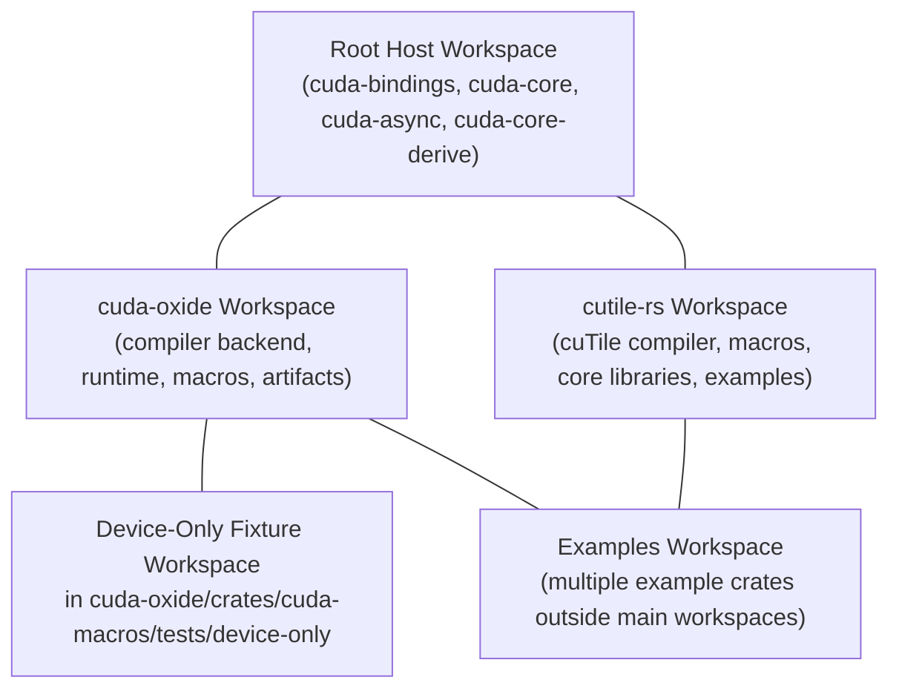
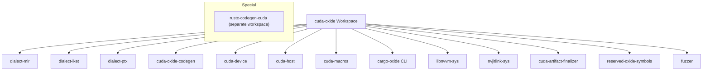

<!-- source: DeepWiki mcp.deepwiki.com · repo NVIDIA/cuda-rust · page 1.1 Repository Layout and Workspaces · fetched 2026-10-26 -->

# Repository Layout and Workspaces

<details>
<summary>Relevant source files</summary>

The following files were used as context for generating this wiki page:

- [.github/workflows/clippy.yml](.github/workflows/clippy.yml)
- [.github/workflows/fmt.yml](.github/workflows/fmt.yml)
- [.github/workflows/unit-tests.yml](.github/workflows/unit-tests.yml)
- [Cargo.lock](Cargo.lock)
- [Cargo.toml](Cargo.toml)
- [cuda-oxide/Cargo.toml](cuda-oxide/Cargo.toml)
- [cutile-rs/CHANGELOG.md](cutile-rs/CHANGELOG.md)
- [cutile-rs/Cargo.lock](cutile-rs/Cargo.lock)
- [cutile-rs/Cargo.toml](cutile-rs/Cargo.toml)
- [cutile-rs/cutile-book/tutorials/12-dgx-spark-inference.md](cutile-rs/cutile-book/tutorials/12-dgx-spark-inference.md)

</details>


This section details the overall repository layout of the NVIDIA `cuda-rust` project, focusing on the organization of multiple Cargo workspaces, including the root "host" workspace, the `cuda-oxide` compiler backend workspace, the `cutile-rs` Tile IR framework workspace, as well as device-only fixtures and examples. It explains the rationale behind keeping these workspaces separate and how dependencies are pinned across them for stability and compatibility.

---

## 1. Overview of Cargo Workspaces in the Repository

The `cuda-rust` repository is structured as a collection of multiple Cargo workspaces, each serving a distinct purpose:

- **Root Host Workspace**: Contains stable host-side crates shared by both the `cuda-oxide` and `cutile-rs` components.
- **`cuda-oxide` Workspace**: Contains the Rust-to-PTX compiler backend and associated compiler/runtime crates.
- **`cutile-rs` Workspace**: Represents the cuTile Rust tile-IR GPU programming framework and related crates.
- **Examples Workspace**: Various example crates showcasing usage of the `cuda-oxide` and `cutile-rs` workspaces.
- **Device-Only Fixture Workspace**: A special workspace under `cuda-oxide/crates/cuda-macros/tests/device-only` that builds device-only kernel code without any host components.

Each workspace has its own `Cargo.toml` manifest and dependency graph, carefully designed to minimize rebuilds and to enable clean separation of concerns.



**Figure 1:** High-level relationship of Cargo workspaces in the repository.

Sources: [`Cargo.toml:1-18`](#), [`cuda-oxide/Cargo.toml:1-40`](#), [`cutile-rs/Cargo.toml:1-80`](#)


---

## 2. Root Host Workspace

The root workspace is defined by the top-level `Cargo.toml` in the repository root and includes the crates:

- `cuda-bindings`
- `cuda-core`
- `cuda-core-derive`
- `cuda-async`

These crates provide **stable, shared host-side runtime support** that both the CUDA Oxide compiler and cuTile framework depend on for interacting with the CUDA driver and device buffers:

- `cuda-bindings`: Raw bindgen-generated FFI bindings to the CUDA driver API.
- `cuda-core`: Core runtime abstractions for CUDA contexts, device buffers, data types, and unsafe low-level operations.
- `cuda-core-derive`: Derive macros for safety and launch contract annotations.
- `cuda-async`: Asynchronous device operation abstractions and futures.

This workspace **does not impose the custom Rust nightly or edition requirements** needed by the `cuda-oxide` compiler backend. Instead, it uses stable Rust and is versioned and published separately, allowing reuse and stability.

The root workspace excludes `cuda-oxide` and `cutile-rs` as members to maintain isolation and to avoid compiler version conflicts:

```toml
[workspace]
resolver = "3"
members = [
    "cuda-bindings",
    "cuda-core",
    "cuda-core-derive",
    "cuda-async",
]
exclude = [
    "cuda-oxide",
    "cutile-rs",
]
```

**Dependency Pinning:** These host-side crates use independent versioning and are pinned with exact versions in the downstream workspaces to ensure API stability.

Sources: [`Cargo.toml:1-18`](#), [`cuda-bindings`, `cuda-core`, `cuda-async` crate metadata inferred from Cargo.lock]()


---

## 3. `cuda-oxide` Workspace: Rust-to-PTX Compiler Backend and Runtime

The `cuda-oxide` directory holds a separate workspace containing the Rust-to-PTX compiler backend, core device and host APIs, macros, and runtime support specific to the compiler implementation. It comprises numerous crates, including:

- Compiler dialect crates: `dialect-mir`, `dialect-iket`, `dialect-ptx`, etc.
- Codegen crates: `cuda-oxide-codegen`, `llvm-export`, etc.
- Device and host crates: `cuda-device`, `cuda-host`, `cuda-macros`
- Compiler tooling: `cargo-oxide` CLI
- FFI bindings and artifact handling: `libnvvm-sys`, `nvjitlink-sys`, `cuda-artifact-finalizer`, `reserved-oxide-symbols`
- Fuzzer support: `fuzzer`

Notably, the `rustc-codegen-cuda` crate inside this workspace is **not a workspace member** because it requires special nightly Rust features and a distinct build process.

The workspace uses **Rust 2024 edition** and is pinned with the latest nightly toolchain as indicated in the `cuda-oxide` toolchain and profile configs (implied).



**Figure 2:** `cuda-oxide` workspace crates overview.

The separation of this workspace achieves:

- **Stable interface for Rust compiler integration and backend development.**
- Ability to develop and test the `rustc-codegen-cuda` backend with its own custom build.
- Pinning dependencies to exact versions ensures reproducible builds.
- Separating host runtime crates via path dependencies avoids duplication and version conflicts.

### Device-Only Fixture

Within this workspace lies a **device-only fixture** workspace under:

```
cuda-oxide/crates/cuda-macros/tests/device-only
```

This workspace demonstrates compilation of device kernel code marked with `#[cuda_module]` without any host-side components or linkage. It is its own minimal Cargo workspace, enabling proof that kernels can build purely for the device with no host surface. It also helps test the properties related to #701/#702 issues referenced in the repo.

Sources: [`cuda-oxide/Cargo.toml:1-40`](#), [unit-tests.yml:13-116](#)


---

## 4. `cutile-rs` Workspace: cuTile Rust Tile IR Framework

The `cutile-rs` workspace encapsulates the cuTile Rust programming model built on the Tile IR system. It includes:

- `cutile-compiler`: Rust to Tile IR compiler passes and transformations.
- `cutile-macro`: Procedural macros for `#[cutile::module]` and `#[cutile::entry]`.
- `cutile-ir`: Tile IR representation, bytecode encoding, and versioning.
- `cutile`: Main host API for kernel launching and runtime.
- `cutile-examples` and `cutile-benchmarks`: Example programs and benchmarks.
- `cutile-kernels`: Reusable kernels implemented in cuTile Rust.
- `cuda-tile-rs`: A thin wrapper around the CUDA Tile C++ library (excluded from default builds).

This workspace uses:

- **Rust 2021 edition**, pinned exactly to version 0.4.0 for all member crates.
- A `rust-toolchain.toml` locking a stable midnight Rust toolchain for stability.
- Exact version pinning with `"=0.4.0"` on dependencies to the host runtime crates (`cuda-bindings`, `cuda-core`, `cuda-async`), ensuring strict API compatibility.

The workspace's `Cargo.toml` configures:

```toml
[workspace]
resolver = "2"

members = [
    "cutile-compiler",
    "cutile-macro",
    "cutile-ir",
    "cutile",
    "cutile-examples",
    "cutile-benchmarks",
    "cutile-kernels",
    "cuda-tile-rs",
]

default-members = [
    "cutile-compiler",
    "cutile-macro",
    "cutile-ir",
    "cutile",
    "cutile-kernels",
    "cutile-examples",
    "cutile-benchmarks",
]

[workspace.package]
version = "0.4.0"
edition = "2021"
rust-version = "1.89"
license = "Apache-2.0"
authors = ["Melih Elibol"]
repository = "https://github.com/nvlabs/cutile-rs"

[workspace.dependencies]
# Host runtime pinned dependencies with exact versions
cuda-bindings = { path = "../cuda-bindings", version = "=0.4.0" }
cuda-core = { path = "../cuda-core", version = "=0.4.0" }
cuda-async = { path = "../cuda-async", version = "=0.4.0" }
```

This strict pinning prevents mismatches between the macros, compiler, and runtime crates, ensuring that generated device code calls into the expected runtime symbols without surprises.

```mermaid
graph TD
    Cutile["cutile-rs Workspace"]
    Cutile --> Comp["cutile-compiler"]
    Cutile --> Macro["cutile-macro"]
    Cutile --> IR["cutile-ir"]
    Cutile --> HostAPI["cutile"]
    Cutile --> Kernels["cutile-kernels"]
    Cutile --> Examples["cutile-examples"]
    Cutile --> Benchmarks["cutile-benchmarks"]
    Cutile --> CudaTile["cuda-tile-rs (optional)"]
    HostAPI --> Runtime["Host runtime crates"]
    Runtime --> "cuda-bindings@0.4.0"
    Runtime --> "cuda-core@0.4.0"
    Runtime --> "cuda-async@0.4.0"
```

**Figure 3:** cuTile (cutile-rs) workspace and key host runtime dependencies.

Sources: [`cutile-rs/Cargo.toml:1-111`](#), [`cutile-rs/CHANGELOG.md`](#)


---

## 5. Examples and Their Placement

The repository hosts several example crates demonstrating how to use various components:

- The `cuda-oxide` examples reside inside `cuda-oxide/crates/rustc-codegen-cuda/examples/`.
- The `cutile-rs` examples are under the `cutile-examples` crate inside the `cutile-rs` workspace.

Examples are separate Cargo crates or workspaces to avoid polluting the main workspace dependency graphs and to keep compilation modular.

They also have custom workspace roots, and as the workflows indicate, their compilation is carefully managed to share build cache directories for speeding CI builds:

- Common target directory sharing via environment variable `CARGO_TARGET_DIR` in CI workflows ensures dependency deduplication across separate workspace roots.
- Each example uses its own `Cargo.toml` to isolate dependencies and feature flags.

The examples are built and linted separately due to their workspace separation and special dependency graphs.

Sources: [`.github/workflows/clippy.yml:40-116`](#), [`cuda-oxide/Cargo.toml:40-60`](#), [`cutile-rs/Cargo.toml:20-40`](#)


---

## 6. Why Separate Workspaces?

### 6.1 Rust Toolchain and Edition Differences

- The root host workspace uses **stable Rust** editions and minimal nightly dependencies for compatibility.
- The `cuda-oxide` compiler backend requires **Rust 2024 edition** and nightly Rust with several unstable rustc features.
- The `rustc-codegen-cuda` backend is a special case requiring direct rustc internals, so it is kept out of the main `cuda-oxide` workspace and built separately.
- The `cutile-rs` workspace uses Rust 2021 edition pinned to a "midnight" stable toolchain for user development.

### 6.2 Dependency and Version Pinning

- Each workspace pins the versions of its dependencies to prevent accidental drift.
- Intra-workspace path dependencies are exact versions (`=0.4.0`), ensuring that generated code (e.g., macros in `cutile-macro`) matches the runtime crates (`cuda-core`, `cuda-async`).
- This avoids subtle runtime crashes or symbol mismatches caused by version skew.

### 6.3 Compilation and Testing Isolation

- Separate workspaces allow independent cargo commands (`cargo build`, `cargo test`, `cargo clippy`) in each component without redundant rebuilds.
- CI workflows run tests and linters in each workspace independently, often sharing build caches to improve throughput, but maintaining clean boundaries.
- Device-only fixtures (kernel code without host code) require distinct workspace and build settings to verify properties like no host linkage (#701/#702).

### 6.4 Workspace Manifest Details

- The root `Cargo.toml` marks the larger nested workspaces `cuda-oxide` and `cutile-rs` as excluded, preventing their crates from leaking into the root workspace.
- Each nested workspace has its own `[workspace]` declaration, package metadata, and member list explicitly defined.

---

## 7. Recap of Version Pinning and Dependency Flow

| Workspace           | Key Pinned Versions                                                  | Notes                                               |
|---------------------|--------------------------------------------------------------------|-----------------------------------------------------|
| Root Host Workspace  | `cuda-bindings`, `cuda-core`, `cuda-core-derive`, `cuda-async` all at 0.4.0 exactly | Stable runtime crates shared by both main components|
| `cuda-oxide`         | Depends on host runtime crates at exact `=0.4.0`                   | Rust 2024 edition, nightly toolchain                 |
| `cutile-rs`          | Depends on host runtime crates at exact `=0.4.0`                   | Rust 2021 edition, stable pinned version             |
| Examples             | Depend on respective workspace crates                              | Built separately with shared target dirs in CI        |
| Device-Only Fixture  | Part of `cuda-oxide` workspace, separate minimal workspace         | Pure device kernel compilation demonstration          |

This design ensures that the **Cuda Oxide compiler, cuTile Rust framework, and shared host runtime all operate with precisely versioned dependencies** to maintain binary compatibility and soundness.

---

# Summary Diagram: Natural Language to Code Entity Mapping

```mermaid
flowchart TD
    subgraph HostRuntime["Host Runtime Components"]
        CB(cuda-bindings)
        CC(cuda-core)
        CCD(cuda-core-derive)
        CA(cuda-async)
    end

    subgraph CUDAOxideWorkspace["cuda-oxide Workspace (Rust-to-PTX Compiler)"]
        CT(cuda-oxide-codegen)
        CD(cuda-device)
        CH(cuda-host)
        CM(cuda-macros)
        CO(cargo-oxide CLI)
        DOF(Device-only Fixture)
        FZ(fuzzer)
    end

    subgraph CutileWorkspace["cutile-rs Workspace (Tile IR Framework)"]
        CComp(cutile-compiler)
        CMacro(cutile-macro)
        CIR(cutile-ir)
        CHost(cutile)
        CEx(cutile-examples)
        CBench(cutile-benchmarks)
        CKernels(cutile-kernels)
        CTRT(Host runtime: cuda-bindings, cuda-core, cuda-async)
    end

    # Dependencies arrows
    CT --> CB
    CT --> CC
    CT --> CA
    CH --> CC
    CM --> CC
    DOF --> CM

    CComp --> CTRT
    CMacro --> CComp
    CHost --> CTRT
    CEx --> CHost
    CBench --> CHost
    CKernels --> CHost

    CTRT -. Path Dependencies .-> CB
    CTRT -. Path Dependencies .-> CC
    CTRT -. Path Dependencies .-> CA
```

**Figure 4:** Mapping of repository natural language components to Cargo workspace crates and inter-dependencies.

---

# Summary

The NVIDIA `cuda-rust` repository strictly separates concerns into multiple Cargo workspaces, balancing the need for stability, compatibility, and clean builds:

- The **root workspace** hosts stable shared host runtime crates used by all products.
- The **`cuda-oxide` workspace** contains the unstable Rust compiler backend for CUDA and associated runtime infrastructure.
- The **`cutile-rs` workspace** implements the cuTile Rust Tile IR GPU programming framework with a strict host runtime dependency pinning.
- Device-only kernel fixtures validate device-focused compilation independently.
- Examples live in separate crates and workspaces to keep main workspaces lean.

Dependencies are pinned exactly across workspaces to prevent runtime ABI mismatches, and build/test workflows coordinate caching despite the workspace separations.

This layout reflects a sophisticated modular architecture enabling rapid compiler and runtime innovation, alongside stable host runtime foundations.

---

**Sources:**  
- [`Cargo.toml:1-18`](#)  
- [`cuda-oxide/Cargo.toml:1-46`](#)  
- [`cutile-rs/Cargo.toml:1-111`](#)  
- [`.github/workflows/clippy.yml:40-117`](#)  
- [`.github/workflows/unit-tests.yml:13-116`](#)  
- [`cutile-rs/CHANGELOG.md:1-130`](#)

---

