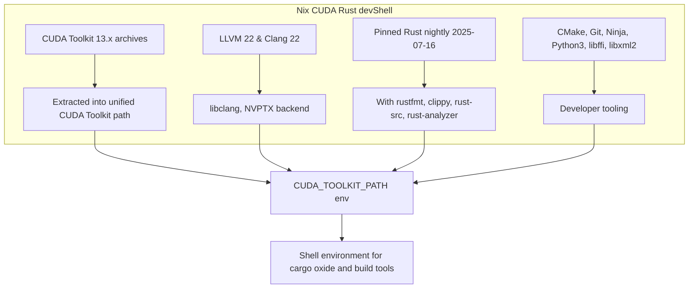
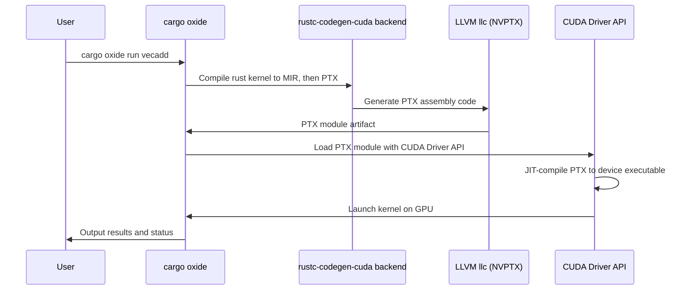
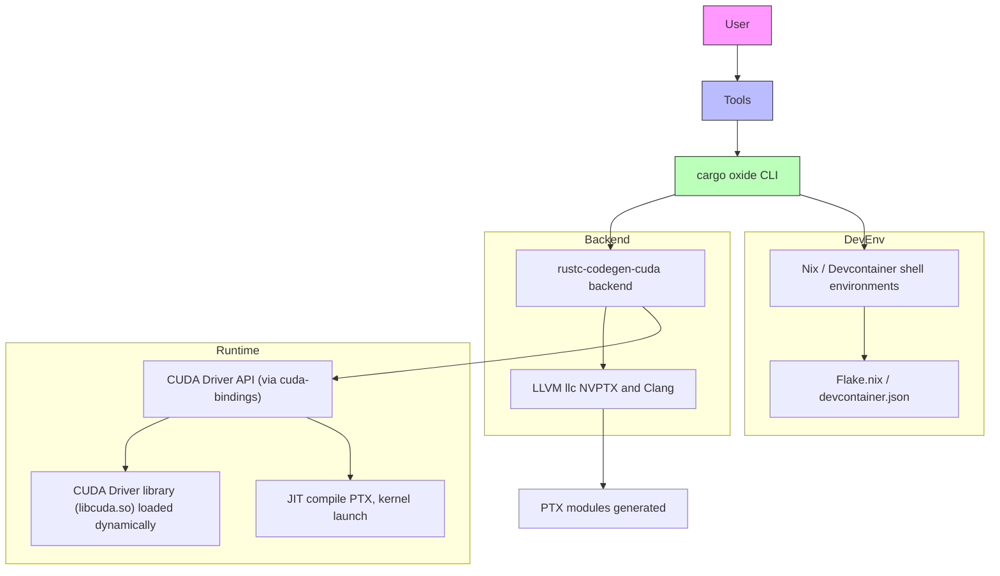

<!-- source: DeepWiki mcp.deepwiki.com · repo NVIDIA/cuda-rust · page 1.2 Getting Started and Toolchain Setup · fetched 2026-10-26 -->

# Getting Started and Toolchain Setup

<details>
<summary>Relevant source files</summary>

The following files were used as context for generating this wiki page:

- [.github/workflows/status-guard.yml](.github/workflows/status-guard.yml)
- [CONTRIBUTING.md](CONTRIBUTING.md)
- [cuda-oxide/.devcontainer/devcontainer.json](cuda-oxide/.devcontainer/devcontainer.json)
- [cuda-oxide/cuda-oxide-book/getting-started/installation.md](cuda-oxide/cuda-oxide-book/getting-started/installation.md)
- [cuda-oxide/nix/templates/default/flake.nix](cuda-oxide/nix/templates/default/flake.nix)
- [cuda-oxide/scripts/check-toolchain-parity.sh](cuda-oxide/scripts/check-toolchain-parity.sh)
- [cutile-rs/flake.lock](cutile-rs/flake.lock)
- [cutile-rs/flake.nix](cutile-rs/flake.nix)
- [rust-toolchain.toml](rust-toolchain.toml)

</details>


This page explains the detailed steps required to set up the development environment for the CUDA Rust monorepo, specifically focusing on building and running the `cuda-oxide` workspace using the appropriate toolchains and dependencies. It covers installation and configuration of the CUDA Toolkit, LLVM, Rust nightly version pinned for the repository, and the use of development containers or Nix shells for reproducible environments. It also guides you through your first successful build and run command using the `cargo oxide` CLI.

---

## 1. System and Software Prerequisites

Before building or running CUDA Rust components, ensure your system meets the following hardware and software requirements:

| **Requirement**       | **Version**            | **Notes**                                                                                                  |
|-----------------------|------------------------|------------------------------------------------------------------------------------------------------------|
| **Operating System**  | Ubuntu 24.04 recommended | Other Linux distros may work but are not officially tested.                                                |
| **NVIDIA GPU**        | Ampere or newer (sm_80+) | Required for driver support and CUDA feature compatibility.                                               |
| **NVIDIA Driver**     | 580 or newer           | Must be a CUDA 13.x compatible driver; driver is loaded dynamically at runtime.                            |
| **CUDA Toolkit**      | 13.0 or newer          | Required headers (`cuda.h`, `curand.h`) and `nvcc` must be installed and reachable in `PATH`.              |
| **LLVM + Clang**      | Version 21 or newer    | Required LLVM backend supporting NVPTX target; Clang needed specifically by `bindgen` for CUDA bindings.   |
| **Rust**              | Nightly, pinned        | The Rust nightly toolchain is pinned in `cuda-oxide/rust-toolchain.toml` for consistency and compatibility. |
| **Host Platform**     | Linux only             | Currently Windows is not supported for `cuda-oxide`.                                                      |

### Notes on driver and toolkit compatibility

The host NVIDIA driver and the CUDA Toolkit are separate. CUDA applications in this repo primarily use LLVM `llc` to emit PTX, which the NVIDIA driver JIT-compiles on load. The CUDA driver supports limited backward compatibility for cubins (finished GPU code), but not for newer PTX versions, so the driver version must be compatible with your CUDA Toolkit PTX version.

For example, a CUDA Toolkit 13.3 emits PTX 9.3, requiring driver 610.43.02 or newer. Older drivers (around 580+) can run finished cubins but will fail with error 222 (`CUDA_ERROR_UNSUPPORTED_PTX_VERSION`) if loading unsupported PTX.

Verify your installation with:

```bash
nvcc --version
nvidia-smi
```

And ensure the driver version shows compatibility in the CUDA release notes.

Sources: [cuda-oxide/cuda-oxide-book/getting-started/installation.md:7-27](), [cuda-oxide/cuda-oxide-book/getting-started/installation.md:116-171]()

---

## 2. Rust Toolchain Setup and Version Pinning

The CUDA Rust repository uses two distinct Rust toolchain pins:

- **Host workspace (stable Rust)**: Applies to the shared host crates at the root level (e.g. `cuda-bindings`, `cuda-core`, `cuda-async`).
- **cuda-oxide workspace (pinned nightly Rust)**: Uses a pinned nightly Rust with `rustc_private` enabled and components such as `rustfmt`, `clippy`, `rust-analyzer`, `rust-src`, and `rustc-dev`.

The pinned Rust nightly toolchain for `cuda-oxide` is declared in `cuda-oxide/rust-toolchain.toml`. This ensures reproducible builds across developer machines:

```toml
[toolchain]
channel = "nightly-2026-08-28"
components = [ "rustfmt", "clippy", "rust-analyzer", "rust-src", "rustc-dev" ]
profile = "minimal"
```

To maintain consistency, this pin is parallel-checked with the scaffolded new-project files, devcontainers, and docs by the `cuda-oxide/scripts/check-toolchain-parity.sh` script.

You should use `cargo oxide` commands inside the `cuda-oxide/` directory, which implicitly use the pinned nightly toolchain.

Sources: [cuda-oxide/scripts/check-toolchain-parity.sh:1-165](), [cuda-oxide/.devcontainer/devcontainer.json:1-47](), [cuda-oxide/cuda-oxide-book/getting-started/installation.md:21-27](), [rust-toolchain.toml:1-8]()

---

## 3. Development Environment Options

### 3.1. Dev Container (recommended for quick start)

The repository provides a pre-configured development container under `cuda-oxide/.devcontainer/` that bundles:

- CUDA Toolkit 13.0
- LLVM 21
- Clang 21
- The pinned Rust nightly toolchain with components
- NVIDIA GPU support through Docker NVIDIA Container Toolkit
- Essential dev utilities and VSCode extensions (`rust-analyzer`, `lldb`)

To use it:

1. Ensure you have Docker installed with the NVIDIA Container Toolkit enabled.
2. Your host system has an NVIDIA driver >= 580 with GPU support.
3. Open the `cuda-oxide/` folder in a devcontainer-aware editor (e.g. VSCode) and select **Reopen in Container**.
   - The container will build and provide GPU access.
4. Run commands inside the container shell or terminals:

```bash
cargo oxide doctor
cargo oxide run vecadd
```

Alternatively, use the CLI devcontainers tool:

```bash
npx -y @devcontainers/cli up --workspace-folder ./cuda-oxide --config ./cuda-oxide/.devcontainer/devcontainer.json
npx -y @devcontainers/cli exec --workspace-folder ./cuda-oxide --config ./cuda-oxide/.devcontainer/devcontainer.json cargo oxide run vecadd
```

This approach guarantees consistency and avoids local install issues.

Sources: [cuda-oxide/cuda-oxide-book/getting-started/installation.md:31-73](), [cuda-oxide/.devcontainer/devcontainer.json:1-47]()

---

### 3.2. Nix Shell (for Linux hosts)

For those using Linux (x86_64 or aarch64) and preferring Nix, the repo supplies `cuda-oxide/flake.nix`. It provides a reproducible development shell with:

- CUDA 13.x redistributables
- LLVM 22 with NVPTX backend
- Clang
- Pinned Rust nightly (`2025-07-16` revision)
- Other dev tools (`cmake`, `git`, `ninja`, `libffi`, `python3`)

Usage:

```bash
cd cuda-oxide
nix develop
cargo oxide run vecadd
```

You can also bootstrap a new project based on the Nix flake without cloning:

```bash
nix run 'github:NVIDIA/cuda-rust?dir=cuda-oxide#new' -- my-project
cd my-project
nix develop
```

This creates a `flake.nix` in your project inheriting the CUDA Rust environment, including host driver detection.

Under the hood, CUDA redistributables are fetched from NVIDIA archives and extracted into one unified toolchain directory inside the Nix store. LLVM and Rust are pinned separately but tightly coupled with CUDA versions for compatibility.

Mermaid diagram below shows the Nix shell components and flow:



Sources: [cutile-rs/flake.nix:1-169](), [cuda-oxide/cuda-oxide-book/getting-started/installation.md:76-113]()

---

## 4. Installing CUDA Toolkit and LLVM Manually

If not using the devcontainer or Nix shell, install the following manually on your Linux system:

- **CUDA Toolkit 13.0+**: Obtain from [NVIDIA CUDA Downloads](https://developer.nvidia.com/cuda-downloads)
  - You require `nvcc` compiler and CUDA runtime headers.
  - Add CUDA bin directory to your `$PATH`, for example:

  ```bash
  export PATH="/usr/local/cuda/bin:$PATH"
  ```

  You can verify installation with:

  ```bash
  nvcc --version
  ```

- **LLVM and Clang 21+** with NVPTX target enabled
  - Clang is used by `bindgen` for generating host bindings to CUDA driver libraries.
  - Ensure `clang-21` or newer is installed and on your path.

Use package managers or build from source to get LLVM and Clang with NVPTX support. The LLVM version must match or exceed 21 to include the NVPTX backend functionality.

If you install CUDA to a non-standard location, set environment variables as:

```bash
export CUDA_TOOLKIT_PATH="/path/to/cuda"
export CUDA_HOME="/path/to/cuda"
```

The build system will look for the toolkit in the order `/usr/local/cuda-13.3`, `/usr/local/cuda-13.2`, `/usr/local/cuda-13`, `/usr/local/cuda` if no variable is set.

Sources: [cuda-oxide/cuda-oxide-book/getting-started/installation.md:114-133](), [cuda-oxide/cuda-oxide-book/getting-started/installation.md:116-171]()

---

## 5. First Build and Run with `cargo oxide`

After environment setup, your basic workflow inside the `cuda-oxide/` directory is as follows:

1. Build and run the standard example kernel `vecadd` (vector addition):

```bash
cargo oxide run vecadd
```

The `cargo oxide` CLI is a custom wrapper with multiple subcommands to build, run, test, and inspect CUDA Rust kernels and modules. Under the hood it orchestrates the pinned nightly Rust compiler, LLVM codegen backends for NVPTX, CUDA driver API calls, and runtime linking/loading.

Before running builds, it is a good practice to check the health of your setup:

```bash
cargo oxide doctor
```

This command verifies CUDA toolkit, driver versions, Rust toolchain, LLVM, and environment variables.

The build process flow inside `cargo oxide run vecadd` is:



Sources: [cuda-oxide/cuda-oxide-book/getting-started/installation.md:83-89](), [CONTRIBUTING.md:118-146]()

---

## 6. Summary of Toolchain Layout and Repository Workspaces

The repository is structured into multiple Cargo workspaces with pinned dependencies to isolate concerns:

- **Root Host Workspace**: Stable Rust pinned (1.98.0), contains shared runtime crates such as `cuda-bindings`, `cuda-core`, `cuda-async`.
- **cuda-oxide Workspace**: Uses pinned Rust nightly with extra components, hosts `rustc-codegen-cuda` backend, and `cargo oxide` CLI tooling.
- **cutile-rs Workspace**: Tile-based IR GPU programming framework, with its own Nix and Rust toolchain pins.
- **Examples Workspace**: Device-host example kernels and tests.
- **Device-only fixture**: Isolated device macros and attributes.

Each workspace has independent Cargo.toml manifests with carefully pinned toolchains for reproducible building. The Pin Parity Checker (`check-toolchain-parity.sh`) in CI ensures all references to Rust toolchain versions remain consistent across scaffolds, devcontainers, documentation, and scripts.

The shared host crates load `libcuda` dynamically at runtime; thus, no CUDA driver linking happens at compile time in the host-side Rust code.

Sources: [CONTRIBUTING.md:114-161](), [cuda-oxide/.devcontainer/devcontainer.json](), [cuda-oxide/scripts/check-toolchain-parity.sh]()

---

# Overall Architecture Diagram Linking Names to Code Entities



---

# Additional Notes

- Use the `Justfile` provided in `cuda-oxide/` to run typical checks:

```bash
just -f cuda-oxide/Justfile check
```

- This verifies formatting, clippy lints, tests, and dependency hygiene.
- Follow the Rust formatting conventions with `cargo oxide fmt`.
- You can scaffold new projects with:

```bash
cargo oxide new my-project
```

which uses the pinned Rust nightly and populates a working `rust-toolchain.toml` for consistency.

- Multi-workspace dependency pinning and dev shells isolate build environments for easier management.

Sources: [CONTRIBUTING.md:130-170]()

---

# Summary

This section detailed the complete setup for working with the CUDA Rust repo `cuda-oxide` workspace, covering:

- Hardware/software prerequisites and CUDA driver-toolkit compatibility.
- Rust nightly pinned toolchain usage and version parity guard scripts.
- Development environments, including devcontainer and Nix shell usage.
- Manual CUDA Toolkit and LLVM install guidance.
- First build/run instructions using `cargo oxide run`.
- Overall architecture and workspace layout implementation.

Following these steps ensures you have a proper, reproducible CUDA Rust development environment capable of compiling and running GPU accelerated Rust code.

---

**Sources:**

- cuda-oxide/cuda-oxide-book/getting-started/installation.md:1-171
- CONTRIBUTING.md:114-177
- cuda-oxide/scripts/check-toolchain-parity.sh:1-165
- cutile-rs/flake.nix:1-169
- cuda-oxide/.devcontainer/devcontainer.json:1-47
- rust-toolchain.toml:1-8

---

