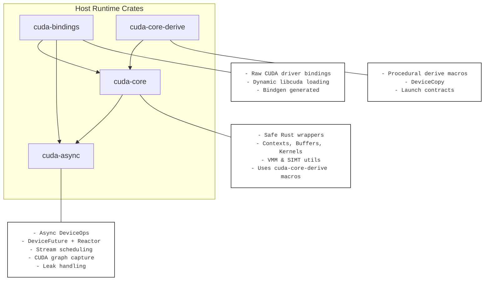

<!-- source: DeepWiki mcp.deepwiki.com · repo NVIDIA/cuda-rust · page 2 Shared Host Runtime Crates · fetched 2026-10-26 -->

# Shared Host Runtime Crates

Relevant source files

The following files were used as context for generating this wiki page:

- [cuda-async/Cargo.toml](cuda-async/Cargo.toml)
- [cuda-async/REACTOR_AB_REPORT.md](cuda-async/REACTOR_AB_REPORT.md)
- [cuda-async/README.md](cuda-async/README.md)
- [cuda-async/src/cuda_graph.rs](cuda-async/src/cuda_graph.rs)
- [cuda-async/src/device_buffer.rs](cuda-async/src/device_buffer.rs)
- [cuda-async/src/device_context.rs](cuda-async/src/device_context.rs)
- [cuda-async/src/device_future.rs](cuda-async/src/device_future.rs)
- [cuda-async/src/device_operation.rs](cuda-async/src/device_operation.rs)
- [cuda-async/src/error.rs](cuda-async/src/error.rs)
- [cuda-async/src/launch.rs](cuda-async/src/launch.rs)
- [cuda-async/src/leak.rs](cuda-async/src/leak.rs)
- [cuda-bindings/Cargo.toml](cuda-bindings/Cargo.toml)
- [cuda-core-derive/Cargo.toml](cuda-core-derive/Cargo.toml)
- [cuda-core/Cargo.toml](cuda-core/Cargo.toml)

This section provides a high-level overview of the core host-side crates shared between the main CUDA runtime products within the `cuda-rust` repository. These foundational crates — `cuda-bindings`, `cuda-core`, `cuda-core-derive`, and `cuda-async` — form a layered and composable base for safe, idiomatic Rust interfaces to CUDA driver functionalities and asynchronous GPU programming.

Each crate’s primary responsibilities and how they interrelate are introduced here. Detailed technical descriptions, usage patterns, and API specifics are available on their respective child pages:

- [cuda-bindings: Raw Driver FFI](#2.1)
- [cuda-core: Contexts, Buffers, VMM](#2.2)
- [cuda-async: Async Device Operations](#2.3)

---

## Overview of the Shared Host Runtime Crates

These four crates represent progressive abstraction levels from raw CUDA driver bindings up to asynchronous execution futures for device operations. Both the `cuda-oxide` rustc backend integration and the `cutile-rs` Tile IR framework build upon this common host-side foundation.

### 1. `cuda-bindings`: Raw CUDA Driver FFI

At the lowest level, `cuda-bindings` provides the raw foreign function interface (FFI) bindings to NVIDIA’s CUDA driver API.

- These are generated using `bindgen` to directly mirror the CUDA C API.
- The crate handles dynamic loading of the `libcuda` shared library at runtime.
- Build scripts ensure the correct generation and regeneration of binding code.
- It is intentionally minimal and unsafe, focusing on exactly mapping the driver API’s types and functions.

Both `cuda-core` and `cuda-async` depend directly on `cuda-bindings` for CUDA driver interaction.

For details, see the child page: [cuda-bindings: Raw Driver FFI](#2.1)

---

### 2. `cuda-core`: Idiomatic CUDA API

`cuda-core` builds an ergonomic and idiomatic Rust abstraction over `cuda-bindings`, exposing safe, high-level CUDA runtime concepts:

- **Context and device management:** `CudaContext`, device enumeration, and error handling layers abstract raw driver handles.
- **Buffer and memory management:** `DeviceBuffer` types parameterized by data type, supporting safe host-device memory interaction.
- **Runtime module loading:** Facilities to load PTX or cubin modules and obtain kernel `Function` handles.
- **Virtual memory management and multicast:** Support for advanced memory sharing and mapping across processes and devices.
- **SIMT (Single Instruction Multiple Thread) host helpers:** Utilities to assist in launching and coordinating threads in warp/block hierarchies.

`cuda-core` also depends on a companion proc macro crate, `cuda-core-derive`, supplying proc macros like `DeviceCopy` to annotate types safe for device copies, and to enforce launch contracts in kernel definitions.

Due to its close tie-in with kernel launching semantics and efficient buffer management, `cuda-core` forms the central foundation for both the host runtime API and the CUDA backend compiler runtime.

For details, see the child page: [cuda-core: Contexts, Buffers, VMM](#2.2)

---

### 3. `cuda-core-derive`: Derive Macros for `cuda-core`

This crate provides the procedural macros used by `cuda-core` to improve ergonomics at compile time:

- Implements the `DeviceCopy` derive macro, allowing automatic annotation of data types that can be safely copied to and from CUDA device memory.
- Provides launch contract-related macros that verify kernel argument types and shapes statically.
- Uses Rust's procedural macro APIs (`proc-macro2`, `syn`, `quote`) for AST manipulation and code generation.

By separating proc macros into a dedicated crate, compilation performance is improved and circular dependencies are avoided.

For details, see the child page: [cuda-core: Contexts, Buffers, VMM](#2.2) (covers macros as well)

---

### 4. `cuda-async`: Asynchronous Device Operations

`cuda-async` extends `cuda-core` with asynchronous programming models tailored to GPU operations:

- Provides the `DeviceOp` trait representing lazy, composable CUDA operations that only execute once `.sync()`, `.sync_on()`, or `.await` is invoked.
- Implements `DeviceFuture`, a `Future` type that wraps a GPU operation and integrates with Rust async executors. It internally manages the lifecycle and synchronization of work executing on CUDA streams.
- Incorporates multiple stream scheduling policies (`SchedulingPolicy` trait), including the default round-robin stream pool to enable concurrent operation overlap.
- Supports a high-performance reactor model with efficient stream completion notification via host memory flags (`cuStreamWriteValue32`) and scanning, avoiding expensive kernel callbacks.
- Handles CUDA graph capture and replay facilities, submission slot management, and correct operation leak handling when futures are dropped prematurely.
- Exposes safe combinators for chaining and combining device operations in asynchronous Rust workflows.
- Integrates robust device fault handling, dropout semantics, and deadlock-prevention via a thread-local execution lock to enforce non-reentrant operation execution.

This crate depends on both `cuda-core` and `cuda-bindings` and defines the high-level asynchronous runtime used by client codebases.

For details, see the child page: [cuda-async: Async Device Operations](#2.3)

---

## Relationship and Dependency Diagram

This diagram maps from the crates’ names to their high-level responsibilities, highlighting their dependency order:

- `cuda-bindings` is the base FFI layer.
- `cuda-core` builds safe abstractions, relying on `cuda-bindings` and macros from `cuda-core-derive`.
- `cuda-async` builds on `cuda-core` for asynchronous operation models.

---

## Summary Table

| Crate              | Purpose / Role                                     | Key Features                  | Depends On             | Child Page Anchor     |
|--------------------|--------------------------------------------------|-------------------------------|-----------------------|----------------------|
| `cuda-bindings`    | Raw CUDA driver API FFI & dynamic library loading | `bindgen` generated bindings  | None                  | #2.1                 |
| `cuda-core`        | Safe CUDA contexts, buffers, kernels, VMM         | `CudaContext`, `DeviceBuffer`, runtime modules, SIMT helpers | `cuda-bindings`, `cuda-core-derive` | #2.2                 |
| `cuda-core-derive` | Proc macros for `DeviceCopy` and kernel contracts | Derive macros for device-safe types | None                  | #2.2 (covers macros)  |
| `cuda-async`       | Async composition of GPU device operations         | `DeviceOp`, `DeviceFuture`, reactor, stream scheduling, CUDA graph | `cuda-core`, `cuda-bindings`          | #2.3                 |

---

## Next Steps

For in-depth technical details, API documentation, and usage examples of each crate, consult the linked child pages:

- [cuda-bindings: Raw Driver FFI](#2.1)
- [cuda-core: Contexts, Buffers, VMM](#2.2)
- [cuda-async: Async Device Operations](#2.3)

These pages cover specifics such as:

- How to dynamically load the CUDA driver and work with the generated bindings.
- How to manage CUDA contexts, allocate buffers, and launch kernels safely.
- How to write async CUDA code using futures, scheduling policies, and stream reactors.

---

# Section References

- For `cuda-bindings` configuration and dependencies, see [`cuda-bindings/Cargo.toml`](cuda-bindings/Cargo.toml:1-36)()  
- For `cuda-core` crate overview and dependencies, see [`cuda-core/Cargo.toml`](cuda-core/Cargo.toml:1-40)()  
- For `cuda-core-derive` proc macros setup, see [`cuda-core-derive/Cargo.toml`](cuda-core-derive/Cargo.toml:1-30)()  
- For `cuda-async` async device execution design, e.g. [`cuda-async/src/device_future.rs`](cuda-async/src/device_future.rs:1-155)(), [`cuda-async/src/device_operation.rs`](cuda-async/src/device_operation.rs:1-188)(), and [`cuda-async/README.md`](cuda-async/README.md:1-163)()

---

This common foundation enables both the `cuda-oxide` Rust CUDA backend compiler and `cutile-rs` Tile IR GPU kernel framework to provide expressive, safe, and performant GPU programming models in Rust.

---

