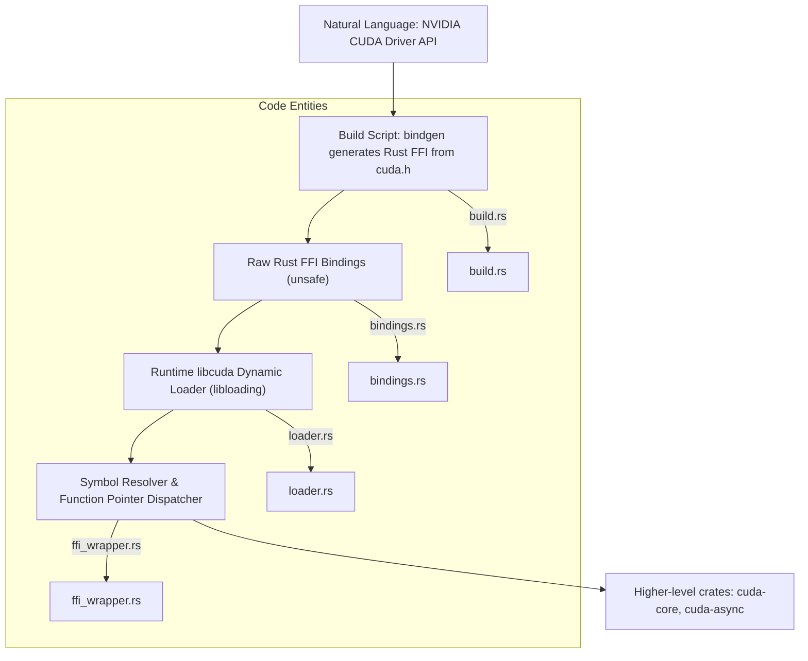
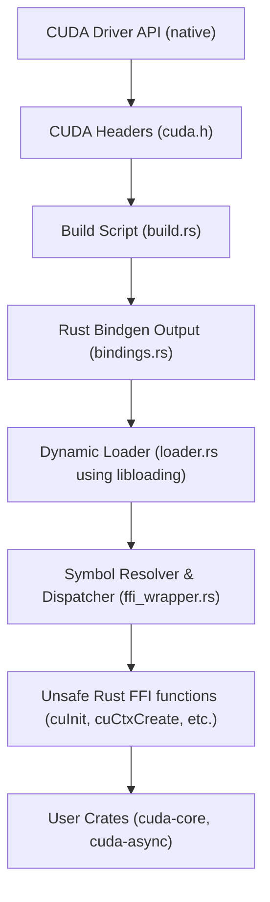

<!-- source: DeepWiki mcp.deepwiki.com · repo NVIDIA/cuda-rust · page 2.1 cuda-bindings: Raw Driver FFI · fetched 2026-10-26 -->

# 2.1 cuda-bindings: Raw Driver FFI

<details>
<summary>Relevant source files</summary>

The following files were used as context for generating this wiki page:

- [.github/workflows/clippy.yml](.github/workflows/clippy.yml)
- [.github/workflows/fmt.yml](.github/workflows/fmt.yml)
- [.github/workflows/unit-tests.yml](.github/workflows/unit-tests.yml)
- [Cargo.lock](Cargo.lock)
- [Cargo.toml](Cargo.toml)
- [cuda-async/Cargo.toml](cuda-async/Cargo.toml)
- [cuda-bindings/Cargo.toml](cuda-bindings/Cargo.toml)
- [cuda-core-derive/Cargo.toml](cuda-core-derive/Cargo.toml)
- [cuda-core/Cargo.toml](cuda-core/Cargo.toml)

</details>


This section details the `cuda-bindings` crate, which provides the foundational low-level interface to the NVIDIA CUDA Driver API for Rust. It offers raw Foreign Function Interface (FFI) bindings generated from the CUDA driver headers via `bindgen`, a dynamic runtime loader for the NVIDIA CUDA Driver library, and describes the build script requirements to generate and maintain these bindings.

---

## Purpose and Scope

The `cuda-bindings` crate serves as the essential abi-stable bridge between Rust and NVIDIA's native CUDA driver API. It exposes unsafe, raw bindings mirroring CUDA's C API, enabling higher-level runtime crates (`cuda-core`, `cuda-async`) and other CUDA interacting components to invoke driver functionality without directly embedding CUDA's headers or linking to its static artifacts at compile-time.

In addition, `cuda-bindings` implements a robust runtime mechanism to dynamically discover and load the `libcuda.so`/`nvcuda.dll` system library. This dynamic loading is crucial for flexibility and portability, as it allows binaries using `cuda-bindings` to run on systems that might or might not have the NVIDIA driver installed, without hard linking or load-time failures.

---

## Implementation Details

### Bindgen-Generated Bindings

At the core, `cuda-bindings` exposes Rust types, constants, enums, and functions corresponding exactly to the CUDA Driver API declared in `cuda.h`. This is achieved via an internal build script using the `bindgen` crate:

- `bindgen` uses the local CUDA Toolkit's `cuda.h` header file to automatically generate Rust FFI bindings.
- The bindings closely reflect the C API signatures, with minimal wrapping or abstraction to avoid semantic drift or overhead.
- The bindings include types such as `CUdevice`, `CUcontext`, function signatures like `cuInit`, `cuDeviceGet`, `cuCtxCreate`, and enumerations of error codes and flags.

This allows the rest of the Rust CUDA ecosystem layers to depend on `cuda-bindings` for the raw interface and build safe abstractions above it.

### Build Script and Bindings Regeneration

The crate contains a build script (`build.rs`) that:

- Invokes `bindgen` during the build phase to regenerate bindings from the CUDA headers.
- Uses `prettyplease` to format the generated Rust code in a readable and idiomatic style.
- Includes additional logic to embed a version stamp or capture the environment for reproducible builds.
  
This dynamic generation approach requires that the CUDA Toolkit headers be installed and discoverable during build time, particularly `cuda.h`. The presence and path of this header is typically controlled via environment variables or standard CUDA install locations.

Any changes in the underlying CUDA Toolkit version or the CUDA headers will cause regeneration of the bindings on the next compilation.

### Dynamic Loading of `libcuda`

Hard-linking against `libcuda.so` is avoided to allow CUDA-dependent binaries to start successfully even on machines without GPUs or NVIDIA drivers installed.

Instead, `cuda-bindings` uses the `libloading` crate to safely open `libcuda.so` (on Linux) or the equivalent system library on other platforms at runtime:

- A singleton loader utility attempts to find and load the dynamic library in the system's library path.
- The function pointers of all CUDA API entry points are dynamically resolved from the loaded library via `libloading::Library::get`.
- The resolved symbols are cached and dispatched via thin function pointers to the raw API bindings.
- This strategy makes the crate resilient to driver absences by delaying linkage errors until the driver is actually used.
- The loader provides transparent forwarding to the CUDA Driver API and reports errors if the driver cannot be loaded or if symbol resolution fails.

This dynamic discovery and loading process complements the raw Rust bindings, enabling safer, driver-optional usage of the CUDA Driver API.

---

## Data Flow and Key Components

The following diagram maps the conceptual flow and main code entities in `cuda-bindings`:



- The **build script** (`build.rs`) automates the generation of the raw bindings from CUDA headers.
- The **bindings.rs** file holds the Rust FFI definitions, covering all CUDA Driver API entry points.
- The **loader.rs** module encapsulates the runtime `libcuda` loading logic using `libloading`.
- The **ffi_wrapper.rs** (or equivalent) resolves and caches the function pointers from the loaded library and exposes thin unsafe Rust functions with the same signatures as the CUDA Driver API.
- Consumer crates like `cuda-core` depend on `cuda-bindings` to safely call CUDA functions indirectly via this loader.

---

## Build Script Requirements

Building `cuda-bindings` requires:

1. **CUDA Toolkit Installed:** The build machine must have the CUDA Toolkit installed, specifically the headers like `cuda.h` accessible.
2. **Bindgen Crate:** Required as a build dependency to parse `cuda.h` and produce Rust bindings.
3. **Prettyplease Crate:** Used to format the generated bindings cleanly.
4. **Standard Rust Build Environment:** Cargo build with Rust edition 2021 or later and Rust version >= 1.89.

If the CUDA toolkit presence or headers are missing, the build will fail during `bindgen` invocation.

In the CI workflows, `cuda-bindings` is tested on runners with the CUDA toolkit installed, ensuring stable generation and usage of bindings.

---

## Key Functions and Types

- **`cuInit(flags: u32) -> CUresult`** — Initialize the CUDA Driver API.
- **`cuDeviceGet(device: *mut CUdevice, ordinal: i32) -> CUresult`** — Return a handle to a CUDA device.
- **`cuCtxCreate(ctx: *mut CUcontext, flags: u32, dev: CUdevice) -> CUresult`** — Create a CUDA context.
- **`CUresult` Enum Type** — Error/status codes from CUDA API calls.
- **`Loader` Singleton** — Abstraction in `loader.rs` that dynamically opens `libcuda` and resolves all entry points.

All these are exposed as unsafe extern "C" functions or function pointer wrappers in Rust via `cuda-bindings`.

---

## Example Usage Pattern

The typical usage pattern enabled by `cuda-bindings` looks like this:

1. At runtime, attempt to load the CUDA Driver library (`libcuda`).
2. If successful, resolve all necessary API function symbols.
3. Call `cuInit(0)` from the dynamically loaded symbols to initialize CUDA.
4. Use raw CUDA API calls through the resolved function pointers.
5. Higher-level crates wrap these in safer Rust abstractions.

This design avoids any static linking and hard dependencies on the CUDA driver, making the ecosystem more robust across diverse systems.

---

## Relationship to Other Crates

The role of `cuda-bindings` in the overall repository is foundational in the **"Shared Host Runtime Crates"** layer:

```mermaid
graph LR
  "cuda-bindings" --> "cuda-core"
  "cuda-core" --> "cuda-async"
  "cuda-async" --> "cuda-oxide"
  "cuda-bindings"--> "cuda-async"
```

- `cuda-bindings` provides **raw FFI coverage**.
- `cuda-core` builds **idiomatic Rust APIs** atop `cuda-bindings`.
- `cuda-async` enables **safe async wrappers** using both `cuda-core` and `cuda-bindings`.
- `cuda-oxide` uses these crates as runtime dependencies for Rust-to-CUDA PTX compilation and execution.

This layered approach modularizes CUDA support between low-level bindings, core abstractions, and async scheduling.

---

# Summary Table: cuda-bindings Crate Overview

| Aspect                     | Description                                                                                   |
|----------------------------|-----------------------------------------------------------------------------------------------|
| Purpose                    | Raw CUDA Driver API Rust FFI and dynamic driver loader                                        |
| Generated By               | `bindgen` parsing CUDA `cuda.h` headers                                                      |
| Key Build Dependencies     | `bindgen`, `prettyplease`, `proc-macro2`, `quote`, `syn`                                     |
| Runtime Components         | `libloading` based dynamic loader for `libcuda`                                              |
| API Exposure               | Unsafe Rust functions mirroring CUDA Driver API                                              |
| Usage Scenario             | Base crate for all higher-level CUDA host APIs                                               |
| Fail Behavior              | Compile-time if CUDA headers missing; runtime error if driver not present but gracefully handled |
| Included in Workspace      | Part of the shared host workspace with `cuda-core` and `cuda-async`                          |
| Cargo Features             | None (purely raw bindings)                                                                    |
| Documentation Location     | `cuda-bindings/` crate                                                                         |

---

# References and Source Files

Sources for this section derive primarily from the crate's `Cargo.toml` and dependency declarations, the build workflow files explaining the build environment, and knowledge of dynamic loading from `libloading` usage, as well as the repository workspace layout linking `cuda-bindings` as the foundational raw FFI crate.

- `cuda-bindings/Cargo.toml:1-36`  
- `.github/workflows/unit-tests.yml:30-150` (explanation of CUDA toolkit presence for building `cuda-bindings`)  
- `Cargo.toml:1-19` (shared workspace memberships listing `cuda-bindings`)  

---

# Diagrams: Mapping Natural Language Concepts to Code Entities

## Diagram 1: System Concept to Code Entities in `cuda-bindings`



## Diagram 2: Crate Dependency and Runtime Flow Linking `cuda-bindings` to Higher Layers


---

# Conclusion

The `cuda-bindings` crate is a crucial low-level component providing the exact CUDA Driver API interface with automatic bindings generation and runtime driver library discovery. It underpins all other NVIDIA CUDA Rust runtime crates, ensuring safe, flexible, and driver-optional usage of the CUDA ecosystem within Rust applications.

By relying on dynamic loading of the CUDA driver and using `bindgen`-generated raw bindings, this crate offers a precise and fault-resilient foundation for higher-level abstractions and asynchronous models implemented in the rest of the `cuda-rust` monorepo.

---

Sources:  
- `cuda-bindings/Cargo.toml:1-36`  
- `.github/workflows/unit-tests.yml:18-150`  
- `Cargo.toml:1-19`

---

