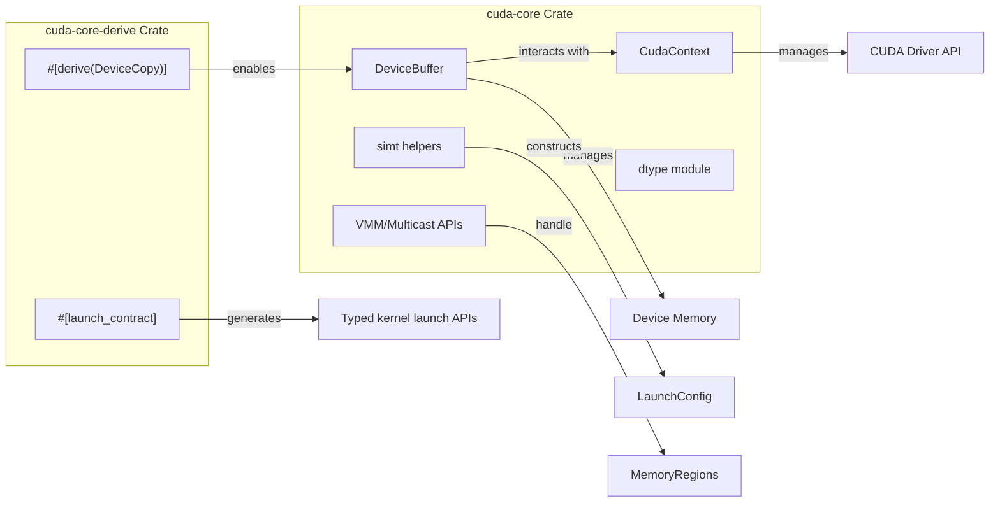

<!-- source: DeepWiki mcp.deepwiki.com · repo NVIDIA/cuda-rust · page 2.2 cuda-core: Contexts, Buffers, VMM · fetched 2026-10-26 -->

# cuda-core: Contexts, Buffers, VMM

<details>
<summary>Relevant source files</summary>

The following files were used as context for generating this wiki page:

- [.gitignore](.gitignore)
- [README.md](README.md)
- [cuda-async/Cargo.toml](cuda-async/Cargo.toml)
- [cuda-bindings/Cargo.toml](cuda-bindings/Cargo.toml)
- [cuda-core-derive/Cargo.toml](cuda-core-derive/Cargo.toml)
- [cuda-core/Cargo.toml](cuda-core/Cargo.toml)

</details>


This page documents the internal design and implementation details of the `cuda-core` crate in the `cuda-rust` ecosystem. It covers the primary abstractions for CUDA context management (`CudaContext`), device memory management (`DeviceBuffer`), the `dtype` system, runtime module loading, virtual memory management (VMM) features including multicast, SIMT host helpers, and the derive macros provided by the companion `cuda-core-derive` crate such as `DeviceCopy` and kernel launch contracts.

`cuda-core` forms the foundational idiomatic CUDA API for host-side Rust support, shared between the `cuda-oxide` Rust CUDA compiler backend and `cutile-rs` tile IR framework.

---

## Overview

The `cuda-core` crate provides idiomatic Rust abstractions for interacting with the CUDA driver API. Its main concerns include:

- **CUDA Contexts**: Safe creation and destruction of CUDA contexts via `CudaContext`.
- **Device Buffers**: Management of GPU device memory with `DeviceBuffer<T>`, including pinned host transfers.
- **Data Types (`dtype`)**: Type representations that map Rust primitives to their CUDA equivalents.
- **Module Loading**: Runtime loading of compiled CUDA kernels/modules and integration with launch APIs.
- **Virtual Memory Management (VMM)**: Support for memory virtualization, region mapping, and multicast.
- **SIMT Host Helpers**: Utilities aiding in setting up SIMT launch configurations.
- **Derive Macros**: Support macros enabling traits like `DeviceCopy` for safe device memory transfer, and launch contracts for kernel invocation correctness.

Together, these features enable high-level, safe, and idiomatic CUDA programming interoperability within Rust's ecosystem.

Sources: `cuda-core/Cargo.toml`(2-40), `README.md`(12-94).

---

## Key Components

### 1. CUDA Context Management: `CudaContext`

- `CudaContext` encapsulates a CUDA driver context associated with a physical device.
- It ensures proper creation, retention, and destruction of the underlying CUDA context handle.
- Typical usage involves creating a new context for a device ordinal and obtaining the default stream from it for command submission.
- `CudaContext` manages lifetime and concurrency safety of CUDA driver resources on the host.
  
This is the fundamental entry point for any CUDA operation from the host side.

**Typical usage snippet** (from `README.md`):
```rust
let ctx = CudaContext::new(0).unwrap();
let stream = ctx.default_stream();
```

Sources: `README.md`(52-53).

---

### 2. Device Memory Management: `DeviceBuffer<T>`

- `DeviceBuffer<T>` is a generic data structure managing device-resident memory buffers for type `T`.
- It provides APIs for allocation, deallocation, and safe transfer between host and device.
- Supports creation from host slices (`from_host`) and zero-initialized buffers (`zeroed`).
- Enables asynchronous data transfer on optional Streams.
- Guarantees type safety and aligns with CUDA's device memory model.
- Integrates tightly with the runtime module system to pass buffers to kernels.

```rust
let input = DeviceBuffer::from_host(&stream, &data).unwrap();
let mut output = DeviceBuffer::<f32>::zeroed(&stream, 1024).unwrap();
```

Sources: `README.md`(56-57).

---

### 3. Data Types (`dtype`)

- The `dtype` system defines mappings and traits that represent device-copyable types.
- Includes support for common Rust primitives (`f32`, `i32`, etc.) and optionally the unstable `f16`.
- Ensures safe device memory operations by tracking device copy semantics.

---

### 4. Runtime Module Loading and Kernel Launching

- Modules generated by the `#[cuda_module]` proc macro are embedded and loaded at runtime.
- Loaded modules expose type-safe kernel launch functions that encode contracts on kernel parameters and launch configurations.
- `LaunchConfig` is used to specify execution grid/block dimensions; it is intentionally raw and unsafe without matching kernel contracts.
- The `cuda-core-derive` crate supports deriving launch contracts adding checked APIs for launching kernels safely.
- Closure captures are scalarized and passed automatically to kernels as parameters.

Typical kernel call (simplified):  
```rust
unsafe {
    module.map::<f32, _>(
        &stream,
        LaunchConfig::for_num_elems(1024),
        move |x: f32| x * factor,
        &input,
        &mut output,
    )
}
.unwrap();
```

Sources: `README.md`(38-89).

---

### 5. Virtual Memory Management (VMM) and Multicast

- `cuda-core` exposes lower-level VMM features of CUDA allowing page table mappings and multicast of memory regions.
- Facilitates advanced memory sharing scenarios across context boundaries and devices.
- Abstracts underlying CUDA driver VMM APIs ensuring safety and correctness.

---

### 6. SIMT Host Helpers

- Utilities for configuring SIMT kernel launches including indexing, thread/block dimension queries, and launch parameter construction.
- These helpers streamline preparing arguments and launch configurations consistent with CUDA kernel expectations.

---

### 7. `cuda-core-derive` Macros

The companion crate `cuda-core-derive` provides procedural macros integral to safe and ergonomic CUDA code.

- **`DeviceCopy`**: 

  Derive macro that marks a Rust struct or primitive as safely copyable to and from device memory.
  
- **`launch_contract`**:

  Enables the static generation of kernel launch contract checks, ensuring kernel parameters and launch configurations adhere to expected layouts and dimension constraints.
  
These macros underpin the safety guarantees and usability improvements of Rust CUDA kernels in this ecosystem.

Sources: `cuda-core-derive/Cargo.toml`(2-30).

---

## Data Flow and Interaction Diagram

```mermaid
flowchart TD
  subgraph "Host Application"
    App["Rust Host App"]
    Ctx["CudaContext"]
    Stream["Cuda Stream"]
    BufHost["Host Memory (Vec<T>)"]
    BufDev["DeviceBuffer<T>"]
    Module["CudaModule (Loaded at runtime)"]
    KernelFunc["Typed kernel launch fn"]
  end

  subgraph "CUDA Device"
    GPUMem["GPU Device Memory"]
    Kernel["GPU Kernel (PTX)"]
  end

  App -->|Create| Ctx
  Ctx -->|Create stream| Stream
  BufHost -->|from_host() + stream| BufDev
  Module -->|load(&Ctx)| Module
  Module -->|launch fn| KernelFunc
  Stream -->|launch| Kernel
  BufDev -->|device mem| GPUMem
  KernelFunc -->|launch_kernel| Kernel
  Kernel -->|access| GPUMem
```

This diagram shows the natural flow of executing a CUDA kernel in Rust via `cuda-core`: a host `CudaContext` manages device resources, buffers are allocated and transferred between host and device, modules are loaded and kernels launched on streams executing code on the device using device memory.

Sources: `README.md`(12-94).

---

## Code Entity to System Map



This mapping outlines major code constructs within the `cuda-core` and `cuda-core-derive` crates and their roles in the CUDA runtime system. `CudaContext` interfaces directly with CUDA driver APIs; `DeviceBuffer<T>` manages device memory lifecycles; derive macros generate glue for safe copying and kernel launching.

Sources: `cuda-core/Cargo.toml`(), `cuda-core-derive/Cargo.toml`(), `README.md`(12-94).

---

## Summary

`cuda-core` is the idiomatic Rust interface to CUDA contexts, device buffers, kernel loading, and memory virtualization. It abstracts the complex CUDA driver APIs safely and ergonomically. Its integration with procedural macros in `cuda-core-derive` enables static kernel launch contract checking and safe device-copyable traits. Together with the SIMT host helpers and VMM features, `cuda-core` forms the backbone of host-side GPU programming in the `cuda-rust` ecosystem.

---

# References and Sources

- `cuda-core/Cargo.toml` lines 1-40
- `cuda-core-derive/Cargo.toml` lines 1-30
- `README.md` lines 12-94

---

