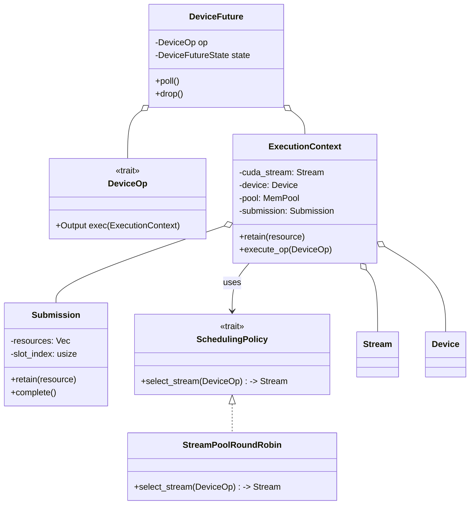

<!-- source: DeepWiki mcp.deepwiki.com · repo NVIDIA/cuda-rust · page 2.3 cuda-async: Async Device Operations · fetched 2026-10-26 -->

# cuda-async: Async Device Operations

<details>
<summary>Relevant source files</summary>

The following files were used as context for generating this wiki page:

- [cuda-async/REACTOR_AB_REPORT.md](cuda-async/REACTOR_AB_REPORT.md)
- [cuda-async/README.md](cuda-async/README.md)
- [cuda-async/src/cuda_graph.rs](cuda-async/src/cuda_graph.rs)
- [cuda-async/src/device_buffer.rs](cuda-async/src/device_buffer.rs)
- [cuda-async/src/device_context.rs](cuda-async/src/device_context.rs)
- [cuda-async/src/device_future.rs](cuda-async/src/device_future.rs)
- [cuda-async/src/device_operation.rs](cuda-async/src/device_operation.rs)
- [cuda-async/src/error.rs](cuda-async/src/error.rs)
- [cuda-async/src/launch.rs](cuda-async/src/launch.rs)
- [cuda-async/src/leak.rs](cuda-async/src/leak.rs)
- [cutile-rs/cutile-examples/examples/cuda_graphs.rs](cutile-rs/cutile-examples/examples/cuda_graphs.rs)
- [cutile-rs/cutile-examples/examples/cuda_graphs_deviceop.rs](cutile-rs/cutile-examples/examples/cuda_graphs_deviceop.rs)
- [cutile-rs/cutile-examples/examples/rms_norm.rs](cutile-rs/cutile-examples/examples/rms_norm.rs)

</details>


This page covers the architecture and implementation details of asynchronous device operations in the `cuda-async` crate within the NVIDIA `cuda-rust` monorepo. It focuses on the core abstractions for expressing GPU workloads as composable lazy device operations (`DeviceOp`) and futures (`DeviceFuture`) that execute asynchronously on CUDA streams. The page explains the design trade-offs and implementation of reactor-based and spin-based completion models, the use of a submission slot table for scalable completion tracking, CUDA graph capture integration, scheduling policies for execution streams, and leak handling for robust resource cleanup.

---

## 1. DeviceOperation and DeviceFuture Model

### 1.1 DeviceOp: Lazy Composable GPU Operations

At the heart of `cuda-async` is the `DeviceOp` trait, representing a **lazy, composable CUDA operation** on device memory and computation resources. Operations are not immediately executed; instead, they are composed and built into DAGs before scheduling on a CUDA stream. Execution occurs when the operation is run via synchronous blocking (`.sync()`, `.sync_on()`) or asynchronous awaiting (`.await`).

`DeviceOp` implementations support combinators familiar from the `futures` crate model, including `.then()`, `.map()`, `.zip!()`, `.shared()`, and `.then_unchecked()` for advanced control. These combinators allow building complex GPU pipelines which share streams and manage dependencies:

- `.then()`: chain dependent work on the same stream, ensuring sequential order.
- `.zip!()`: combine independent operations allowing concurrent overlap on different streams.
- `.shared()`: cloneable, execute-once device operations, supporting concurrent waiting.
- `.then_unchecked()`: relaxes thread-local execution lock for nested execution but requires user guarantees of no data races.

Operations are driven by an **execution context** that encapsulates the assigned CUDA stream, device, memory pool, and submission tracking (see below). The execution context is constructed lazily during operation execution and submission.

### 1.2 DeviceFuture: Bridging CUDA Completion to Rust Async

The `DeviceFuture` type implements `std::future::Future` and **drives a DeviceOp through its lifecycle from idle to execution and completion** on a CUDA stream. Its internal state machine is:

```text
  Idle ──first poll──> Executing ──completion signal──> Complete
           (enqueue on stream,            (yield output)
            inline spin / wait, then
            register for completion callback)
```

- Initial poll triggers `execute()` submitting the operation to the CUDA stream.
- Inline spin waits for stream completion by polling `cuStreamQuery` for a microsecond budget (default 20 µs), reducing wake latency.
- If the operation is not complete, a **reactor slot** or a **host callback** is registered:
  - **Reactor**: a system-wide thread monitors armed slots that get flagged by the GPU via `cuStreamWriteValue32`; it wakes futures upon completion.
  - **Host Callback**: fallback mechanism using `cuLaunchHostFunc` for completion notification, especially when reactor is unavailable or disabled.
- On completion, the future resolves and hands out the operation result.

Dropping a `DeviceFuture` **does not cancel the executing GPU work**. Instead, if the future was polled and work is in-flight, drop blocks until the CUDA stream drains to safely release owned resources. If waiting is impossible (e.g., stream is recording a CUDA graph or the context is faulted), the resources are leaked with a loud stderr warning since releasing memory while device writes to it would yield undefined behavior.

This model cleanly separates GPU execution from Rust async scheduling while providing low-latency inline-spin optimization and scalable event-based notification via the reactor.

---

## 2. Reactor vs Spin Completion

### Completion Methods

`cuda-async` supports multiple completion notification modes selectable at runtime:

- **Inline Spin**: The future polls the CUDA stream repeatedly for a short spin budget before registering the callback. This accelerates low-latency, short-duration kernels by often resolving futures without a wakeup.
  
- **Reactor (Default)**: Uses a **flag-based completion reactor**. Each GPU operation is assigned a slot in pinned host memory. When an operation completes, `cuStreamWriteValue32` writes a notification flag to the slot atomically. A dedicated high-priority OS thread scans the slots and wakes futures waiting on completed ones. This highly scalable design amortizes wakeups across thousands of simultaneous GPU operations.

- **Host Callback**: Uses `cuLaunchHostFunc` to ask CUDA to call back a host function once stream work completes. This method may stall on faults since callbacks are never run then. It is used when the reactor slot pool is exhausted or when explicitly requested by environment flags.

### Reactor Slot Table

The **SlotTable** is a core data structure mapping outstanding operations ("slots") to completion flags in pinned host memory:

- Each `DeviceFuture` entering the execution state registers an armed slot.
- Slots are scanned by the reactor thread, which wakes futures with completed work.
- The slot table optimizes wake-up to only unpark the waking thread when going from idle to active (`empty→wake` policy).
- Lock-free and multi-thread-safe registration and completion detection allow thousands of concurrent in-flight kernels.

This system enables high throughput with low CPU contention.

### Inline Spin Budget

The amount of time spent polling the CUDA stream inline before fallback to callback/flag notification is controlled via environment variables (`CUDA_ASYNC_SPIN_BUDGET_US`, default 20 µs). Setting this to 0 disables inline spin, forcing always to callback or reactor notification.

---

## 3. Submission and Slot Table Design

Every submitted operation is tracked via a **Submission** object which records:

- Held resource leases for memory and buffers, preventing premature deallocation.
- Submission state: whether it's recording a graph or executing normally.
- The assigned completion slot index in the SlotTable.

The **ExecutionContext** maintains an owned `Submission`. When an operation is enqueued:

- It registers all associated buffers and resource accesses (via `retain` and `retain_lease`) with the submission.
- When used within a CUDA graph capture, resources are tracked differently, and the context sets `recording = true`.
- The submission slots manage completion notifications with a backlog of pending operations.

The SlotTable and Submission architecture enable efficient multiplexing of completion events without one callback per operation, reducing driver overhead and stream thread pressure.

---

## 4. CUDA Graph Capture Integration

`cuda-async` supports capturing composed operations as CUDA graphs for low-overhead replay:

- A special **recording ExecutionContext** is constructed with the flag `recording = true`.
- Graph captures trigger graph node creation instead of immediate kernel launches.
- Recorded resource usages are tracked via the submission and added as replay resources.
- The submitted operations are baked into a `CudaGraph` object.
- Replaying the graph reacquires resource leases as needed.

The capture API exposes a scoped interface to capture imperative closures of `DeviceOp` executions, which are turned into graphs atomically and replayed multiple times with minimal CPU overhead.

---

## 5. Scheduling Policies

`cuda-async` models execution stream assignment via the trait `SchedulingPolicy`, which maps `DeviceOp`s to CUDA streams:

- The default implementation is `StreamPoolRoundRobin`, which cycles through 4 streams per device in round-robin order, allowing up to 4 concurrent streams to overlap work.
- Other policies can be implemented and plugged in, e.g., a single-stream scheduler.

The `AsyncDeviceContext` maintains a per-thread device state including:

- The active scheduling policy.
- The deallocation stream to free memory asynchronously.
- Optional memory pool.

Device contexts are thread-local to allow flexibility and avoid global bottlenecks.

---

## 6. Leak Handling on Future Drop

Dropping a `DeviceFuture` before completion requires careful resource management because:

- GPU tasks may still write into buffers.
- Releasing those buffers early would cause data races and undefined behavior.

The drop implementation:

- If GPU work is not submitted yet (e.g., future never polled), simply drops.
- If GPU work is submitted but still in flight, it **blocks the host synchronously on the CUDA stream draining** before dropping the held resources.
- If this wait is impossible (faulted context, CUDA graph recording), the resources are leaked intentionally with a **loud stderr report**.

Leak reporting goes through [`report_leak`], allowing test capture and controlled diagnostics.

---

## 7. Key Classes and Functions

| Entity | Description | Location |
|------------|-------------|------------|
| `DeviceOp` | Trait for lazy, composable GPU operations | `cuda-async/src/device_operation.rs` [6-1881]() |
| `DeviceFuture` | Future that drives a `DeviceOp` through submission and completion | `cuda-async/src/device_future.rs` [6-805]() |
| `ExecutionContext` | Represents an active execution with CUDA stream, device, and submission | `cuda-async/src/device_operation.rs:107-188`() |
| `Submission` | Tracks resources and completion state for each launched kernel | see `device_operation.rs` referenced inside `ExecutionContext` |
| `SlotTable` | Reactor's host-side data structure to track in-flight operation completions | implemented in `cuda-async/src/slot_table.rs` (not shown here) |
| `SchedulingPolicy` | Trait to decide stream assignment per operation, default RoundRobin pool | `cuda-async/src/device_context.rs:7-179`() |
| `CudaGraph` | Represents a CUDA graph built from captured operations | `cuda-async/src/cuda_graph.rs` (not in provided content) |
| `report_leak` | Reports resource leaks due to incomplete future drop | `cuda-async/src/leak.rs:6-71`() |

---

## 8. Data Flow Diagram: DeviceOp Execution and Completion

```mermaid
flowchart TD
  UserAPI["User creates DeviceOp"]
  PollFuture["First poll() on DeviceFuture"]
  AcquireLock["acquire_execution_lock()"]
  Submit["Submit kernel on CUDA stream"]
  InlineSpin["Inline spin: cuStreamQuery for spin budget"]
  CompletedInline["Complete if done"]
  RegisterCallback["Register completion callback (Reactor or HostCallback)"]
  CompletionEvent["GPU signals completion"]
  ReactorThread["Reactor scans slot table"]
  WakeTask["Wake async task"]
  PollAgain["Future poll() observes completion"]
  ReturnResult["Return output to user"]
  DropFuture["Drop DeviceFuture"]
  WaitStream["Wait on CUDA stream drain (if in-flight)"]
  LeakReport["Report leak (if wait impossible)"]

  UserAPI --> PollFuture
  PollFuture --> AcquireLock
  AcquireLock --> Submit
  Submit --> InlineSpin
  InlineSpin --> CompletedInline
  CompletedInline -->|done| ReturnResult
  CompletedInline -->|not done| RegisterCallback
  RegisterCallback --> CompletionEvent
  CompletionEvent --> ReactorThread
  ReactorThread --> WakeTask
  WakeTask --> PollAgain
  PollAgain --> ReturnResult
  DropFuture -->|if in-flight| WaitStream
  WaitStream -->|block then drop resources| ()
  WaitStream -->|fail to wait| LeakReport
```

---

## 9. Operational Diagram: Scheduling and Submission Layers



---

## 10. Summary

`cuda-async` provides an elegant, scalable abstraction for asynchronous GPU programming in Rust. Its key features include:

- A composable lazy `DeviceOp` model allowing complex CUDA kernels and DAGs to be expressed cleanly.
- Efficient completion tracking via a reference-counted `DeviceFuture` tied to CUDA streams.
- An event-driven **reactor** for scalable notification of kernel completion using a pinned-slot table and flag writes.
- Support for fallback host-callback completions and inline spinning to reduce latency.
- Integration with CUDA graph capture for batching sequences of operations.
- Pluggable scheduling policies to assign operations to streams.
- Careful management of resource lifetime and leak reporting for asynchronous futures.

This makes `cuda-async` a foundational building block upon which higher-level GPU programming libraries and device kernels in `cutile-rs` and `cuda-oxide` can rely.

---

## Sources

- `cuda-async/src/device_operation.rs:6-1881` ()
- `cuda-async/src/device_future.rs:6-805` ()
- `cuda-async/src/device_context.rs:6-179` ()
- `cuda-async/src/leak.rs:6-71` ()
- `cuda-async/README.md:1-163` ()
- `cutile-rs/cutile-examples/examples/cuda_graphs_deviceop.rs:1-181` ()
- `cutile-rs/cutile-examples/examples/cuda_graphs.rs:1-190` ()

---

