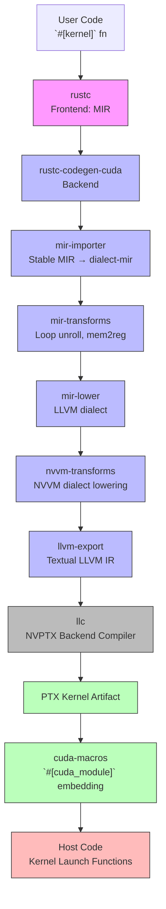

<!-- source: DeepWiki mcp.deepwiki.com · repo NVIDIA/cuda-rust · page 3 cuda-oxide: Rust-to-PTX Compiler and Runtime · fetched 2026-10-26 -->

# cuda-oxide: Rust-to-PTX Compiler and Runtime

<details>
<summary>Relevant source files</summary>

The following files were used as context for generating this wiki page:

- [.gitignore](.gitignore)
- [README.md](README.md)
- [cuda-oxide/cuda-oxide-book/compiler/architecture-overview.md](cuda-oxide/cuda-oxide-book/compiler/architecture-overview.md)

</details>


This section provides a high-level overview of the `cuda-oxide` project, the core Rust-to-PTX compilation backend, and runtime API that enable writing CUDA kernels directly in Rust. It explains the single-source `#[kernel]` and `#[cuda_module]` model, the custom rustc codegen backend, and the accompanying tooling. Detailed technical implementations are covered in linked child pages.

---

## Single-Source Rust CUDA Programming Model

The `cuda-oxide` compiler enables writing GPU kernels and host-side control code together in the same Rust source file, leveraging Rust's native language features without the need for separate CUDA C++ or DSLs.

- Device kernels are annotated with `#[kernel]`. These functions are compiled to NVIDIA PTX.
- Kernel modules are annotated with `#[cuda_module]` and embed the compiled device code into the host binary.
- Kernel launches can pass closures with captured environment variables as arguments, which are properly scalarized and passed to the GPU.
- Examples demonstrate generic device kernels working on arbitrary data types, providing the convenience of Rust generics and closures on CUDA.

This model promotes type safety and monomorphized specialization while fully integrating device and host code into a unified Rust workflow.

```rust
#[cuda_module]
mod kernels {
    #[kernel]
    pub fn map<T: Copy, F: Fn(T) -> T + Copy>(f: F, input: &[T], mut out: DisjointSlice<T>) {
        let idx = thread::index_1d();
        let i = idx.get();
        if let Some(out_elem) = out.get_mut(idx) {
            *out_elem = f(input[i]);
        }
    }
}
```

Kernels like `map` above can be launched with raw unsafe `LaunchConfig` or via safe checked `PreparedLaunch` methods when using `#[launch_contract]`.

For asynchronous GPU execution, the host runtime integrates with a `DeviceOperation` future-like API allowing lazy launch, composition, and synchronization.

Sources: [README.md:12-94]()

---

## rustc Codegen Backend: From Rust Source to PTX

At the heart of `cuda-oxide` is a custom rustc codegen backend (`rustc-codegen-cuda`) that intercepts the normal Rust compilation process and handles CUDA kernel codegen:

- It recognizes kernel entry points renamed with a reserved namespace to detect `#[kernel]` functions.
- The rustc MIR is bridged to a stable MIR API (`rustc_public`), ensuring compatibility across Rust versions.
- MIR is translated to `dialect-mir` in the pliron IR framework, where GPU-specific transformations and optimizations occur.
- `mir-transforms` apply passes like loop unrolling and SSA promotion (`mem2reg`).
- Lowering from `dialect-mir` to the LLVM dialect prepares the IR for backend compilation.
- Textual LLVM IR is emitted and passed to LLVM's NVPTX backend (`llc`) for final PTX generation.
- The pipeline supports multiple IR dialects specialized for NVIDIA GPU features (`dialect-nvvm`) and PTX scheduling.

This layered approach leverages Rust's mature frontend and LLVM's battle-tested backend while maintaining the entire pipeline in Rust except for the external `llc` stage. The IR framework Pliron provides extensibility and easy debugging throughout.

### Compilation Pipeline Diagram

```mermaid
flowchart LR
  RS[["Rust Source\n(#[kernel])"]]
  RC[rustc Frontend\n(MIR, type & borrow check)]
  SM[Stable MIR\n(rustc_public)]
  IM["mir-importer\n-> dialect-mir"]
  MT[mir-transforms\n(loop unroll, mem2reg)]
  ML[mir-lower\n(dialect-mir -> LLVM dialect)]
  NV[nvvm-transforms\n(NVVM lowering)]
  LE[llvm-export\n(textual LLVM IR)]
  LLC["LLVM llc\nNVPTX Backend"]
  PTX[PTX GPU Code]

  RS --> RC --> SM --> IM --> MT --> ML --> NV --> LE --> LLC --> PTX
```

For details on every compilation stage, see [Compilation Pipeline: MIR to PTX](#3.1).

Sources: [cuda-oxide/cuda-oxide-book/compiler/architecture-overview.md:1-113]()

---

## Tooling via `cargo-oxide`

`cargo-oxide` is a cargo subcommand driving the cuda-oxide build pipeline, replacing `cargo build` for projects containing CUDA Rust kernels:

- Supports subcommands like `build`, `run`, `test`, `inspect`, `pipeline`, `sanitize`, `debug`, `doctor`, and `scaffold`.
- Handles backend resolution and caching of the compiler codegen backend.
- Enables inspecting intermediate GPU artifacts (e.g., dumping generated PTX).
- Supports launching and debugging CUDA kernels from Rust test suites.
- Offers commands to clean build caches and refresh the backend compiler.

Example commands:

```
cargo oxide run host_closure   # build and run example kernel with Rust closures
cargo oxide inspect vecadd     # view generated PTX
cargo oxide pipeline vecadd    # display full MIR-to-PTX pipeline
cargo oxide sanitize vecadd    # run memory checks on CUDA kernel
cargo oxide test               # run tests using the cuda-oxide backend
cargo oxide update             # update cached codegen compiler
```

For complete details, see [cargo-oxide CLI](#3.3).

Sources: [README.md:113-144]()

---

## Device and Host API Crates

To make developing and running CUDA kernels ergonomic and safe, `cuda-oxide` provides multiple supporting crates:

- `cuda-device`: Device-side abstractions like thread indexing, shared memory, warp/cluster intrinsics, scoped atomics, and barriers.
- `cuda-host`: Host APIs for kernel module loading, memory management, pinned transfers, and kernel launches.
- `cuda-macros`: Procedural macros enabling `#[kernel]`, `#[cuda_module]` annotations, and launch contract generation.
- These crates offer a unified typed API surface for both device and host code, enabling seamless kernels and launch contracts in Rust.

See [Device and Host APIs (cuda-device, cuda-host, cuda-macros)](#3.2) for an in-depth overview.

Sources: [README.md:12-94]()

---

## Related Components and Documentation

For deeper technical dives, the `cuda-oxide` section has child pages covering the core components:

| Child Page | Description |
|------------|-------------|
| [Compilation Pipeline: MIR to PTX](#3.1) | Detailed breakdown of rustc codegen backend, MIR translation, pliron dialects, LLVM IR generation, nvvm lowering, PTX assembly, and the iket dialect. |
| [Device and Host APIs (cuda-device, cuda-host, cuda-macros)](#3.2) | Kernel and module macros, device intrinsics, synchronization primitives, shared memory, atomics, and launch contracts. |
| [cargo-oxide CLI](#3.3) | CLI architecture, subcommands, backend updates, and integration with Cargo workflows. |
| [Examples, Fuzzer and the cuda-oxide Book](#3.4) | A vast collection of example kernels (190+), fuzz-testing crates, and documentation structure. |

---

## High-Level Relationship Diagram: System Names to Code Entities



---

## Summary

- `cuda-oxide` implements a seamless Rust-native CUDA kernel development, leveraging Rust's type system and rustc internals.
- The rustc codegen backend handles the full compilation pipeline from Rust source to PTX GPU code using a layered IR infrastructure.
- Host and device APIs provide safe abstractions for kernel code, launches, and async execution.
- Tooling (`cargo-oxide`) enables comprehensive build, debug, and inspection workflows.
- Child pages deliver detailed insights on compilation, API design, CLI, and usage examples.

This design makes CUDA kernel development idiomatic for Rust users and bridges the gap between Rust's high-level semantics and NVIDIA GPU hardware efficiently and flexibly.

For full technical details and usage, explore the child pages linked above.

---

Sources:  
[cuda-oxide/README.md:12-94]()  
[cuda-oxide/README.md:113-144]()  
[cuda-oxide/cuda-oxide-book/compiler/architecture-overview.md:1-113]()

---

