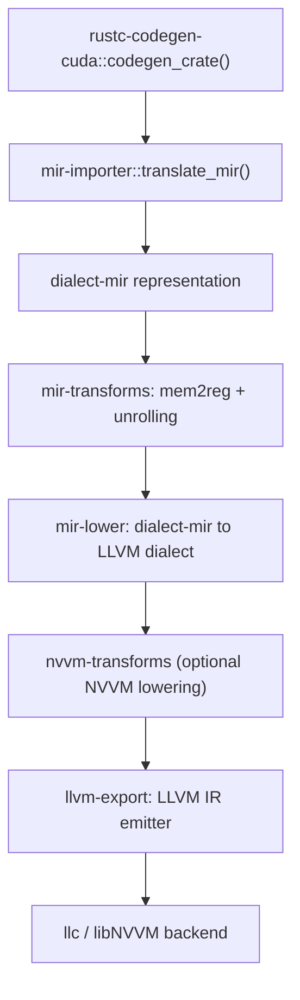

<!-- source: DeepWiki mcp.deepwiki.com · repo NVIDIA/cuda-rust · page 3.1 Compilation Pipeline: MIR to PTX · fetched 2026-10-26 -->

# Compilation Pipeline: MIR to PTX

<details>
<summary>Relevant source files</summary>

The following files were used as context for generating this wiki page:

- [.gitignore](.gitignore)
- [README.md](README.md)
- [cuda-oxide/cuda-oxide-book/compiler/architecture-overview.md](cuda-oxide/cuda-oxide-book/compiler/architecture-overview.md)

</details>


This page provides a high-level overview of the cuda-oxide compilation pipeline transforming Rust MIR (Mid-level Intermediate Representation) to NVIDIA PTX (Parallel Thread Execution) code. It covers the key crates, IR dialects, transform passes, and external tools used in this process inside the [cuda-oxide](https://github.com/NVIDIA/cuda-rust/tree/main/cuda-oxide) workspace.

This is a **parent page** that introduces core concepts and shows how the different crates and components belong to the overall pipeline. Detailed explanations of subtopics such as CUDA intrinsics and final artifact linking reside in dedicated child pages:

- See [Intrinsics and Target Specs](#3.1.1) for CUDA intrinsic implementations, runtime ABI and target definition.
- See [Artifacts, Linking and Finalization](#3.1.2) for device binary linking, symbol naming, and embedding strategies.

---

## 3.1.1. Overview of Pipeline Stages

The pipeline starts from Rust source annotated with `#[kernel]` and ends with NVIDIA GPU executable PTX code or cubin binaries. The overall flow is:

```mermaid
flowchart TD
  A[Source: Rust #[kernel] fn] -->|rustc frontend| B(Stable MIR)
  B -->|mir-importer crate| C[dialect-mir (Pliron)]
  C -->|mir-transforms: optimization passes| D[mir-lower: LLVM dialect (Pliron)]
  D -->|nvvm-transforms (optional)| E[llvm-export: LLVM IR text (.ll)]
  E -->|external llc or libNVVM| F[GPU binary: PTX, CUBIN, or LTOIR]
```

1. **Rust Frontend & Stable MIR:** The Rust compiler (`rustc`) parses, type checks, monomorphizes generics, and produces a stable MIR representation of the code (from rustc internals via `rustc_public` APIs). The device kernels carry unique mangled names reserved by `reserved-oxide-symbols` to avoid collision.

2. **`dialect-mir` and `mir-importer`:** The MIR is imported into the Pliron IR framework as `dialect-mir`, a custom dialect that closely models Rust MIR semantics (places, projections, Rvalues, etc.). This dialect initially uses MIR-style memory operations (`mir.alloca`, `mir.load`, `mir.store`). The `mir-importer` crate orchestrates this translation from Stable MIR to Pliron `dialect-mir`.

3. **`mir-transforms`:** Several optimization passes run on SSA-form Pliron IR, including memory promotion (`mem2reg`) to lift allocas into SSA values and annotated loop unrolling based on kernel metadata.

4. **`mir-lower`:** The lowering pass transforms `dialect-mir` operations into LLVM dialect operations (`llvm.alloca`, `llvm.load`, `llvm.store`, `llvm.call`, etc.) using the `pliron-llvm` crate. This phase flattens Rust abstractions into LLVM IR semantics suitable for code generation.

5. **`nvvm-transforms`:** For NVVM (NVIDIA’s LLVM variant) builds, GPU intrinsics and LLVM IR are reshaped to acceptable NVVM dialect patterns. This step is optionally skipped for building plain PTX.

6. **`llvm-export`:** The finalized LLVM dialect is emitted as textual LLVM IR (`.ll`) files. These can be inspected or used downstream.

7. **GPU Artifact Generation:** The external LLVM backend tool `llc` compiles the `.ll` file into PTX assembly. For NVVM-based builds, libNVVM and `nvJitLink` are used to produce optimized LTOIR and CUBIN binary artifacts.

---
## 3.1.2. Crate and Component Roles

Here is an overview of the key crates involved in this pipeline and their primary responsibilities:

| Crate                         | Purpose                                                                                  |
|:------------------------------|:-----------------------------------------------------------------------------------------|
| `rustc-codegen-cuda`          | Entry point backend for rustc codegen, selects and invokes device codegen pipeline       |
| `mir-importer`                | Translates Stable MIR to `dialect-mir`, drives compilation stages                        |
| `dialect-mir`                 | Pliron IR dialect modeling Rust MIR semantics (places, Rvalues, terminators)             |
| `mir-transforms`              | Optimization passes on `dialect-mir`, e.g., mem2reg, loop unrolling                       |
| `mir-lower`                  | Lowers `dialect-mir` to LLVM dialect IR suitable for LLVM codegen                        |
| `nvvm-transforms`             | Transforms LLVM dialect IR to NVVM-compliant form for NVIDIA GPU backend                 |
| `llvm-export`                 | Emits LLVM IR text from LLVM dialect IR; integrates pliron-llvm                          |
| `dialect-nvvm`                | PLIR dialect that encodes NVIDIA GPU intrinsics (`tid`, `ntid`, barriers, TMA, etc.)     |
| `ptx-parse`, `ptx-schedule`  | (Covered in detail in child pages) Parsing and scheduling passes for PTX assembly        |
| `iket-dialect`                | (Advanced custom dialect, see future enhancements)                                      |

Each of these crates encapsulates a stage or a set of passes. This modularity enables easy development, debugging, and reuse of components.

---

## 3.1.3. High-Level Flow of Data and Control

The rustc codegen backend (`rustc-codegen-cuda`) is the entry point for device kernel codegen. It receives Stable MIR from the rustc frontend and calls `mir-importer` to start the lowering pipeline.



- `rustc-codegen-cuda` hooks into rustc’s crate codegen process to identify and split host and device functions.
- `mir-importer` translates MIR into the `dialect-mir` IR, applying initial mir-allocation and load/store operations.
- `mir-transforms` runs analyses and optimizations, converting the MIR-ish IR into SSA form.
- `mir-lower` performs the main lowering pass to convert Rust-specific ops into LLVM dialect instructions.
- `nvvm-transforms` adjusts LLVM IR for libNVVM compatibility if needed.
- `llvm-export` produces the intermediate LLVM textual IR.
- Finally, external tools compile this to PTX or cubin form.

---

## 3.1.4. Dialects and IR Forms

The pipeline uses the Pliron IR framework, an MLIR-inspired IR system implemented in Rust. It hosts dialects modeling various abstraction levels:

| Dialect               | Description                                                         | Location                     |
|-----------------------|---------------------------------------------------------------------|------------------------------|
| `dialect-mir`         | High-level representation of Rust MIR constructs: `alloca`, `load`, `store`, places, rvalues | `dialect-mir` crate           |
| `dialect-llvm`        | LLVM IR instructions implemented as a dialect using `pliron-llvm`  | upstream `pliron-llvm` crate  |
| `dialect-nvvm`        | NVIDIA-specific intrinsics and GPU features like warp ops, barriers | `dialect-nvvm` crate          |
| `iket dialect`        | (Experimental/future) Candidate for advanced GPU instruction set representation | (design in progress)          |

The IR gradually lowers from `dialect-mir` to `dialect-llvm`, maintaining IR textual, analyzable, and transformable forms inside Rust.

---

## 3.1.5. PTX Generation and Scheduling

At the end of the lowering pipeline, the textual LLVM IR is compiled into PTX using either the LLVM `llc` tool with NVPTX backend, or for NVVM builds, dynamic linking via libNVVM and the `nvjitlink` system produces cubin files.

The `ptx-parse` and `ptx-schedule` crates handle parsing and reordering of PTX instructions to optimize register usage and warp scheduling, improving kernel performance on the GPU hardware.

---

## Related Child Pages and Detailed Topics

- **3.1.1. Intrinsics and Target Specs**  
  Details the `cuda-intrinsics-gen`, intrinsics catalogs and probing, target specification for different compute capabilities, and ABI stability checks. See child page [Intrinsics and Target Specs](#3.1.1).
  
- **3.1.2. Artifacts, Linking and Finalization**  
  Discusses the embedding of device code into the host binary, symbol reservation, final linking of PTX and cubin artifacts with `cuda-artifact-finalizer`, and LTOIR workflows. See child page [Artifacts, Linking and Finalization](#3.1.2).

---

## Summary

This pipeline exemplifies an effective blend of Rust tooling, custom IR design, and GPU-targeted code generation:

- It leverages stable rustc MIR for frontend correctness and monomorphization.
- It uses Pliron IR dialects for mid-end transformations adapted for GPU semantics.
- It depends on LLVM’s NVPTX backend for mature code generation.
- It implements custom transforms and scheduling tailored for CUDA GPUs.
- The end-to-end compilation is orchestrated across well-scoped crates, enabling modular development and experimentation.

For those wishing to contribute or understand internal details, the child pages provide deep dives into CUDA intrinsics, target management, and binary artifact finalization.

---

### Sources:

- `cuda-oxide/cuda-oxide-book/compiler/architecture-overview.md:1-139`  
- `README.md:12-95` (examples of usage and general design)  
- `mir-importer/src/lib.rs` (import and pipeline orchestration, not excerpted but referenced)  
- `mir-lower/src/lib.rs` (lowering dialect-mir to LLVM dialect)  
- `nvvm-transforms` (NVVM compatibility pass)  
- `rustc-codegen-cuda` (backend integration entry point)  

(Exact file lines for code locations are from `cuda-oxide/cuda-oxide-book/compiler/architecture-overview.md:1-139` and `README.md:12-95` here.)

---

