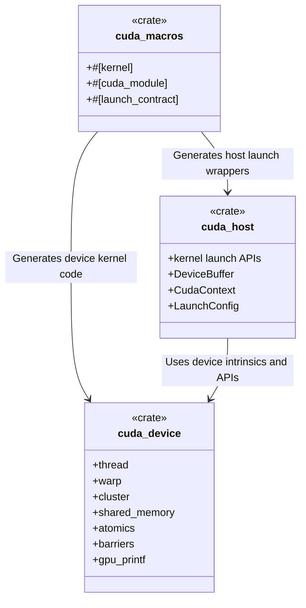

<!-- source: DeepWiki mcp.deepwiki.com · repo NVIDIA/cuda-rust · page 3.2 Device and Host APIs (cuda-device, cuda-host, cuda-macros) · fetched 2026-10-26 -->

# Device and Host APIs (cuda-device, cuda-host, cuda-macros)

<details>
<summary>Relevant source files</summary>

The following files were used as context for generating this wiki page:

- [.gitignore](.gitignore)
- [README.md](README.md)
- [cuda-oxide/crates/cargo-oxide/README.md](cuda-oxide/crates/cargo-oxide/README.md)

</details>


This section documents the key device and host API crates within the `cuda-oxide` ecosystem: `cuda-device`, `cuda-host`, and `cuda-macros`. These crates provide the essential building blocks for writing and launching CUDA kernels in pure Rust using the `#[kernel]` and `#[cuda_module]` procedural macros, along with support for GPU debugging, synchronization, shared memory, atomic operations, and launch contracts enabling safe, zero-cost abstraction of GPU launches.

---

## Overview

The device and host APIs unify the user-facing kernel programming model and low-level CUDA device features into the Rust ecosystem through:

- Compiler-supported **`#[kernel]`** functions that compile to GPU PTX code.
- Module embedding via **`#[cuda_module]`** procedural macros, producing typed kernel launchers.
- Device-side intrinsics for **thread**, **warp**, and **cluster** operations.
- Device-side APIs for **shared memory**, **atomic operations**, and **barriers**.
- **`gpu_printf`** functionality for device-side debugging output.
- **Launch contracts** that let users associate kernel launch parameter validation rules checked at compile-time or kernel load-time.

Together, these offer a safe, ergonomic, and performant way to write and launch GPU kernels fully in Rust, without foreign language bindings or DSLs.

### Rust Kernel Execution Model

The model enables:

- Single-source compilation of host and device code in the same file.
- Generic closures as kernel parameters, with automatic closure capture scalarization.
- Safe kernel launch API generation from `#[cuda_module]` with optional launch contracts to statically ensure launch parameter correctness.
- Asynchronous GPU kernel execution with futures and device operations (`cuda-async` integration).
- Explicit raw launch configurations requiring safety proof, or safer, checked `PreparedLaunch` abstractions via launch contracts.

This API encapsulates CUDA programming idioms and abstractions behind idiomatic Rust constructs muscling through the Rust compiler plug-in frontend (`rustc-codegen-cuda`).

---

## `#[kernel]` and `#[cuda_module]` Macros

### `#[kernel]`

The `#[kernel]` attribute marks ordinary Rust `fn`s as CUDA kernels to be compiled for execution on the GPU device. This triggers the `cuda-macros` procedural macro to:

- Lower the device function through the custom rustc backend `cuda-oxide` into PTX assembly.
- Translate Rust borrowing and lifetime rules into CUDA's thread model.
- Support generic parameters and closures capturing environment variables, which are scalarized and passed as kernel parameters.

Example from `README.md`:

```rust
#[cuda_module]
mod kernels {
    #[kernel]
    pub fn map<T: Copy, F: Fn(T) -> T + Copy>(f: F, input: &[T], mut out: DisjointSlice<T>) {
        let idx = thread::index_1d();
        let i = idx.get();
        if let Some(out_elem) = out.get_mut(idx) {
            *out_elem = f(input[i]);
        }
    }
}
```

This kernel uses the device `thread::index_1d()` intrinsic to identify the thread index and applies the passed closure `f` to input elements.

### `#[cuda_module]`

`#[cuda_module]` applied on a module embeds all compiled device kernels and associated metadata in the host binary. It also:

- Generates strongly typed host wrappers with signature matching the kernel parameters.
- Handles launching configuration and safety contracts (if specified).
- Supports both synchronous raw launches and asynchronous launches returning `DeviceOperation`s.

Launching example:

```rust
let module = kernels::load(&ctx).unwrap();
unsafe {
    module.map::<f32, _>(
        &stream,
        LaunchConfig::for_num_elems(1024),
        move |x: f32| x * factor,
        &input,
        &mut output,
    )
}.unwrap();
```

This provides type-assisted, safe API matching kernel signatures and dispatch rules.

---

## Device intrinsics and APIs

`cuda-device` and `cuda-host` crates expose the CUDA programming model idioms in Rust:

### Thread, Warp, and Cluster Intrinsics

Device-side modules provide functions and types to query and manipulate thread indices and groupings:

- **thread intrinsics** (e.g., `thread::index_1d()`, `thread::lane_id()`).
- **warp intrinsics** for warp-synchronous programming.
- **cluster intrinsics** for larger thread group synchronization and communication.

These intrinsics map closely to CUDA's hardware abstraction.

### Shared Memory

Shared memory is supported as scoped dynamically or statically sized buffers accessible by threads in a block. The API allows:

- Typed shared memory allocation in kernels.
- Syncronization barriers for coordinating access.
- Safe abstractions over raw pointer manipulation.

### Atomic Operations

Atomic types and methods are provided with a choice of memory orderings, implemented efficiently using native CUDA device atomics.

### Barriers and Synchronization

Functions that provide barrier synchronization at thread, warp, or cluster level to coordinate execution within cooperating threads in a compute unit.

---

## `gpu_printf` Debug Facility

The `gpu_printf` macro enables device-side print debugging similar to CUDA's `printf` from kernels. It supports standard format strings and variadic arguments but uses device-safe formatting internally.

---

## Launch Contracts

Launch contracts are an advanced feature allowing users to annotate kernel parameter semantics and launch configuration constraints with custom policies. These are checked at launch time (often compile-time) to enforce correctness rules that normally require manual proof of safety.

For example:

- Ensuring launch grid size matches thread indexing expectations.
- Validating shared memory usage constraints.

Contracts are generated by the `#[launch_contract(...)]` annotations and integrated into the generated launch APIs for safer kernel invocations.

---

## Data Flow and Interaction Diagram

### Overview: From Rust Kernel Code to GPU Execution and Host Launch

```mermaid
flowchart TD
    subgraph Host
        A1[User Rust Source with #[cuda_module], #[kernel]]
        A2[cuda-oxide rustc backend: rustc-codegen-cuda]
        A3[Host Binary with embedded device module]
        A4[Typed kernel launch API]
        A5[Invoke LaunchConfig and stream]
    end

    subgraph Device
        D1[PTX compiled kernel function]
        D2[Device intrinsics (thread, warp, cluster)]
        D3[Shared Memory, Atomics, Barriers]
        D4[gpu_printf debug output]
    end

    A1 -->|Compile with cuda-oxide| A2
    A2 -->|Codegen embeds module| A3
    A3 -->|Generate wrappers| A4
    A4 -->|Launch with config| A5
    A5 -->|CUDA Driver API call| D1
    D1 --> D2
    D1 --> D3
    D1 --> D4
```

Sources: `README.md:12-89`()

---

## Code Entity Mapping: Procedural Macros and Core Crates



Sources: `README.md:30-88`()

---

## Key Crate Responsibilities and Files

| Crate       | Responsibility and Key Features                           | Relevant Code Artifacts               |
|-------------|-----------------------------------------------------------|-------------------------------------|
| `cuda-macros` | Procedural macros implementing `#[kernel]`, `#[cuda_module]`, and `#[launch_contract]`. Create both device code and host launch code. | Macro code generating PTX, launch wrappers. |
| `cuda-device`  | Device-side APIs; thread, warp, cluster intrinsics, shared memory, atomics, barriers, `gpu_printf`. Low-level device Rust abstractions. | Intrinsics, device atomics, shared memory modules. |
| `cuda-host`    | Host-side APIs for context management, memory buffers, streams, kernel launch configuration, and type-safe launching. | CudaContext, DeviceBuffer, LaunchConfig structs and kernel launch APIs.|

Sources: `README.md:30-89`()

---

## Launch Contract Details

Launch contracts allow expressing and enforcing constraints on kernel launch parameters. This is crucial since CUDA launch parameters are raw, unchecked, making it easy to launch with incompatible grid/block sizes or arguments.

The crate machinery behind launch contracts:

- Defines policies checked at compile-time or kernel loading.
- Generates a `PreparedLaunch` handle from user parameters.
- Checks thread/block size dimensions against kernel indexing.
- Enforces shared memory limits or other resource constraints.

Users write:

```rust
#[launch_contract(...)]
#[kernel]
pub fn my_kernel(...) { /* device code */ }
```

The macro expands kernel launchers, wrapping raw launch parameters and injecting validation code.

---

## Conclusion

The `cuda-device`, `cuda-host`, and `cuda-macros` crates form the foundation of the `cuda-oxide` Rust ecosystem, enabling:

- Expressive Rust-native CUDA kernel programming.
- Integration of Rust generics, closures, and safety into GPU programming.
- Device intrinsics matching CUDA hardware model.
- Synchronized shared memory use, atomics, and barriers.
- Debugging via `gpu_printf`.
- Safer and ergonomic kernel launches thanks to static launch contracts.

This unified design brings a modern Rust programming approach directly to GPU computing with seamless host/device integration and strong API guarantees.

---

# References

- `README.md`, lines 1-90 (kernel example, macros, intrinsics, launch usage)  
- `README.md`, lines 150-159 (toolchain and usage context)  

Sources:  
`README.md:1-90`(), `README.md:150-159`()

---

