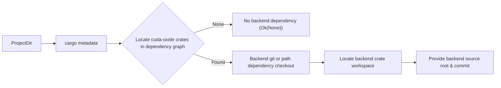
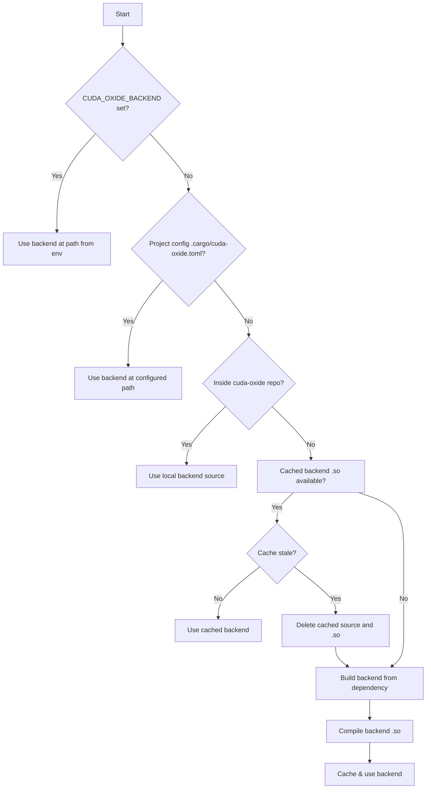
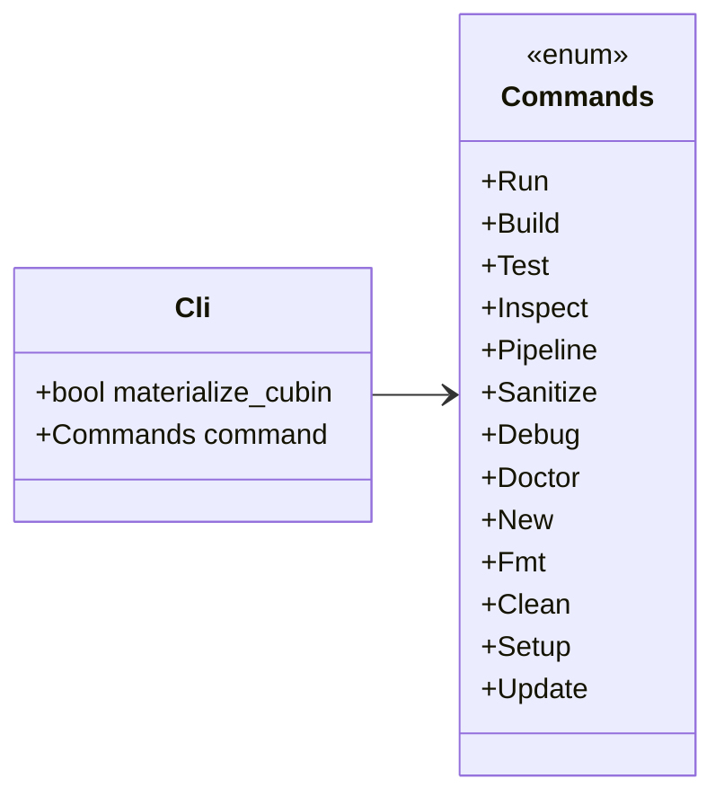
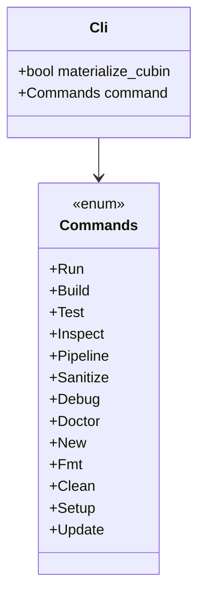

<!-- source: DeepWiki mcp.deepwiki.com · repo NVIDIA/cuda-rust · page 3.3 cargo-oxide CLI · fetched 2026-10-26 -->

# cargo-oxide CLI

<details>
<summary>Relevant source files</summary>

The following files were used as context for generating this wiki page:

- [.vscode/settings.json](.vscode/settings.json)
- [cuda-oxide/crates/cargo-oxide/src/backend.rs](cuda-oxide/crates/cargo-oxide/src/backend.rs)
- [cuda-oxide/crates/cargo-oxide/src/backend_source.rs](cuda-oxide/crates/cargo-oxide/src/backend_source.rs)
- [cuda-oxide/crates/cargo-oxide/src/commands/fmt.rs](cuda-oxide/crates/cargo-oxide/src/commands/fmt.rs)
- [cuda-oxide/crates/cargo-oxide/src/main.rs](cuda-oxide/crates/cargo-oxide/src/main.rs)
- [cuda-oxide/cuda-oxide-book/compiler/catalog-generated-intrinsics.md](cuda-oxide/cuda-oxide-book/compiler/catalog-generated-intrinsics.md)

</details>


The `cargo-oxide` CLI is a comprehensive Cargo subcommand tailored for building, running, testing, and inspecting Rust GPU programs leveraging the cuda-oxide ecosystem. It replaces traditional xtask patterns by providing a unified, user-friendly interface that works seamlessly both inside the cuda-oxide repository (for developers) and outside (for end-users).

---

## Purpose and Scope

This page details the internal architecture and the implementation of the `cargo-oxide` CLI, focusing on:

- The various CLI subcommands (such as `build`, `run`, `test`, `inspect`, `pipeline`, `sanitize`, `debug`, `doctor`, `scaffold`, and `fmt`).
- The backend resolution mechanism that discovers or builds the `librustc_codegen_cuda.so` (the rustc CUDA backend).
- The caching and update flow to keep the backend in sync with the project, toolchain, and repository states.

This document aims to provide a thorough technical understanding of `cargo-oxide`'s internals, data flow, key code entities, and its interaction with the cuda-oxide backend infrastructure.

---

## 1. Overview of the Cargo-Oxide CLI

### 1.1 High-Level Functionality

`cargo-oxide` acts as a Cargo subcommand named `cargo oxide`, which lets users invoke the tooling as:

```bash
cargo oxide <subcommand> [args...]
```

Common usage examples include:

- Building and running example kernels or projects
- Inspecting generated intermediate representations (e.g., PTX, NVVM IR)
- Running device kernel tests or sanitizing runs under Nvidia Compute Sanitizer
- Formatting all relevant crates
- Managing the backend rustc codegen compilation and caching lifecycle
- Debugging and doctor commands that validate environment setups
- Scaffolding new projects with template kernels

This design consolidates all cuda-oxide workflow steps into a single CLI, simplifying development and usage.

### 1.2 Command Structure

The CLI is implemented using the `clap` crate for command-line argument parsing. The top-level command parsing struct is `Cli` with several subcommands encapsulated in the `Commands` enum. This design provides a modular and extensible command hierarchy.

Key subcommands include:

- `run`: Build and execute examples or projects
- `build`: Compile without running
- `test`: Run test suites on kernels and device code
- `inspect`: Print generated PTX or IR artifacts
- `pipeline`: Verbose dump of the compilation pipeline stages
- `sanitize`: Execute kernels under CUDA sanitizers like Memcheck or Racecheck
- `debug`: Run under tools like `cuda-gdb`
- `doctor`: Environment diagnostics and sanity checks
- `scaffold` (or `new`): Create new example projects with templates
- `fmt`: Format all repository and example code using `cargo fmt`
- `clean`, `setup`, `update`: Manage build outputs and backend installation

Additionally, two internal hidden commands, `__materializer-handshake` and `__debug-policy`, help in backend communication and debug configuration reporting.

---

## 2. CLI Subcommands

This section delves into the implementation and behavior of major subcommands.

### 2.1 Run and Build

The `run` command is the most frequently used subcommand, which builds an example or project and launches it on the GPU. It supports options to select the target architecture, enable device features, choose output binaries, and control debugging and optimization flags (e.g., disabling FMA contraction or emitting device debug info).

The `build` variant performs the same compilation steps but does not execute the program.

Both commands first resolve the backend through the backend resolution logic (described later) and then orchestrate the compilation using Cargo with specific rustc flags and environment configurations.

**Key CLI Struct Fragment:**  
```rust
enum Commands {
    Run {
        example: Option<String>,
        arch: Option<String>,
        features: Option<String>,
        device_features: Option<String>,
        bin: Option<String>,
        verbose: bool,
        no_fmad: bool,
        lineinfo: bool,
        device_debug: bool,
        unchecked_indexing: bool,
        app_args: Vec<String>,
    },
    Build {
        // parameters largely mirroring `Run` but without execution
    },
    // ...
}
```

### 2.2 Test

The `test` command runs device and host tests defined in the examples or projects, capturing results and aborting on failures. It integrates with Cargo's testing infrastructure and hooks into the backend as needed.

### 2.3 Inspect and Pipeline

- `inspect` builds and prints detailed generated low-level intermediate representations such as PTX code, useful for kernel developers for debugging or verification.
- `pipeline` outputs a verbose sequential dump of the compilation pipeline stages, exposing MIR-to-PTX transformations and diagnostics.

### 2.4 Sanitize

The `sanitize` command runs compiled kernels under various NVIDIA Compute Sanitizer tools (such as Memcheck, Racecheck) to detect out-of-bounds memory access, undefined behavior, and race conditions on the GPU.

It supports tool selection and inherits architectural and device feature flags similar to `run`.

### 2.5 Debug and Doctor

- `debug` runs an example or project under `cuda-gdb` or similar debugging utilities with optional TUI.
- `doctor` performs environment sanity checks such as CUDA toolkit presence, LLVM version, Rust toolchain compatibility, and backend status to help diagnose configuration issues.

### 2.6 Scaffold (New)

The `new` subcommand scaffolds a standalone example kernel project. It offers templates with optional async runtime integration and device kernel setup, enabling users to quickly bootstrap new work.

### 2.7 Format (`fmt`)

The `fmt` command formats every crate and example the CI gate cares about, harmonizing code style across:

- The shared host workspace crates (`cuda-core`, etc.)
- The cuda-oxide workspace itself (`rustc-codegen-cuda` and other crates)
- The device-only fixture (`cuda-macros/tests/device-only`)
- All `Cargo.toml` manifests under `examples/` recursively, skipping `target` directories

It supports a `--check` mode to verify formatting without changing files and reports failure if reformatting is required.

**Implementation Detail:** It executes `cargo fmt --all` at the root of each crate or workspace independently rather than a single workspace-wide `--all` to avoid workspace boundary issues and redundant formatting.  
[`cuda-oxide/crates/cargo-oxide/src/commands/fmt.rs:28-110`]()  

---

## 3. Backend Resolution and Update Flow

A critical responsibility of `cargo-oxide` is to locate, build, and maintain the CUDA rustc codegen backend (`librustc_codegen_cuda.so`), which is central to lowering Rust device kernels to PTX code.

### 3.1 Backend Source Identification

The backend code lives within the `rustc-codegen-cuda` crate, and is tightly coupled to the `cuda-device` and `cuda-host` crates at a specific git commit. Given that kernel code depends on those crates, it is imperative that the backend lowering code corresponds to the exact same commit to avoid incompatible lowering.

This repository supports two layouts for the backend crate:

- **Historical flat layout:** `crates/rustc-codegen-cuda`
- **Nested layout:** `cuda-oxide/crates/rustc-codegen-cuda`

The code to find and traverse these paths is encapsulated in the `backend_source` module, which implements the `DependencySource` enum distinguishing whether the backend is from a git dependency (Cargo-managed checkout) or a local path dependency checkout.

**Data Flow Diagram: Backend Source Resolution**



### 3.2 Backend Discovery Priorities

The `cargo-oxide` backend discovery uses a prioritized search with fallback and caching:

1. **Explicit Override via Environment Variable:** `CUDA_OXIDE_BACKEND` path takes precedence.
2. **Project Configuration:** `.cargo/cuda-oxide.toml` specifying a custom backend path.
3. **Local Repository:** Detect if running inside the cuda-oxide repo by checking for the presence of backend crate folders.
4. **Cached Backend Shared Object:** Uses a cached `.so` stored at `~/.cargo/cuda-oxide/librustc_codegen_cuda.so`, but only if the cached `.so` was built from the correct commit matching the project's cuda-oxide dependency and passes staleness checks.
5. **Build from Dependency Checkout:** If no suitable cache exists, clones or uses the dependency checkout to build the backend `.so` and caches it.

### 3.3 Cache Staleness and Synchronization Checks

The backend cache validity depends on several criteria:

- **Binary mtime check:** If the `cargo-oxide` binary is newer than the cached `.so`, the cache is dropped and rebuilt to match the new binary.
- **Source mtime check:** If the backend source `.rs` files or `Cargo.toml` are newer than the `.so`, rebuild in place from the cached source.
- **Toolchain fingerprint:** Compares the `rustc -vV` output used to build the `.so` with the currently active toolchain to detect mismatched rust compiler versions. If mismatched, re-clone and rebuild. A loop detection marker prevents infinite rebuild cycles.
- **Backend commit SHA:** Ensures the `.so` was built from the exact commit the project's cuda-oxide dependency resolves to.

This robust heuristic system ensures that the backend loaded is always correct and up-to-date without unnecessary rebuilds.

---

**Backend Resolution and Build Flow Diagram**



### 3.4 Backend Build and Invocation

When building the backend, `cargo-oxide` performs:

- Cloning or using Cargo's git checkout for `cuda-device`/`cuda-host` dependencies.
- Running a build with the pinned Rust nightly toolchain specified by the checkout's `rust-toolchain.toml`.
- Caching the resulting shared object `.so` and the build metadata (commit SHA, toolchain fingerprint).

During compilation (e.g., in `run`), the backend `.so` is dynamically loaded into the rustc compilation process, enabling lowering of Rust kernels through the rustc plugin mechanism.

---

## 4. Code Entity Mapping and Data Flow Overview

### 4.1 Top-Level CLI Structure



- `Cli` is defined in `cuda-oxide/crates/cargo-oxide/src/main.rs:46-61`  
- `Commands` subcommands are elaborated extensively in the same file from lines 65 onwards.

### 4.2 Backend Resolution Module

```mermaid
classDiagram
    direction TB
    class backend_source {
        +fn resolve_dependency_source(Path, bool) -> Result<Option<DependencySource>, String>
        +enum DependencySource { Git, Path }
        +fn pinned_channel(Path) -> Option<String>
    }
    class backend {
        +fn find_workspace_root() -> Option<PathBuf>
        +fn backend_path() -> Result<PathBuf>
        +fn check_cache_staleness()
    }

    backend_source --|> backend
```

- `backend_source` manages locating the source code for the backend based on Cargo metadata and traversing directory layouts.  
- `backend` implements the backend shared library `.so` discovery, caching logic, and the staleness heuristics.

---

## 5. Key Implementation Details

### 5.1 CLI Parsing with clap

The command-line argument parsing uses `clap::Parser` and `Subcommand` derive macros to define CLI options and subcommands declaratively. This enables structured help, argument validation, and extensible command composition.

[`cuda-oxide/crates/cargo-oxide/src/main.rs:33-161`]()

### 5.2 Formatting Command

The `fmt` command mirrors the CI formatting gates by formatting all relevant crates and examples consistently:

- Walks through top-level workspaces and sub-crates.
- Executes `cargo fmt --all` or `cargo fmt` per manifest path to avoid workspace boundary issues.
- Recursively traverses `examples` directories ignoring `target` folders.
- Supports `--check` mode for CI integration.

[`cuda-oxide/crates/cargo-oxide/src/commands/fmt.rs:28-182`]()

### 5.3 Backend Cache Management

In the backend resolution (`backend.rs`), elaborate logic detects timing relationships among:

- The `cargo-oxide` binary mtime.
- The cached backend `.so` file mtime.
- The cached backend source directory file mtimes.
- The toolchain fingerprint files.

Actions are taken accordingly:

- Cache deletion and fresh clone when `cargo-oxide` binary version updates.
- In-place rebuild when backend source updates.
- Re-clone and rebuild on toolchain mismatch.
- Detect potential rebuild loops with marker files.

[`cuda-oxide/crates/cargo-oxide/src/backend.rs:7-131`]()

---

## 6. Summary

`cargo-oxide` CLI is a central and sophisticated component of the cuda-oxide Rust ecosystem, providing a versatile interface for building, running, inspecting, testing, sanitizing, and developing Rust GPU programs. It integrates tightly with the cuda-oxide backend's caching and build system, ensuring correct and up-to-date lowering of Rust GPU kernels.

Through its carefully designed subcommands and backend management logic, it empowers both end-users and cuda-oxide developers to work efficiently with Rust CUDA code.

---

# Appendix: Diagrams Summary

**1. Backend Source Resolution**


**2. Backend Discovery and Build Flow**


**3. CLI Structure**



**4. Backend Resolution Module Interaction**

```mermaid
classDiagram
    class backend_source {
        +fn resolve_dependency_source()
        +enum DependencySource { Git, Path }
        +fn pinned_channel()
    }
    class backend {
        +fn find_workspace_root()
        +fn backend_path()
        +fn check_cache_staleness()
    }
    backend_source --|> backend
```

---

## Sources:

- `cuda-oxide/crates/cargo-oxide/src/main.rs:1-156`  
- `cuda-oxide/crates/cargo-oxide/src/backend.rs:1-131`  
- `cuda-oxide/crates/cargo-oxide/src/backend_source.rs:1-173`  
- `cuda-oxide/crates/cargo-oxide/src/commands/fmt.rs:1-182`

---

