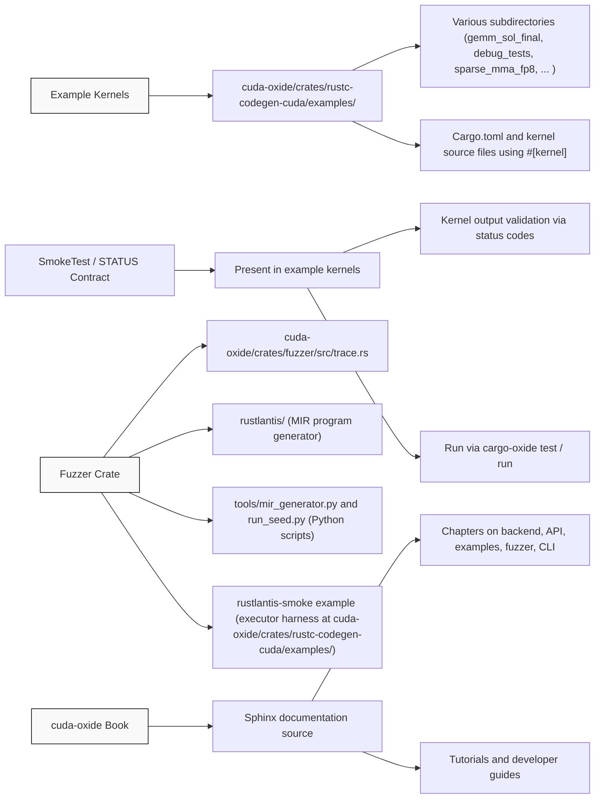
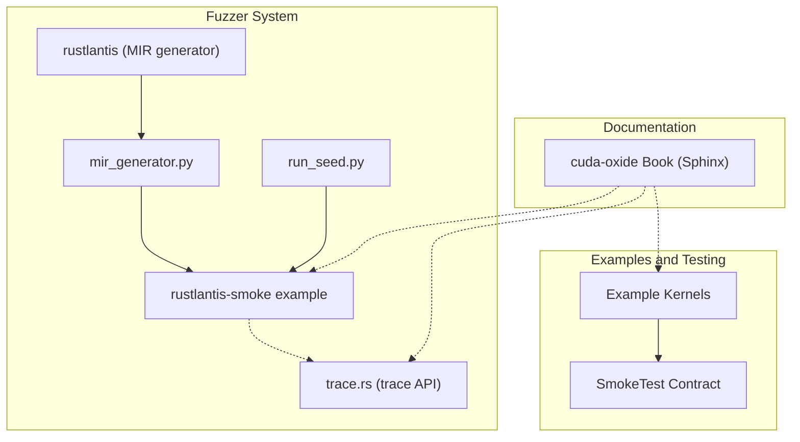

<!-- source: DeepWiki mcp.deepwiki.com · repo NVIDIA/cuda-rust · page 3.4 Examples, Fuzzer and the cuda-oxide Book · fetched 2026-10-26 -->

# Examples, Fuzzer and the cuda-oxide Book

Relevant source files

The following files were used as context for generating this wiki page:

- [cuda-oxide/Cargo.lock](cuda-oxide/Cargo.lock)
- [cuda-oxide/crates/fuzzer/README.md](cuda-oxide/crates/fuzzer/README.md)
- [cuda-oxide/crates/rustc-codegen-cuda/examples/cross_crate_merged_symbols/Cargo.lock](cuda-oxide/crates/rustc-codegen-cuda/examples/cross_crate_merged_symbols/Cargo.lock)
- [cuda-oxide/crates/rustc-codegen-cuda/examples/cutile_inter_kernel/Cargo.lock](cuda-oxide/crates/rustc-codegen-cuda/examples/cutile_inter_kernel/Cargo.lock)
- [cuda-oxide/crates/rustc-codegen-cuda/examples/debug-tests/Cargo.lock](cuda-oxide/crates/rustc-codegen-cuda/examples/debug-tests/Cargo.lock)
- [cuda-oxide/crates/rustc-codegen-cuda/examples/debug_pointer_locals/Cargo.lock](cuda-oxide/crates/rustc-codegen-cuda/examples/debug_pointer_locals/Cargo.lock)
- [cuda-oxide/crates/rustc-codegen-cuda/examples/gemm_sol_final/bench/README.md](cuda-oxide/crates/rustc-codegen-cuda/examples/gemm_sol_final/bench/README.md)
- [cuda-oxide/crates/rustc-codegen-cuda/examples/image_convolution/Cargo.lock](cuda-oxide/crates/rustc-codegen-cuda/examples/image_convolution/Cargo.lock)
- [cuda-oxide/crates/rustc-codegen-cuda/examples/kernel_reference_validity/Cargo.lock](cuda-oxide/crates/rustc-codegen-cuda/examples/kernel_reference_validity/Cargo.lock)
- [cuda-oxide/crates/rustc-codegen-cuda/examples/shared_memory_helper/Cargo.lock](cuda-oxide/crates/rustc-codegen-cuda/examples/shared_memory_helper/Cargo.lock)
- [cuda-oxide/crates/rustc-codegen-cuda/examples/sparse_mma_fp8/Cargo.lock](cuda-oxide/crates/rustc-codegen-cuda/examples/sparse_mma_fp8/Cargo.lock)

This page covers key components supporting testing, verification, and comprehensive documentation within the `cuda-oxide` crate of the NVIDIA `cuda-rust` monorepo. It details the extensive collection of example CUDA kernels, the fuzzer crate used for backend differential testing, the critical smoke test and STATUS contract for kernel correctness, and the structure and role of the core `cuda-oxide` documentation book.

---

## 1. Extensive Example Kernels

The `cuda-oxide/crates/rustc-codegen-cuda/examples/` directory hosts a broad collection of over 190 example kernels and test cases targeting different features, correctness scenarios, and performance characteristics of the Rust-to-CUDA compilation pipeline. These examples serve multiple purposes:

- **Validation of `#[kernel]` codegen and runtime execution** on actual GPUs.
- **Coverage of kernel API features**, including thread, warp, and cluster intrinsics, shared memory, atomics, and barriers.
- **Demonstration of corner cases and compiler backend correctness**.
- **Performance and smoke tests** for new features or bug regressions.

Typical example subdirectories include:

- `debug_pointer_locals`: Tests related to debugging support in kernels.
- `shared_memory_helper`: Illustrates safe use of shared memory.
- `gemm_sol_final/bench`: Benchmarks for GPU GEMM performance.
- `sparse_mma_fp8`: Features usage of sparse matrix MMA and FP8 data types.
- `cutile_inter_kernel`: Integration tests with the cutile tile-IR framework.
- `cross_crate_merged_symbols`: Validates symbol merging across crates.
- Others covering scheduling, synchronization, and intrinsic usage.

Each example often features a `Cargo.toml` and a minimal entry point `main.rs` or `lib.rs`, leveraging the `#[kernel]` attribute macros provided by `cuda-oxide` for device functions. These kernels are compiled and launched via the `cargo-oxide` tool (see section 3.3 in the TOC) which orchestrates compilation through `rustc-codegen-cuda` and runtime execution.

The examples are vital both for developers evolving the backend and users seeking proper usage patterns and templates.

---

## 2. STATUS / SmokeTest Contract

A central testing approach within the examples is the **STATUS or smoketest contract**. This contract is primarily implemented via *validation kernels* embedded within example test cases which:

- Run on GPU with a known deterministic workload.
- Produce a concise response or validation pattern to the host.
- Signal PASS or FAIL via output status codes or sentinel data in device buffers.

This contract allows automated CI and developer verification to ensure that changes to backend code generation, runtime, or device libraries do not break expected kernel behavior. The smoke test approach is minimalistic but effective for fast feedback.

`cargo-oxide` runs these smoke tests automatically when using commands like `cargo oxide test` or `cargo oxide run` on example projects.

---

## 3. The Fuzzer Crate (`cuda-oxide/crates/fuzzer`)

The **fuzzer crate** supports differential testing of the CUDA backend by generating and validating custom kernel cases dynamically. Its main components and functionality are:

- **`src/trace.rs`**: Defines a `no_std` trace API protocol used by CPU and GPU test runs to record internal state and variable values for comparison.
- **`rustlantis/` vendored adapter**: Bundles an upstream tool `rustlantis` that generates random MIR (Mid-level Intermediate Representation) programs suitable for fuzzing the Rust-to-CUDA compilation.
- **Python tools** under `tools/`:
  - `mir_generator.py`: Adapts a raw `rustlantis` seed program into a CUDA smoke test case compliant with `cuda-oxide`.
  - `run_seed.py`: Script to run generated fuzz seeds, optionally in batches.

### Fuzzer Workflow

1. **Seed generation**: `rustlantis` generates a random MIR-based Rust function.
2. **Adaptation**: `mir_generator.py` rewrites the output to replace `dump_var(...)` calls with calls into the fuzzer's trace API.
3. **Execution harness**: The `rustlantis-smoke` example in `rustc-codegen-cuda` runs the generated kernel both on CPU (oracle) and GPU.
4. **Trace Comparison**: CPU and GPU traces are converted to hashes (`u64`) for exact equality checks.

This system enables detection of subtle backend bugs due to floating point or control flow mismatches. The fuzzer runs many seeds often in CI and developer testing environments.

### Status Codes from Fuzzer Runs

- `PASS`: CPU and GPU traces agree exactly.
- `MISMATCH`: Trace differences indicate likely kernel bug.
- `COMPILE_FAIL [backend]`: Errors during kernel compilation or running.
- `UNSUPPORTED [adapter]`: The test case contains unsupported MIR features or types for codegen.

This fuzzer system includes schedule fuzzing to mutate PTX instructions with inserted delays, targeting schedule-sensitive concurrency bugs, including race conditions and deadlocks.

---

## 4. The cuda-oxide Book

`cuda-oxide` maintains a comprehensive **Sphinx-based documentation book** that serves as a developer and user manual for the entire Rust-for-CUDA toolchain. The book architecture is structured along the major crate components and user-facing features, with dedicated chapters covering:

- Overview and architecture.
- Compilation pipeline.
- Device and host APIs (kernel attributes, intrinsics).
- CLI commands and development workflows.
- Examples, benchmarks, and testing infrastructure.
- Integration with cutile-rs for tile-based IR programming.
- Tutorials, reference documentation, and best practices.

The book is continuously updated with the latest backend and runtime capabilities and acts as the primary canonical reference and onboarding material for contributors and users. It includes guides, tutorials (01-12), and reference pages for proc-macros, intrinsics, ABI conventions, and launch contracts.

The examples and fuzzer crates discussed above are referenced throughout the book to illustrate usage, testing strategies, and backend integration points.

---

## 5. Natural Language to Code Entities Mapping

The following diagrams bridge the conceptual components described in natural language to their corresponding code entities and files in the repository, focusing on examples, fuzzer, and documentation infrastructure:

---

## 6. Summary

This section (3.4) of the monorepo documentation highlights:

- The massive suite of example kernels which both serve as usage examples and correctness tests.
- The smoke testing contract embedded in these examples to assure stable backend and runtime correctness.
- The `fuzzer` crate, facilitating large-scale differential backend fuzz testing using generated MIR kernels.
- The `cuda-oxide` Sphinx documentation book as the authoritative source of knowledge, guiding users and developers.

Together, these components form a robust ecosystem supporting continuous verification, development, and user onboarding for the `cuda-oxide` Rust-to-CUDA compiler backend.

---

## References

- Example kernel Cargo lock files (e.g. `cuda-oxide/crates/rustc-codegen-cuda/examples/*/Cargo.lock`) reveal dependency setups and example crate details.
- Fuzzer crate README (`cuda-oxide/crates/fuzzer/README.md`) outlines its structure, tools, and usage.
- Sphinx book and documentation references are implied by the monorepo TOC but source is located within the repo docs directory (not shown here).
- Kernel smoke test contract and execution is implemented in example kernel harnesses and `cargo-oxide` CLI workflows.

Sources:  
`cuda-oxide/crates/rustc-codegen-cuda/examples/shared_memory_helper/Cargo.lock`  
`cuda-oxide/crates/rustc-codegen-cuda/examples/debug_pointer_locals/Cargo.lock`  
`cuda-oxide/crates/rustc-codegen-cuda/examples/cross_crate_merged_symbols/Cargo.lock`  
`cuda-oxide/crates/rustc-codegen-cuda/examples/sparse_mma_fp8/Cargo.lock`  
`cuda-oxide/crates/fuzzer/README.md`

---

