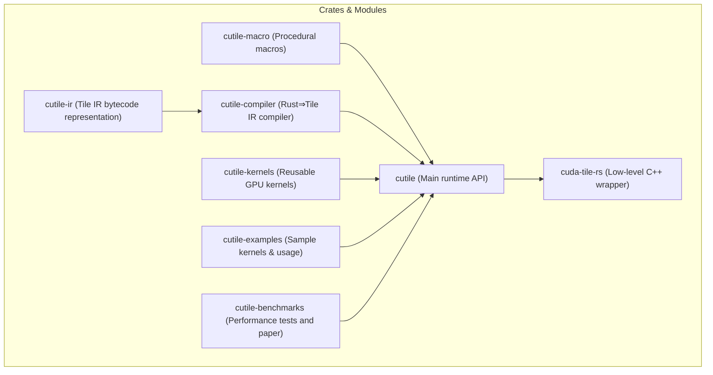
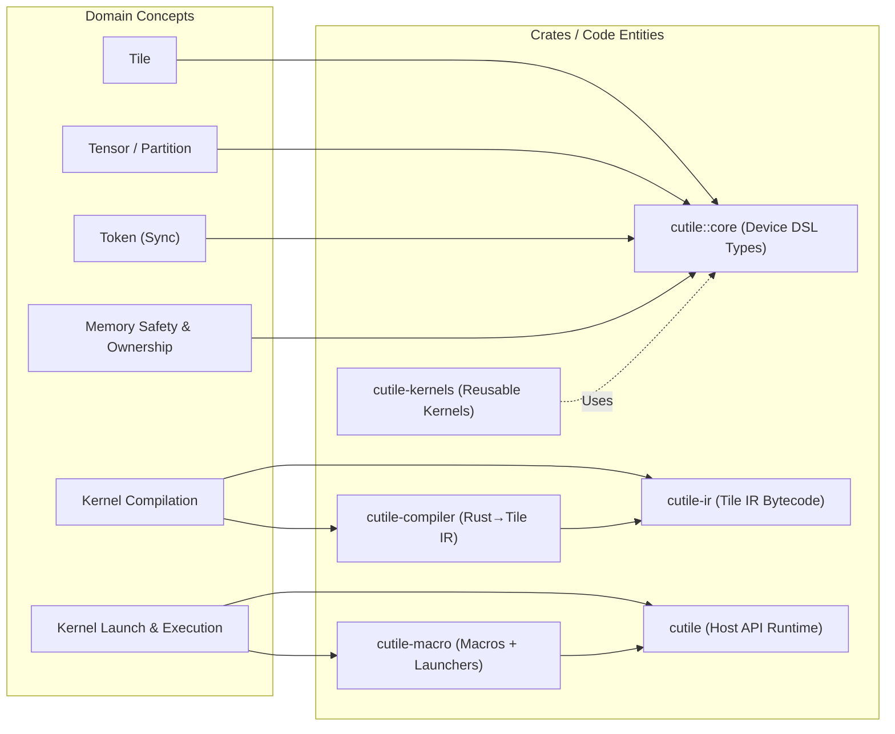
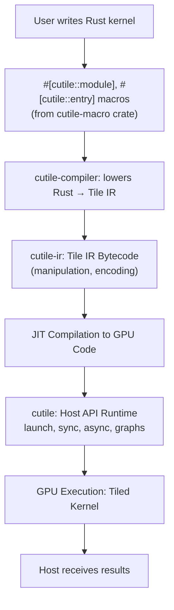

<!-- source: DeepWiki mcp.deepwiki.com · repo NVIDIA/cuda-rust · page 4 cutile-rs: Tile IR GPU Programming · fetched 2026-10-26 -->

# cutile-rs: Tile IR GPU Programming

<details>
<summary>Relevant source files</summary>

The following files were used as context for generating this wiki page:

- [cutile-rs/CHANGELOG.md](cutile-rs/CHANGELOG.md)
- [cutile-rs/CONTRIBUTING.md](cutile-rs/CONTRIBUTING.md)
- [cutile-rs/Cargo.lock](cutile-rs/Cargo.lock)
- [cutile-rs/Cargo.toml](cutile-rs/Cargo.toml)
- [cutile-rs/LICENSE](cutile-rs/LICENSE)
- [cutile-rs/README.md](cutile-rs/README.md)
- [cutile-rs/cutile-benchmarks/paper/README.md](cutile-rs/cutile-benchmarks/paper/README.md)
- [cutile-rs/cutile-book/tutorials/12-dgx-spark-inference.md](cutile-rs/cutile-book/tutorials/12-dgx-spark-inference.md)

</details>


The `cutile-rs` project provides a safe, Rust-native programming framework for writing high-performance GPU kernels using a tile-based model. It embodies a memory-safe, data-race-free approach to GPU programming built on the CUDA Tile Intermediate Representation (IR), leveraging Rust's ownership system to enforce exclusive and shared access to tensor data partitions on the GPU. This framework enables flexible kernel execution modes including synchronous launching, asynchronous futures with Rust `async`/`await`, and CUDA graph replay.

This page presents a high-level overview of the cuTile Rust framework, its main components, and how its various crates interoperate to provide a comprehensive GPU programming solution. For detailed documentation, tutorials, and technical insights, links to child pages are provided at the end.

---

## Overview of the cuTile Rust Framework

cuTile Rust (`cutile-rs`) centers around safe tile-based GPU computation by:

- Extending Rust’s ownership and borrowing rules to device kernels to ensure memory safety and data race freedom.
- Partitioning mutable outputs disjointly for exclusive updates while allowing shared read-only access to inputs.
- Representing GPU kernels using CUDA Tile IR, a low-level bytecode suited for tiling and efficient data movement.
- Supporting JIT compilation and caching of kernels specialized by runtime values and shapes.
- Providing ergonomic host APIs and procedural macros that generate GPU kernel launchers, synchronization primitives, and device operations.

The core `cutile` crate and its supporting crates are organized to separate concerns like device DSL types, compilation passes, macros, and host runtime management, making the system modular and extensible. 

A minimal example shows the idiomatic usage style, where a tensor operation like addition is expressed in a Rust kernel function annotated with `#[cutile::entry]` inside a `#[cutile::module]`. Inputs can be shared tensors, outputs are mutable partitions, and the host launches tiled kernel invocations:

```rust
#[cutile::module]
mod kernel {
    #[cutile::entry()]
    fn add<const B: i32>(
        z: &mut Tensor<f32, { [B] }>,
        x: &Tensor<f32, { [-1] }>,
        y: &Tensor<f32, { [-1] }>,
    ) {
        let tx = x.load_like(z);
        let ty = y.load_like(z);
        z.store(tx + ty);
    }
}

fn main() -> Result<(), Error> {
    let x = api::ones::<f32>(&[1024]);
    let y = api::ones::<f32>(&[1024]);
    let z = api::zeros::<f32>(&[1024]).partition([128]);

    let (z, _x, _y) = kernel::add(z, x, y).sync()?;
    let result = z.unpartition().to_host_vec().sync()?;
    assert_eq!(result, vec![2.0_f32; 1024]);
    Ok(())
}
```

This pattern illustrates how cuTile supports expression of fine-grained tile computations with disjoint ownership in a type-safe manner, and launch control on the host side.

Sources: [cutile-rs/README.md:1-177]()

---

## Core Concepts and Project Structure

cuTile Rust is composed of multiple crates, each with a defined purpose, combined into a workspace for seamless development and version compatibility. The workspace includes core libraries, compiler components, macros, kernel collections, examples, benchmarks, and tools for compilation and runtime execution.

Below is an outline of primary sub-projects within `cutile-rs`:



Each crate serves a distinct role but integrates closely. The `cutile` crate provides the host API and exposes device DSL types. The `cutile-macro` crate processes kernel definitions and generates safe kernel launchers. The `cutile-compiler` translates Rust kernel code into Tile IR bytecode. The `cutile-ir` crate models the Tile IR format and supports kernel serialization. Reusable optimized kernels live in `cutile-kernels`, while user-facing samples reside in `cutile-examples`, with benchmarks and reproduction data in `cutile-benchmarks`.

Version and feature dependencies within crates are pinned exactly to prevent breakage and ensure compatibility with the evolving Tile IR and CUDA toolkit support.

Sources: [cutile-rs/Cargo.toml:1-110](), [cutile-rs/README.md:1-177]()

---

## High-Level Subsystems in cuTile Rust

The various aspects of the framework organize into several broad subsystems, each supported by one or more crates:

### 1. Device DSL and Core Types

The device-side Domain Specific Language (DSL) defines the abstractions for safe, efficient GPU programming:

- **Tile**: represents a single computation tile with thread/block indices.
- **Tensor**: typed multi-dimensional data buffers on device.
- **Partition / PartitionMut**: disjoint "views" or subregions of mutable or immutable tensors that express alias-free ownership.
- **PartitionIndex**: indices for partitions supporting slicing and iteration.
- **Token**: lightweight synchronization objects representing operation completion.
- Support for atomic operations, shapes, rounding modes, ordering markers, and strongly typed pointer tiles.

These types enforce Rust's ownership and aliasing rules on the GPU, enabling reasoning about data races and memory safety at compile time.

For extensive details, see the child page:
- [Device DSL and Core Types](#4.1)

---

### 2. cutile-compiler: Rust to Tile IR

The compiler crate takes Rust kernel code and lowers it into Tile IR, performing:

- Expression, binary operator, intrinsic, and tile-op compilation.
- Type inference and bounds checks for safe memory accesses.
- Specialization based on kernel const generics and runtime tile shapes.
- Application of user hints and static code checks.

It outputs Tile IR bytecode modules that the JIT runtime loads and compiles to GPU code.

This subsystem depends directly on `cutile-ir`, which models the bytecode format, provides encoding/decoding, debugging info, and round-trip validation.

For in-depth coverage, see:
- [cutile-compiler: Rust to Tile IR](#4.2)
  - [cutile-ir: Bytecode Representation](#4.2.1)
  - [JIT Compilation, Caching and tileiras](#4.2.2)

---

### 3. cutile-macro and Kernel Launchers

The procedural macro crate enables ergonomic kernel definitions and safe launch code generation:

- Attributes like `#[cutile::module]` and `#[cutile::entry]` transform Rust functions into GPU kernels.
- Syntax validation and rank instantiation logic.
- Automatic generation of host-side launchers and device operation wrappers.
- Launch contracts and lifetime bookkeeping integration.

It connects user-defined kernels to the runtime host API seamlessly.

Further reading at:
- [cutile-macro and Kernel Launchers](#4.3)

---

### 4. Host API: Launching, Graphs and Autotuning

The host-side runtime manages kernel execution:

- **DeviceOp** compositional abstractions for building asynchronous GPU workflows.
- Multiple launch modes: synchronous, asynchronous/future-based, and CUDA graph replay.
- Facilities for warmup, benchmarking, and autotuning kernel specializations and launch parameters.
- Autotuner records management enabling performance tuning.

This layer interacts with CUDA driver APIs and the `cuda-async` crate for async operation handling.

For host runtime details, see:
- [Host API: Launching, Graphs and Autotuning](#4.4)

---

### 5. Kernels, Examples, and Benchmarks

To facilitate rapid development, cuTile provides:

- The `cutile-kernels` library with efficient implementations of popular GPU kernels like attention, GEMM, and norms.
- Ready-to-run `cutile-examples` demonstrating usage patterns and API idioms.
- `cutile-benchmarks` for performance evaluation and reproducing results from the cuTile research paper.

These crates are invaluable for practical insights and performance validation.

Explore:
- [Kernels, Examples and Benchmarks](#4.5)

---

### 6. cutile Book and Tutorials

A comprehensive Sphinx-based online book offers:

- Guides to understanding the cuTile architecture, concepts, and Rust integration.
- Stepwise tutorials (01-12) ranging from basic kernels to large-scale inference.
- Reference pages covering DSL APIs, compiler internals, and host APIs.
- Versioned builds to track the evolving API and feature set.

Visit:
- [cutile Book and Tutorials](#4.6)

---

## cuTile Rust Architecture Conceptual Diagrams

Below we illustrate the high-level relationship of natural language domain concepts to code entities in cuTile Rust.

### Diagram 1: Mapping Domain Concepts to Core Crates and Types



This diagram shows how domain concepts like tiles, tensors, synchronization tokens, and safety are implemented primarily in `cutile::core`. Kernel compilation revolves around the `cutile-compiler` and the Tile IR representation in `cutile-ir`. Kernel launching involves procedural macros in `cutile-macro` and host runtime logic in `cutile`. Common kernels live in `cutile-kernels`.

### Diagram 2: Workflow from Source Rust Kernel to Execution



This displays the typical data flow: the user writes kernels annotated with macros, which generate code compiled by the compiler crate into Tile IR bytecode modeled by `cutile-ir`. At runtime, kernels are JIT compiled and launched using the `cutile` runtime API, executing tiled kernels on GPU with safe memory access semantics.

---

## Summary

cuTile Rust (`cutile-rs`) offers an innovative GPU programming framework leveraging Rust's safety guarantees, tile-based execution, and CUDA Tile IR. Its modular architecture separates device DSL types, compiler passes, macros, kernel libraries, and runtime launching into specialized crates. This approach facilitates high productivity, safety, and performance on modern NVIDIA GPUs.

To dive into each area in detail, follow the links below:

- [Device DSL and Core Types](#4.1) — Tile, Tensor, Partition/PartitionMut, Token, atomics, shapes, pointer tiles, and safety marker types.
- [cutile-compiler: Rust to Tile IR](#4.2) — Compiler frontend passes compiling Rust kernels into Tile IR bytecode, with type inference, specialization, and static checks.
- [cutile-macro and Kernel Launchers](#4.3) — Kernel macro annotations, syntax validation, rank instantiation, and generation of launchers and device operation wrappers.
- [Host API: Launching, Graphs and Autotuning](#4.4) — Runtime APIs for launching kernels synchronously or asynchronously, CUDA graph replay, and autotuning support.
- [Kernels, Examples and Benchmarks](#4.5) — Library of reusable optimized kernels, example applications, and benchmarks including paper repro artifacts.
- [cutile Book and Tutorials](#4.6) — Comprehensive guides, tutorials, and reference documentation covering all aspects of cuTile Rust.

Exploring these child pages will provide you with the necessary technical depth to master cuTile Rust GPU programming.

---

Sources:  
[cutile-rs/README.md:1-177](), [cutile-rs/Cargo.toml:1-110](), [cutile-rs/CHANGELOG.md:1-130]()

---

