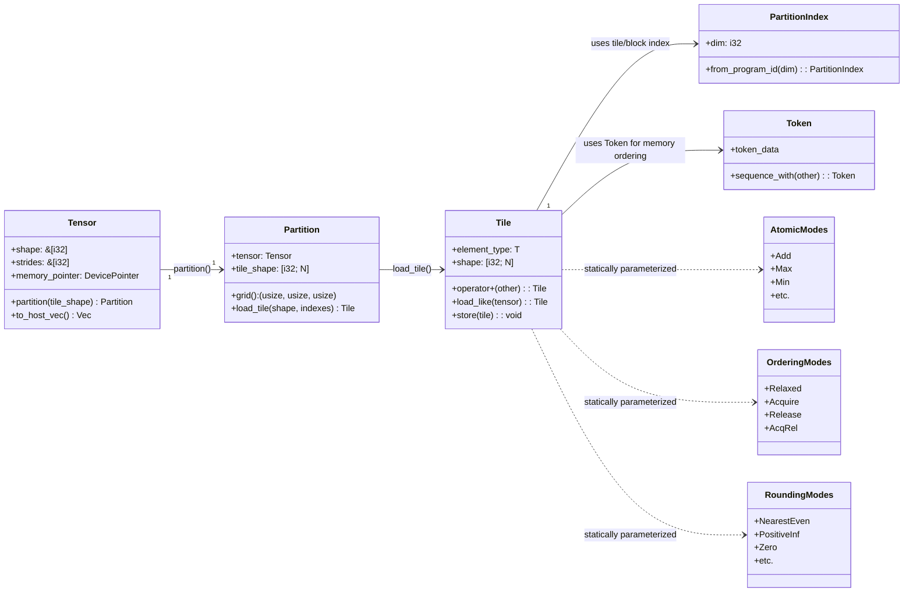

<!-- source: DeepWiki mcp.deepwiki.com · repo NVIDIA/cuda-rust · page 4.1 Device DSL and Core Types · fetched 2026-10-26 -->

# Device DSL and Core Types

<details>
<summary>Relevant source files</summary>

The following files were used as context for generating this wiki page:

- [cutile-rs/cutile-benchmarks/Cargo.toml](cutile-rs/cutile-benchmarks/Cargo.toml)
- [cutile-rs/cutile-benchmarks/benches/host_overhead.rs](cutile-rs/cutile-benchmarks/benches/host_overhead.rs)
- [cutile-rs/cutile-book/reference/dsl-api.md](cutile-rs/cutile-book/reference/dsl-api.md)
- [cutile-rs/cutile-compiler/src/compiler/compile_binary_op.rs](cutile-rs/cutile-compiler/src/compiler/compile_binary_op.rs)
- [cutile-rs/cutile-compiler/src/compiler/compile_cuda_tile_op.rs](cutile-rs/cutile-compiler/src/compiler/compile_cuda_tile_op.rs)
- [cutile-rs/cutile-compiler/src/compiler/compile_expression.rs](cutile-rs/cutile-compiler/src/compiler/compile_expression.rs)
- [cutile-rs/cutile-compiler/src/compiler/compile_global.rs](cutile-rs/cutile-compiler/src/compiler/compile_global.rs)
- [cutile-rs/cutile-compiler/src/compiler/compile_intrinsic.rs](cutile-rs/cutile-compiler/src/compiler/compile_intrinsic.rs)
- [cutile-rs/cutile-compiler/src/passes/type_inference.rs](cutile-rs/cutile-compiler/src/passes/type_inference.rs)
- [cutile-rs/cutile-examples/examples/scale_ptr.rs](cutile-rs/cutile-examples/examples/scale_ptr.rs)
- [cutile-rs/cutile-macro/src/rank_instantiation.rs](cutile-rs/cutile-macro/src/rank_instantiation.rs)
- [cutile-rs/cutile/src/_core.rs](cutile-rs/cutile/src/_core.rs)
- [cutile-rs/cutile/src/tensor.rs](cutile-rs/cutile/src/tensor.rs)
- [cutile-rs/cutile/tests/global_memory.rs](cutile-rs/cutile/tests/global_memory.rs)
- [cutile-rs/cutile/tests/gpu/audit_short_circuit.rs](cutile-rs/cutile/tests/gpu/audit_short_circuit.rs)
- [cutile-rs/cutile/tests/gpu/global_counter.rs](cutile-rs/cutile/tests/gpu/global_counter.rs)
- [cutile-rs/cutile/tests/ui.rs](cutile-rs/cutile/tests/ui.rs)
- [cutile-rs/cutile/tests/ui/global_block_scope.rs](cutile-rs/cutile/tests/ui/global_block_scope.rs)

</details>


This page documents the core types and DSL components of the cuTile Rust tile-based GPU programming framework within the `cutile-rs` crate. It covers the foundational abstractions used in device-side kernels expressed in Rust syntax and compiled to CUDA Tile IR, namely:

- **Tile**: Representing a tiled slice of a tensor held in thread-block-local registers/memory.
- **Tensor**: Typed multi-dimensional GPU buffer with shape and strides.
- **Partition / PartitionMut**: Logical division of tensors into tiles for GPU parallel processing.
- **PartitionIndex**: Representation of tile/block indices.
- **Token**: Ordering tokens to ensure correct sequencing of device memory operations.
- **Atomics**: Modes and types for atomic operations in device code.
- **Shapes and Rounding/Ordering Marker Types**: Marker traits and ZST (zero-sized types) used in static dispatch to parameterize device operations.
- **Pointer Tiles**: Representing device pointers to tiles for raw memory access.

These abstractions form the building blocks for writing safe, ergonomic, and high-performance CUDA kernels using cuTile, which compiles Rust-like code into efficient GPU code leveraging NVIDIA's CUDA Tile IR.

---

## 1. Purpose and Scope

This page explains the Rust-side device DSL (`cutile::core::*`) types and traits that underpin GPU kernel programming in cuTile Rust. These core types correspond closely to Tile IR concepts and map to efficient statically-typed GPU code with zero-cost abstractions. It also covers the marker types and traits used for encoding rounding modes, memory ordering, atomics, and other compiler-specialization parameters in a type-safe manner.

We provide detailed explanations of the key structs/classes, static type-level parameters, and core data flow concepts for tensors, tiles, partitions, and synchronization tokens. Relevant compiler mechanics related to these types are cross-referenced.

---

## 2. Core DSL Types and Concepts

The core device DSL types reside in the crate `cutile-rs/cutile/src/_core.rs` namespace and related modules such as `tensor.rs`. They are designed to represent the multi-dimensional GPU array and tiling abstractions required for tile-based GPU programming.

### 2.1 Tile

A `Tile<T, const S: [i32; N]>` represents a tile of elements in device registers or shared memory, where `T` is the element type and `S` is a constant shape array specifying the tile's extent in each dimension. Tiles correspond typically to the threads in a CUDA thread block operating on a view (partition) of a tensor.

The `Tile` type is parameterized by element type and shape as a const generic param. Tiles support arithmetic operations, indexing, load/store from/to tensors, and device-side computation. They are essentially statically shaped vector-like values mirrored from the Tile IR `tile<shape x elem>`.

### 2.2 Tensor

The `Tensor<T>` type encapsulates a multi-dimensional buffer located on the GPU device memory. It manages raw device memory allocation through the RAII wrapper `DeviceBuffer` from the `cuda_async` crate, tracks shape and strides, and offers zero-copy reshape and view functions.

Key features of `Tensor<T>`:

- Maintains the shape, strides, and size of the buffer (`Tensor` is a smart pointer).
- Provides methods for device-CPU data transfer.
- Is thread-safe (`Send` and `Sync`).
- Supports partitioning into tiles for kernel launches.

The `Tensor` API is designed for safe usage and convenient interoperability with kernel partitions and device-side tiles.

### 2.3 Partition and PartitionMut

`Partition<Tensor<T>>` and `PartitionMut<Tensor<T>>` provide tiled views over tensors, dividing the tensor into disjoint tiles. Each tile maps to a CUDA thread block, enabling parallel GPU processing on independent partitions.

Features:

- Compute launch grids automatically based on tensor and partition tile shapes.
- Supports partial tiles on tensor edges (bounds checked or padded at runtime).
- Provides zero-cost abstractions as metadata-only wrappers, incurring no runtime overhead.
- Supports safe concurrency and indexing APIs.

The partition abstraction allows users to write kernels that address their data in tiles aligned to CUDA thread blocks, abstracting grid/block calculations.

### 2.4 PartitionIndex

`PartitionIndex` encodes the index of the current tile in a grid. It represents the multi-dimensional CUDA block index (`blockIdx`) and is used to compute offsets for tile loads/stores. It is an integral part of safely indexing partitions to tiles in device kernels.

### 2.5 Token

`Token` represents a sequencing token related to a tensor or memory region that is used to order device memory operations. This is essential to expressing dependencies and ensuring correct synchronization between loads, stores, atomic updates, and other memory accesses.

In cuTile Rust, tokens are threaded through operations and loops so that the compiler and runtime can maintain correct synchronization without explicit barriers or fences by the user.

---

## 3. Marker Types and Parameter Modules

cuTile Rust employs zero-sized types (ZSTs) and marker traits extensively to model static dispatch parameters. These modules are implemented in `cutile-rs/cutile/src/_core.rs` and exported to the device DSL. Their design mirrors the static operation parameters from the CUDA Tile IR specification.

For example:

- **ftz (Flush-To-Zero)**: Marker structs `Enabled` and `Disabled` implement trait `ftz::Mode`. This configures whether denormal floating-point inputs/outputs are flushed to zero (`f32` only).
  
- **rounding**: Contains marker traits and structs like `NearestEven`, `PositiveInf`, `Zero` etc., representing floating-point rounding modes for operations. All implement the `rounding::Mode` trait.

- **allocation**: Marker types `Local` and `Global` for whether an automatic allocation's address is shared across tile threads.

- **fast_acc**: Marker for whether "fast" accumulation mode is enabled in floating-point raw matrix multiply operations.

- **saturating**: Marker for saturation behavior in float-to-integer conversions.

- **nan**: NaN propagation on max/min float operations.

- **atomic**: Enumeration of atomic read-modify-write modes (Add, And, Or, Max, Min, etc.) as marker structs implementing `atomic::Mode`.

- **ordering**: Models memory ordering constraints for loads, stores, and atomics: `Weak`, `Relaxed`, `Acquire`, `Release`, `AcqRel` with appropriate traits restricting applicability (e.g., `LoadMode`, `StoreMode`, `AtomicMode`).

- **scope**: Memory scope for atomics: `TileBlock`, `Device`, `System`.

- **tma**: Whether TMA (Tensor Memory Accelerator) optimization hints are enabled.

This system encodes static dispatch hints and options at compile time in the Rust type system, allowing the JIT compiler to generate specialized Tile IR and GPU code accordingly with zero runtime overhead.

---

## 4. Atomics and Memory Ordering

Atomic operations and memory ordering are a first-class concern in the cuTile DSL since GPU concurrency semantics depend heavily on ordering guarantees.

The atomic modes (`atomic::Mode`) precisely map to Tile IR atomic RMW operations, and the memory ordering modes (`ordering::Mode`) reflect Tile IR's allowed options for loads, stores, and atomics with trait constraints to ensure correctness.

Memory scopes (`scope::Mode`) specify the granularity of synchronization: tile-block-local, device-wide, or system-wide.

By encoding these statically, kernel programmers can invoke atomic ops like `atomic_add` with correct static qualifiers and the compiler emits the corresponding Tile IR `atomic_rmw_tko` operations with ordering and scope attributes.

---

## 5. Shapes and Pointer Tiles

- Shapes are represented as const generics with arrays like `[i32; N]`, modeling the dimensionality statically in both `Tensor<T, S>` and `Tile<T, S>`.

- Pointer tiles represent low-level device pointers with Tile semantics (`*mut TileType`) allowing raw device pointer manipulation in kernels when needed.

---

## 6. Data Flow and Typical Usage

A typical usage flow for device kernels:

1. **Host Side**: Allocate and initialize a `Tensor<T>` with known shape.

2. Partition the tensor into disjoint tiles using `.partition(tile_shape)` producing a `Partition<Tensor<T>>` view.

3. Launch a kernel with this partition view, where:

   - Kernel entry point receives mutable references to partitioned (output) tensors and/or immutable references for inputs.

   - Inside the kernel, use `program_id(dim)` to get tile/block index.

   - Use `load_tile` on input tensors or tiles to produce `Tile<T, S>` values representing tile-local data.

   - Perform arithmetic on tiles using overloaded operators.

   - Use `store` to write tiles back to output partition.

4. The device compiler translates all DSL calls into Tile IR, recording memory ordering, atomic modes, rounding modes, and emits highly specialized code.

---

## 7. Class and Module Relationship Diagram



---

## 8. Natural Language to Code Entity Mapping

### 8.1 Core Types Mapping

```mermaid
graph TD
    A["GPU Memory: Multi-dimensional Array"] -->|Managed by| B[TENSOR<T>]
    B -->|Partitioned into tiles| C[PARTITION<TENSOR<T>>]
    C -->|Process tile| D[TILE<T, SHAPE>]
    D -->|Indexed by| E[PartitionIndex]
    D -->|Synchronize| F[Token]
    D -->|Atomic ops with| G[AtomicModes]
    D -->|Memory ordering| H[OrderingModes]
    D -->|Floating-point rounding| I[RoundingModes]

    subgraph Code Entities
        B --> cutile-rs/cutile/src/tensor.rs [`Tensor, Partition, IntoPartition`]
        D --> cutile-rs/cutile/src/_core.rs [`Tile`, Marker Types]
        E --> inferred from partition/blockIdx usage
        F --> cutile-rs/cutile/src/_core.rs [`Token`]
        G --> cutile-rs/cutile/src/_core.rs [`atomic` mod]
        H --> cutile-rs/cutile/src/_core.rs [`ordering` mod]
        I --> cutile-rs/cutile/src/_core.rs [`rounding` mod]
    end
```

### 8.2 Kernel Entry Parameters Mapping

```mermaid
graph TD
    KernelEntry["#[cutile::entry()] Kernel Function"] -->|First param mutable| Output[&mut Tensor<E, S> (Partitioned)]
    KernelEntry -->|Inputs| Input1[&Tensor<E, S>]
    KernelEntry -->|Scalars| ScalarParams[f32, i32, etc.]
    KernelEntry -->|Pointers| RawPtrs[*mut T, *const T]

    Output --> cutile-rs/cutile-book/reference/dsl-api.md
    Input1 --> cutile-rs/cutile-book/reference/dsl-api.md
    ScalarParams --> compile-time const generics and rust primitives
    RawPtrs --> DevicePointer in cuda_async crate

```

---

## 9. Key Functions and Traits

### 9.1 Partitioning Traits (`cutile-rs/cutile/src/tensor.rs`)

- **IntoPartition** trait allows converting a tensor into a tiled partition view.

- **Unpartition** converts a partition view back to the underlying tensor.

- **ToHostVec** provides asynchronous GPU-to-CPU copy.

### 9.2 Load/Store on Tiles (`cutile-rs/cutile/src/_core.rs` and `tensor.rs`)

- `load_like` and `load_tile` methods on tensors/partitions load tiles corresponding to thread block indices.

- `store` stores tile data back into tensor partitions.

### 9.3 Marker Trait Pattern (in `_core.rs`)

- Marker structs implement empty traits (`Mode`) marking static operation parameters.

- Used for static dispatching tile IR instructions with compile-time known parameters.

---

## 10. Implementation Notes and Data Flow

- The device DSL's static parameters (rounding, atomics, memory ordering) are encoded as empty type-level structs and traits to enable `#[cuda_tile::op]` macro attribute specialization during kernel compilation.

- The `Token` type represents ordering dependencies between memory operations. It is used internally by the compiler to maintain safe memory accesses without explicit synchronization in code.

- The compiler back-end translates high-level Rust code using these types to Tile IR bytecode with precise control of memory semantics, atomics, rounding, and partition indexing.

- Tensors abstract GPU device memory buffers with shape metadata, and partitions overlay tiled views enabling per-thread-block data processing.

- Tiles represent fixed-shape, register- or shared-memory-resident arrays processed inside thread blocks.

---

## 11. Summary Table of Marker Modules in `_core.rs`

| Module          | Purpose                                   | Marker Types Example                |
|-----------------|-------------------------------------------|-----------------------------------|
| `ftz`           | Flush-To-Zero mode (float denorms)             | `Enabled`, `Disabled`              |
| `rounding`      | Floating-point rounding modes                     | `NearestEven`, `PositiveInf`       |
| `allocation`    | Automatic allocation address sharing               | `Local`, `Global`                  |
| `fast_acc`      | Fast accumulation in matmul                         | `Enabled`, `Disabled`              |
| `saturating`    | Saturation in float-to-int conversions               | `Enabled`, `Disabled`              |
| `nan`           | NaN propagation in max/min                       | `Enabled`, `Disabled`              |
| `atomic`        | Atomic RMW operations                         | `Add`, `And`, `Or`, `Max`, `Min`  |
| `ordering`      | Memory ordering for loads/stores/atomics           | `Weak`, `Relaxed`, `Acquire`       |
| `scope`         | Memory scope for atomics/load-store                   | `TileBlock`, `Device`, `System`     |
| `tma`           | Tensor Memory Accelerator optimization hint              | `Enabled`, `Disabled`              |

---

## 12. References and Sources

- Marker types and static parameter modules: `cutile-rs/cutile/src/_core.rs:1-218`  
- Tensor, Partition, and partitioning traits: `cutile-rs/cutile/src/tensor.rs:1-209`  
- Kernel entry point and DSL usage examples: `cutile-rs/cutile-book/reference/dsl-api.md:1-161`  
- Atomic memory ordering and related marker types: `cutile-rs/cutile/src/_core.rs:99-182`  
- Tests referencing Global memory usage as a related abstraction: `cutile-rs/cutile/tests/global_memory.rs:1-196`  
- Compiler-side static parameter markers usage for op compilation: `cutile-rs/cutile-compiler/src/compiler/compile_cuda_tile_op.rs`, `compile_intrinsic.rs`

Sources:  
`cutile-rs/cutile/src/_core.rs:1-218`  
`cutile-rs/cutile/src/tensor.rs:1-209`  
`cutile-rs/cutile-book/reference/dsl-api.md:1-161`  
`cutile-rs/cutile/tests/global_memory.rs:1-196`  
`cutile-rs/cutile-compiler/src/compiler/compile_cuda_tile_op.rs:1-181`  
`cutile-rs/cutile-compiler/src/compiler/compile_intrinsic.rs:1-172`

---

