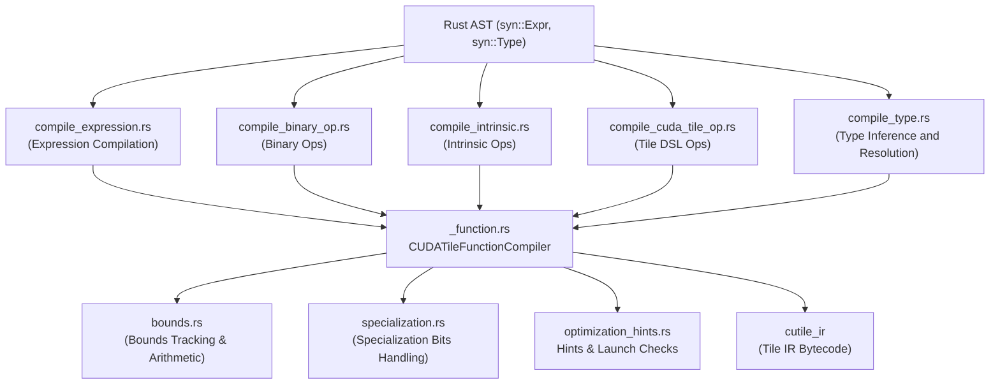

<!-- source: DeepWiki mcp.deepwiki.com · repo NVIDIA/cuda-rust · page 4.2 cutile-compiler: Rust to Tile IR · fetched 2026-10-26 -->

# 4.2 cutile-compiler: Rust to Tile IR

Relevant source files

The following files were used as context for generating this wiki page:

- [cutile-rs/cuda-tile-rs/Cargo.toml](cutile-rs/cuda-tile-rs/Cargo.toml)
- [cutile-rs/cutile-compiler/Cargo.toml](cutile-rs/cutile-compiler/Cargo.toml)
- [cutile-rs/cutile-compiler/src/bounds.rs](cutile-rs/cutile-compiler/src/bounds.rs)
- [cutile-rs/cutile-compiler/src/compiler/_function.rs](cutile-rs/cutile-compiler/src/compiler/_function.rs)
- [cutile-rs/cutile-compiler/src/compiler/_module.rs](cutile-rs/cutile-compiler/src/compiler/_module.rs)
- [cutile-rs/cutile-compiler/src/compiler/compile_binary_op.rs](cutile-rs/cutile-compiler/src/compiler/compile_binary_op.rs)
- [cutile-rs/cutile-compiler/src/compiler/compile_cuda_tile_op.rs](cutile-rs/cutile-compiler/src/compiler/compile_cuda_tile_op.rs)
- [cutile-rs/cutile-compiler/src/compiler/compile_expression.rs](cutile-rs/cutile-compiler/src/compiler/compile_expression.rs)
- [cutile-rs/cutile-compiler/src/compiler/compile_inline.rs](cutile-rs/cutile-compiler/src/compiler/compile_inline.rs)
- [cutile-rs/cutile-compiler/src/compiler/compile_intrinsic.rs](cutile-rs/cutile-compiler/src/compiler/compile_intrinsic.rs)
- [cutile-rs/cutile-compiler/src/compiler/compile_type.rs](cutile-rs/cutile-compiler/src/compiler/compile_type.rs)
- [cutile-rs/cutile-compiler/src/generics.rs](cutile-rs/cutile-compiler/src/generics.rs)
- [cutile-rs/cutile-compiler/src/kernel_entry_generator.rs](cutile-rs/cutile-compiler/src/kernel_entry_generator.rs)
- [cutile-rs/cutile-compiler/src/passes/mod.rs](cutile-rs/cutile-compiler/src/passes/mod.rs)
- [cutile-rs/cutile-compiler/src/specialization.rs](cutile-rs/cutile-compiler/src/specialization.rs)
- [cutile-rs/cutile-compiler/src/specialization_tests.rs](cutile-rs/cutile-compiler/src/specialization_tests.rs)
- [cutile-rs/cutile-compiler/src/types.rs](cutile-rs/cutile-compiler/src/types.rs)
- [cutile-rs/cutile-examples/examples/scale_ptr.rs](cutile-rs/cutile-examples/examples/scale_ptr.rs)
- [cutile-rs/cutile/src/_core.rs](cutile-rs/cutile/src/_core.rs)
- [cutile-rs/cutile/tests/basics_and_inlining.rs](cutile-rs/cutile/tests/basics_and_inlining.rs)
- [cutile-rs/cutile/tests/bitwise_and_bitcast_ops.rs](cutile-rs/cutile/tests/bitwise_and_bitcast_ops.rs)
- [cutile-rs/cutile/tests/memory_and_atomic_ops.rs](cutile-rs/cutile/tests/memory_and_atomic_ops.rs)
- [cutile-rs/cutile/tests/specialization_bits.rs](cutile-rs/cutile/tests/specialization_bits.rs)
- [cutile-rs/cutile/tests/tensor_and_matrix_ops.rs](cutile-rs/cutile/tests/tensor_and_matrix_ops.rs)

This section provides a high-level overview of the compiler frontend in the `cutile-compiler` crate that translates Rust kernels written in the cuTile DSL into NVIDIA's Tile Intermediate Representation (Tile IR). The compiler frontend is responsible for multiple passes that progressively interpret, check, and lower Rust code into Tile IR operations with full type information and correctness guarantees.

The `cutile-compiler` focuses on handling expression compilation, binary operations, intrinsic and Tile IR op generation, type inference, bounds analysis, specialization, hints propagation, and correctness checks. It is designed as a self-contained compiler emitting Tile IR without wrapping legacy compiler layers. This page serves as a parent overview that explains the main concepts and relationships in this compilation pipeline and links to child pages for detailed per-topic technical documentation.

---

## 4.2.1 Compiler Frontend Passes: Overview

The `cutile-compiler` pipeline is organized into several passes and modules which together handle the translation of Rust kernel code into Tile IR bytecode. The main responsibilities of the frontend include:

- **Expression Compilation**: Transform Rust `syn::Expr` AST nodes into Tile IR operations, recursively compiling sub-expressions, managing operator dispatch, and handling control flow constructs such as loops, conditionals, and blocks.

- **Binary Operation and Intrinsic Compilation**: Decode and translate Rust binary operations and intrinsic calls into corresponding Tile IR instructions, including arithmetic, logical, and special CUDA Tile operations.

- **Tile Operation Compilation**: Process annotated Tile DSL operators (`#[cuda_tile::op]`), interpreting static parameters and turning calls into Tile IR operations with appropriate attributes and metadata.

- **Type Inference and Checking**: Infer and resolve the types of expressions and values within the Tile DSL, producing `TileRustType` representations tied to Tile IR type structures. This passes ensure type correctness and compatibility with the Tile IR type system.

- **Bounds Tracking and Checking**: Use an integer interval arithmetic framework for static bounds analysis of dimension and indexing expressions to detect out-of-bounds accesses and optimize bounds checking.

- **Specialization and Optimization Hints**: Handle specialization bits and attributes that guide code generation, such as enabling/disabling TMA (Tensor Memory Accelerator), fast accumulation modes, rounding modes, and memory ordering optimizations.

- **Hints and Checks Propagation**: Analyze and propagate compiler hints (e.g., launch-time checks, optimization directives) throughout the compilation, enabling hoisting of invariant checks and ensuring runtime safety.

Together, these passes form a comprehensive compiler frontend that ensures Rust-based GPU kernels written in the cuTile DSL are faithfully and efficiently translated into Tile IR, where they become the input for further JIT compilation and execution.

---

## 4.2.2 Relationships Between Core Compiler Components

The `cutile-compiler` crate contains several submodules each handling a specialization of these frontend duties. The key code entities of the compiler map closely to the major pass categories:

**Diagram 1:** Mapping from natural language compiler concepts to primary Rust compiler source files and core classes.

Note how each compilation pass works with the central `CUDATileFunctionCompiler` struct (`_function.rs`), which orchestrates compilation per function and accumulates insights such as type information, optimization hints, and launch checks in one place.

---

## 4.2.3 Expression, Binary and Intrinsic Compilation

The frontend recursively interprets Rust expressions (`syn::Expr`) and compiles them directly to Tile IR operations. This is primarily handled in the `compile_expression.rs` module, which performs a mechanical port of the original frontend logic into the new compiler. Expression compilation includes:

- Translating control flow constructs like `if`, `for`, and `while` loops.
- Handling binary operators through `compile_binary_op.rs` and mapping Rust operators to Tile IR ops.
- Supporting intrinsic function calls and custom macro intrinsics within the DSL, compiled via `compile_intrinsic.rs`.
- Managing static (zero-sized) compile-time marker types like rounding modes, flush-to-zero flags, and atomic modes, propagating these as static attributes.
  
For example, expressions that use intrinsic Tile operations or utilize compiler-op markers are converted into Tile IR with specialized builder utilities (see `OpBuilder`, `append_op` in `cutile_ir::builder`).

The passes also track mutability, token ownership (for ordering and synchronization), and static shape information via specialized types `TileRustValue` and `TileRustType` to ensure correctness while compiling complex DSL code.

---

## 4.2.4 Type Inference and TileRustType Compilation

The compiler frontend converts Rust `syn::Type` AST nodes to the `TileRustType` representation in `compile_type.rs`, wrapping Tile IR types with extensions to hold Rust type metadata and DSL-specific traits.

- Primitive Rust scalar types map straightforwardly to Tile IR scalar types.
- Structured and user-defined types are instantiated with embedded shape information for tensors, tiles, partitions, and dimension maps.
- Enum, tuple, and array types are supported, including compile-time constant shape arrays.

Type compilation runs eagerly during frontend passes and is important for subsequent IR generation and verification steps.

---

## 4.2.5 Bounds Tracking and Static Analysis

Using the `bounds.rs` module, the compiler tracks integer value ranges statically throughout AST expressions. This interval arithmetic supports:

- Compile-time verification of indexing expressions for out-of-bounds detection.
- Hoisting of checks outside loops when possible.
- Support for operations like add, sub, mul, div with saturation to widen bounds safely.

Bounds analysis propagates ranges through the compiler passes during IR emission and check optimization, enabling sound and performant safety instrumentation.

---

## 4.2.6 Specialization Bits, Hints, and Launch Checks

The compiler supports a system of *specialization bits* and *hints* that control code generation patterns and optimizations.

- Static parameters, typically zero-sized types (e.g., `ftz::Enabled`), are resolved in `compile_cuda_tile_op.rs` and `compile_intrinsic.rs`.
- The `resolve_static_params` function parses static parameters mapping (e.g., `param_name={Enabled: attr=val}`) from function attributes to Tile IR named attributes.
- Attributes control accumulation modes, TMA usage hints, rounding modes, memory ordering, and atomic operation semantics.
- Launch-time and runtime validation checks are hoisted and managed in the core compiler struct, ensuring kernel parameters meet safety contracts before execution.

---

## 4.2.7 Kernel Entry and Launch Preparation

Kernel entry generation is a key step where the compiler wraps a Rust kernel signature into a Tile IR entry-point function with all requisite parameter handling and validation. This is covered in the `kernel_entry_generator.rs` module.

- Kernel parameters (tensors, partitions, scalars) are analyzed and converted into explicit Tile IR function arguments.
- Shape and stride metadata are unpacked and passed to Tile IR for runtime checks.
- Special hooks enable efficient parameter unpacking, argument mutability accounting, and runtime launch-time validation setup.
- The compiler is aware of maximum supported tensor ranks and specialization rules to enforce correctness.

---

## 4.2.8 Inline Expansion and Call Site Management

Inline function calls and method inlining within kernels are handled in `compile_inline.rs`. The compiler manages:

- Mapping caller arguments to callee parameters, tracking generic arguments via `GenericArgInference`.
- Generating IR for inlined bodies with accurate source location and debug info preservation.
- Copying mutable metadata and token updates between caller and callee contexts.
- Maintaining module scope and call-site stacks to enable complex nested transformations without losing diagnostic clarity.

---

## Further Detail and Child Pages

This overview introduces the key aspects of the `cutile-compiler` Rust to Tile IR frontend. More detailed and focused documentation is available in the following child pages:

- **[cutile-ir: Bytecode Representation](#4.2.1)** — Covers Tile IR module data model, writer/decoder, encoding formats, enum representations, debug information, binary version negotiation, and validation.

- **[JIT Compilation, Caching and tileiras](#4.2.2)** — Describes TileFunctionKey specialization keys, the cache design for compiled kernels, launch-site-specific cache usage, and how the `tileiras` toolchain integrates with the frontend outputs.

These child pages delve into bytecode structure, compilation orchestration beyond frontend passes, and runtime considerations.

---

# Summary Table of Core Compiler Modules

| Module                         | Responsibility                                          | Code Entity / Type                 |
|-------------------------------|---------------------------------------------------------|----------------------------------|
| `compile_expression.rs`        | Expression AST to Tile IR translation                   | Expression compiler passes        |
| `compile_binary_op.rs`         | Binary op mapping from Rust to Tile IR                  | Binary operation compiler         |
| `compile_intrinsic.rs`         | Intrinsic call compilation and macro execution          | Intrinsic compiler passes         |
| `compile_cuda_tile_op.rs`      | Tile-specific DSL op resolution and Tile IR emission    | Tile operation compiler           |
| `compile_type.rs`              | Type inference and TileRustType generation              | Type compiler                    |
| `bounds.rs`                   | Static bounds arithmetic and interval analysis          | Bounds tracking and computations  |
| `kernel_entry_generator.rs`    | Kernel argument unpacking, validation, and entry IR gen | Kernel entry generator struct     |
| `compile_inline.rs`            | Inline expansion of calls in Tile IR                     | Inline call compiler              |
| `_function.rs`                 | Central compilation context and orchestration class     | `CUDATileFunctionCompiler`        |

---

# Glossary

- **Tile IR**: A bytecode intermediate representation for NVIDIA CUDA Tile GPU kernels.
- **TileRustType**: Rust struct representing Tile DSL types with Tile IR type linkage.
- **CUDATileFunctionCompiler**: Core Rust struct orchestrating the compilation of a single kernel or function to Tile IR.
- **Specialization Bits**: Compile-time flags controlling kernel specialization and optimization.
- **Static Params**: Zero-sized compile-time types (e.g., rounding modes) affecting IR attributes.
- **Launch Checks**: Validations run during kernel launch to ensure parameter correctness.
- **Token**: An ordering/synchronization construct for enforcing memory ordering in Tile IR.

---

# References in Code

- Core compiler struct `CUDATileFunctionCompiler`: [`cutile-rs/cutile-compiler/src/compiler/_function.rs:43-99`]()
- Expression compilation: [`cutile-rs/cutile-compiler/src/compiler/compile_expression.rs:1-149`]()
- Intrinsic compilation and static param resolution: [`cutile-rs/cutile-compiler/src/compiler/compile_intrinsic.rs:1-180`]()
- Tile op compilation and static parameter resolution: [`cutile-rs/cutile-compiler/src/compiler/compile_cuda_tile_op.rs:1-180`]()
- Type compilation and inference: [`cutile-rs/cutile-compiler/src/compiler/compile_type.rs:1-142`]()
- Bounds tracking arithmetic: [`cutile-rs/cutile-compiler/src/bounds.rs:1-198`]()
- Kernel entry generation: [`cutile-rs/cutile-compiler/src/kernel_entry_generator.rs:1-179`]()
- Inline function call handling: [`cutile-rs/cutile-compiler/src/compiler/compile_inline.rs:1-148`]()
- Marker types and static params traits: [`cutile-rs/cutile/src/_core.rs:1-218`]()
- Compiler pass pipeline declaration: [`cutile-rs/cutile-compiler/src/passes/mod.rs:1-45`]()  

---

This page forms the foundation for understanding the rust-based frontend for Tile IR generation in the `cuda-rust` monorepo. Refer to the linked child pages for comprehensive technical details on Tile IR representation and the runtime compilation infrastructure. 

Sources:  
`cutile-rs/cutile-compiler/src/compiler/_function.rs:1-99`  
`cutile-rs/cutile-compiler/src/compiler/compile_expression.rs:1-149`  
`cutile-rs/cutile-compiler/src/compiler/compile_intrinsic.rs:1-180`  
`cutile-rs/cutile-compiler/src/compiler/compile_cuda_tile_op.rs:1-180`  
`cutile-rs/cutile-compiler/src/compiler/compile_type.rs:1-142`  
`cutile-rs/cutile-compiler/src/bounds.rs:1-198`  
`cutile-rs/cutile-compiler/src/kernel_entry_generator.rs:1-179`  
`cutile-rs/cutile-compiler/src/compiler/compile_inline.rs:1-148`  
`cutile-rs/cutile/src/_core.rs:1-218`  
`cutile-rs/cutile-compiler/src/passes/mod.rs:1-45`

---

