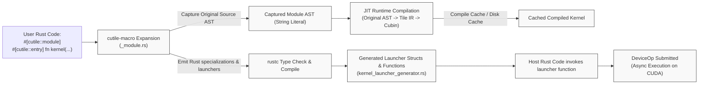
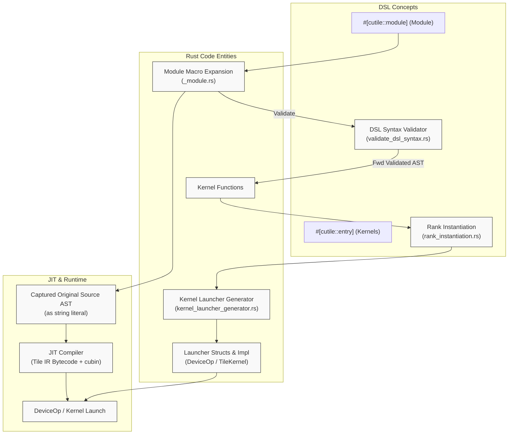

<!-- source: DeepWiki mcp.deepwiki.com · repo NVIDIA/cuda-rust · page 4.3 cutile-macro and Kernel Launchers · fetched 2026-10-26 -->

# 4.3 cutile-macro and Kernel Launchers

<details>
<summary>Relevant source files</summary>

The following files were used as context for generating this wiki page:

- [cutile-rs/cutile-book/tutorials/01-hello-world.md](cutile-rs/cutile-book/tutorials/01-hello-world.md)
- [cutile-rs/cutile-compiler/src/cuda_tile_runtime_utils.rs](cutile-rs/cutile-compiler/src/cuda_tile_runtime_utils.rs)
- [cutile-rs/cutile-macro/src/_module.rs](cutile-rs/cutile-macro/src/_module.rs)
- [cutile-rs/cutile-macro/src/error.rs](cutile-rs/cutile-macro/src/error.rs)
- [cutile-rs/cutile-macro/src/kernel_launcher_generator.rs](cutile-rs/cutile-macro/src/kernel_launcher_generator.rs)
- [cutile-rs/cutile-macro/src/validate_dsl_syntax.rs](cutile-rs/cutile-macro/src/validate_dsl_syntax.rs)
- [cutile-rs/cutile/src/tile_kernel.rs](cutile-rs/cutile/src/tile_kernel.rs)
- [cutile-rs/cutile/tests/gpu.rs](cutile-rs/cutile/tests/gpu.rs)

</details>


This page documents the design and implementation of the `#[cutile::module]` and `#[cutile::entry]` macros within the cuTile Rust tile-IR GPU programming framework. It covers the DSL syntax validation for GPU kernels, rank instantiation of generic parameters, and the generation of kernel launchers and device operation code that serve as type-safe interfaces to invoke CUDA tile kernels from Rust.

---

## Purpose and Scope

- Explain the conceptual and implementation details of the `cutile-macro` procedural macros that mark Rust modules and functions as containing GPU kernels (`#[cutile::module]` and `#[cutile::entry]`).
- Detail the validation rules enforcing safe, supported kernel parameter types.
- Describe the rank-instantiation process for generic kernel parameters like types and constant generics.
- Present how kernel launcher structs and functions are generated to provide ergonomic and type-safe launching of compiled GPU kernels.
- Illustrate the end-to-end data flow from macro expansion through to runtime kernel launch.
- Use diagrams to bridge the natural language usage of `#[cutile::module]` and `#[cutile::entry]` with concrete code entities like `TileFunctionKey`, launcher structs, and DeviceOps.

---

## 4.3.1 `#[cutile::module]` Macro: Overview and Responsibilities

The `#[cutile::module]` attribute macro is applied to Rust modules intended to contain GPU kernel code. Its main responsibilities are:

1. **Module Content Processing**: It walks through the module's Rust items (functions, structs, traits, impls, uses) and dispatches them to appropriate transformers:
   - Functions tagged with `#[cutile::entry]` get kernel launcher functions and structs generated.
   - GPU kernel-related items (variadic ops, traits) get shadow dispatch and rank-instantiation applied.
   - Other structs and traits may be rank-instantiated if variadic.
   - Use statements are collected for AST aggregation.

2. **Dual Output Strategy**:
   - Emits *expanded Rust code* for rustc consumption, including rank-instantiated variants of functions and structs, shadow traits, and kernel launchers.
   - Captures *original pre-expanded source code* as a string literal in a "module AST" function. This AST is re-parsed at runtime by the JIT compiler to compile GPU kernels from the user's original generic code, not from the rank-instantiated expansions.
   
3. **Rank Instantiation** takes place at macro expansion time, producing concrete specializations for generic parameters that are literal constants or types, so that rustc can properly type-check and compile the host-side launcher code.

4. **Kernel Launchers** are synthesized for every `#[cutile::entry]` function, and include:
   - Structs implementing `DeviceOp` and `TileKernel` traits.
   - Top-level launcher functions accepting arguments convertible into device operations (`IntoDeviceOp`).
   - Materialized launch functions accepting fully instantiated argument tuples.

5. **Linker-Registry Integration**:
   - Emits per-module AST builder function referenced in a global `CUTILE_MODULES` linker section for the JIT to discover and compile kernels.

### Macro Design Notes

- The macro never exposes its expansion for JIT compilation. The JIT always sees the original source text captured at macro expansion.
- This two-track system supports ergonomic Rust compilation while allowing the JIT to instantiate the generic Tile IR kernels when launching.
- Validation of entry point kernel signatures happens here to enforce DSL constraints.

### Relevant Code

- Core orchestration and item dispatch appear in [`cutile-macro/src/_module.rs:6-174`]().
- Key functions include `get_self_ast_ident()`, `get_registry_path()`, and the main module macro expansion logic at lines 148–174.

---

## 4.3.2 DSL Syntax Validation of Kernel Entry Points

The cuTile DSL restricts kernel entry points to take only a limited set of parameter types to ensure safety and JIT-compatibility:

- **Supported parameter types:**
  - Scalars (e.g., `i32`, `f32`, `bool`)
  - References to tensors:
    - Immutable: `&Tensor<T, S>`
    - Mutable partitioned: `&mut Tensor<T, S>`
  - Raw pointers (`*mut T`) — only for unsafe kernels
  - `MappedPartitionMut` types (passed by value) are rare exceptions, disallowed as references.

- **Disallowed parameter types:**
  - Owned tensor types passed by value (e.g., `Tensor<T, S>`)
  - Arbitrary references other than `&Tensor`/`&mut Tensor`
  - User-defined complex structs not annotated as accepted DSL types
  - Closures or other complex types

- **Validation Process:**
  - Each parameter of a `#[cutile::entry]` function is analyzed by `validate_entry_point_parameters()`.
  - `Type::Reference` parameters must specifically be a `Tensor` type reference.
  - Owned `Tensor` values cause compilation errors with helpful messages directing users to use references instead.
  - Raw pointers are checked for supported types.
  - Other types are assumed to be scalars, validated elsewhere.

- **Error Reporting:**
  - The validator generates span-aware, user-friendly errors pointing to the exact problematic parameter type.
  - It suggests correct usages like using `&mut Tensor` instead of `Tensor` for partitioned tensors.

### Example Valid and Invalid Entry Points

```rust,ignore
#[cutile::entry]
fn valid_kernel<const N: i32>(
    output: &mut Tensor<f32, {[N]}>,  // mutable partitioned tensor
    input: &Tensor<f32, {[-1]}>,      // immutable tensor reference
    scalar: f32,                      // scalar parameter
) { }

#[cutile::entry]
fn invalid_kernel(
    owned: Tensor<f32, {[128]}>,      // Error: cannot move tensor, use &mut Tensor
    vec_ref: &Vec<f32>,               // Error: only &Tensor references allowed
) { }
```

### Relevant Code

- Implemented in [`cutile-macro/src/validate_dsl_syntax.rs:5-155`](), especially `validate_entry_point_parameters()`.
- Comprehensive type pattern matching and error generation occur between lines 106–155.

---

## 4.3.3 Rank Instantiation of Generic Parameters

cuTile kernels are often generic over:

- **Type parameters**: e.g., `T: ElementType`
- **Const scalars**: e.g., `const N: i32`
- **Const arrays**: e.g., `const S: [i32; 2]`

The macro system:

- Inspects generic parameters of kernel functions.
- Infers which generic parameters must be specialized ("rank-instantiated") based on literal types or constant generics.
- Generates concrete instantiations (structs and impls) for these literal specializations, enabling rustc to type-check and optimize host-side calls.

Rank-instantiation occurs separately from the runtime JIT, which re-instantiates generics dynamically from the original source AST at kernel launch time.

This separation avoids duplicating macro-generated code in the JIT and allows smooth compilation and caching on both host and device sides.

---

## 4.3.4 Kernel Launcher Generation

Kernel launchers provide the user-facing API for launching GPU kernels compiled from Tile IR. They bridge idiomatic Rust function calls to the asynchronous GPU DeviceOps. The kernel launcher generation system:

### For each `#[cutile::entry]` kernel function:

- Generates a **launcher struct** `MyKernel<..,DI>`:
  - Implements `DeviceOp`: the asynchronous device operation.
  - Implements `TileKernel`: exposing kernel metadata (`.generics()`, `.grid()`, `.compile_options()`).
  - Optionally implements `GraphNode` if the argument `DI` is a device operation in a graph.

- Provides **public launcher function** `my_kernel(..)`:
  - Takes every argument as an `IntoDeviceOp`, allowing:
    - Materialized values like `Tensor`, `Arc<Tensor>`, `Partition`.
    - Lazy device operations producing the required tensors.
  - Wraps arguments into `KernelInput`/`KernelOutput` types and combines them into a tuple op.
  - Returns the launcher struct constructed with these args.

- Provides **`my_kernel_apply(..)`**:
  - Takes a fully materialized tuple of arguments with concrete types.
  - Used internally by the cuTile API.

### Key Launcher Features:

- **Generic Parameter Inference**:
  - Automatically infers kernel generic parameters from input tensors:
    - Type parameters (e.g., `T`) from element types.
    - Const scalar generics (e.g., `N`) from tensor shapes.
    - Const array generics from partition shapes.

- **Argument Transformation**:
  - References to `&mut Tensor<T,S>` become `impl KernelOutput<T>`
  - References to `&Tensor<T,S>` become `impl KernelInput<T>`
  - Raw pointers (`*mut T`) become `DevicePointer<T>`
  - Scalars remain unchanged.

- **Launch Grid Inference**:
  - Uses the shapes and partitions of arguments to determine the 3D CUDA launch grid.
  - Requires consistency of grid dimensions among partitioned tensors.

- **Launch Process**:
  1. Evaluates argument ops, infers generics.
  2. Compiles kernel specialization with caching.
  3. Validates argument types, partitions, declared preconditions.
  4. Validates inferred grid against the compiled kernel.
  5. Launches kernel asynchronously, returning types reflecting the input arguments.

### Example Generated Launcher (from a kernel `my_kernel`):

```rust,ignore
pub fn my_kernel<T: Send + DType, _A0, _Q0, _A1, _S1>(
    output: _A0,
    input: _A1,
) -> MyKernel<T, _S1, _Q0, KernelArgs<(
    PrepareOutput<<_A0 as IntoDeviceOp<_Q0>>::Op, T>,
    PrepareInput<<_A1 as IntoDeviceOp<_S1>>::Op, T>,
)>>
where
    _A0: IntoDeviceOp<_Q0>, _Q0: KernelOutput<T>,
    _A1: IntoDeviceOp<_S1>, _S1: KernelInput<T>,
{ /* wraps args into ops and constructs MyKernel launcher */ }

pub fn my_kernel_apply<T: Send + DType>(
    input: (Partition<Tensor<T>>, Arc<Tensor<T>>),
) -> MyKernel<T, Arc<Tensor<T>>, Partition<Tensor<T>>, Value<(Partition<Tensor<T>>, Arc<Tensor<T>>)>>
```

### Error Checking and Diagnostics

- Validates element types, partition shapes, and kernel preconditions.
- Supports enabling detailed JIT diagnostic logging via environment variables.

### Relevant Code

- Launcher generator and helper types reside in [`cutile-macro/src/kernel_launcher_generator.rs:1-164`]().
- The main per-kernel launcher expansions occur from lines 10–93 (documentation) and 110–1739 (implementation not fully shown).
- Generic inference and parameter classification in `RequiredGenerics` struct at lines 130–164.

---

## 4.3.5 Data Flow Summary and Mermaid Diagrams

The diagram below illustrates how the natural language DSL annotations translate into core code entities and flow through expansion, validation, compilation, and launch.



---



---

## 4.3.6 Key Classes and Functions

| Code Entity          | Description                                                                                 | Location (file:line)                |
|---------------------|---------------------------------------------------------------------------------------------|-----------------------------------|
| `validate_entry_point_parameters` | Validates kernel function parameter types against DSL constraints                      | `cutile-macro/src/validate_dsl_syntax.rs:106-155`  |
| `RequiredGenerics`   | Tracks and manages inference state of generic parameters for kernel launchers              | `cutile-macro/src/kernel_launcher_generator.rs:130-164` |
| Kernel launcher generator functions | Generate launchers structs and functions from `#[cutile::entry]` kernels          | `cutile-macro/src/kernel_launcher_generator.rs:1-164` and onwards |
| `_module_asts()` (generated) | Returns original unexpanded source AST string literals for runtime JIT consumption          | `cutile-macro/src/_module.rs:18-54` (conceptual description) |
| `ToolkitCapabilities` | Holds cached toolchain and device capabilities info for use in compilation                  | `cutile-compiler/src/cuda_tile_runtime_utils.rs:44-91` (context for runtime interface) |
| `TileFunctionKey`     | Cache key encapsulating kernel specialization parameters for compiled kernel reuse           | `cutile/src/tile_kernel.rs:111-173`                   |

---

## 4.3.7 Summary

The `cutile-macro` crate underpins the ergonomic GPU programming experience in cuTile-rs by providing:

- The `#[cutile::module]` macro to integrate GPU kernel modules.
- The `#[cutile::entry]` macro to mark kernel entry points.
- Validation enforcing kernel parameter restrictions.
- Rank instantiation expanding generic kernels for rustc.
- Generation of kernel launchers that facilitate type-safe asynchronous launching of compiled kernels.
- Capturing and aggregation of source ASTs for JIT compilation at runtime.

This system neatly separates concerns: macro expansions guide Rust compilation and host code ergonomics, while the captured source enables the JIT to generate device code dynamically, respecting user-written generic kernels.

---

Sources:  
- `cutile-rs/cutile-macro/src/_module.rs:1-174`  
- `cutile-rs/cutile-macro/src/validate_dsl_syntax.rs:1-155`  
- `cutile-rs/cutile-macro/src/kernel_launcher_generator.rs:1-164`  
- `cutile-rs/cutile/src/tile_kernel.rs:111-173`  
- `cutile-rs/cutile-compiler/src/cuda_tile_runtime_utils.rs:44-91`

---

