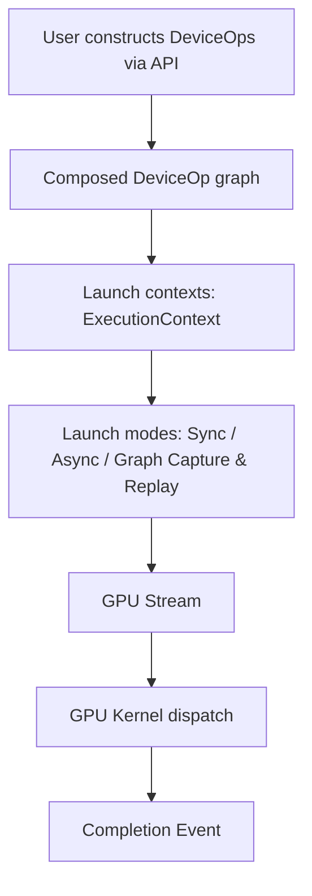
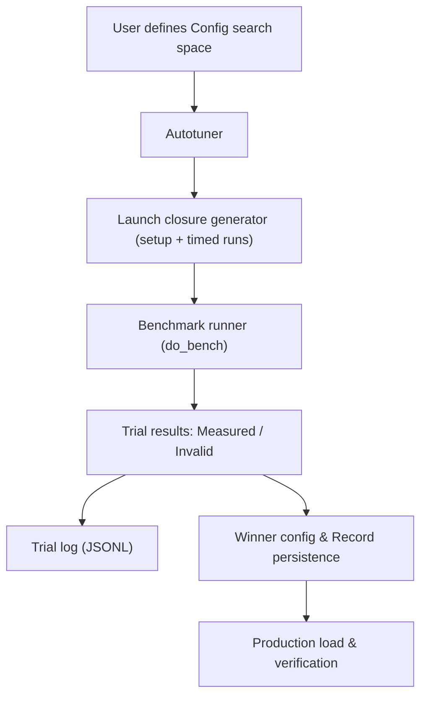
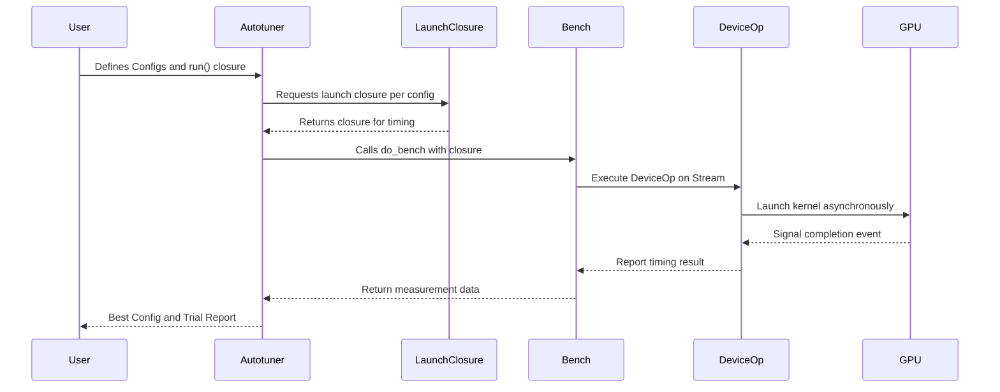

<!-- source: DeepWiki mcp.deepwiki.com · repo NVIDIA/cuda-rust · page 4.4 Host API: Launching, Graphs and Autotuning · fetched 2026-10-26 -->

# Host API: Launching, Graphs and Autotuning

<details>
<summary>Relevant source files</summary>

The following files were used as context for generating this wiki page:

- [cutile-rs/cutile-book/guide/autotuning.md](cutile-rs/cutile-book/guide/autotuning.md)
- [cutile-rs/cutile-book/guide/device-operations.md](cutile-rs/cutile-book/guide/device-operations.md)
- [cutile-rs/cutile-book/guide/performance.md](cutile-rs/cutile-book/guide/performance.md)
- [cutile-rs/cutile-book/reference/host-api.md](cutile-rs/cutile-book/reference/host-api.md)
- [cutile-rs/cutile-compiler/src/compiler/optimization_hints.rs](cutile-rs/cutile-compiler/src/compiler/optimization_hints.rs)
- [cutile-rs/cutile-compiler/src/jit_cache.rs](cutile-rs/cutile-compiler/src/jit_cache.rs)
- [cutile-rs/cutile-examples/examples/autotune.rs](cutile-rs/cutile-examples/examples/autotune.rs)
- [cutile-rs/cutile-ir/tests/bytecode_version.rs](cutile-rs/cutile-ir/tests/bytecode_version.rs)
- [cutile-rs/cutile/src/api.rs](cutile-rs/cutile/src/api.rs)
- [cutile-rs/cutile/src/bench.rs](cutile-rs/cutile/src/bench.rs)
- [cutile-rs/cutile/src/tune.rs](cutile-rs/cutile/src/tune.rs)
- [cutile-rs/cutile/tests/autotune.rs](cutile-rs/cutile/tests/autotune.rs)
- [cutile-rs/cutile/tests/common/mod.rs](cutile-rs/cutile/tests/common/mod.rs)
- [cutile-rs/cutile/tests/gpu/warmup_composed.rs](cutile-rs/cutile/tests/gpu/warmup_composed.rs)
- [cutile-rs/cutile/tests/tensor_reinterpret.rs](cutile-rs/cutile/tests/tensor_reinterpret.rs)
- [cutile-rs/cutile/tests/tensor_views.rs](cutile-rs/cutile/tests/tensor_views.rs)
- [cutile-rs/cutile/tests/warmup.rs](cutile-rs/cutile/tests/warmup.rs)

</details>


This page describes the host-facing API and implementation details for launching GPU computations using composed `DeviceOp`s, the sync/async/graph-replay execution modes, warmup and benchmarking hooks, as well as the kernel autotuning infrastructure including candidate configuration search, trial records, and provenanced persistent records.

---

## 1. Overview and Purpose

In the cuTile host API, all computations are represented as *device operations* (`DeviceOp`), which are lazy asynchronous handles to GPU work that only execute when `.await`ed or synchronized on a CUDA stream. This composable model facilitates building complex graphs of GPU computations with fine control over execution modes:

- **Sync launch**: block on completion immediately.
- **Async launch**: enqueue and poll for completion without blocking CPU threads.
- **Graph replay launch**: capture GPU work as a CUDA Graph to reduce kernel launch overhead in repetitive workflows.

Additionally, warmup calls hide JIT latency by compiling kernels in advance without launching, benchmarking APIs time kernel execution with device-event precision, and autotuning tools perform systematic parameter sweeps over candidate kernel configurations, validate correctness, time performance under a budget, and persist tuned results with provenance verification.

---

## 2. DeviceOp Composition and Launch Modes

At the core of the host API is the `DeviceOp` trait that encapsulates asynchronous operations yielding GPU tensors or side effects. Most high-level kernel calls and tensor manipulations return these operations, which compose naturally with Rust's async/await.

### 2.1 `DeviceOp` Execution and Composition

The API module (`cutile::api`) exposes many tensor creation and manipulation functions returning `DeviceOp`s. For example:

- `api::zeros::<f32>(&[1024])` returns a `DeviceOp` that allocates and zeros 1024 floats on the GPU when awaited.
- You can compose operations by chaining `DeviceOp`s before `.await`, building a dependency graph of lazy GPU work.

This lazy evaluation model enables sophisticated launch scheduling, graph capture, fusion opportunities, and overlap of CPU/GPU work.

### 2.2 Launch Modes

Operations implementing `DeviceOp` can be launched in three main ways, coordinated via the `ExecutionContext`:

- **Synchronous launch (`.sync()` / `.sync_on(stream)`)**: the caller blocks on the GPU stream until the operation completes. Simplest but stalls CPU threads.

- **Asynchronous launch (`.await` / `.sync_on(stream)` within async contexts)**: enqueues work on a CUDA stream and returns a future, allowing CPU tasks to progress concurrently with GPU work.

- **Graph capture and replay launch**: captures a sequence of `DeviceOp`s into a CUDA Graph at runtime, which can be replayed with minimal overhead repeatedly. This mode is especially beneficial for kernels launched many times with identical parameters and shapes.

The composed operations handle conditions like launch validation, memory allocation, and stream assignment internally in these modes.

---

## 3. Kernel Warmup and Benchmarking APIs

The host runtime exposes interfaces to:

- **Warmup kernels**: compile specialized kernel variants before actual execution to amortize JIT latency at dispatch time.

- **Benchmark kernels**: precisely time execution latency on the device with CUDA event timing patterns, including warmup iterations and multiple measured repetitions controlling cache state.

### 3.1 Warmup

Using `compile()` on a composed kernel call expression (with placeholder `meta` tensors representing shapes but no allocations) guarantees the kernel specialization warms the JIT cache for the exact launch parameters. This ensures subsequent real launches are cached and fast.

Example warmup pattern from `cutile-rs/cutile/tests/warmup_composed.rs`:

```rust
let zm = api::meta::<f32>(&[64, 64]).sync()?.partition([16, 16]).map([4, 1], 4);
let xm = api::meta::<f32>(&[64, 64]).sync()?;
composed_warm_module::mapped_madd(zm, Arc::new(xm))
    .generics(generics())
    .compile_options(opts.clone())
    .compile()?;
```

After this, real GPU dispatches with actual tensors and identical types/shapes will skip JIT compilation, hitting the cache [cutile-rs/cutile/tests/warmup_composed.rs:20-100]().

### 3.2 Benchmarking API

The `cutile::bench` module provides the key function:

- `do_bench(stream, options, closure) -> Measurement`

where `closure` enqueues the GPU work to benchmark. The API performs:

- Warmup executions for a programmed time budget
- Clears the L2 cache between repetitions to measure cold cache performance
- Multiple timed iterations, reporting medians and quantiles to reduce noise

Paired benchmarking with `do_bench_paired` allows A/B comparisons between two configurations in interleaved runs.

The benchmark results (`Measurement`) include median, min, mean latencies and the raw samples [cutile-rs/cutile/src/bench.rs:30-188]().

---

## 4. Autotuning Infrastructure

The autotuning system enables systematic search over kernel parameter spaces (e.g., tile sizes, occupancy hints) to find configurations minimizing execution time in a correctness-checked manner.

### 4.1 Autotuner Concepts

The main entities include:

- **`Config`**: a named set of parameters (integer or string), fully serializable and comparable. Config IDs are deterministic sorted key-value strings (e.g. `"BN=32,TILE=16"`).

- **`Searcher`**: determines the order in which candidates from the config space are visited. The default is an exhaustive `GridSearch`.

- **`Trial` and `TrialState`**: represent the outcome of running one candidate, recording median runtime or failure with a reason string.

- **`Autotuner`**: controls the overall sweep, invoking user callbacks with a candidate config, running correctness gate launches, followed by benchmarked timing. Logging to a resumable JSONL format ensures durability and restartability.

- **Provenance tracking** ensures that tuning state is only resumed for matching kernels, architectures, toolchain versions, and source code.

### 4.2 Tuning Workflow

The user provides:

- A list of `Config`s constituting the search space.

- A closure `(stream, config) -> Result<LaunchClosure>` where the launch closure runs the kernel with that config for timing.

The correct launch closure is run once for correctness validation, then multiple times for measurement with warmup and cache clearing.

Invalid candidates record a failure but do not stop the search. After all candidates are visited (or the budget expires), the best configuration is selected by median runtime.

Example configuration declaration and autotuner run (from `cutile-book/guide/autotuning.md`):

```rust
let configs: Vec<Config> = [16i64, 32, 64, 128]
    .iter()
    .map(|bn| Config::new([("BN", ParamValue::Int(*bn))]))
    .collect();

let output = Autotuner::new("fmha_decode")
    .configs(configs)
    .run(&stream, |stream, config| {
        let bn = config.int("BN").unwrap();
        let launch = move |stream: &Arc<Stream>| {
            fmha_decode(out.partition([1, bn as i32]), &q, &k, &v)
                .sync_on(stream)
        };
        launch(&stream)?;
        Ok(launch)
    })?;
let best: Config = output.best.expect("a winner");
```

Paired A/B runs among the top candidates reduce drifting and noise in performance data.

### 4.3 Persistent Records and Verification

Winners can be serialized in JSON files called `Record`s, storing:

- Buckets labeled by problem shape or other criteria

- The winning `Config`

- Median latency and sample count

- A persistent cache key derived from the launch expression without launching (`l2_cache_key()`)

These records are verified at load time against the current kernel source hash, architecture, toolchain, and cache key to avoid silent mismatch errors.

The record interface supports transparent production use where tuning results are loaded to skip online search, ensuring consistent performance and correctness [cutile-rs/cutile/src/tune.rs:1-174](), [cutile-rs/cutile-book/guide/autotuning.md:1-161]().

---

## 5. Mermaid Diagrams

### 5.1 DeviceOp Execution Flow and Launch Modes



**Explanation**: The user builds lazy `DeviceOp`s via the API, which compose internally into graphs. During execution, an `ExecutionContext` handles launch mode selection (sync blocking, async futures, or graph capture), which submit kernels onto CUDA streams and signal completion via events.

Sources: `cutile-rs/cutile/src/api.rs:1-201`, `cutile-rs/cutile/src/bench.rs:30-188`

---

### 5.2 Autotuning Components and Data Flow



**Explanation**: The user provides a list of configs defining parameterized kernel variants. The autotuner runs launch closures for each candidate, measuring via the benchmark runner. Trial results (measured or invalid) are logged to JSONL. The best config is persisted as a record, which production code can load with provenance-based verification to ensure safe kernel reuse.

Sources: `cutile-rs/cutile/src/tune.rs:1-174`, `cutile-rs/cutile-book/guide/autotuning.md:1-161`, `cutile-rs/cutile/tests/autotune.rs:1-110`

---

## 6. Key Types and Functions

| Concept                    | Rust Types / Functions                                   | Description                                                                                       |
|----------------------------|---------------------------------------------------------|-------------------------------------------------------------------------------------------------|
| Device Operation           | `DeviceOp` trait, `api::zeros`, `api::ones`, `api::dup` | Lazy async GPU operations representing tensor creation/manipulation launched on CUDA streams.   |
| Execution Context          | `ExecutionContext` from `cuda_async::device_operation`  | Carries stream, kernel state, and launch policy for invocations.                                |
| Kernel Compile and Launch | `.compile()`, `.sync_on(stream)`, `.await`              | Methods on composed kernel builders to JIT compile and launch synchronously or asynchronously.   |
| Warmup                    | `.compile()` on meta tensors                             | Compile-specialize kernels without allocation or launch, priming the JIT cache.                 |
| Benchmarking              | `cutile::bench::do_bench(stream, opts, closure)`        | Times kernel executions on a stream with warmup, repetitions, and L2 cache clearing option.     |
| Autotuning Config         | `tune::Config`                                           | A stable mapping of named integer/string parameters encoding one candidate kernel variant.      |
| Autotuner                 | `tune::Autotuner::new(name)`                            | Driver for parameter space search, correctness testing, timing measurement, and record logging. |
| Trial and TrialState      | `tune::Trial`, `tune::TrialState`                        | Results of executing one candidate, either measured timing or invalid with error message.       |
| Record and RecordEntry    | `tune::Record`, `RecordEntry`                            | Persisted tuning winners with full provenance and cache key verification.                       |

---

## 7. Detailed Data Flow for Kernel Launch and Autotuning



**Explanation**: The autotuner queries user code for a launch closure per candidate, which when timed is asynchronously executed on the GPU via `DeviceOp`. CUDA event timing collects latencies returned to benchmarks and autotuner, which aggregates results and selects the best configuration.

Sources: `cutile-rs/cutile/src/tune.rs:1-174`, `cutile-rs/cutile/src/bench.rs:1-188`, `cutile-rs/cutile/tests/autotune.rs:1-110`

---

## 8. Summary

This section of the cuTile-rs ecosystem enables advanced GPU kernel dispatch capabilities including:

- Composing device operations asynchronously with Rust futures.
- Supporting multiple kernel launch modes (sync, async, graph capture).
- Proactively warming-up kernels to reduce latency.
- Precise benchmarking with device timing, warmup, and cache flushing.
- Autotuning with systematic candidate enumeration, correctness gating, timing, logging, and persistent record application.

The internals carefully track kernel specialization keys, provenance metadata, and runtime errors to deliver a reliable pipeline from kernel authoring through deployment and tuning at scale.

---

## Sources

- `cutile-rs/cutile/src/api.rs:1-201`
- `cutile-rs/cutile/src/bench.rs:1-188`
- `cutile-rs/cutile/src/tune.rs:1-174`
- `cutile-rs/cutile/tests/autotune.rs:1-110`
- `cutile-rs/cutile/tests/warmup_composed.rs:1-100`
- `cutile-rs/cutile-book/guide/autotuning.md:1-161`

---

