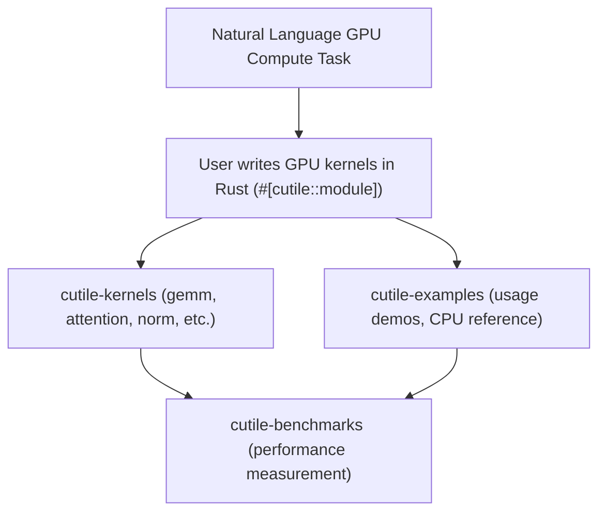
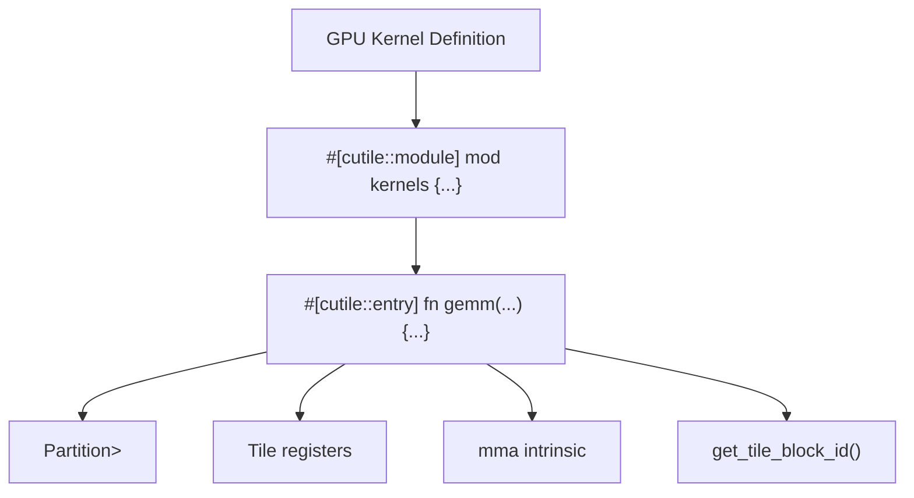
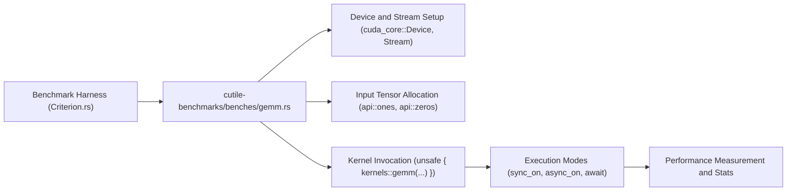

<!-- source: DeepWiki mcp.deepwiki.com · repo NVIDIA/cuda-rust · page 4.5 Kernels, Examples and Benchmarks · fetched 2026-10-26 -->

# Kernels, Examples and Benchmarks

<details>
<summary>Relevant source files</summary>

The following files were used as context for generating this wiki page:

- [cutile-rs/cutile-benchmarks/benches/execution_lock.rs](cutile-rs/cutile-benchmarks/benches/execution_lock.rs)
- [cutile-rs/cutile-benchmarks/benches/fmha.rs](cutile-rs/cutile-benchmarks/benches/fmha.rs)
- [cutile-rs/cutile-benchmarks/benches/fmha_causal.rs](cutile-rs/cutile-benchmarks/benches/fmha_causal.rs)
- [cutile-rs/cutile-benchmarks/benches/gemm.rs](cutile-rs/cutile-benchmarks/benches/gemm.rs)
- [cutile-rs/cutile-benchmarks/benches/launch_overhead.rs](cutile-rs/cutile-benchmarks/benches/launch_overhead.rs)
- [cutile-rs/cutile-benchmarks/benches/rmsnorm.rs](cutile-rs/cutile-benchmarks/benches/rmsnorm.rs)
- [cutile-rs/cutile-benchmarks/benches/softmax.rs](cutile-rs/cutile-benchmarks/benches/softmax.rs)
- [cutile-rs/cutile-examples/Cargo.toml](cutile-rs/cutile-examples/Cargo.toml)
- [cutile-rs/cutile-examples/examples/async_gemm.rs](cutile-rs/cutile-examples/examples/async_gemm.rs)
- [cutile-rs/cutile-examples/examples/async_mlp.rs](cutile-rs/cutile-examples/examples/async_mlp.rs)
- [cutile-rs/cutile-examples/examples/batch_matmul.rs](cutile-rs/cutile-examples/examples/batch_matmul.rs)
- [cutile-rs/cutile-examples/examples/cudarc_interop.rs](cutile-rs/cutile-examples/examples/cudarc_interop.rs)
- [cutile-rs/cutile-examples/examples/flash_attention.rs](cutile-rs/cutile-examples/examples/flash_attention.rs)
- [cutile-rs/cutile-examples/examples/flash_attention_causal.rs](cutile-rs/cutile-examples/examples/flash_attention_causal.rs)
- [cutile-rs/cutile-examples/examples/gemm.rs](cutile-rs/cutile-examples/examples/gemm.rs)
- [cutile-rs/cutile-examples/examples/softmax.rs](cutile-rs/cutile-examples/examples/softmax.rs)
- [cutile-rs/cutile-examples/src/lib.rs](cutile-rs/cutile-examples/src/lib.rs)
- [cutile-rs/cutile-kernels/Cargo.toml](cutile-rs/cutile-kernels/Cargo.toml)
- [cutile-rs/cutile-macro/Cargo.toml](cutile-rs/cutile-macro/Cargo.toml)
- [cutile-rs/cutile/Cargo.toml](cutile-rs/cutile/Cargo.toml)
- [cutile-rs/cutile/src/lib.rs](cutile-rs/cutile/src/lib.rs)
- [cutile-rs/cutile/tests/gpu/borrow_raw_parts.rs](cutile-rs/cutile/tests/gpu/borrow_raw_parts.rs)
- [cutile-rs/cutile/tests/gpu/submission_lifetimes.rs](cutile-rs/cutile/tests/gpu/submission_lifetimes.rs)
- [cutile-rs/scripts/run_examples.sh](cutile-rs/scripts/run_examples.sh)

</details>


This page documents the core components related to GPU kernels, example programs, benchmark tests, and paper artifact reproduction within the cuTile Rust ecosystem. It focuses on the `cutile-kernels` library containing reusable kernels for common GPU workloads (like attention mechanisms, GEMM, and normalization), the `cutile-examples` crate that showcases usage patterns, and `cutile-benchmarks` which provides benchmarking infrastructure. Additionally, it highlights how these elements collectively reproduce key research results.

---

## 4.5.1 cutile-kernels: Reusable cuTile Rust Kernels Library

The `cutile-kernels` crate encapsulates a curated library of GPU kernels implemented with cuTile Rust primitives. These kernels implement fundamental operations frequently used by machine learning and scientific computing workloads.

### Key Features and Coverage

- **Attention kernels**: Flash Attention variations, including causal masking, implemented as high-performance fused operations.
- **Matrix Multiply (GEMM)**: Efficient tile-level GEMM kernels enabling batched matrix-matrix multiplication.
- **Normalization Kernels**: RMS normalization kernels for stable layer normalization with efficient parallel reduction.

### Implementation Details

The kernels are implemented as `#[cutile::entry]`-annotated GPU kernel functions inside modules marked with `#[cutile::module]`. These entries accept `Tensor` parameters partitioned into tiles with compile-time shape constants to enable aggressive kernel specialization and optimization.

For example, the GEMM kernel declaration looks like:

```rust
#[cutile::entry(unchecked_accesses = true)]
unsafe fn gemm<T: ElementType, const BM: i32, const BN: i32, const BK: i32>(
    z: &mut Tensor<T, { [BM, BN] }>,
    x: &Tensor<T, { [-1, -1] }>,
    y: &Tensor<T, { [-1, -1] }>,
    k: i32,
) {
    // Compute partitioned GEMM using mma intrinsic and tile loads/stores
}
```

- The kernel partitions inputs `x` and `y` and uses `get_tile_block_id` to identify thread block indices.
- The loop iterates over the reduction dimension `k` in tile-sized chunks (`BK`).
- Tile registers hold partial accumulation results.
- The kernel uses cuTile's `Tile` and `Partition` abstractions for memory and parallelism management.

This design yields kernels that are safe to launch, asynchronously awaitable on GPU streams, and tightly integrated with Rust’s type system for compile-time checks.

### Kernel Caching and Launching

Kernels compiled and specialized for specific tile shapes and types are cached on disk and in-memory, reducing launch latency and enabling runtime flexibility for asynchronously composed GPU operations.

---

## 4.5.2 cutile-examples: Usage Demos and Reference Implementations

The `cutile-examples` crate contains a collection of example programs demonstrating cuTile Rust’s capabilities in real-world scenarios. These include:

- Matrix multiplication (GEMM)
- Flash Attention (standard and causal variants)
- Asynchronous GPU programming patterns
- Custom kernel writes and invocations
- Autotuning experimental API usage

### Cargo Configuration and Features

- Optional features such as `experimental-tune` enable autotuning functionality in selected examples.
- CPU reference implementations via dependency on `candle` core and NN are available under the `reference-cpu` feature for correctness validation.
- Examples are organized as cargo examples and can be run with customized features flags.

### Important Utilities and Helpers

The crate provides various utilities like:

- Host CPU softmax and FMHA reference implementations using the candle CPU tensor stack.
- Helpers for pretty printing matrices.
- Performance modeling functions for theoretical peak TFLOPS of NVIDIA GPUs like RTX 5090.

### Example: Flash Attention Kernel and Execution Flow

The flash attention kernel (simplified snippet) uses cuTile's tile partitioning and built-in `mma` tensor core intrinsics to compute:

```rust
let pid: (i32, i32, i32) = get_tile_block_id(); // Thread block identification
let q_part = q.partition(shape![1, 1, BM, D]);
let tq = q_part.load([...]).reshape(shape![BM, D]); // Load a tile of queries

// Loop over key/value tiles
for j in 0..num_tiles {
    let k_tile = k_part.load([...]).reshape(shape![BN, D]);
    let k_tile_trans = k_tile.transpose();
    let mut qk = constant(0.0f32, shape![BM, BN]);
    qk = mma(tq, k_tile_trans, qk); // Matrix multiply accumulate
    // apply softmax and scaling ...
    acc = mma(p, v_tile, acc);
}
out.store(acc);
```

This example is integrated with CPU-side reference implementations and correctness checks.

---

## 4.5.3 cutile-benchmarks: Performance Measurement Crates

The `cutile-benchmarks` workspace contains rigorous benchmark suites built with Criterion.rs for cuTile Rust kernels.

### Benchmark Scenarios

- **Launch overhead tests**: Compare modes of kernel execution including synchronous launch + synchronize, async with host callback, and async execution with deferred synchronization.
- **GEMM Performance**: Benchmarks for different matrix sizes and tile configurations.
- **Flash Attention variants**: Benchmarks that exercise causal and non-causal FMHA kernels.
- **Normalization (RMS norm)**: Benchmarks for parallel RMS normalization kernels over varying input sizes.

### Benchmark Structure

- Benchmarks create CUDA contexts and streams.
- Input tensors are randomized or zero-initialized asynchronously on GPU.
- Kernels are warmed up before timing measurement.
- Iterative runs capture throughput and latency statistics.
- Benchmarks support smoke-test mode with minimal runs for CI.

### Example: Launch Overhead Benchmark

This bench evaluates three execution modes for the GEMM kernel:

1. `sync_on`: Execute kernel and immediately synchronize the stream (blocking).
2. `await`: Launch asynchronously and wait via a `cuLaunchHostFunc` callback to schedule the poll.
3. `async_on`: Launch asynchronously with deferred synchronization at the end.

The benchmark code calls the `gemm` kernel in a loop passing pre-initialized tensors partitioned into tiles matching the kernel tile sizes. Elapsed durations from Criterion allow comparative performance analysis of the dispatching overheads for the different async APIs.

---

## 4.5.4 Paper Artifact Reproduction

The suite of kernels, examples, and benchmarks in `cutile-kernels`, `cutile-examples`, and `cutile-benchmarks` collectively enable replication of results from the cuTile Rust research papers. For instance:

- Flash Attention kernels reproduce key results on attention acceleration.
- RMS normalization kernels mirror LayerNorm benchmarks common in transformer models.
- GEMM benchmarks validate correctness and efficiency of cuTile’s tile and MMA abstractions.

Artifacts leverage CPU reference implementations and rigorous benchmarks to verify correctness, performance, and scaling behavior.

---

## Data Flow and Execution Model Overview

The typical flow from writing a kernel to measuring performance is as follows:



---

## System to Code Entity Mapping: Kernel Development



---

## System to Code Entity Mapping: Benchmarking Workflow



---

## Summary of Key API Components

| Crate             | Main Purpose                               | Key API Features                         |
|-------------------|-------------------------------------------|------------------------------------------|
| `cutile-kernels`   | Predefined GPU kernels library             | GEMM, attention, normalization kernels  |
| `cutile-examples`  | Usage demos and CPU reference implementations | Flash attention, async patterns          |
| `cutile-benchmarks`| Kernel and runtime performance benchmarks  | Latency, throughput, launch overhead tests |

---

Sources:  
- `cutile-rs/cutile-kernels/Cargo.toml:1-20`  
- `cutile-rs/cutile-examples/Cargo.toml:1-52`  
- `cutile-rs/cutile-examples/src/lib.rs:1-160`  
- `cutile-rs/cutile-examples/examples/flash_attention.rs:1-154`  
- `cutile-rs/cutile-benchmarks/benches/launch_overhead.rs:1-190`  
- `cutile-rs/cutile-benchmarks/benches/rmsnorm.rs:1-144`  
- `cutile-rs/cutile/src/lib.rs:1-183`

---

