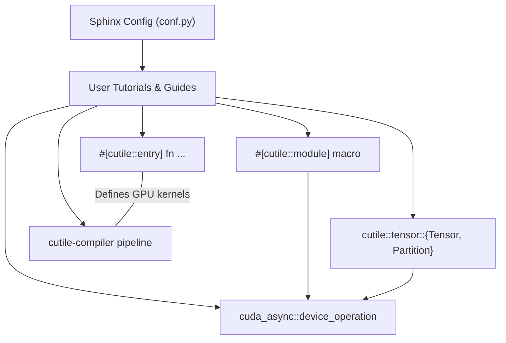
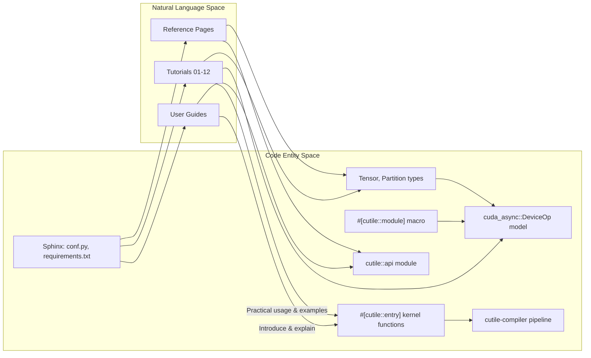

<!-- source: DeepWiki mcp.deepwiki.com · repo NVIDIA/cuda-rust · page 4.6 cutile Book and Tutorials · fetched 2026-10-26 -->

# cutile Book and Tutorials

<details>
<summary>Relevant source files</summary>

The following files were used as context for generating this wiki page:

- [cutile-rs/.gitignore](cutile-rs/.gitignore)
- [cutile-rs/cutile-book/README.md](cutile-rs/cutile-book/README.md)
- [cutile-rs/cutile-book/conf.py](cutile-rs/cutile-book/conf.py)
- [cutile-rs/cutile-book/guide/debugging-and-profiling.md](cutile-rs/cutile-book/guide/debugging-and-profiling.md)
- [cutile-rs/cutile-book/guide/interoperability.md](cutile-rs/cutile-book/guide/interoperability.md)
- [cutile-rs/cutile-book/guide/introduction.md](cutile-rs/cutile-book/guide/introduction.md)
- [cutile-rs/cutile-book/guide/tensors-and-tiles.md](cutile-rs/cutile-book/guide/tensors-and-tiles.md)
- [cutile-rs/cutile-book/guide/useful-mental-models.md](cutile-rs/cutile-book/guide/useful-mental-models.md)
- [cutile-rs/cutile-book/index.md](cutile-rs/cutile-book/index.md)
- [cutile-rs/cutile-book/reference/glossary.md](cutile-rs/cutile-book/reference/glossary.md)
- [cutile-rs/cutile-book/requirements.txt](cutile-rs/cutile-book/requirements.txt)
- [cutile-rs/cutile-book/robots.txt](cutile-rs/cutile-book/robots.txt)
- [cutile-rs/cutile-book/tutorials/02-vector-addition.md](cutile-rs/cutile-book/tutorials/02-vector-addition.md)
- [cutile-rs/cutile-book/tutorials/03-saxpy.md](cutile-rs/cutile-book/tutorials/03-saxpy.md)
- [cutile-rs/cutile-book/tutorials/04-matrix-multiplication.md](cutile-rs/cutile-book/tutorials/04-matrix-multiplication.md)
- [cutile-rs/cutile-book/tutorials/05-fused-softmax.md](cutile-rs/cutile-book/tutorials/05-fused-softmax.md)
- [cutile-rs/cutile-book/tutorials/06-flash-attention.md](cutile-rs/cutile-book/tutorials/06-flash-attention.md)
- [cutile-rs/cutile-book/tutorials/07-intro-to-async.md](cutile-rs/cutile-book/tutorials/07-intro-to-async.md)
- [cutile-rs/cutile-book/tutorials/08-data-parallel-mlp.md](cutile-rs/cutile-book/tutorials/08-data-parallel-mlp.md)
- [cutile-rs/cutile-book/tutorials/09-pointer-addition.md](cutile-rs/cutile-book/tutorials/09-pointer-addition.md)
- [cutile-rs/cutile-book/tutorials/10-cuda-graphs.md](cutile-rs/cutile-book/tutorials/10-cuda-graphs.md)
- [cutile-rs/cutile-book/tutorials/11-nvfp4-inference.md](cutile-rs/cutile-book/tutorials/11-nvfp4-inference.md)
- [cutile-rs/scripts/build_versioned_book.sh](cutile-rs/scripts/build_versioned_book.sh)

</details>


This page provides a detailed map and overview of the **cuTile Rust** Sphinx documentation book. The book is a comprehensive collection of guides, tutorials, and reference material for the cuTile Rust GPU programming framework, built around Rust tile-based kernels compiled down to CUDA. It is structured with curated user guides, 12 progressive tutorials, detailed API reference pages, and supports versioned builds.

---

## Purpose and Scope

The cuTile Rust book serves as both an introductory and in-depth technical resource for developers using the cuTile Rust framework. It includes step-by-step tutorials (from "hello world" to advanced topics such as CUDA graphs and async execution), conceptual guides explaining core abstractions (tensors, tiles, device operations), and references for API functions, macros, and configuration. The documentation is designed to bridge the gap between the natural language concepts familiar to programmers and the concrete code entities found in the codebase.

---

## Book Structure and Content Overview

The documentation content is organized as follows:

### 1. User Guides: Conceptual and Foundational Material

These guides introduce key concepts, programming patterns, and background knowledge underlying cuTile Rust:

- **Introduction**: Overview of cuTile's architecture, kernel launching model, tensor partitioning, and data loading/storing patterns.
- **Host vs Device Code**: Differentiates between host setup code and GPU-executed kernel code.
- **Tensors and Tiles**: Explains the main data abstractions, layout, and partitioning concepts.
- **JIT Compilation**: Describes how Rust kernels are compiled to Tile IR, and then to executable GPU binaries.
- **Device Operations**: Details the asynchronous execution model and `DeviceOp` traits.
- **Performance**: Tips on achieving high throughput and leveraging hardware like Tensor Cores.
- **Autotuning**: Guides tuning kernel launch parameters and caching compiled variants.
- **Bounds Check Placement**: How bounds checking is optimized or elided in Tile IR kernels.
- **Interoperability**: How cuTile kernels coexist with external CUDA C++ kernels.
- **Debugging and Profiling**: Techniques for inspecting generated IR, runtime dumps, and GPU faults.
- **Useful Mental Models**: Conceptual frameworks for understanding parallelism and memory within cuTile.

### 2. Tutorials: Step-by-step Examples 01 to 12

A sequence of increasing difficulty and complexity tutorials designed to teach cuTile programming patterns:

| Tutorial Number | Title                       | Focus                                           |
|-----------------|-----------------------------|------------------------------------------------|
| 01              | Hello World                 | First kernel, module, kernel launch basics     |
| 02              | Vector Addition             | Partitioning, tile operations, launching       |
| 03              | SAXPY                      | Combining scalar and vector operations          |
| 04              | Matrix Multiplication      | GEMM kernel, const generics, K-loop, mma intrinsic |
| 05              | Fused Softmax              | Reduction ops and fused kernels                  |
| 06              | Fused Multihead Attention  | Complex fused kernels, online softmax           |
| 07              | Introduction to Async      | `DeviceOp`, `DeviceFuture`, chained launches    |
| 08              | Data Parallel MLP          | Multi-kernel compositions, multi-GPU launching |
| 09              | Pointer Addition           | Unsafe raw device pointers, lifetimes           |
| 10              | CUDA Graphs                | Graph capture and replay execution               |
| 11              | NVFP4 Inference            | Inference with FP4 low-precision                 |
| 12              | DGX Spark Inference        | Distributed inference pipelines                   |

Each tutorial contains full annotated example code, explanation of the algorithms learned, and practical usage advice.

### 3. Reference Pages

Comprehensive API and DSL references include:

- **DSL API**: Details of tile operators, intrinsics, type constraints.
- **Host API**: Host side launching, tensor APIs, partitioning.
- **Compatibility**: Version compatibility, ABI considerations.
- **Glossary**: Definitions of core terminology (Tile IR, Token, Partition, DeviceOp, etc.).

### 4. Versioning and Build

The book build uses a Sphinx configuration (`conf.py`) that supports:

- Markdown and reStructuredText source support with MyST parser.
- NVIDIA-branded PyData Sphinx Theme with custom navigation layout.
- Version switches driven by environment variables (`CUTILE_DOCS_VERSION`) allowing published docs to present multiple released versions of the documentation.
- Cards, grids, and a clean sidebar for intuitive navigation.
- Copy buttons on code blocks for easy use.
- Reference links consistent with the project GitHub and repo structure.

The versioned build is triggered by a dedicated shell script (`scripts/build_versioned_book.sh`) that builds multiple versions in parallel for release.

---

## How the Book Content Maps to Code Entities

Below is a mapping from natural language content in the docs to key code entities and files in the `cutile-rs` crate:



- Kernel functions annotated with `#[cutile::entry]` define GPU tile kernels (e.g., tutorials/tutorial_02, tutorial_04).
- The `#[cutile::module]` macro expands kernel modules to generate safe launchers calling the CUDA runtime asynchronously.
- The `Tensor` and `Partition` types are core to host-device data layout and safe parallel access.
- `DeviceOp` traits encapsulate lazy asynchronous GPU operations integrating device futures and scheduling.
- Tile IR compilation and caching backends turn Rust AST annotated kernels into efficient GPU executables.
- The Sphinx config (`cutile-book/conf.py` and requirements) governs the build and presentation of these materials.

---

## Technical Details: Key Files and Data Flow

1. **Kernel Definition and Launching**

   Within tutorial files (e.g., `cutile-book/tutorials/02-vector-addition.md` and `tutorials/04-matrix-multiplication.md`), kernels are written as Rust functions marked with `#[cutile::entry()]` generated inside a `#[cutile::module]`:

   ```rust
   #[cutile::entry()]
   fn add<const S: [i32; 2]>(
       z: &mut Tensor<f32, S>,
       x: &Tensor<f32, {[-1, -1]}>,
       y: &Tensor<f32, {[-1, -1]}>,
   ) {
       let tile_x = x.load_like(z);
       let tile_y = y.load_like(z);
       z.store(tile_x + tile_y);
   }
   ```

   The kernel receives tile-sized mutable partitions of output, loads corresponding input tiles, computes, and stores results. The host-side code launches partitioned tensors to occupy the GPU tile grid.

   Sources: `cutile-rs/cutile-book/tutorials/02-vector-addition.md:23-32`, `cutile-rs/cutile-book/tutorials/04-matrix-multiplication.md:76-95`()

2. **Partitioning and Safety**

   Partitioning is key to exclusive mutable access on the GPU. The host splits tensors into disjoint partitions:

   ```rust
   let z = zeros(&[32, 32]).sync_on(&stream)?.partition([4, 4]);
   ```

   This partition size determines the launch grid and enforces aliasing rules at compile time. Immutable inputs can be passed without partitioning or can be partitioned inside the kernel for different access patterns.

   Sources: `cutile-rs/cutile-book/tutorials/02-vector-addition.md:69-102`()

3. **Async Execution with DeviceOp**

   The cuTile runtime expresses GPU calls asynchronously as `DeviceOp` futures, composable and schedulable on CUDA streams:

   ```rust
   let op = kernel_call(...);
   let (out,) = op.sync()?;
   ```

   This lazy execution model improves composability and concurrency, with safe Rust bindings wrapping the CUDA kernel launch APIs.

   Sources: `cutile-rs/cutile-book/tutorials/08-data-parallel-mlp.md:75-196` (partial), `cutile-rs/cutile-book/guide/interoperability.md:97-150`()

4. **Unsafe Raw Pointer Usage**

   Advanced tutorials show pitfalls and correct usage when using raw device pointers:

   ```rust
   unsafe fn add_ptr<T: ElementType>(z_ptr: *mut T, x_ptr: *mut T, y_ptr: *mut T, len: i32) { ... }
   ```

   These kernels require explicit lifetime and aliasing guarantees as safety is not enforced by the Rust type system here.

   Sources: `cutile-rs/cutile-book/tutorials/09-pointer-addition.md:19-88`()

5. **Fused Kernel Examples**

   Complex kernels such as "Fused Multihead Attention" implement tiled matrix operations with online softmax in a single kernel, demonstrating cuTile's power to generate high-performance custom kernels:

   Sources: `cutile-rs/cutile-book/tutorials/06-flash-attention.md:1-188`()

6. **Sphinx Book Build Configuration**

   The Sphinx documentation site is built with a customizable `conf.py` enabling:

   - Markdown support using myst-parser
   - NVIDIA-styled pydata_sphinx_theme for branding and usability
   - Version switches to load different documentation versions dynamically
   - Custom sidebar and header configurations

   Sources: `cutile-rs/cutile-book/conf.py:1-130`()

---

## Overview of the Book TOC in the Sphinx Config

The book source files use MyST Markdown with a hierarchical TOC structure defined across:

- `guide/` subfolder for conceptual guides
- `tutorials/` subfolder for tutorials 01–12
- `reference/` subfolder for API references

Example excerpt from the toctree snippets embedded in `index.md`:

```markdown
```{toctree}
:tutorials/
:tutorials/01-hello-world
:tutorials/02-vector-addition
:tutorials/03-saxpy
:tutorials/04-matrix-multiplication
...
```

---

## Summary Table of cuTile Book Sections and their Content

| Section          | Content Type        | Highlights                                                                                     |
|------------------|---------------------|------------------------------------------------------------------------------------------------|
| Guides           | Conceptual Guides   | Introductions, memory model, data layouts, compilation, performance tuning, debugging          |
| Tutorials 01-12  | Hands-On Examples   | From simple vector addition to asynchronous multi-GPU MLP training and CUDA Graphs             |
| Reference Pages  | API Reference       | Detailed DSL and Host API docs, compatibility notes, glossary                                 |
| Version Support  | Book Build          | Multiple doc versions with clean navigation and NVIDIA branding                               |

---

# Supplementary Diagram: Natural Language Concepts to Code Artifacts in cuTile Rust



---

# Summary

The cuTile Rust book and tutorials provide a meticulously organized, comprehensive resource for programming safe, high-performance tiled GPU kernels with Rust. The staged learning through user guides and progressive tutorials, combined with detailed API references and a mature versioned documentation build system, equips developers to safely harness the CUDA GPU architecture and future-proof their kernels with idiomatic Rust abstractions.

---

### Sources

- `cutile-rs/cutile-book/index.md:1-120`()
- `cutile-rs/cutile-book/guide/introduction.md:1-132`()
- `cutile-rs/cutile-book/tutorials/02-vector-addition.md:1-168`()
- `cutile-rs/cutile-book/tutorials/04-matrix-multiplication.md:1-195`()
- `cutile-rs/cutile-book/tutorials/06-flash-attention.md:1-188`()
- `cutile-rs/cutile-book/tutorials/08-data-parallel-mlp.md:1-196`()
- `cutile-rs/cutile-book/tutorials/09-pointer-addition.md:1-150`()
- `cutile-rs/cutile-book/guide/interoperability.md:1-151`()
- `cutile-rs/cutile-book/guide/debugging-and-profiling.md:1-178`()
- `cutile-rs/cutile-book/conf.py:1-130`()

---

