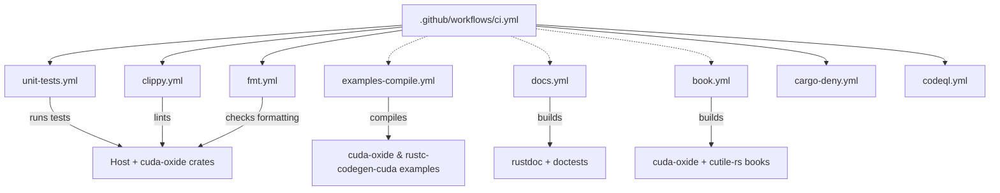

<!-- source: DeepWiki mcp.deepwiki.com · repo NVIDIA/cuda-rust · page 5 Testing and Quality Infrastructure · fetched 2026-10-26 -->

# Testing and Quality Infrastructure

<details>
<summary>Relevant source files</summary>

The following files were used as context for generating this wiki page:

- [.github/ISSUE_TEMPLATE/bug_report.yml](.github/ISSUE_TEMPLATE/bug_report.yml)
- [.github/workflows/book.yml](.github/workflows/book.yml)
- [.github/workflows/ci.yml](.github/workflows/ci.yml)
- [.github/workflows/clippy.yml](.github/workflows/clippy.yml)
- [.github/workflows/docs.yml](.github/workflows/docs.yml)
- [.github/workflows/examples-compile.yml](.github/workflows/examples-compile.yml)
- [.github/workflows/fmt.yml](.github/workflows/fmt.yml)
- [.github/workflows/unit-tests.yml](.github/workflows/unit-tests.yml)
- [.gitmodules](.gitmodules)
- [Cargo.lock](Cargo.lock)
- [Cargo.toml](Cargo.toml)

</details>


This section provides an overview of the testing and quality infrastructure that ensures robustness, correctness, and maintainability in the cuda-rust codebase. It covers the Continuous Integration (CI) workflows orchestrating various quality gates, the test suites and harnesses validating core functionality, and the guard scripts that enforce repository policies. Each sub-area is developed with the goal of comprehensive coverage, automating enforceable standards, and easing contributions while avoiding regressions.

The details of the specific workflows, guard scripts, test suites, and governance policies are captured in dedicated child pages for clarity and depth, linked throughout this page.

---

## 5.1 CI Workflows

The repository uses GitHub Actions extensively for continuous integration, with a unified entry point workflow `.github/workflows/ci.yml` that calls out to specialized workflows managing different quality and correctness aspects:

- **Unit Tests**: The `unit-tests.yml` workflow runs comprehensive Rust unit tests across the majority of crates in the repository, including stable host crates and components of cuda-oxide, with selective CUDA toolkit installation when required. It includes delicate handling of crates that require the CUDA driver or LLVM toolchain specifics for compiling GPU code or cuda-bindings (e.g., `cuda-oxide-codegen`). Tests are generally run with `cargo test --all-targets` for broad coverage, and ignore tests requiring a live CUDA driver on runners without GPUs. [`.github/workflows/unit-tests.yml:2-151`]()
  
- **Clippy Linting**: The `clippy.yml` workflow runs the Rust linter across all workspace crates and examples to enforce zero allowable warnings. For large numbers of example crates and nested workspaces (e.g., `rustc-codegen-cuda` examples and device-only fixtures), it consolidates target directories for caching and avoids redundant rebuilds. This careful orchestration helps maintain high code quality and catch subtle issues before merging. [`.github/workflows/clippy.yml:2-117`]()
  
- **Formatting**: Validation of Rust source formatting by Rustfmt is automated under `fmt.yml`. This workflow covers all workspace crates and example crates, including device-only fixtures outside the main workspace. Enforcement is done using `cargo fmt --check` ensuring consistent style across the codebase. [`.github/workflows/fmt.yml:2-62`]()
  
- **Examples Compilation**: The `examples-compile.yml` workflow compiles the extensive set of example kernels and device pipeline components without requiring GPU hardware. It installs required toolchains such as LLVM 22 for NVPTX backend compilation, and uses shared target directories to avoid overload of CI runner disk space. This serves as a smoketest to catch compilation regressions in the large device-side example set. [`.github/workflows/examples-compile.yml:2-153`]()
  
- **Documentation and Book**: Generating API documentation and doctests, plus building and deploying the Sphinx-based `cuda-oxide` book and the versioned `cutile-rs` book, are handled by `docs.yml` and `book.yml`. These workflows ensure up-to-date user and developer documentation with strict warning enforcement during builds. [`.github/workflows/docs.yml:2-89`], [`.github/workflows/book.yml:1-129`]()
  
- **Additional Checks**: Other CI workflows include cargo-deny checks for license and dependency policy enforcement and CodeQL for security scanning, all orchestrated from the top-level CI entry point. [`.github/workflows/ci.yml:2-56`]()
  
Together, these CI workflows form a tightly integrated automated pipeline that gates all code submissions through testing, linting, formatting, security, and documentation checks.

### Diagram: Main CI Workflows and Their Coordination



Sources: `.github/workflows/ci.yml`, `.github/workflows/unit-tests.yml`, `.github/workflows/clippy.yml`, `.github/workflows/fmt.yml`, `.github/workflows/examples-compile.yml`, `.github/workflows/docs.yml`, `.github/workflows/book.yml`

---

## 5.2 Guard Scripts and Policy Enforcement

To maintain code quality and consistency beyond automated tests, a suite of repository guard scripts and policy enforcers are integrated into the CI pipeline and local development tools:

- **Status Guard Jobs** validate that key repositories constraints are met before merging, including no regressions in tests, lint, and formatting.

- **Toolchain Parity** scripts ensure all CI jobs and developer environments use pinned Rust nightly versions and CUDA toolkit versions, aligned precisely to avoid subtle divergence in builds or behavior.

- **Naming Guards** enforce consistent crate, module, and example naming conventions using scripts checking for naming collisions or style violations.

- **Licensing and Security** are assessed by cargo-deny configured with `deny.toml`, checking third-party crates for known license conflicts and vulnerabilities. SPDX headers are enforced in source files to maintain clear licensing metadata.

- **Justfile tasks** encapsulate common guard script invocations and policy checks for easy invocation during local development or CI.

These guard mechanisms create policy layers complementing automated testing by preventing common issues and ensuring compliance with repository standards.

For precise guard definitions, script locations, and integration points, see the dedicated child page.

Sources: `.github/workflows/ci.yml`, references to `deny.toml` and Justfile (not directly shown but referenced by workflows)

---

## 5.3 Test Suites and Harnesses

Testing in cuda-rust spans a variety of suites targeting different layers and execution environments:

- **CPU vs GPU Test Runners**: Test harnesses distinguish and selectively run tests that require a real GPU driver vs tests that run purely on the CPU or mocked environments. The CI disables tests requiring live GPUs on default runners by marking them `#[ignore]`.

- **Cutile Test Corpora**: The `cutile-rs` library includes comprehensive tests of its Tile IR intermediate representation, kernel operations, and type/system invariants. These include:

  - Operations tests verifying core semantics.

  - UI and `trybuild` style compile-fail tests for macro and DSL syntax checks.

  - Tests exercising submission lifetimes and debug information facilities.

- **Smoketests**: A set of lightweight tests, including compilation-only runs of all examples, verify the basic end-to-end functionality without exhaustive execution. These serve as fast feedback and CI safety nets.

These test suites use Rust's built-in test framework augmented by scripts in `cuda-oxide/scripts` and elsewhere to orchestrate GPU kernel launches, feature toggles, and environment-aware test selection.

Sources: `.github/workflows/unit-tests.yml`, `.github/workflows/examples-compile.yml`

---

## 5.4 Contributing and Project Governance

Smooth contribution and project governance are supported by:

- **Developer Certificate of Origin (DCO) Sign-offs**, ensuring contributors affirm the origin and licensing of submitted code.

- **Branch and Pull Request Conventions** specifying branching models, naming, and submission guidelines.

- **CODEOWNERS** files that designate code-area reviewers and gatekeepers for pull requests.

- **Issue and PR Templates**, including detailed bug report prompts that request reproduction examples, error messages, hardware and software environment information, and `cargo oxide doctor` outputs to assist diagnosis.

- **Security Policy**, outlining responsible disclosure processes.

- **Dependabot** automated dependency updates integrating with the cargo-deny checks to maintain up-to-date and secure dependency snapshots.

These governance tools complement the technical testing infrastructure to deliver a robust and collaborative environment for development.

Sources: `.github/ISSUE_TEMPLATE/bug_report.yml`

---

# Diagram: Testing and Quality Infrastructure — Natural Language Systems to Code Entities

```mermaid
graph TB
  subgraph CI Workflows
    unitTests[unit-tests.yml]
    clippy[clippy.yml]
    fmt[fmt.yml]
    examplesCompile[examples-compile.yml]
    docs[docs.yml]
    book[book.yml]
    cargoDeny[ cargo-deny.yml ]
  end

  subgraph Test Suites
    cpuTests[CPU Test Runner]
    gpuTests[GPU Test Runner]
    cutileOpsTests["cutile-rs ops tests"]
    trybuildTests["trybuild (UI) tests"]
    lifetimeTests["Submission lifetime tests"]
    debugInfoTests["Debug info tests"]
  end

  subgraph Guard Scripts
    statusGuards[Status Guard Jobs]
    toolchainParity[Toolchain Parity scripts]
    namingGuard[Naming Convention Scripts]
    licenseCheck[cargo-deny with deny.toml]
    spdxHeaders[SPDX header checkers]
    justfileTasks[Justfile tasks]
  end

  CI Workflows -->|invoke| unitTests
  CI Workflows -->|invoke| clippy
  CI Workflows -->|invoke| fmt
  CI Workflows -->|invoke| examplesCompile
  CI Workflows -->|invoke| docs
  CI Workflows -->|invoke| book
  CI Workflows -->|invoke| cargoDeny

  unitTests --> cpuTests
  unitTests --> gpuTests

  cpuTests --> cutileOpsTests
  cpuTests --> trybuildTests
  gpuTests --> lifetimeTests
  gpuTests --> debugInfoTests

  Guard Scripts -. enforce policies .-> CI Workflows
  licenseCheck -. config file deny.toml .-> cargoDeny

  namingGuard --> Justfile[Justfile]
  statusGuards -. run with CI .-> unitTests
  toolchainParity -. verify nightly/CUDA versions .-> CI Workflows

```

---

For detailed information about each topic, see the child pages:

| Section | Title                      | Description                                               |
|---------|----------------------------|-----------------------------------------------------------|
| 5.1     | [CI Workflows](#5.1)       | Describes unit tests, formatting, clippy, example compilation, docs, cargo-deny, and overall CI orchestration.           |
| 5.2     | [Guard Scripts and Policy Enforcement](#5.2) | Explains guard scripts for status guarding, toolchain parity, naming conventions, license enforcement, SPDX headers, and task automation.           |
| 5.3     | [Test Suites and Harnesses](#5.3) | Covers test runner scripts for CPU/GPU, cutile test corpora, trybuild suites, submission lifetime tests, and smoketests.  |
| 5.4     | [Contributing and Project Governance](#5.4) | Details project governance including DCO sign-off, branch/PR conventions, CODEOWNERS, issue/PR templates, security policy, and Dependabot. |

This modular organization encourages focused comprehension and streamlined maintenance of quality workflows and policies in the cuda-rust project.

---

**End of Section**  

Sources:  
- `.github/workflows/unit-tests.yml`  
- `.github/workflows/clippy.yml`  
- `.github/workflows/fmt.yml`  
- `.github/workflows/examples-compile.yml`  
- `.github/workflows/docs.yml`  
- `.github/workflows/book.yml`  
- `.github/workflows/ci.yml`  
- `.github/ISSUE_TEMPLATE/bug_report.yml`

---

