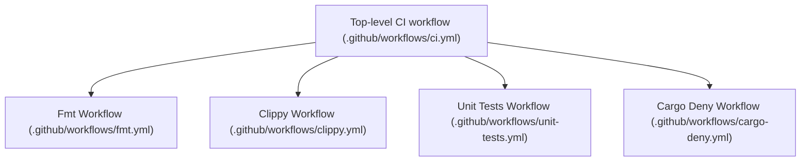
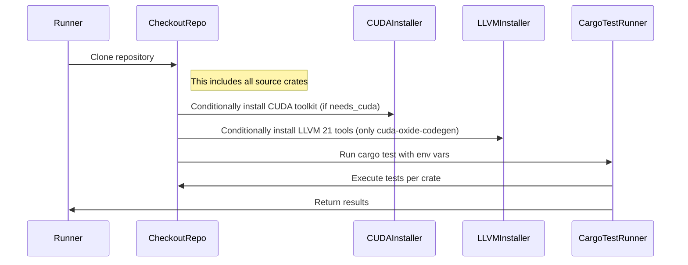
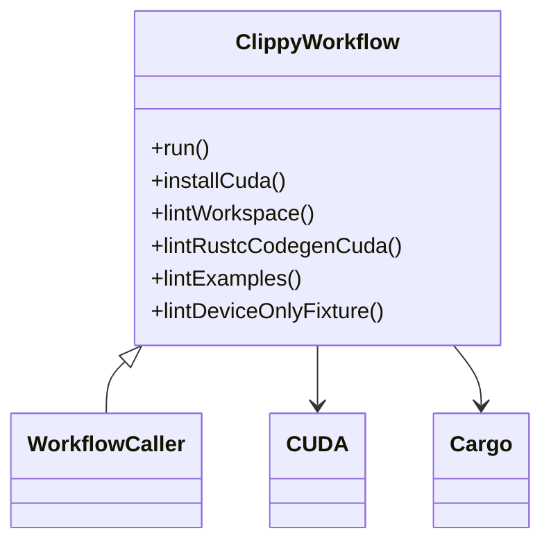
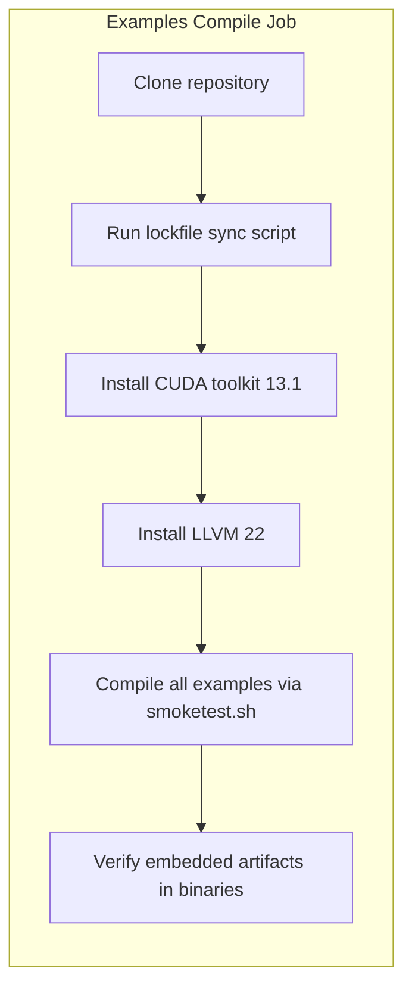
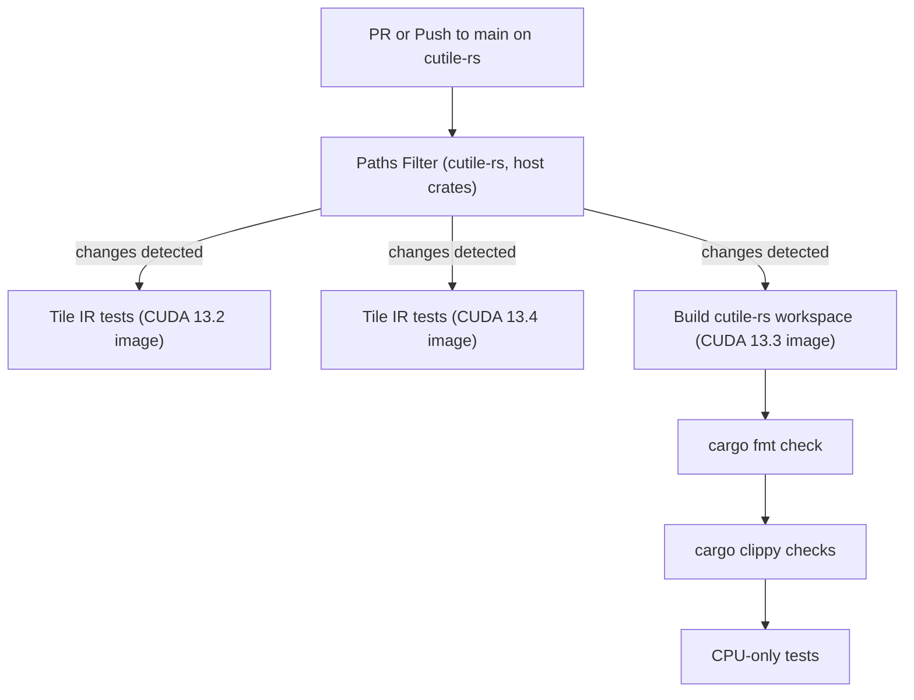
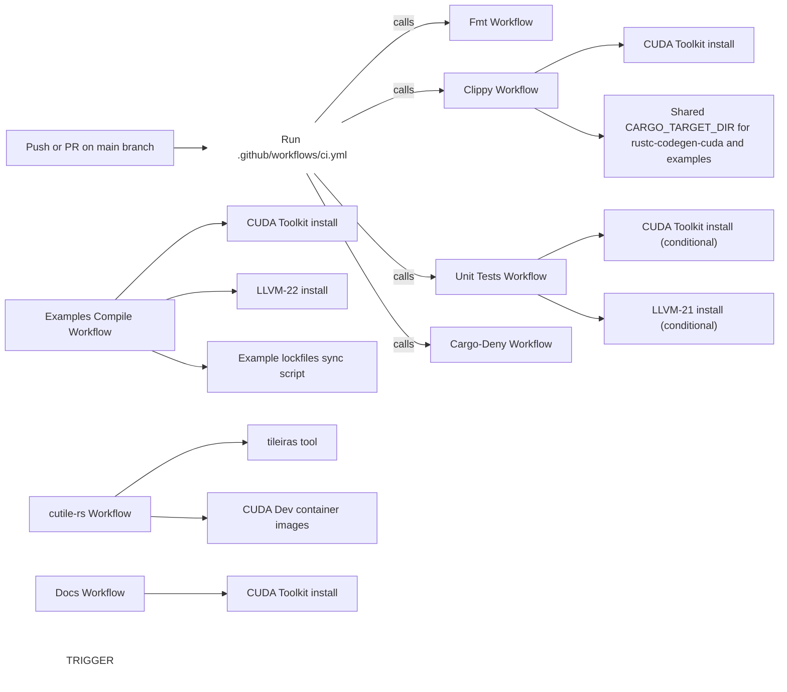

<!-- source: DeepWiki mcp.deepwiki.com · repo NVIDIA/cuda-rust · page 5.1 CI Workflows · fetched 2026-10-26 -->

# CI Workflows

<details>
<summary>Relevant source files</summary>

The following files were used as context for generating this wiki page:

- [.github/ISSUE_TEMPLATE/bug_report.yml](.github/ISSUE_TEMPLATE/bug_report.yml)
- [.github/workflows/book.yml](.github/workflows/book.yml)
- [.github/workflows/ci.yml](.github/workflows/ci.yml)
- [.github/workflows/clippy.yml](.github/workflows/clippy.yml)
- [.github/workflows/cutile-rs.yml](.github/workflows/cutile-rs.yml)
- [.github/workflows/docs.yml](.github/workflows/docs.yml)
- [.github/workflows/examples-compile.yml](.github/workflows/examples-compile.yml)
- [.github/workflows/fmt.yml](.github/workflows/fmt.yml)
- [.github/workflows/unit-tests.yml](.github/workflows/unit-tests.yml)
- [.gitmodules](.gitmodules)
- [Cargo.lock](Cargo.lock)
- [Cargo.toml](Cargo.toml)
- [cutile-rs/.github/actions/setup/action.yml](cutile-rs/.github/actions/setup/action.yml)

</details>


This page documents the Continuous Integration (CI) workflows implemented in the NVIDIA `cuda-rust` monorepo. It covers the key workflows responsible for maintaining code quality, correctness, style conformance, and documentation accuracy across the multiple workspaces and crates in this repository. The workflows are orchestrated by the top-level CI entry point and exercise unit tests, code linters, formatting checks, example compilations, documentation builds, security scans, and the cutile-rs Tile IR subsystem validation.

---

## 1. Overview and Purpose

The CI workflows in this repository are designed to:

- Validate the correctness of the codebase via extensive unit tests across all crates and workspace boundaries.
- Enforce Rust coding standards and idiomatic usage via `clippy` lints and `rustfmt` formatting.
- Ensure the compilation integrity of the large set of example crates built on the Rust-to-PTX compilation backend.
- Build and test Rust documentation (`rustdoc`) and Sphinx-based books to guarantee accuracy and no compilation warnings.
- Scan dependencies and code for security vulnerabilities and policy violations via `cargo-deny` and GitHub CodeQL.
- Specifically test the cutile-rs Tile IR framework in isolation on dedicated runners and CUDA toolkits.
- Orchestrate all of the above in a scalable, multi-job parallelized way using GitHub Actions workflow calls and matrix strategies.

Each workflow is implemented in a dedicated YAML inside `.github/workflows/`, with a top-level orchestrating workflow referencing each job via the `uses:` directive. This setup ensures modularity, reusability, and clear separation of concerns.

---

## 2. The Top-Level Orchestrator: `.github/workflows/ci.yml`

The `ci.yml` workflow is the single entry point triggered on pushes and pull requests to the `main` branch that affect any of the key source trees or configs: `cuda-oxide/**`, shared host crates (`cuda-bindings`, `cuda-core`, etc.), and the GitHub workflow files themselves.

Key properties:

- Uses a concurrency group `ci-gate-${{ github.ref_name }}` to serialize jobs and cancel in-progress runs on multiple pushes to the same branch.
- Runs multiple jobs by referencing separate workflows via the `uses:` key:
  - `fmt` to check code formatting.
  - `clippy` for linting.
  - `unit-tests` for running unit and integration tests.
  - `cargo-deny` for dependency/security scans.
- Explicitly restricts read-only access to repository contents in job permissions.

This design centralizes CI invocation and standardizes environment setup and triggers.



Sources: `.github/workflows/ci.yml:1-56`(), `.github/workflows/fmt.yml:1-62`(), `.github/workflows/clippy.yml:1-117`(), `.github/workflows/unit-tests.yml:1-151`()

---

## 3. Unit Tests Workflow: `.github/workflows/unit-tests.yml`

### 3.1 Purpose

This workflow runs all unit and integration tests for the majority of Rust crates in the monorepo, including the shared host runtime crates and the rustc-codegen-cuda backend workspace. It excludes the `fuzzer` crate and device-only fixtures that have separate integration or smoke tests.

### 3.2 Implementation Details

- **Trigger:** Invoked only as a `workflow_call` by `ci.yml`.
- **Matrix Strategy:** Defines a matrix of target crates (`package`) to test, with some requiring CUDA (`needs_cuda: true`). This enables parallel test execution per crate.
- **CUDA Toolkit Installation:** If a crate needs CUDA (e.g., for bindgen steps using `cuda.h`), installs CUDA 13.1.1 via the community action `Jimver/cuda-toolkit@v0.2.35`, selecting `nvcc` and `cudart-dev` sub-packages.
- **LLVM 21 Install:** For the `cuda-oxide-codegen` crate, LLVM 21 tools (`llc` and `opt`) are installed, as these are needed for the NVPTX backend compilation steps.
- **Run Tests:** Runs `cargo test` passing `--all-targets` by default or overridden `test_args` per crate.
- **Special Check for cargo-oxide CLI:** Runs `cargo-oxide doctor` to test its behavior when no CUDA toolkit is installed, confirming the diagnostic output is correct.

### 3.3 Data Flow

- Checkout repository code.
- Optionally install CUDA and LLVM depending on matrix.
- Set relevant environment variables such as `LIBRARY_PATH` and `LD_LIBRARY_PATH` for linker visibility.
- Run `cargo test` on each crate.
- For cargo-oxide CLI, run specific subcommand and check output.



Sources: `.github/workflows/unit-tests.yml:1-151`()

---

## 4. Clippy Workflow: `.github/workflows/clippy.yml`

### 4.1 Purpose

Enforces strict lints from Rust’s Clippy tool at the workspace and example level, preventing warnings and ensuring consistent code quality.

### 4.2 Implementation Details

- Runs on a `workflow_call`, invoked by `ci.yml`.
- Installs CUDA toolkit (same pin as unit-tests).
- Runs three main lint passes:
  1. All crates in `cuda-oxide`’s root workspace with `--workspace --all-targets`.
  2. The `rustc-codegen-cuda` crate and its examples, sharing a `CARGO_TARGET_DIR` to deduplicate compilation cache and reduce disk usage.
  3. The special `cuda-macros/tests/device-only` workspace, which proves device-only fixture lint correctness.
- Uses bash loops and directory discovery to handle nested example crates not part of top-level workspaces.
- Fails on any lints (`-D warnings`).

### 4.3 Key Features

- Uses a shared target directory (`runner.temp/clippy-shared-target`) for `rustc-codegen-cuda` and examples to optimize for large numbers of invocations.
- Detects nested workspace members dynamically by listing `Cargo.toml` files depth-wise.
- Ensures no warnings occur anywhere including tests, benches, and examples.



Sources: `.github/workflows/clippy.yml:1-117`()

---

## 5. Formatting Workflow: `.github/workflows/fmt.yml`

### 5.1 Purpose

Ensures all Rust source code in the repository is properly formatted according to Rustfmt, failing the build on any divergence.

### 5.2 Implementation Details

- Invoked via `workflow_call` from `ci.yml`.
- Runs `cargo fmt --check`:
  - On the host stable workspace crates (`cuda-bindings`, `cuda-core`, `cuda-core-derive`, `cuda-async`).
  - On the `cuda-oxide` workspace.
  - On the `rustc-codegen-cuda` workspace (separate crate).
  - On all example crates found under `cuda-oxide/crates/rustc-codegen-cuda/examples/**/` using a bash glob loop.
  - On the `cuda-macros` device-only fixture workspace.
- Installed `rustfmt` comes from pinned Rust nightly toolchain used for all builds, ensuring consistent style enforcement.

### 5.3 Data Flow

- Clone repository.
- Run `cargo fmt` check for core workspaces.
- Iterate all example manifests to run format checks.
- Fail if any formatting issue found.

Sources: `.github/workflows/fmt.yml:1-62`()

---

## 6. Examples Compile Workflow: `.github/workflows/examples-compile.yml`

### 6.1 Purpose

Compiles all example crates in the repository to verify that device pipelines produce compilable kernels without relying on an actual GPU driver or runtime.

### 6.2 Implementation Details

- Triggered on changes to `cuda-oxide` and shared host crates on `main`.
- Installs CUDA toolkit pinned at 13.1 with `nvcc`, `cudart-dev`, `libcurand-dev`, and `libnvjitlink-dev` sub-packages.
- Installs LLVM 22 (`llc` and `opt`) pinned for device PTX generation.
- Before compiling examples, runs a lockfile synchronization script (`cuda-oxide/scripts/sync-example-locks.sh`) to ensure all example workspaces share identical dependency versions, which is critical for cache efficiency.
- Uses a shared `CARGO_TARGET_DIR` under runner temp storage for example compilations to avoid disk exhaustion caused by repeated rebuilds.
- Calls `cuda-oxide/scripts/smoketest.sh --compile-only` to build all examples as a smoketest, aborting on any compilation failure.
- Also verifies embedded artifact sections in compiled binaries.

### 6.3 Notes

- Timeout is set generously to ~75 minutes due to the large number of examples.
- Compilation environment carefully manages `LIBRARY_PATH` and `LD_LIBRARY_PATH` for proper linkage.



Sources: `.github/workflows/examples-compile.yml:1-153`()

---

## 7. Documentation Workflow: `.github/workflows/docs.yml`

### 7.1 Purpose

Builds Rust documentation (`cargo doc`) and runs doctests to catch broken intra-doc links and documentation code errors. Also builds the `rustc-codegen-cuda` crate docs.

### 7.2 Implementation Details

- Runs on pushes and PRs affecting source and doc files of `cuda-oxide` and host crates.
- Installs CUDA toolkit to allow building `cuda-bindings` which requires `cuda.h` at build-time.
- Runs `cargo doc --no-deps --workspace` and then `cargo test --doc --workspace` with `RUSTDOCFLAGS="-D warnings"` to enforce warning-free builds.
- Separately builds documentation for `rustc-codegen-cuda` because it is its own workspace and not part of the root workspace.

Sources: `.github/workflows/docs.yml:1-89`()

---

## 8. Book Deployment Workflow: `.github/workflows/book.yml`

### 8.1 Purpose

Builds and deploys the `cuda-oxide` Sphinx documentation book and the versioned `cutile-rs` book to GitHub Pages.

### 8.2 Implementation Details

- Watches documentation source directories in both `cuda-oxide` and `cutile-rs`.
- Runs Python setup and installs Sphinx dependencies.
- Builds both Sphinx books with warnings promoted to errors (`-W -keep-going`).
- Uploads built static site artifacts on pushes (but not pull requests).
- Deploys the built website via the GitHub Pages action.
- Uses concurrency groups and cancellation policies optimized for Pages deploy consistency.

Sources: `.github/workflows/book.yml:1-129`()

---

## 9. Cutile-rs Tile IR Validation Workflow: `.github/workflows/cutile-rs.yml`

### 9.1 Purpose

Specialized workflow for validating the cutile-rs subsystem (Tile IR GPU programming framework) which lives under the nested workspace `cutile-rs`. This workflow tests the host crates and tile IR components separately on self-hosted runners and NVIDIA CUDA container images.

### 9.2 Implementation Details

- Triggered on pushes to main and special mirrored pull request refs.
- Uses path filters with `dorny/paths-filter` to detect when files affecting cutile-rs or shared host crates have changed.
- Runs separate tests:
  - Tile IR assembler tests on CUDA 13.2 and 13.4 dev images, installing `tileiras` tool and verifying its version.
  - Builds the entire tile-related workspace under CUDA 13.3 container.
  - Runs formatting, clippy, CPU-only tests for tile IR.
  - Runs CPU-only test scripts under `cutile-rs`.
- Uses GitHub Actions container support with NVIDIA CUDA dev images and sets environment variables to CUDA toolkit paths.
- Runs a sequential chain of jobs with conditional execution based on the changed files in the PR or push.

### 9.3 Special Features

- Uses a custom local composite action `cutile-rs/.github/actions/setup` to prepare the container with build dependencies, install Rust toolchain pinned in `rust-toolchain.toml`, and restore cached build targets.
- Provides a smoke test for the Tile IR assembler binary and basic bytecode tests.
- Checks for tile IR API breaking changes via a publish/version bump pipeline (partially shown).



Sources: `.github/workflows/cutile-rs.yml:1-180`(), `cutile-rs/.github/actions/setup/action.yml:1-78`()

---

## 10. Security and Policy Workflows: CodeQL and Cargo-deny

- Cargo deny scans the dependency graphs for vulnerabilities and license compliance issues.
- CodeQL is configured in repository settings (not shown in the provided files) but is triggered through GitHub's native integration.
- `cargo-deny.yml` is included as a used workflow in `.github/workflows/ci.yml`.
- These tools ensure supply chain security and open-source license compliance.

---

## 11. Summary Table of All CI Workflows

| Workflow             | File                          | Purpose                                   | Key Features                         |
|----------------------|-------------------------------|-------------------------------------------|------------------------------------|
| Top-Level Orchestrator| `.github/workflows/ci.yml`    | Runs all major checks via calls            | Serial concurrency, multi-job      |
| Unit Tests           | `.github/workflows/unit-tests.yml` | Run all package unit and integration tests | Matrix per package, CUDA install   |
| Clippy               | `.github/workflows/clippy.yml`| Run lint checks on all workspaces & examples| Shared target dir for caching      |
| Formatting           | `.github/workflows/fmt.yml`   | Enforce `rustfmt` style                    | Includes nested example crates     |
| Examples Compile     | `.github/workflows/examples-compile.yml` | Compile all example crates                 | Checks lockfiles, LLVM 22 pinning  |
| Docs                 | `.github/workflows/docs.yml`  | Build rustdoc and run doctests             | Includes separate codegen crate    |
| Book Deployment      | `.github/workflows/book.yml`  | Build & deploy Sphinx books                 | Handles multiple books, deploy gating |
| cutile-rs            | `.github/workflows/cutile-rs.yml` | Validate tile IR subsystem workflows       | Runs on dedicated CUDA containers  |
| Cargo Deny           | `.github/workflows/cargo-deny.yml` (used) | Checks dependency & policy compliance      | Integrated from top-level CI       |

---

## 12. Diagram: Mapping CI Workflows to Code Entities and Crates

```mermaid
graph TB
  subgraph "Workflows"
    CIYAML[ci.yml]
    UnitTests["unit-tests.yml"]
    ClippyWF["clippy.yml"]
    FmtWF["fmt.yml"]
    ExamplesWF["examples-compile.yml"]
    DocsWF["docs.yml"]
    BookWF["book.yml"]
    CutileWF["cutile-rs.yml"]
    CargoDenyWF["cargo-deny.yml"]
  end

  subgraph "Host & Core Crates"
    CudaBindings["cuda-bindings"]
    CudaCore["cuda-core"]
    CudaCoreDerive["cuda-core-derive"]
    CudaAsync["cuda-async"]
  end

  subgraph "Rustc Codegen"
    RustcCodegenCuda["rustc-codegen-cuda"]
    RustcCodegenCudaExamples["rustc-codegen-cuda/examples/*"]
    CargoOxide["cargo-oxide"]
    CudaMacros["cuda-macros"]
    CudaDevice["cuda-device"]
    LibnvvmSys["libnvvm-sys"]
  end

  subgraph "cutile-rs Workspace"
    CutileRs["cutile-rs"]
    CutileIr["cutile-ir"]
    TileIRAssembler["tileiras tool"]
  end

  CIYAML --> UnitTests
  CIYAML --> ClippyWF
  CIYAML --> FmtWF
  CIYAML --> CargoDenyWF

  UnitTests --> CudaBindings
  UnitTests --> CudaCore
  UnitTests --> CudaCoreDerive
  UnitTests --> CudaAsync
  UnitTests --> RustcCodegenCuda
  UnitTests --> CargoOxide
  UnitTests --> CudaMacros
  UnitTests --> CudaDevice
  UnitTests --> LibnvvmSys

  ClippyWF --> CudaBindings
  ClippyWF --> CudaCore
  ClippyWF --> CudaCoreDerive
  ClippyWF --> CudaAsync
  ClippyWF --> RustcCodegenCuda
  ClippyWF --> RustcCodegenCudaExamples
  ClippyWF --> CudaMacros

  FmtWF --> CudaBindings
  FmtWF --> CudaCore
  FmtWF --> CudaCoreDerive
  FmtWF --> CudaAsync
  FmtWF --> RustcCodegenCuda
  FmtWF --> RustcCodegenCudaExamples
  FmtWF --> CudaMacros

  ExamplesWF --> RustcCodegenCudaExamples
  ExamplesWF --> CudaBindings
  ExamplesWF --> CudaCore
  ExamplesWF --> CudaCoreDerive
  ExamplesWF --> CudaAsync

  DocsWF --> CudaBindings
  DocsWF --> CudaCore
  DocsWF --> CudaCoreDerive
  DocsWF --> CudaAsync
  DocsWF --> RustcCodegenCuda

  BookWF --> "cuda-oxide/cuda-oxide-book"
  BookWF --> "cutile-rs/cutile-book"

  CutileWF --> CutileRs
  CutileWF --> CutileIr
  CutileWF --> CudaBindings
  CutileWF --> CudaCore
  CutileWF --> CudaCoreDerive
  CutileWF --> CudaAsync
  CutileWF --> TileIRAssembler
```

---

## 13. Diagram: CI Workflow Data Flow and Interactions



---

# Summary

The CI workflows for the `cuda-rust` monorepo rigorously enforce quality by modularly running tests, linting, formatting, and documentation validation under reproducible pinned Rust and CUDA toolchains. They leverage workflow calls to break down the pipeline while sharing environment setup like CUDA installations and build caches to optimize runtime and resource use. The tile IR subsystem (`cutile-rs`) receives specialized testing coverage in GPU container images, reflecting its distinct runtime and development stack. Overall, this layered and matrix-driven CI infrastructure ensures robust and scalable development integration for the complex GPU programming rust ecosystem NVIDIA is building.


---

# Sources

- `.github/workflows/ci.yml:1-56`  
- `.github/workflows/unit-tests.yml:1-151`  
- `.github/workflows/clippy.yml:1-117`  
- `.github/workflows/fmt.yml:1-62`  
- `.github/workflows/examples-compile.yml:1-153`  
- `.github/workflows/docs.yml:1-89`  
- `.github/workflows/book.yml:1-129`  
- `.github/workflows/cutile-rs.yml:1-180`  
- `cutile-rs/.github/actions/setup/action.yml:1-78`

---

