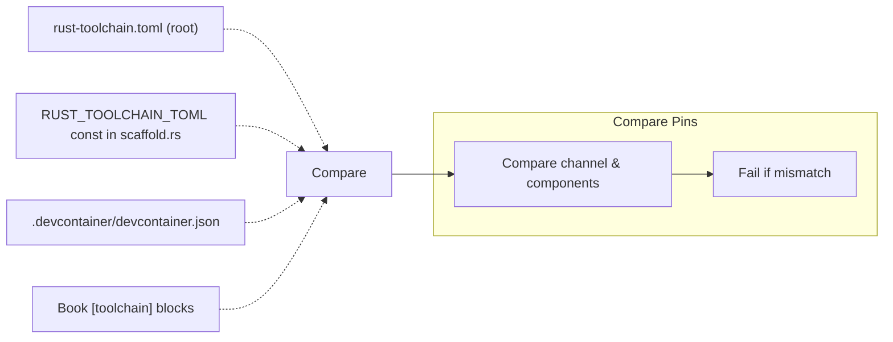
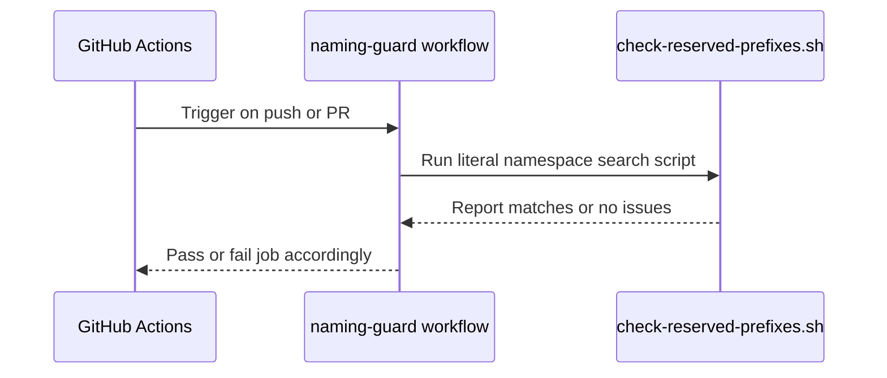
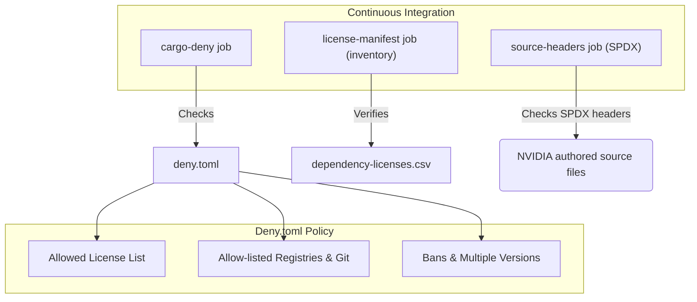

<!-- source: DeepWiki mcp.deepwiki.com · repo NVIDIA/cuda-rust · page 5.2 Guard Scripts and Policy Enforcement · fetched 2026-10-26 -->

# 5.2 Guard Scripts and Policy Enforcement

<details>
<summary>Relevant source files</summary>

The following files were used as context for generating this wiki page:

- [.github/workflows/cargo-deny.yml](.github/workflows/cargo-deny.yml)
- [.github/workflows/codeql.yml](.github/workflows/codeql.yml)
- [.github/workflows/naming-guard.yml](.github/workflows/naming-guard.yml)
- [.github/workflows/status-guard.yml](.github/workflows/status-guard.yml)
- [CONTRIBUTING.md](CONTRIBUTING.md)
- [cuda-oxide/Justfile](cuda-oxide/Justfile)
- [cuda-oxide/cuda-oxide-book/getting-started/installation.md](cuda-oxide/cuda-oxide-book/getting-started/installation.md)
- [cuda-oxide/nix/templates/default/flake.nix](cuda-oxide/nix/templates/default/flake.nix)
- [cuda-oxide/scripts/check-toolchain-parity.sh](cuda-oxide/scripts/check-toolchain-parity.sh)
- [cutile-rs/deny.toml](cutile-rs/deny.toml)
- [deny.toml](deny.toml)

</details>


This section details the various guard scripts and policy enforcement mechanisms employed in the NVIDIA `cuda-rust` repository. These guard jobs ensure code quality, consistent tooling, licensing compliance, and proper naming conventions. They are implemented as continuous integration (CI) jobs, supporting contributors and maintainers in upholding repository standards. The enforcement covers:

- Status-guard jobs for example correctness and documentation
- Toolchain pin parity checks
- Naming guard scripts for reserved symbol detection
- Licensing enforcement using `cargo-deny` and `deny.toml` policies
- SPDX header validation on source files
- Convenient Justfile tasks for manual invocation

This page is a technical deep dive into how these guard mechanisms work, the data flow in CI pipelines, key scripts and config files, and how developers interact with them.

---

## 5.2.1 Status-Guard Jobs

The **status-guard** workflow is a consolidated set of CI jobs that verify repository-wide correctness and consistency outside direct build/test automation. It runs on `push` and `pull_request` events targeting the `main` branch, ensuring findings arrive early in the review cycle.

Key jobs include:

### 1. Error-Example Status Guard

- Validates that all example files whose names begin with `error` appear correctly listed in `STATUS.md` and referenced in `smoketest.sh`.
- This guarantees that the documentation and test harness agree on the categorization and handling of error-case examples.
- The guard invokes the script `cuda-oxide/scripts/check-error-example-status.sh`.

### 2. Example Smoketest Contract

- Checks that examples adhere to the standard smoketest success markers and category clauses.
- This prevents regression or drift in example validation without running on GPU hardware or compiling.
- Implemented by running `cuda-oxide/scripts/check-example-smoketest-contract.sh`.

### 3. Crate Inventory

- Validates that all workspace members are listed in the README's crate overview section.
- Avoids missing or stale crate documentation links.
- Enforced by `cuda-oxide/scripts/check-crate-inventory.sh`.

### 4. Toolchain Pin Parity

- Ensures all copies of the Rust nightly toolchain pin are in sync across:
  - The central `rust-toolchain.toml`
  - The scaffold constant string in `crates/cargo-oxide/src/commands/scaffold.rs`
  - The `.devcontainer/devcontainer.json`
  - The pinned `[toolchain]` blocks quoted in the book's markdown files
- Prevents confusing build failures due to stale toolchain references.
- The script `cuda-oxide/scripts/check-toolchain-parity.sh` performs these checks by parsing and comparing the strings extracted from these files.

### 5. CLI Documentation Coverage

- Verifies the repository's documentation (book) fully lists all subcommands of the `cargo-oxide` CLI.
- Prevents undocumented or outdated command references in end-user docs.
- Uses `cuda-oxide/scripts/check-cli-doc-coverage.sh`.

### 6. Book API Names Guard

- Confirms that every device API call shown in the book, crate READMEs, and example README files resolves successfully in the source.
- Catches cases of renamed, removed, or mistyped device functions appearing in docs.
- Uses `cuda-oxide/scripts/check-book-api-names.sh`.

### 7. Book Import Order

- Checks that Rust code blocks in the book conform to the pinned `rustfmt` import ordering.
- Ensures formatting and style consistency in documentation snippets.
- Run via `cuda-oxide/scripts/check-book-import-order.sh`.

### 8. Source References

- Verifies that all repo-root-anchored file references in markdown or Rust doc comments actually point to tracked files or declared outputs.
- Catches stale or broken documentation links.
- Run with `cuda-oxide/scripts/check-source-references.sh`.

---

```mermaid
flowchart TD
  "GitHub Actions" --> "Status-guard workflow"
  subgraph "Status-guard Jobs"
    direction TB
    Job1[Error-example status guard]
    Job2[Example smoketest contract]
    Job3[Crate inventory]
    Job4[Toolchain pin parity]
    Job5[CLI doc coverage]
    Job6[Book API names]
    Job7[Book import order]
    Job8[Source references]
  end
  "Status-guard workflow" --> Job1
  "Status-guard workflow" --> Job2
  "Status-guard workflow" --> Job3
  "Status-guard workflow" --> Job4
  "Status-guard workflow" --> Job5
  "Status-guard workflow" --> Job6
  "Status-guard workflow" --> Job7
  "Status-guard workflow" --> Job8
```

**Sources:**  
`.github/workflows/status-guard.yml:1-161`  
`cuda-oxide/scripts/check-toolchain-parity.sh:1-165`

---

## 5.2.2 Toolchain Pin Parity

Many parts of the repo pin the exact Rust toolchain version and components used to build CUDA Rust:

- The root `rust-toolchain.toml` files the main pinned version.
- The Rust code constant `RUST_TOOLCHAIN_TOML` in `crates/cargo-oxide/src/commands/scaffold.rs` serves as a scaffold template for new projects.
- The `.devcontainer/devcontainer.json` pre-installs a subset of components in the development container image.
- The book quotes the `[toolchain]` block as a copy-paste snippet for readers.

The **toolchain pin parity** guard script ensures all these independent pins match exactly for **channel** and **components**, preventing confusing breakage or silent drift.

### Implementation Details

- The script extracts the `[toolchain]` block’s `channel` and `components` from each file.
- It uses regex parsing for `channel = "..."` and a robust pattern to extract multi-line `components`.
- The `RUST_TOOLCHAIN_TOML` constant is parsed out of the Rust source with a multiline raw string regex.
- All parsed values are compared byte-wise with UTF-8 locale to avoid locale collation surprises.
- Discrepancies are reported with clear diagnostics referencing the files.
- Missing or malformed data causes the script to fail with a parse error, ensuring no silent false passes.

### Why This Matters

The pinned nightly ensures consistent builds and toolchain features, including nightly flags, rustfmt behavior, and compatibility with compiler internals needed by the CUDA Rust backend. Divergent pins break:

- The codegen backend loading
- Formatting within the book examples
- Devcontainer builds and cache warming
- Scaffolding for new projects via `cargo oxide new`

Regular execution of this guard prevents widespread confusion.

---



**Sources:**  
`cuda-oxide/scripts/check-toolchain-parity.sh:1-165`

---

## 5.2.3 Naming Guard

To enforce a consistent symbol namespace within the repository, the **naming-guard** workflow runs a dedicated job:

- Searches the entire source tree for hardcoded literals matching reserved prefixes, specifically reserved symbol names defined by the code.
- Its goal is to prevent unauthorized or accidental use of prefixes that are reserved for internal or generated symbols.
- The matching pattern and rationale are embedded fully in the guard script `cuda-oxide/scripts/check-reserved-prefixes.sh`, allowing local mutation tests.

This guard is lightweight, fast (~5 minutes timeout), and helps avoid namespace pollution that could cause build/link conflicts or undefined behavior.

---



**Sources:**  
`.github/workflows/naming-guard.yml:1-34`

---

## 5.2.4 License and Dependency Policy via Cargo-Deny and `deny.toml`

License compliance and dependency vetting are enforced primarily via the `cargo-deny` tool configured through a central `deny.toml` file.

### `cargo-deny` Workflow

- Job `cargo-deny` runs on push, PR, and scheduled weekly for security scans.
- Runs multiple checks on dependency graphs resolved independently from several independent Cargo workspaces:
  - The stable host workspace (root workspace with host crates only)
  - The CUDA Oxide workspace (`cuda-oxide`)
  - The rustc-codegen-cuda backend workspace
  - The device-only fixture workspace inside `cuda-macros/tests/device-only`
- This isolation exists because different workspaces have separate `[workspace]` declarations, and `cargo-deny` resolution respects these boundaries.
- Tests bans and allow-lists for licenses, source registries, multiple versions, and known advisories.
- Enforces that the third-party dependencies conform to approved licenses, recorded in `deny.toml`.
- Additionally, verifies that the `dependency-licenses.csv` inventory file matches the resolved graph.
- Verifies that source files authored by NVIDIA carry SPDX copyright/license headers with the standard format.

### The `deny.toml` Policy File

- The root workspace (`deny.toml`) only governs root-level host crates, excluding their dev-dependencies from other workspace policy.
- Common permissive licenses are allowed: MIT, Apache-2.0 (including with LLVM exception), BSD variants, ISC, Unicode-3.0, Zlib, etc.
- Unknown registries or git sources outside explicit allow-lists are denied.
- A special git allow-list includes the Pliron project.
- Warnings are issued for multiple versions of the same crate.
- Wildcards allow some controlled exceptions.

### Hardware and Toolchain Independence

- The `cargo-deny` runs do not need CUDA toolkit, LLVM, or driver, as they only resolve metadata and policy coverage.
- This decoupling reduces false negatives and cost on CI.

---



**Sources:**  
`.github/workflows/cargo-deny.yml:1-139`

`deny.toml:1-53`  
`cutile-rs/deny.toml:1-34`

---

## 5.2.5 SPDX Headers Check

- The `source-headers` job is part of the `cargo-deny` workflow focused solely on validating that **every NVIDIA-authored source file** carries the correct SPDX license header.
- This is a purely textual check running bash script `cuda-oxide/scripts/check-spdx-headers.sh`.
- It uses Git to find tracked source files and scans them ensuring the standard header pattern appears at the top.
- The check runs fast (~5 minutes timeout).
- This enforces licensing visibility, provenance, and compliance.

---

## 5.2.6 Justfile Guard Tasks

The repository provides a `Justfile` in `cuda-oxide/Justfile` that exposes guard-related tasks to developers, enabling local consistency checks matching the CI.

### Relevant Tasks

- `just fmt` — Formats all Rust code to repository style using `cargo oxide fmt`.
- `just fmt-check` — Check formatting without modifying files.
- `just clippy` — Run Clippy lints on all relevant workspaces with warnings as errors.
- `just clippy-fix` — Attempt to auto-fix Clippy warnings.
- `just test` — Run unit tests in non-CUDA-dependent packages.
- `just test-cuda` — Run CUDA-dependent unit tests.
- `just check` — Runs a composite of most guards and checks except some heavy or specialized passes.
- `just check-guards` — Comprehensive check covering status-guard and naming-guard workflows.

These commands replicate CI guard checks locally, facilitating quick iteration and pre-commit verification. They cover the codebase’s broad scope including SIMT workspace, CUDA codegen backend, device-only fixtures, and examples.

---

```mermaid
graph TD
  Developer -->|Run| Justfile
  Justfile -->|Executes| FormatCheck[fmt / fmt-check]
  Justfile --> ClippyLint[clippy / clippy-fix]
  Justfile --> UnitTests[test / test-cuda]
  Justfile --> GuardsCheck[check-guards (status, naming, cargo-deny)]
  Justfile --> CargoDenyCheck[cargo deny check]

  GuardsCheck --> StatusGuardWorkflow["status-guard job logic"]
  GuardsCheck --> NamingGuardWorkflow["naming-guard job logic"]
  GuardsCheck --> CargoDenyJob["cargo-deny job logic"]
```

**Sources:**  
`cuda-oxide/Justfile:1-135`  
`.github/workflows/cargo-deny.yml:1-139`  
`.github/workflows/status-guard.yml:1-161`  
`.github/workflows/naming-guard.yml:1-34`

---

# Summary

The guard scripts and policy enforcement form a vital safety net in the `cuda-rust` monorepo, automating checks that maintain:

- Example correctness and conformity to test contracts
- Consistent Rust toolchain pinning across repo components and documentation
- Clean symbol namespaces without unexpected or reserved prefix usage
- Licensing compliance for all third-party dependencies and first-party source code
- Code style and documentation correctness

Combined with CI orchestrations and Justfile local tasks, these tools empower smooth collaboration and high code quality in this complex multi-workspace repository.

They also create a bridge between natural language specification (docs, READMEs, policies) and the technical implementation (scripts, CI definitions, configs), ensuring that critical policy is machine-verified continuously.

---

# Appendix: Key Files

| Purpose                          | File Path                                             |
|---------------------------------|-------------------------------------------------------|
| Status-guard workflow            | `.github/workflows/status-guard.yml`                  |
| Naming-guard workflow            | `.github/workflows/naming-guard.yml`                  |
| Cargo-deny license policy        | `.github/workflows/cargo-deny.yml`                     |
| Deny.toml - host workspace       | `deny.toml`                                            |
| Deny.toml - cutile-rs            | `cutile-rs/deny.toml`                                  |
| Toolchain pin parity check       | `cuda-oxide/scripts/check-toolchain-parity.sh`        |
| Reserved prefixes check script   | `cuda-oxide/scripts/check-reserved-prefixes.sh`       |
| SPDX header check script         | `cuda-oxide/scripts/check-spdx-headers.sh`             |
| Justfile guard tasks             | `cuda-oxide/Justfile`                                  |

---

# References for Further Details

- How to run guards locally: `just check-guards` in `cuda-oxide/Justfile`
- License and dependency policy configuration: `deny.toml` and `cargo-deny` docs
- Contribution guidelines on DCO and sign-off: `CONTRIBUTING.md`  
- Status-guard job scripts lives under `cuda-oxide/scripts/`

---

**Sources:**  
`.github/workflows/status-guard.yml`  
`.github/workflows/cargo-deny.yml`  
`.github/workflows/naming-guard.yml`  
`deny.toml`  
`cutile-rs/deny.toml`  
`cuda-oxide/scripts/check-toolchain-parity.sh`  
`cuda-oxide/Justfile`  
`CONTRIBUTING.md`

---

