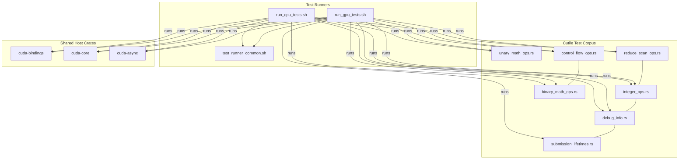
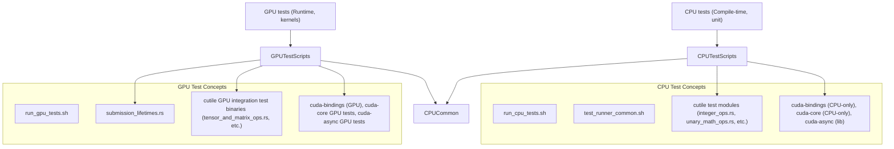

<!-- source: DeepWiki mcp.deepwiki.com · repo NVIDIA/cuda-rust · page 5.3 Test Suites and Harnesses · fetched 2026-10-26 -->

# Test Suites and Harnesses

Relevant source files

The following files were used as context for generating this wiki page:

- [cutile-rs/cutile-compiler/src/compiler/utils.rs](cutile-rs/cutile-compiler/src/compiler/utils.rs)
- [cutile-rs/cutile-compiler/src/passes/node_ids.rs](cutile-rs/cutile-compiler/src/passes/node_ids.rs)
- [cutile-rs/cutile-compiler/src/passes/typed_dispatch_lowering.rs](cutile-rs/cutile-compiler/src/passes/typed_dispatch_lowering.rs)
- [cutile-rs/cutile/tests/binary_math_ops.rs](cutile-rs/cutile/tests/binary_math_ops.rs)
- [cutile-rs/cutile/tests/checked_store_corpus.rs](cutile-rs/cutile/tests/checked_store_corpus.rs)
- [cutile-rs/cutile/tests/control_flow_ops.rs](cutile-rs/cutile/tests/control_flow_ops.rs)
- [cutile-rs/cutile/tests/debug_info.rs](cutile-rs/cutile/tests/debug_info.rs)
- [cutile-rs/cutile/tests/differential_placement.rs](cutile-rs/cutile/tests/differential_placement.rs)
- [cutile-rs/cutile/tests/gpu/audit_check_hoisting.rs](cutile-rs/cutile/tests/gpu/audit_check_hoisting.rs)
- [cutile-rs/cutile/tests/integer_ops.rs](cutile-rs/cutile/tests/integer_ops.rs)
- [cutile-rs/cutile/tests/optimization_hints.rs](cutile-rs/cutile/tests/optimization_hints.rs)
- [cutile-rs/cutile/tests/partition_index_schedules.rs](cutile-rs/cutile/tests/partition_index_schedules.rs)
- [cutile-rs/cutile/tests/reduce_scan_ops.rs](cutile-rs/cutile/tests/reduce_scan_ops.rs)
- [cutile-rs/cutile/tests/submission_lifetimes.rs](cutile-rs/cutile/tests/submission_lifetimes.rs)
- [cutile-rs/cutile/tests/type_conversion_ops.rs](cutile-rs/cutile/tests/type_conversion_ops.rs)
- [cutile-rs/cutile/tests/unary_math_ops.rs](cutile-rs/cutile/tests/unary_math_ops.rs)
- [cutile-rs/scripts/run_all.sh](cutile-rs/scripts/run_all.sh)
- [cutile-rs/scripts/run_benchmarks.sh](cutile-rs/scripts/run_benchmarks.sh)
- [cutile-rs/scripts/run_cpu_tests.sh](cutile-rs/scripts/run_cpu_tests.sh)
- [cutile-rs/scripts/run_gpu_tests.sh](cutile-rs/scripts/run_gpu_tests.sh)
- [cutile-rs/scripts/test_runner_common.sh](cutile-rs/scripts/test_runner_common.sh)

This page details the testing infrastructure employed in the [cuda-rust](https://github.com/NVIDIA/cuda-rust) monorepo, specifically focusing on the test suites and harnesses that validate the CPU and GPU code paths, the cutile test corpora, and foundational smoketests. It covers the implementation of GPU vs CPU test runners, the organization of test binaries for cutile operators and kernels, regression suites such as trybuild and debug info tests, and submission lifetime correctness checks.

---

## Purpose and Scope

The objective of the test suites and harnesses is to ensure correctness, regression prevention, and quality assurance across the various layers of the cuda-rust stack. This includes:

- **Host CPU-Only Tests:** Quick feedback tests that validate compilation, type inference, and CPU-executable or host-side components.
- **GPU Integration Tests:** Validate runtime kernel launches and interactions requiring a live CUDA driver and GPU hardware.
- **Cutile Test Corpora:** Collections of tests exercising tile-IR operations (e.g., arithmetic ops, control flow, conversion ops), trybuild-based UI regressions, submission lifetimes, and debug info correctness.
- **Smoketests:** Basic verification of environment setups, driver availability, module loading and other fundamental GPU operations.
  
The tests are executed via scripted runners that systematically invoke suite groups, with detailed reporting and environment controls for stability.

---

## CPU vs GPU Test Runner Scripts

The repository defines two primary shell scripts as entrypoints to run CPU-only and GPU-dependent tests, respectively. Both scripts source a common helper script to structure test runs.

### Shared Test Runner Helpers (`test_runner_common.sh`)

This Bash script provides utility functions such as:

- `print_header`: Prints a formatted section header for clarity in logs.
- `run_step`: Executes a named step command, prints success/failure indications, and tracks an overall success status.
- `run_examples`, `run_benches`: Helpers to run example binaries and benchmarks selectively.
- `print_summary_and_exit`: Outputs overall test completion results and sets exit codes accordingly.
- Helper wrappers such as `host_cargo()` to run `cargo` commands from the repository root.

The script handles output coloring and failure accumulation gracefully for CI integration. It is sourced at the start of the CPU and GPU test scripts to orchestrate test group execution uniformly.

### CPU Test Runner (`run_cpu_tests.sh`)

The CPU test script is designed to execute host-side and compile-time tests that do not require a live CUDA driver or GPU. It performs the following:

- Runs unit tests on pure CPU crates like `cutile-ir`, `cutile-compiler` library, and example capability checks without driver dependency.
- Executes doc-tests for compiler crates.
- Runs compile-only subsets of cutile kernel tests, including control_flow_ops, tensor_and_matrix_ops, type_conversion_ops, and specialization_bits with filters for compile-only cases.
- Runs host-side unit and contract tests for shared crates: `cuda-bindings` (excluding the driver-dependent `cuda_tests`), `cuda-core` (including device copy derive macros, launch contracts), and `cuda-async`.
- Runs some integration tests that only compile but don’t launch GPU code.
  
It skips tests requiring device access, deferring them to the GPU runner. It reports a summarized success/failure state at the end.

### GPU Test Runner (`run_gpu_tests.sh`)

The GPU test script runs integration and runtime tests requiring actual CUDA device hardware. It executes:

- A series of cutile GPU kernel tests validating tensor and tile operations: arange, autotune, do_bench benchmarks, float type ops, GPU execution ops, nested partitions, tensor reinterpretation and views.
- Specialized runtime tests (e.g. `control_flow_ops`, `tensor_and_matrix_ops`, `type_conversion_ops`, `specialization_bits`) triggered with filters to run only runtime-executed cases.
- Warmup and disk-cache tests to verify caching correctness.
- Aggregate `gpu` test binary for combined coverage.
- Submission lifetime tests: executing with different CUDA async spin budgets to verify stream and completion reactor vs spin paths in single-threaded mode.
- Debug info kernel tests running with ignored status as smoke validation.
- Shared host GPU integration tests for `cuda-core` including virtual memory manager (vmm), multicast, peer-to-peer (p2p) on multiple GPUs.
- Integration tests for `cuda-async` exercising concurrency, driver features, execution locks, pools, reactors.
- GPU integration suite tests for `cuda-bindings`.
  
The GPU test script uses environment variables (e.g., `CUDA_ASYNC_SPIN_BUDGET_US`) to configure runtime correctness testing across async completion mechanisms. It ends with a detailed success/failure summary.

---

## Cutile Test Corpora

The cutile crate contains an extensive suite of tests that exercise its high-level Tile IR Rust kernel framework and accompanying compiler API. These tests are traditionally classified as integration tests compiled and run as Cargo test binaries or doc-tests.

### Test Categories

- **Operator Tests:** Modularized test files define kernels exercising integral ops (`integer_ops.rs`), floating-point unary ops (`unary_math_ops.rs`), binary math ops (`binary_math_ops.rs`), control flow (`control_flow_ops.rs`), reduction and scan ops (`reduce_scan_ops.rs`), type conversion ops, and optimization hints.
- **UI / Trybuild Tests:** Compile-fail or compile-only regressions validate error messages and semantic contract enforcement.
- **Submission Lifetimes:** Tests that validate kernel submission lifecycle and stream completion synchronization mechanics.
- **Debug Info Tests:** Kernel and helper functions verify debug source line and call site information preservation across module compilation, leveraging `CompileOptions` with debug info levels.

Test artifacts are usually compiled via the `KernelCompiler` API or directly running tested kernels with generic parameters. Test cases invoke Tile IR operations and confirm the expected IR contains appropriate operations or attributes.

### Example Test Flow in Integer Ops

A test kernel loads tensors, performs operations like maximum/minimum, multiplication-high bits, and stores results. The associated tests compile the module's IR for these kernels and assert that the expected MLIR operations (`maxi`, `mini`, `mulhii`) appear with the correct signedness attributes. Separate tests cover unsigned variants, named arithmetic, and dispatch of trait-based operations.

### Debug Info Verification

Tests compile kernels with different debug info levels (`None`, `Line`, `Full`) and inspect the compiled bytecode or IR to ensure that debug scopes, inline call sites, and file/line information are maintained correctly even for nested kernel helper functions. The tests traverse debug metadata structures and assert expected provenance for source operations.

---

## Smoketests and Submission Lifetime Tests

The submission lifetime tests are a core subset designed to validate the interaction between kernel submission, stream synchronization, and context-wide operations like module loading and cache eviction. They are run exclusively single-threaded due to complex stream gating and blocking host calls, evaluating correctness under various async completion settings (`reactor` vs `spin` path).

These tests rely on gated asynchronous progress mechanisms where every test operation asserts correct handling of the `Pending` state in the first poll regardless of completion budget. They provide early detection of deadlocks, stalls, and improper completion signals.

---

## Test Data and Execution Flow Diagram

The following diagram illustrates the high-level flow of test runner execution, showing the relationship between system components and key scripts.

**Legend:**  
- Arrows indicate invocation or execution flow.  
- Dashed lines indicate conceptual dependencies or overlap in tested features.

Sources:  
`cutile-rs/scripts/run_cpu_tests.sh:1-151`,  
`cutile-rs/scripts/run_gpu_tests.sh:1-135`,  
`cutile-rs/scripts/test_runner_common.sh:1-176`,  
`cutile-rs/cutile/tests/integer_ops.rs:1-208`,  
`cutile-rs/cutile/tests/unary_math_ops.rs:1-177`,  
`cutile-rs/cutile/tests/binary_math_ops.rs:1-191`,  
`cutile-rs/cutile/tests/control_flow_ops.rs:1-193`,  
`cutile-rs/cutile/tests/reduce_scan_ops.rs:1-205`,  
`cutile-rs/cutile/tests/debug_info.rs:1-185`,  
`cutile-rs/cutile/tests/submission_lifetimes.rs` (implied from GPU runner).

---

## CPU vs GPU Test Workflow Detail

The test runners distinguish tests to optimize for hardware resource availability:

| Test Runner       | Execution Environment      | Crates/Tests Covered                                  | Characteristics                                               |
|-------------------|----------------------------|------------------------------------------------------|---------------------------------------------------------------|
| `run_cpu_tests.sh` | No GPU or driver needed    | cutile-ir, cutile-compiler unit/tests, compile-only tests, host crates without GPU calls                    | Fast, checks compile-time contracts, and host emulation       |
| `run_gpu_tests.sh` | Requires live GPU hardware | cutile integration tests, submission lifetimes tests, cuda-core & cuda-async integration with live driver   | Runtime correctness including device launch and async behavior|

This division allows CI workflows to parallelize and optimize the costly GPU test runs separately from faster CPU tests.

---

## Key Functions and Test Constructs

- **run_step (bash function in test_runner_common.sh):**  
  Wraps a named invocation, executes a command, and prints colored pass/fail output, accumulating overall result status.

- **host_cargo (bash function):**  
  Runs `cargo` commands inside repository root to properly resolve workspace crates like `cuda-bindings`, `cuda-core`, shared across nested Cargo workspaces.

- **Cutile Kernel Tests (Rust):**  
  Each test file defines a [`#[cutile::module]`](../4.3) Rust module with multiple [`#[cutile::entry]`](../4.3) kernels exercising specific operations. Functions load input tensors, perform tile IR operations, and store outputs validating correctness. Some tests compile kernels via `KernelCompiler` to ensure correct MLIR/bytecode emission and coverage of special cases like debug info and specialization bits.

- **Submission Lifetimes Test Binaries:**  
  Special test executables running sequences of kernel submissions with gated synchronization to force intricate completion behaviors across CUDA streams and contexts.

---

## Integration with Repository and CI

The test runners are invoked within CI workflows ([Section 5.1](../5.1)) after build steps. The separation of CPU and GPU tests aligns with concurrent job allocation. Results contribute to status guards and quality gates ([Section 5.2](../5.2)).

Explicit environment variables like `CUDA_ASYNC_SPIN_BUDGET_US` configure the test conditions for asynchronous completion kernel runs to thoroughly test progress rules.

The tests also serve as live documentation for the CUDA Rust framework kernels and the cutile tile-IR programming model presented in [Sections 4](../4) and [3](../3), providing practical examples of API usage and compiler-emitted code patterns.

---

## Summary

The cuda-rust repository establishes a comprehensive and layered testing strategy:

- CPU-only test suites quickly validate code correctness and compile-time contracts without GPU dependencies.
- GPU test suites verify live device executions, kernel launch correctness, asynchronous runtime behavior, and driver interactions.
- Cutile test corpora rigorously exercise Tile IR operations, reductions, control flow, optimizations, and debug info through modular Rust kernel tests and compiler IR assertions.
- Submission lifetime and smoketests ensure robust synchronization and driver interaction correctness under diverse async completion paths.
  
The test runners orchestrate these tests comprehensively with clear logging and conditional execution, ensuring a high level of quality assurance for this advanced GPU Rust programming framework.

---

# Appendix: Mapping Natural Language Test Concepts to Code Entities

Sources:  
See all previous source files stated in the page.

---

**This completes the detailed documentation for Section 5.3 — Test Suites and Harnesses in the cuda-rust repository.**

---

