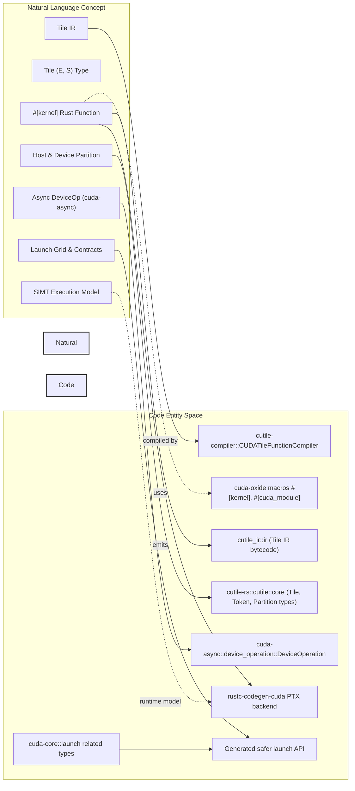
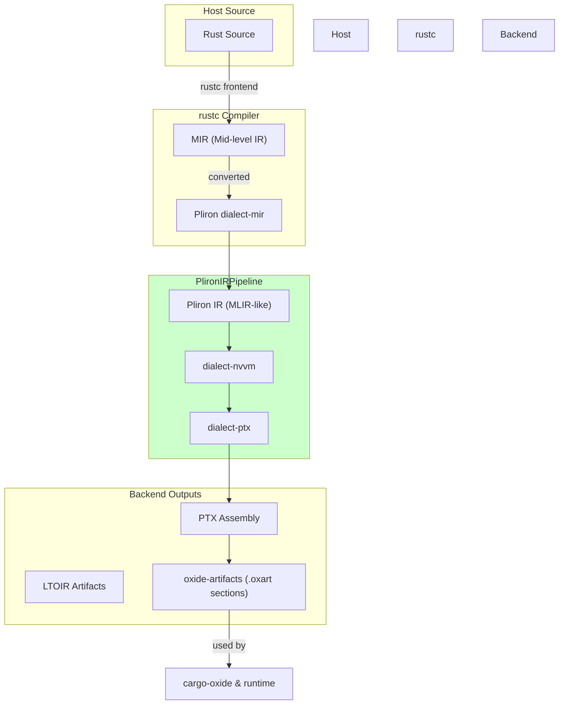

<!-- source: DeepWiki mcp.deepwiki.com · repo NVIDIA/cuda-rust · page 6 Glossary · fetched 2026-10-26 -->

# Glossary

<details>
<summary>Relevant source files</summary>

The following files were used as context for generating this wiki page:

- [.gitignore](.gitignore)
- [README.md](README.md)
- [cutile-rs/CONTRIBUTING.md](cutile-rs/CONTRIBUTING.md)
- [cutile-rs/LICENSE](cutile-rs/LICENSE)
- [cutile-rs/README.md](cutile-rs/README.md)
- [cutile-rs/cutile-benchmarks/paper/README.md](cutile-rs/cutile-benchmarks/paper/README.md)
- [cutile-rs/cutile-book/guide/debugging-and-profiling.md](cutile-rs/cutile-book/guide/debugging-and-profiling.md)
- [cutile-rs/cutile-book/guide/tensors-and-tiles.md](cutile-rs/cutile-book/guide/tensors-and-tiles.md)
- [cutile-rs/cutile-book/guide/useful-mental-models.md](cutile-rs/cutile-book/guide/useful-mental-models.md)
- [cutile-rs/cutile-book/reference/glossary.md](cutile-rs/cutile-book/reference/glossary.md)
- [cutile-rs/cutile-book/tutorials/11-nvfp4-inference.md](cutile-rs/cutile-book/tutorials/11-nvfp4-inference.md)
- [cutile-rs/cutile-compiler/src/compiler/compile_binary_op.rs](cutile-rs/cutile-compiler/src/compiler/compile_binary_op.rs)
- [cutile-rs/cutile-compiler/src/compiler/compile_cuda_tile_op.rs](cutile-rs/cutile-compiler/src/compiler/compile_cuda_tile_op.rs)
- [cutile-rs/cutile-compiler/src/compiler/compile_expression.rs](cutile-rs/cutile-compiler/src/compiler/compile_expression.rs)
- [cutile-rs/cutile-compiler/src/compiler/compile_intrinsic.rs](cutile-rs/cutile-compiler/src/compiler/compile_intrinsic.rs)
- [cutile-rs/cutile-examples/examples/scale_ptr.rs](cutile-rs/cutile-examples/examples/scale_ptr.rs)
- [cutile-rs/cutile/src/_core.rs](cutile-rs/cutile/src/_core.rs)

</details>


This page defines 25 key repository-specific terms used throughout the cuda-rust codebase and related projects such as cuda-oxide and cutile-rs. Each entry explains the term's concept, its implementation in code, and how it fits into the system's data flow, referencing relevant source files for deeper study. Two system diagrams at the end bridge from natural language concepts to concrete code entities to aid understanding.

---

### Tile IR
**Tile IR** (Intermediate Representation) is a low-level, strongly-typed bytecode dialect designed to express GPU kernels as operations on multi-dimensional **tiles** of data. It models GPU tile-level operations explicitly and is emitted primarily by the `cutile-compiler` when translating Rust kernels into Tile IR bytecode.

- Tiles are multi-dimensional fragments of data carried in registers.
- Tile IR encodes operations such as loads/stores, arithmetic, atomics, and synchronization primitives at tile granularity.
- The Tile IR is represented in the `cutile_ir` crate under `cutile_ir::ir`, with typed bytecode and IR building facilities (`OpBuilder`) used by compiler passes.

The Tile IR bytecode can be JIT-compiled or translated further into CUDA PTX for GPU execution.

Sources:  
- `cutile-rs/cutile-compiler/src/compiler/compile_cuda_tile_op.rs:1-181`  
- `cutile-rs/cutile/src/_core.rs:14-18`  
- `cutile-rs/cutile-book/reference/glossary.md:7-29`  

---

### tileiras
`tileiras` is the external **Tile IR assembler/disassembler** tool used in the build and runtime pipeline to read or write Tile IR bytecode artifacts for JIT and caching.

- cuTile Rust builds Tile IR bytecode modules with `cutile-compiler`.
- The `tileiras` CLI manages encoding and decoding Tile IR modules, enabling debugging and interoperability.
- The environment variable `CUTILE_TILEIRAS_PATH` can override the binary to control versions used for compilation.

It lives primarily outside the Rust codebase but is tightly integrated with JIT cache layers.

Sources:  
- `cutile-rs/README.md:79-147`  
- `cutile-rs/cutile-book/reference/glossary.md` (mentions tileiras usage and version compatibility)  

---

### Pliron
**Pliron** is a Rust-based MLIR-like (Multi-Level Intermediate Representation) IR framework developed as part of `cuda-oxide`. It provides a multi-stage compilation IR pipeline from Rust MIR down to PTX.

- Rust source → Rust MIR → Pliron IR → LLVM IR → PTX  
- The pliron IR supports dialects modeled after LLVM IR and CUDA's NVVM dialects.
- `cuda-oxide` depends on Pliron to transform the compiler's MIR into suitable codegen IR, eventually lowered to PTX.

Pliron is not a direct user-facing library but underpins the rustc-based CUDA backend.

Sources:  
- `README.md:20-21`  
- `README.md:117-123`

---

### dialect-mir
`dialect-mir` is a **Pliron dialect** representing Rust MIR in the Pliron framework used within `cuda-oxide`.

- It captures Rust MIR in a Pliron-compatible form for further lowering.
- Implements MIR transformations and optimizations before translating to LLVM dialects.
- Acts as a bridge between Rust's compiler internals and the CUDA-targeted IR pipeline.

This dialect is essential for maintaining the fidelity of Rust semantics when lowering to GPU ISA.

Sources:  
- `README.md:118-123` (implied as part of compilation pipeline)  

---

### LTOIR
**LTOIR** (Link Time Optimization IR) stands for a bundled intermediate representation artifact emitted by `cuda-oxide` to support cross-crate device code linking and optimization.

- The device code from multiple crates is linked and optimized before final PTX emission.
- An opaque "LTOIR" artifact is generated by the compiler backend and consumed later during the build.
- Supports embedding binary code sections in host binaries.

This artifact ensures efficient device code linking similar to CPU LTO workflows.

Sources:  
- `README.md:137-139`  

---

### DeviceOp
`DeviceOp` is a core abstraction modeling a **device-side asynchronous operation** in the `cuda-async` crate.

- Represents CUDA device launches, memory transfers, and operations tracked asynchronously.
- Implements futures and combinators for GPU kernel execution scheduling.
- Provides host APIs to launch kernels and check completion status without blocking.

It enables Rust async/await style GPU programming.

Sources:  
- `README.md:19` (mentions device-side abstractions)  
- `README.md:89-91` (async kernel launches via DeviceOperation)  

---

### Token (in cutile-rs)
A **Token** is a synchronization token type used on the GPU device to represent ordering and dependencies between tile memory operations.

- Produced from loads/stores/atomics to track and synchronize memory ordering.
- Threads in a tile program use Tokens to ensure proper serialization.
- Returned as part of load/store operations in tile-IR.

Implemented in `cutile-rs` core types managing device memory model safety.

Sources:  
- `cutile-rs/cutile/src/_core.rs` (token mentions implied in atomic & load/store APIs)  
- `cutile-rs/cutile-examples/examples/scale_ptr.rs:54-76` (load/store tokens usage)  

---

### Partition (in cutile-rs)
A **Partition** represents a multi-dimensional division or subdivision of a tensor, used to assign non-overlapping output subregions to GPU tile blocks.

- **Host-side Partition:** obtained via a `.partition(...)` call on a mutable tensor to split output buffers into tiles.
- **Device-side Partition:** created inside kernels on read-only inputs for indexed tiled access.
- Controls launch grid inference from output tensor partitioning.
- Ensures exclusive mutable access semantics for safe parallel writes.

See `[cutile-rs/cutile-book/reference/glossary.md:15-31]` for detailed conceptual explanation of host/device partitions.

Sources:  
- `cutile-rs/cutile-book/reference/glossary.md:15-31`  
- `cutile-rs/cutile-compiler/src/compiler/compile_intrinsic.rs:89-135` (partition geometry extraction)  

---

### TileFunctionKey
A **TileFunctionKey** is a specialization key representing the concrete typed version of a kernel function during JIT specialization in `cutile-compiler`.

- Encodes generic parameters, tile shapes, and specialization bits for each compiled kernel variant.
- Used for cache keying to avoid recompilation for identical kernel specializations.
- Serialized/deserialized for disk and memory caches.
- Supports versioning and invalidation.

Sources:  
- `cutile-rs/cutile-compiler/src/compiler/compile_cuda_tile_op.rs` (specialization bits parsing, attribute propagation)  
- `cutile-rs/cutile-compiler/src/compiler/compile_intrinsic.rs` (specialization handling hints)  

---

### cargo-oxide
`cargo-oxide` is a Cargo subcommand tool (`cargo oxide`) that drives the `cuda-oxide` compilation pipeline for compiling CUDA Rust kernels.

- Supports subcommands: build, run, test, inspect, pipeline, sanitize, debug, doctor, scaffold, fmt.
- Manages rustc flags, backend invocations, and host-device artifact integration.
- Allows inspection of intermediate IR stages in the Rust to PTX pipeline.
- Enables LTOIR artifact emission and backend updates.

Referenced throughout the `README.md` for usage examples.

Sources:  
- `README.md:150-156`  
- `README.md:114-144`  

---

### `#[kernel]` (cuda-oxide macro)
The attribute macro `#[kernel]` marks Rust functions for GPU device compilation in `cuda-oxide`.

- Identifies functions compiled into CUDA PTX kernels.
- Supports generic parameters, closures, and captures.
- Generates device-side code and launch wrappers exposed to host code.
- Enforces kernel entry point constraints.

Example code snippet:  
```rust
#[kernel]
pub fn map<T: Copy, F: Fn(T) -> T + Copy>(f: F, input: &[T], mut out: DisjointSlice<T>) {
    let idx = thread::index_1d();
    if let Some(out_elem) = out.get_mut(idx) {
        *out_elem = f(input[idx.get()]);
    }
}
```

Sources:  
- `README.md:41-48` 

---

### `#[cuda_module]` (cuda-oxide macro)
The attribute macro `#[cuda_module]` decorates Rust modules to bundle device kernel code as embedded PTX blobs in the host binary.

- Embeds compiled device artifacts as binary sections.
- Generates typed safe-launch host API functions.
- Minimizes manual kernel module loading.
- Coordinates host-device linkage.

Sources:  
- `README.md:37-46`  

---

### NVPTX
NVPTX is the **NVIDIA Parallel Thread Execution** ISA used as the intermediate ISA for GPU kernels targeting NVIDIA architectures.

- `cuda-oxide` backend emits PTX assembly as output before driver JIT compilation.
- Supports standard CUDA programming model concepts (warps, threads, blocks).
- PTX targets via machine-specific backends of LLVM leveraged in `cuda-oxide`.

Sources:  
- `README.md:16-18` (mentions rustc backend compiling kernels to PTX)  

---

### SIMT
SIMT (**Single Instruction, Multiple Threads**) is the GPU execution model that runs many GPU threads in lock-step.

- `cuda-oxide` models CUDA SIMT kernels natively in Rust.
- The kernel and runtime assume a flat thread group (a warp) executing the same instructions simultaneously.
- Host API `cuda-core` and `cuda-async` provide abstractions for launching and synchronizing SIMT kernels.

Sources:  
- `README.md:16-18`  
- `README.md:19-20`  

---

### oxart (oxide-artifacts)
`oxart` is the file format and crate handling compiled device code artifacts: PTX, LTOIR, and cubins embedded in host binaries.

- `oxide-artifacts` crate serializes and deserializes these sections.
- Used in both cuda-oxide host runtime and compiler backend.
- Supports opaque embedding and retrieval during runtime.

Sources:  
- `README.md:137-139`  

---

### Specialization bits
Specialization bits are compile-time flags or parameters encoded in `TileFunctionKey` for kernel specialization in `cutile-compiler`.

- Control kernel variants, e.g., enabling optimizations or features (FTZ, rounds, atomic behavior).
- Manifested as zero-sized type marker parameters.
- Provide static dispatch and tuning without runtime overhead.

Sources:  
- `cutile-rs/cutile-compiler/src/compiler/compile_cuda_tile_op.rs:79-181`  
- `cutile-rs/cutile-compiler/src/compiler/compile_intrinsic.rs:90-180`  

---

### DeviceOp composition
DeviceOps can be composed into larger asynchronous workflows in `cuda-async`.

- Supports sync launches, CUDA graphs, and replay.
- Combines memory operations, kernel launches, and device futures in dependency graphs.
- Provides composable futures for GPU concurrency.

Sources:  
- `README.md:19, 89-92`   

---

### Token Propagation (cutile-rs)
Token lifetimes and propagation enforce ordering of tile-block memory operations on device.

- Functions like `load_ptr_tko` and `store_ptr_tko` accept and return Tokens.
- Used internally to sequence dependent memory operations.
- Ensures non-overlapping memory accesses obey concurrency constraints in single-threaded tile blocks.

Example – load/create token:  
```rust
let (tile, token): (Tile<f32, _>, Token) = load_ptr_tko(...);
```

Sources:  
- `cutile-rs/cutile-examples/examples/scale_ptr.rs:54-76`  
- `cutile-rs/cutile/src/_core.rs`   

---

### Tile (Type)
The central multi-dimensional data fragment operated on by tile programs.

- Represented as `Tile<E, S>` where `E` is element type and `S` is a static shape array.
- Used in kernel computations; lives in registers.
- Supports element-wise arithmetic, broadcasting, slicing, and view transformations.
- Emitted in Tile IR backend and compiled to PTX.

Sources:  
- `cutile-rs/cutile-book/reference/glossary.md:7-13`  
- `cutile-rs/cutile/src/_core.rs:14-18`  

---

### PartitionMut (Host-side)
A wrapper for mutable tensors partitioned into disjoint subregions to enforce exclusive writable access semantics.

- Created on the host before kernel launch by calling `.partition()` on `Tensor`.
- Passed as kernel arguments to ensure safe concurrent writes.
- Generates a launch grid from the partition shape.

Sources:  
- `cutile-rs/cutile-book/reference/glossary.md:15-31`  

---

### Token (loop token accumulator)
`LoopTokenAcc` is an internal helper in the compiler that threads token dependencies through loops in Tile IR code.

- Carries ordering tokens across loop iterations.
- Ensures write serializations and consistent memory orderings across loop bodies.
- Supports complex aliasing and mutable views safely.

Sources:  
- `cutile-rs/cutile-compiler/src/compiler/compile_expression.rs:48-72`  

---

### dialect-nvvm
A **Pliron dialect** modeling NVIDIA's NVVM IR dialect for LLVM IR targeting NVIDIA GPUs.

- Used in lowering Tile IR to LLVM IR within compiler pipeline.
- Supports NVIDIA-specific intrinsics and code generation directives.
- Enables compatibility with NVPTX codegen pipelines.

Sources:  
- `README.md:118-123` (implied)  

---

### Device Function (cuda-oxide)
A Rust function marked with `#[kernel]` that is compiled by `cuda-oxide` into a device function in PTX.

- Includes captured parameters lifted into kernel argument blocks.
- Linked in device modules emitted as embedded artifacts.
- Host-visible wrappers generated for safe launching.

Sources:  
- `README.md:41-48`  

---

### cargo-oxide subcommands
`cargo-oxide` supports extensive tooling beyond build including:

- `build` – compile with CUDA codegen backend.
- `run` – build and execute GPU-enabled Rust binaries.
- `inspect` – print generated PTX/device code.
- `pipeline` – show IR lowering stages.
- `sanitize` – run CUDA correctness checks.
- `debug` – launch with `cuda-gdb`.
- `test` – run unit tests instrumented for GPU.
- `emit-ltoir` – compile device code LTOIR artifacts.
- `update` – refresh backend tools.

Sources:  
- `README.md:114-144`  

---

### SIMT Host Helpers (cuda-core crate)
Helper abstractions for handling SIMT launch configurations and thread indexing on the host side.

- Exposed in `cuda-core` crate.
- Examples include `LaunchConfig` and wrappers around CUDA streams.
- Ensure that grid and block sizes correspond to kernel expectations.

Sources:  
- `README.md:18-19` (mentions launch configuration)  

---

### Dialect-ptx
A Pliron dialect that models PTX instructions in the compiler pipeline.

- Final lowering stage before emitting vendor PTX assembly.
- Handles PTX-specific optimization and scheduling passes.
- Converts intermediate views into explicit PTX instructions.

Sources:  
- `README.md:118-123` (pipeline mention)  

---

### specialization bits (detailed)
In `cutile-rs` and `cuda-oxide` compilation, specialization bits encode choices such as:

- Flush-to-zero enabled/disabled.
- Rounding modes for floating-point ops.
- Atomic modes and memory ordering.
- Optimization hints like enabling TMA (Tensor Memory Accelerator).

They are represented as marker types in Rust code (`ftz::Enabled`, `rounding::NearestEven`), parsed during compilation for static dispatch.

Example:  
```rust
fn some_op<FTZ: ftz::Mode>() { ... }
```

Sources:  
- `cutile-rs/cutile-compiler/src/compiler/compile_cuda_tile_op.rs:79-181`  
- `cutile-rs/cutile/src/_core.rs:34-217`  

---

### Device Kernel Launch Contracts
Contracts enforce that kernel launch configurations and resource requirements are safe.

- Provided through macros generating checked APIs.
- Allows safe invocation of unsafe raw CUDA launch parameters.
- Encode pre- and post-conditions such as matching index-space sizes, synchronization, and memory bounds.

Sources:  
- `README.md:88-89`  

---

### Warp/Cluster intrinsics
Support for warp and cluster-level collective communication in CUDA kernels.

- Exposed through device-side intrinsics macros.
- Enable reductions, shuffles, and shared memory operations at warp granularity.
- Used in `cuda-oxide` device API and passed through to Tile IR.

Sources:  
- `README.md:17`  

---

### oxart vs cubin vs PTX
- **PTX** is human-readable NVIDIA intermediate assembly (source-level ISA).
- **CUBIN** is a binary format containing the final GPU machine code.
- **oxart** is the custom artifact format embedding compiled device code at different pipeline stages (PTX, LTOIR, or combined).

These are handled by `oxide-artifacts` crate and the compilation pipeline.

Sources:  
- `README.md:137-139`  

---

### Device and Host APIs (cuda-device, cuda-host, cuda-macros)
- Device APIs provide kernel annotations like `#[kernel]` and intrinsics for thread indexing, shared memory, barriers, atomics.
- Host APIs provide safe wrappers and launch contracts.
- Macros generate glue code binding device kernels and host launchers.

Sources:  
- `README.md:18-20`  

---

## Diagrams

### System Overview: "Natural Language GPU Kernel Concepts" to "Code Entities"



Sources:  
- `README.md:20-21,41-48`  
- `cutile-rs/cutile-compiler/src/compiler/compile_cuda_tile_op.rs`  
- `cutile-rs/cutile-examples/examples/scale_ptr.rs`  
- `cutile-rs/cutile/src/_core.rs`  

---

### Compilation Pipeline: Mapping Stages and Artifacts



Sources:  
- `README.md:20-23,117-125`  

---

# Summary Table of Terms and Locations

| Term                  | Description Brief                         | Main Source File(s)                              |
|-----------------------|-----------------------------------------|-------------------------------------------------|
| Tile IR               | Tile-level GPU IR bytecode dialect      | `cutile-compiler/src/compiler/compile_cuda_tile_op.rs` |
| tileiras              | Tile IR assembler/disassembler tool     | `cutile-rs/README.md`                            |
| Pliron                | Rust MLIR-like multi-level IR framework | `README.md` compiler pipeline sections           |
| dialect-mir           | Pliron dialect representing MIR         | `README.md` compiler pipeline                    |
| LTOIR                 | Link-time optimized dev code IR artifact| `README.md`                                      |
| DeviceOp              | Async GPU device operation abstraction  | `README.md` host runtime                         |
| Token                 | Dependency token for device ordering    | `cutile-rs/cutile/src/_core.rs`, example code   |
| Partition             | Tensor divisions for safe parallelism   | `cutile-rs/cutile-book/reference/glossary.md`  |
| TileFunctionKey       | Kernel specialization key                | `cutile-compiler/src/compiler/compile_intrinsic.rs` |
| cargo-oxide           | Cargo subcommand for cuda-oxide build   | `README.md`                                      |
| `#[kernel]`           | Device entry-point macro                  | `README.md`                                      |
| `#[cuda_module]`      | Embeds device PTX module                 | `README.md`                                      |
| NVPTX                 | NVIDIA GPU ISA (PTX)                     | `README.md`                                      |
| SIMT                  | GPU execution model                      | `README.md`                                      |
| oxart                  | Compiled device code artifact format    | `README.md`                                      |
| specialization bits   | Compile-time kernel dispatch flags      | `cutile-compiler/src/compiler/compile_cuda_tile_op.rs` |
| DeviceOp composition  | Async workflow composition model        | `README.md`                                      |
| Token Propagation     | Memory operation ordering token          | `cutile-rs/cutile-examples/examples/scale_ptr.rs` |
| Tile (type)           | Register-resident multi-dimensional block| `cutile-rs/cutile-book/reference/glossary.md`  |
| PartitionMut (Host)   | Mutably partitioned tensor on host       | `cutile-rs/cutile-book/reference/glossary.md`  |
| LoopTokenAcc          | Compiler internal token acc in loops      | `cutile-compiler/src/compiler/compile_expression.rs` |
| dialect-nvvm          | Pliron NVVM LLVM IR dialect              | `README.md`                                      |
| Device Function       | Rust `#[kernel]` compiled PTX device fn | `README.md`                                      |
| cargo-oxide subcommands| CLI commands to manage cuda-oxide builds | `README.md`                                      |
| SIMT Host Helpers     | Host-side launch grid and thread helpers | `README.md`                                      |
| dialect-ptx           | Pliron PTX dialect                        | `README.md`                                      |
| Device Kernel Launch Contracts | Launch config checks                | `README.md`                                      |
| Warp/Cluster intrinsics| Warp-level collective ops support        | `README.md`                                      |

---

This glossary and diagrams aim to clarify the layered compilation model, key types, and runtime abstractions of cuda-rust and related projects, linking concrete code entities to higher-level GPU programming concepts.

Sources:  
- `README.md` [1-159]()  
- `cutile-rs/cutile-book/reference/glossary.md:1-67`  
- `cutile-rs/cutile-compiler/src/compiler/compile_cuda_tile_op.rs:1-181`  
- `cutile-rs/cutile-compiler/src/compiler/compile_intrinsic.rs:6-180`  
- `cutile-rs/cutile-compiler/src/compiler/compile_expression.rs:48-72`  
- `cutile-rs/cutile/src/_core.rs:1-218`  
- `cutile-rs/cutile-examples/examples/scale_ptr.rs:27-78`