# Page: Overview

# Overview

<details>
<summary>Relevant source files</summary>

The following files were used as context for generating this wiki page:

- [.github/workflows/clippy.yml](.github/workflows/clippy.yml)
- [.github/workflows/fmt.yml](.github/workflows/fmt.yml)
- [.github/workflows/unit-tests.yml](.github/workflows/unit-tests.yml)
- [.gitignore](.gitignore)
- [Cargo.lock](Cargo.lock)
- [Cargo.toml](Cargo.toml)
- [README.md](README.md)
- [cutile-rs/CONTRIBUTING.md](cutile-rs/CONTRIBUTING.md)
- [cutile-rs/LICENSE](cutile-rs/LICENSE)
- [cutile-rs/README.md](cutile-rs/README.md)
- [cutile-rs/cutile-benchmarks/paper/README.md](cutile-rs/cutile-benchmarks/paper/README.md)

</details>


This wiki page presents a high-level introduction to the **NVIDIA cuda-rust monorepo**, a comprehensive Rust-based ecosystem designed for GPU programming targeting NVIDIA CUDA platforms. The repository integrates multiple related projects and libraries to provide both low-level CUDA driver bindings and high-level Rust abstractions for writing, compiling, and launching CUDA kernels in Rust, as well as an advanced Tile IR framework for safe and flexible GPU kernel development.

The cuda-rust monorepo contains three main components, each with their own specialized responsibilities and synergies:

---

## 1. Shared Host Runtime Crates

A foundational suite of Rust crates that provide safe and ergonomic host-side bindings and runtimes for CUDA development. These crates serve as the shared infrastructure supporting higher-level codebases in this repository.

- **`cuda-bindings`**: A bindgen-generated, raw FFI binding crate for the NVIDIA CUDA driver API. It dynamically loads the `libcuda` library at runtime, enabling flexible compatibility with installed CUDA drivers. The crate abstracts loading and initialization concerns while exposing the full low-level API for fine-grained control.  
- **`cuda-core`**: Implements core abstractions such as `CudaContext`, device memory management types like `DeviceBuffer`, and utilities for CUDA context and runtime management. It also includes support for virtual memory management (VMM), multicast transfers, and single instruction multiple thread (SIMT) host helpers. This crate includes derive macros (`cuda-core-derive`) for convenience attributes like `DeviceCopy` and kernel launch contracts.  
- **`cuda-async`**: Provides facilities for asynchronous execution models of device operations, offering types like `DeviceOperation` and `DeviceFuture`. It handles CUDA stream submission, completion reactors versus spin-loop wait strategies, scheduling policies, CUDA graph capture support, and automatic resource leak detection. This crate builds upon `cuda-core` and shares its runtime.

These crates are designed to be low-level, stable foundations that can be broadly shared and integrated into both the `cuda-oxide` and `cutile-rs` projects.

For deep details on these, see the child page **[Shared Host Runtime Crates](#2)**.

---

## 2. cuda-oxide: Rust-to-PTX Compiler and Runtime

`cuda-oxide` is a cutting-edge Rust compiler backend and runtime tailored to compile native Rust GPU kernels targeting NVIDIA's PTX intermediate representation for CUDA devices.

Key points:

- **Single-source compilation model**: Host and device code live in the same Rust file and are compiled together via the custom `cargo oxide` subcommand, enabling seamless coding workflows without domain-specific languages or separate toolchains.  
- **rustc codegen backend**: Implements a custom rustc backend that generates MIR (Rust's mid-level IR) and progressively lowers it using an MLIR-like internal IR framework called Pliron, eventually emitting LLVM IR and PTX code.  
- **Device-side APIs**: Provides idiomatic Rust-style device APIs for CUDA programming, such as `#[kernel]` and `#[cuda_module]` attributes to define GPU kernels and modules; intrinsics for thread indexing, warp/cluster operations, shared memory, atomics, and barriers; and compile-time kernel policies for specialization without runtime overhead.  
- **Host-side runtime**: Includes the host APIs that leverage `cuda-core` and `cuda-async` for memory management, kernel launching, and asynchronous GPU workflows, supporting closures, typed launch configurations, and safe kernel launches with contracts.  
- **Extensive tooling**: The `cargo-oxide` CLI exposes subcommands for building, running, testing, inspecting generated PTX, viewing compilation pipelines, debugging, sanitizing, and more.

The `cuda-oxide` project's core compiler crates and utilities live under the `cuda-oxide` directory and maintain a complex, evolving compilation pipeline from Rust MIR through custom dialects to PTX.

See the child page **[cuda-oxide: Rust-to-PTX Compiler and Runtime](#3)** for a full breakdown.

---

## 3. cutile-rs: Tile IR GPU Programming Framework

`cutile-rs` is a Rust-native framework built around the Tile IR intermediate representation for GPU kernels, providing a type-safe, memory-safe, and flexible tile-based programming model.

Key features:

- **Memory-safe GPU kernels**: The framework extends Rust's ownership and borrowing rules to device code. Outputs are split into disjoint tiles (mutable regions), while multiple inputs can be safely shared. This ensures data-race freedom by design.  
- **Tile IR backend**: Kernels are written in Rust and JIT-compiled at runtime into Tile IR bytecode which captures the tiled data access patterns and is specialized for the target GPU architecture.  
- **Device DSL and core types**: Provides core abstractions like `Tile`, `Tensor`, `Partition`, `Token`, and atomic types. Supports pointer tiles, shapes, rounding modes, and ordering to enable expressive GPU algorithms.  
- **Compiler frontend passes**: Implements compiler passes for compiling Rust expressions, binary operations, intrinsics, and tile operations, with type inference, bounds checks, and specialization support.  
- **JIT compilation and caching**: Supports runtime compilation, multi-layered caching of specialized kernels keyed by `TileFunctionKey`, host API launchers, and CUDA graph replay.  
- **Host API**: Facilitates launching kernels synchronously, asynchronously, or as CUDA graph replays. Supports autotuning, benchmarking, and warmup phases to optimize execution.  
- **Rich ecosystem**: Includes a variety of example kernels, benchmarks, and tutorials organized in a dedicated book.

`cutile-rs` is provided as a self-contained workspace and crate set alongside `cuda-oxide`. It leverages the shared host crates (`cuda-bindings`, `cuda-core`, `cuda-async`) and runtime, but offers a distinct, higher-level, tile-oriented programming model.

For extensive information, see the child page **[cutile-rs: Tile IR GPU Programming](#4)**.

---

# Relationship and Integration Diagram

```mermaid
graph TB
  subgraph SharedHostCrates["Shared Host Crates"]
    A[cuda-bindings]
    B[cuda-core]
    Bx[cuda-core-derive]
    C[cuda-async]
  end

  subgraph CUDA_OXIDE["cuda-oxide Project"]
    D[rustc-codegen-cuda backend]
    E[Device APIs: #[kernel], #[cuda_module]]
    F[cargo-oxide CLI and tooling]
    G[Host runtime: uses cuda-core + cuda-async]
  end

  subgraph CUTILE_RS["cutile-rs Project"]
    H[Tile IR compiler and JIT]
    I[Device DSL: Tile, Tensor, Partition, Token]
    J[Host API & Kernel Launchers]
    K[Examples, Benchmarks, Tutorials]
  end

  A --> B --> C
  Bx --> B
  B --> G
  C --> G

  B --> H
  C --> J

  H --> I --> J
  J --> K

  D -->|compiles| E
  F -->|invokes| D & G

  style SharedHostCrates fill:#f9f9f9,stroke:#333,stroke-width:1px
  style CUDA_OXIDE fill:#f0f0f0,stroke:#333,stroke-width:1px
  style CUTILE_RS fill:#f0f0f0,stroke:#333,stroke-width:1px
```

*Diagram showing the major components and their code-level relationships. The shared host crates `cuda-bindings`, `cuda-core` (+ `cuda-core-derive`), and `cuda-async` provide foundational runtime and API functionality consumed by both `cuda-oxide` (rustc backend and CLI) and `cutile-rs` (Tile IR compiler and runtime).*

---

# Repository Structure and Workspaces

The repository is organized into multiple Cargo workspaces and nested projects:

| Workspace / Directory | Purpose |
|-----------------------|---------|
| **Root host workspace** | Contains stable host crates shared by both products (`cuda-bindings`, `cuda-core`, `cuda-core-derive`, `cuda-async`). These crates avoid rustc-nightly dependencies where possible to remain broadly compatible. |
| **`cuda-oxide` workspace** | Contains the rustc codegen backend for CUDA as well as device APIs and the `cargo-oxide` CLI tool for building/running/testing Rust CUDA projects. This workspace requires Rust nightly with specialized components and LLVM toolchain. |
| **`cutile-rs` workspace** | Dedicated to the Tile IR framework, comprising libraries for the device DSL, compiler passes, host API, examples, and benchmarks. This workspace targets usability and safety centered on the Tile IR abstraction. |
| **Device-only fixtures** | Kernel-only crates and tests that compile device code without a host component, verifying compile-time properties. |
| **`examples/`** | Cross-workspace examples demonstrating usage of both `cuda-oxide` and `cutile-rs`. |

The workspaces are separate to isolate dependencies, pin toolchains, and scaffold independent development lifecycles. The root workspace dependencies are managed independently to maintain a stable surface for shared runtime crates, while the nested workspaces focus on product-specific needs.  
For detailed layout, workspace rules, dependency pinning, and rationale see the child page **[Repository Layout and Workspaces](#1.1)**.

---

# Getting Started and Toolchain Setup

Setting up a development environment requires several components, including:

- **CUDA Toolkit 13.0+** (recommended 13.3+) for driver libraries and headers. The `cuda-bindings` crate loads the NVIDIA `libcuda` dynamically at runtime.  
- **Rust nightly toolchain** with `rust-src`, `rustc-dev`, and `llvm-tools` components pinned in `rust-toolchain.toml`, required mainly by the `cuda-oxide` backend for compilation. The `cutile-rs` framework primarily supports Rust stable.  
- **Clang and libclang development headers** needed for bindgen to generate CUDA binding crates.  
- **Linux OS**, tested on Ubuntu 24.04 as primary target.  
- Optional: Nix shells or development containers for environment reproducibility.

The repository includes devcontainers and Nix flakes to simplify environment provisioning. The `cargo-oxide` CLI drives the build pipeline for the cuda-oxide backend, handling all toolchain orchestration internally. Example workflows for building, running, inspecting artifacts and debugging are provided via `cargo oxide` subcommands.

For a step-by-step installation guide, toolchain configuration, and first build instructions, see **[Getting Started and Toolchain Setup](#1.2)**.

---

# Summary

The cuda-rust monorepo is a modular, evolving ecosystem designed to empower Rust developers with native support for CUDA GPU programming. It integrates:

- Shared host-side runtime crates (`cuda-bindings`, `cuda-core`, `cuda-async`) that underpin higher-level tooling.  
- `cuda-oxide`, a rustc backend that compiles single-source Rust kernels to PTX with advanced device APIs and a robust CLI.  
- `cutile-rs`, a Tile IR-driven framework with Rust-friendly safety, composability, and JIT compilation for tiled GPU kernels.

These components are developed and versioned in separate Cargo workspaces with stable runtime dependencies shared across projects. Together, they present a path forward for modern, safe, and ergonomic GPU programming in Rust.

---

**Links to Child Pages:**

- Repository Layout and Workspaces: [Repository Layout and Workspaces](#1.1)  
- Getting Started and Toolchain Setup: [Getting Started and Toolchain Setup](#1.2)  
- Shared Host Runtime Crates: [Shared Host Runtime Crates](#2)  
- cuda-oxide Compiler and Runtime: [cuda-oxide: Rust-to-PTX Compiler and Runtime](#3)  
- cutile-rs Tile IR Framework: [cutile-rs: Tile IR GPU Programming](#4)  
- Testing and Quality Infrastructure: [Testing and Quality Infrastructure](#5)  
- Glossary of Terms: [Glossary](#6)  

---

Sources:  
- `README.md:1-159`()  
- `cutile-rs/README.md:1-177`()  
- `Cargo.toml:1-19`()  
- `.github/workflows/unit-tests.yml:1-151`()

---

# Page: Repository Layout and Workspaces

# Repository Layout and Workspaces

<details>
<summary>Relevant source files</summary>

The following files were used as context for generating this wiki page:

- [.github/workflows/clippy.yml](.github/workflows/clippy.yml)
- [.github/workflows/fmt.yml](.github/workflows/fmt.yml)
- [.github/workflows/unit-tests.yml](.github/workflows/unit-tests.yml)
- [Cargo.lock](Cargo.lock)
- [Cargo.toml](Cargo.toml)
- [cuda-oxide/Cargo.toml](cuda-oxide/Cargo.toml)
- [cutile-rs/CHANGELOG.md](cutile-rs/CHANGELOG.md)
- [cutile-rs/Cargo.lock](cutile-rs/Cargo.lock)
- [cutile-rs/Cargo.toml](cutile-rs/Cargo.toml)
- [cutile-rs/cutile-book/tutorials/12-dgx-spark-inference.md](cutile-rs/cutile-book/tutorials/12-dgx-spark-inference.md)

</details>


This section details the overall repository layout of the NVIDIA `cuda-rust` project, focusing on the organization of multiple Cargo workspaces, including the root "host" workspace, the `cuda-oxide` compiler backend workspace, the `cutile-rs` Tile IR framework workspace, as well as device-only fixtures and examples. It explains the rationale behind keeping these workspaces separate and how dependencies are pinned across them for stability and compatibility.

---

## 1. Overview of Cargo Workspaces in the Repository

The `cuda-rust` repository is structured as a collection of multiple Cargo workspaces, each serving a distinct purpose:

- **Root Host Workspace**: Contains stable host-side crates shared by both the `cuda-oxide` and `cutile-rs` components.
- **`cuda-oxide` Workspace**: Contains the Rust-to-PTX compiler backend and associated compiler/runtime crates.
- **`cutile-rs` Workspace**: Represents the cuTile Rust tile-IR GPU programming framework and related crates.
- **Examples Workspace**: Various example crates showcasing usage of the `cuda-oxide` and `cutile-rs` workspaces.
- **Device-Only Fixture Workspace**: A special workspace under `cuda-oxide/crates/cuda-macros/tests/device-only` that builds device-only kernel code without any host components.

Each workspace has its own `Cargo.toml` manifest and dependency graph, carefully designed to minimize rebuilds and to enable clean separation of concerns.

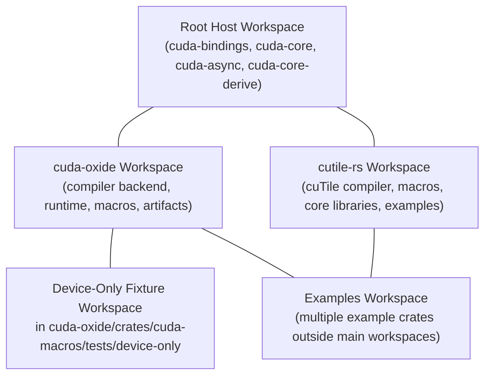

**Figure 1:** High-level relationship of Cargo workspaces in the repository.

Sources: [`Cargo.toml:1-18`](#), [`cuda-oxide/Cargo.toml:1-40`](#), [`cutile-rs/Cargo.toml:1-80`](#)


---

## 2. Root Host Workspace

The root workspace is defined by the top-level `Cargo.toml` in the repository root and includes the crates:

- `cuda-bindings`
- `cuda-core`
- `cuda-core-derive`
- `cuda-async`

These crates provide **stable, shared host-side runtime support** that both the CUDA Oxide compiler and cuTile framework depend on for interacting with the CUDA driver and device buffers:

- `cuda-bindings`: Raw bindgen-generated FFI bindings to the CUDA driver API.
- `cuda-core`: Core runtime abstractions for CUDA contexts, device buffers, data types, and unsafe low-level operations.
- `cuda-core-derive`: Derive macros for safety and launch contract annotations.
- `cuda-async`: Asynchronous device operation abstractions and futures.

This workspace **does not impose the custom Rust nightly or edition requirements** needed by the `cuda-oxide` compiler backend. Instead, it uses stable Rust and is versioned and published separately, allowing reuse and stability.

The root workspace excludes `cuda-oxide` and `cutile-rs` as members to maintain isolation and to avoid compiler version conflicts:

```toml
[workspace]
resolver = "3"
members = [
    "cuda-bindings",
    "cuda-core",
    "cuda-core-derive",
    "cuda-async",
]
exclude = [
    "cuda-oxide",
    "cutile-rs",
]
```

**Dependency Pinning:** These host-side crates use independent versioning and are pinned with exact versions in the downstream workspaces to ensure API stability.

Sources: [`Cargo.toml:1-18`](#), [`cuda-bindings`, `cuda-core`, `cuda-async` crate metadata inferred from Cargo.lock]()


---

## 3. `cuda-oxide` Workspace: Rust-to-PTX Compiler Backend and Runtime

The `cuda-oxide` directory holds a separate workspace containing the Rust-to-PTX compiler backend, core device and host APIs, macros, and runtime support specific to the compiler implementation. It comprises numerous crates, including:

- Compiler dialect crates: `dialect-mir`, `dialect-iket`, `dialect-ptx`, etc.
- Codegen crates: `cuda-oxide-codegen`, `llvm-export`, etc.
- Device and host crates: `cuda-device`, `cuda-host`, `cuda-macros`
- Compiler tooling: `cargo-oxide` CLI
- FFI bindings and artifact handling: `libnvvm-sys`, `nvjitlink-sys`, `cuda-artifact-finalizer`, `reserved-oxide-symbols`
- Fuzzer support: `fuzzer`

Notably, the `rustc-codegen-cuda` crate inside this workspace is **not a workspace member** because it requires special nightly Rust features and a distinct build process.

The workspace uses **Rust 2024 edition** and is pinned with the latest nightly toolchain as indicated in the `cuda-oxide` toolchain and profile configs (implied).

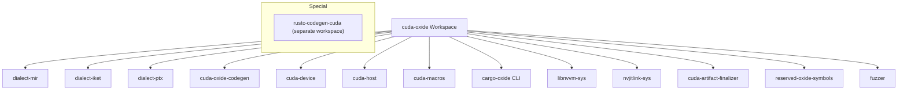

**Figure 2:** `cuda-oxide` workspace crates overview.

The separation of this workspace achieves:

- **Stable interface for Rust compiler integration and backend development.**
- Ability to develop and test the `rustc-codegen-cuda` backend with its own custom build.
- Pinning dependencies to exact versions ensures reproducible builds.
- Separating host runtime crates via path dependencies avoids duplication and version conflicts.

### Device-Only Fixture

Within this workspace lies a **device-only fixture** workspace under:

```
cuda-oxide/crates/cuda-macros/tests/device-only
```

This workspace demonstrates compilation of device kernel code marked with `#[cuda_module]` without any host-side components or linkage. It is its own minimal Cargo workspace, enabling proof that kernels can build purely for the device with no host surface. It also helps test the properties related to #701/#702 issues referenced in the repo.

Sources: [`cuda-oxide/Cargo.toml:1-40`](#), [unit-tests.yml:13-116](#)


---

## 4. `cutile-rs` Workspace: cuTile Rust Tile IR Framework

The `cutile-rs` workspace encapsulates the cuTile Rust programming model built on the Tile IR system. It includes:

- `cutile-compiler`: Rust to Tile IR compiler passes and transformations.
- `cutile-macro`: Procedural macros for `#[cutile::module]` and `#[cutile::entry]`.
- `cutile-ir`: Tile IR representation, bytecode encoding, and versioning.
- `cutile`: Main host API for kernel launching and runtime.
- `cutile-examples` and `cutile-benchmarks`: Example programs and benchmarks.
- `cutile-kernels`: Reusable kernels implemented in cuTile Rust.
- `cuda-tile-rs`: A thin wrapper around the CUDA Tile C++ library (excluded from default builds).

This workspace uses:

- **Rust 2021 edition**, pinned exactly to version 0.4.0 for all member crates.
- A `rust-toolchain.toml` locking a stable midnight Rust toolchain for stability.
- Exact version pinning with `"=0.4.0"` on dependencies to the host runtime crates (`cuda-bindings`, `cuda-core`, `cuda-async`), ensuring strict API compatibility.

The workspace's `Cargo.toml` configures:

```toml
[workspace]
resolver = "2"

members = [
    "cutile-compiler",
    "cutile-macro",
    "cutile-ir",
    "cutile",
    "cutile-examples",
    "cutile-benchmarks",
    "cutile-kernels",
    "cuda-tile-rs",
]

default-members = [
    "cutile-compiler",
    "cutile-macro",
    "cutile-ir",
    "cutile",
    "cutile-kernels",
    "cutile-examples",
    "cutile-benchmarks",
]

[workspace.package]
version = "0.4.0"
edition = "2021"
rust-version = "1.89"
license = "Apache-2.0"
authors = ["Melih Elibol"]
repository = "https://github.com/nvlabs/cutile-rs"

[workspace.dependencies]
# Host runtime pinned dependencies with exact versions
cuda-bindings = { path = "../cuda-bindings", version = "=0.4.0" }
cuda-core = { path = "../cuda-core", version = "=0.4.0" }
cuda-async = { path = "../cuda-async", version = "=0.4.0" }
```

This strict pinning prevents mismatches between the macros, compiler, and runtime crates, ensuring that generated device code calls into the expected runtime symbols without surprises.

```mermaid
graph TD
    Cutile["cutile-rs Workspace"]
    Cutile --> Comp["cutile-compiler"]
    Cutile --> Macro["cutile-macro"]
    Cutile --> IR["cutile-ir"]
    Cutile --> HostAPI["cutile"]
    Cutile --> Kernels["cutile-kernels"]
    Cutile --> Examples["cutile-examples"]
    Cutile --> Benchmarks["cutile-benchmarks"]
    Cutile --> CudaTile["cuda-tile-rs (optional)"]
    HostAPI --> Runtime["Host runtime crates"]
    Runtime --> "cuda-bindings@0.4.0"
    Runtime --> "cuda-core@0.4.0"
    Runtime --> "cuda-async@0.4.0"
```

**Figure 3:** cuTile (cutile-rs) workspace and key host runtime dependencies.

Sources: [`cutile-rs/Cargo.toml:1-111`](#), [`cutile-rs/CHANGELOG.md`](#)


---

## 5. Examples and Their Placement

The repository hosts several example crates demonstrating how to use various components:

- The `cuda-oxide` examples reside inside `cuda-oxide/crates/rustc-codegen-cuda/examples/`.
- The `cutile-rs` examples are under the `cutile-examples` crate inside the `cutile-rs` workspace.

Examples are separate Cargo crates or workspaces to avoid polluting the main workspace dependency graphs and to keep compilation modular.

They also have custom workspace roots, and as the workflows indicate, their compilation is carefully managed to share build cache directories for speeding CI builds:

- Common target directory sharing via environment variable `CARGO_TARGET_DIR` in CI workflows ensures dependency deduplication across separate workspace roots.
- Each example uses its own `Cargo.toml` to isolate dependencies and feature flags.

The examples are built and linted separately due to their workspace separation and special dependency graphs.

Sources: [`.github/workflows/clippy.yml:40-116`](#), [`cuda-oxide/Cargo.toml:40-60`](#), [`cutile-rs/Cargo.toml:20-40`](#)


---

## 6. Why Separate Workspaces?

### 6.1 Rust Toolchain and Edition Differences

- The root host workspace uses **stable Rust** editions and minimal nightly dependencies for compatibility.
- The `cuda-oxide` compiler backend requires **Rust 2024 edition** and nightly Rust with several unstable rustc features.
- The `rustc-codegen-cuda` backend is a special case requiring direct rustc internals, so it is kept out of the main `cuda-oxide` workspace and built separately.
- The `cutile-rs` workspace uses Rust 2021 edition pinned to a "midnight" stable toolchain for user development.

### 6.2 Dependency and Version Pinning

- Each workspace pins the versions of its dependencies to prevent accidental drift.
- Intra-workspace path dependencies are exact versions (`=0.4.0`), ensuring that generated code (e.g., macros in `cutile-macro`) matches the runtime crates (`cuda-core`, `cuda-async`).
- This avoids subtle runtime crashes or symbol mismatches caused by version skew.

### 6.3 Compilation and Testing Isolation

- Separate workspaces allow independent cargo commands (`cargo build`, `cargo test`, `cargo clippy`) in each component without redundant rebuilds.
- CI workflows run tests and linters in each workspace independently, often sharing build caches to improve throughput, but maintaining clean boundaries.
- Device-only fixtures (kernel code without host code) require distinct workspace and build settings to verify properties like no host linkage (#701/#702).

### 6.4 Workspace Manifest Details

- The root `Cargo.toml` marks the larger nested workspaces `cuda-oxide` and `cutile-rs` as excluded, preventing their crates from leaking into the root workspace.
- Each nested workspace has its own `[workspace]` declaration, package metadata, and member list explicitly defined.

---

## 7. Recap of Version Pinning and Dependency Flow

| Workspace           | Key Pinned Versions                                                  | Notes                                               |
|---------------------|--------------------------------------------------------------------|-----------------------------------------------------|
| Root Host Workspace  | `cuda-bindings`, `cuda-core`, `cuda-core-derive`, `cuda-async` all at 0.4.0 exactly | Stable runtime crates shared by both main components|
| `cuda-oxide`         | Depends on host runtime crates at exact `=0.4.0`                   | Rust 2024 edition, nightly toolchain                 |
| `cutile-rs`          | Depends on host runtime crates at exact `=0.4.0`                   | Rust 2021 edition, stable pinned version             |
| Examples             | Depend on respective workspace crates                              | Built separately with shared target dirs in CI        |
| Device-Only Fixture  | Part of `cuda-oxide` workspace, separate minimal workspace         | Pure device kernel compilation demonstration          |

This design ensures that the **Cuda Oxide compiler, cuTile Rust framework, and shared host runtime all operate with precisely versioned dependencies** to maintain binary compatibility and soundness.

---

# Summary Diagram: Natural Language to Code Entity Mapping

```mermaid
flowchart TD
    subgraph HostRuntime["Host Runtime Components"]
        CB(cuda-bindings)
        CC(cuda-core)
        CCD(cuda-core-derive)
        CA(cuda-async)
    end

    subgraph CUDAOxideWorkspace["cuda-oxide Workspace (Rust-to-PTX Compiler)"]
        CT(cuda-oxide-codegen)
        CD(cuda-device)
        CH(cuda-host)
        CM(cuda-macros)
        CO(cargo-oxide CLI)
        DOF(Device-only Fixture)
        FZ(fuzzer)
    end

    subgraph CutileWorkspace["cutile-rs Workspace (Tile IR Framework)"]
        CComp(cutile-compiler)
        CMacro(cutile-macro)
        CIR(cutile-ir)
        CHost(cutile)
        CEx(cutile-examples)
        CBench(cutile-benchmarks)
        CKernels(cutile-kernels)
        CTRT(Host runtime: cuda-bindings, cuda-core, cuda-async)
    end

    # Dependencies arrows
    CT --> CB
    CT --> CC
    CT --> CA
    CH --> CC
    CM --> CC
    DOF --> CM

    CComp --> CTRT
    CMacro --> CComp
    CHost --> CTRT
    CEx --> CHost
    CBench --> CHost
    CKernels --> CHost

    CTRT -. Path Dependencies .-> CB
    CTRT -. Path Dependencies .-> CC
    CTRT -. Path Dependencies .-> CA
```

**Figure 4:** Mapping of repository natural language components to Cargo workspace crates and inter-dependencies.

---

# Summary

The NVIDIA `cuda-rust` repository strictly separates concerns into multiple Cargo workspaces, balancing the need for stability, compatibility, and clean builds:

- The **root workspace** hosts stable shared host runtime crates used by all products.
- The **`cuda-oxide` workspace** contains the unstable Rust compiler backend for CUDA and associated runtime infrastructure.
- The **`cutile-rs` workspace** implements the cuTile Rust Tile IR GPU programming framework with a strict host runtime dependency pinning.
- Device-only kernel fixtures validate device-focused compilation independently.
- Examples live in separate crates and workspaces to keep main workspaces lean.

Dependencies are pinned exactly across workspaces to prevent runtime ABI mismatches, and build/test workflows coordinate caching despite the workspace separations.

This layout reflects a sophisticated modular architecture enabling rapid compiler and runtime innovation, alongside stable host runtime foundations.

---

**Sources:**  
- [`Cargo.toml:1-18`](#)  
- [`cuda-oxide/Cargo.toml:1-46`](#)  
- [`cutile-rs/Cargo.toml:1-111`](#)  
- [`.github/workflows/clippy.yml:40-117`](#)  
- [`.github/workflows/unit-tests.yml:13-116`](#)  
- [`cutile-rs/CHANGELOG.md:1-130`](#)

---

# Page: Getting Started and Toolchain Setup

# Getting Started and Toolchain Setup

<details>
<summary>Relevant source files</summary>

The following files were used as context for generating this wiki page:

- [.github/workflows/status-guard.yml](.github/workflows/status-guard.yml)
- [CONTRIBUTING.md](CONTRIBUTING.md)
- [cuda-oxide/.devcontainer/devcontainer.json](cuda-oxide/.devcontainer/devcontainer.json)
- [cuda-oxide/cuda-oxide-book/getting-started/installation.md](cuda-oxide/cuda-oxide-book/getting-started/installation.md)
- [cuda-oxide/nix/templates/default/flake.nix](cuda-oxide/nix/templates/default/flake.nix)
- [cuda-oxide/scripts/check-toolchain-parity.sh](cuda-oxide/scripts/check-toolchain-parity.sh)
- [cutile-rs/flake.lock](cutile-rs/flake.lock)
- [cutile-rs/flake.nix](cutile-rs/flake.nix)
- [rust-toolchain.toml](rust-toolchain.toml)

</details>


This page explains the detailed steps required to set up the development environment for the CUDA Rust monorepo, specifically focusing on building and running the `cuda-oxide` workspace using the appropriate toolchains and dependencies. It covers installation and configuration of the CUDA Toolkit, LLVM, Rust nightly version pinned for the repository, and the use of development containers or Nix shells for reproducible environments. It also guides you through your first successful build and run command using the `cargo oxide` CLI.

---

## 1. System and Software Prerequisites

Before building or running CUDA Rust components, ensure your system meets the following hardware and software requirements:

| **Requirement**       | **Version**            | **Notes**                                                                                                  |
|-----------------------|------------------------|------------------------------------------------------------------------------------------------------------|
| **Operating System**  | Ubuntu 24.04 recommended | Other Linux distros may work but are not officially tested.                                                |
| **NVIDIA GPU**        | Ampere or newer (sm_80+) | Required for driver support and CUDA feature compatibility.                                               |
| **NVIDIA Driver**     | 580 or newer           | Must be a CUDA 13.x compatible driver; driver is loaded dynamically at runtime.                            |
| **CUDA Toolkit**      | 13.0 or newer          | Required headers (`cuda.h`, `curand.h`) and `nvcc` must be installed and reachable in `PATH`.              |
| **LLVM + Clang**      | Version 21 or newer    | Required LLVM backend supporting NVPTX target; Clang needed specifically by `bindgen` for CUDA bindings.   |
| **Rust**              | Nightly, pinned        | The Rust nightly toolchain is pinned in `cuda-oxide/rust-toolchain.toml` for consistency and compatibility. |
| **Host Platform**     | Linux only             | Currently Windows is not supported for `cuda-oxide`.                                                      |

### Notes on driver and toolkit compatibility

The host NVIDIA driver and the CUDA Toolkit are separate. CUDA applications in this repo primarily use LLVM `llc` to emit PTX, which the NVIDIA driver JIT-compiles on load. The CUDA driver supports limited backward compatibility for cubins (finished GPU code), but not for newer PTX versions, so the driver version must be compatible with your CUDA Toolkit PTX version.

For example, a CUDA Toolkit 13.3 emits PTX 9.3, requiring driver 610.43.02 or newer. Older drivers (around 580+) can run finished cubins but will fail with error 222 (`CUDA_ERROR_UNSUPPORTED_PTX_VERSION`) if loading unsupported PTX.

Verify your installation with:

```bash
nvcc --version
nvidia-smi
```

And ensure the driver version shows compatibility in the CUDA release notes.

Sources: [cuda-oxide/cuda-oxide-book/getting-started/installation.md:7-27](), [cuda-oxide/cuda-oxide-book/getting-started/installation.md:116-171]()

---

## 2. Rust Toolchain Setup and Version Pinning

The CUDA Rust repository uses two distinct Rust toolchain pins:

- **Host workspace (stable Rust)**: Applies to the shared host crates at the root level (e.g. `cuda-bindings`, `cuda-core`, `cuda-async`).
- **cuda-oxide workspace (pinned nightly Rust)**: Uses a pinned nightly Rust with `rustc_private` enabled and components such as `rustfmt`, `clippy`, `rust-analyzer`, `rust-src`, and `rustc-dev`.

The pinned Rust nightly toolchain for `cuda-oxide` is declared in `cuda-oxide/rust-toolchain.toml`. This ensures reproducible builds across developer machines:

```toml
[toolchain]
channel = "nightly-2026-08-28"
components = [ "rustfmt", "clippy", "rust-analyzer", "rust-src", "rustc-dev" ]
profile = "minimal"
```

To maintain consistency, this pin is parallel-checked with the scaffolded new-project files, devcontainers, and docs by the `cuda-oxide/scripts/check-toolchain-parity.sh` script.

You should use `cargo oxide` commands inside the `cuda-oxide/` directory, which implicitly use the pinned nightly toolchain.

Sources: [cuda-oxide/scripts/check-toolchain-parity.sh:1-165](), [cuda-oxide/.devcontainer/devcontainer.json:1-47](), [cuda-oxide/cuda-oxide-book/getting-started/installation.md:21-27](), [rust-toolchain.toml:1-8]()

---

## 3. Development Environment Options

### 3.1. Dev Container (recommended for quick start)

The repository provides a pre-configured development container under `cuda-oxide/.devcontainer/` that bundles:

- CUDA Toolkit 13.0
- LLVM 21
- Clang 21
- The pinned Rust nightly toolchain with components
- NVIDIA GPU support through Docker NVIDIA Container Toolkit
- Essential dev utilities and VSCode extensions (`rust-analyzer`, `lldb`)

To use it:

1. Ensure you have Docker installed with the NVIDIA Container Toolkit enabled.
2. Your host system has an NVIDIA driver >= 580 with GPU support.
3. Open the `cuda-oxide/` folder in a devcontainer-aware editor (e.g. VSCode) and select **Reopen in Container**.
   - The container will build and provide GPU access.
4. Run commands inside the container shell or terminals:

```bash
cargo oxide doctor
cargo oxide run vecadd
```

Alternatively, use the CLI devcontainers tool:

```bash
npx -y @devcontainers/cli up --workspace-folder ./cuda-oxide --config ./cuda-oxide/.devcontainer/devcontainer.json
npx -y @devcontainers/cli exec --workspace-folder ./cuda-oxide --config ./cuda-oxide/.devcontainer/devcontainer.json cargo oxide run vecadd
```

This approach guarantees consistency and avoids local install issues.

Sources: [cuda-oxide/cuda-oxide-book/getting-started/installation.md:31-73](), [cuda-oxide/.devcontainer/devcontainer.json:1-47]()

---

### 3.2. Nix Shell (for Linux hosts)

For those using Linux (x86_64 or aarch64) and preferring Nix, the repo supplies `cuda-oxide/flake.nix`. It provides a reproducible development shell with:

- CUDA 13.x redistributables
- LLVM 22 with NVPTX backend
- Clang
- Pinned Rust nightly (`2025-07-16` revision)
- Other dev tools (`cmake`, `git`, `ninja`, `libffi`, `python3`)

Usage:

```bash
cd cuda-oxide
nix develop
cargo oxide run vecadd
```

You can also bootstrap a new project based on the Nix flake without cloning:

```bash
nix run 'github:NVIDIA/cuda-rust?dir=cuda-oxide#new' -- my-project
cd my-project
nix develop
```

This creates a `flake.nix` in your project inheriting the CUDA Rust environment, including host driver detection.

Under the hood, CUDA redistributables are fetched from NVIDIA archives and extracted into one unified toolchain directory inside the Nix store. LLVM and Rust are pinned separately but tightly coupled with CUDA versions for compatibility.

Mermaid diagram below shows the Nix shell components and flow:

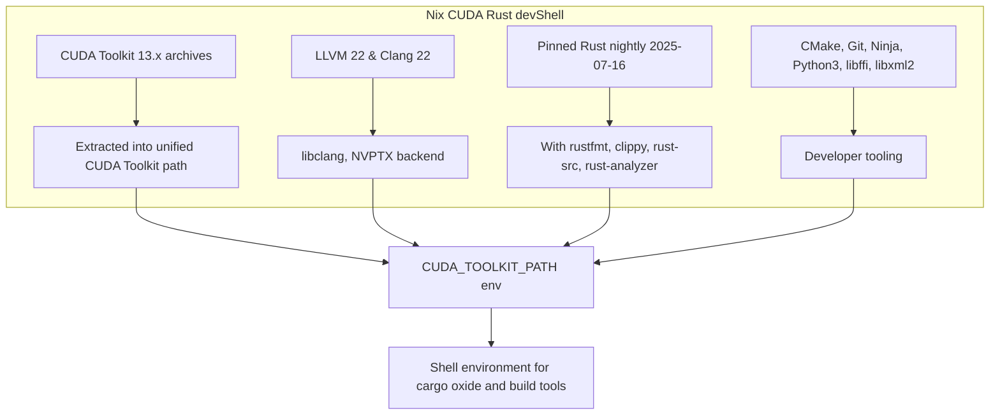

Sources: [cutile-rs/flake.nix:1-169](), [cuda-oxide/cuda-oxide-book/getting-started/installation.md:76-113]()

---

## 4. Installing CUDA Toolkit and LLVM Manually

If not using the devcontainer or Nix shell, install the following manually on your Linux system:

- **CUDA Toolkit 13.0+**: Obtain from [NVIDIA CUDA Downloads](https://developer.nvidia.com/cuda-downloads)
  - You require `nvcc` compiler and CUDA runtime headers.
  - Add CUDA bin directory to your `$PATH`, for example:

  ```bash
  export PATH="/usr/local/cuda/bin:$PATH"
  ```

  You can verify installation with:

  ```bash
  nvcc --version
  ```

- **LLVM and Clang 21+** with NVPTX target enabled
  - Clang is used by `bindgen` for generating host bindings to CUDA driver libraries.
  - Ensure `clang-21` or newer is installed and on your path.

Use package managers or build from source to get LLVM and Clang with NVPTX support. The LLVM version must match or exceed 21 to include the NVPTX backend functionality.

If you install CUDA to a non-standard location, set environment variables as:

```bash
export CUDA_TOOLKIT_PATH="/path/to/cuda"
export CUDA_HOME="/path/to/cuda"
```

The build system will look for the toolkit in the order `/usr/local/cuda-13.3`, `/usr/local/cuda-13.2`, `/usr/local/cuda-13`, `/usr/local/cuda` if no variable is set.

Sources: [cuda-oxide/cuda-oxide-book/getting-started/installation.md:114-133](), [cuda-oxide/cuda-oxide-book/getting-started/installation.md:116-171]()

---

## 5. First Build and Run with `cargo oxide`

After environment setup, your basic workflow inside the `cuda-oxide/` directory is as follows:

1. Build and run the standard example kernel `vecadd` (vector addition):

```bash
cargo oxide run vecadd
```

The `cargo oxide` CLI is a custom wrapper with multiple subcommands to build, run, test, and inspect CUDA Rust kernels and modules. Under the hood it orchestrates the pinned nightly Rust compiler, LLVM codegen backends for NVPTX, CUDA driver API calls, and runtime linking/loading.

Before running builds, it is a good practice to check the health of your setup:

```bash
cargo oxide doctor
```

This command verifies CUDA toolkit, driver versions, Rust toolchain, LLVM, and environment variables.

The build process flow inside `cargo oxide run vecadd` is:

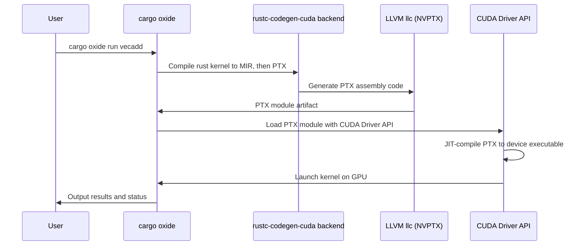

Sources: [cuda-oxide/cuda-oxide-book/getting-started/installation.md:83-89](), [CONTRIBUTING.md:118-146]()

---

## 6. Summary of Toolchain Layout and Repository Workspaces

The repository is structured into multiple Cargo workspaces with pinned dependencies to isolate concerns:

- **Root Host Workspace**: Stable Rust pinned (1.98.0), contains shared runtime crates such as `cuda-bindings`, `cuda-core`, `cuda-async`.
- **cuda-oxide Workspace**: Uses pinned Rust nightly with extra components, hosts `rustc-codegen-cuda` backend, and `cargo oxide` CLI tooling.
- **cutile-rs Workspace**: Tile-based IR GPU programming framework, with its own Nix and Rust toolchain pins.
- **Examples Workspace**: Device-host example kernels and tests.
- **Device-only fixture**: Isolated device macros and attributes.

Each workspace has independent Cargo.toml manifests with carefully pinned toolchains for reproducible building. The Pin Parity Checker (`check-toolchain-parity.sh`) in CI ensures all references to Rust toolchain versions remain consistent across scaffolds, devcontainers, documentation, and scripts.

The shared host crates load `libcuda` dynamically at runtime; thus, no CUDA driver linking happens at compile time in the host-side Rust code.

Sources: [CONTRIBUTING.md:114-161](), [cuda-oxide/.devcontainer/devcontainer.json](), [cuda-oxide/scripts/check-toolchain-parity.sh]()

---

# Overall Architecture Diagram Linking Names to Code Entities

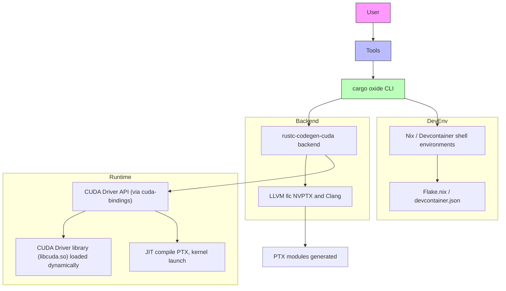

---

# Additional Notes

- Use the `Justfile` provided in `cuda-oxide/` to run typical checks:

```bash
just -f cuda-oxide/Justfile check
```

- This verifies formatting, clippy lints, tests, and dependency hygiene.
- Follow the Rust formatting conventions with `cargo oxide fmt`.
- You can scaffold new projects with:

```bash
cargo oxide new my-project
```

which uses the pinned Rust nightly and populates a working `rust-toolchain.toml` for consistency.

- Multi-workspace dependency pinning and dev shells isolate build environments for easier management.

Sources: [CONTRIBUTING.md:130-170]()

---

# Summary

This section detailed the complete setup for working with the CUDA Rust repo `cuda-oxide` workspace, covering:

- Hardware/software prerequisites and CUDA driver-toolkit compatibility.
- Rust nightly pinned toolchain usage and version parity guard scripts.
- Development environments, including devcontainer and Nix shell usage.
- Manual CUDA Toolkit and LLVM install guidance.
- First build/run instructions using `cargo oxide run`.
- Overall architecture and workspace layout implementation.

Following these steps ensures you have a proper, reproducible CUDA Rust development environment capable of compiling and running GPU accelerated Rust code.

---

**Sources:**

- cuda-oxide/cuda-oxide-book/getting-started/installation.md:1-171
- CONTRIBUTING.md:114-177
- cuda-oxide/scripts/check-toolchain-parity.sh:1-165
- cutile-rs/flake.nix:1-169
- cuda-oxide/.devcontainer/devcontainer.json:1-47
- rust-toolchain.toml:1-8

---

# Page: Shared Host Runtime Crates

# Shared Host Runtime Crates

<details>
<summary>Relevant source files</summary>

The following files were used as context for generating this wiki page:

- [cuda-async/Cargo.toml](cuda-async/Cargo.toml)
- [cuda-async/REACTOR_AB_REPORT.md](cuda-async/REACTOR_AB_REPORT.md)
- [cuda-async/README.md](cuda-async/README.md)
- [cuda-async/src/cuda_graph.rs](cuda-async/src/cuda_graph.rs)
- [cuda-async/src/device_buffer.rs](cuda-async/src/device_buffer.rs)
- [cuda-async/src/device_context.rs](cuda-async/src/device_context.rs)
- [cuda-async/src/device_future.rs](cuda-async/src/device_future.rs)
- [cuda-async/src/device_operation.rs](cuda-async/src/device_operation.rs)
- [cuda-async/src/error.rs](cuda-async/src/error.rs)
- [cuda-async/src/launch.rs](cuda-async/src/launch.rs)
- [cuda-async/src/leak.rs](cuda-async/src/leak.rs)
- [cuda-bindings/Cargo.toml](cuda-bindings/Cargo.toml)
- [cuda-core-derive/Cargo.toml](cuda-core-derive/Cargo.toml)
- [cuda-core/Cargo.toml](cuda-core/Cargo.toml)

</details>


This section provides a high-level overview of the core host-side crates shared between the main CUDA runtime products within the `cuda-rust` repository. These foundational crates — `cuda-bindings`, `cuda-core`, `cuda-core-derive`, and `cuda-async` — form a layered and composable base for safe, idiomatic Rust interfaces to CUDA driver functionalities and asynchronous GPU programming.

Each crate’s primary responsibilities and how they interrelate are introduced here. Detailed technical descriptions, usage patterns, and API specifics are available on their respective child pages:

- [cuda-bindings: Raw Driver FFI](#2.1)
- [cuda-core: Contexts, Buffers, VMM](#2.2)
- [cuda-async: Async Device Operations](#2.3)

---

## Overview of the Shared Host Runtime Crates

These four crates represent progressive abstraction levels from raw CUDA driver bindings up to asynchronous execution futures for device operations. Both the `cuda-oxide` rustc backend integration and the `cutile-rs` Tile IR framework build upon this common host-side foundation.

### 1. `cuda-bindings`: Raw CUDA Driver FFI

At the lowest level, `cuda-bindings` provides the raw foreign function interface (FFI) bindings to NVIDIA’s CUDA driver API.

- These are generated using `bindgen` to directly mirror the CUDA C API.
- The crate handles dynamic loading of the `libcuda` shared library at runtime.
- Build scripts ensure the correct generation and regeneration of binding code.
- It is intentionally minimal and unsafe, focusing on exactly mapping the driver API’s types and functions.

Both `cuda-core` and `cuda-async` depend directly on `cuda-bindings` for CUDA driver interaction.

For details, see the child page: [cuda-bindings: Raw Driver FFI](#2.1)

---

### 2. `cuda-core`: Idiomatic CUDA API

`cuda-core` builds an ergonomic and idiomatic Rust abstraction over `cuda-bindings`, exposing safe, high-level CUDA runtime concepts:

- **Context and device management:** `CudaContext`, device enumeration, and error handling layers abstract raw driver handles.
- **Buffer and memory management:** `DeviceBuffer` types parameterized by data type, supporting safe host-device memory interaction.
- **Runtime module loading:** Facilities to load PTX or cubin modules and obtain kernel `Function` handles.
- **Virtual memory management and multicast:** Support for advanced memory sharing and mapping across processes and devices.
- **SIMT (Single Instruction Multiple Thread) host helpers:** Utilities to assist in launching and coordinating threads in warp/block hierarchies.

`cuda-core` also depends on a companion proc macro crate, `cuda-core-derive`, supplying proc macros like `DeviceCopy` to annotate types safe for device copies, and to enforce launch contracts in kernel definitions.

Due to its close tie-in with kernel launching semantics and efficient buffer management, `cuda-core` forms the central foundation for both the host runtime API and the CUDA backend compiler runtime.

For details, see the child page: [cuda-core: Contexts, Buffers, VMM](#2.2)

---

### 3. `cuda-core-derive`: Derive Macros for `cuda-core`

This crate provides the procedural macros used by `cuda-core` to improve ergonomics at compile time:

- Implements the `DeviceCopy` derive macro, allowing automatic annotation of data types that can be safely copied to and from CUDA device memory.
- Provides launch contract-related macros that verify kernel argument types and shapes statically.
- Uses Rust's procedural macro APIs (`proc-macro2`, `syn`, `quote`) for AST manipulation and code generation.

By separating proc macros into a dedicated crate, compilation performance is improved and circular dependencies are avoided.

For details, see the child page: [cuda-core: Contexts, Buffers, VMM](#2.2) (covers macros as well)

---

### 4. `cuda-async`: Asynchronous Device Operations

`cuda-async` extends `cuda-core` with asynchronous programming models tailored to GPU operations:

- Provides the `DeviceOp` trait representing lazy, composable CUDA operations that only execute once `.sync()`, `.sync_on()`, or `.await` is invoked.
- Implements `DeviceFuture`, a `Future` type that wraps a GPU operation and integrates with Rust async executors. It internally manages the lifecycle and synchronization of work executing on CUDA streams.
- Incorporates multiple stream scheduling policies (`SchedulingPolicy` trait), including the default round-robin stream pool to enable concurrent operation overlap.
- Supports a high-performance reactor model with efficient stream completion notification via host memory flags (`cuStreamWriteValue32`) and scanning, avoiding expensive kernel callbacks.
- Handles CUDA graph capture and replay facilities, submission slot management, and correct operation leak handling when futures are dropped prematurely.
- Exposes safe combinators for chaining and combining device operations in asynchronous Rust workflows.
- Integrates robust device fault handling, dropout semantics, and deadlock-prevention via a thread-local execution lock to enforce non-reentrant operation execution.

This crate depends on both `cuda-core` and `cuda-bindings` and defines the high-level asynchronous runtime used by client codebases.

For details, see the child page: [cuda-async: Async Device Operations](#2.3)

---

## Relationship and Dependency Diagram

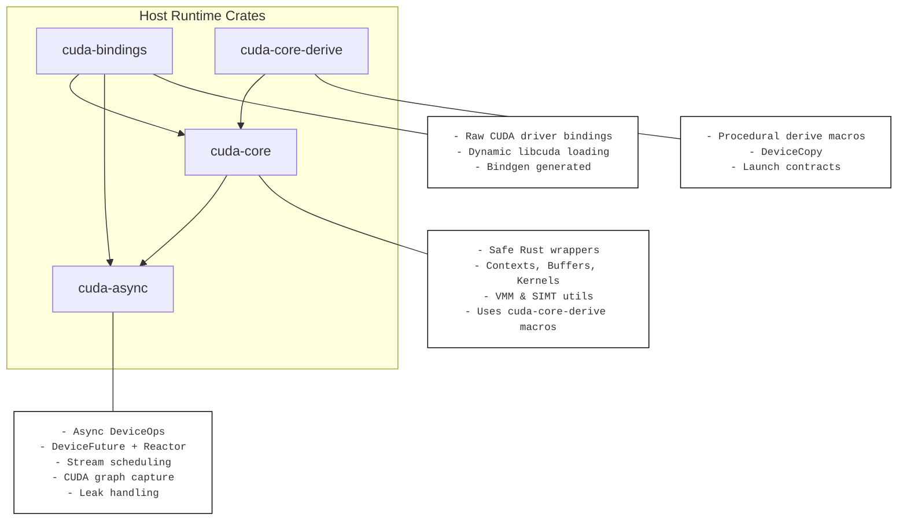

This diagram maps from the crates’ names to their high-level responsibilities, highlighting their dependency order:

- `cuda-bindings` is the base FFI layer.
- `cuda-core` builds safe abstractions, relying on `cuda-bindings` and macros from `cuda-core-derive`.
- `cuda-async` builds on `cuda-core` for asynchronous operation models.

---

## Summary Table

| Crate              | Purpose / Role                                     | Key Features                  | Depends On             | Child Page Anchor     |
|--------------------|--------------------------------------------------|-------------------------------|-----------------------|----------------------|
| `cuda-bindings`    | Raw CUDA driver API FFI & dynamic library loading | `bindgen` generated bindings  | None                  | #2.1                 |
| `cuda-core`        | Safe CUDA contexts, buffers, kernels, VMM         | `CudaContext`, `DeviceBuffer`, runtime modules, SIMT helpers | `cuda-bindings`, `cuda-core-derive` | #2.2                 |
| `cuda-core-derive` | Proc macros for `DeviceCopy` and kernel contracts | Derive macros for device-safe types | None                  | #2.2 (covers macros)  |
| `cuda-async`       | Async composition of GPU device operations         | `DeviceOp`, `DeviceFuture`, reactor, stream scheduling, CUDA graph | `cuda-core`, `cuda-bindings`          | #2.3                 |

---

## Next Steps

For in-depth technical details, API documentation, and usage examples of each crate, consult the linked child pages:

- [cuda-bindings: Raw Driver FFI](#2.1)
- [cuda-core: Contexts, Buffers, VMM](#2.2)
- [cuda-async: Async Device Operations](#2.3)

These pages cover specifics such as:

- How to dynamically load the CUDA driver and work with the generated bindings.
- How to manage CUDA contexts, allocate buffers, and launch kernels safely.
- How to write async CUDA code using futures, scheduling policies, and stream reactors.

---

# Section References

- For `cuda-bindings` configuration and dependencies, see [`cuda-bindings/Cargo.toml`](cuda-bindings/Cargo.toml:1-36)()  
- For `cuda-core` crate overview and dependencies, see [`cuda-core/Cargo.toml`](cuda-core/Cargo.toml:1-40)()  
- For `cuda-core-derive` proc macros setup, see [`cuda-core-derive/Cargo.toml`](cuda-core-derive/Cargo.toml:1-30)()  
- For `cuda-async` async device execution design, e.g. [`cuda-async/src/device_future.rs`](cuda-async/src/device_future.rs:1-155)(), [`cuda-async/src/device_operation.rs`](cuda-async/src/device_operation.rs:1-188)(), and [`cuda-async/README.md`](cuda-async/README.md:1-163)()

---

This common foundation enables both the `cuda-oxide` Rust CUDA backend compiler and `cutile-rs` Tile IR GPU kernel framework to provide expressive, safe, and performant GPU programming models in Rust.

---

# Page: cuda-bindings: Raw Driver FFI

# 2.1 cuda-bindings: Raw Driver FFI

<details>
<summary>Relevant source files</summary>

The following files were used as context for generating this wiki page:

- [.github/workflows/clippy.yml](.github/workflows/clippy.yml)
- [.github/workflows/fmt.yml](.github/workflows/fmt.yml)
- [.github/workflows/unit-tests.yml](.github/workflows/unit-tests.yml)
- [Cargo.lock](Cargo.lock)
- [Cargo.toml](Cargo.toml)
- [cuda-async/Cargo.toml](cuda-async/Cargo.toml)
- [cuda-bindings/Cargo.toml](cuda-bindings/Cargo.toml)
- [cuda-core-derive/Cargo.toml](cuda-core-derive/Cargo.toml)
- [cuda-core/Cargo.toml](cuda-core/Cargo.toml)

</details>


This section details the `cuda-bindings` crate, which provides the foundational low-level interface to the NVIDIA CUDA Driver API for Rust. It offers raw Foreign Function Interface (FFI) bindings generated from the CUDA driver headers via `bindgen`, a dynamic runtime loader for the NVIDIA CUDA Driver library, and describes the build script requirements to generate and maintain these bindings.

---

## Purpose and Scope

The `cuda-bindings` crate serves as the essential abi-stable bridge between Rust and NVIDIA's native CUDA driver API. It exposes unsafe, raw bindings mirroring CUDA's C API, enabling higher-level runtime crates (`cuda-core`, `cuda-async`) and other CUDA interacting components to invoke driver functionality without directly embedding CUDA's headers or linking to its static artifacts at compile-time.

In addition, `cuda-bindings` implements a robust runtime mechanism to dynamically discover and load the `libcuda.so`/`nvcuda.dll` system library. This dynamic loading is crucial for flexibility and portability, as it allows binaries using `cuda-bindings` to run on systems that might or might not have the NVIDIA driver installed, without hard linking or load-time failures.

---

## Implementation Details

### Bindgen-Generated Bindings

At the core, `cuda-bindings` exposes Rust types, constants, enums, and functions corresponding exactly to the CUDA Driver API declared in `cuda.h`. This is achieved via an internal build script using the `bindgen` crate:

- `bindgen` uses the local CUDA Toolkit's `cuda.h` header file to automatically generate Rust FFI bindings.
- The bindings closely reflect the C API signatures, with minimal wrapping or abstraction to avoid semantic drift or overhead.
- The bindings include types such as `CUdevice`, `CUcontext`, function signatures like `cuInit`, `cuDeviceGet`, `cuCtxCreate`, and enumerations of error codes and flags.

This allows the rest of the Rust CUDA ecosystem layers to depend on `cuda-bindings` for the raw interface and build safe abstractions above it.

### Build Script and Bindings Regeneration

The crate contains a build script (`build.rs`) that:

- Invokes `bindgen` during the build phase to regenerate bindings from the CUDA headers.
- Uses `prettyplease` to format the generated Rust code in a readable and idiomatic style.
- Includes additional logic to embed a version stamp or capture the environment for reproducible builds.
  
This dynamic generation approach requires that the CUDA Toolkit headers be installed and discoverable during build time, particularly `cuda.h`. The presence and path of this header is typically controlled via environment variables or standard CUDA install locations.

Any changes in the underlying CUDA Toolkit version or the CUDA headers will cause regeneration of the bindings on the next compilation.

### Dynamic Loading of `libcuda`

Hard-linking against `libcuda.so` is avoided to allow CUDA-dependent binaries to start successfully even on machines without GPUs or NVIDIA drivers installed.

Instead, `cuda-bindings` uses the `libloading` crate to safely open `libcuda.so` (on Linux) or the equivalent system library on other platforms at runtime:

- A singleton loader utility attempts to find and load the dynamic library in the system's library path.
- The function pointers of all CUDA API entry points are dynamically resolved from the loaded library via `libloading::Library::get`.
- The resolved symbols are cached and dispatched via thin function pointers to the raw API bindings.
- This strategy makes the crate resilient to driver absences by delaying linkage errors until the driver is actually used.
- The loader provides transparent forwarding to the CUDA Driver API and reports errors if the driver cannot be loaded or if symbol resolution fails.

This dynamic discovery and loading process complements the raw Rust bindings, enabling safer, driver-optional usage of the CUDA Driver API.

---

## Data Flow and Key Components

The following diagram maps the conceptual flow and main code entities in `cuda-bindings`:

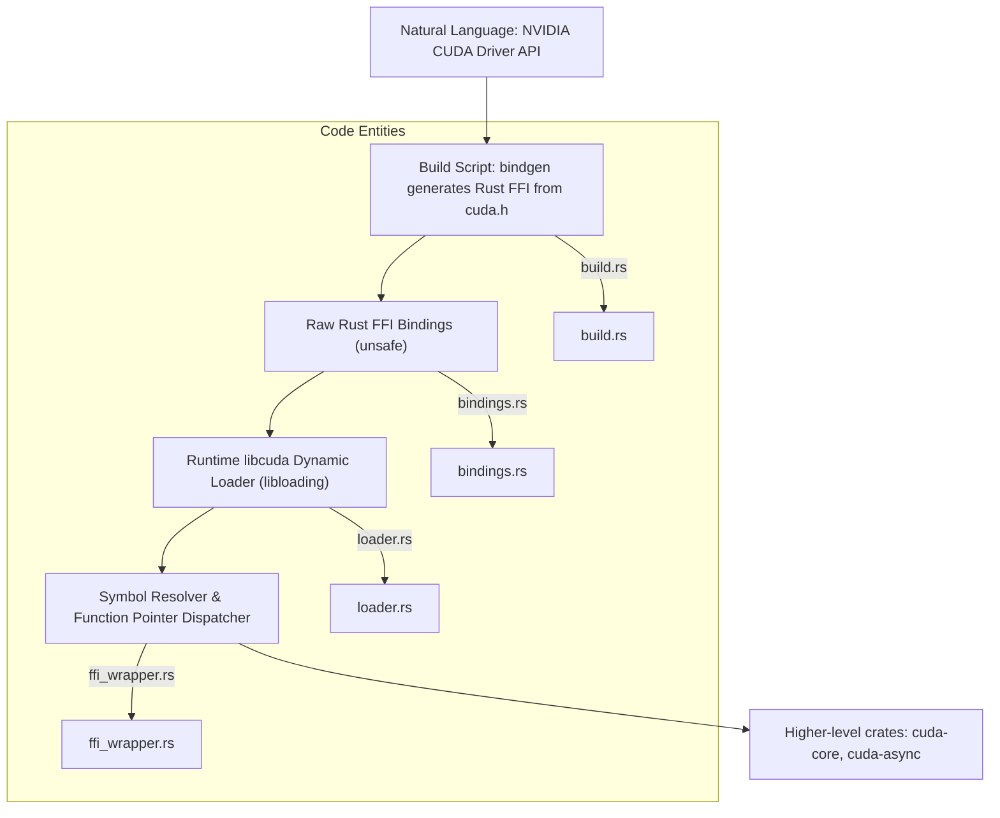

- The **build script** (`build.rs`) automates the generation of the raw bindings from CUDA headers.
- The **bindings.rs** file holds the Rust FFI definitions, covering all CUDA Driver API entry points.
- The **loader.rs** module encapsulates the runtime `libcuda` loading logic using `libloading`.
- The **ffi_wrapper.rs** (or equivalent) resolves and caches the function pointers from the loaded library and exposes thin unsafe Rust functions with the same signatures as the CUDA Driver API.
- Consumer crates like `cuda-core` depend on `cuda-bindings` to safely call CUDA functions indirectly via this loader.

---

## Build Script Requirements

Building `cuda-bindings` requires:

1. **CUDA Toolkit Installed:** The build machine must have the CUDA Toolkit installed, specifically the headers like `cuda.h` accessible.
2. **Bindgen Crate:** Required as a build dependency to parse `cuda.h` and produce Rust bindings.
3. **Prettyplease Crate:** Used to format the generated bindings cleanly.
4. **Standard Rust Build Environment:** Cargo build with Rust edition 2021 or later and Rust version >= 1.89.

If the CUDA toolkit presence or headers are missing, the build will fail during `bindgen` invocation.

In the CI workflows, `cuda-bindings` is tested on runners with the CUDA toolkit installed, ensuring stable generation and usage of bindings.

---

## Key Functions and Types

- **`cuInit(flags: u32) -> CUresult`** — Initialize the CUDA Driver API.
- **`cuDeviceGet(device: *mut CUdevice, ordinal: i32) -> CUresult`** — Return a handle to a CUDA device.
- **`cuCtxCreate(ctx: *mut CUcontext, flags: u32, dev: CUdevice) -> CUresult`** — Create a CUDA context.
- **`CUresult` Enum Type** — Error/status codes from CUDA API calls.
- **`Loader` Singleton** — Abstraction in `loader.rs` that dynamically opens `libcuda` and resolves all entry points.

All these are exposed as unsafe extern "C" functions or function pointer wrappers in Rust via `cuda-bindings`.

---

## Example Usage Pattern

The typical usage pattern enabled by `cuda-bindings` looks like this:

1. At runtime, attempt to load the CUDA Driver library (`libcuda`).
2. If successful, resolve all necessary API function symbols.
3. Call `cuInit(0)` from the dynamically loaded symbols to initialize CUDA.
4. Use raw CUDA API calls through the resolved function pointers.
5. Higher-level crates wrap these in safer Rust abstractions.

This design avoids any static linking and hard dependencies on the CUDA driver, making the ecosystem more robust across diverse systems.

---

## Relationship to Other Crates

The role of `cuda-bindings` in the overall repository is foundational in the **"Shared Host Runtime Crates"** layer:

```mermaid
graph LR
  "cuda-bindings" --> "cuda-core"
  "cuda-core" --> "cuda-async"
  "cuda-async" --> "cuda-oxide"
  "cuda-bindings"--> "cuda-async"
```

- `cuda-bindings` provides **raw FFI coverage**.
- `cuda-core` builds **idiomatic Rust APIs** atop `cuda-bindings`.
- `cuda-async` enables **safe async wrappers** using both `cuda-core` and `cuda-bindings`.
- `cuda-oxide` uses these crates as runtime dependencies for Rust-to-CUDA PTX compilation and execution.

This layered approach modularizes CUDA support between low-level bindings, core abstractions, and async scheduling.

---

# Summary Table: cuda-bindings Crate Overview

| Aspect                     | Description                                                                                   |
|----------------------------|-----------------------------------------------------------------------------------------------|
| Purpose                    | Raw CUDA Driver API Rust FFI and dynamic driver loader                                        |
| Generated By               | `bindgen` parsing CUDA `cuda.h` headers                                                      |
| Key Build Dependencies     | `bindgen`, `prettyplease`, `proc-macro2`, `quote`, `syn`                                     |
| Runtime Components         | `libloading` based dynamic loader for `libcuda`                                              |
| API Exposure               | Unsafe Rust functions mirroring CUDA Driver API                                              |
| Usage Scenario             | Base crate for all higher-level CUDA host APIs                                               |
| Fail Behavior              | Compile-time if CUDA headers missing; runtime error if driver not present but gracefully handled |
| Included in Workspace      | Part of the shared host workspace with `cuda-core` and `cuda-async`                          |
| Cargo Features             | None (purely raw bindings)                                                                    |
| Documentation Location     | `cuda-bindings/` crate                                                                         |

---

# References and Source Files

Sources for this section derive primarily from the crate's `Cargo.toml` and dependency declarations, the build workflow files explaining the build environment, and knowledge of dynamic loading from `libloading` usage, as well as the repository workspace layout linking `cuda-bindings` as the foundational raw FFI crate.

- `cuda-bindings/Cargo.toml:1-36`  
- `.github/workflows/unit-tests.yml:30-150` (explanation of CUDA toolkit presence for building `cuda-bindings`)  
- `Cargo.toml:1-19` (shared workspace memberships listing `cuda-bindings`)  

---

# Diagrams: Mapping Natural Language Concepts to Code Entities

## Diagram 1: System Concept to Code Entities in `cuda-bindings`

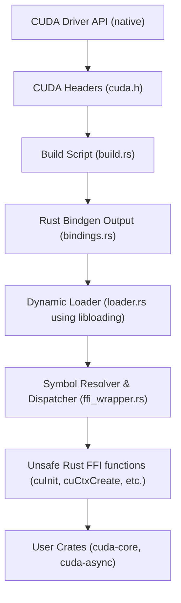

## Diagram 2: Crate Dependency and Runtime Flow Linking `cuda-bindings` to Higher Layers

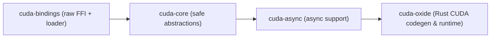

---

# Conclusion

The `cuda-bindings` crate is a crucial low-level component providing the exact CUDA Driver API interface with automatic bindings generation and runtime driver library discovery. It underpins all other NVIDIA CUDA Rust runtime crates, ensuring safe, flexible, and driver-optional usage of the CUDA ecosystem within Rust applications.

By relying on dynamic loading of the CUDA driver and using `bindgen`-generated raw bindings, this crate offers a precise and fault-resilient foundation for higher-level abstractions and asynchronous models implemented in the rest of the `cuda-rust` monorepo.

---

Sources:  
- `cuda-bindings/Cargo.toml:1-36`  
- `.github/workflows/unit-tests.yml:18-150`  
- `Cargo.toml:1-19`

---

# Page: cuda-core: Contexts, Buffers, VMM

# cuda-core: Contexts, Buffers, VMM

<details>
<summary>Relevant source files</summary>

The following files were used as context for generating this wiki page:

- [.gitignore](.gitignore)
- [README.md](README.md)
- [cuda-async/Cargo.toml](cuda-async/Cargo.toml)
- [cuda-bindings/Cargo.toml](cuda-bindings/Cargo.toml)
- [cuda-core-derive/Cargo.toml](cuda-core-derive/Cargo.toml)
- [cuda-core/Cargo.toml](cuda-core/Cargo.toml)

</details>


This page documents the internal design and implementation details of the `cuda-core` crate in the `cuda-rust` ecosystem. It covers the primary abstractions for CUDA context management (`CudaContext`), device memory management (`DeviceBuffer`), the `dtype` system, runtime module loading, virtual memory management (VMM) features including multicast, SIMT host helpers, and the derive macros provided by the companion `cuda-core-derive` crate such as `DeviceCopy` and kernel launch contracts.

`cuda-core` forms the foundational idiomatic CUDA API for host-side Rust support, shared between the `cuda-oxide` Rust CUDA compiler backend and `cutile-rs` tile IR framework.

---

## Overview

The `cuda-core` crate provides idiomatic Rust abstractions for interacting with the CUDA driver API. Its main concerns include:

- **CUDA Contexts**: Safe creation and destruction of CUDA contexts via `CudaContext`.
- **Device Buffers**: Management of GPU device memory with `DeviceBuffer<T>`, including pinned host transfers.
- **Data Types (`dtype`)**: Type representations that map Rust primitives to their CUDA equivalents.
- **Module Loading**: Runtime loading of compiled CUDA kernels/modules and integration with launch APIs.
- **Virtual Memory Management (VMM)**: Support for memory virtualization, region mapping, and multicast.
- **SIMT Host Helpers**: Utilities aiding in setting up SIMT launch configurations.
- **Derive Macros**: Support macros enabling traits like `DeviceCopy` for safe device memory transfer, and launch contracts for kernel invocation correctness.

Together, these features enable high-level, safe, and idiomatic CUDA programming interoperability within Rust's ecosystem.

Sources: `cuda-core/Cargo.toml`(2-40), `README.md`(12-94).

---

## Key Components

### 1. CUDA Context Management: `CudaContext`

- `CudaContext` encapsulates a CUDA driver context associated with a physical device.
- It ensures proper creation, retention, and destruction of the underlying CUDA context handle.
- Typical usage involves creating a new context for a device ordinal and obtaining the default stream from it for command submission.
- `CudaContext` manages lifetime and concurrency safety of CUDA driver resources on the host.
  
This is the fundamental entry point for any CUDA operation from the host side.

**Typical usage snippet** (from `README.md`):
```rust
let ctx = CudaContext::new(0).unwrap();
let stream = ctx.default_stream();
```

Sources: `README.md`(52-53).

---

### 2. Device Memory Management: `DeviceBuffer<T>`

- `DeviceBuffer<T>` is a generic data structure managing device-resident memory buffers for type `T`.
- It provides APIs for allocation, deallocation, and safe transfer between host and device.
- Supports creation from host slices (`from_host`) and zero-initialized buffers (`zeroed`).
- Enables asynchronous data transfer on optional Streams.
- Guarantees type safety and aligns with CUDA's device memory model.
- Integrates tightly with the runtime module system to pass buffers to kernels.

```rust
let input = DeviceBuffer::from_host(&stream, &data).unwrap();
let mut output = DeviceBuffer::<f32>::zeroed(&stream, 1024).unwrap();
```

Sources: `README.md`(56-57).

---

### 3. Data Types (`dtype`)

- The `dtype` system defines mappings and traits that represent device-copyable types.
- Includes support for common Rust primitives (`f32`, `i32`, etc.) and optionally the unstable `f16`.
- Ensures safe device memory operations by tracking device copy semantics.

---

### 4. Runtime Module Loading and Kernel Launching

- Modules generated by the `#[cuda_module]` proc macro are embedded and loaded at runtime.
- Loaded modules expose type-safe kernel launch functions that encode contracts on kernel parameters and launch configurations.
- `LaunchConfig` is used to specify execution grid/block dimensions; it is intentionally raw and unsafe without matching kernel contracts.
- The `cuda-core-derive` crate supports deriving launch contracts adding checked APIs for launching kernels safely.
- Closure captures are scalarized and passed automatically to kernels as parameters.

Typical kernel call (simplified):  
```rust
unsafe {
    module.map::<f32, _>(
        &stream,
        LaunchConfig::for_num_elems(1024),
        move |x: f32| x * factor,
        &input,
        &mut output,
    )
}
.unwrap();
```

Sources: `README.md`(38-89).

---

### 5. Virtual Memory Management (VMM) and Multicast

- `cuda-core` exposes lower-level VMM features of CUDA allowing page table mappings and multicast of memory regions.
- Facilitates advanced memory sharing scenarios across context boundaries and devices.
- Abstracts underlying CUDA driver VMM APIs ensuring safety and correctness.

---

### 6. SIMT Host Helpers

- Utilities for configuring SIMT kernel launches including indexing, thread/block dimension queries, and launch parameter construction.
- These helpers streamline preparing arguments and launch configurations consistent with CUDA kernel expectations.

---

### 7. `cuda-core-derive` Macros

The companion crate `cuda-core-derive` provides procedural macros integral to safe and ergonomic CUDA code.

- **`DeviceCopy`**: 

  Derive macro that marks a Rust struct or primitive as safely copyable to and from device memory.
  
- **`launch_contract`**:

  Enables the static generation of kernel launch contract checks, ensuring kernel parameters and launch configurations adhere to expected layouts and dimension constraints.
  
These macros underpin the safety guarantees and usability improvements of Rust CUDA kernels in this ecosystem.

Sources: `cuda-core-derive/Cargo.toml`(2-30).

---

## Data Flow and Interaction Diagram

```mermaid
flowchart TD
  subgraph "Host Application"
    App["Rust Host App"]
    Ctx["CudaContext"]
    Stream["Cuda Stream"]
    BufHost["Host Memory (Vec<T>)"]
    BufDev["DeviceBuffer<T>"]
    Module["CudaModule (Loaded at runtime)"]
    KernelFunc["Typed kernel launch fn"]
  end

  subgraph "CUDA Device"
    GPUMem["GPU Device Memory"]
    Kernel["GPU Kernel (PTX)"]
  end

  App -->|Create| Ctx
  Ctx -->|Create stream| Stream
  BufHost -->|from_host() + stream| BufDev
  Module -->|load(&Ctx)| Module
  Module -->|launch fn| KernelFunc
  Stream -->|launch| Kernel
  BufDev -->|device mem| GPUMem
  KernelFunc -->|launch_kernel| Kernel
  Kernel -->|access| GPUMem
```

This diagram shows the natural flow of executing a CUDA kernel in Rust via `cuda-core`: a host `CudaContext` manages device resources, buffers are allocated and transferred between host and device, modules are loaded and kernels launched on streams executing code on the device using device memory.

Sources: `README.md`(12-94).

---

## Code Entity to System Map

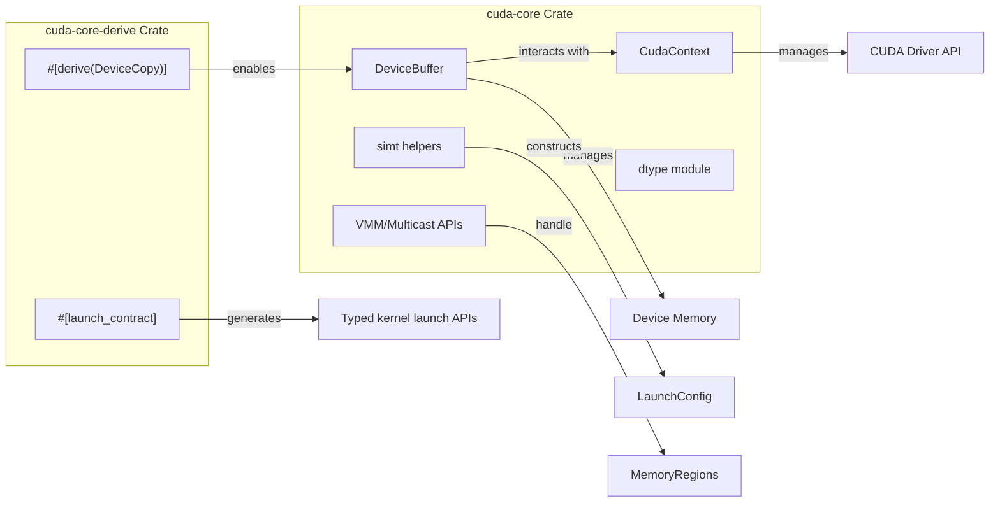

This mapping outlines major code constructs within the `cuda-core` and `cuda-core-derive` crates and their roles in the CUDA runtime system. `CudaContext` interfaces directly with CUDA driver APIs; `DeviceBuffer<T>` manages device memory lifecycles; derive macros generate glue for safe copying and kernel launching.

Sources: `cuda-core/Cargo.toml`(), `cuda-core-derive/Cargo.toml`(), `README.md`(12-94).

---

## Summary

`cuda-core` is the idiomatic Rust interface to CUDA contexts, device buffers, kernel loading, and memory virtualization. It abstracts the complex CUDA driver APIs safely and ergonomically. Its integration with procedural macros in `cuda-core-derive` enables static kernel launch contract checking and safe device-copyable traits. Together with the SIMT host helpers and VMM features, `cuda-core` forms the backbone of host-side GPU programming in the `cuda-rust` ecosystem.

---

# References and Sources

- `cuda-core/Cargo.toml` lines 1-40
- `cuda-core-derive/Cargo.toml` lines 1-30
- `README.md` lines 12-94

---

# Page: cuda-async: Async Device Operations

# cuda-async: Async Device Operations

<details>
<summary>Relevant source files</summary>

The following files were used as context for generating this wiki page:

- [cuda-async/REACTOR_AB_REPORT.md](cuda-async/REACTOR_AB_REPORT.md)
- [cuda-async/README.md](cuda-async/README.md)
- [cuda-async/src/cuda_graph.rs](cuda-async/src/cuda_graph.rs)
- [cuda-async/src/device_buffer.rs](cuda-async/src/device_buffer.rs)
- [cuda-async/src/device_context.rs](cuda-async/src/device_context.rs)
- [cuda-async/src/device_future.rs](cuda-async/src/device_future.rs)
- [cuda-async/src/device_operation.rs](cuda-async/src/device_operation.rs)
- [cuda-async/src/error.rs](cuda-async/src/error.rs)
- [cuda-async/src/launch.rs](cuda-async/src/launch.rs)
- [cuda-async/src/leak.rs](cuda-async/src/leak.rs)
- [cutile-rs/cutile-examples/examples/cuda_graphs.rs](cutile-rs/cutile-examples/examples/cuda_graphs.rs)
- [cutile-rs/cutile-examples/examples/cuda_graphs_deviceop.rs](cutile-rs/cutile-examples/examples/cuda_graphs_deviceop.rs)
- [cutile-rs/cutile-examples/examples/rms_norm.rs](cutile-rs/cutile-examples/examples/rms_norm.rs)

</details>


This page covers the architecture and implementation details of asynchronous device operations in the `cuda-async` crate within the NVIDIA `cuda-rust` monorepo. It focuses on the core abstractions for expressing GPU workloads as composable lazy device operations (`DeviceOp`) and futures (`DeviceFuture`) that execute asynchronously on CUDA streams. The page explains the design trade-offs and implementation of reactor-based and spin-based completion models, the use of a submission slot table for scalable completion tracking, CUDA graph capture integration, scheduling policies for execution streams, and leak handling for robust resource cleanup.

---

## 1. DeviceOperation and DeviceFuture Model

### 1.1 DeviceOp: Lazy Composable GPU Operations

At the heart of `cuda-async` is the `DeviceOp` trait, representing a **lazy, composable CUDA operation** on device memory and computation resources. Operations are not immediately executed; instead, they are composed and built into DAGs before scheduling on a CUDA stream. Execution occurs when the operation is run via synchronous blocking (`.sync()`, `.sync_on()`) or asynchronous awaiting (`.await`).

`DeviceOp` implementations support combinators familiar from the `futures` crate model, including `.then()`, `.map()`, `.zip!()`, `.shared()`, and `.then_unchecked()` for advanced control. These combinators allow building complex GPU pipelines which share streams and manage dependencies:

- `.then()`: chain dependent work on the same stream, ensuring sequential order.
- `.zip!()`: combine independent operations allowing concurrent overlap on different streams.
- `.shared()`: cloneable, execute-once device operations, supporting concurrent waiting.
- `.then_unchecked()`: relaxes thread-local execution lock for nested execution but requires user guarantees of no data races.

Operations are driven by an **execution context** that encapsulates the assigned CUDA stream, device, memory pool, and submission tracking (see below). The execution context is constructed lazily during operation execution and submission.

### 1.2 DeviceFuture: Bridging CUDA Completion to Rust Async

The `DeviceFuture` type implements `std::future::Future` and **drives a DeviceOp through its lifecycle from idle to execution and completion** on a CUDA stream. Its internal state machine is:

```text
  Idle ──first poll──> Executing ──completion signal──> Complete
           (enqueue on stream,            (yield output)
            inline spin / wait, then
            register for completion callback)
```

- Initial poll triggers `execute()` submitting the operation to the CUDA stream.
- Inline spin waits for stream completion by polling `cuStreamQuery` for a microsecond budget (default 20 µs), reducing wake latency.
- If the operation is not complete, a **reactor slot** or a **host callback** is registered:
  - **Reactor**: a system-wide thread monitors armed slots that get flagged by the GPU via `cuStreamWriteValue32`; it wakes futures upon completion.
  - **Host Callback**: fallback mechanism using `cuLaunchHostFunc` for completion notification, especially when reactor is unavailable or disabled.
- On completion, the future resolves and hands out the operation result.

Dropping a `DeviceFuture` **does not cancel the executing GPU work**. Instead, if the future was polled and work is in-flight, drop blocks until the CUDA stream drains to safely release owned resources. If waiting is impossible (e.g., stream is recording a CUDA graph or the context is faulted), the resources are leaked with a loud stderr warning since releasing memory while device writes to it would yield undefined behavior.

This model cleanly separates GPU execution from Rust async scheduling while providing low-latency inline-spin optimization and scalable event-based notification via the reactor.

---

## 2. Reactor vs Spin Completion

### Completion Methods

`cuda-async` supports multiple completion notification modes selectable at runtime:

- **Inline Spin**: The future polls the CUDA stream repeatedly for a short spin budget before registering the callback. This accelerates low-latency, short-duration kernels by often resolving futures without a wakeup.
  
- **Reactor (Default)**: Uses a **flag-based completion reactor**. Each GPU operation is assigned a slot in pinned host memory. When an operation completes, `cuStreamWriteValue32` writes a notification flag to the slot atomically. A dedicated high-priority OS thread scans the slots and wakes futures waiting on completed ones. This highly scalable design amortizes wakeups across thousands of simultaneous GPU operations.

- **Host Callback**: Uses `cuLaunchHostFunc` to ask CUDA to call back a host function once stream work completes. This method may stall on faults since callbacks are never run then. It is used when the reactor slot pool is exhausted or when explicitly requested by environment flags.

### Reactor Slot Table

The **SlotTable** is a core data structure mapping outstanding operations ("slots") to completion flags in pinned host memory:

- Each `DeviceFuture` entering the execution state registers an armed slot.
- Slots are scanned by the reactor thread, which wakes futures with completed work.
- The slot table optimizes wake-up to only unpark the waking thread when going from idle to active (`empty→wake` policy).
- Lock-free and multi-thread-safe registration and completion detection allow thousands of concurrent in-flight kernels.

This system enables high throughput with low CPU contention.

### Inline Spin Budget

The amount of time spent polling the CUDA stream inline before fallback to callback/flag notification is controlled via environment variables (`CUDA_ASYNC_SPIN_BUDGET_US`, default 20 µs). Setting this to 0 disables inline spin, forcing always to callback or reactor notification.

---

## 3. Submission and Slot Table Design

Every submitted operation is tracked via a **Submission** object which records:

- Held resource leases for memory and buffers, preventing premature deallocation.
- Submission state: whether it's recording a graph or executing normally.
- The assigned completion slot index in the SlotTable.

The **ExecutionContext** maintains an owned `Submission`. When an operation is enqueued:

- It registers all associated buffers and resource accesses (via `retain` and `retain_lease`) with the submission.
- When used within a CUDA graph capture, resources are tracked differently, and the context sets `recording = true`.
- The submission slots manage completion notifications with a backlog of pending operations.

The SlotTable and Submission architecture enable efficient multiplexing of completion events without one callback per operation, reducing driver overhead and stream thread pressure.

---

## 4. CUDA Graph Capture Integration

`cuda-async` supports capturing composed operations as CUDA graphs for low-overhead replay:

- A special **recording ExecutionContext** is constructed with the flag `recording = true`.
- Graph captures trigger graph node creation instead of immediate kernel launches.
- Recorded resource usages are tracked via the submission and added as replay resources.
- The submitted operations are baked into a `CudaGraph` object.
- Replaying the graph reacquires resource leases as needed.

The capture API exposes a scoped interface to capture imperative closures of `DeviceOp` executions, which are turned into graphs atomically and replayed multiple times with minimal CPU overhead.

---

## 5. Scheduling Policies

`cuda-async` models execution stream assignment via the trait `SchedulingPolicy`, which maps `DeviceOp`s to CUDA streams:

- The default implementation is `StreamPoolRoundRobin`, which cycles through 4 streams per device in round-robin order, allowing up to 4 concurrent streams to overlap work.
- Other policies can be implemented and plugged in, e.g., a single-stream scheduler.

The `AsyncDeviceContext` maintains a per-thread device state including:

- The active scheduling policy.
- The deallocation stream to free memory asynchronously.
- Optional memory pool.

Device contexts are thread-local to allow flexibility and avoid global bottlenecks.

---

## 6. Leak Handling on Future Drop

Dropping a `DeviceFuture` before completion requires careful resource management because:

- GPU tasks may still write into buffers.
- Releasing those buffers early would cause data races and undefined behavior.

The drop implementation:

- If GPU work is not submitted yet (e.g., future never polled), simply drops.
- If GPU work is submitted but still in flight, it **blocks the host synchronously on the CUDA stream draining** before dropping the held resources.
- If this wait is impossible (faulted context, CUDA graph recording), the resources are leaked intentionally with a **loud stderr report**.

Leak reporting goes through [`report_leak`], allowing test capture and controlled diagnostics.

---

## 7. Key Classes and Functions

| Entity | Description | Location |
|------------|-------------|------------|
| `DeviceOp` | Trait for lazy, composable GPU operations | `cuda-async/src/device_operation.rs` [6-1881]() |
| `DeviceFuture` | Future that drives a `DeviceOp` through submission and completion | `cuda-async/src/device_future.rs` [6-805]() |
| `ExecutionContext` | Represents an active execution with CUDA stream, device, and submission | `cuda-async/src/device_operation.rs:107-188`() |
| `Submission` | Tracks resources and completion state for each launched kernel | see `device_operation.rs` referenced inside `ExecutionContext` |
| `SlotTable` | Reactor's host-side data structure to track in-flight operation completions | implemented in `cuda-async/src/slot_table.rs` (not shown here) |
| `SchedulingPolicy` | Trait to decide stream assignment per operation, default RoundRobin pool | `cuda-async/src/device_context.rs:7-179`() |
| `CudaGraph` | Represents a CUDA graph built from captured operations | `cuda-async/src/cuda_graph.rs` (not in provided content) |
| `report_leak` | Reports resource leaks due to incomplete future drop | `cuda-async/src/leak.rs:6-71`() |

---

## 8. Data Flow Diagram: DeviceOp Execution and Completion

```mermaid
flowchart TD
  UserAPI["User creates DeviceOp"]
  PollFuture["First poll() on DeviceFuture"]
  AcquireLock["acquire_execution_lock()"]
  Submit["Submit kernel on CUDA stream"]
  InlineSpin["Inline spin: cuStreamQuery for spin budget"]
  CompletedInline["Complete if done"]
  RegisterCallback["Register completion callback (Reactor or HostCallback)"]
  CompletionEvent["GPU signals completion"]
  ReactorThread["Reactor scans slot table"]
  WakeTask["Wake async task"]
  PollAgain["Future poll() observes completion"]
  ReturnResult["Return output to user"]
  DropFuture["Drop DeviceFuture"]
  WaitStream["Wait on CUDA stream drain (if in-flight)"]
  LeakReport["Report leak (if wait impossible)"]

  UserAPI --> PollFuture
  PollFuture --> AcquireLock
  AcquireLock --> Submit
  Submit --> InlineSpin
  InlineSpin --> CompletedInline
  CompletedInline -->|done| ReturnResult
  CompletedInline -->|not done| RegisterCallback
  RegisterCallback --> CompletionEvent
  CompletionEvent --> ReactorThread
  ReactorThread --> WakeTask
  WakeTask --> PollAgain
  PollAgain --> ReturnResult
  DropFuture -->|if in-flight| WaitStream
  WaitStream -->|block then drop resources| ()
  WaitStream -->|fail to wait| LeakReport
```

---

## 9. Operational Diagram: Scheduling and Submission Layers

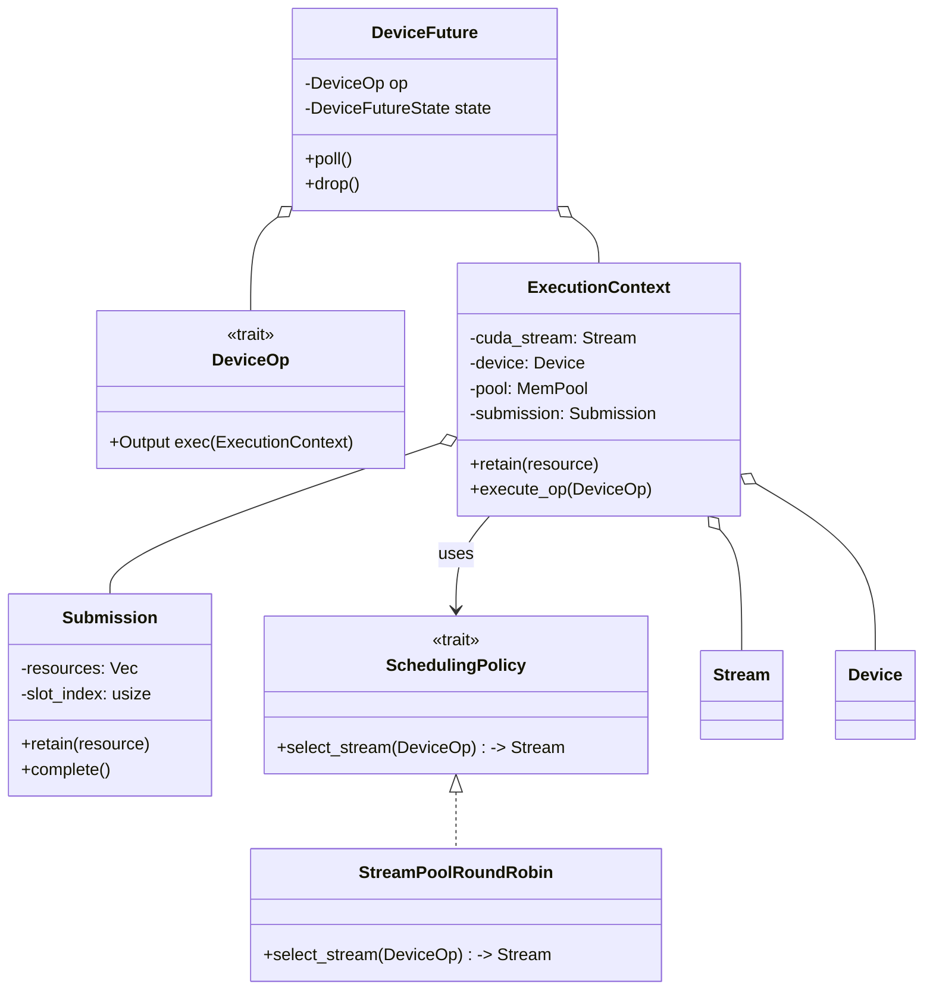

---

## 10. Summary

`cuda-async` provides an elegant, scalable abstraction for asynchronous GPU programming in Rust. Its key features include:

- A composable lazy `DeviceOp` model allowing complex CUDA kernels and DAGs to be expressed cleanly.
- Efficient completion tracking via a reference-counted `DeviceFuture` tied to CUDA streams.
- An event-driven **reactor** for scalable notification of kernel completion using a pinned-slot table and flag writes.
- Support for fallback host-callback completions and inline spinning to reduce latency.
- Integration with CUDA graph capture for batching sequences of operations.
- Pluggable scheduling policies to assign operations to streams.
- Careful management of resource lifetime and leak reporting for asynchronous futures.

This makes `cuda-async` a foundational building block upon which higher-level GPU programming libraries and device kernels in `cutile-rs` and `cuda-oxide` can rely.

---

## Sources

- `cuda-async/src/device_operation.rs:6-1881` ()
- `cuda-async/src/device_future.rs:6-805` ()
- `cuda-async/src/device_context.rs:6-179` ()
- `cuda-async/src/leak.rs:6-71` ()
- `cuda-async/README.md:1-163` ()
- `cutile-rs/cutile-examples/examples/cuda_graphs_deviceop.rs:1-181` ()
- `cutile-rs/cutile-examples/examples/cuda_graphs.rs:1-190` ()

---

# Page: cuda-oxide: Rust-to-PTX Compiler and Runtime

# cuda-oxide: Rust-to-PTX Compiler and Runtime

<details>
<summary>Relevant source files</summary>

The following files were used as context for generating this wiki page:

- [.gitignore](.gitignore)
- [README.md](README.md)
- [cuda-oxide/cuda-oxide-book/compiler/architecture-overview.md](cuda-oxide/cuda-oxide-book/compiler/architecture-overview.md)

</details>


This section provides a high-level overview of the `cuda-oxide` project, the core Rust-to-PTX compilation backend, and runtime API that enable writing CUDA kernels directly in Rust. It explains the single-source `#[kernel]` and `#[cuda_module]` model, the custom rustc codegen backend, and the accompanying tooling. Detailed technical implementations are covered in linked child pages.

---

## Single-Source Rust CUDA Programming Model

The `cuda-oxide` compiler enables writing GPU kernels and host-side control code together in the same Rust source file, leveraging Rust's native language features without the need for separate CUDA C++ or DSLs.

- Device kernels are annotated with `#[kernel]`. These functions are compiled to NVIDIA PTX.
- Kernel modules are annotated with `#[cuda_module]` and embed the compiled device code into the host binary.
- Kernel launches can pass closures with captured environment variables as arguments, which are properly scalarized and passed to the GPU.
- Examples demonstrate generic device kernels working on arbitrary data types, providing the convenience of Rust generics and closures on CUDA.

This model promotes type safety and monomorphized specialization while fully integrating device and host code into a unified Rust workflow.

```rust
#[cuda_module]
mod kernels {
    #[kernel]
    pub fn map<T: Copy, F: Fn(T) -> T + Copy>(f: F, input: &[T], mut out: DisjointSlice<T>) {
        let idx = thread::index_1d();
        let i = idx.get();
        if let Some(out_elem) = out.get_mut(idx) {
            *out_elem = f(input[i]);
        }
    }
}
```

Kernels like `map` above can be launched with raw unsafe `LaunchConfig` or via safe checked `PreparedLaunch` methods when using `#[launch_contract]`.

For asynchronous GPU execution, the host runtime integrates with a `DeviceOperation` future-like API allowing lazy launch, composition, and synchronization.

Sources: [README.md:12-94]()

---

## rustc Codegen Backend: From Rust Source to PTX

At the heart of `cuda-oxide` is a custom rustc codegen backend (`rustc-codegen-cuda`) that intercepts the normal Rust compilation process and handles CUDA kernel codegen:

- It recognizes kernel entry points renamed with a reserved namespace to detect `#[kernel]` functions.
- The rustc MIR is bridged to a stable MIR API (`rustc_public`), ensuring compatibility across Rust versions.
- MIR is translated to `dialect-mir` in the pliron IR framework, where GPU-specific transformations and optimizations occur.
- `mir-transforms` apply passes like loop unrolling and SSA promotion (`mem2reg`).
- Lowering from `dialect-mir` to the LLVM dialect prepares the IR for backend compilation.
- Textual LLVM IR is emitted and passed to LLVM's NVPTX backend (`llc`) for final PTX generation.
- The pipeline supports multiple IR dialects specialized for NVIDIA GPU features (`dialect-nvvm`) and PTX scheduling.

This layered approach leverages Rust's mature frontend and LLVM's battle-tested backend while maintaining the entire pipeline in Rust except for the external `llc` stage. The IR framework Pliron provides extensibility and easy debugging throughout.

### Compilation Pipeline Diagram

```mermaid
flowchart LR
  RS[["Rust Source\n(#[kernel])"]]
  RC[rustc Frontend\n(MIR, type & borrow check)]
  SM[Stable MIR\n(rustc_public)]
  IM["mir-importer\n-> dialect-mir"]
  MT[mir-transforms\n(loop unroll, mem2reg)]
  ML[mir-lower\n(dialect-mir -> LLVM dialect)]
  NV[nvvm-transforms\n(NVVM lowering)]
  LE[llvm-export\n(textual LLVM IR)]
  LLC["LLVM llc\nNVPTX Backend"]
  PTX[PTX GPU Code]

  RS --> RC --> SM --> IM --> MT --> ML --> NV --> LE --> LLC --> PTX
```

For details on every compilation stage, see [Compilation Pipeline: MIR to PTX](#3.1).

Sources: [cuda-oxide/cuda-oxide-book/compiler/architecture-overview.md:1-113]()

---

## Tooling via `cargo-oxide`

`cargo-oxide` is a cargo subcommand driving the cuda-oxide build pipeline, replacing `cargo build` for projects containing CUDA Rust kernels:

- Supports subcommands like `build`, `run`, `test`, `inspect`, `pipeline`, `sanitize`, `debug`, `doctor`, and `scaffold`.
- Handles backend resolution and caching of the compiler codegen backend.
- Enables inspecting intermediate GPU artifacts (e.g., dumping generated PTX).
- Supports launching and debugging CUDA kernels from Rust test suites.
- Offers commands to clean build caches and refresh the backend compiler.

Example commands:

```
cargo oxide run host_closure   # build and run example kernel with Rust closures
cargo oxide inspect vecadd     # view generated PTX
cargo oxide pipeline vecadd    # display full MIR-to-PTX pipeline
cargo oxide sanitize vecadd    # run memory checks on CUDA kernel
cargo oxide test               # run tests using the cuda-oxide backend
cargo oxide update             # update cached codegen compiler
```

For complete details, see [cargo-oxide CLI](#3.3).

Sources: [README.md:113-144]()

---

## Device and Host API Crates

To make developing and running CUDA kernels ergonomic and safe, `cuda-oxide` provides multiple supporting crates:

- `cuda-device`: Device-side abstractions like thread indexing, shared memory, warp/cluster intrinsics, scoped atomics, and barriers.
- `cuda-host`: Host APIs for kernel module loading, memory management, pinned transfers, and kernel launches.
- `cuda-macros`: Procedural macros enabling `#[kernel]`, `#[cuda_module]` annotations, and launch contract generation.
- These crates offer a unified typed API surface for both device and host code, enabling seamless kernels and launch contracts in Rust.

See [Device and Host APIs (cuda-device, cuda-host, cuda-macros)](#3.2) for an in-depth overview.

Sources: [README.md:12-94]()

---

## Related Components and Documentation

For deeper technical dives, the `cuda-oxide` section has child pages covering the core components:

| Child Page | Description |
|------------|-------------|
| [Compilation Pipeline: MIR to PTX](#3.1) | Detailed breakdown of rustc codegen backend, MIR translation, pliron dialects, LLVM IR generation, nvvm lowering, PTX assembly, and the iket dialect. |
| [Device and Host APIs (cuda-device, cuda-host, cuda-macros)](#3.2) | Kernel and module macros, device intrinsics, synchronization primitives, shared memory, atomics, and launch contracts. |
| [cargo-oxide CLI](#3.3) | CLI architecture, subcommands, backend updates, and integration with Cargo workflows. |
| [Examples, Fuzzer and the cuda-oxide Book](#3.4) | A vast collection of example kernels (190+), fuzz-testing crates, and documentation structure. |

---

## High-Level Relationship Diagram: System Names to Code Entities

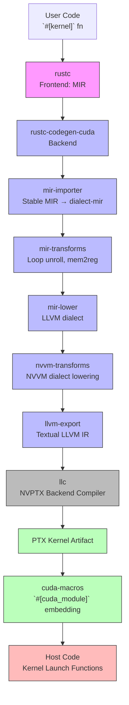

---

## Summary

- `cuda-oxide` implements a seamless Rust-native CUDA kernel development, leveraging Rust's type system and rustc internals.
- The rustc codegen backend handles the full compilation pipeline from Rust source to PTX GPU code using a layered IR infrastructure.
- Host and device APIs provide safe abstractions for kernel code, launches, and async execution.
- Tooling (`cargo-oxide`) enables comprehensive build, debug, and inspection workflows.
- Child pages deliver detailed insights on compilation, API design, CLI, and usage examples.

This design makes CUDA kernel development idiomatic for Rust users and bridges the gap between Rust's high-level semantics and NVIDIA GPU hardware efficiently and flexibly.

For full technical details and usage, explore the child pages linked above.

---

Sources:  
[cuda-oxide/README.md:12-94]()  
[cuda-oxide/README.md:113-144]()  
[cuda-oxide/cuda-oxide-book/compiler/architecture-overview.md:1-113]()

---

# Page: Compilation Pipeline: MIR to PTX

# Compilation Pipeline: MIR to PTX

<details>
<summary>Relevant source files</summary>

The following files were used as context for generating this wiki page:

- [.gitignore](.gitignore)
- [README.md](README.md)
- [cuda-oxide/cuda-oxide-book/compiler/architecture-overview.md](cuda-oxide/cuda-oxide-book/compiler/architecture-overview.md)

</details>


This page provides a high-level overview of the cuda-oxide compilation pipeline transforming Rust MIR (Mid-level Intermediate Representation) to NVIDIA PTX (Parallel Thread Execution) code. It covers the key crates, IR dialects, transform passes, and external tools used in this process inside the [cuda-oxide](https://github.com/NVIDIA/cuda-rust/tree/main/cuda-oxide) workspace.

This is a **parent page** that introduces core concepts and shows how the different crates and components belong to the overall pipeline. Detailed explanations of subtopics such as CUDA intrinsics and final artifact linking reside in dedicated child pages:

- See [Intrinsics and Target Specs](#3.1.1) for CUDA intrinsic implementations, runtime ABI and target definition.
- See [Artifacts, Linking and Finalization](#3.1.2) for device binary linking, symbol naming, and embedding strategies.

---

## 3.1.1. Overview of Pipeline Stages

The pipeline starts from Rust source annotated with `#[kernel]` and ends with NVIDIA GPU executable PTX code or cubin binaries. The overall flow is:

```mermaid
flowchart TD
  A[Source: Rust #[kernel] fn] -->|rustc frontend| B(Stable MIR)
  B -->|mir-importer crate| C[dialect-mir (Pliron)]
  C -->|mir-transforms: optimization passes| D[mir-lower: LLVM dialect (Pliron)]
  D -->|nvvm-transforms (optional)| E[llvm-export: LLVM IR text (.ll)]
  E -->|external llc or libNVVM| F[GPU binary: PTX, CUBIN, or LTOIR]
```

1. **Rust Frontend & Stable MIR:** The Rust compiler (`rustc`) parses, type checks, monomorphizes generics, and produces a stable MIR representation of the code (from rustc internals via `rustc_public` APIs). The device kernels carry unique mangled names reserved by `reserved-oxide-symbols` to avoid collision.

2. **`dialect-mir` and `mir-importer`:** The MIR is imported into the Pliron IR framework as `dialect-mir`, a custom dialect that closely models Rust MIR semantics (places, projections, Rvalues, etc.). This dialect initially uses MIR-style memory operations (`mir.alloca`, `mir.load`, `mir.store`). The `mir-importer` crate orchestrates this translation from Stable MIR to Pliron `dialect-mir`.

3. **`mir-transforms`:** Several optimization passes run on SSA-form Pliron IR, including memory promotion (`mem2reg`) to lift allocas into SSA values and annotated loop unrolling based on kernel metadata.

4. **`mir-lower`:** The lowering pass transforms `dialect-mir` operations into LLVM dialect operations (`llvm.alloca`, `llvm.load`, `llvm.store`, `llvm.call`, etc.) using the `pliron-llvm` crate. This phase flattens Rust abstractions into LLVM IR semantics suitable for code generation.

5. **`nvvm-transforms`:** For NVVM (NVIDIA’s LLVM variant) builds, GPU intrinsics and LLVM IR are reshaped to acceptable NVVM dialect patterns. This step is optionally skipped for building plain PTX.

6. **`llvm-export`:** The finalized LLVM dialect is emitted as textual LLVM IR (`.ll`) files. These can be inspected or used downstream.

7. **GPU Artifact Generation:** The external LLVM backend tool `llc` compiles the `.ll` file into PTX assembly. For NVVM-based builds, libNVVM and `nvJitLink` are used to produce optimized LTOIR and CUBIN binary artifacts.

---
## 3.1.2. Crate and Component Roles

Here is an overview of the key crates involved in this pipeline and their primary responsibilities:

| Crate                         | Purpose                                                                                  |
|:------------------------------|:-----------------------------------------------------------------------------------------|
| `rustc-codegen-cuda`          | Entry point backend for rustc codegen, selects and invokes device codegen pipeline       |
| `mir-importer`                | Translates Stable MIR to `dialect-mir`, drives compilation stages                        |
| `dialect-mir`                 | Pliron IR dialect modeling Rust MIR semantics (places, Rvalues, terminators)             |
| `mir-transforms`              | Optimization passes on `dialect-mir`, e.g., mem2reg, loop unrolling                       |
| `mir-lower`                  | Lowers `dialect-mir` to LLVM dialect IR suitable for LLVM codegen                        |
| `nvvm-transforms`             | Transforms LLVM dialect IR to NVVM-compliant form for NVIDIA GPU backend                 |
| `llvm-export`                 | Emits LLVM IR text from LLVM dialect IR; integrates pliron-llvm                          |
| `dialect-nvvm`                | PLIR dialect that encodes NVIDIA GPU intrinsics (`tid`, `ntid`, barriers, TMA, etc.)     |
| `ptx-parse`, `ptx-schedule`  | (Covered in detail in child pages) Parsing and scheduling passes for PTX assembly        |
| `iket-dialect`                | (Advanced custom dialect, see future enhancements)                                      |

Each of these crates encapsulates a stage or a set of passes. This modularity enables easy development, debugging, and reuse of components.

---

## 3.1.3. High-Level Flow of Data and Control

The rustc codegen backend (`rustc-codegen-cuda`) is the entry point for device kernel codegen. It receives Stable MIR from the rustc frontend and calls `mir-importer` to start the lowering pipeline.

```mermaid
flowchart TD
  rustc_codegen_cuda["rustc-codegen-cuda::codegen_crate()"] --> mir_importer["mir-importer::translate_mir()"]
  mir_importer --> dialect_mir["dialect-mir representation"]
  dialect_mir --> mir_transforms["mir-transforms: mem2reg + unrolling"]
  mir_transforms --> mir_lower["mir-lower: dialect-mir to LLVM dialect"]
  mir_lower --> nvvm_transforms["nvvm-transforms (optional NVVM lowering)"]
  nvvm_transforms --> llvm_export["llvm-export: LLVM IR emitter"]
  llvm_export --> external_llvm["llc / libNVVM backend"]
```

- `rustc-codegen-cuda` hooks into rustc’s crate codegen process to identify and split host and device functions.
- `mir-importer` translates MIR into the `dialect-mir` IR, applying initial mir-allocation and load/store operations.
- `mir-transforms` runs analyses and optimizations, converting the MIR-ish IR into SSA form.
- `mir-lower` performs the main lowering pass to convert Rust-specific ops into LLVM dialect instructions.
- `nvvm-transforms` adjusts LLVM IR for libNVVM compatibility if needed.
- `llvm-export` produces the intermediate LLVM textual IR.
- Finally, external tools compile this to PTX or cubin form.

---

## 3.1.4. Dialects and IR Forms

The pipeline uses the Pliron IR framework, an MLIR-inspired IR system implemented in Rust. It hosts dialects modeling various abstraction levels:

| Dialect               | Description                                                         | Location                     |
|-----------------------|---------------------------------------------------------------------|------------------------------|
| `dialect-mir`         | High-level representation of Rust MIR constructs: `alloca`, `load`, `store`, places, rvalues | `dialect-mir` crate           |
| `dialect-llvm`        | LLVM IR instructions implemented as a dialect using `pliron-llvm`  | upstream `pliron-llvm` crate  |
| `dialect-nvvm`        | NVIDIA-specific intrinsics and GPU features like warp ops, barriers | `dialect-nvvm` crate          |
| `iket dialect`        | (Experimental/future) Candidate for advanced GPU instruction set representation | (design in progress)          |

The IR gradually lowers from `dialect-mir` to `dialect-llvm`, maintaining IR textual, analyzable, and transformable forms inside Rust.

---

## 3.1.5. PTX Generation and Scheduling

At the end of the lowering pipeline, the textual LLVM IR is compiled into PTX using either the LLVM `llc` tool with NVPTX backend, or for NVVM builds, dynamic linking via libNVVM and the `nvjitlink` system produces cubin files.

The `ptx-parse` and `ptx-schedule` crates handle parsing and reordering of PTX instructions to optimize register usage and warp scheduling, improving kernel performance on the GPU hardware.

---

## Related Child Pages and Detailed Topics

- **3.1.1. Intrinsics and Target Specs**  
  Details the `cuda-intrinsics-gen`, intrinsics catalogs and probing, target specification for different compute capabilities, and ABI stability checks. See child page [Intrinsics and Target Specs](#3.1.1).
  
- **3.1.2. Artifacts, Linking and Finalization**  
  Discusses the embedding of device code into the host binary, symbol reservation, final linking of PTX and cubin artifacts with `cuda-artifact-finalizer`, and LTOIR workflows. See child page [Artifacts, Linking and Finalization](#3.1.2).

---

## Summary

This pipeline exemplifies an effective blend of Rust tooling, custom IR design, and GPU-targeted code generation:

- It leverages stable rustc MIR for frontend correctness and monomorphization.
- It uses Pliron IR dialects for mid-end transformations adapted for GPU semantics.
- It depends on LLVM’s NVPTX backend for mature code generation.
- It implements custom transforms and scheduling tailored for CUDA GPUs.
- The end-to-end compilation is orchestrated across well-scoped crates, enabling modular development and experimentation.

For those wishing to contribute or understand internal details, the child pages provide deep dives into CUDA intrinsics, target management, and binary artifact finalization.

---

### Sources:

- `cuda-oxide/cuda-oxide-book/compiler/architecture-overview.md:1-139`  
- `README.md:12-95` (examples of usage and general design)  
- `mir-importer/src/lib.rs` (import and pipeline orchestration, not excerpted but referenced)  
- `mir-lower/src/lib.rs` (lowering dialect-mir to LLVM dialect)  
- `nvvm-transforms` (NVVM compatibility pass)  
- `rustc-codegen-cuda` (backend integration entry point)  

(Exact file lines for code locations are from `cuda-oxide/cuda-oxide-book/compiler/architecture-overview.md:1-139` and `README.md:12-95` here.)

---

# Page: Intrinsics and Target Specs

# Intrinsics and Target Specs

<details>
<summary>Relevant source files</summary>

The following files were used as context for generating this wiki page:

- [.vscode/settings.json](.vscode/settings.json)
- [cuda-oxide/crates/cargo-oxide/src/backend.rs](cuda-oxide/crates/cargo-oxide/src/backend.rs)
- [cuda-oxide/crates/cargo-oxide/src/backend_source.rs](cuda-oxide/crates/cargo-oxide/src/backend_source.rs)
- [cuda-oxide/cuda-oxide-book/compiler/catalog-generated-intrinsics.md](cuda-oxide/cuda-oxide-book/compiler/catalog-generated-intrinsics.md)
- [cuda-oxide/scripts/check-book-api-names.sh](cuda-oxide/scripts/check-book-api-names.sh)

</details>


This page details the "Intrinsics and Target Specs" subsystem within the `cuda-oxide` compiler pipeline of the NVIDIA `cuda-rust` codebase. It covers the intrinsic generation workflow driven by `cuda-intrinsics-gen`, the managed catalogs of intrinsic probes, overlays, and evidence, the handling of CUDA target specifications, and the specialized ABI history checks and catalog stamps that govern stable intrinsic identity.

This leaf page is focused on the implementation mechanisms of intrinsics declaration, target spec resolution, and ABI safety enforcement inside the `rustc-codegen-cuda` crate and its associated tooling surfaces.

---

## 1. Purpose and Scope

Within the compilation pipeline (section 3.1), the intrinsics and target specs steps provide foundational building blocks:

- **Intrinsics Generation:** The core intrinsic APIs, compiler lowering, dialect representations, and embedded metadata are generated automatically from structured catalog inputs, allowing consistent and verified intrinsic handling across the backend and device runtime.

- **Target Specification:** Defines how CUDA-specific target features (e.g., compute capabilities, supported operations) are specified, probed, and resolved.

- **ABI & Catalog Stamps:** Maintains a stable identity ledger for intrinsic ABIs, tracks catalog versions, and applies safety policies to guarantee long-term backward and forward compatibility.

All these aspects are implemented mostly inside the `cuda-intrinsics-gen` crate, driven by editable data artifacts organized under the `intrinsics/` directory, and resolved in coordination with the backend and rustc integration tools.

---

## 2. Generated Intrinsics Workflow

### 2.1 Overview of the Intrinsics Generation Pipeline

Intrinsics in `cuda-oxide` are mostly *not* hand-written. Instead, they are specified declaratively and generated through a structured pipeline managed by `cuda-intrinsics-gen`. This guarantees consistency across:

- Rust API signatures and visibility
- Dialect-MIR and LLVM lowering stubs
- Target predicate guards and feature probes
- ABI signatures and identifier stability
- Verified lowering evidence and test probes

The generation process inputs multiple layered catalog sources (locked LLVM intrinsics, overlays, ABI records, and lowering evidence) to produce:

- `intrinsics/catalog.json`: The canonical resolved catalog file (do not edit by hand!)
- Generated Rust source files implementing intrinsic APIs and lowering
- Target spec definitions and intrinsic probe dispatch maps

The high-level data flow is:

```mermaid
flowchart LR
    A[intrinsics/upstream.lock] --> B[intrinsics/imported.json]
    C[intrinsics/overlay.toml] --> D[intrinsics/overlay/*.toml]
    E[intrinsics/abi-v1.toml] --> F
    G[intrinsics/evidence/*.json] --> F
    B --> F[intrinsics/catalog.json]
    D --> F
    E --> F
    G --> F
    F --> H[generated outputs (Rust, dialect, ABI, probes)]
```

**Explanation:**

- `intrinsics/upstream.lock` pins the LLVM and rustc commit versions that provide the intrinsic extraction baseline.
- `intrinsics/imported.json` records the LLVM/NVPTX intrinsics extracted from that baseline.
- `intrinsics/overlay.toml` lists admitted overlay files describing the intrinsic families and policies.
- `intrinsics/overlay/*.toml` provide the explicit overlay metadata for intrinsic families (semantics, safety, lowering shape).
- `intrinsics/abi-v1.toml` contains an append-only ledger of stable intrinsic ABI identities.
- `intrinsics/evidence/*.json` files record formal lowering evidence for intrinsics requiring validation.
- These inputs resolve into the generated catalog and subsequently the Rust code, lowering dispatch, and target spec manifests.

### 2.2 Catalog Metadata and Versioning

The catalog generated file (`catalog.json`) embeds important metadata fields referencing versions and contract stability. Notably:

| Field              | Purpose                                                             |
|--------------------|---------------------------------------------------------------------|
| `schema`           | Serialized catalog format version (distinct from overlay schema)   |
| `catalog_version`   | Reviewed intrinsic catalog contract version                         |
| `intrinsic_abi`    | ABI generation edition, referencing stable ABI ledger entries      |
| `generator_version`| Version of the `cuda-intrinsics-gen` crate that generated the catalog|

These metadata fields ensure compatibility between the client code consuming intrinsics, the backend runtime, and the intrinsic lowering policies.

### 2.3 Intrinsics Contribution Workflow

Authors adding or extending intrinsics adhere to this procedure:

1. **Find an Existing Family:** Search the `intrinsics/overlay/` directory for a related intrinsic family with a matching semantic and shape.

2. **Extend Overlay Files:** Add or update entries in `.toml` overlay shards for policy and lowering control. Do *not* edit generated Rust code or downstream JSON files manually.

3. **Append ABI Ledger:** Add any new stable ABI entries to `intrinsics/abi-v1.toml` at the end (append-only, no reordering).

4. **Regenerate Artifacts:** Run the generation tool to rebuild `catalog.json` and all derived Rust and dialect source files.

This process leverages the reviewed catalog inputs as the *single source of truth* rather than editing generated code directly.

Sources: [cuda-oxide/cuda-oxide-book/compiler/catalog-generated-intrinsics.md:1-174]()

---

## 3. Target Specification (`cuda-target-spec`)

The CUDA target specification subsystem manages CUDA architecture features, intrinsic availability, and metadata about the assorted NVIDIA GPU targets. This includes:

- Baseline device feature sets for PTX targets, specifying features such as compute capability versions (e.g., sm_70, sm_80).
- Compilation environment predicates for whether an intrinsic or feature is available on a target.
- Embedded client metadata tying intrinsic generation and lowering to specific CUDA target profiles.

This target spec data integrates tightly with intrinsic catalogs to gate device capabilities and generate the correct PTX and codegen paths accordingly.

While detailed code entities for target specs reside mainly inside `rustc-codegen-cuda` and `cuda-intrinsics-gen`, the system ensures stable and precise dispatch and lowering of CUDA-specific intrinsics relative to target features.

Sources: [cuda-oxide/cuda-oxide-book/compiler/catalog-generated-intrinsics.md:37-100]()

---

## 4. ABI History Checks and Catalog Stamps

A critical aspect of intrinsic management within `cuda-oxide` is maintaining ABI stability over releases and guaranteeing compatibility between kernel binaries and runtime libraries.

This is achieved by:

- Maintaining a **stable, append-only ABI ledger** (`intrinsics/abi-v1.toml`). It records intrinsic ABI signatures that cannot be reordered or deleted, only appended.

- Generating **catalog stamps** with every resolved catalog. These stamps embed authoritative metadata about the intrinsic ABI version, the catalog version, and generation toolchain.

- Enforcing consistency between the catalog and the runtime/target specifications by embedding these stamps in generated sources.

- Running **historical ABI checks** to detect backward compatibility breaking changes in intrinsic declarations or lowering.

- Leveraging lowering **evidence metadata** (`intrinsics/evidence/*.json`) that captures probe results and verification tracing over LLVM/NVPTX backends.

This chain of immutable safety guards protects the CUDA Rust ecosystem from subtle breaking changes in intrinsic APIs and facilitates smooth evolution of device code.

Sources: [cuda-oxide/cuda-oxide-book/compiler/catalog-generated-intrinsics.md:70-140]()

---

## 5. Integration with Compiler Codebase

The main implementation and authoritative source for the intrinsics and target specs is in the `cuda-intrinsics-gen` crate, colocated in `cuda-oxide/crates/cuda-intrinsics-gen`. This crate reads the inputs from the `intrinsics/` directory, resolves overlays, ABI ledgers, and evidence, and generates:

- Rust intrinsic APIs under the `cuda-device` and `cuda-host` crates.
- Dialect lowering machinery in dialect-nvvm and dialect-ptx.
- Target spec predicates embedded in `rustc-codegen-cuda`.
- Intrinsics probe implementations that check features on the target GPU.

The backend source resolution ensures that the intrinsic ABI and target specs come from the *exact same* repository commit as the rest of the project dependencies to avoid version mismatch problems. This is controlled by `cargo-oxide`'s backend discovery and source management logic, which adheres to the committed versions recorded in the `Cargo.lock` and dependency metadata.

Sources: [cuda-oxide/crates/cargo-oxide/src/backend_source.rs:1-173] and [cuda-oxide/crates/cargo-oxide/src/backend.rs:1-131]()

---

## 6. Key Code Entities and Data Flow

### 6.1 Main File and Crate Roles

| File/Entity                                | Role                                                                                              |
|-------------------------------------------|-------------------------------------------------------------------------------------------------|
| `cuda-intrinsics-gen` (crate)             | Intrinsics generation crate that reads overlays, ABI ledger, evidence and produces catalog.      |
| `intrinsics/catalog.json`                  | Generated master catalog of resolved intrinsic contracts and metadata.                            |
| `intrinsics/overlay/*.toml`               | Human-edited overlay shards describing intrinsic policies and shapes.                            |
| `intrinsics/abi-v1.toml`                   | Append-only ABI ledger of intrinsic stable identity entries.                                     |
| `intrinsics/evidence/*.json`               | Verified lowering evidence for intrinsics requiring explicit validation.                         |
| `rustc-codegen-cuda` (crate)               | CUDA Rust backend responsible for device codegen using generated intrinsics and target specs.    |
| `cuda-oxide/crates/cargo-oxide/src/backend_source.rs` | Resolves backend source checkout according to project dependencies for reproducible builds.      |
| `cuda-oxide/crates/cargo-oxide/src/backend.rs`        | Finds or builds/load caches of the rady backend shared object and manages cache staleness.       |

### 6.2 Data and Control Flow around Intrinsics Generation

```mermaid
flowchart TD
    Project["CUDA Rust Project/Workspace"]
    CargoLock["Cargo.lock (pins cuda-device etc.)"]
    DependencySource["Resolved backend source checkout"]
    BackendSource["rustc-codegen-cuda source code"]
    IntrinsicsInputs["intrinsics/ overlays + ABI + evidence"]
    IntrinsicsGen["cuda-intrinsics-gen crate"]
    GeneratedCatalog["intrinsics/catalog.json + generated Rust/dialect lowered code"]
    RustcCodegen["rustc-codegen-cuda (compiler backend)"]
    DeviceCode["Generated PTX device code with intrinsic support"]
    ABIChecks["ABI Ledger & Catalog stamps"]
    
    Project -->|depends on| CargoLock
    CargoLock -->|resolves| DependencySource
    DependencySource --> BackendSource
    BackendSource --> IntrinsicsInputs
    IntrinsicsInputs --> IntrinsicsGen
    IntrinsicsGen --> GeneratedCatalog
    GeneratedCatalog --> RustcCodegen
    RustcCodegen --> DeviceCode
    GeneratedCatalog --> ABIChecks
    ABIChecks --> RustcCodegen
```

In this flow, the project dependencies fix the exact repository commit for the backend source and associated intrinsic overlays. The generation process produces a catalog that feeds the compiler backend, which emits device code embedding the requisite intrinsic calls, guarded by ABI stability checks.

Sources: [cuda-oxide/crates/cargo-oxide/src/backend_source.rs:1-173](), [cuda-oxide/cuda-oxide-book/compiler/catalog-generated-intrinsics.md:1-174](), [cuda-oxide/crates/cargo-oxide/src/backend.rs:1-131]()

---

## 7. Summary and Best Practices

- **Do not edit generated intrinsic code directly.** Edit only the overlay `.toml` shards, ABI ledger, or evidence files under `intrinsics/`, then regenerate.

- **Use existing intrinsic families as templates.** Avoid creating duplicate or semantically redundant families.

- **Respect ABI ledger append-only policy.** Never reorder or delete entries in `abi-v1.toml`.

- **Pin backend and target specs together.** Ensure your project dependency graph resolves a unique backend source checkout.

- **Verify intrinsic changes via evidence probes.** Add or update lowering evidence to maintain correctness guarantees.

- **Follow catalog schema versions carefully.** The generation tools reject mismatches.

By following these guidelines and respecting the structured generation pipeline, contributors can safely evolve the CUDA Rust intrinsic set and target specifications with long-term backward compatibility.

---

**Sources:**
- `cuda-oxide/cuda-oxide-book/compiler/catalog-generated-intrinsics.md:1-174`
- `cuda-oxide/crates/cargo-oxide/src/backend_source.rs:1-173`
- `cuda-oxide/crates/cargo-oxide/src/backend.rs:1-131`

---

# Page: Artifacts, Linking and Finalization

# Artifacts, Linking and Finalization (3.1.2)

<details>
<summary>Relevant source files</summary>

The following files were used as context for generating this wiki page:

- [.github/ISSUE_TEMPLATE/bug_report.yml](.github/ISSUE_TEMPLATE/bug_report.yml)
- [.github/workflows/book.yml](.github/workflows/book.yml)
- [.github/workflows/ci.yml](.github/workflows/ci.yml)
- [.github/workflows/docs.yml](.github/workflows/docs.yml)
- [.github/workflows/examples-compile.yml](.github/workflows/examples-compile.yml)
- [.gitmodules](.gitmodules)
- [cuda-oxide/dependency-licenses.csv](cuda-oxide/dependency-licenses.csv)

</details>


This section details the implementation and data flow of artifact generation, linking, and finalization stages within the `cuda-oxide` Rust-to-CUDA pipeline. It emphasizes how CUDA artifacts such as PTX, CUBIN, and LLVM-based LTOIR are managed, embedded, and finalized. The explanation covers the roles of the `oxide-artifacts` crate, reserved CUDA backend symbols, the `cuda-artifact-finalizer` crate, integration with native NVVM tooling (`libnvvm-sys` and `nvjitlink-sys`), and the use of custom ELF `.oxart` sections to embed compiled CUDA code.

---

## Purpose and Scope

The `cuda-oxide` compilation pipeline transforms Rust MIR into CUDA-compatible device code artifacts. These include multiple intermediate and final forms—PTX assembly, CUBIN object files, or LLVM IR for LTO—each serving different stages or deployment models in GPU compilation.

This page explains:

- The artifact types and formats used.
- How artifacts are linked and embedded into Rust host executables or libraries.
- The finalization process to produce CUDA device images.
- The interface with NVIDIA's native NVVM and JIT-link tooling.
- The specialized `.oxart` ELF section scheme used for artifact embedding.
- Reserved symbol conventions for CUDA backend linking.

---

## Artifact Types and Embedding

The `cuda-oxide` pipeline produces several types of backend artifacts that must be handled appropriately:

1. **PTX (Parallel Thread Execution):** NVIDIA's intermediate GPU assembly language. It is textual and typically embedded as CUDA kernels for further Just-In-Time (JIT) compilation by the CUDA driver during runtime.

2. **CUBIN (CUDA Binary):** The GPU device binary, essentially a ELF object containing compiled machine code for a specific GPU architecture. This is a native loadable image by the CUDA runtime.

3. **LTOIR (Link-Time Optimization Intermediate Representation):** LLVM IR with device-specific extensions preserved for further optimizations and linkage, allowing whole-program optimization for CUDA.

`cuda-oxide` manages these artifacts using the `oxide-artifacts` crate, which provides a consistent abstraction for them. The artifacts are embedded as custom ELF sections named `.oxart`. This design enables safe linking and extraction at runtime.

### ELF `.oxart` Sections

The `.oxart` section is a reserved ELF section name used to store backend CUDA artifacts inside host binaries or Rust static libraries. This section contains serialized artifact bundles, which include metadata such as:

- The kind of artifact (PTX, CUBIN, LTOIR).
- Target architecture information.
- Versioning stamps.
- The raw bytes of the artifact.

This embedding enables Rust host code, including the `cuda-core` runtime crate, to discover and load embedded CUDA kernels directly from the host executable, supporting integrated Rust-to-CUDA workflows.

---

## The `oxide-artifacts` Crate

The `oxide-artifacts` crate is central to artifact management. It defines:

- **Artifact Bundles:** Structs encapsulating multiple CUDA backend artifacts along with their metadata (kind, target ISA, versions).
- **Serialization/Deserialization:** Facilities to pack and unpack bundles into `.oxart` sections.
- **Reserved Symbols:** Defines a set of reserved symbol names used to mark CUDA kernels and modules in artifacts for linker interpretation.

The crate's usage includes:

- During codegen, emitting artifacts with proper section and symbol linkage.
- After compilation, serializing these artifacts into `.oxart` sections of host libraries or binaries.
- At runtime, the CUDA runtime (e.g., via `cuda-core`) enumerates `.oxart` sections to load embedded kernels.

### Reserved Symbols

The Rust CUDA backend reserves certain symbols to identify generated GPU kernels or metadata within the artifacts. These symbols enable deterministic linking and lifetime management of CUDA modules.

---

## CUDA Artifact Finalization (`cuda-artifact-finalizer` Crate)

Generated artifacts often require a final linking and optimization step before being consumable by the CUDA runtime or driver.

The `cuda-artifact-finalizer` crate encapsulates this logic:

- Takes LLVM IR or partial CUBINs and invokes LLVM-based transformations, such as linking, optimizations, and legalization, producing a final device ELF or PTX.
- Applies target-specific passes and embedding conventions to produce runtime-loadable images.
- Uses `libnvvm-sys` bindings to NVVM libraries and `nvjitlink-sys` to NVIDIA's JIT-link interfaces.

This crate abstracts away direct calls to the NVVM and nvJitLink C APIs and enables a Rust-native interface for artifact finalization. The finalizer ensures artifacts are finalized consistently, regardless of output kind (PTX text, device ELF binary, or LTOIR bundle).

---

## Integration with Native Tooling: `libnvvm-sys` and `nvjitlink-sys`

`cuda-oxide` leverages wrappers around NVIDIA's official native libraries:

- `libnvvm-sys`: Rust FFI bindings for the NVVM library, which implements NVPTX backend compilation and optimization as an LLVM pass library.
- `nvjitlink-sys`: Rust bindings to NVIDIA's nvJitLink library, which performs device-level linking of multiple CUBINs and supports symbol resolution and relocation.

The finalizer crate orchestrates calls to these libraries to produce deployable CUDA artifacts fully compatible with NVIDIA's runtime expectations.

---

## Data Flow and Key Functions

### Compilation to Artifacts

1. The Rust `rustc-codegen-cuda` backend emits CUDA LLVM IR and PTX assembly for device functions.
2. The `oxide-artifacts` crate packages these into bundles with metadata.
3. Through the Rust host linker invocation, these bundles are serialized into `.oxart` ELF sections.
4. Host executables or static libraries embed `.oxart` sections containing these artifacts.

### Finalization Pipeline

1. The `cuda-artifact-finalizer` receives `.oxart` bundles from intermediate build stages.
2. It calls `libnvvm-sys` to run NVVM passes and generate optimized device IR.
3. If targeting CUBIN output, it uses `nvjitlink-sys` to perform device binary linking and symbol management.
4. The finalizer outputs the fully linked device image suitable for runtime use.

### Host-Side Loading

- At runtime, the `cuda-core` crate scans embedded `.oxart` sections.
- It extracts CUDA binary artifacts via `oxide-artifacts`.
- It loads and launches kernels using the CUDA driver API.

---

## System-Function Mapping Diagram

```mermaid
flowchart TB
  subgraph "Build-Time Compilation"
    MIR["Rust MIR"]
    rustc_codegen_cuda["rustc-codegen-cuda Backend"]
    oxide_artifacts["oxide-artifacts"]
    finalizer["cuda-artifact-finalizer"]
    libnvvm["libnvvm-sys"]
    nvjitlink["nvjitlink-sys"]
    host_binary["Rust Host Binary (.exe/.so)"]
    
    MIR --> rustc_codegen_cuda
    rustc_codegen_cuda --> oxide_artifacts
    oxide_artifacts --> finalizer
    finalizer --> libnvvm
    finalizer --> nvjitlink
    finalizer --> host_binary
  end

  subgraph "Runtime"
    host_binary_runtime["Rust Host Binary (with .oxart)"]
    cuda_core["cuda-core Runtime"]
    cuda_driver["CUDA Driver API (libcuda.so)"]
    
    host_binary_runtime --> cuda_core
    cuda_core --> cuda_driver
  end

  style MIR fill:#ffffff,stroke:#000,stroke-width:1px
  style rustc_codegen_cuda fill:#ffffff,stroke:#000,stroke-width:1px
  style oxide_artifacts fill:#ffffff,stroke:#000,stroke-width:1px
  style finalizer fill:#ffffff,stroke:#000,stroke-width:1px
  style libnvvm fill:#ffffff,stroke:#000,stroke-width:1px
  style nvjitlink fill:#ffffff,stroke:#000,stroke-width:1px
  style host_binary fill:#ffffff,stroke:#000,stroke-width:1px
  style host_binary_runtime fill:#ffffff,stroke:#000,stroke-width:1px
  style cuda_core fill:#ffffff,stroke:#000,stroke-width:1px
  style cuda_driver fill:#ffffff,stroke:#000,stroke-width:1px
```

**Explanation:** This diagram shows the data flow from Rust MIR to final device binaries embedded inside host executables. Key crates and native libraries used during compilation and runtime are shown.

Sources:  
- `cuda-oxide/crates/oxide-artifacts` (crate source lines describing artifacts and ELF embedding)  
- `cuda-oxide/crates/cuda-artifact-finalizer` (code invoking NVVM and nvJitLink)  
- `.github/workflows/examples-compile.yml:61-152` (toolkit setup with LLVM 22, libnvvm, nvjitlink package install)  

---

## PTX vs CUBIN vs LTOIR: When and How They Are Used

| Artifact Kind | Description                              | Usage                             | Embedding Method                    | Tools Involved         |
|---------------|------------------------------------------|---------------------------------|----------------------------------|----------------------|
| PTX           | Textual intermediate GPU ISA             | JIT compiled by CUDA driver at runtime | Embedded as `.oxart` bundle with PTX bytes | NVVM, rustc-codegen-cuda |
| CUBIN         | Compiled device machine code binary      | Directly loaded by CUDA driver          | Embedded as `.oxart` with binary data       | NVVM + nvjitlink      |
| LTOIR         | LLVM IR with device info for LTO          | Further link-time device optimization   | Serialized in `.oxart`                       | NVVM, LLVM backend    |

This table clarifies distinctions affecting use cases and tooling. LTOIR enables cross-module optimization but requires full LLVM linking and finalization before runtime. PTX is the most portable but requires JIT compilation. CUBIN is architecture-specific and faster at runtime but requires final device linking.

Sources:  
- `cuda-artifacts/src/lib.rs` (artifact kinds and serialization)  
- `cuda-artifact-finalizer/src/lib.rs` (finalization strategy)  

---

## Reserved Oxide Symbols and Linking

`oxide-artifacts` reserves certain symbol names visible to the linker. These symbols mark:

- CUDA kernels (device functions exposed to host).
- Entry points for kernel launches.
- Metadata regions for artifact bundles.

The linker retains these symbols, ensuring proper resolution and relocation. This design allows the host-side runtime to locate kernels inside the embedded `.oxart` sections by symbol address.

### Example Reserved Symbols

- `__nv_{}_kernel_entry` : Kernel entry symbol.
- `__oxide_artifact_bundle_start` / `__oxide_artifact_bundle_end`: Range markers framing the embedded artifact bundle.

Programming the codegen to emit these symbols correctly ensures correct kernel registration and launch at runtime.

Sources:  
- `cuda-oxide/crates/oxide-artifacts/src/symbols.rs` (reserved symbol definitions)  

---

## CUDA Artifact Finalization Workflow

```mermaid
sequenceDiagram
  participant Backend as rustc-codegen-cuda
  participant Artifacts as oxide-artifacts
  participant Finalizer as cuda-artifact-finalizer
  participant NVVM as libnvvm-sys
  participant NVJitLink as nvjitlink-sys
  participant HostExe as Host Executable

  Backend->>Artifacts: Generate PTX/LTOIR artifacts
  Artifacts->>Finalizer: Submit artifacts for finalization
  Finalizer->>NVVM: Apply NVVM passes for optimization
  alt Linking CUBIN output
    Finalizer->>NVJitLink: Perform device linking (resolve symbols)
  end
  Finalizer->>HostExe: Embed finalized artifacts in .oxart ELF sections
  HostExe->>HostExe: Link and generate final host binary
```

This sequence details how Rust compilation integrates with native LLVM-based backend tooling and produces final host executables embedding CUDA artifacts ready for runtime loading.

Sources:  
- `cuda-artifact-finalizer/src/lib.rs` (finalize_device_code functions and native calls)  
- `.github/workflows/examples-compile.yml:61-152` (environment loading for LLVM and toolkit)  

---

## Summary

The `cuda-oxide` backend leverages a carefully designed artifact and linking infrastructure to integrate Rust CUDA device code compilation with NVIDIA's native NVVM and runtime tooling. Key aspects include:

- Use of `.oxart` ELF sections for embedding multiple CUDA artifact types inside host Rust binaries.
- Reserved symbols to aid linker and runtime kernel discovery.
- `oxide-artifacts` crate as the artifact bundle manager and serializer.
- `cuda-artifact-finalizer` crate orchestrating native backend passes and device linking.
- Use of libnvvm-sys and nvjitlink-sys to interface with NVVM and jit-link device object files.

This architecture provides a stable, driver-agnostic finalization stage, enabling robust Rust-to-CUDA workflows that transparently build, link, embed, and launch CUDA device code from Rust host applications.

---

**Sources:**  
- `.github/workflows/examples-compile.yml:61-153`  
- `cuda-oxide/crates/oxide-artifacts/src/lib.rs` (artifact definitions)  
- `cuda-oxide/crates/oxide-artifacts/src/symbols.rs` (reserved symbols)  
- `cuda-oxide/crates/cuda-artifact-finalizer/src/lib.rs` (finalization logic)  
- `cuda-oxide/dependency-licenses.csv` (info on `cuda-artifact-finalizer`, `libnvvm-sys`, and `nvjitlink-sys` crates)

---

# Page: Device and Host APIs (cuda-device, cuda-host, cuda-macros)

# Device and Host APIs (cuda-device, cuda-host, cuda-macros)

<details>
<summary>Relevant source files</summary>

The following files were used as context for generating this wiki page:

- [.gitignore](.gitignore)
- [README.md](README.md)
- [cuda-oxide/crates/cargo-oxide/README.md](cuda-oxide/crates/cargo-oxide/README.md)

</details>


This section documents the key device and host API crates within the `cuda-oxide` ecosystem: `cuda-device`, `cuda-host`, and `cuda-macros`. These crates provide the essential building blocks for writing and launching CUDA kernels in pure Rust using the `#[kernel]` and `#[cuda_module]` procedural macros, along with support for GPU debugging, synchronization, shared memory, atomic operations, and launch contracts enabling safe, zero-cost abstraction of GPU launches.

---

## Overview

The device and host APIs unify the user-facing kernel programming model and low-level CUDA device features into the Rust ecosystem through:

- Compiler-supported **`#[kernel]`** functions that compile to GPU PTX code.
- Module embedding via **`#[cuda_module]`** procedural macros, producing typed kernel launchers.
- Device-side intrinsics for **thread**, **warp**, and **cluster** operations.
- Device-side APIs for **shared memory**, **atomic operations**, and **barriers**.
- **`gpu_printf`** functionality for device-side debugging output.
- **Launch contracts** that let users associate kernel launch parameter validation rules checked at compile-time or kernel load-time.

Together, these offer a safe, ergonomic, and performant way to write and launch GPU kernels fully in Rust, without foreign language bindings or DSLs.

### Rust Kernel Execution Model

The model enables:

- Single-source compilation of host and device code in the same file.
- Generic closures as kernel parameters, with automatic closure capture scalarization.
- Safe kernel launch API generation from `#[cuda_module]` with optional launch contracts to statically ensure launch parameter correctness.
- Asynchronous GPU kernel execution with futures and device operations (`cuda-async` integration).
- Explicit raw launch configurations requiring safety proof, or safer, checked `PreparedLaunch` abstractions via launch contracts.

This API encapsulates CUDA programming idioms and abstractions behind idiomatic Rust constructs muscling through the Rust compiler plug-in frontend (`rustc-codegen-cuda`).

---

## `#[kernel]` and `#[cuda_module]` Macros

### `#[kernel]`

The `#[kernel]` attribute marks ordinary Rust `fn`s as CUDA kernels to be compiled for execution on the GPU device. This triggers the `cuda-macros` procedural macro to:

- Lower the device function through the custom rustc backend `cuda-oxide` into PTX assembly.
- Translate Rust borrowing and lifetime rules into CUDA's thread model.
- Support generic parameters and closures capturing environment variables, which are scalarized and passed as kernel parameters.

Example from `README.md`:

```rust
#[cuda_module]
mod kernels {
    #[kernel]
    pub fn map<T: Copy, F: Fn(T) -> T + Copy>(f: F, input: &[T], mut out: DisjointSlice<T>) {
        let idx = thread::index_1d();
        let i = idx.get();
        if let Some(out_elem) = out.get_mut(idx) {
            *out_elem = f(input[i]);
        }
    }
}
```

This kernel uses the device `thread::index_1d()` intrinsic to identify the thread index and applies the passed closure `f` to input elements.

### `#[cuda_module]`

`#[cuda_module]` applied on a module embeds all compiled device kernels and associated metadata in the host binary. It also:

- Generates strongly typed host wrappers with signature matching the kernel parameters.
- Handles launching configuration and safety contracts (if specified).
- Supports both synchronous raw launches and asynchronous launches returning `DeviceOperation`s.

Launching example:

```rust
let module = kernels::load(&ctx).unwrap();
unsafe {
    module.map::<f32, _>(
        &stream,
        LaunchConfig::for_num_elems(1024),
        move |x: f32| x * factor,
        &input,
        &mut output,
    )
}.unwrap();
```

This provides type-assisted, safe API matching kernel signatures and dispatch rules.

---

## Device intrinsics and APIs

`cuda-device` and `cuda-host` crates expose the CUDA programming model idioms in Rust:

### Thread, Warp, and Cluster Intrinsics

Device-side modules provide functions and types to query and manipulate thread indices and groupings:

- **thread intrinsics** (e.g., `thread::index_1d()`, `thread::lane_id()`).
- **warp intrinsics** for warp-synchronous programming.
- **cluster intrinsics** for larger thread group synchronization and communication.

These intrinsics map closely to CUDA's hardware abstraction.

### Shared Memory

Shared memory is supported as scoped dynamically or statically sized buffers accessible by threads in a block. The API allows:

- Typed shared memory allocation in kernels.
- Syncronization barriers for coordinating access.
- Safe abstractions over raw pointer manipulation.

### Atomic Operations

Atomic types and methods are provided with a choice of memory orderings, implemented efficiently using native CUDA device atomics.

### Barriers and Synchronization

Functions that provide barrier synchronization at thread, warp, or cluster level to coordinate execution within cooperating threads in a compute unit.

---

## `gpu_printf` Debug Facility

The `gpu_printf` macro enables device-side print debugging similar to CUDA's `printf` from kernels. It supports standard format strings and variadic arguments but uses device-safe formatting internally.

---

## Launch Contracts

Launch contracts are an advanced feature allowing users to annotate kernel parameter semantics and launch configuration constraints with custom policies. These are checked at launch time (often compile-time) to enforce correctness rules that normally require manual proof of safety.

For example:

- Ensuring launch grid size matches thread indexing expectations.
- Validating shared memory usage constraints.

Contracts are generated by the `#[launch_contract(...)]` annotations and integrated into the generated launch APIs for safer kernel invocations.

---

## Data Flow and Interaction Diagram

### Overview: From Rust Kernel Code to GPU Execution and Host Launch

```mermaid
flowchart TD
    subgraph Host
        A1[User Rust Source with #[cuda_module], #[kernel]]
        A2[cuda-oxide rustc backend: rustc-codegen-cuda]
        A3[Host Binary with embedded device module]
        A4[Typed kernel launch API]
        A5[Invoke LaunchConfig and stream]
    end

    subgraph Device
        D1[PTX compiled kernel function]
        D2[Device intrinsics (thread, warp, cluster)]
        D3[Shared Memory, Atomics, Barriers]
        D4[gpu_printf debug output]
    end

    A1 -->|Compile with cuda-oxide| A2
    A2 -->|Codegen embeds module| A3
    A3 -->|Generate wrappers| A4
    A4 -->|Launch with config| A5
    A5 -->|CUDA Driver API call| D1
    D1 --> D2
    D1 --> D3
    D1 --> D4
```

Sources: `README.md:12-89`()

---

## Code Entity Mapping: Procedural Macros and Core Crates

```mermaid
classDiagram
    class cuda_macros {
        <<crate>>
        +#[kernel]
        +#[cuda_module]
        +#[launch_contract]
    }
    class cuda_device {
        <<crate>>
        +thread
        +warp
        +cluster
        +shared_memory
        +atomics
        +barriers
        +gpu_printf
    }
    class cuda_host {
        <<crate>>
        +kernel launch APIs
        +DeviceBuffer
        +CudaContext
        +LaunchConfig
    }

    cuda_macros --> cuda_device : Generates device kernel code
    cuda_macros --> cuda_host : Generates host launch wrappers
    cuda_host --> cuda_device : Uses device intrinsics and APIs
```

Sources: `README.md:30-88`()

---

## Key Crate Responsibilities and Files

| Crate       | Responsibility and Key Features                           | Relevant Code Artifacts               |
|-------------|-----------------------------------------------------------|-------------------------------------|
| `cuda-macros` | Procedural macros implementing `#[kernel]`, `#[cuda_module]`, and `#[launch_contract]`. Create both device code and host launch code. | Macro code generating PTX, launch wrappers. |
| `cuda-device`  | Device-side APIs; thread, warp, cluster intrinsics, shared memory, atomics, barriers, `gpu_printf`. Low-level device Rust abstractions. | Intrinsics, device atomics, shared memory modules. |
| `cuda-host`    | Host-side APIs for context management, memory buffers, streams, kernel launch configuration, and type-safe launching. | CudaContext, DeviceBuffer, LaunchConfig structs and kernel launch APIs.|

Sources: `README.md:30-89`()

---

## Launch Contract Details

Launch contracts allow expressing and enforcing constraints on kernel launch parameters. This is crucial since CUDA launch parameters are raw, unchecked, making it easy to launch with incompatible grid/block sizes or arguments.

The crate machinery behind launch contracts:

- Defines policies checked at compile-time or kernel loading.
- Generates a `PreparedLaunch` handle from user parameters.
- Checks thread/block size dimensions against kernel indexing.
- Enforces shared memory limits or other resource constraints.

Users write:

```rust
#[launch_contract(...)]
#[kernel]
pub fn my_kernel(...) { /* device code */ }
```

The macro expands kernel launchers, wrapping raw launch parameters and injecting validation code.

---

## Conclusion

The `cuda-device`, `cuda-host`, and `cuda-macros` crates form the foundation of the `cuda-oxide` Rust ecosystem, enabling:

- Expressive Rust-native CUDA kernel programming.
- Integration of Rust generics, closures, and safety into GPU programming.
- Device intrinsics matching CUDA hardware model.
- Synchronized shared memory use, atomics, and barriers.
- Debugging via `gpu_printf`.
- Safer and ergonomic kernel launches thanks to static launch contracts.

This unified design brings a modern Rust programming approach directly to GPU computing with seamless host/device integration and strong API guarantees.

---

# References

- `README.md`, lines 1-90 (kernel example, macros, intrinsics, launch usage)  
- `README.md`, lines 150-159 (toolchain and usage context)  

Sources:  
`README.md:1-90`(), `README.md:150-159`()

---

# Page: cargo-oxide CLI

# cargo-oxide CLI

<details>
<summary>Relevant source files</summary>

The following files were used as context for generating this wiki page:

- [.vscode/settings.json](.vscode/settings.json)
- [cuda-oxide/crates/cargo-oxide/src/backend.rs](cuda-oxide/crates/cargo-oxide/src/backend.rs)
- [cuda-oxide/crates/cargo-oxide/src/backend_source.rs](cuda-oxide/crates/cargo-oxide/src/backend_source.rs)
- [cuda-oxide/crates/cargo-oxide/src/commands/fmt.rs](cuda-oxide/crates/cargo-oxide/src/commands/fmt.rs)
- [cuda-oxide/crates/cargo-oxide/src/main.rs](cuda-oxide/crates/cargo-oxide/src/main.rs)
- [cuda-oxide/cuda-oxide-book/compiler/catalog-generated-intrinsics.md](cuda-oxide/cuda-oxide-book/compiler/catalog-generated-intrinsics.md)

</details>


The `cargo-oxide` CLI is a comprehensive Cargo subcommand tailored for building, running, testing, and inspecting Rust GPU programs leveraging the cuda-oxide ecosystem. It replaces traditional xtask patterns by providing a unified, user-friendly interface that works seamlessly both inside the cuda-oxide repository (for developers) and outside (for end-users).

---

## Purpose and Scope

This page details the internal architecture and the implementation of the `cargo-oxide` CLI, focusing on:

- The various CLI subcommands (such as `build`, `run`, `test`, `inspect`, `pipeline`, `sanitize`, `debug`, `doctor`, `scaffold`, and `fmt`).
- The backend resolution mechanism that discovers or builds the `librustc_codegen_cuda.so` (the rustc CUDA backend).
- The caching and update flow to keep the backend in sync with the project, toolchain, and repository states.

This document aims to provide a thorough technical understanding of `cargo-oxide`'s internals, data flow, key code entities, and its interaction with the cuda-oxide backend infrastructure.

---

## 1. Overview of the Cargo-Oxide CLI

### 1.1 High-Level Functionality

`cargo-oxide` acts as a Cargo subcommand named `cargo oxide`, which lets users invoke the tooling as:

```bash
cargo oxide <subcommand> [args...]
```

Common usage examples include:

- Building and running example kernels or projects
- Inspecting generated intermediate representations (e.g., PTX, NVVM IR)
- Running device kernel tests or sanitizing runs under Nvidia Compute Sanitizer
- Formatting all relevant crates
- Managing the backend rustc codegen compilation and caching lifecycle
- Debugging and doctor commands that validate environment setups
- Scaffolding new projects with template kernels

This design consolidates all cuda-oxide workflow steps into a single CLI, simplifying development and usage.

### 1.2 Command Structure

The CLI is implemented using the `clap` crate for command-line argument parsing. The top-level command parsing struct is `Cli` with several subcommands encapsulated in the `Commands` enum. This design provides a modular and extensible command hierarchy.

Key subcommands include:

- `run`: Build and execute examples or projects
- `build`: Compile without running
- `test`: Run test suites on kernels and device code
- `inspect`: Print generated PTX or IR artifacts
- `pipeline`: Verbose dump of the compilation pipeline stages
- `sanitize`: Execute kernels under CUDA sanitizers like Memcheck or Racecheck
- `debug`: Run under tools like `cuda-gdb`
- `doctor`: Environment diagnostics and sanity checks
- `scaffold` (or `new`): Create new example projects with templates
- `fmt`: Format all repository and example code using `cargo fmt`
- `clean`, `setup`, `update`: Manage build outputs and backend installation

Additionally, two internal hidden commands, `__materializer-handshake` and `__debug-policy`, help in backend communication and debug configuration reporting.

---

## 2. CLI Subcommands

This section delves into the implementation and behavior of major subcommands.

### 2.1 Run and Build

The `run` command is the most frequently used subcommand, which builds an example or project and launches it on the GPU. It supports options to select the target architecture, enable device features, choose output binaries, and control debugging and optimization flags (e.g., disabling FMA contraction or emitting device debug info).

The `build` variant performs the same compilation steps but does not execute the program.

Both commands first resolve the backend through the backend resolution logic (described later) and then orchestrate the compilation using Cargo with specific rustc flags and environment configurations.

**Key CLI Struct Fragment:**  
```rust
enum Commands {
    Run {
        example: Option<String>,
        arch: Option<String>,
        features: Option<String>,
        device_features: Option<String>,
        bin: Option<String>,
        verbose: bool,
        no_fmad: bool,
        lineinfo: bool,
        device_debug: bool,
        unchecked_indexing: bool,
        app_args: Vec<String>,
    },
    Build {
        // parameters largely mirroring `Run` but without execution
    },
    // ...
}
```

### 2.2 Test

The `test` command runs device and host tests defined in the examples or projects, capturing results and aborting on failures. It integrates with Cargo's testing infrastructure and hooks into the backend as needed.

### 2.3 Inspect and Pipeline

- `inspect` builds and prints detailed generated low-level intermediate representations such as PTX code, useful for kernel developers for debugging or verification.
- `pipeline` outputs a verbose sequential dump of the compilation pipeline stages, exposing MIR-to-PTX transformations and diagnostics.

### 2.4 Sanitize

The `sanitize` command runs compiled kernels under various NVIDIA Compute Sanitizer tools (such as Memcheck, Racecheck) to detect out-of-bounds memory access, undefined behavior, and race conditions on the GPU.

It supports tool selection and inherits architectural and device feature flags similar to `run`.

### 2.5 Debug and Doctor

- `debug` runs an example or project under `cuda-gdb` or similar debugging utilities with optional TUI.
- `doctor` performs environment sanity checks such as CUDA toolkit presence, LLVM version, Rust toolchain compatibility, and backend status to help diagnose configuration issues.

### 2.6 Scaffold (New)

The `new` subcommand scaffolds a standalone example kernel project. It offers templates with optional async runtime integration and device kernel setup, enabling users to quickly bootstrap new work.

### 2.7 Format (`fmt`)

The `fmt` command formats every crate and example the CI gate cares about, harmonizing code style across:

- The shared host workspace crates (`cuda-core`, etc.)
- The cuda-oxide workspace itself (`rustc-codegen-cuda` and other crates)
- The device-only fixture (`cuda-macros/tests/device-only`)
- All `Cargo.toml` manifests under `examples/` recursively, skipping `target` directories

It supports a `--check` mode to verify formatting without changing files and reports failure if reformatting is required.

**Implementation Detail:** It executes `cargo fmt --all` at the root of each crate or workspace independently rather than a single workspace-wide `--all` to avoid workspace boundary issues and redundant formatting.  
[`cuda-oxide/crates/cargo-oxide/src/commands/fmt.rs:28-110`]()  

---

## 3. Backend Resolution and Update Flow

A critical responsibility of `cargo-oxide` is to locate, build, and maintain the CUDA rustc codegen backend (`librustc_codegen_cuda.so`), which is central to lowering Rust device kernels to PTX code.

### 3.1 Backend Source Identification

The backend code lives within the `rustc-codegen-cuda` crate, and is tightly coupled to the `cuda-device` and `cuda-host` crates at a specific git commit. Given that kernel code depends on those crates, it is imperative that the backend lowering code corresponds to the exact same commit to avoid incompatible lowering.

This repository supports two layouts for the backend crate:

- **Historical flat layout:** `crates/rustc-codegen-cuda`
- **Nested layout:** `cuda-oxide/crates/rustc-codegen-cuda`

The code to find and traverse these paths is encapsulated in the `backend_source` module, which implements the `DependencySource` enum distinguishing whether the backend is from a git dependency (Cargo-managed checkout) or a local path dependency checkout.

**Data Flow Diagram: Backend Source Resolution**

```mermaid
flowchart LR
    A["ProjectDir"] --> B["cargo metadata"]
    B --> C{Locate cuda-oxide crates in dependency graph}
    C -->|None| D["No backend dependency (Ok(None))"]
    C -->|Found| E["Backend git or path dependency checkout"]
    E --> F["Locate backend crate workspace"]
    F --> G["Provide backend source root & commit"]
```

### 3.2 Backend Discovery Priorities

The `cargo-oxide` backend discovery uses a prioritized search with fallback and caching:

1. **Explicit Override via Environment Variable:** `CUDA_OXIDE_BACKEND` path takes precedence.
2. **Project Configuration:** `.cargo/cuda-oxide.toml` specifying a custom backend path.
3. **Local Repository:** Detect if running inside the cuda-oxide repo by checking for the presence of backend crate folders.
4. **Cached Backend Shared Object:** Uses a cached `.so` stored at `~/.cargo/cuda-oxide/librustc_codegen_cuda.so`, but only if the cached `.so` was built from the correct commit matching the project's cuda-oxide dependency and passes staleness checks.
5. **Build from Dependency Checkout:** If no suitable cache exists, clones or uses the dependency checkout to build the backend `.so` and caches it.

### 3.3 Cache Staleness and Synchronization Checks

The backend cache validity depends on several criteria:

- **Binary mtime check:** If the `cargo-oxide` binary is newer than the cached `.so`, the cache is dropped and rebuilt to match the new binary.
- **Source mtime check:** If the backend source `.rs` files or `Cargo.toml` are newer than the `.so`, rebuild in place from the cached source.
- **Toolchain fingerprint:** Compares the `rustc -vV` output used to build the `.so` with the currently active toolchain to detect mismatched rust compiler versions. If mismatched, re-clone and rebuild. A loop detection marker prevents infinite rebuild cycles.
- **Backend commit SHA:** Ensures the `.so` was built from the exact commit the project's cuda-oxide dependency resolves to.

This robust heuristic system ensures that the backend loaded is always correct and up-to-date without unnecessary rebuilds.

---

**Backend Resolution and Build Flow Diagram**

```mermaid
flowchart TD
    Start["Start"] --> EnvOverride{"CUDA_OXIDE_BACKEND set?"}
    EnvOverride -- Yes --> UseEnv["Use backend at path from env"]
    EnvOverride -- No --> ProjectConfig{"Project config .cargo/cuda-oxide.toml?"}
    ProjectConfig -- Yes --> UseConfig["Use backend at configured path"]
    ProjectConfig -- No --> LocalRepo{"Inside cuda-oxide repo?"}
    LocalRepo -- Yes --> UseLocal["Use local backend source"]
    LocalRepo -- No --> CacheCheck["Cached backend .so available?"]
    CacheCheck -- Yes --> CacheValid{"Cache stale?"}
    CacheCheck -- No --> BuildFromDep["Build backend from dependency"]
    CacheValid -- No --> UseCache["Use cached backend"]
    CacheValid -- Yes --> DeleteCache["Delete cached source and .so"]
    DeleteCache --> BuildFromDep
    BuildFromDep --> BuildBackend["Compile backend .so"]
    BuildBackend --> CacheAndUse["Cache & use backend"]
```

### 3.4 Backend Build and Invocation

When building the backend, `cargo-oxide` performs:

- Cloning or using Cargo's git checkout for `cuda-device`/`cuda-host` dependencies.
- Running a build with the pinned Rust nightly toolchain specified by the checkout's `rust-toolchain.toml`.
- Caching the resulting shared object `.so` and the build metadata (commit SHA, toolchain fingerprint).

During compilation (e.g., in `run`), the backend `.so` is dynamically loaded into the rustc compilation process, enabling lowering of Rust kernels through the rustc plugin mechanism.

---

## 4. Code Entity Mapping and Data Flow Overview

### 4.1 Top-Level CLI Structure

```mermaid
classDiagram
    direction LR
    class Cli {
        +bool materialize_cubin
        +Commands command
    }

    class Commands {
        <<enum>>
        +Run
        +Build
        +Test
        +Inspect
        +Pipeline
        +Sanitize
        +Debug
        +Doctor
        +New
        +Fmt
        +Clean
        +Setup
        +Update
    }

    Cli --> Commands
```

- `Cli` is defined in `cuda-oxide/crates/cargo-oxide/src/main.rs:46-61`  
- `Commands` subcommands are elaborated extensively in the same file from lines 65 onwards.

### 4.2 Backend Resolution Module

```mermaid
classDiagram
    direction TB
    class backend_source {
        +fn resolve_dependency_source(Path, bool) -> Result<Option<DependencySource>, String>
        +enum DependencySource { Git, Path }
        +fn pinned_channel(Path) -> Option<String>
    }
    class backend {
        +fn find_workspace_root() -> Option<PathBuf>
        +fn backend_path() -> Result<PathBuf>
        +fn check_cache_staleness()
    }

    backend_source --|> backend
```

- `backend_source` manages locating the source code for the backend based on Cargo metadata and traversing directory layouts.  
- `backend` implements the backend shared library `.so` discovery, caching logic, and the staleness heuristics.

---

## 5. Key Implementation Details

### 5.1 CLI Parsing with clap

The command-line argument parsing uses `clap::Parser` and `Subcommand` derive macros to define CLI options and subcommands declaratively. This enables structured help, argument validation, and extensible command composition.

[`cuda-oxide/crates/cargo-oxide/src/main.rs:33-161`]()

### 5.2 Formatting Command

The `fmt` command mirrors the CI formatting gates by formatting all relevant crates and examples consistently:

- Walks through top-level workspaces and sub-crates.
- Executes `cargo fmt --all` or `cargo fmt` per manifest path to avoid workspace boundary issues.
- Recursively traverses `examples` directories ignoring `target` folders.
- Supports `--check` mode for CI integration.

[`cuda-oxide/crates/cargo-oxide/src/commands/fmt.rs:28-182`]()

### 5.3 Backend Cache Management

In the backend resolution (`backend.rs`), elaborate logic detects timing relationships among:

- The `cargo-oxide` binary mtime.
- The cached backend `.so` file mtime.
- The cached backend source directory file mtimes.
- The toolchain fingerprint files.

Actions are taken accordingly:

- Cache deletion and fresh clone when `cargo-oxide` binary version updates.
- In-place rebuild when backend source updates.
- Re-clone and rebuild on toolchain mismatch.
- Detect potential rebuild loops with marker files.

[`cuda-oxide/crates/cargo-oxide/src/backend.rs:7-131`]()

---

## 6. Summary

`cargo-oxide` CLI is a central and sophisticated component of the cuda-oxide Rust ecosystem, providing a versatile interface for building, running, inspecting, testing, sanitizing, and developing Rust GPU programs. It integrates tightly with the cuda-oxide backend's caching and build system, ensuring correct and up-to-date lowering of Rust GPU kernels.

Through its carefully designed subcommands and backend management logic, it empowers both end-users and cuda-oxide developers to work efficiently with Rust CUDA code.

---

# Appendix: Diagrams Summary

**1. Backend Source Resolution**

```mermaid
flowchart LR
    A["ProjectDir"] --> B["cargo metadata"]
    B --> C{Locate cuda-oxide crates in dependency graph}
    C -->|None| D["No backend dependency (Ok(None))"]
    C -->|Found| E["Backend git or path dependency checkout"]
    E --> F["Locate backend crate workspace"]
    F --> G["Provide backend source root & commit"]
```

**2. Backend Discovery and Build Flow**

```mermaid
flowchart TD
    Start["Start"] --> EnvOverride{"CUDA_OXIDE_BACKEND set?"}
    EnvOverride -- Yes --> UseEnv["Use backend at path from env"]
    EnvOverride -- No --> ProjectConfig{"Project config .cargo/cuda-oxide.toml?"}
    ProjectConfig -- Yes --> UseConfig["Use backend at configured path"]
    ProjectConfig -- No --> LocalRepo{"Inside cuda-oxide repo?"}
    LocalRepo -- Yes --> UseLocal["Use local backend source"]
    LocalRepo -- No --> CacheCheck["Cached backend .so available?"]
    CacheCheck -- Yes --> CacheValid{"Cache stale?"}
    CacheCheck -- No --> BuildFromDep["Build backend from dependency"]
    CacheValid -- No --> UseCache["Use cached backend"]
    CacheValid -- Yes --> DeleteCache["Delete cached source and .so"]
    DeleteCache --> BuildFromDep
    BuildFromDep --> BuildBackend["Compile backend .so"]
    BuildBackend --> CacheAndUse["Cache & use backend"]
```

**3. CLI Structure**

```mermaid
classDiagram
    Cli --> Commands
    class Cli {
        +bool materialize_cubin
        +Commands command
    }
    class Commands {
        <<enum>>
        +Run
        +Build
        +Test
        +Inspect
        +Pipeline
        +Sanitize
        +Debug
        +Doctor
        +New
        +Fmt
        +Clean
        +Setup
        +Update
    }
```

**4. Backend Resolution Module Interaction**

```mermaid
classDiagram
    class backend_source {
        +fn resolve_dependency_source()
        +enum DependencySource { Git, Path }
        +fn pinned_channel()
    }
    class backend {
        +fn find_workspace_root()
        +fn backend_path()
        +fn check_cache_staleness()
    }
    backend_source --|> backend
```

---

## Sources:

- `cuda-oxide/crates/cargo-oxide/src/main.rs:1-156`  
- `cuda-oxide/crates/cargo-oxide/src/backend.rs:1-131`  
- `cuda-oxide/crates/cargo-oxide/src/backend_source.rs:1-173`  
- `cuda-oxide/crates/cargo-oxide/src/commands/fmt.rs:1-182`

---

# Page: Examples, Fuzzer and the cuda-oxide Book

# Examples, Fuzzer and the cuda-oxide Book

<details>
<summary>Relevant source files</summary>

The following files were used as context for generating this wiki page:

- [cuda-oxide/Cargo.lock](cuda-oxide/Cargo.lock)
- [cuda-oxide/crates/fuzzer/README.md](cuda-oxide/crates/fuzzer/README.md)
- [cuda-oxide/crates/rustc-codegen-cuda/examples/cross_crate_merged_symbols/Cargo.lock](cuda-oxide/crates/rustc-codegen-cuda/examples/cross_crate_merged_symbols/Cargo.lock)
- [cuda-oxide/crates/rustc-codegen-cuda/examples/cutile_inter_kernel/Cargo.lock](cuda-oxide/crates/rustc-codegen-cuda/examples/cutile_inter_kernel/Cargo.lock)
- [cuda-oxide/crates/rustc-codegen-cuda/examples/debug-tests/Cargo.lock](cuda-oxide/crates/rustc-codegen-cuda/examples/debug-tests/Cargo.lock)
- [cuda-oxide/crates/rustc-codegen-cuda/examples/debug_pointer_locals/Cargo.lock](cuda-oxide/crates/rustc-codegen-cuda/examples/debug_pointer_locals/Cargo.lock)
- [cuda-oxide/crates/rustc-codegen-cuda/examples/gemm_sol_final/bench/README.md](cuda-oxide/crates/rustc-codegen-cuda/examples/gemm_sol_final/bench/README.md)
- [cuda-oxide/crates/rustc-codegen-cuda/examples/image_convolution/Cargo.lock](cuda-oxide/crates/rustc-codegen-cuda/examples/image_convolution/Cargo.lock)
- [cuda-oxide/crates/rustc-codegen-cuda/examples/kernel_reference_validity/Cargo.lock](cuda-oxide/crates/rustc-codegen-cuda/examples/kernel_reference_validity/Cargo.lock)
- [cuda-oxide/crates/rustc-codegen-cuda/examples/shared_memory_helper/Cargo.lock](cuda-oxide/crates/rustc-codegen-cuda/examples/shared_memory_helper/Cargo.lock)
- [cuda-oxide/crates/rustc-codegen-cuda/examples/sparse_mma_fp8/Cargo.lock](cuda-oxide/crates/rustc-codegen-cuda/examples/sparse_mma_fp8/Cargo.lock)

</details>


This page covers key components supporting testing, verification, and comprehensive documentation within the `cuda-oxide` crate of the NVIDIA `cuda-rust` monorepo. It details the extensive collection of example CUDA kernels, the fuzzer crate used for backend differential testing, the critical smoke test and STATUS contract for kernel correctness, and the structure and role of the core `cuda-oxide` documentation book.

---

## 1. Extensive Example Kernels

The `cuda-oxide/crates/rustc-codegen-cuda/examples/` directory hosts a broad collection of over 190 example kernels and test cases targeting different features, correctness scenarios, and performance characteristics of the Rust-to-CUDA compilation pipeline. These examples serve multiple purposes:

- **Validation of `#[kernel]` codegen and runtime execution** on actual GPUs.
- **Coverage of kernel API features**, including thread, warp, and cluster intrinsics, shared memory, atomics, and barriers.
- **Demonstration of corner cases and compiler backend correctness**.
- **Performance and smoke tests** for new features or bug regressions.

Typical example subdirectories include:

- `debug_pointer_locals`: Tests related to debugging support in kernels.
- `shared_memory_helper`: Illustrates safe use of shared memory.
- `gemm_sol_final/bench`: Benchmarks for GPU GEMM performance.
- `sparse_mma_fp8`: Features usage of sparse matrix MMA and FP8 data types.
- `cutile_inter_kernel`: Integration tests with the cutile tile-IR framework.
- `cross_crate_merged_symbols`: Validates symbol merging across crates.
- Others covering scheduling, synchronization, and intrinsic usage.

Each example often features a `Cargo.toml` and a minimal entry point `main.rs` or `lib.rs`, leveraging the `#[kernel]` attribute macros provided by `cuda-oxide` for device functions. These kernels are compiled and launched via the `cargo-oxide` tool (see section 3.3 in the TOC) which orchestrates compilation through `rustc-codegen-cuda` and runtime execution.

The examples are vital both for developers evolving the backend and users seeking proper usage patterns and templates.

---

## 2. STATUS / SmokeTest Contract

A central testing approach within the examples is the **STATUS or smoketest contract**. This contract is primarily implemented via *validation kernels* embedded within example test cases which:

- Run on GPU with a known deterministic workload.
- Produce a concise response or validation pattern to the host.
- Signal PASS or FAIL via output status codes or sentinel data in device buffers.

This contract allows automated CI and developer verification to ensure that changes to backend code generation, runtime, or device libraries do not break expected kernel behavior. The smoke test approach is minimalistic but effective for fast feedback.

`cargo-oxide` runs these smoke tests automatically when using commands like `cargo oxide test` or `cargo oxide run` on example projects.

---

## 3. The Fuzzer Crate (`cuda-oxide/crates/fuzzer`)

The **fuzzer crate** supports differential testing of the CUDA backend by generating and validating custom kernel cases dynamically. Its main components and functionality are:

- **`src/trace.rs`**: Defines a `no_std` trace API protocol used by CPU and GPU test runs to record internal state and variable values for comparison.
- **`rustlantis/` vendored adapter**: Bundles an upstream tool `rustlantis` that generates random MIR (Mid-level Intermediate Representation) programs suitable for fuzzing the Rust-to-CUDA compilation.
- **Python tools** under `tools/`:
  - `mir_generator.py`: Adapts a raw `rustlantis` seed program into a CUDA smoke test case compliant with `cuda-oxide`.
  - `run_seed.py`: Script to run generated fuzz seeds, optionally in batches.

### Fuzzer Workflow

1. **Seed generation**: `rustlantis` generates a random MIR-based Rust function.
2. **Adaptation**: `mir_generator.py` rewrites the output to replace `dump_var(...)` calls with calls into the fuzzer's trace API.
3. **Execution harness**: The `rustlantis-smoke` example in `rustc-codegen-cuda` runs the generated kernel both on CPU (oracle) and GPU.
4. **Trace Comparison**: CPU and GPU traces are converted to hashes (`u64`) for exact equality checks.

This system enables detection of subtle backend bugs due to floating point or control flow mismatches. The fuzzer runs many seeds often in CI and developer testing environments.

### Status Codes from Fuzzer Runs

- `PASS`: CPU and GPU traces agree exactly.
- `MISMATCH`: Trace differences indicate likely kernel bug.
- `COMPILE_FAIL [backend]`: Errors during kernel compilation or running.
- `UNSUPPORTED [adapter]`: The test case contains unsupported MIR features or types for codegen.

This fuzzer system includes schedule fuzzing to mutate PTX instructions with inserted delays, targeting schedule-sensitive concurrency bugs, including race conditions and deadlocks.

---

## 4. The cuda-oxide Book

`cuda-oxide` maintains a comprehensive **Sphinx-based documentation book** that serves as a developer and user manual for the entire Rust-for-CUDA toolchain. The book architecture is structured along the major crate components and user-facing features, with dedicated chapters covering:

- Overview and architecture.
- Compilation pipeline.
- Device and host APIs (kernel attributes, intrinsics).
- CLI commands and development workflows.
- Examples, benchmarks, and testing infrastructure.
- Integration with cutile-rs for tile-based IR programming.
- Tutorials, reference documentation, and best practices.

The book is continuously updated with the latest backend and runtime capabilities and acts as the primary canonical reference and onboarding material for contributors and users. It includes guides, tutorials (01-12), and reference pages for proc-macros, intrinsics, ABI conventions, and launch contracts.

The examples and fuzzer crates discussed above are referenced throughout the book to illustrate usage, testing strategies, and backend integration points.

---

## 5. Natural Language to Code Entities Mapping

The following diagrams bridge the conceptual components described in natural language to their corresponding code entities and files in the repository, focusing on examples, fuzzer, and documentation infrastructure:

```mermaid
graph LR
  A["Example Kernels"] --> B["cuda-oxide/crates/rustc-codegen-cuda/examples/"]
  B --> C["Various subdirectories (gemm_sol_final, debug_tests, sparse_mma_fp8, ... )"]
  B --> D["Cargo.toml and kernel source files using #[kernel]"]

  E["SmokeTest / STATUS Contract"] --> F["Present in example kernels"]
  F --> G["Kernel output validation via status codes"]
  F --> H["Run via cargo-oxide test / run"]

  I["Fuzzer Crate"] --> J["cuda-oxide/crates/fuzzer/src/trace.rs"]
  I --> K["rustlantis/ (MIR program generator)"]
  I --> L["tools/mir_generator.py and run_seed.py (Python scripts)"]
  I --> M["rustlantis-smoke example (executor harness at cuda-oxide/crates/rustc-codegen-cuda/examples/)"]

  N["cuda-oxide Book"] --> O["Sphinx documentation source"]
  O --> P["Chapters on backend, API, examples, fuzzer, CLI"]
  O --> Q["Tutorials and developer guides"]

  style A fill:#f9f9f9,stroke:#000,stroke-width:1px
  style I fill:#f9f9f9,stroke:#000,stroke-width:1px
  style N fill:#f9f9f9,stroke:#000,stroke-width:1px
```

```mermaid
graph TD
  subgraph Examples and Testing
    EK["Example Kernels"]
    ST["SmokeTest Contract"]
    EK --> ST
  end

  subgraph Fuzzer System
    TR["trace.rs (trace API)"]
    RA["rustlantis (MIR generator)"]
    MG["mir_generator.py"]
    RS["run_seed.py"]
    EX["rustlantis-smoke example"]
    RA --> MG
    MG --> EX
    RS --> EX
    EX -.-> TR
  end

  subgraph Documentation
    BK["cuda-oxide Book (Sphinx)"]
    BK -.-> EK
    BK -.-> EX
    BK -.-> TR
  end
```

---

## 6. Summary

This section (3.4) of the monorepo documentation highlights:

- The massive suite of example kernels which both serve as usage examples and correctness tests.
- The smoke testing contract embedded in these examples to assure stable backend and runtime correctness.
- The `fuzzer` crate, facilitating large-scale differential backend fuzz testing using generated MIR kernels.
- The `cuda-oxide` Sphinx documentation book as the authoritative source of knowledge, guiding users and developers.

Together, these components form a robust ecosystem supporting continuous verification, development, and user onboarding for the `cuda-oxide` Rust-to-CUDA compiler backend.

---

## References

- Example kernel Cargo lock files (e.g. `cuda-oxide/crates/rustc-codegen-cuda/examples/*/Cargo.lock`) reveal dependency setups and example crate details.
- Fuzzer crate README (`cuda-oxide/crates/fuzzer/README.md`) outlines its structure, tools, and usage.
- Sphinx book and documentation references are implied by the monorepo TOC but source is located within the repo docs directory (not shown here).
- Kernel smoke test contract and execution is implemented in example kernel harnesses and `cargo-oxide` CLI workflows.

Sources:  
`cuda-oxide/crates/rustc-codegen-cuda/examples/shared_memory_helper/Cargo.lock`  
`cuda-oxide/crates/rustc-codegen-cuda/examples/debug_pointer_locals/Cargo.lock`  
`cuda-oxide/crates/rustc-codegen-cuda/examples/cross_crate_merged_symbols/Cargo.lock`  
`cuda-oxide/crates/rustc-codegen-cuda/examples/sparse_mma_fp8/Cargo.lock`  
`cuda-oxide/crates/fuzzer/README.md`

---

# Page: cutile-rs: Tile IR GPU Programming

# cutile-rs: Tile IR GPU Programming

<details>
<summary>Relevant source files</summary>

The following files were used as context for generating this wiki page:

- [cutile-rs/CHANGELOG.md](cutile-rs/CHANGELOG.md)
- [cutile-rs/CONTRIBUTING.md](cutile-rs/CONTRIBUTING.md)
- [cutile-rs/Cargo.lock](cutile-rs/Cargo.lock)
- [cutile-rs/Cargo.toml](cutile-rs/Cargo.toml)
- [cutile-rs/LICENSE](cutile-rs/LICENSE)
- [cutile-rs/README.md](cutile-rs/README.md)
- [cutile-rs/cutile-benchmarks/paper/README.md](cutile-rs/cutile-benchmarks/paper/README.md)
- [cutile-rs/cutile-book/tutorials/12-dgx-spark-inference.md](cutile-rs/cutile-book/tutorials/12-dgx-spark-inference.md)

</details>


The `cutile-rs` project provides a safe, Rust-native programming framework for writing high-performance GPU kernels using a tile-based model. It embodies a memory-safe, data-race-free approach to GPU programming built on the CUDA Tile Intermediate Representation (IR), leveraging Rust's ownership system to enforce exclusive and shared access to tensor data partitions on the GPU. This framework enables flexible kernel execution modes including synchronous launching, asynchronous futures with Rust `async`/`await`, and CUDA graph replay.

This page presents a high-level overview of the cuTile Rust framework, its main components, and how its various crates interoperate to provide a comprehensive GPU programming solution. For detailed documentation, tutorials, and technical insights, links to child pages are provided at the end.

---

## Overview of the cuTile Rust Framework

cuTile Rust (`cutile-rs`) centers around safe tile-based GPU computation by:

- Extending Rust’s ownership and borrowing rules to device kernels to ensure memory safety and data race freedom.
- Partitioning mutable outputs disjointly for exclusive updates while allowing shared read-only access to inputs.
- Representing GPU kernels using CUDA Tile IR, a low-level bytecode suited for tiling and efficient data movement.
- Supporting JIT compilation and caching of kernels specialized by runtime values and shapes.
- Providing ergonomic host APIs and procedural macros that generate GPU kernel launchers, synchronization primitives, and device operations.

The core `cutile` crate and its supporting crates are organized to separate concerns like device DSL types, compilation passes, macros, and host runtime management, making the system modular and extensible. 

A minimal example shows the idiomatic usage style, where a tensor operation like addition is expressed in a Rust kernel function annotated with `#[cutile::entry]` inside a `#[cutile::module]`. Inputs can be shared tensors, outputs are mutable partitions, and the host launches tiled kernel invocations:

```rust
#[cutile::module]
mod kernel {
    #[cutile::entry()]
    fn add<const B: i32>(
        z: &mut Tensor<f32, { [B] }>,
        x: &Tensor<f32, { [-1] }>,
        y: &Tensor<f32, { [-1] }>,
    ) {
        let tx = x.load_like(z);
        let ty = y.load_like(z);
        z.store(tx + ty);
    }
}

fn main() -> Result<(), Error> {
    let x = api::ones::<f32>(&[1024]);
    let y = api::ones::<f32>(&[1024]);
    let z = api::zeros::<f32>(&[1024]).partition([128]);

    let (z, _x, _y) = kernel::add(z, x, y).sync()?;
    let result = z.unpartition().to_host_vec().sync()?;
    assert_eq!(result, vec![2.0_f32; 1024]);
    Ok(())
}
```

This pattern illustrates how cuTile supports expression of fine-grained tile computations with disjoint ownership in a type-safe manner, and launch control on the host side.

Sources: [cutile-rs/README.md:1-177]()

---

## Core Concepts and Project Structure

cuTile Rust is composed of multiple crates, each with a defined purpose, combined into a workspace for seamless development and version compatibility. The workspace includes core libraries, compiler components, macros, kernel collections, examples, benchmarks, and tools for compilation and runtime execution.

Below is an outline of primary sub-projects within `cutile-rs`:

```mermaid
flowchart TB
  subgraph "Crates & Modules"
    cutile["cutile (Main runtime API)"]
    cutile_macro["cutile-macro (Procedural macros)"]
    cutile_compiler["cutile-compiler (Rust⇒Tile IR compiler)"]
    cutile_ir["cutile-ir (Tile IR bytecode representation)"]
    cutile_kernels["cutile-kernels (Reusable GPU kernels)"]
    cutile_examples["cutile-examples (Sample kernels & usage)"]
    cutile_benchmarks["cutile-benchmarks (Performance tests and paper)"]
    cuda_tile_rs["cuda-tile-rs (Low-level C++ wrapper)"]
  end

  cutile_macro --> cutile
  cutile_compiler --> cutile
  cutile_ir --> cutile_compiler
  cutile_kernels --> cutile
  cutile_examples --> cutile
  cutile_benchmarks --> cutile
  cutile --> cuda_tile_rs
```

Each crate serves a distinct role but integrates closely. The `cutile` crate provides the host API and exposes device DSL types. The `cutile-macro` crate processes kernel definitions and generates safe kernel launchers. The `cutile-compiler` translates Rust kernel code into Tile IR bytecode. The `cutile-ir` crate models the Tile IR format and supports kernel serialization. Reusable optimized kernels live in `cutile-kernels`, while user-facing samples reside in `cutile-examples`, with benchmarks and reproduction data in `cutile-benchmarks`.

Version and feature dependencies within crates are pinned exactly to prevent breakage and ensure compatibility with the evolving Tile IR and CUDA toolkit support.

Sources: [cutile-rs/Cargo.toml:1-110](), [cutile-rs/README.md:1-177]()

---

## High-Level Subsystems in cuTile Rust

The various aspects of the framework organize into several broad subsystems, each supported by one or more crates:

### 1. Device DSL and Core Types

The device-side Domain Specific Language (DSL) defines the abstractions for safe, efficient GPU programming:

- **Tile**: represents a single computation tile with thread/block indices.
- **Tensor**: typed multi-dimensional data buffers on device.
- **Partition / PartitionMut**: disjoint "views" or subregions of mutable or immutable tensors that express alias-free ownership.
- **PartitionIndex**: indices for partitions supporting slicing and iteration.
- **Token**: lightweight synchronization objects representing operation completion.
- Support for atomic operations, shapes, rounding modes, ordering markers, and strongly typed pointer tiles.

These types enforce Rust's ownership and aliasing rules on the GPU, enabling reasoning about data races and memory safety at compile time.

For extensive details, see the child page:
- [Device DSL and Core Types](#4.1)

---

### 2. cutile-compiler: Rust to Tile IR

The compiler crate takes Rust kernel code and lowers it into Tile IR, performing:

- Expression, binary operator, intrinsic, and tile-op compilation.
- Type inference and bounds checks for safe memory accesses.
- Specialization based on kernel const generics and runtime tile shapes.
- Application of user hints and static code checks.

It outputs Tile IR bytecode modules that the JIT runtime loads and compiles to GPU code.

This subsystem depends directly on `cutile-ir`, which models the bytecode format, provides encoding/decoding, debugging info, and round-trip validation.

For in-depth coverage, see:
- [cutile-compiler: Rust to Tile IR](#4.2)
  - [cutile-ir: Bytecode Representation](#4.2.1)
  - [JIT Compilation, Caching and tileiras](#4.2.2)

---

### 3. cutile-macro and Kernel Launchers

The procedural macro crate enables ergonomic kernel definitions and safe launch code generation:

- Attributes like `#[cutile::module]` and `#[cutile::entry]` transform Rust functions into GPU kernels.
- Syntax validation and rank instantiation logic.
- Automatic generation of host-side launchers and device operation wrappers.
- Launch contracts and lifetime bookkeeping integration.

It connects user-defined kernels to the runtime host API seamlessly.

Further reading at:
- [cutile-macro and Kernel Launchers](#4.3)

---

### 4. Host API: Launching, Graphs and Autotuning

The host-side runtime manages kernel execution:

- **DeviceOp** compositional abstractions for building asynchronous GPU workflows.
- Multiple launch modes: synchronous, asynchronous/future-based, and CUDA graph replay.
- Facilities for warmup, benchmarking, and autotuning kernel specializations and launch parameters.
- Autotuner records management enabling performance tuning.

This layer interacts with CUDA driver APIs and the `cuda-async` crate for async operation handling.

For host runtime details, see:
- [Host API: Launching, Graphs and Autotuning](#4.4)

---

### 5. Kernels, Examples, and Benchmarks

To facilitate rapid development, cuTile provides:

- The `cutile-kernels` library with efficient implementations of popular GPU kernels like attention, GEMM, and norms.
- Ready-to-run `cutile-examples` demonstrating usage patterns and API idioms.
- `cutile-benchmarks` for performance evaluation and reproducing results from the cuTile research paper.

These crates are invaluable for practical insights and performance validation.

Explore:
- [Kernels, Examples and Benchmarks](#4.5)

---

### 6. cutile Book and Tutorials

A comprehensive Sphinx-based online book offers:

- Guides to understanding the cuTile architecture, concepts, and Rust integration.
- Stepwise tutorials (01-12) ranging from basic kernels to large-scale inference.
- Reference pages covering DSL APIs, compiler internals, and host APIs.
- Versioned builds to track the evolving API and feature set.

Visit:
- [cutile Book and Tutorials](#4.6)

---

## cuTile Rust Architecture Conceptual Diagrams

Below we illustrate the high-level relationship of natural language domain concepts to code entities in cuTile Rust.

### Diagram 1: Mapping Domain Concepts to Core Crates and Types

```mermaid
graph LR
  subgraph "Domain Concepts"
    T1["Tile"]
    T2["Tensor / Partition"]
    T3["Token (Sync)"]
    T4["Memory Safety & Ownership"]
    T5["Kernel Compilation"]
    T6["Kernel Launch & Execution"]
  end

  subgraph "Crates / Code Entities"
    C1["cutile::core (Device DSL Types)"]
    C2["cutile-compiler (Rust→Tile IR)"]
    C3["cutile-ir (Tile IR Bytecode)"]
    C4["cutile-macro (Macros + Launchers)"]
    C5["cutile (Host API Runtime)"]
    C6["cutile-kernels (Reusable Kernels)"]
  end

  %% Relationships
  T1 --> C1
  T2 --> C1
  T3 --> C1
  T4 --> C1
  T5 --> C2
  T5 --> C3
  T6 --> C4
  T6 --> C5
  C6 -. Uses .-> C1
  C4 --> C5
  C2 --> C3
```

This diagram shows how domain concepts like tiles, tensors, synchronization tokens, and safety are implemented primarily in `cutile::core`. Kernel compilation revolves around the `cutile-compiler` and the Tile IR representation in `cutile-ir`. Kernel launching involves procedural macros in `cutile-macro` and host runtime logic in `cutile`. Common kernels live in `cutile-kernels`.

### Diagram 2: Workflow from Source Rust Kernel to Execution

```mermaid
flowchart TD
  UserKernel["User writes Rust kernel"]

  CodeMacro["#[cutile::module], #[cutile::entry] macros\n(from cutile-macro crate)"]
  Compiler["cutile-compiler: lowers Rust → Tile IR"]
  IRRepresentation["cutile-ir: Tile IR Bytecode\n(manipulation, encoding)"]
  JIT["JIT Compilation to GPU Code"]
  Runtime["cutile: Host API Runtime\nlaunch, sync, async, graphs"]
  GPU["GPU Execution: Tiled Kernel"]
  Result["Host receives results"]

  UserKernel --> CodeMacro --> Compiler --> IRRepresentation --> JIT --> Runtime --> GPU --> Result
```

This displays the typical data flow: the user writes kernels annotated with macros, which generate code compiled by the compiler crate into Tile IR bytecode modeled by `cutile-ir`. At runtime, kernels are JIT compiled and launched using the `cutile` runtime API, executing tiled kernels on GPU with safe memory access semantics.

---

## Summary

cuTile Rust (`cutile-rs`) offers an innovative GPU programming framework leveraging Rust's safety guarantees, tile-based execution, and CUDA Tile IR. Its modular architecture separates device DSL types, compiler passes, macros, kernel libraries, and runtime launching into specialized crates. This approach facilitates high productivity, safety, and performance on modern NVIDIA GPUs.

To dive into each area in detail, follow the links below:

- [Device DSL and Core Types](#4.1) — Tile, Tensor, Partition/PartitionMut, Token, atomics, shapes, pointer tiles, and safety marker types.
- [cutile-compiler: Rust to Tile IR](#4.2) — Compiler frontend passes compiling Rust kernels into Tile IR bytecode, with type inference, specialization, and static checks.
- [cutile-macro and Kernel Launchers](#4.3) — Kernel macro annotations, syntax validation, rank instantiation, and generation of launchers and device operation wrappers.
- [Host API: Launching, Graphs and Autotuning](#4.4) — Runtime APIs for launching kernels synchronously or asynchronously, CUDA graph replay, and autotuning support.
- [Kernels, Examples and Benchmarks](#4.5) — Library of reusable optimized kernels, example applications, and benchmarks including paper repro artifacts.
- [cutile Book and Tutorials](#4.6) — Comprehensive guides, tutorials, and reference documentation covering all aspects of cuTile Rust.

Exploring these child pages will provide you with the necessary technical depth to master cuTile Rust GPU programming.

---

Sources:  
[cutile-rs/README.md:1-177](), [cutile-rs/Cargo.toml:1-110](), [cutile-rs/CHANGELOG.md:1-130]()

---

# Page: Device DSL and Core Types

# Device DSL and Core Types

<details>
<summary>Relevant source files</summary>

The following files were used as context for generating this wiki page:

- [cutile-rs/cutile-benchmarks/Cargo.toml](cutile-rs/cutile-benchmarks/Cargo.toml)
- [cutile-rs/cutile-benchmarks/benches/host_overhead.rs](cutile-rs/cutile-benchmarks/benches/host_overhead.rs)
- [cutile-rs/cutile-book/reference/dsl-api.md](cutile-rs/cutile-book/reference/dsl-api.md)
- [cutile-rs/cutile-compiler/src/compiler/compile_binary_op.rs](cutile-rs/cutile-compiler/src/compiler/compile_binary_op.rs)
- [cutile-rs/cutile-compiler/src/compiler/compile_cuda_tile_op.rs](cutile-rs/cutile-compiler/src/compiler/compile_cuda_tile_op.rs)
- [cutile-rs/cutile-compiler/src/compiler/compile_expression.rs](cutile-rs/cutile-compiler/src/compiler/compile_expression.rs)
- [cutile-rs/cutile-compiler/src/compiler/compile_global.rs](cutile-rs/cutile-compiler/src/compiler/compile_global.rs)
- [cutile-rs/cutile-compiler/src/compiler/compile_intrinsic.rs](cutile-rs/cutile-compiler/src/compiler/compile_intrinsic.rs)
- [cutile-rs/cutile-compiler/src/passes/type_inference.rs](cutile-rs/cutile-compiler/src/passes/type_inference.rs)
- [cutile-rs/cutile-examples/examples/scale_ptr.rs](cutile-rs/cutile-examples/examples/scale_ptr.rs)
- [cutile-rs/cutile-macro/src/rank_instantiation.rs](cutile-rs/cutile-macro/src/rank_instantiation.rs)
- [cutile-rs/cutile/src/_core.rs](cutile-rs/cutile/src/_core.rs)
- [cutile-rs/cutile/src/tensor.rs](cutile-rs/cutile/src/tensor.rs)
- [cutile-rs/cutile/tests/global_memory.rs](cutile-rs/cutile/tests/global_memory.rs)
- [cutile-rs/cutile/tests/gpu/audit_short_circuit.rs](cutile-rs/cutile/tests/gpu/audit_short_circuit.rs)
- [cutile-rs/cutile/tests/gpu/global_counter.rs](cutile-rs/cutile/tests/gpu/global_counter.rs)
- [cutile-rs/cutile/tests/ui.rs](cutile-rs/cutile/tests/ui.rs)
- [cutile-rs/cutile/tests/ui/global_block_scope.rs](cutile-rs/cutile/tests/ui/global_block_scope.rs)

</details>


This page documents the core types and DSL components of the cuTile Rust tile-based GPU programming framework within the `cutile-rs` crate. It covers the foundational abstractions used in device-side kernels expressed in Rust syntax and compiled to CUDA Tile IR, namely:

- **Tile**: Representing a tiled slice of a tensor held in thread-block-local registers/memory.
- **Tensor**: Typed multi-dimensional GPU buffer with shape and strides.
- **Partition / PartitionMut**: Logical division of tensors into tiles for GPU parallel processing.
- **PartitionIndex**: Representation of tile/block indices.
- **Token**: Ordering tokens to ensure correct sequencing of device memory operations.
- **Atomics**: Modes and types for atomic operations in device code.
- **Shapes and Rounding/Ordering Marker Types**: Marker traits and ZST (zero-sized types) used in static dispatch to parameterize device operations.
- **Pointer Tiles**: Representing device pointers to tiles for raw memory access.

These abstractions form the building blocks for writing safe, ergonomic, and high-performance CUDA kernels using cuTile, which compiles Rust-like code into efficient GPU code leveraging NVIDIA's CUDA Tile IR.

---

## 1. Purpose and Scope

This page explains the Rust-side device DSL (`cutile::core::*`) types and traits that underpin GPU kernel programming in cuTile Rust. These core types correspond closely to Tile IR concepts and map to efficient statically-typed GPU code with zero-cost abstractions. It also covers the marker types and traits used for encoding rounding modes, memory ordering, atomics, and other compiler-specialization parameters in a type-safe manner.

We provide detailed explanations of the key structs/classes, static type-level parameters, and core data flow concepts for tensors, tiles, partitions, and synchronization tokens. Relevant compiler mechanics related to these types are cross-referenced.

---

## 2. Core DSL Types and Concepts

The core device DSL types reside in the crate `cutile-rs/cutile/src/_core.rs` namespace and related modules such as `tensor.rs`. They are designed to represent the multi-dimensional GPU array and tiling abstractions required for tile-based GPU programming.

### 2.1 Tile

A `Tile<T, const S: [i32; N]>` represents a tile of elements in device registers or shared memory, where `T` is the element type and `S` is a constant shape array specifying the tile's extent in each dimension. Tiles correspond typically to the threads in a CUDA thread block operating on a view (partition) of a tensor.

The `Tile` type is parameterized by element type and shape as a const generic param. Tiles support arithmetic operations, indexing, load/store from/to tensors, and device-side computation. They are essentially statically shaped vector-like values mirrored from the Tile IR `tile<shape x elem>`.

### 2.2 Tensor

The `Tensor<T>` type encapsulates a multi-dimensional buffer located on the GPU device memory. It manages raw device memory allocation through the RAII wrapper `DeviceBuffer` from the `cuda_async` crate, tracks shape and strides, and offers zero-copy reshape and view functions.

Key features of `Tensor<T>`:

- Maintains the shape, strides, and size of the buffer (`Tensor` is a smart pointer).
- Provides methods for device-CPU data transfer.
- Is thread-safe (`Send` and `Sync`).
- Supports partitioning into tiles for kernel launches.

The `Tensor` API is designed for safe usage and convenient interoperability with kernel partitions and device-side tiles.

### 2.3 Partition and PartitionMut

`Partition<Tensor<T>>` and `PartitionMut<Tensor<T>>` provide tiled views over tensors, dividing the tensor into disjoint tiles. Each tile maps to a CUDA thread block, enabling parallel GPU processing on independent partitions.

Features:

- Compute launch grids automatically based on tensor and partition tile shapes.
- Supports partial tiles on tensor edges (bounds checked or padded at runtime).
- Provides zero-cost abstractions as metadata-only wrappers, incurring no runtime overhead.
- Supports safe concurrency and indexing APIs.

The partition abstraction allows users to write kernels that address their data in tiles aligned to CUDA thread blocks, abstracting grid/block calculations.

### 2.4 PartitionIndex

`PartitionIndex` encodes the index of the current tile in a grid. It represents the multi-dimensional CUDA block index (`blockIdx`) and is used to compute offsets for tile loads/stores. It is an integral part of safely indexing partitions to tiles in device kernels.

### 2.5 Token

`Token` represents a sequencing token related to a tensor or memory region that is used to order device memory operations. This is essential to expressing dependencies and ensuring correct synchronization between loads, stores, atomic updates, and other memory accesses.

In cuTile Rust, tokens are threaded through operations and loops so that the compiler and runtime can maintain correct synchronization without explicit barriers or fences by the user.

---

## 3. Marker Types and Parameter Modules

cuTile Rust employs zero-sized types (ZSTs) and marker traits extensively to model static dispatch parameters. These modules are implemented in `cutile-rs/cutile/src/_core.rs` and exported to the device DSL. Their design mirrors the static operation parameters from the CUDA Tile IR specification.

For example:

- **ftz (Flush-To-Zero)**: Marker structs `Enabled` and `Disabled` implement trait `ftz::Mode`. This configures whether denormal floating-point inputs/outputs are flushed to zero (`f32` only).
  
- **rounding**: Contains marker traits and structs like `NearestEven`, `PositiveInf`, `Zero` etc., representing floating-point rounding modes for operations. All implement the `rounding::Mode` trait.

- **allocation**: Marker types `Local` and `Global` for whether an automatic allocation's address is shared across tile threads.

- **fast_acc**: Marker for whether "fast" accumulation mode is enabled in floating-point raw matrix multiply operations.

- **saturating**: Marker for saturation behavior in float-to-integer conversions.

- **nan**: NaN propagation on max/min float operations.

- **atomic**: Enumeration of atomic read-modify-write modes (Add, And, Or, Max, Min, etc.) as marker structs implementing `atomic::Mode`.

- **ordering**: Models memory ordering constraints for loads, stores, and atomics: `Weak`, `Relaxed`, `Acquire`, `Release`, `AcqRel` with appropriate traits restricting applicability (e.g., `LoadMode`, `StoreMode`, `AtomicMode`).

- **scope**: Memory scope for atomics: `TileBlock`, `Device`, `System`.

- **tma**: Whether TMA (Tensor Memory Accelerator) optimization hints are enabled.

This system encodes static dispatch hints and options at compile time in the Rust type system, allowing the JIT compiler to generate specialized Tile IR and GPU code accordingly with zero runtime overhead.

---

## 4. Atomics and Memory Ordering

Atomic operations and memory ordering are a first-class concern in the cuTile DSL since GPU concurrency semantics depend heavily on ordering guarantees.

The atomic modes (`atomic::Mode`) precisely map to Tile IR atomic RMW operations, and the memory ordering modes (`ordering::Mode`) reflect Tile IR's allowed options for loads, stores, and atomics with trait constraints to ensure correctness.

Memory scopes (`scope::Mode`) specify the granularity of synchronization: tile-block-local, device-wide, or system-wide.

By encoding these statically, kernel programmers can invoke atomic ops like `atomic_add` with correct static qualifiers and the compiler emits the corresponding Tile IR `atomic_rmw_tko` operations with ordering and scope attributes.

---

## 5. Shapes and Pointer Tiles

- Shapes are represented as const generics with arrays like `[i32; N]`, modeling the dimensionality statically in both `Tensor<T, S>` and `Tile<T, S>`.

- Pointer tiles represent low-level device pointers with Tile semantics (`*mut TileType`) allowing raw device pointer manipulation in kernels when needed.

---

## 6. Data Flow and Typical Usage

A typical usage flow for device kernels:

1. **Host Side**: Allocate and initialize a `Tensor<T>` with known shape.

2. Partition the tensor into disjoint tiles using `.partition(tile_shape)` producing a `Partition<Tensor<T>>` view.

3. Launch a kernel with this partition view, where:

   - Kernel entry point receives mutable references to partitioned (output) tensors and/or immutable references for inputs.

   - Inside the kernel, use `program_id(dim)` to get tile/block index.

   - Use `load_tile` on input tensors or tiles to produce `Tile<T, S>` values representing tile-local data.

   - Perform arithmetic on tiles using overloaded operators.

   - Use `store` to write tiles back to output partition.

4. The device compiler translates all DSL calls into Tile IR, recording memory ordering, atomic modes, rounding modes, and emits highly specialized code.

---

## 7. Class and Module Relationship Diagram

```mermaid
classDiagram
    direction LR
    class Tensor{
        +shape: &[i32]
        +strides: &[i32]
        +memory_pointer: DevicePointer
        +partition(tile_shape) Partition
        +to_host_vec() Vec
    }
    class Partition{
        +tensor: Tensor
        +tile_shape: [i32; N]
        +grid(): (usize, usize, usize)
        +load_tile(shape, indexes) Tile
    }
    class Tile{
        +element_type: T
        +shape: [i32; N]
        +operator+(other): Tile
        +load_like(tensor): Tile
        +store(tile): void
    }
    class PartitionIndex{
        +dim: i32
        +from_program_id(dim): PartitionIndex
    }
    class Token{
        +token_data
        +sequence_with(other): Token
    }
    class AtomicModes{
        +Add
        +Max
        +Min
        +etc.
    }
    class OrderingModes{
        +Relaxed
        +Acquire
        +Release
        +AcqRel
    }
    class RoundingModes{
        +NearestEven
        +PositiveInf
        +Zero
        +etc.
    }

    Tensor "1" --> "1" Partition : partition()
    Partition --> Tile : load_tile()
    Tile "1" --> PartitionIndex : uses tile/block index
    Tile --> Token : uses Token for memory ordering
    Tile ..> AtomicModes : statically parameterized
    Tile ..> OrderingModes : statically parameterized
    Tile ..> RoundingModes : statically parameterized
```

---

## 8. Natural Language to Code Entity Mapping

### 8.1 Core Types Mapping

```mermaid
graph TD
    A["GPU Memory: Multi-dimensional Array"] -->|Managed by| B[TENSOR<T>]
    B -->|Partitioned into tiles| C[PARTITION<TENSOR<T>>]
    C -->|Process tile| D[TILE<T, SHAPE>]
    D -->|Indexed by| E[PartitionIndex]
    D -->|Synchronize| F[Token]
    D -->|Atomic ops with| G[AtomicModes]
    D -->|Memory ordering| H[OrderingModes]
    D -->|Floating-point rounding| I[RoundingModes]

    subgraph Code Entities
        B --> cutile-rs/cutile/src/tensor.rs [`Tensor, Partition, IntoPartition`]
        D --> cutile-rs/cutile/src/_core.rs [`Tile`, Marker Types]
        E --> inferred from partition/blockIdx usage
        F --> cutile-rs/cutile/src/_core.rs [`Token`]
        G --> cutile-rs/cutile/src/_core.rs [`atomic` mod]
        H --> cutile-rs/cutile/src/_core.rs [`ordering` mod]
        I --> cutile-rs/cutile/src/_core.rs [`rounding` mod]
    end
```

### 8.2 Kernel Entry Parameters Mapping

```mermaid
graph TD
    KernelEntry["#[cutile::entry()] Kernel Function"] -->|First param mutable| Output[&mut Tensor<E, S> (Partitioned)]
    KernelEntry -->|Inputs| Input1[&Tensor<E, S>]
    KernelEntry -->|Scalars| ScalarParams[f32, i32, etc.]
    KernelEntry -->|Pointers| RawPtrs[*mut T, *const T]

    Output --> cutile-rs/cutile-book/reference/dsl-api.md
    Input1 --> cutile-rs/cutile-book/reference/dsl-api.md
    ScalarParams --> compile-time const generics and rust primitives
    RawPtrs --> DevicePointer in cuda_async crate

```

---

## 9. Key Functions and Traits

### 9.1 Partitioning Traits (`cutile-rs/cutile/src/tensor.rs`)

- **IntoPartition** trait allows converting a tensor into a tiled partition view.

- **Unpartition** converts a partition view back to the underlying tensor.

- **ToHostVec** provides asynchronous GPU-to-CPU copy.

### 9.2 Load/Store on Tiles (`cutile-rs/cutile/src/_core.rs` and `tensor.rs`)

- `load_like` and `load_tile` methods on tensors/partitions load tiles corresponding to thread block indices.

- `store` stores tile data back into tensor partitions.

### 9.3 Marker Trait Pattern (in `_core.rs`)

- Marker structs implement empty traits (`Mode`) marking static operation parameters.

- Used for static dispatching tile IR instructions with compile-time known parameters.

---

## 10. Implementation Notes and Data Flow

- The device DSL's static parameters (rounding, atomics, memory ordering) are encoded as empty type-level structs and traits to enable `#[cuda_tile::op]` macro attribute specialization during kernel compilation.

- The `Token` type represents ordering dependencies between memory operations. It is used internally by the compiler to maintain safe memory accesses without explicit synchronization in code.

- The compiler back-end translates high-level Rust code using these types to Tile IR bytecode with precise control of memory semantics, atomics, rounding, and partition indexing.

- Tensors abstract GPU device memory buffers with shape metadata, and partitions overlay tiled views enabling per-thread-block data processing.

- Tiles represent fixed-shape, register- or shared-memory-resident arrays processed inside thread blocks.

---

## 11. Summary Table of Marker Modules in `_core.rs`

| Module          | Purpose                                   | Marker Types Example                |
|-----------------|-------------------------------------------|-----------------------------------|
| `ftz`           | Flush-To-Zero mode (float denorms)             | `Enabled`, `Disabled`              |
| `rounding`      | Floating-point rounding modes                     | `NearestEven`, `PositiveInf`       |
| `allocation`    | Automatic allocation address sharing               | `Local`, `Global`                  |
| `fast_acc`      | Fast accumulation in matmul                         | `Enabled`, `Disabled`              |
| `saturating`    | Saturation in float-to-int conversions               | `Enabled`, `Disabled`              |
| `nan`           | NaN propagation in max/min                       | `Enabled`, `Disabled`              |
| `atomic`        | Atomic RMW operations                         | `Add`, `And`, `Or`, `Max`, `Min`  |
| `ordering`      | Memory ordering for loads/stores/atomics           | `Weak`, `Relaxed`, `Acquire`       |
| `scope`         | Memory scope for atomics/load-store                   | `TileBlock`, `Device`, `System`     |
| `tma`           | Tensor Memory Accelerator optimization hint              | `Enabled`, `Disabled`              |

---

## 12. References and Sources

- Marker types and static parameter modules: `cutile-rs/cutile/src/_core.rs:1-218`  
- Tensor, Partition, and partitioning traits: `cutile-rs/cutile/src/tensor.rs:1-209`  
- Kernel entry point and DSL usage examples: `cutile-rs/cutile-book/reference/dsl-api.md:1-161`  
- Atomic memory ordering and related marker types: `cutile-rs/cutile/src/_core.rs:99-182`  
- Tests referencing Global memory usage as a related abstraction: `cutile-rs/cutile/tests/global_memory.rs:1-196`  
- Compiler-side static parameter markers usage for op compilation: `cutile-rs/cutile-compiler/src/compiler/compile_cuda_tile_op.rs`, `compile_intrinsic.rs`

Sources:  
`cutile-rs/cutile/src/_core.rs:1-218`  
`cutile-rs/cutile/src/tensor.rs:1-209`  
`cutile-rs/cutile-book/reference/dsl-api.md:1-161`  
`cutile-rs/cutile/tests/global_memory.rs:1-196`  
`cutile-rs/cutile-compiler/src/compiler/compile_cuda_tile_op.rs:1-181`  
`cutile-rs/cutile-compiler/src/compiler/compile_intrinsic.rs:1-172`

---

# Page: cutile-compiler: Rust to Tile IR

# 4.2 cutile-compiler: Rust to Tile IR

<details>
<summary>Relevant source files</summary>

The following files were used as context for generating this wiki page:

- [cutile-rs/cuda-tile-rs/Cargo.toml](cutile-rs/cuda-tile-rs/Cargo.toml)
- [cutile-rs/cutile-compiler/Cargo.toml](cutile-rs/cutile-compiler/Cargo.toml)
- [cutile-rs/cutile-compiler/src/bounds.rs](cutile-rs/cutile-compiler/src/bounds.rs)
- [cutile-rs/cutile-compiler/src/compiler/_function.rs](cutile-rs/cutile-compiler/src/compiler/_function.rs)
- [cutile-rs/cutile-compiler/src/compiler/_module.rs](cutile-rs/cutile-compiler/src/compiler/_module.rs)
- [cutile-rs/cutile-compiler/src/compiler/compile_binary_op.rs](cutile-rs/cutile-compiler/src/compiler/compile_binary_op.rs)
- [cutile-rs/cutile-compiler/src/compiler/compile_cuda_tile_op.rs](cutile-rs/cutile-compiler/src/compiler/compile_cuda_tile_op.rs)
- [cutile-rs/cutile-compiler/src/compiler/compile_expression.rs](cutile-rs/cutile-compiler/src/compiler/compile_expression.rs)
- [cutile-rs/cutile-compiler/src/compiler/compile_inline.rs](cutile-rs/cutile-compiler/src/compiler/compile_inline.rs)
- [cutile-rs/cutile-compiler/src/compiler/compile_intrinsic.rs](cutile-rs/cutile-compiler/src/compiler/compile_intrinsic.rs)
- [cutile-rs/cutile-compiler/src/compiler/compile_type.rs](cutile-rs/cutile-compiler/src/compiler/compile_type.rs)
- [cutile-rs/cutile-compiler/src/generics.rs](cutile-rs/cutile-compiler/src/generics.rs)
- [cutile-rs/cutile-compiler/src/kernel_entry_generator.rs](cutile-rs/cutile-compiler/src/kernel_entry_generator.rs)
- [cutile-rs/cutile-compiler/src/passes/mod.rs](cutile-rs/cutile-compiler/src/passes/mod.rs)
- [cutile-rs/cutile-compiler/src/specialization.rs](cutile-rs/cutile-compiler/src/specialization.rs)
- [cutile-rs/cutile-compiler/src/specialization_tests.rs](cutile-rs/cutile-compiler/src/specialization_tests.rs)
- [cutile-rs/cutile-compiler/src/types.rs](cutile-rs/cutile-compiler/src/types.rs)
- [cutile-rs/cutile-examples/examples/scale_ptr.rs](cutile-rs/cutile-examples/examples/scale_ptr.rs)
- [cutile-rs/cutile/src/_core.rs](cutile-rs/cutile/src/_core.rs)
- [cutile-rs/cutile/tests/basics_and_inlining.rs](cutile-rs/cutile/tests/basics_and_inlining.rs)
- [cutile-rs/cutile/tests/bitwise_and_bitcast_ops.rs](cutile-rs/cutile/tests/bitwise_and_bitcast_ops.rs)
- [cutile-rs/cutile/tests/memory_and_atomic_ops.rs](cutile-rs/cutile/tests/memory_and_atomic_ops.rs)
- [cutile-rs/cutile/tests/specialization_bits.rs](cutile-rs/cutile/tests/specialization_bits.rs)
- [cutile-rs/cutile/tests/tensor_and_matrix_ops.rs](cutile-rs/cutile/tests/tensor_and_matrix_ops.rs)

</details>


This section provides a high-level overview of the compiler frontend in the `cutile-compiler` crate that translates Rust kernels written in the cuTile DSL into NVIDIA's Tile Intermediate Representation (Tile IR). The compiler frontend is responsible for multiple passes that progressively interpret, check, and lower Rust code into Tile IR operations with full type information and correctness guarantees.

The `cutile-compiler` focuses on handling expression compilation, binary operations, intrinsic and Tile IR op generation, type inference, bounds analysis, specialization, hints propagation, and correctness checks. It is designed as a self-contained compiler emitting Tile IR without wrapping legacy compiler layers. This page serves as a parent overview that explains the main concepts and relationships in this compilation pipeline and links to child pages for detailed per-topic technical documentation.

---

## 4.2.1 Compiler Frontend Passes: Overview

The `cutile-compiler` pipeline is organized into several passes and modules which together handle the translation of Rust kernel code into Tile IR bytecode. The main responsibilities of the frontend include:

- **Expression Compilation**: Transform Rust `syn::Expr` AST nodes into Tile IR operations, recursively compiling sub-expressions, managing operator dispatch, and handling control flow constructs such as loops, conditionals, and blocks.

- **Binary Operation and Intrinsic Compilation**: Decode and translate Rust binary operations and intrinsic calls into corresponding Tile IR instructions, including arithmetic, logical, and special CUDA Tile operations.

- **Tile Operation Compilation**: Process annotated Tile DSL operators (`#[cuda_tile::op]`), interpreting static parameters and turning calls into Tile IR operations with appropriate attributes and metadata.

- **Type Inference and Checking**: Infer and resolve the types of expressions and values within the Tile DSL, producing `TileRustType` representations tied to Tile IR type structures. This passes ensure type correctness and compatibility with the Tile IR type system.

- **Bounds Tracking and Checking**: Use an integer interval arithmetic framework for static bounds analysis of dimension and indexing expressions to detect out-of-bounds accesses and optimize bounds checking.

- **Specialization and Optimization Hints**: Handle specialization bits and attributes that guide code generation, such as enabling/disabling TMA (Tensor Memory Accelerator), fast accumulation modes, rounding modes, and memory ordering optimizations.

- **Hints and Checks Propagation**: Analyze and propagate compiler hints (e.g., launch-time checks, optimization directives) throughout the compilation, enabling hoisting of invariant checks and ensuring runtime safety.

Together, these passes form a comprehensive compiler frontend that ensures Rust-based GPU kernels written in the cuTile DSL are faithfully and efficiently translated into Tile IR, where they become the input for further JIT compilation and execution.

---

## 4.2.2 Relationships Between Core Compiler Components

The `cutile-compiler` crate contains several submodules each handling a specialization of these frontend duties. The key code entities of the compiler map closely to the major pass categories:

```mermaid
flowchart TD
  RustAST["Rust AST (syn::Expr, syn::Type)"]
  ExpressionCompilation["compile_expression.rs\n(Expression Compilation)"]
  BinaryOpCompilation["compile_binary_op.rs\n(Binary Ops)"]
  IntrinsicCompilation["compile_intrinsic.rs\n(Intrinsic Ops)"]
  TileOpCompilation["compile_cuda_tile_op.rs\n(Tile DSL Ops)"]
  TypeCompilation["compile_type.rs\n(Type Inference and Resolution)"]
  BoundsAnalysis["bounds.rs\n(Bounds Tracking & Arithmetic)"]
  Specialization["specialization.rs\n(Specialization Bits Handling)"]
  CompilerCore["_function.rs\nCUDATileFunctionCompiler"]
  OptimizationHints["optimization_hints.rs\nHints & Launch Checks"]
  ResultingTileIR["cutile_ir\n(Tile IR Bytecode)"]

  RustAST --> ExpressionCompilation --> CompilerCore
  RustAST --> BinaryOpCompilation --> CompilerCore
  RustAST --> IntrinsicCompilation --> CompilerCore
  RustAST --> TileOpCompilation --> CompilerCore
  RustAST --> TypeCompilation --> CompilerCore

  CompilerCore --> BoundsAnalysis
  CompilerCore --> Specialization
  CompilerCore --> OptimizationHints
  CompilerCore --> ResultingTileIR
```
**Diagram 1:** Mapping from natural language compiler concepts to primary Rust compiler source files and core classes.

Note how each compilation pass works with the central `CUDATileFunctionCompiler` struct (`_function.rs`), which orchestrates compilation per function and accumulates insights such as type information, optimization hints, and launch checks in one place.

---

## 4.2.3 Expression, Binary and Intrinsic Compilation

The frontend recursively interprets Rust expressions (`syn::Expr`) and compiles them directly to Tile IR operations. This is primarily handled in the `compile_expression.rs` module, which performs a mechanical port of the original frontend logic into the new compiler. Expression compilation includes:

- Translating control flow constructs like `if`, `for`, and `while` loops.
- Handling binary operators through `compile_binary_op.rs` and mapping Rust operators to Tile IR ops.
- Supporting intrinsic function calls and custom macro intrinsics within the DSL, compiled via `compile_intrinsic.rs`.
- Managing static (zero-sized) compile-time marker types like rounding modes, flush-to-zero flags, and atomic modes, propagating these as static attributes.
  
For example, expressions that use intrinsic Tile operations or utilize compiler-op markers are converted into Tile IR with specialized builder utilities (see `OpBuilder`, `append_op` in `cutile_ir::builder`).

The passes also track mutability, token ownership (for ordering and synchronization), and static shape information via specialized types `TileRustValue` and `TileRustType` to ensure correctness while compiling complex DSL code.

---

## 4.2.4 Type Inference and TileRustType Compilation

The compiler frontend converts Rust `syn::Type` AST nodes to the `TileRustType` representation in `compile_type.rs`, wrapping Tile IR types with extensions to hold Rust type metadata and DSL-specific traits.

- Primitive Rust scalar types map straightforwardly to Tile IR scalar types.
- Structured and user-defined types are instantiated with embedded shape information for tensors, tiles, partitions, and dimension maps.
- Enum, tuple, and array types are supported, including compile-time constant shape arrays.

Type compilation runs eagerly during frontend passes and is important for subsequent IR generation and verification steps.

---

## 4.2.5 Bounds Tracking and Static Analysis

Using the `bounds.rs` module, the compiler tracks integer value ranges statically throughout AST expressions. This interval arithmetic supports:

- Compile-time verification of indexing expressions for out-of-bounds detection.
- Hoisting of checks outside loops when possible.
- Support for operations like add, sub, mul, div with saturation to widen bounds safely.

Bounds analysis propagates ranges through the compiler passes during IR emission and check optimization, enabling sound and performant safety instrumentation.

---

## 4.2.6 Specialization Bits, Hints, and Launch Checks

The compiler supports a system of *specialization bits* and *hints* that control code generation patterns and optimizations.

- Static parameters, typically zero-sized types (e.g., `ftz::Enabled`), are resolved in `compile_cuda_tile_op.rs` and `compile_intrinsic.rs`.
- The `resolve_static_params` function parses static parameters mapping (e.g., `param_name={Enabled: attr=val}`) from function attributes to Tile IR named attributes.
- Attributes control accumulation modes, TMA usage hints, rounding modes, memory ordering, and atomic operation semantics.
- Launch-time and runtime validation checks are hoisted and managed in the core compiler struct, ensuring kernel parameters meet safety contracts before execution.

---

## 4.2.7 Kernel Entry and Launch Preparation

Kernel entry generation is a key step where the compiler wraps a Rust kernel signature into a Tile IR entry-point function with all requisite parameter handling and validation. This is covered in the `kernel_entry_generator.rs` module.

- Kernel parameters (tensors, partitions, scalars) are analyzed and converted into explicit Tile IR function arguments.
- Shape and stride metadata are unpacked and passed to Tile IR for runtime checks.
- Special hooks enable efficient parameter unpacking, argument mutability accounting, and runtime launch-time validation setup.
- The compiler is aware of maximum supported tensor ranks and specialization rules to enforce correctness.

---

## 4.2.8 Inline Expansion and Call Site Management

Inline function calls and method inlining within kernels are handled in `compile_inline.rs`. The compiler manages:

- Mapping caller arguments to callee parameters, tracking generic arguments via `GenericArgInference`.
- Generating IR for inlined bodies with accurate source location and debug info preservation.
- Copying mutable metadata and token updates between caller and callee contexts.
- Maintaining module scope and call-site stacks to enable complex nested transformations without losing diagnostic clarity.

---

## Further Detail and Child Pages

This overview introduces the key aspects of the `cutile-compiler` Rust to Tile IR frontend. More detailed and focused documentation is available in the following child pages:

- **[cutile-ir: Bytecode Representation](#4.2.1)** — Covers Tile IR module data model, writer/decoder, encoding formats, enum representations, debug information, binary version negotiation, and validation.

- **[JIT Compilation, Caching and tileiras](#4.2.2)** — Describes TileFunctionKey specialization keys, the cache design for compiled kernels, launch-site-specific cache usage, and how the `tileiras` toolchain integrates with the frontend outputs.

These child pages delve into bytecode structure, compilation orchestration beyond frontend passes, and runtime considerations.

---

# Summary Table of Core Compiler Modules

| Module                         | Responsibility                                          | Code Entity / Type                 |
|-------------------------------|---------------------------------------------------------|----------------------------------|
| `compile_expression.rs`        | Expression AST to Tile IR translation                   | Expression compiler passes        |
| `compile_binary_op.rs`         | Binary op mapping from Rust to Tile IR                  | Binary operation compiler         |
| `compile_intrinsic.rs`         | Intrinsic call compilation and macro execution          | Intrinsic compiler passes         |
| `compile_cuda_tile_op.rs`      | Tile-specific DSL op resolution and Tile IR emission    | Tile operation compiler           |
| `compile_type.rs`              | Type inference and TileRustType generation              | Type compiler                    |
| `bounds.rs`                   | Static bounds arithmetic and interval analysis          | Bounds tracking and computations  |
| `kernel_entry_generator.rs`    | Kernel argument unpacking, validation, and entry IR gen | Kernel entry generator struct     |
| `compile_inline.rs`            | Inline expansion of calls in Tile IR                     | Inline call compiler              |
| `_function.rs`                 | Central compilation context and orchestration class     | `CUDATileFunctionCompiler`        |

---

# Glossary

- **Tile IR**: A bytecode intermediate representation for NVIDIA CUDA Tile GPU kernels.
- **TileRustType**: Rust struct representing Tile DSL types with Tile IR type linkage.
- **CUDATileFunctionCompiler**: Core Rust struct orchestrating the compilation of a single kernel or function to Tile IR.
- **Specialization Bits**: Compile-time flags controlling kernel specialization and optimization.
- **Static Params**: Zero-sized compile-time types (e.g., rounding modes) affecting IR attributes.
- **Launch Checks**: Validations run during kernel launch to ensure parameter correctness.
- **Token**: An ordering/synchronization construct for enforcing memory ordering in Tile IR.

---

# References in Code

- Core compiler struct `CUDATileFunctionCompiler`: [`cutile-rs/cutile-compiler/src/compiler/_function.rs:43-99`]()
- Expression compilation: [`cutile-rs/cutile-compiler/src/compiler/compile_expression.rs:1-149`]()
- Intrinsic compilation and static param resolution: [`cutile-rs/cutile-compiler/src/compiler/compile_intrinsic.rs:1-180`]()
- Tile op compilation and static parameter resolution: [`cutile-rs/cutile-compiler/src/compiler/compile_cuda_tile_op.rs:1-180`]()
- Type compilation and inference: [`cutile-rs/cutile-compiler/src/compiler/compile_type.rs:1-142`]()
- Bounds tracking arithmetic: [`cutile-rs/cutile-compiler/src/bounds.rs:1-198`]()
- Kernel entry generation: [`cutile-rs/cutile-compiler/src/kernel_entry_generator.rs:1-179`]()
- Inline function call handling: [`cutile-rs/cutile-compiler/src/compiler/compile_inline.rs:1-148`]()
- Marker types and static params traits: [`cutile-rs/cutile/src/_core.rs:1-218`]()
- Compiler pass pipeline declaration: [`cutile-rs/cutile-compiler/src/passes/mod.rs:1-45`]()  

---

This page forms the foundation for understanding the rust-based frontend for Tile IR generation in the `cuda-rust` monorepo. Refer to the linked child pages for comprehensive technical details on Tile IR representation and the runtime compilation infrastructure. 

Sources:  
`cutile-rs/cutile-compiler/src/compiler/_function.rs:1-99`  
`cutile-rs/cutile-compiler/src/compiler/compile_expression.rs:1-149`  
`cutile-rs/cutile-compiler/src/compiler/compile_intrinsic.rs:1-180`  
`cutile-rs/cutile-compiler/src/compiler/compile_cuda_tile_op.rs:1-180`  
`cutile-rs/cutile-compiler/src/compiler/compile_type.rs:1-142`  
`cutile-rs/cutile-compiler/src/bounds.rs:1-198`  
`cutile-rs/cutile-compiler/src/kernel_entry_generator.rs:1-179`  
`cutile-rs/cutile-compiler/src/compiler/compile_inline.rs:1-148`  
`cutile-rs/cutile/src/_core.rs:1-218`  
`cutile-rs/cutile-compiler/src/passes/mod.rs:1-45`

---

# Page: cutile-ir: Bytecode Representation

# 4.2.1 cutile-ir: Bytecode Representation

<details>
<summary>Relevant source files</summary>

The following files were used as context for generating this wiki page:

- [cutile-rs/cutile-compiler/src/compiler/shared_utils.rs](cutile-rs/cutile-compiler/src/compiler/shared_utils.rs)
- [cutile-rs/cutile-compiler/src/compiler/tile_rust_type.rs](cutile-rs/cutile-compiler/src/compiler/tile_rust_type.rs)
- [cutile-rs/cutile-compiler/src/kernel_naming.rs](cutile-rs/cutile-compiler/src/kernel_naming.rs)
- [cutile-rs/cutile-ir/examples/decode_full.rs](cutile-rs/cutile-ir/examples/decode_full.rs)
- [cutile-rs/cutile-ir/examples/patch_debug_ids.rs](cutile-rs/cutile-ir/examples/patch_debug_ids.rs)
- [cutile-rs/cutile-ir/src/bytecode/debug_info.rs](cutile-rs/cutile-ir/src/bytecode/debug_info.rs)
- [cutile-rs/cutile-ir/src/bytecode/decoder.rs](cutile-rs/cutile-ir/src/bytecode/decoder.rs)
- [cutile-rs/cutile-ir/src/bytecode/encoding.rs](cutile-rs/cutile-ir/src/bytecode/encoding.rs)
- [cutile-rs/cutile-ir/src/bytecode/enums.rs](cutile-rs/cutile-ir/src/bytecode/enums.rs)
- [cutile-rs/cutile-ir/src/bytecode/mod.rs](cutile-rs/cutile-ir/src/bytecode/mod.rs)
- [cutile-rs/cutile-ir/src/bytecode/op_writer.rs](cutile-rs/cutile-ir/src/bytecode/op_writer.rs)
- [cutile-rs/cutile-ir/src/bytecode/writer.rs](cutile-rs/cutile-ir/src/bytecode/writer.rs)
- [cutile-rs/cutile-ir/tests/bytecode_determinism.rs](cutile-rs/cutile-ir/tests/bytecode_determinism.rs)
- [cutile-rs/cutile-ir/tests/per_op_roundtrip.rs](cutile-rs/cutile-ir/tests/per_op_roundtrip.rs)
- [cutile-rs/cutile/tests/token_threading.rs](cutile-rs/cutile/tests/token_threading.rs)

</details>


This page details the **Tile IR bytecode representation** within the `cutile-ir` crate, specifically the module model, bytecode writing and decoding processes, encoding formats, the defined enums mapping various bytecode components, debug info handling, bytecode versioning, and round-trip validation workflows for serialization consistency. This is a leaf page focused on the low-level on-disk binary format used to serialize the Tile IR [`Module`](crate::ir::Module) for consumption by the Tile IR JIT compiler (`tileiras`) and related tooling.

---

## Purpose and Scope

The Tile IR bytecode format is a compact binary serialization of the Tile IR in-memory `Module` that enables kernel artifacts to be saved, loaded, and processed independently of the Rust compiler. It is the intermediate step before just-in-time compilation to CUBIN/ELF or PTX. The format is tightly versioned to enable forward and backward compatibility, with explicit version negotiation and feature gating.

The bytecode representation covers:

- The **module model**: grouping globals, functions, constants, and type metadata.
- The **writer**: serialization of the module to binary with deterministic ordering.
- The **decoder**: a diagnostic tool reading binary bytecode and dumping a human-readable structured text representation.
- The **encoding primitives**: variable-length integers, fixed-size little-endian writes, floats, alignment bytes.
- The **enums**: constants representing sections, type tags, attribute tags, function flags, and debug tags.
- Integration of **debug info** into the bytecode, supporting source locations and symbols.
- Explicit **version negotiation** using structured `BytecodeVersion` triples and feature gating during writing.
- Ensuring **serialization determinism** and **round-trip validation** to guarantee stable caches and correctness.

---

## Tile IR Module Model for Bytecode

The Tile IR `Module` encapsulates:

- **Globals**: named global variables with type and initial constant values.
- **Functions**: `Operation`s including entry points and kernel code blocks.
- **Constants**: constant objects used inside the module.
- **Types**: all types used in the module, assigned indices for serialization.
- **Strings**: a string pool for attribute keys/names and symbol names.

In the bytecode format, these sections are serialized in a strict order to ensure dependencies resolve correctly:

1. **Header**: Magic bytes and the bytecode version (major.minor.tag).
2. **Global section**: Serialized global variable metadata.
3. **Function section**: Function table, including entry points and their operations.
4. **Constant section**: Raw data constants embedded for global and function body use.
5. **Debug section**: Debug info entries linking to source locations.
6. **Type section**: Type table entries, including composite and specialized tile types.
7. **String section**: String pool referenced by other sections.
8. **Producer section**: Optionally record the bytecode producer string identifying the tool.
9. **End marker**.

This layout supports incremental decoding and validation.

---

## Bytecode Writer: `write_bytecode`

The main entry point to serialize a Tile IR `Module` is the `write_bytecode` function, which optionally accepts a specific target `BytecodeVersion` for the emitted output.

```rust
pub fn write_bytecode(module: &Module) -> Result<Vec<u8>>;
pub fn write_bytecode_version(module: &Module, version: BytecodeVersion) -> Result<Vec<u8>>;
```

The writer procedure:

- Validates the requested version against supported ranges.
- Initializes a `WriterCtx` context containing:
  - A map from IR values to bytecode indices.
  - String, type, and constant managers implementing deduplication and indexing.
  - A debug info collector for attaching location info.
  - The target output `version`.

- Performs a **pre-scan** phase to collect all strings, types, and constants needed by globals and functions before writing any section.
- Writes sections to a expanding byte vector (`Vec<u8>`), strictly in order:
  - Calls specialized helpers such as `write_header`, `write_global_section`, `write_function_section`, `write_constant_section`, `write_debug_section`, `write_type_section`, `write_string_section`.
  - Adds the producer string section if present.
  - Terminates with the `EndOfBytecode` marker.

- Returns the serialized bytecode vector or an error on failure.

This guarantees deterministic output due to insertion-order string pools (`IndexMap`) and enforced ordering of types, values, and functions.

### Versioning and Feature Gating

During writing, certain operations or attributes require a minimum bytecode version. The writer enforces this by checking for each opcode, attribute, or feature whether the target version supports it, returning an error otherwise. For example, return statements inside loops or certain optimization hints have minimum required versions, preventing generation of invalid bytecode.

### Bytecode Round-Trip Validation

Round-trip tests instantiate minimal kernels exercising every operation pattern, serialize to bytecode, then decode and verify the round-tripped text for correctness, asserting no errors surfaced. This is implemented in the test suite to ensure writer/decoder fidelity.

---

## Bytecode Decoder: `decode_bytecode`

The `decode_bytecode` function reads raw Tile IR bytecode and produces a structured text dump intended for debugging and inspection (not for reconstructing full IR `Module` directly).

- Parses and verifies the header, including magic and bytecode version.
- Reads and collects raw bytecode sections: strings, types, globals, functions, constants, debug info.
- Decodes each section in dependency order, resolving references by string and type indices.
- Outputs human-readable information:
  - String pool listings.
  - Type declarations.
  - Function headers and bodies in textual form.
  - Debug information source locations.
- Detects and reports inconsistencies or unsupported features as errors.

This aids debugging of bytecode files produced by the writer or seen in external tools.

---

## Encoding Primitives

Encoding uses the `EncodingWriter` type implementing the fundamental binary data writing operations:

- **Variable-length unsigned integers (`varint`)** using LEB128-style encoding.
- **Signed integers encoded via zigzag signed varint** encoding for compact representation.
- **Fixed-width little-endian writes** of bytes, u16s, u32s, u64s, i32s, i64s, floats (`f32`, `f64`).
- **APFloat encoding** matching LLVM's on-disk float representation conventions.
- **Padding/alignment** via a special alignment byte `0xCB` to ensure proper alignment boundaries in the bytecode.

This module mirrors the C++ `EncodingWriter` implementation from the original CUDA-Tile codebase, maintaining compatibility with the toolchain.

---

## Bytecode Enums and Constants

The bytecode defines numerous enums representing:

| Enum                 | Description                                                       |
|----------------------|-------------------------------------------------------------------|
| `Section`            | Section identifiers used in the bytecode stream                   |
| `TypeTag`            | Identifies each type variant for type table serialization         |
| `DebugTag`           | Tags for debug info entries                                       |
| `DebugReserved`      | Reserved debug-location indices                                   |
| `FunctionFlag`       | Per-function bitflags for visibility, kernel type, optimization  |
| `AttributeTag`       | Tags used before attributes to identify their type                |
| `BytecodeVersion`    | Version triples encoding major, minor, and tag for bytecode       |
| `ALIGNMENT_BYTE`     | Special byte `0xCB` used for padding alignment                    |
| `MAGIC`              | Fixed magic byte header `[0x7F, b'T', b'i', b'l', b'e', b'I', b'R', 0x00]` |

These enums are used to guarantee consistent encoding and decoding of all bytecode components and drive the bytecode writer/reader logic.

Version constants guide supported minimum and current bytecode formats, e.g., 13.2 to 13.4.

---

## Debug Info Integration

The bytecode includes a separate **Debug section** that encodes source location metadata and debug symbols:

- The debug info collector builds entries for compile units, source files, lexical blocks, locations, and function subprograms.
- This debug info is serialized after constants but before types and strings, allowing source-level reconstruction tooling to map between Tile IR and original source.
- Debug info entries use `DebugTag` enum values to identify record kinds.
- Integration with function symbols ensures user-facing kernel names are recovered with source mapping for profilers and debuggers.

---

## Round-Trip Validation and Serialization Determinism

### Round-trip Validation

Tests extensively verify that:

- Every operation variant can be serialized into bytecode.
- The bytecode can be decoded back into a textual representation with no loss or error.
- This ensures the writer and decoder are synchronized and reliable in production scenarios.

### Serialization Determinism

Deterministic serialization is critical for content-addressed caching (SHA-256 over `.bc` files):

- The string pool uses deterministic insertion order (`indexmap::IndexMap`).
- Type and value indices are assigned in stable orders (insertion order).
- No iteration over unordered collections such as `HashMap` in code paths emitting serialized data.
- The test `same_module_serializes_to_identical_bytes` verifies byte-for-byte identical outputs when serializing the same Tile IR module twice in isolation.

---

## Diagrams

### Diagram 1: Tile IR Bytecode Serialization Flow

```mermaid
flowchart TB
    A[Input: Tile IR Module (cutile_ir::ir::Module)]
    B[Initialize WriterCtx (string/type/constant maps)]
    C[Prescan Module: Collect strings, types, constants]
    D[Write Header (MAGIC + BytecodeVersion)]
    E[Write Global Section]
    F[Write Function Section]
    G[Write Constant Section]
    H[Write Debug Section]
    I[Write Type Section]
    J[Write String Section]
    K[Write Producer Section (optional)]
    L[Write End Marker]
    M[Output: Bytecode Vec<u8>]

    A --> B --> C --> D --> E --> F --> G --> H --> I --> J --> K --> L --> M
```

**Explanation:** This linear pipeline describes the key steps the bytecode writer performs to serialize a Tile IR `Module`. The process enforces a strict output section order and performs pre-serialization indexing and validation.

---

### Diagram 2: Bytecode Section Dependencies and Relations

```mermaid
graph LR
    String[Strings Section] -->|Referenced by| Type[Type Section]
    String -->|Referenced by| Global[Global Section]
    String -->|Referenced by| Function[Function Section]
    Type -->|Uses| Constant[Constants Section]
    Function -->|Contains| Operations[Operations and Values]
    Debug[Debug Section] -->|Links| Function
    Producer[Producer Section] -.-> String
    EndMarker[End Marker]

    subgraph BytecodeFile
      String
      Type
      Global
      Function
      Constant
      Debug
      Producer
      EndMarker
    end
```

**Explanation:** The bytecode sections are interconnected; strings form the root dependency as they are referenced by globals, types, and functions. Types may contain constants. Functions consist of multiple operations referencing types and globals. Debug info links to function info and source symbols.

---

### Diagram 3: Bytecode Module to Code Entity Mapping

```mermaid
graph TD
    Module["cutile_ir::ir::Module"] --> Globals["Vec<Global>"]
    Module --> Functions["Vec<Function Ops (Operation)>"]
    Module --> Types["Type Table"]
    Module --> Strings["String Pool"]
    Module --> Constants["Constant Pool"]
    Module --> DebugInfo["Debug Info Collector"]

    write_bytecode["write_bytecode()"] --> WriterCtx["WriterCtx {...}"]
    WriterCtx --> StringManager["StringManager"]
    WriterCtx --> TypeManager["TypeManager"]
    WriterCtx --> ConstantManager["ConstantManager"]
    WriterCtx --> DebugInfoCollector["DebugInfoCollector"]

    write_bytecode -->|serialize sections| BytecodeOutput["Vec<u8>"]
```

**Explanation:** This diagram relates in-memory Rust data structures representing the Tile IR `Module` with the writer context and managers responsible for orchestrating the serialization to bytecode. The main API entry is `write_bytecode`, which returns a `Vec<u8>` representing the full binary.

---

## Key Source Code Locations

| Topic                     | File and Line Ranges                     | Description                                     |
|---------------------------|-----------------------------------------|-------------------------------------------------|
| Bytecode Writer Entry     | `cutile-rs/cutile-ir/src/bytecode/writer.rs:29-118`    | Main `write_bytecode` functions, writer context, and section write orchestration.         |
| Bytecode Enums/Constants  | `cutile-rs/cutile-ir/src/bytecode/enums.rs:6-213`      | All bytecode format enums and constants like sections, types, versioning.                 |
| Encoding Primitives       | `cutile-rs/cutile-ir/src/bytecode/encoding.rs:0-215`   | Low-level byte and varint encoding for bytecode writes.                                  |
| Per-Op Serialization     | `cutile-rs/cutile-ir/src/bytecode/op_writer.rs:0-194`  | Operation-level dispatch to serialize each opcode body.                                  |
| Bytecode Decoder          | `cutile-rs/cutile-ir/src/bytecode/decoder.rs:0-207`    | Bytecode parsing and structured text emission for diagnostics.                           |
| Round-trip Tests          | `cutile-rs/cutile-ir/tests/per_op_roundtrip.rs`         | Tests verifying bytecode serialization and decoding correctness.                         |
| Serialization Determinism | `cutile-rs/cutile-ir/tests/bytecode_determinism.rs`     | Tests ensuring two serializations produce bit-identical bytecode for the same IR module. |

---

# Summary

The Tile IR bytecode representation in `cutile-ir` provides a carefully versioned, tightly specified, and deterministic binary serialization for Tile-based GPU kernels. It is implemented as a layered writer architecture backed by compact encoding primitives, a detailed type and string indexing system, and extensive version and feature checks. A separate decoder tool assists in troubleshooting. The design ensures stable caching and tooling interoperability, powering the rest of the `cutile-rs` Tile IR compiler stack.

---

## Sources

- `cutile-rs/cutile-ir/src/bytecode/writer.rs:1-198`  
- `cutile-rs/cutile-ir/src/bytecode/enums.rs:1-213`  
- `cutile-rs/cutile-ir/src/bytecode/encoding.rs:1-215`  
- `cutile-rs/cutile-ir/src/bytecode/op_writer.rs:1-194`  
- `cutile-rs/cutile-ir/src/bytecode/decoder.rs:1-207`  
- `cutile-rs/cutile-ir/tests/per_op_roundtrip.rs`  
- `cutile-rs/cutile-ir/tests/bytecode_determinism.rs`  
- `cutile-rs/cutile-ir/src/bytecode/mod.rs:1-23`

---

# Page: JIT Compilation, Caching and tileiras

# 4.2.2 JIT Compilation, Caching and tileiras

<details>
<summary>Relevant source files</summary>

The following files were used as context for generating this wiki page:

- [cutile-rs/cutile-book/guide/jit-compilation.md](cutile-rs/cutile-book/guide/jit-compilation.md)
- [cutile-rs/cutile-compiler/src/compile_api.rs](cutile-rs/cutile-compiler/src/compile_api.rs)
- [cutile-rs/cutile-compiler/src/compiler/checks/mod.rs](cutile-rs/cutile-compiler/src/compiler/checks/mod.rs)
- [cutile-rs/cutile-compiler/src/compiler/checks/placement.rs](cutile-rs/cutile-compiler/src/compiler/checks/placement.rs)
- [cutile-rs/cutile-compiler/src/cuda_tile_runtime_utils.rs](cutile-rs/cutile-compiler/src/cuda_tile_runtime_utils.rs)
- [cutile-rs/cutile-compiler/src/lib.rs](cutile-rs/cutile-compiler/src/lib.rs)
- [cutile-rs/cutile-macro/src/kernel_launcher_generator.rs](cutile-rs/cutile-macro/src/kernel_launcher_generator.rs)
- [cutile-rs/cutile/src/tile_kernel.rs](cutile-rs/cutile/src/tile_kernel.rs)
- [cutile-rs/cutile/tests/gpu.rs](cutile-rs/cutile/tests/gpu.rs)
- [cutile-rs/cutile/tests/kernel_compiler.rs](cutile-rs/cutile/tests/kernel_compiler.rs)

</details>


This section provides an in-depth technical overview of the Just-In-Time (JIT) compilation process for cuTile Rust kernels, covering how kernel specializations are identified, the multi-layer caching system, and how the external Tile IR assembler tool `tileiras` is discovered, utilized, and fingerprinted.

The main focus areas include:

- The `TileFunctionKey` struct as the core specialization key.
- In-memory and disk caching strategies to minimize compilation overhead.
- Launch-site caching integration for efficient repeated kernel launches.
- Toolchain resolution for the `tileiras` binary and its version/fingerprint management.

---

## Overview of JIT Compilation in cuTile Rust

cuTile Rust employs *launch-time* JIT compilation for GPU kernels marked by `#[cutile::entry]`. Compilation is deferred until the first launch of a specialization, which includes the entry function, generic types/consts, grid configuration, compilation options, and target GPU architecture. Once compiled, the kernel binary (cubin) is cached *in memory* within the running host process so that subsequent launches with matching specializations execute immediately.

Changing parameters that affect the generated code causes new specializations and triggers compilation. Parameters such as runtime tensor extents that are dynamic do not create new specializations but affect kernel invocation only.

The JIT pipeline is:

```
Rust AST -> Tile IR bytecode -> GPU cubin
```

This process relies on the external `tileiras` tool to assemble bytecode into executable GPU cubins for the target architecture.

When a kernel is launched:

1. The runtime builds a `TileFunctionKey` representing the requested specialization.
2. It checks an in-memory cache for a matching compiled cubin.
3. If missing, it attempts to load from a disk cache keyed by a hash of the binary bytecode.
4. On a cache miss, it calls `tileiras` to assemble the bytecode into a cubin.
5. The result is stored in caches and returned for launch.

This setup balances fast repeated kernel invocations with the flexibility of dynamic Rust-generic-based GPU code specialization.

Sources:  
- cutile-rs/cutile/src/tile_kernel.rs:1-173  
- cutile-rs/cutile-compiler/src/cuda_tile_runtime_utils.rs:1-165  
- cutile-rs/cutile-book/guide/jit-compilation.md:1-97  

---

## TileFunctionKey: The Kernel Specialization Key

The `TileFunctionKey` struct uniquely identifies a compiled kernel specialization. It captures all compilation-relevant parameters that define a unique GPU kernel binary. This includes:

- **Module and function names** (`module_name`, `function_name`)
- **Function generics**: e.g., type parameters and const generics from kernel signature.
- **Stride arguments**: records which tensor strides are 1 for optimization decisions.
- **Specialization bits**: power-of-two divisibility and other specialization hints that heuristically improve performance.
- **Scalar hints**: divisibility hints for scalar parameters.
- **Optional compile-time grid launch dimensions**
- **Compile options**: tunable settings affecting code generation and scheduling.
- **The source hash** of the kernel's own module (only the kernel module, not dependencies)
- **Device ID and GPU name** targeted for binary generation.
- **Rust compiler version** used, ensuring compatibility with host code expectations.
- **`tileiras` fingerprint**, the version string and hash to detect the exact assembler in use.

`TileFunctionKey` supports equality and hashing, enabling it to serve as a cache key.

### Purpose

Two kernel launches sharing a `TileFunctionKey` reuse the same compiled cubin, avoiding redundant compilation and loading. The key therefore represents the specialization boundary.

### Notable Details

- Kernel runtime tensor extents are deliberately absent because they do not influence codegen, only runtime behavior.
- The `source_hash` covers just the kernel's own source, not dependencies, so edits in helper modules do not change these keys.
- The `tileiras_fingerprint` detects which assembler binary built the cubin, supporting toolchain consistency.

### Construction

A type-safe builder `TileFunctionKeyBuilder` is provided to construct keys and avoid field ordering errors.

```rust
let key = TileFunctionKey::builder("module_name", "function_name")
    .generics(vec!["f32".into(), "128".into()])
    .stride_args(strides)
    .spec_args(spec_bits)
    .scalar_hints(div_hints)
    .grid(Some((x, y, z)))
    .compile_options(opts)
    .source_hash(kernel_source_hash)
    .device_id(device_id)
    .gpu_name(get_gpu_name(device_id))
    .compiler_version(get_compiler_version())
    .tileiras_fingerprint(tileiras_fingerprint())
    .build();
```

Sources:  
- cutile-rs/cutile/src/tile_kernel.rs:92-173

---

## Multi-Layer Caching Architecture

### 1. In-Memory Cache

Each process maintains a *runtime* cache of compiled kernels keyed by `TileFunctionKey`. This cache is a `DashMap` (concurrent hashmap supporting lock-free reads) which stores cubin handles and compiled GPU functions.

- Enables instant launch reuse within a single process lifetime.
- The cache is cleared when the process exits.
- Counts and diagnostics (such as number of JIT compile misses) are maintained via an atomic counter.

### 2. Disk Cache

A persistent disk cache stores compiled cubins keyed by a hash computed over the kernel's Tile IR bytecode, the target GPU architecture, and the `tileiras` assembler fingerprint.

- Allows sharing compiled binaries between process restarts.
- Reduces costly compilation/assembly steps on subsequent runs.
- Upon a cache miss in memory, the system attempts to load the binary from disk before triggering JIT compilation.

### 3. Launch-Site Cache

At the call site (generated launcher structs), an additional per-launch-site cache exists keyed by the low-level specialization key. This avoids rebuilding keys frequently and helps threading reuse by caching compile results associated with launcher calls.

---

### Data Flow for Kernel Launch and Compilation

```mermaid
flowchart TD
    subgraph Host Process
        direction TB
        Start["Launch Kernel with specialization args"]
        KeyBuild["Build TileFunctionKey"]
        MemCacheCheck["Check In-Memory Cache (DashMap)"]
        DiskCacheCheck["Check Disk Cache"]
        CompileKernel["Invoke JIT compiler & tileiras assembler"]
        StoreMemCache["Store to In-Memory Cache"]
        StoreDiskCache["Store to Disk Cache"]
        LaunchGPU["Launch compiled kernel on GPU"]
    end

    Start --> KeyBuild
    KeyBuild --> MemCacheCheck
    MemCacheCheck -- Hit --> LaunchGPU
    MemCacheCheck -- Miss --> DiskCacheCheck
    DiskCacheCheck -- Hit --> StoreMemCache
    DiskCacheCheck -- Miss --> CompileKernel
    CompileKernel --> StoreMemCache
    CompileKernel --> StoreDiskCache
    StoreMemCache --> LaunchGPU
    StoreDiskCache -.-> LaunchGPU
```

This shows the decision path from launch to compilation or cache retrieval.

Sources:  
- cutile-rs/cutile/src/tile_kernel.rs:1-173  

---

## Toolchain Resolution and tileiras Fingerprints

The external binary `tileiras` is required to assemble Tile IR bytecode into GPU cubins. The runtime has a rigorous resolution and fingerprinting mechanism to ensure consistent toolchain usage.

### tileiras Binary Discovery

- The `tileiras` executable is resolved in this order:

  1. Environment variable `CUTILE_TILEIRAS_PATH`: if set to an absolute path, it is used verbatim.
  2. CUDA Toolkit install directories indicated by environment variables `CUDA_TOOLKIT_PATH` and `CUDA_HOME` in order.
  3. Finally, fall back on the system-wide `PATH`.

- This logic mirrors build script detection for consistency.

### Toolchain Fingerprint

Once resolved, the following operate:

- `tileiras` version is queried via `--version`.
- A *fingerprint* computed based on file metadata or version string captures the identity of the assembler.
- This fingerprint is embedded in the cache keys and `TileFunctionKey`.
- Using a different or incompatible version triggers recompilation, preventing cache poisoning.

### Bytecode Version Negotiation

- The assembler supports certain bytecode versions.
- The environment variable `CUTILE_BYTECODE_VERSION` can request a specific target IR version.
- The chosen bytecode version is negotiated between the runtime serializer and the assembler to ensure compatibility.

Sources:  
- cutile-rs/cutile-compiler/src/cuda_tile_runtime_utils.rs:20-165  
- cutile-rs/cutile/src/tile_kernel.rs:15-19  

---

## Relationship between Natural Language Concepts and Code Entities

### System Names and Their Corresponding Rust Types and Functions

```mermaid
classDiagram
    class TileFunctionKey {
        <<struct>>
        +module_name: String
        +function_name: String
        +function_generics: Vec<String>
        +stride_args: Vec<(String, Vec<i32>)>
        +spec_args: Vec<(String, SpecializationBits)>
        +scalar_hints: Vec<(String, DivHint)>
        +grid: Option<(u32, u32, u32)>
        +compile_options: CompileOptions
        +source_hash: String
        +device_id: usize
        +gpu_name: String
        +compiler_version: String
        +tileiras_fingerprint: String
    }
    class ToolkitCapabilities {
        <<struct>>
        +tileiras: PathBuf
        +tileiras_version: &str
        +target: TargetCapabilities
        +driver_version: i32
        +for_device(device_id: usize) -> Arc<Self>
    }
    class KernelCompiler {
        <<struct>>
        +new(...)
        +generics(...)
        +compile() -> CompileArtifacts
    }
    class CompileArtifacts {
        <<struct>>
        +ir_text() -> String
        +bytecode() -> Result<Vec<u8>, JITError>
        +launch_checks() -> &[LaunchCheck]
    }
    class TileirasOptions {
        <<struct>>
    }

    %% relationships
    TileFunctionKey "1" <-- "used by" TileKernel Launcher
    KernelCompiler --> CompileArtifacts : compiles
    ToolkitCapabilities --> TileFunctionKey : provides gpu_name, toolchain info
    TileFunctionKey --> TileirasOptions : includes options affecting assembler
```

Sources:  
- cutile-rs/cutile/src/tile_kernel.rs:90-173  
- cutile-rs/cutile-compiler/src/compile_api.rs:1-180  
- cutile-rs/cutile-compiler/src/cuda_tile_runtime_utils.rs:43-91  

---

### End-to-End JIT Compilation Workflow in Code

```mermaid
sequenceDiagram
    participant Launcher as cutile::tile_kernel Launcher
    participant CacheMem as InMemoryCache (DashMap)
    participant CacheDisk as DiskCache
    participant Compiler as cutile_compiler::compile_api::KernelCompiler
    participant Tileiras as tileiras external tool
    participant CUDA as CUDA Driver / GPU

    Launcher->>CacheMem: check TileFunctionKey cache
    alt found
        CacheMem-->>Launcher: return cubin
    else not found
        CacheMem->>CacheDisk: check disk cache by binary key
        alt found
            CacheDisk-->>CacheMem: load cubin
            CacheMem-->>Launcher: return cubin
        else not found
            Launcher->>Compiler: build Tile IR bytecode
            Compiler->>Tileiras: invoke tileiras to assemble cubin
            Tileiras-->>Compiler: cubin
            Compiler->>CacheDisk: store cubin in disk cache
            Compiler->>CacheMem: store cubin in memory cache
            CacheMem-->>Launcher: return cubin
        end
    end
    Launcher->>CUDA: launch kernel with cubin
    CUDA-->>Launcher: execution completes
```

This sequence clarifies the interaction between launcher code, caches, compiler, assembler, and GPU driver.

Sources:  
- cutile-rs/cutile/src/tile_kernel.rs:1-173  
- cutile-rs/cutile-compiler/src/compile_api.rs:1-180  
- cutile-rs/cutile-compiler/src/cuda_tile_runtime_utils.rs:1-165  

---

# Summary

This section detailed the JIT compilation machinery within cuTile Rust, focusing on:

- The construction of robust, collision-resistant specialization keys (`TileFunctionKey`), capturing codegen-relevant variants including generics, GPU target, and assembler versioning.
- A multi-layer caching system with in-memory caches for process lifetimes, persistent disk caches for workspace reuse, and per-launch-site caches for runtime efficiency.
- Environment-driven resolution of the required external `tileiras` assembler, including version and bytecode version negotiation to maintain pipeline consistency.
- The orchestration of kernel compilation, assembly, caching, and launching optimized for minimizing latency on first and repeated launches.

Understanding these pieces is crucial for contributors aiming to extend or debug cuTile Rust kernel launch performance and specialization behavior.

---

# Code References

| Feature/Concept                      | File & Line Range                                           |
|------------------------------------|-------------------------------------------------------------|
| ToolkitCapabilities and toolchain   | cutile-rs/cutile-compiler/src/cuda_tile_runtime_utils.rs:43-91  |
| TileFunctionKey struct and builder | cutile-rs/cutile/src/tile_kernel.rs:92-173                   |
| KernelCompiler and CompileArtifacts | cutile-rs/cutile-compiler/src/compile_api.rs:1-180           |
| JIT caching & launch orchestration | cutile-rs/cutile/src/tile_kernel.rs:1-173                    |
| JIT Compilation Guide (book)        | cutile-rs/cutile-book/guide/jit-compilation.md:1-97          |

---

# Page: cutile-macro and Kernel Launchers

# 4.3 cutile-macro and Kernel Launchers

<details>
<summary>Relevant source files</summary>

The following files were used as context for generating this wiki page:

- [cutile-rs/cutile-book/tutorials/01-hello-world.md](cutile-rs/cutile-book/tutorials/01-hello-world.md)
- [cutile-rs/cutile-compiler/src/cuda_tile_runtime_utils.rs](cutile-rs/cutile-compiler/src/cuda_tile_runtime_utils.rs)
- [cutile-rs/cutile-macro/src/_module.rs](cutile-rs/cutile-macro/src/_module.rs)
- [cutile-rs/cutile-macro/src/error.rs](cutile-rs/cutile-macro/src/error.rs)
- [cutile-rs/cutile-macro/src/kernel_launcher_generator.rs](cutile-rs/cutile-macro/src/kernel_launcher_generator.rs)
- [cutile-rs/cutile-macro/src/validate_dsl_syntax.rs](cutile-rs/cutile-macro/src/validate_dsl_syntax.rs)
- [cutile-rs/cutile/src/tile_kernel.rs](cutile-rs/cutile/src/tile_kernel.rs)
- [cutile-rs/cutile/tests/gpu.rs](cutile-rs/cutile/tests/gpu.rs)

</details>


This page documents the design and implementation of the `#[cutile::module]` and `#[cutile::entry]` macros within the cuTile Rust tile-IR GPU programming framework. It covers the DSL syntax validation for GPU kernels, rank instantiation of generic parameters, and the generation of kernel launchers and device operation code that serve as type-safe interfaces to invoke CUDA tile kernels from Rust.

---

## Purpose and Scope

- Explain the conceptual and implementation details of the `cutile-macro` procedural macros that mark Rust modules and functions as containing GPU kernels (`#[cutile::module]` and `#[cutile::entry]`).
- Detail the validation rules enforcing safe, supported kernel parameter types.
- Describe the rank-instantiation process for generic kernel parameters like types and constant generics.
- Present how kernel launcher structs and functions are generated to provide ergonomic and type-safe launching of compiled GPU kernels.
- Illustrate the end-to-end data flow from macro expansion through to runtime kernel launch.
- Use diagrams to bridge the natural language usage of `#[cutile::module]` and `#[cutile::entry]` with concrete code entities like `TileFunctionKey`, launcher structs, and DeviceOps.

---

## 4.3.1 `#[cutile::module]` Macro: Overview and Responsibilities

The `#[cutile::module]` attribute macro is applied to Rust modules intended to contain GPU kernel code. Its main responsibilities are:

1. **Module Content Processing**: It walks through the module's Rust items (functions, structs, traits, impls, uses) and dispatches them to appropriate transformers:
   - Functions tagged with `#[cutile::entry]` get kernel launcher functions and structs generated.
   - GPU kernel-related items (variadic ops, traits) get shadow dispatch and rank-instantiation applied.
   - Other structs and traits may be rank-instantiated if variadic.
   - Use statements are collected for AST aggregation.

2. **Dual Output Strategy**:
   - Emits *expanded Rust code* for rustc consumption, including rank-instantiated variants of functions and structs, shadow traits, and kernel launchers.
   - Captures *original pre-expanded source code* as a string literal in a "module AST" function. This AST is re-parsed at runtime by the JIT compiler to compile GPU kernels from the user's original generic code, not from the rank-instantiated expansions.
   
3. **Rank Instantiation** takes place at macro expansion time, producing concrete specializations for generic parameters that are literal constants or types, so that rustc can properly type-check and compile the host-side launcher code.

4. **Kernel Launchers** are synthesized for every `#[cutile::entry]` function, and include:
   - Structs implementing `DeviceOp` and `TileKernel` traits.
   - Top-level launcher functions accepting arguments convertible into device operations (`IntoDeviceOp`).
   - Materialized launch functions accepting fully instantiated argument tuples.

5. **Linker-Registry Integration**:
   - Emits per-module AST builder function referenced in a global `CUTILE_MODULES` linker section for the JIT to discover and compile kernels.

### Macro Design Notes

- The macro never exposes its expansion for JIT compilation. The JIT always sees the original source text captured at macro expansion.
- This two-track system supports ergonomic Rust compilation while allowing the JIT to instantiate the generic Tile IR kernels when launching.
- Validation of entry point kernel signatures happens here to enforce DSL constraints.

### Relevant Code

- Core orchestration and item dispatch appear in [`cutile-macro/src/_module.rs:6-174`]().
- Key functions include `get_self_ast_ident()`, `get_registry_path()`, and the main module macro expansion logic at lines 148–174.

---

## 4.3.2 DSL Syntax Validation of Kernel Entry Points

The cuTile DSL restricts kernel entry points to take only a limited set of parameter types to ensure safety and JIT-compatibility:

- **Supported parameter types:**
  - Scalars (e.g., `i32`, `f32`, `bool`)
  - References to tensors:
    - Immutable: `&Tensor<T, S>`
    - Mutable partitioned: `&mut Tensor<T, S>`
  - Raw pointers (`*mut T`) — only for unsafe kernels
  - `MappedPartitionMut` types (passed by value) are rare exceptions, disallowed as references.

- **Disallowed parameter types:**
  - Owned tensor types passed by value (e.g., `Tensor<T, S>`)
  - Arbitrary references other than `&Tensor`/`&mut Tensor`
  - User-defined complex structs not annotated as accepted DSL types
  - Closures or other complex types

- **Validation Process:**
  - Each parameter of a `#[cutile::entry]` function is analyzed by `validate_entry_point_parameters()`.
  - `Type::Reference` parameters must specifically be a `Tensor` type reference.
  - Owned `Tensor` values cause compilation errors with helpful messages directing users to use references instead.
  - Raw pointers are checked for supported types.
  - Other types are assumed to be scalars, validated elsewhere.

- **Error Reporting:**
  - The validator generates span-aware, user-friendly errors pointing to the exact problematic parameter type.
  - It suggests correct usages like using `&mut Tensor` instead of `Tensor` for partitioned tensors.

### Example Valid and Invalid Entry Points

```rust,ignore
#[cutile::entry]
fn valid_kernel<const N: i32>(
    output: &mut Tensor<f32, {[N]}>,  // mutable partitioned tensor
    input: &Tensor<f32, {[-1]}>,      // immutable tensor reference
    scalar: f32,                      // scalar parameter
) { }

#[cutile::entry]
fn invalid_kernel(
    owned: Tensor<f32, {[128]}>,      // Error: cannot move tensor, use &mut Tensor
    vec_ref: &Vec<f32>,               // Error: only &Tensor references allowed
) { }
```

### Relevant Code

- Implemented in [`cutile-macro/src/validate_dsl_syntax.rs:5-155`](), especially `validate_entry_point_parameters()`.
- Comprehensive type pattern matching and error generation occur between lines 106–155.

---

## 4.3.3 Rank Instantiation of Generic Parameters

cuTile kernels are often generic over:

- **Type parameters**: e.g., `T: ElementType`
- **Const scalars**: e.g., `const N: i32`
- **Const arrays**: e.g., `const S: [i32; 2]`

The macro system:

- Inspects generic parameters of kernel functions.
- Infers which generic parameters must be specialized ("rank-instantiated") based on literal types or constant generics.
- Generates concrete instantiations (structs and impls) for these literal specializations, enabling rustc to type-check and optimize host-side calls.

Rank-instantiation occurs separately from the runtime JIT, which re-instantiates generics dynamically from the original source AST at kernel launch time.

This separation avoids duplicating macro-generated code in the JIT and allows smooth compilation and caching on both host and device sides.

---

## 4.3.4 Kernel Launcher Generation

Kernel launchers provide the user-facing API for launching GPU kernels compiled from Tile IR. They bridge idiomatic Rust function calls to the asynchronous GPU DeviceOps. The kernel launcher generation system:

### For each `#[cutile::entry]` kernel function:

- Generates a **launcher struct** `MyKernel<..,DI>`:
  - Implements `DeviceOp`: the asynchronous device operation.
  - Implements `TileKernel`: exposing kernel metadata (`.generics()`, `.grid()`, `.compile_options()`).
  - Optionally implements `GraphNode` if the argument `DI` is a device operation in a graph.

- Provides **public launcher function** `my_kernel(..)`:
  - Takes every argument as an `IntoDeviceOp`, allowing:
    - Materialized values like `Tensor`, `Arc<Tensor>`, `Partition`.
    - Lazy device operations producing the required tensors.
  - Wraps arguments into `KernelInput`/`KernelOutput` types and combines them into a tuple op.
  - Returns the launcher struct constructed with these args.

- Provides **`my_kernel_apply(..)`**:
  - Takes a fully materialized tuple of arguments with concrete types.
  - Used internally by the cuTile API.

### Key Launcher Features:

- **Generic Parameter Inference**:
  - Automatically infers kernel generic parameters from input tensors:
    - Type parameters (e.g., `T`) from element types.
    - Const scalar generics (e.g., `N`) from tensor shapes.
    - Const array generics from partition shapes.

- **Argument Transformation**:
  - References to `&mut Tensor<T,S>` become `impl KernelOutput<T>`
  - References to `&Tensor<T,S>` become `impl KernelInput<T>`
  - Raw pointers (`*mut T`) become `DevicePointer<T>`
  - Scalars remain unchanged.

- **Launch Grid Inference**:
  - Uses the shapes and partitions of arguments to determine the 3D CUDA launch grid.
  - Requires consistency of grid dimensions among partitioned tensors.

- **Launch Process**:
  1. Evaluates argument ops, infers generics.
  2. Compiles kernel specialization with caching.
  3. Validates argument types, partitions, declared preconditions.
  4. Validates inferred grid against the compiled kernel.
  5. Launches kernel asynchronously, returning types reflecting the input arguments.

### Example Generated Launcher (from a kernel `my_kernel`):

```rust,ignore
pub fn my_kernel<T: Send + DType, _A0, _Q0, _A1, _S1>(
    output: _A0,
    input: _A1,
) -> MyKernel<T, _S1, _Q0, KernelArgs<(
    PrepareOutput<<_A0 as IntoDeviceOp<_Q0>>::Op, T>,
    PrepareInput<<_A1 as IntoDeviceOp<_S1>>::Op, T>,
)>>
where
    _A0: IntoDeviceOp<_Q0>, _Q0: KernelOutput<T>,
    _A1: IntoDeviceOp<_S1>, _S1: KernelInput<T>,
{ /* wraps args into ops and constructs MyKernel launcher */ }

pub fn my_kernel_apply<T: Send + DType>(
    input: (Partition<Tensor<T>>, Arc<Tensor<T>>),
) -> MyKernel<T, Arc<Tensor<T>>, Partition<Tensor<T>>, Value<(Partition<Tensor<T>>, Arc<Tensor<T>>)>>
```

### Error Checking and Diagnostics

- Validates element types, partition shapes, and kernel preconditions.
- Supports enabling detailed JIT diagnostic logging via environment variables.

### Relevant Code

- Launcher generator and helper types reside in [`cutile-macro/src/kernel_launcher_generator.rs:1-164`]().
- The main per-kernel launcher expansions occur from lines 10–93 (documentation) and 110–1739 (implementation not fully shown).
- Generic inference and parameter classification in `RequiredGenerics` struct at lines 130–164.

---

## 4.3.5 Data Flow Summary and Mermaid Diagrams

The diagram below illustrates how the natural language DSL annotations translate into core code entities and flow through expansion, validation, compilation, and launch.

```mermaid
graph LR
  NLUser["User Rust Code:\n#[cutile::module]\n#[cutile::entry] fn kernel(...)"] --> MacroExp["cutile-macro Expansion\n(_module.rs)"]
  MacroExp -->|Emit Rust specializations & launchers| Rustc["rustc Type Check & Compile"]
  MacroExp -->|Capture Original Source AST| ModuleAST["Captured Module AST (String Literal)"]
  ModuleAST --> JITCompile["JIT Runtime Compilation\n(Original AST -> Tile IR -> Cubin)"]
  JITCompile -->|Compile Cache / Disk Cache| CachedCubin["Cached Compiled Kernel"]
  Rustc --> LauncherStructs["Generated Launcher Structs & Functions\n(kernel_launcher_generator.rs)"]
  LauncherStructs --> HostCall["Host Rust Code invokes launcher function"]
  HostCall --> DeviceOp["DeviceOp Submitted\n(Async Execution on CUDA)"]

  classDef code fill:#f9f9f9,stroke:#333,stroke-width:1px;
  class MacroExp,Rustc,ModuleAST,JITCompile,CachedCubin,LauncherStructs,HostCall,DeviceOp code;
```

---

```mermaid
graph TD
  subgraph DSL Concepts
    MOD["#[cutile::module] (Module)"]
    ENTRY["#[cutile::entry] (Kernels)"]
    VALIDATE["DSL Syntax Validator\n(validate_dsl_syntax.rs)"]
    RANK_INST["Rank Instantiation\n(rank_instantiation.rs)"]
  end

  subgraph Rust Code Entities
    MOD_EXP["Module Macro Expansion\n(_module.rs)"]
    KERNEL_FN["Kernel Functions"]
    LAUNCHER_GEN["Kernel Launcher Generator\n(kernel_launcher_generator.rs)"]
    LAUNCHER_STRCT["Launcher Structs & Impl\n(DeviceOp / TileKernel)"]
  end

  subgraph JIT & Runtime
    AST_CAPTURED["Captured Original Source AST\n(as string literal)"]
    JIT_COMPILER["JIT Compiler\n(Tile IR Bytecode + cubin)"]
    DEVICE_OP["DeviceOp / Kernel Launch"]
  end

  MOD --> MOD_EXP
  MOD_EXP -->|Validate| VALIDATE
  VALIDATE -->|Fwd Validated AST| KERNEL_FN
  KERNEL_FN --> RANK_INST
  RANK_INST --> LAUNCHER_GEN
  LAUNCHER_GEN --> LAUNCHER_STRCT
  MOD_EXP --> AST_CAPTURED --> JIT_COMPILER --> DEVICE_OP
  LAUNCHER_STRCT --> DEVICE_OP

  classDef code fill:#f9f9f9,stroke:#333,stroke-width:1px;
  class MOD_EXP,KERNEL_FN,LAUNCHER_GEN,LAUNCHER_STRCT,AST_CAPTURED,JIT_COMPILER,DEVICE_OP,VALIDATE,RANK_INST code;
```

---

## 4.3.6 Key Classes and Functions

| Code Entity          | Description                                                                                 | Location (file:line)                |
|---------------------|---------------------------------------------------------------------------------------------|-----------------------------------|
| `validate_entry_point_parameters` | Validates kernel function parameter types against DSL constraints                      | `cutile-macro/src/validate_dsl_syntax.rs:106-155`  |
| `RequiredGenerics`   | Tracks and manages inference state of generic parameters for kernel launchers              | `cutile-macro/src/kernel_launcher_generator.rs:130-164` |
| Kernel launcher generator functions | Generate launchers structs and functions from `#[cutile::entry]` kernels          | `cutile-macro/src/kernel_launcher_generator.rs:1-164` and onwards |
| `_module_asts()` (generated) | Returns original unexpanded source AST string literals for runtime JIT consumption          | `cutile-macro/src/_module.rs:18-54` (conceptual description) |
| `ToolkitCapabilities` | Holds cached toolchain and device capabilities info for use in compilation                  | `cutile-compiler/src/cuda_tile_runtime_utils.rs:44-91` (context for runtime interface) |
| `TileFunctionKey`     | Cache key encapsulating kernel specialization parameters for compiled kernel reuse           | `cutile/src/tile_kernel.rs:111-173`                   |

---

## 4.3.7 Summary

The `cutile-macro` crate underpins the ergonomic GPU programming experience in cuTile-rs by providing:

- The `#[cutile::module]` macro to integrate GPU kernel modules.
- The `#[cutile::entry]` macro to mark kernel entry points.
- Validation enforcing kernel parameter restrictions.
- Rank instantiation expanding generic kernels for rustc.
- Generation of kernel launchers that facilitate type-safe asynchronous launching of compiled kernels.
- Capturing and aggregation of source ASTs for JIT compilation at runtime.

This system neatly separates concerns: macro expansions guide Rust compilation and host code ergonomics, while the captured source enables the JIT to generate device code dynamically, respecting user-written generic kernels.

---

Sources:  
- `cutile-rs/cutile-macro/src/_module.rs:1-174`  
- `cutile-rs/cutile-macro/src/validate_dsl_syntax.rs:1-155`  
- `cutile-rs/cutile-macro/src/kernel_launcher_generator.rs:1-164`  
- `cutile-rs/cutile/src/tile_kernel.rs:111-173`  
- `cutile-rs/cutile-compiler/src/cuda_tile_runtime_utils.rs:44-91`

---

# Page: Host API: Launching, Graphs and Autotuning

# Host API: Launching, Graphs and Autotuning

<details>
<summary>Relevant source files</summary>

The following files were used as context for generating this wiki page:

- [cutile-rs/cutile-book/guide/autotuning.md](cutile-rs/cutile-book/guide/autotuning.md)
- [cutile-rs/cutile-book/guide/device-operations.md](cutile-rs/cutile-book/guide/device-operations.md)
- [cutile-rs/cutile-book/guide/performance.md](cutile-rs/cutile-book/guide/performance.md)
- [cutile-rs/cutile-book/reference/host-api.md](cutile-rs/cutile-book/reference/host-api.md)
- [cutile-rs/cutile-compiler/src/compiler/optimization_hints.rs](cutile-rs/cutile-compiler/src/compiler/optimization_hints.rs)
- [cutile-rs/cutile-compiler/src/jit_cache.rs](cutile-rs/cutile-compiler/src/jit_cache.rs)
- [cutile-rs/cutile-examples/examples/autotune.rs](cutile-rs/cutile-examples/examples/autotune.rs)
- [cutile-rs/cutile-ir/tests/bytecode_version.rs](cutile-rs/cutile-ir/tests/bytecode_version.rs)
- [cutile-rs/cutile/src/api.rs](cutile-rs/cutile/src/api.rs)
- [cutile-rs/cutile/src/bench.rs](cutile-rs/cutile/src/bench.rs)
- [cutile-rs/cutile/src/tune.rs](cutile-rs/cutile/src/tune.rs)
- [cutile-rs/cutile/tests/autotune.rs](cutile-rs/cutile/tests/autotune.rs)
- [cutile-rs/cutile/tests/common/mod.rs](cutile-rs/cutile/tests/common/mod.rs)
- [cutile-rs/cutile/tests/gpu/warmup_composed.rs](cutile-rs/cutile/tests/gpu/warmup_composed.rs)
- [cutile-rs/cutile/tests/tensor_reinterpret.rs](cutile-rs/cutile/tests/tensor_reinterpret.rs)
- [cutile-rs/cutile/tests/tensor_views.rs](cutile-rs/cutile/tests/tensor_views.rs)
- [cutile-rs/cutile/tests/warmup.rs](cutile-rs/cutile/tests/warmup.rs)

</details>


This page describes the host-facing API and implementation details for launching GPU computations using composed `DeviceOp`s, the sync/async/graph-replay execution modes, warmup and benchmarking hooks, as well as the kernel autotuning infrastructure including candidate configuration search, trial records, and provenanced persistent records.

---

## 1. Overview and Purpose

In the cuTile host API, all computations are represented as *device operations* (`DeviceOp`), which are lazy asynchronous handles to GPU work that only execute when `.await`ed or synchronized on a CUDA stream. This composable model facilitates building complex graphs of GPU computations with fine control over execution modes:

- **Sync launch**: block on completion immediately.
- **Async launch**: enqueue and poll for completion without blocking CPU threads.
- **Graph replay launch**: capture GPU work as a CUDA Graph to reduce kernel launch overhead in repetitive workflows.

Additionally, warmup calls hide JIT latency by compiling kernels in advance without launching, benchmarking APIs time kernel execution with device-event precision, and autotuning tools perform systematic parameter sweeps over candidate kernel configurations, validate correctness, time performance under a budget, and persist tuned results with provenance verification.

---

## 2. DeviceOp Composition and Launch Modes

At the core of the host API is the `DeviceOp` trait that encapsulates asynchronous operations yielding GPU tensors or side effects. Most high-level kernel calls and tensor manipulations return these operations, which compose naturally with Rust's async/await.

### 2.1 `DeviceOp` Execution and Composition

The API module (`cutile::api`) exposes many tensor creation and manipulation functions returning `DeviceOp`s. For example:

- `api::zeros::<f32>(&[1024])` returns a `DeviceOp` that allocates and zeros 1024 floats on the GPU when awaited.
- You can compose operations by chaining `DeviceOp`s before `.await`, building a dependency graph of lazy GPU work.

This lazy evaluation model enables sophisticated launch scheduling, graph capture, fusion opportunities, and overlap of CPU/GPU work.

### 2.2 Launch Modes

Operations implementing `DeviceOp` can be launched in three main ways, coordinated via the `ExecutionContext`:

- **Synchronous launch (`.sync()` / `.sync_on(stream)`)**: the caller blocks on the GPU stream until the operation completes. Simplest but stalls CPU threads.

- **Asynchronous launch (`.await` / `.sync_on(stream)` within async contexts)**: enqueues work on a CUDA stream and returns a future, allowing CPU tasks to progress concurrently with GPU work.

- **Graph capture and replay launch**: captures a sequence of `DeviceOp`s into a CUDA Graph at runtime, which can be replayed with minimal overhead repeatedly. This mode is especially beneficial for kernels launched many times with identical parameters and shapes.

The composed operations handle conditions like launch validation, memory allocation, and stream assignment internally in these modes.

---

## 3. Kernel Warmup and Benchmarking APIs

The host runtime exposes interfaces to:

- **Warmup kernels**: compile specialized kernel variants before actual execution to amortize JIT latency at dispatch time.

- **Benchmark kernels**: precisely time execution latency on the device with CUDA event timing patterns, including warmup iterations and multiple measured repetitions controlling cache state.

### 3.1 Warmup

Using `compile()` on a composed kernel call expression (with placeholder `meta` tensors representing shapes but no allocations) guarantees the kernel specialization warms the JIT cache for the exact launch parameters. This ensures subsequent real launches are cached and fast.

Example warmup pattern from `cutile-rs/cutile/tests/warmup_composed.rs`:

```rust
let zm = api::meta::<f32>(&[64, 64]).sync()?.partition([16, 16]).map([4, 1], 4);
let xm = api::meta::<f32>(&[64, 64]).sync()?;
composed_warm_module::mapped_madd(zm, Arc::new(xm))
    .generics(generics())
    .compile_options(opts.clone())
    .compile()?;
```

After this, real GPU dispatches with actual tensors and identical types/shapes will skip JIT compilation, hitting the cache [cutile-rs/cutile/tests/warmup_composed.rs:20-100]().

### 3.2 Benchmarking API

The `cutile::bench` module provides the key function:

- `do_bench(stream, options, closure) -> Measurement`

where `closure` enqueues the GPU work to benchmark. The API performs:

- Warmup executions for a programmed time budget
- Clears the L2 cache between repetitions to measure cold cache performance
- Multiple timed iterations, reporting medians and quantiles to reduce noise

Paired benchmarking with `do_bench_paired` allows A/B comparisons between two configurations in interleaved runs.

The benchmark results (`Measurement`) include median, min, mean latencies and the raw samples [cutile-rs/cutile/src/bench.rs:30-188]().

---

## 4. Autotuning Infrastructure

The autotuning system enables systematic search over kernel parameter spaces (e.g., tile sizes, occupancy hints) to find configurations minimizing execution time in a correctness-checked manner.

### 4.1 Autotuner Concepts

The main entities include:

- **`Config`**: a named set of parameters (integer or string), fully serializable and comparable. Config IDs are deterministic sorted key-value strings (e.g. `"BN=32,TILE=16"`).

- **`Searcher`**: determines the order in which candidates from the config space are visited. The default is an exhaustive `GridSearch`.

- **`Trial` and `TrialState`**: represent the outcome of running one candidate, recording median runtime or failure with a reason string.

- **`Autotuner`**: controls the overall sweep, invoking user callbacks with a candidate config, running correctness gate launches, followed by benchmarked timing. Logging to a resumable JSONL format ensures durability and restartability.

- **Provenance tracking** ensures that tuning state is only resumed for matching kernels, architectures, toolchain versions, and source code.

### 4.2 Tuning Workflow

The user provides:

- A list of `Config`s constituting the search space.

- A closure `(stream, config) -> Result<LaunchClosure>` where the launch closure runs the kernel with that config for timing.

The correct launch closure is run once for correctness validation, then multiple times for measurement with warmup and cache clearing.

Invalid candidates record a failure but do not stop the search. After all candidates are visited (or the budget expires), the best configuration is selected by median runtime.

Example configuration declaration and autotuner run (from `cutile-book/guide/autotuning.md`):

```rust
let configs: Vec<Config> = [16i64, 32, 64, 128]
    .iter()
    .map(|bn| Config::new([("BN", ParamValue::Int(*bn))]))
    .collect();

let output = Autotuner::new("fmha_decode")
    .configs(configs)
    .run(&stream, |stream, config| {
        let bn = config.int("BN").unwrap();
        let launch = move |stream: &Arc<Stream>| {
            fmha_decode(out.partition([1, bn as i32]), &q, &k, &v)
                .sync_on(stream)
        };
        launch(&stream)?;
        Ok(launch)
    })?;
let best: Config = output.best.expect("a winner");
```

Paired A/B runs among the top candidates reduce drifting and noise in performance data.

### 4.3 Persistent Records and Verification

Winners can be serialized in JSON files called `Record`s, storing:

- Buckets labeled by problem shape or other criteria

- The winning `Config`

- Median latency and sample count

- A persistent cache key derived from the launch expression without launching (`l2_cache_key()`)

These records are verified at load time against the current kernel source hash, architecture, toolchain, and cache key to avoid silent mismatch errors.

The record interface supports transparent production use where tuning results are loaded to skip online search, ensuring consistent performance and correctness [cutile-rs/cutile/src/tune.rs:1-174](), [cutile-rs/cutile-book/guide/autotuning.md:1-161]().

---

## 5. Mermaid Diagrams

### 5.1 DeviceOp Execution Flow and Launch Modes

```mermaid
flowchart TD
    A["User constructs DeviceOps via API"]
    B["Composed DeviceOp graph"]
    C["Launch contexts: ExecutionContext"]
    D["Launch modes: Sync / Async / Graph Capture & Replay"]
    E["GPU Stream"]
    F["GPU Kernel dispatch"]
    G["Completion Event"]

    A --> B
    B --> C
    C --> D
    D --> E
    E --> F
    F --> G
```

**Explanation**: The user builds lazy `DeviceOp`s via the API, which compose internally into graphs. During execution, an `ExecutionContext` handles launch mode selection (sync blocking, async futures, or graph capture), which submit kernels onto CUDA streams and signal completion via events.

Sources: `cutile-rs/cutile/src/api.rs:1-201`, `cutile-rs/cutile/src/bench.rs:30-188`

---

### 5.2 Autotuning Components and Data Flow

```mermaid
graph TD
    U["User defines Config search space"]
    T["Autotuner"]
    L["Launch closure generator (setup + timed runs)"]
    B["Benchmark runner (do_bench)"]
    R["Trial log (JSONL)"]
    C["Trial results: Measured / Invalid"]
    W["Winner config & Record persistence"]
    V["Production load & verification"]

    U --> T
    T --> L
    L --> B
    B --> C
    C --> R
    C --> W
    W --> V
```

**Explanation**: The user provides a list of configs defining parameterized kernel variants. The autotuner runs launch closures for each candidate, measuring via the benchmark runner. Trial results (measured or invalid) are logged to JSONL. The best config is persisted as a record, which production code can load with provenance-based verification to ensure safe kernel reuse.

Sources: `cutile-rs/cutile/src/tune.rs:1-174`, `cutile-rs/cutile-book/guide/autotuning.md:1-161`, `cutile-rs/cutile/tests/autotune.rs:1-110`

---

## 6. Key Types and Functions

| Concept                    | Rust Types / Functions                                   | Description                                                                                       |
|----------------------------|---------------------------------------------------------|-------------------------------------------------------------------------------------------------|
| Device Operation           | `DeviceOp` trait, `api::zeros`, `api::ones`, `api::dup` | Lazy async GPU operations representing tensor creation/manipulation launched on CUDA streams.   |
| Execution Context          | `ExecutionContext` from `cuda_async::device_operation`  | Carries stream, kernel state, and launch policy for invocations.                                |
| Kernel Compile and Launch | `.compile()`, `.sync_on(stream)`, `.await`              | Methods on composed kernel builders to JIT compile and launch synchronously or asynchronously.   |
| Warmup                    | `.compile()` on meta tensors                             | Compile-specialize kernels without allocation or launch, priming the JIT cache.                 |
| Benchmarking              | `cutile::bench::do_bench(stream, opts, closure)`        | Times kernel executions on a stream with warmup, repetitions, and L2 cache clearing option.     |
| Autotuning Config         | `tune::Config`                                           | A stable mapping of named integer/string parameters encoding one candidate kernel variant.      |
| Autotuner                 | `tune::Autotuner::new(name)`                            | Driver for parameter space search, correctness testing, timing measurement, and record logging. |
| Trial and TrialState      | `tune::Trial`, `tune::TrialState`                        | Results of executing one candidate, either measured timing or invalid with error message.       |
| Record and RecordEntry    | `tune::Record`, `RecordEntry`                            | Persisted tuning winners with full provenance and cache key verification.                       |

---

## 7. Detailed Data Flow for Kernel Launch and Autotuning

```mermaid
sequenceDiagram
    participant User
    participant Autotuner
    participant LaunchClosure
    participant Bench
    participant DeviceOp
    participant GPU

    User->>Autotuner: Defines Configs and run() closure
    Autotuner->>LaunchClosure: Requests launch closure per config
    LaunchClosure-->>Autotuner: Returns closure for timing
    Autotuner->>Bench: Calls do_bench with closure
    Bench->>DeviceOp: Execute DeviceOp on Stream
    DeviceOp->>GPU: Launch kernel asynchronously
    GPU-->>DeviceOp: Signal completion event
    DeviceOp-->>Bench: Report timing result
    Bench-->>Autotuner: Return measurement data
    Autotuner-->>User: Best Config and Trial Report
```

**Explanation**: The autotuner queries user code for a launch closure per candidate, which when timed is asynchronously executed on the GPU via `DeviceOp`. CUDA event timing collects latencies returned to benchmarks and autotuner, which aggregates results and selects the best configuration.

Sources: `cutile-rs/cutile/src/tune.rs:1-174`, `cutile-rs/cutile/src/bench.rs:1-188`, `cutile-rs/cutile/tests/autotune.rs:1-110`

---

## 8. Summary

This section of the cuTile-rs ecosystem enables advanced GPU kernel dispatch capabilities including:

- Composing device operations asynchronously with Rust futures.
- Supporting multiple kernel launch modes (sync, async, graph capture).
- Proactively warming-up kernels to reduce latency.
- Precise benchmarking with device timing, warmup, and cache flushing.
- Autotuning with systematic candidate enumeration, correctness gating, timing, logging, and persistent record application.

The internals carefully track kernel specialization keys, provenance metadata, and runtime errors to deliver a reliable pipeline from kernel authoring through deployment and tuning at scale.

---

## Sources

- `cutile-rs/cutile/src/api.rs:1-201`
- `cutile-rs/cutile/src/bench.rs:1-188`
- `cutile-rs/cutile/src/tune.rs:1-174`
- `cutile-rs/cutile/tests/autotune.rs:1-110`
- `cutile-rs/cutile/tests/warmup_composed.rs:1-100`
- `cutile-rs/cutile-book/guide/autotuning.md:1-161`

---

# Page: Kernels, Examples and Benchmarks

# Kernels, Examples and Benchmarks

<details>
<summary>Relevant source files</summary>

The following files were used as context for generating this wiki page:

- [cutile-rs/cutile-benchmarks/benches/execution_lock.rs](cutile-rs/cutile-benchmarks/benches/execution_lock.rs)
- [cutile-rs/cutile-benchmarks/benches/fmha.rs](cutile-rs/cutile-benchmarks/benches/fmha.rs)
- [cutile-rs/cutile-benchmarks/benches/fmha_causal.rs](cutile-rs/cutile-benchmarks/benches/fmha_causal.rs)
- [cutile-rs/cutile-benchmarks/benches/gemm.rs](cutile-rs/cutile-benchmarks/benches/gemm.rs)
- [cutile-rs/cutile-benchmarks/benches/launch_overhead.rs](cutile-rs/cutile-benchmarks/benches/launch_overhead.rs)
- [cutile-rs/cutile-benchmarks/benches/rmsnorm.rs](cutile-rs/cutile-benchmarks/benches/rmsnorm.rs)
- [cutile-rs/cutile-benchmarks/benches/softmax.rs](cutile-rs/cutile-benchmarks/benches/softmax.rs)
- [cutile-rs/cutile-examples/Cargo.toml](cutile-rs/cutile-examples/Cargo.toml)
- [cutile-rs/cutile-examples/examples/async_gemm.rs](cutile-rs/cutile-examples/examples/async_gemm.rs)
- [cutile-rs/cutile-examples/examples/async_mlp.rs](cutile-rs/cutile-examples/examples/async_mlp.rs)
- [cutile-rs/cutile-examples/examples/batch_matmul.rs](cutile-rs/cutile-examples/examples/batch_matmul.rs)
- [cutile-rs/cutile-examples/examples/cudarc_interop.rs](cutile-rs/cutile-examples/examples/cudarc_interop.rs)
- [cutile-rs/cutile-examples/examples/flash_attention.rs](cutile-rs/cutile-examples/examples/flash_attention.rs)
- [cutile-rs/cutile-examples/examples/flash_attention_causal.rs](cutile-rs/cutile-examples/examples/flash_attention_causal.rs)
- [cutile-rs/cutile-examples/examples/gemm.rs](cutile-rs/cutile-examples/examples/gemm.rs)
- [cutile-rs/cutile-examples/examples/softmax.rs](cutile-rs/cutile-examples/examples/softmax.rs)
- [cutile-rs/cutile-examples/src/lib.rs](cutile-rs/cutile-examples/src/lib.rs)
- [cutile-rs/cutile-kernels/Cargo.toml](cutile-rs/cutile-kernels/Cargo.toml)
- [cutile-rs/cutile-macro/Cargo.toml](cutile-rs/cutile-macro/Cargo.toml)
- [cutile-rs/cutile/Cargo.toml](cutile-rs/cutile/Cargo.toml)
- [cutile-rs/cutile/src/lib.rs](cutile-rs/cutile/src/lib.rs)
- [cutile-rs/cutile/tests/gpu/borrow_raw_parts.rs](cutile-rs/cutile/tests/gpu/borrow_raw_parts.rs)
- [cutile-rs/cutile/tests/gpu/submission_lifetimes.rs](cutile-rs/cutile/tests/gpu/submission_lifetimes.rs)
- [cutile-rs/scripts/run_examples.sh](cutile-rs/scripts/run_examples.sh)

</details>


This page documents the core components related to GPU kernels, example programs, benchmark tests, and paper artifact reproduction within the cuTile Rust ecosystem. It focuses on the `cutile-kernels` library containing reusable kernels for common GPU workloads (like attention mechanisms, GEMM, and normalization), the `cutile-examples` crate that showcases usage patterns, and `cutile-benchmarks` which provides benchmarking infrastructure. Additionally, it highlights how these elements collectively reproduce key research results.

---

## 4.5.1 cutile-kernels: Reusable cuTile Rust Kernels Library

The `cutile-kernels` crate encapsulates a curated library of GPU kernels implemented with cuTile Rust primitives. These kernels implement fundamental operations frequently used by machine learning and scientific computing workloads.

### Key Features and Coverage

- **Attention kernels**: Flash Attention variations, including causal masking, implemented as high-performance fused operations.
- **Matrix Multiply (GEMM)**: Efficient tile-level GEMM kernels enabling batched matrix-matrix multiplication.
- **Normalization Kernels**: RMS normalization kernels for stable layer normalization with efficient parallel reduction.

### Implementation Details

The kernels are implemented as `#[cutile::entry]`-annotated GPU kernel functions inside modules marked with `#[cutile::module]`. These entries accept `Tensor` parameters partitioned into tiles with compile-time shape constants to enable aggressive kernel specialization and optimization.

For example, the GEMM kernel declaration looks like:

```rust
#[cutile::entry(unchecked_accesses = true)]
unsafe fn gemm<T: ElementType, const BM: i32, const BN: i32, const BK: i32>(
    z: &mut Tensor<T, { [BM, BN] }>,
    x: &Tensor<T, { [-1, -1] }>,
    y: &Tensor<T, { [-1, -1] }>,
    k: i32,
) {
    // Compute partitioned GEMM using mma intrinsic and tile loads/stores
}
```

- The kernel partitions inputs `x` and `y` and uses `get_tile_block_id` to identify thread block indices.
- The loop iterates over the reduction dimension `k` in tile-sized chunks (`BK`).
- Tile registers hold partial accumulation results.
- The kernel uses cuTile's `Tile` and `Partition` abstractions for memory and parallelism management.

This design yields kernels that are safe to launch, asynchronously awaitable on GPU streams, and tightly integrated with Rust’s type system for compile-time checks.

### Kernel Caching and Launching

Kernels compiled and specialized for specific tile shapes and types are cached on disk and in-memory, reducing launch latency and enabling runtime flexibility for asynchronously composed GPU operations.

---

## 4.5.2 cutile-examples: Usage Demos and Reference Implementations

The `cutile-examples` crate contains a collection of example programs demonstrating cuTile Rust’s capabilities in real-world scenarios. These include:

- Matrix multiplication (GEMM)
- Flash Attention (standard and causal variants)
- Asynchronous GPU programming patterns
- Custom kernel writes and invocations
- Autotuning experimental API usage

### Cargo Configuration and Features

- Optional features such as `experimental-tune` enable autotuning functionality in selected examples.
- CPU reference implementations via dependency on `candle` core and NN are available under the `reference-cpu` feature for correctness validation.
- Examples are organized as cargo examples and can be run with customized features flags.

### Important Utilities and Helpers

The crate provides various utilities like:

- Host CPU softmax and FMHA reference implementations using the candle CPU tensor stack.
- Helpers for pretty printing matrices.
- Performance modeling functions for theoretical peak TFLOPS of NVIDIA GPUs like RTX 5090.

### Example: Flash Attention Kernel and Execution Flow

The flash attention kernel (simplified snippet) uses cuTile's tile partitioning and built-in `mma` tensor core intrinsics to compute:

```rust
let pid: (i32, i32, i32) = get_tile_block_id(); // Thread block identification
let q_part = q.partition(shape![1, 1, BM, D]);
let tq = q_part.load([...]).reshape(shape![BM, D]); // Load a tile of queries

// Loop over key/value tiles
for j in 0..num_tiles {
    let k_tile = k_part.load([...]).reshape(shape![BN, D]);
    let k_tile_trans = k_tile.transpose();
    let mut qk = constant(0.0f32, shape![BM, BN]);
    qk = mma(tq, k_tile_trans, qk); // Matrix multiply accumulate
    // apply softmax and scaling ...
    acc = mma(p, v_tile, acc);
}
out.store(acc);
```

This example is integrated with CPU-side reference implementations and correctness checks.

---

## 4.5.3 cutile-benchmarks: Performance Measurement Crates

The `cutile-benchmarks` workspace contains rigorous benchmark suites built with Criterion.rs for cuTile Rust kernels.

### Benchmark Scenarios

- **Launch overhead tests**: Compare modes of kernel execution including synchronous launch + synchronize, async with host callback, and async execution with deferred synchronization.
- **GEMM Performance**: Benchmarks for different matrix sizes and tile configurations.
- **Flash Attention variants**: Benchmarks that exercise causal and non-causal FMHA kernels.
- **Normalization (RMS norm)**: Benchmarks for parallel RMS normalization kernels over varying input sizes.

### Benchmark Structure

- Benchmarks create CUDA contexts and streams.
- Input tensors are randomized or zero-initialized asynchronously on GPU.
- Kernels are warmed up before timing measurement.
- Iterative runs capture throughput and latency statistics.
- Benchmarks support smoke-test mode with minimal runs for CI.

### Example: Launch Overhead Benchmark

This bench evaluates three execution modes for the GEMM kernel:

1. `sync_on`: Execute kernel and immediately synchronize the stream (blocking).
2. `await`: Launch asynchronously and wait via a `cuLaunchHostFunc` callback to schedule the poll.
3. `async_on`: Launch asynchronously with deferred synchronization at the end.

The benchmark code calls the `gemm` kernel in a loop passing pre-initialized tensors partitioned into tiles matching the kernel tile sizes. Elapsed durations from Criterion allow comparative performance analysis of the dispatching overheads for the different async APIs.

---

## 4.5.4 Paper Artifact Reproduction

The suite of kernels, examples, and benchmarks in `cutile-kernels`, `cutile-examples`, and `cutile-benchmarks` collectively enable replication of results from the cuTile Rust research papers. For instance:

- Flash Attention kernels reproduce key results on attention acceleration.
- RMS normalization kernels mirror LayerNorm benchmarks common in transformer models.
- GEMM benchmarks validate correctness and efficiency of cuTile’s tile and MMA abstractions.

Artifacts leverage CPU reference implementations and rigorous benchmarks to verify correctness, performance, and scaling behavior.

---

## Data Flow and Execution Model Overview

The typical flow from writing a kernel to measuring performance is as follows:

```mermaid
flowchart TD
    NL["Natural Language GPU Compute Task"]
    USER["User writes GPU kernels in Rust (#[cutile::module])"]
    KERNEL["cutile-kernels (gemm, attention, norm, etc.)"]
    EXAMPLES["cutile-examples (usage demos, CPU reference)"]
    BENCH["cutile-benchmarks (performance measurement)"]

    NL --> USER
    USER --> KERNEL
    USER --> EXAMPLES
    KERNEL --> BENCH
    EXAMPLES --> BENCH
```

---

## System to Code Entity Mapping: Kernel Development

```mermaid
graph TD
    A["GPU Kernel Definition"]
    A1["#[cutile::module] mod kernels {...}"]
    A2["#[cutile::entry] fn gemm(...) {...}"]
    A3["Partition<Tensor<T>>"]
    A4["Tile<T> registers"]
    A5["mma intrinsic"]
    A6["get_tile_block_id()"]

    A --> A1
    A1 --> A2
    A2 --> A3
    A2 --> A4
    A2 --> A5
    A2 --> A6
```

---

## System to Code Entity Mapping: Benchmarking Workflow

```mermaid
graph LR
    B1["Benchmark Harness (Criterion.rs)"]
    B2["cutile-benchmarks/benches/gemm.rs"]
    B3["Device and Stream Setup (cuda_core::Device, Stream)"]
    B4["Input Tensor Allocation (api::ones, api::zeros)"]
    B5["Kernel Invocation (unsafe { kernels::gemm(...) })"]
    B6["Execution Modes (sync_on, async_on, await)"]
    B7["Performance Measurement and Stats"]

    B1 --> B2
    B2 --> B3
    B2 --> B4
    B2 --> B5
    B5 --> B6
    B6 --> B7
```

---

## Summary of Key API Components

| Crate             | Main Purpose                               | Key API Features                         |
|-------------------|-------------------------------------------|------------------------------------------|
| `cutile-kernels`   | Predefined GPU kernels library             | GEMM, attention, normalization kernels  |
| `cutile-examples`  | Usage demos and CPU reference implementations | Flash attention, async patterns          |
| `cutile-benchmarks`| Kernel and runtime performance benchmarks  | Latency, throughput, launch overhead tests |

---

Sources:  
- `cutile-rs/cutile-kernels/Cargo.toml:1-20`  
- `cutile-rs/cutile-examples/Cargo.toml:1-52`  
- `cutile-rs/cutile-examples/src/lib.rs:1-160`  
- `cutile-rs/cutile-examples/examples/flash_attention.rs:1-154`  
- `cutile-rs/cutile-benchmarks/benches/launch_overhead.rs:1-190`  
- `cutile-rs/cutile-benchmarks/benches/rmsnorm.rs:1-144`  
- `cutile-rs/cutile/src/lib.rs:1-183`

---

# Page: cutile Book and Tutorials

# cutile Book and Tutorials

<details>
<summary>Relevant source files</summary>

The following files were used as context for generating this wiki page:

- [cutile-rs/.gitignore](cutile-rs/.gitignore)
- [cutile-rs/cutile-book/README.md](cutile-rs/cutile-book/README.md)
- [cutile-rs/cutile-book/conf.py](cutile-rs/cutile-book/conf.py)
- [cutile-rs/cutile-book/guide/debugging-and-profiling.md](cutile-rs/cutile-book/guide/debugging-and-profiling.md)
- [cutile-rs/cutile-book/guide/interoperability.md](cutile-rs/cutile-book/guide/interoperability.md)
- [cutile-rs/cutile-book/guide/introduction.md](cutile-rs/cutile-book/guide/introduction.md)
- [cutile-rs/cutile-book/guide/tensors-and-tiles.md](cutile-rs/cutile-book/guide/tensors-and-tiles.md)
- [cutile-rs/cutile-book/guide/useful-mental-models.md](cutile-rs/cutile-book/guide/useful-mental-models.md)
- [cutile-rs/cutile-book/index.md](cutile-rs/cutile-book/index.md)
- [cutile-rs/cutile-book/reference/glossary.md](cutile-rs/cutile-book/reference/glossary.md)
- [cutile-rs/cutile-book/requirements.txt](cutile-rs/cutile-book/requirements.txt)
- [cutile-rs/cutile-book/robots.txt](cutile-rs/cutile-book/robots.txt)
- [cutile-rs/cutile-book/tutorials/02-vector-addition.md](cutile-rs/cutile-book/tutorials/02-vector-addition.md)
- [cutile-rs/cutile-book/tutorials/03-saxpy.md](cutile-rs/cutile-book/tutorials/03-saxpy.md)
- [cutile-rs/cutile-book/tutorials/04-matrix-multiplication.md](cutile-rs/cutile-book/tutorials/04-matrix-multiplication.md)
- [cutile-rs/cutile-book/tutorials/05-fused-softmax.md](cutile-rs/cutile-book/tutorials/05-fused-softmax.md)
- [cutile-rs/cutile-book/tutorials/06-flash-attention.md](cutile-rs/cutile-book/tutorials/06-flash-attention.md)
- [cutile-rs/cutile-book/tutorials/07-intro-to-async.md](cutile-rs/cutile-book/tutorials/07-intro-to-async.md)
- [cutile-rs/cutile-book/tutorials/08-data-parallel-mlp.md](cutile-rs/cutile-book/tutorials/08-data-parallel-mlp.md)
- [cutile-rs/cutile-book/tutorials/09-pointer-addition.md](cutile-rs/cutile-book/tutorials/09-pointer-addition.md)
- [cutile-rs/cutile-book/tutorials/10-cuda-graphs.md](cutile-rs/cutile-book/tutorials/10-cuda-graphs.md)
- [cutile-rs/cutile-book/tutorials/11-nvfp4-inference.md](cutile-rs/cutile-book/tutorials/11-nvfp4-inference.md)
- [cutile-rs/scripts/build_versioned_book.sh](cutile-rs/scripts/build_versioned_book.sh)

</details>


This page provides a detailed map and overview of the **cuTile Rust** Sphinx documentation book. The book is a comprehensive collection of guides, tutorials, and reference material for the cuTile Rust GPU programming framework, built around Rust tile-based kernels compiled down to CUDA. It is structured with curated user guides, 12 progressive tutorials, detailed API reference pages, and supports versioned builds.

---

## Purpose and Scope

The cuTile Rust book serves as both an introductory and in-depth technical resource for developers using the cuTile Rust framework. It includes step-by-step tutorials (from "hello world" to advanced topics such as CUDA graphs and async execution), conceptual guides explaining core abstractions (tensors, tiles, device operations), and references for API functions, macros, and configuration. The documentation is designed to bridge the gap between the natural language concepts familiar to programmers and the concrete code entities found in the codebase.

---

## Book Structure and Content Overview

The documentation content is organized as follows:

### 1. User Guides: Conceptual and Foundational Material

These guides introduce key concepts, programming patterns, and background knowledge underlying cuTile Rust:

- **Introduction**: Overview of cuTile's architecture, kernel launching model, tensor partitioning, and data loading/storing patterns.
- **Host vs Device Code**: Differentiates between host setup code and GPU-executed kernel code.
- **Tensors and Tiles**: Explains the main data abstractions, layout, and partitioning concepts.
- **JIT Compilation**: Describes how Rust kernels are compiled to Tile IR, and then to executable GPU binaries.
- **Device Operations**: Details the asynchronous execution model and `DeviceOp` traits.
- **Performance**: Tips on achieving high throughput and leveraging hardware like Tensor Cores.
- **Autotuning**: Guides tuning kernel launch parameters and caching compiled variants.
- **Bounds Check Placement**: How bounds checking is optimized or elided in Tile IR kernels.
- **Interoperability**: How cuTile kernels coexist with external CUDA C++ kernels.
- **Debugging and Profiling**: Techniques for inspecting generated IR, runtime dumps, and GPU faults.
- **Useful Mental Models**: Conceptual frameworks for understanding parallelism and memory within cuTile.

### 2. Tutorials: Step-by-step Examples 01 to 12

A sequence of increasing difficulty and complexity tutorials designed to teach cuTile programming patterns:

| Tutorial Number | Title                       | Focus                                           |
|-----------------|-----------------------------|------------------------------------------------|
| 01              | Hello World                 | First kernel, module, kernel launch basics     |
| 02              | Vector Addition             | Partitioning, tile operations, launching       |
| 03              | SAXPY                      | Combining scalar and vector operations          |
| 04              | Matrix Multiplication      | GEMM kernel, const generics, K-loop, mma intrinsic |
| 05              | Fused Softmax              | Reduction ops and fused kernels                  |
| 06              | Fused Multihead Attention  | Complex fused kernels, online softmax           |
| 07              | Introduction to Async      | `DeviceOp`, `DeviceFuture`, chained launches    |
| 08              | Data Parallel MLP          | Multi-kernel compositions, multi-GPU launching |
| 09              | Pointer Addition           | Unsafe raw device pointers, lifetimes           |
| 10              | CUDA Graphs                | Graph capture and replay execution               |
| 11              | NVFP4 Inference            | Inference with FP4 low-precision                 |
| 12              | DGX Spark Inference        | Distributed inference pipelines                   |

Each tutorial contains full annotated example code, explanation of the algorithms learned, and practical usage advice.

### 3. Reference Pages

Comprehensive API and DSL references include:

- **DSL API**: Details of tile operators, intrinsics, type constraints.
- **Host API**: Host side launching, tensor APIs, partitioning.
- **Compatibility**: Version compatibility, ABI considerations.
- **Glossary**: Definitions of core terminology (Tile IR, Token, Partition, DeviceOp, etc.).

### 4. Versioning and Build

The book build uses a Sphinx configuration (`conf.py`) that supports:

- Markdown and reStructuredText source support with MyST parser.
- NVIDIA-branded PyData Sphinx Theme with custom navigation layout.
- Version switches driven by environment variables (`CUTILE_DOCS_VERSION`) allowing published docs to present multiple released versions of the documentation.
- Cards, grids, and a clean sidebar for intuitive navigation.
- Copy buttons on code blocks for easy use.
- Reference links consistent with the project GitHub and repo structure.

The versioned build is triggered by a dedicated shell script (`scripts/build_versioned_book.sh`) that builds multiple versions in parallel for release.

---

## How the Book Content Maps to Code Entities

Below is a mapping from natural language content in the docs to key code entities and files in the `cutile-rs` crate:

```mermaid
flowchart TB
  User["User Tutorials & Guides"]
  Kernel["Kernels / Modules"]
  Launcher["Launcher API / Macro"]
  Tensor["Tensor & Partition APIs"]
  DeviceOp["DeviceOp & Async Model"]
  TileIR["Tile IR & Compilation"]
  Cfg["Sphinx Config (conf.py)"]

  User --> Kernel["#[cutile::entry] fn ..."]
  User --> Launcher["#[cutile::module] macro"]
  User --> Tensor["cutile::tensor::{Tensor, Partition}"]
  User --> DeviceOp["cuda_async::device_operation"]
  User --> TileIR["cutile-compiler pipeline"]
  Cfg --> User

  Kernel ---|Defines GPU kernels| TileIR
  Launcher ---> DeviceOp
  Tensor --> DeviceOp
```

- Kernel functions annotated with `#[cutile::entry]` define GPU tile kernels (e.g., tutorials/tutorial_02, tutorial_04).
- The `#[cutile::module]` macro expands kernel modules to generate safe launchers calling the CUDA runtime asynchronously.
- The `Tensor` and `Partition` types are core to host-device data layout and safe parallel access.
- `DeviceOp` traits encapsulate lazy asynchronous GPU operations integrating device futures and scheduling.
- Tile IR compilation and caching backends turn Rust AST annotated kernels into efficient GPU executables.
- The Sphinx config (`cutile-book/conf.py` and requirements) governs the build and presentation of these materials.

---

## Technical Details: Key Files and Data Flow

1. **Kernel Definition and Launching**

   Within tutorial files (e.g., `cutile-book/tutorials/02-vector-addition.md` and `tutorials/04-matrix-multiplication.md`), kernels are written as Rust functions marked with `#[cutile::entry()]` generated inside a `#[cutile::module]`:

   ```rust
   #[cutile::entry()]
   fn add<const S: [i32; 2]>(
       z: &mut Tensor<f32, S>,
       x: &Tensor<f32, {[-1, -1]}>,
       y: &Tensor<f32, {[-1, -1]}>,
   ) {
       let tile_x = x.load_like(z);
       let tile_y = y.load_like(z);
       z.store(tile_x + tile_y);
   }
   ```

   The kernel receives tile-sized mutable partitions of output, loads corresponding input tiles, computes, and stores results. The host-side code launches partitioned tensors to occupy the GPU tile grid.

   Sources: `cutile-rs/cutile-book/tutorials/02-vector-addition.md:23-32`, `cutile-rs/cutile-book/tutorials/04-matrix-multiplication.md:76-95`()

2. **Partitioning and Safety**

   Partitioning is key to exclusive mutable access on the GPU. The host splits tensors into disjoint partitions:

   ```rust
   let z = zeros(&[32, 32]).sync_on(&stream)?.partition([4, 4]);
   ```

   This partition size determines the launch grid and enforces aliasing rules at compile time. Immutable inputs can be passed without partitioning or can be partitioned inside the kernel for different access patterns.

   Sources: `cutile-rs/cutile-book/tutorials/02-vector-addition.md:69-102`()

3. **Async Execution with DeviceOp**

   The cuTile runtime expresses GPU calls asynchronously as `DeviceOp` futures, composable and schedulable on CUDA streams:

   ```rust
   let op = kernel_call(...);
   let (out,) = op.sync()?;
   ```

   This lazy execution model improves composability and concurrency, with safe Rust bindings wrapping the CUDA kernel launch APIs.

   Sources: `cutile-rs/cutile-book/tutorials/08-data-parallel-mlp.md:75-196` (partial), `cutile-rs/cutile-book/guide/interoperability.md:97-150`()

4. **Unsafe Raw Pointer Usage**

   Advanced tutorials show pitfalls and correct usage when using raw device pointers:

   ```rust
   unsafe fn add_ptr<T: ElementType>(z_ptr: *mut T, x_ptr: *mut T, y_ptr: *mut T, len: i32) { ... }
   ```

   These kernels require explicit lifetime and aliasing guarantees as safety is not enforced by the Rust type system here.

   Sources: `cutile-rs/cutile-book/tutorials/09-pointer-addition.md:19-88`()

5. **Fused Kernel Examples**

   Complex kernels such as "Fused Multihead Attention" implement tiled matrix operations with online softmax in a single kernel, demonstrating cuTile's power to generate high-performance custom kernels:

   Sources: `cutile-rs/cutile-book/tutorials/06-flash-attention.md:1-188`()

6. **Sphinx Book Build Configuration**

   The Sphinx documentation site is built with a customizable `conf.py` enabling:

   - Markdown support using myst-parser
   - NVIDIA-styled pydata_sphinx_theme for branding and usability
   - Version switches to load different documentation versions dynamically
   - Custom sidebar and header configurations

   Sources: `cutile-rs/cutile-book/conf.py:1-130`()

---

## Overview of the Book TOC in the Sphinx Config

The book source files use MyST Markdown with a hierarchical TOC structure defined across:

- `guide/` subfolder for conceptual guides
- `tutorials/` subfolder for tutorials 01–12
- `reference/` subfolder for API references

Example excerpt from the toctree snippets embedded in `index.md`:

```markdown
```{toctree}
:tutorials/
:tutorials/01-hello-world
:tutorials/02-vector-addition
:tutorials/03-saxpy
:tutorials/04-matrix-multiplication
...
```

---

## Summary Table of cuTile Book Sections and their Content

| Section          | Content Type        | Highlights                                                                                     |
|------------------|---------------------|------------------------------------------------------------------------------------------------|
| Guides           | Conceptual Guides   | Introductions, memory model, data layouts, compilation, performance tuning, debugging          |
| Tutorials 01-12  | Hands-On Examples   | From simple vector addition to asynchronous multi-GPU MLP training and CUDA Graphs             |
| Reference Pages  | API Reference       | Detailed DSL and Host API docs, compatibility notes, glossary                                 |
| Version Support  | Book Build          | Multiple doc versions with clean navigation and NVIDIA branding                               |

---

# Supplementary Diagram: Natural Language Concepts to Code Artifacts in cuTile Rust

```mermaid
graph LR
    subgraph "Natural Language Space"
        Guides["User Guides"]
        Tutorials["Tutorials 01-12"]
        References["Reference Pages"]
    end

    subgraph "Code Entity Space"
        KernelFunc["#[cutile::entry] kernel functions"]
        ModuleMacro["#[cutile::module] macro"]
        HostAPI["cutile::api module"]
        TensorTypes["Tensor, Partition types"]
        AsyncModel["cuda_async::DeviceOp model"]
        TileIRCompiler["cutile-compiler pipeline"]
        SphinxConf["Sphinx: conf.py, requirements.txt"]
    end

    Guides -->|Introduce & explain| KernelFunc
    Guides --> HostAPI
    Tutorials -->|Practical usage & examples| KernelFunc
    Tutorials --> TensorTypes
    Tutorials --> AsyncModel
    References --> TensorTypes
    References --> HostAPI

    KernelFunc --> TileIRCompiler
    ModuleMacro --> AsyncModel
    TensorTypes --> AsyncModel

    SphinxConf --> Guides
    SphinxConf --> Tutorials
    SphinxConf --> References
```

---

# Summary

The cuTile Rust book and tutorials provide a meticulously organized, comprehensive resource for programming safe, high-performance tiled GPU kernels with Rust. The staged learning through user guides and progressive tutorials, combined with detailed API references and a mature versioned documentation build system, equips developers to safely harness the CUDA GPU architecture and future-proof their kernels with idiomatic Rust abstractions.

---

### Sources

- `cutile-rs/cutile-book/index.md:1-120`()
- `cutile-rs/cutile-book/guide/introduction.md:1-132`()
- `cutile-rs/cutile-book/tutorials/02-vector-addition.md:1-168`()
- `cutile-rs/cutile-book/tutorials/04-matrix-multiplication.md:1-195`()
- `cutile-rs/cutile-book/tutorials/06-flash-attention.md:1-188`()
- `cutile-rs/cutile-book/tutorials/08-data-parallel-mlp.md:1-196`()
- `cutile-rs/cutile-book/tutorials/09-pointer-addition.md:1-150`()
- `cutile-rs/cutile-book/guide/interoperability.md:1-151`()
- `cutile-rs/cutile-book/guide/debugging-and-profiling.md:1-178`()
- `cutile-rs/cutile-book/conf.py:1-130`()

---

# Page: Testing and Quality Infrastructure

# Testing and Quality Infrastructure

<details>
<summary>Relevant source files</summary>

The following files were used as context for generating this wiki page:

- [.github/ISSUE_TEMPLATE/bug_report.yml](.github/ISSUE_TEMPLATE/bug_report.yml)
- [.github/workflows/book.yml](.github/workflows/book.yml)
- [.github/workflows/ci.yml](.github/workflows/ci.yml)
- [.github/workflows/clippy.yml](.github/workflows/clippy.yml)
- [.github/workflows/docs.yml](.github/workflows/docs.yml)
- [.github/workflows/examples-compile.yml](.github/workflows/examples-compile.yml)
- [.github/workflows/fmt.yml](.github/workflows/fmt.yml)
- [.github/workflows/unit-tests.yml](.github/workflows/unit-tests.yml)
- [.gitmodules](.gitmodules)
- [Cargo.lock](Cargo.lock)
- [Cargo.toml](Cargo.toml)

</details>


This section provides an overview of the testing and quality infrastructure that ensures robustness, correctness, and maintainability in the cuda-rust codebase. It covers the Continuous Integration (CI) workflows orchestrating various quality gates, the test suites and harnesses validating core functionality, and the guard scripts that enforce repository policies. Each sub-area is developed with the goal of comprehensive coverage, automating enforceable standards, and easing contributions while avoiding regressions.

The details of the specific workflows, guard scripts, test suites, and governance policies are captured in dedicated child pages for clarity and depth, linked throughout this page.

---

## 5.1 CI Workflows

The repository uses GitHub Actions extensively for continuous integration, with a unified entry point workflow `.github/workflows/ci.yml` that calls out to specialized workflows managing different quality and correctness aspects:

- **Unit Tests**: The `unit-tests.yml` workflow runs comprehensive Rust unit tests across the majority of crates in the repository, including stable host crates and components of cuda-oxide, with selective CUDA toolkit installation when required. It includes delicate handling of crates that require the CUDA driver or LLVM toolchain specifics for compiling GPU code or cuda-bindings (e.g., `cuda-oxide-codegen`). Tests are generally run with `cargo test --all-targets` for broad coverage, and ignore tests requiring a live CUDA driver on runners without GPUs. [`.github/workflows/unit-tests.yml:2-151`]()
  
- **Clippy Linting**: The `clippy.yml` workflow runs the Rust linter across all workspace crates and examples to enforce zero allowable warnings. For large numbers of example crates and nested workspaces (e.g., `rustc-codegen-cuda` examples and device-only fixtures), it consolidates target directories for caching and avoids redundant rebuilds. This careful orchestration helps maintain high code quality and catch subtle issues before merging. [`.github/workflows/clippy.yml:2-117`]()
  
- **Formatting**: Validation of Rust source formatting by Rustfmt is automated under `fmt.yml`. This workflow covers all workspace crates and example crates, including device-only fixtures outside the main workspace. Enforcement is done using `cargo fmt --check` ensuring consistent style across the codebase. [`.github/workflows/fmt.yml:2-62`]()
  
- **Examples Compilation**: The `examples-compile.yml` workflow compiles the extensive set of example kernels and device pipeline components without requiring GPU hardware. It installs required toolchains such as LLVM 22 for NVPTX backend compilation, and uses shared target directories to avoid overload of CI runner disk space. This serves as a smoketest to catch compilation regressions in the large device-side example set. [`.github/workflows/examples-compile.yml:2-153`]()
  
- **Documentation and Book**: Generating API documentation and doctests, plus building and deploying the Sphinx-based `cuda-oxide` book and the versioned `cutile-rs` book, are handled by `docs.yml` and `book.yml`. These workflows ensure up-to-date user and developer documentation with strict warning enforcement during builds. [`.github/workflows/docs.yml:2-89`], [`.github/workflows/book.yml:1-129`]()
  
- **Additional Checks**: Other CI workflows include cargo-deny checks for license and dependency policy enforcement and CodeQL for security scanning, all orchestrated from the top-level CI entry point. [`.github/workflows/ci.yml:2-56`]()
  
Together, these CI workflows form a tightly integrated automated pipeline that gates all code submissions through testing, linting, formatting, security, and documentation checks.

### Diagram: Main CI Workflows and Their Coordination

```mermaid
flowchart TD
  CI.yml[".github/workflows/ci.yml"]
  UnitTests["unit-tests.yml"]
  Clippy["clippy.yml"]
  Fmt["fmt.yml"]
  ExamplesCompile["examples-compile.yml"]
  Docs["docs.yml"]
  Book["book.yml"]
  CargoDeny["cargo-deny.yml"]
  CodeQL["codeql.yml"]

  CI.yml --> UnitTests
  CI.yml --> Clippy
  CI.yml --> Fmt
  CI.yml --> CargoDeny
  CI.yml --> CodeQL
  CI.yml -.-> ExamplesCompile
  CI.yml -.-> Docs
  CI.yml -.-> Book

  UnitTests --> |runs tests| Crates["Host + cuda-oxide crates"]
  Clippy --> |lints| Crates
  Fmt --> |checks formatting| Crates
  ExamplesCompile --> |compiles| Examples["cuda-oxide & rustc-codegen-cuda examples"]
  Docs --> |builds| DocsArtifacts["rustdoc + doctests"]
  Book --> |builds| Books["cuda-oxide + cutile-rs books"]

```

Sources: `.github/workflows/ci.yml`, `.github/workflows/unit-tests.yml`, `.github/workflows/clippy.yml`, `.github/workflows/fmt.yml`, `.github/workflows/examples-compile.yml`, `.github/workflows/docs.yml`, `.github/workflows/book.yml`

---

## 5.2 Guard Scripts and Policy Enforcement

To maintain code quality and consistency beyond automated tests, a suite of repository guard scripts and policy enforcers are integrated into the CI pipeline and local development tools:

- **Status Guard Jobs** validate that key repositories constraints are met before merging, including no regressions in tests, lint, and formatting.

- **Toolchain Parity** scripts ensure all CI jobs and developer environments use pinned Rust nightly versions and CUDA toolkit versions, aligned precisely to avoid subtle divergence in builds or behavior.

- **Naming Guards** enforce consistent crate, module, and example naming conventions using scripts checking for naming collisions or style violations.

- **Licensing and Security** are assessed by cargo-deny configured with `deny.toml`, checking third-party crates for known license conflicts and vulnerabilities. SPDX headers are enforced in source files to maintain clear licensing metadata.

- **Justfile tasks** encapsulate common guard script invocations and policy checks for easy invocation during local development or CI.

These guard mechanisms create policy layers complementing automated testing by preventing common issues and ensuring compliance with repository standards.

For precise guard definitions, script locations, and integration points, see the dedicated child page.

Sources: `.github/workflows/ci.yml`, references to `deny.toml` and Justfile (not directly shown but referenced by workflows)

---

## 5.3 Test Suites and Harnesses

Testing in cuda-rust spans a variety of suites targeting different layers and execution environments:

- **CPU vs GPU Test Runners**: Test harnesses distinguish and selectively run tests that require a real GPU driver vs tests that run purely on the CPU or mocked environments. The CI disables tests requiring live GPUs on default runners by marking them `#[ignore]`.

- **Cutile Test Corpora**: The `cutile-rs` library includes comprehensive tests of its Tile IR intermediate representation, kernel operations, and type/system invariants. These include:

  - Operations tests verifying core semantics.

  - UI and `trybuild` style compile-fail tests for macro and DSL syntax checks.

  - Tests exercising submission lifetimes and debug information facilities.

- **Smoketests**: A set of lightweight tests, including compilation-only runs of all examples, verify the basic end-to-end functionality without exhaustive execution. These serve as fast feedback and CI safety nets.

These test suites use Rust's built-in test framework augmented by scripts in `cuda-oxide/scripts` and elsewhere to orchestrate GPU kernel launches, feature toggles, and environment-aware test selection.

Sources: `.github/workflows/unit-tests.yml`, `.github/workflows/examples-compile.yml`

---

## 5.4 Contributing and Project Governance

Smooth contribution and project governance are supported by:

- **Developer Certificate of Origin (DCO) Sign-offs**, ensuring contributors affirm the origin and licensing of submitted code.

- **Branch and Pull Request Conventions** specifying branching models, naming, and submission guidelines.

- **CODEOWNERS** files that designate code-area reviewers and gatekeepers for pull requests.

- **Issue and PR Templates**, including detailed bug report prompts that request reproduction examples, error messages, hardware and software environment information, and `cargo oxide doctor` outputs to assist diagnosis.

- **Security Policy**, outlining responsible disclosure processes.

- **Dependabot** automated dependency updates integrating with the cargo-deny checks to maintain up-to-date and secure dependency snapshots.

These governance tools complement the technical testing infrastructure to deliver a robust and collaborative environment for development.

Sources: `.github/ISSUE_TEMPLATE/bug_report.yml`

---

# Diagram: Testing and Quality Infrastructure — Natural Language Systems to Code Entities

```mermaid
graph TB
  subgraph CI Workflows
    unitTests[unit-tests.yml]
    clippy[clippy.yml]
    fmt[fmt.yml]
    examplesCompile[examples-compile.yml]
    docs[docs.yml]
    book[book.yml]
    cargoDeny[ cargo-deny.yml ]
  end

  subgraph Test Suites
    cpuTests[CPU Test Runner]
    gpuTests[GPU Test Runner]
    cutileOpsTests["cutile-rs ops tests"]
    trybuildTests["trybuild (UI) tests"]
    lifetimeTests["Submission lifetime tests"]
    debugInfoTests["Debug info tests"]
  end

  subgraph Guard Scripts
    statusGuards[Status Guard Jobs]
    toolchainParity[Toolchain Parity scripts]
    namingGuard[Naming Convention Scripts]
    licenseCheck[cargo-deny with deny.toml]
    spdxHeaders[SPDX header checkers]
    justfileTasks[Justfile tasks]
  end

  CI Workflows -->|invoke| unitTests
  CI Workflows -->|invoke| clippy
  CI Workflows -->|invoke| fmt
  CI Workflows -->|invoke| examplesCompile
  CI Workflows -->|invoke| docs
  CI Workflows -->|invoke| book
  CI Workflows -->|invoke| cargoDeny

  unitTests --> cpuTests
  unitTests --> gpuTests

  cpuTests --> cutileOpsTests
  cpuTests --> trybuildTests
  gpuTests --> lifetimeTests
  gpuTests --> debugInfoTests

  Guard Scripts -. enforce policies .-> CI Workflows
  licenseCheck -. config file deny.toml .-> cargoDeny

  namingGuard --> Justfile[Justfile]
  statusGuards -. run with CI .-> unitTests
  toolchainParity -. verify nightly/CUDA versions .-> CI Workflows

```

---

For detailed information about each topic, see the child pages:

| Section | Title                      | Description                                               |
|---------|----------------------------|-----------------------------------------------------------|
| 5.1     | [CI Workflows](#5.1)       | Describes unit tests, formatting, clippy, example compilation, docs, cargo-deny, and overall CI orchestration.           |
| 5.2     | [Guard Scripts and Policy Enforcement](#5.2) | Explains guard scripts for status guarding, toolchain parity, naming conventions, license enforcement, SPDX headers, and task automation.           |
| 5.3     | [Test Suites and Harnesses](#5.3) | Covers test runner scripts for CPU/GPU, cutile test corpora, trybuild suites, submission lifetime tests, and smoketests.  |
| 5.4     | [Contributing and Project Governance](#5.4) | Details project governance including DCO sign-off, branch/PR conventions, CODEOWNERS, issue/PR templates, security policy, and Dependabot. |

This modular organization encourages focused comprehension and streamlined maintenance of quality workflows and policies in the cuda-rust project.

---

**End of Section**  

Sources:  
- `.github/workflows/unit-tests.yml`  
- `.github/workflows/clippy.yml`  
- `.github/workflows/fmt.yml`  
- `.github/workflows/examples-compile.yml`  
- `.github/workflows/docs.yml`  
- `.github/workflows/book.yml`  
- `.github/workflows/ci.yml`  
- `.github/ISSUE_TEMPLATE/bug_report.yml`

---

# Page: CI Workflows

# CI Workflows

<details>
<summary>Relevant source files</summary>

The following files were used as context for generating this wiki page:

- [.github/ISSUE_TEMPLATE/bug_report.yml](.github/ISSUE_TEMPLATE/bug_report.yml)
- [.github/workflows/book.yml](.github/workflows/book.yml)
- [.github/workflows/ci.yml](.github/workflows/ci.yml)
- [.github/workflows/clippy.yml](.github/workflows/clippy.yml)
- [.github/workflows/cutile-rs.yml](.github/workflows/cutile-rs.yml)
- [.github/workflows/docs.yml](.github/workflows/docs.yml)
- [.github/workflows/examples-compile.yml](.github/workflows/examples-compile.yml)
- [.github/workflows/fmt.yml](.github/workflows/fmt.yml)
- [.github/workflows/unit-tests.yml](.github/workflows/unit-tests.yml)
- [.gitmodules](.gitmodules)
- [Cargo.lock](Cargo.lock)
- [Cargo.toml](Cargo.toml)
- [cutile-rs/.github/actions/setup/action.yml](cutile-rs/.github/actions/setup/action.yml)

</details>


This page documents the Continuous Integration (CI) workflows implemented in the NVIDIA `cuda-rust` monorepo. It covers the key workflows responsible for maintaining code quality, correctness, style conformance, and documentation accuracy across the multiple workspaces and crates in this repository. The workflows are orchestrated by the top-level CI entry point and exercise unit tests, code linters, formatting checks, example compilations, documentation builds, security scans, and the cutile-rs Tile IR subsystem validation.

---

## 1. Overview and Purpose

The CI workflows in this repository are designed to:

- Validate the correctness of the codebase via extensive unit tests across all crates and workspace boundaries.
- Enforce Rust coding standards and idiomatic usage via `clippy` lints and `rustfmt` formatting.
- Ensure the compilation integrity of the large set of example crates built on the Rust-to-PTX compilation backend.
- Build and test Rust documentation (`rustdoc`) and Sphinx-based books to guarantee accuracy and no compilation warnings.
- Scan dependencies and code for security vulnerabilities and policy violations via `cargo-deny` and GitHub CodeQL.
- Specifically test the cutile-rs Tile IR framework in isolation on dedicated runners and CUDA toolkits.
- Orchestrate all of the above in a scalable, multi-job parallelized way using GitHub Actions workflow calls and matrix strategies.

Each workflow is implemented in a dedicated YAML inside `.github/workflows/`, with a top-level orchestrating workflow referencing each job via the `uses:` directive. This setup ensures modularity, reusability, and clear separation of concerns.

---

## 2. The Top-Level Orchestrator: `.github/workflows/ci.yml`

The `ci.yml` workflow is the single entry point triggered on pushes and pull requests to the `main` branch that affect any of the key source trees or configs: `cuda-oxide/**`, shared host crates (`cuda-bindings`, `cuda-core`, etc.), and the GitHub workflow files themselves.

Key properties:

- Uses a concurrency group `ci-gate-${{ github.ref_name }}` to serialize jobs and cancel in-progress runs on multiple pushes to the same branch.
- Runs multiple jobs by referencing separate workflows via the `uses:` key:
  - `fmt` to check code formatting.
  - `clippy` for linting.
  - `unit-tests` for running unit and integration tests.
  - `cargo-deny` for dependency/security scans.
- Explicitly restricts read-only access to repository contents in job permissions.

This design centralizes CI invocation and standardizes environment setup and triggers.

```mermaid
flowchart TD
  TL["Top-level CI workflow (.github/workflows/ci.yml)"] --> FMT["Fmt Workflow (.github/workflows/fmt.yml)"]
  TL --> CLIPPY["Clippy Workflow (.github/workflows/clippy.yml)"]
  TL --> UNITTESTS["Unit Tests Workflow (.github/workflows/unit-tests.yml)"]
  TL --> CARGO_DENY["Cargo Deny Workflow (.github/workflows/cargo-deny.yml)"]
```

Sources: `.github/workflows/ci.yml:1-56`(), `.github/workflows/fmt.yml:1-62`(), `.github/workflows/clippy.yml:1-117`(), `.github/workflows/unit-tests.yml:1-151`()

---

## 3. Unit Tests Workflow: `.github/workflows/unit-tests.yml`

### 3.1 Purpose

This workflow runs all unit and integration tests for the majority of Rust crates in the monorepo, including the shared host runtime crates and the rustc-codegen-cuda backend workspace. It excludes the `fuzzer` crate and device-only fixtures that have separate integration or smoke tests.

### 3.2 Implementation Details

- **Trigger:** Invoked only as a `workflow_call` by `ci.yml`.
- **Matrix Strategy:** Defines a matrix of target crates (`package`) to test, with some requiring CUDA (`needs_cuda: true`). This enables parallel test execution per crate.
- **CUDA Toolkit Installation:** If a crate needs CUDA (e.g., for bindgen steps using `cuda.h`), installs CUDA 13.1.1 via the community action `Jimver/cuda-toolkit@v0.2.35`, selecting `nvcc` and `cudart-dev` sub-packages.
- **LLVM 21 Install:** For the `cuda-oxide-codegen` crate, LLVM 21 tools (`llc` and `opt`) are installed, as these are needed for the NVPTX backend compilation steps.
- **Run Tests:** Runs `cargo test` passing `--all-targets` by default or overridden `test_args` per crate.
- **Special Check for cargo-oxide CLI:** Runs `cargo-oxide doctor` to test its behavior when no CUDA toolkit is installed, confirming the diagnostic output is correct.

### 3.3 Data Flow

- Checkout repository code.
- Optionally install CUDA and LLVM depending on matrix.
- Set relevant environment variables such as `LIBRARY_PATH` and `LD_LIBRARY_PATH` for linker visibility.
- Run `cargo test` on each crate.
- For cargo-oxide CLI, run specific subcommand and check output.

```mermaid
sequenceDiagram
  participant GitHubRunner as Runner
  participant Repo as CheckoutRepo
  participant CUDA as CUDAInstaller
  participant LLVM as LLVMInstaller
  participant Cargo as CargoTestRunner

  GitHubRunner->>Repo: Clone repository
  Note right of Repo: This includes all source crates
  Repo->>CUDA: Conditionally install CUDA toolkit (if needs_cuda)
  Repo->>LLVM: Conditionally install LLVM 21 tools (only cuda-oxide-codegen)
  Repo->>Cargo: Run cargo test with env vars
  Cargo->>Repo: Execute tests per crate
  Cargo->>GitHubRunner: Return results
```

Sources: `.github/workflows/unit-tests.yml:1-151`()

---

## 4. Clippy Workflow: `.github/workflows/clippy.yml`

### 4.1 Purpose

Enforces strict lints from Rust’s Clippy tool at the workspace and example level, preventing warnings and ensuring consistent code quality.

### 4.2 Implementation Details

- Runs on a `workflow_call`, invoked by `ci.yml`.
- Installs CUDA toolkit (same pin as unit-tests).
- Runs three main lint passes:
  1. All crates in `cuda-oxide`’s root workspace with `--workspace --all-targets`.
  2. The `rustc-codegen-cuda` crate and its examples, sharing a `CARGO_TARGET_DIR` to deduplicate compilation cache and reduce disk usage.
  3. The special `cuda-macros/tests/device-only` workspace, which proves device-only fixture lint correctness.
- Uses bash loops and directory discovery to handle nested example crates not part of top-level workspaces.
- Fails on any lints (`-D warnings`).

### 4.3 Key Features

- Uses a shared target directory (`runner.temp/clippy-shared-target`) for `rustc-codegen-cuda` and examples to optimize for large numbers of invocations.
- Detects nested workspace members dynamically by listing `Cargo.toml` files depth-wise.
- Ensures no warnings occur anywhere including tests, benches, and examples.

```mermaid
classDiagram
class ClippyWorkflow {
  +run()
  +installCuda()
  +lintWorkspace()
  +lintRustcCodegenCuda()
  +lintExamples()
  +lintDeviceOnlyFixture()
}

ClippyWorkflow <|-- WorkflowCaller
ClippyWorkflow --> CUDA
ClippyWorkflow --> Cargo
```

Sources: `.github/workflows/clippy.yml:1-117`()

---

## 5. Formatting Workflow: `.github/workflows/fmt.yml`

### 5.1 Purpose

Ensures all Rust source code in the repository is properly formatted according to Rustfmt, failing the build on any divergence.

### 5.2 Implementation Details

- Invoked via `workflow_call` from `ci.yml`.
- Runs `cargo fmt --check`:
  - On the host stable workspace crates (`cuda-bindings`, `cuda-core`, `cuda-core-derive`, `cuda-async`).
  - On the `cuda-oxide` workspace.
  - On the `rustc-codegen-cuda` workspace (separate crate).
  - On all example crates found under `cuda-oxide/crates/rustc-codegen-cuda/examples/**/` using a bash glob loop.
  - On the `cuda-macros` device-only fixture workspace.
- Installed `rustfmt` comes from pinned Rust nightly toolchain used for all builds, ensuring consistent style enforcement.

### 5.3 Data Flow

- Clone repository.
- Run `cargo fmt` check for core workspaces.
- Iterate all example manifests to run format checks.
- Fail if any formatting issue found.

Sources: `.github/workflows/fmt.yml:1-62`()

---

## 6. Examples Compile Workflow: `.github/workflows/examples-compile.yml`

### 6.1 Purpose

Compiles all example crates in the repository to verify that device pipelines produce compilable kernels without relying on an actual GPU driver or runtime.

### 6.2 Implementation Details

- Triggered on changes to `cuda-oxide` and shared host crates on `main`.
- Installs CUDA toolkit pinned at 13.1 with `nvcc`, `cudart-dev`, `libcurand-dev`, and `libnvjitlink-dev` sub-packages.
- Installs LLVM 22 (`llc` and `opt`) pinned for device PTX generation.
- Before compiling examples, runs a lockfile synchronization script (`cuda-oxide/scripts/sync-example-locks.sh`) to ensure all example workspaces share identical dependency versions, which is critical for cache efficiency.
- Uses a shared `CARGO_TARGET_DIR` under runner temp storage for example compilations to avoid disk exhaustion caused by repeated rebuilds.
- Calls `cuda-oxide/scripts/smoketest.sh --compile-only` to build all examples as a smoketest, aborting on any compilation failure.
- Also verifies embedded artifact sections in compiled binaries.

### 6.3 Notes

- Timeout is set generously to ~75 minutes due to the large number of examples.
- Compilation environment carefully manages `LIBRARY_PATH` and `LD_LIBRARY_PATH` for proper linkage.

```mermaid
flowchart LR
  subgraph "Examples Compile Job"
    CLONE["Clone repository"]
    LOCK_SYNC["Run lockfile sync script"]
    CUDA_INSTALL["Install CUDA toolkit 13.1"]
    LLVM_INSTALL["Install LLVM 22"]
    COMPILE["Compile all examples via smoketest.sh"]
    VERIFY_ARTIFACTS["Verify embedded artifacts in binaries"]
  end

  CLONE --> LOCK_SYNC --> CUDA_INSTALL --> LLVM_INSTALL --> COMPILE --> VERIFY_ARTIFACTS
```

Sources: `.github/workflows/examples-compile.yml:1-153`()

---

## 7. Documentation Workflow: `.github/workflows/docs.yml`

### 7.1 Purpose

Builds Rust documentation (`cargo doc`) and runs doctests to catch broken intra-doc links and documentation code errors. Also builds the `rustc-codegen-cuda` crate docs.

### 7.2 Implementation Details

- Runs on pushes and PRs affecting source and doc files of `cuda-oxide` and host crates.
- Installs CUDA toolkit to allow building `cuda-bindings` which requires `cuda.h` at build-time.
- Runs `cargo doc --no-deps --workspace` and then `cargo test --doc --workspace` with `RUSTDOCFLAGS="-D warnings"` to enforce warning-free builds.
- Separately builds documentation for `rustc-codegen-cuda` because it is its own workspace and not part of the root workspace.

Sources: `.github/workflows/docs.yml:1-89`()

---

## 8. Book Deployment Workflow: `.github/workflows/book.yml`

### 8.1 Purpose

Builds and deploys the `cuda-oxide` Sphinx documentation book and the versioned `cutile-rs` book to GitHub Pages.

### 8.2 Implementation Details

- Watches documentation source directories in both `cuda-oxide` and `cutile-rs`.
- Runs Python setup and installs Sphinx dependencies.
- Builds both Sphinx books with warnings promoted to errors (`-W -keep-going`).
- Uploads built static site artifacts on pushes (but not pull requests).
- Deploys the built website via the GitHub Pages action.
- Uses concurrency groups and cancellation policies optimized for Pages deploy consistency.

Sources: `.github/workflows/book.yml:1-129`()

---

## 9. Cutile-rs Tile IR Validation Workflow: `.github/workflows/cutile-rs.yml`

### 9.1 Purpose

Specialized workflow for validating the cutile-rs subsystem (Tile IR GPU programming framework) which lives under the nested workspace `cutile-rs`. This workflow tests the host crates and tile IR components separately on self-hosted runners and NVIDIA CUDA container images.

### 9.2 Implementation Details

- Triggered on pushes to main and special mirrored pull request refs.
- Uses path filters with `dorny/paths-filter` to detect when files affecting cutile-rs or shared host crates have changed.
- Runs separate tests:
  - Tile IR assembler tests on CUDA 13.2 and 13.4 dev images, installing `tileiras` tool and verifying its version.
  - Builds the entire tile-related workspace under CUDA 13.3 container.
  - Runs formatting, clippy, CPU-only tests for tile IR.
  - Runs CPU-only test scripts under `cutile-rs`.
- Uses GitHub Actions container support with NVIDIA CUDA dev images and sets environment variables to CUDA toolkit paths.
- Runs a sequential chain of jobs with conditional execution based on the changed files in the PR or push.

### 9.3 Special Features

- Uses a custom local composite action `cutile-rs/.github/actions/setup` to prepare the container with build dependencies, install Rust toolchain pinned in `rust-toolchain.toml`, and restore cached build targets.
- Provides a smoke test for the Tile IR assembler binary and basic bytecode tests.
- Checks for tile IR API breaking changes via a publish/version bump pipeline (partially shown).

```mermaid
flowchart TD
    PRPush["PR or Push to main on cutile-rs"]
    PF["Paths Filter (cutile-rs, host crates)"]
    TileIR_Cuda13_2["Tile IR tests (CUDA 13.2 image)"]
    TileIR_Cuda13_4["Tile IR tests (CUDA 13.4 image)"]
    Build_13_3["Build cutile-rs workspace (CUDA 13.3 image)"]
    Format["cargo fmt check"]
    Clippy["cargo clippy checks"]
    TestCPU["CPU-only tests"]
    
    PRPush --> PF
    PF --"changes detected"--> TileIR_Cuda13_2
    PF --"changes detected"--> TileIR_Cuda13_4
    PF --"changes detected"--> Build_13_3
    Build_13_3 --> Format --> Clippy --> TestCPU
```

Sources: `.github/workflows/cutile-rs.yml:1-180`(), `cutile-rs/.github/actions/setup/action.yml:1-78`()

---

## 10. Security and Policy Workflows: CodeQL and Cargo-deny

- Cargo deny scans the dependency graphs for vulnerabilities and license compliance issues.
- CodeQL is configured in repository settings (not shown in the provided files) but is triggered through GitHub's native integration.
- `cargo-deny.yml` is included as a used workflow in `.github/workflows/ci.yml`.
- These tools ensure supply chain security and open-source license compliance.

---

## 11. Summary Table of All CI Workflows

| Workflow             | File                          | Purpose                                   | Key Features                         |
|----------------------|-------------------------------|-------------------------------------------|------------------------------------|
| Top-Level Orchestrator| `.github/workflows/ci.yml`    | Runs all major checks via calls            | Serial concurrency, multi-job      |
| Unit Tests           | `.github/workflows/unit-tests.yml` | Run all package unit and integration tests | Matrix per package, CUDA install   |
| Clippy               | `.github/workflows/clippy.yml`| Run lint checks on all workspaces & examples| Shared target dir for caching      |
| Formatting           | `.github/workflows/fmt.yml`   | Enforce `rustfmt` style                    | Includes nested example crates     |
| Examples Compile     | `.github/workflows/examples-compile.yml` | Compile all example crates                 | Checks lockfiles, LLVM 22 pinning  |
| Docs                 | `.github/workflows/docs.yml`  | Build rustdoc and run doctests             | Includes separate codegen crate    |
| Book Deployment      | `.github/workflows/book.yml`  | Build & deploy Sphinx books                 | Handles multiple books, deploy gating |
| cutile-rs            | `.github/workflows/cutile-rs.yml` | Validate tile IR subsystem workflows       | Runs on dedicated CUDA containers  |
| Cargo Deny           | `.github/workflows/cargo-deny.yml` (used) | Checks dependency & policy compliance      | Integrated from top-level CI       |

---

## 12. Diagram: Mapping CI Workflows to Code Entities and Crates

```mermaid
graph TB
  subgraph "Workflows"
    CIYAML[ci.yml]
    UnitTests["unit-tests.yml"]
    ClippyWF["clippy.yml"]
    FmtWF["fmt.yml"]
    ExamplesWF["examples-compile.yml"]
    DocsWF["docs.yml"]
    BookWF["book.yml"]
    CutileWF["cutile-rs.yml"]
    CargoDenyWF["cargo-deny.yml"]
  end

  subgraph "Host & Core Crates"
    CudaBindings["cuda-bindings"]
    CudaCore["cuda-core"]
    CudaCoreDerive["cuda-core-derive"]
    CudaAsync["cuda-async"]
  end

  subgraph "Rustc Codegen"
    RustcCodegenCuda["rustc-codegen-cuda"]
    RustcCodegenCudaExamples["rustc-codegen-cuda/examples/*"]
    CargoOxide["cargo-oxide"]
    CudaMacros["cuda-macros"]
    CudaDevice["cuda-device"]
    LibnvvmSys["libnvvm-sys"]
  end

  subgraph "cutile-rs Workspace"
    CutileRs["cutile-rs"]
    CutileIr["cutile-ir"]
    TileIRAssembler["tileiras tool"]
  end

  CIYAML --> UnitTests
  CIYAML --> ClippyWF
  CIYAML --> FmtWF
  CIYAML --> CargoDenyWF

  UnitTests --> CudaBindings
  UnitTests --> CudaCore
  UnitTests --> CudaCoreDerive
  UnitTests --> CudaAsync
  UnitTests --> RustcCodegenCuda
  UnitTests --> CargoOxide
  UnitTests --> CudaMacros
  UnitTests --> CudaDevice
  UnitTests --> LibnvvmSys

  ClippyWF --> CudaBindings
  ClippyWF --> CudaCore
  ClippyWF --> CudaCoreDerive
  ClippyWF --> CudaAsync
  ClippyWF --> RustcCodegenCuda
  ClippyWF --> RustcCodegenCudaExamples
  ClippyWF --> CudaMacros

  FmtWF --> CudaBindings
  FmtWF --> CudaCore
  FmtWF --> CudaCoreDerive
  FmtWF --> CudaAsync
  FmtWF --> RustcCodegenCuda
  FmtWF --> RustcCodegenCudaExamples
  FmtWF --> CudaMacros

  ExamplesWF --> RustcCodegenCudaExamples
  ExamplesWF --> CudaBindings
  ExamplesWF --> CudaCore
  ExamplesWF --> CudaCoreDerive
  ExamplesWF --> CudaAsync

  DocsWF --> CudaBindings
  DocsWF --> CudaCore
  DocsWF --> CudaCoreDerive
  DocsWF --> CudaAsync
  DocsWF --> RustcCodegenCuda

  BookWF --> "cuda-oxide/cuda-oxide-book"
  BookWF --> "cutile-rs/cutile-book"

  CutileWF --> CutileRs
  CutileWF --> CutileIr
  CutileWF --> CudaBindings
  CutileWF --> CudaCore
  CutileWF --> CudaCoreDerive
  CutileWF --> CudaAsync
  CutileWF --> TileIRAssembler
```

---

## 13. Diagram: CI Workflow Data Flow and Interactions

```mermaid
flowchart LR
  Trigger["Push or PR on main branch"] --> CIYAML["Run .github/workflows/ci.yml"]

  CIYAML -->|calls| FMT["Fmt Workflow"]
  CIYAML -->|calls| CLIPPY["Clippy Workflow"]
  CIYAML -->|calls| UNITTESTS["Unit Tests Workflow"]
  CIYAML -->|calls| CARGODENY["Cargo-Deny Workflow"]

  UNITTESTS --> CUDA_TOOLKIT["CUDA Toolkit install (conditional)"]
  UNITTESTS --> LLVM21["LLVM-21 install (conditional)"]
  CLIPPY --> CUDA_TOOLKIT_CLIPPY["CUDA Toolkit install"]
  EXAMPLESWF["Examples Compile Workflow"] --> CUDA_TOOLKIT_EXAMPLES["CUDA Toolkit install"]
  EXAMPLESWF --> LLVM22["LLVM-22 install"]

  CUTILE["cutile-rs Workflow"] --> TILEIR_ASSEMBLER["tileiras tool"]
  CUTILE --> CUDA_DEV_IMAGES["CUDA Dev container images"]

  DOCS["Docs Workflow"] --> CUDA_TOOLKIT_DOCS["CUDA Toolkit install"]

  EXAMPLESWF --> LOCKFILE_SYNC["Example lockfiles sync script"]
  CLIPPY --> SHARED_TARGET_DIR["Shared CARGO_TARGET_DIR for rustc-codegen-cuda and examples"]

  style TRIGGER fill:none,stroke:none
  style CIYAML fill:none,stroke:none
```

---

# Summary

The CI workflows for the `cuda-rust` monorepo rigorously enforce quality by modularly running tests, linting, formatting, and documentation validation under reproducible pinned Rust and CUDA toolchains. They leverage workflow calls to break down the pipeline while sharing environment setup like CUDA installations and build caches to optimize runtime and resource use. The tile IR subsystem (`cutile-rs`) receives specialized testing coverage in GPU container images, reflecting its distinct runtime and development stack. Overall, this layered and matrix-driven CI infrastructure ensures robust and scalable development integration for the complex GPU programming rust ecosystem NVIDIA is building.


---

# Sources

- `.github/workflows/ci.yml:1-56`  
- `.github/workflows/unit-tests.yml:1-151`  
- `.github/workflows/clippy.yml:1-117`  
- `.github/workflows/fmt.yml:1-62`  
- `.github/workflows/examples-compile.yml:1-153`  
- `.github/workflows/docs.yml:1-89`  
- `.github/workflows/book.yml:1-129`  
- `.github/workflows/cutile-rs.yml:1-180`  
- `cutile-rs/.github/actions/setup/action.yml:1-78`

---

# Page: Guard Scripts and Policy Enforcement

# 5.2 Guard Scripts and Policy Enforcement

<details>
<summary>Relevant source files</summary>

The following files were used as context for generating this wiki page:

- [.github/workflows/cargo-deny.yml](.github/workflows/cargo-deny.yml)
- [.github/workflows/codeql.yml](.github/workflows/codeql.yml)
- [.github/workflows/naming-guard.yml](.github/workflows/naming-guard.yml)
- [.github/workflows/status-guard.yml](.github/workflows/status-guard.yml)
- [CONTRIBUTING.md](CONTRIBUTING.md)
- [cuda-oxide/Justfile](cuda-oxide/Justfile)
- [cuda-oxide/cuda-oxide-book/getting-started/installation.md](cuda-oxide/cuda-oxide-book/getting-started/installation.md)
- [cuda-oxide/nix/templates/default/flake.nix](cuda-oxide/nix/templates/default/flake.nix)
- [cuda-oxide/scripts/check-toolchain-parity.sh](cuda-oxide/scripts/check-toolchain-parity.sh)
- [cutile-rs/deny.toml](cutile-rs/deny.toml)
- [deny.toml](deny.toml)

</details>


This section details the various guard scripts and policy enforcement mechanisms employed in the NVIDIA `cuda-rust` repository. These guard jobs ensure code quality, consistent tooling, licensing compliance, and proper naming conventions. They are implemented as continuous integration (CI) jobs, supporting contributors and maintainers in upholding repository standards. The enforcement covers:

- Status-guard jobs for example correctness and documentation
- Toolchain pin parity checks
- Naming guard scripts for reserved symbol detection
- Licensing enforcement using `cargo-deny` and `deny.toml` policies
- SPDX header validation on source files
- Convenient Justfile tasks for manual invocation

This page is a technical deep dive into how these guard mechanisms work, the data flow in CI pipelines, key scripts and config files, and how developers interact with them.

---

## 5.2.1 Status-Guard Jobs

The **status-guard** workflow is a consolidated set of CI jobs that verify repository-wide correctness and consistency outside direct build/test automation. It runs on `push` and `pull_request` events targeting the `main` branch, ensuring findings arrive early in the review cycle.

Key jobs include:

### 1. Error-Example Status Guard

- Validates that all example files whose names begin with `error` appear correctly listed in `STATUS.md` and referenced in `smoketest.sh`.
- This guarantees that the documentation and test harness agree on the categorization and handling of error-case examples.
- The guard invokes the script `cuda-oxide/scripts/check-error-example-status.sh`.

### 2. Example Smoketest Contract

- Checks that examples adhere to the standard smoketest success markers and category clauses.
- This prevents regression or drift in example validation without running on GPU hardware or compiling.
- Implemented by running `cuda-oxide/scripts/check-example-smoketest-contract.sh`.

### 3. Crate Inventory

- Validates that all workspace members are listed in the README's crate overview section.
- Avoids missing or stale crate documentation links.
- Enforced by `cuda-oxide/scripts/check-crate-inventory.sh`.

### 4. Toolchain Pin Parity

- Ensures all copies of the Rust nightly toolchain pin are in sync across:
  - The central `rust-toolchain.toml`
  - The scaffold constant string in `crates/cargo-oxide/src/commands/scaffold.rs`
  - The `.devcontainer/devcontainer.json`
  - The pinned `[toolchain]` blocks quoted in the book's markdown files
- Prevents confusing build failures due to stale toolchain references.
- The script `cuda-oxide/scripts/check-toolchain-parity.sh` performs these checks by parsing and comparing the strings extracted from these files.

### 5. CLI Documentation Coverage

- Verifies the repository's documentation (book) fully lists all subcommands of the `cargo-oxide` CLI.
- Prevents undocumented or outdated command references in end-user docs.
- Uses `cuda-oxide/scripts/check-cli-doc-coverage.sh`.

### 6. Book API Names Guard

- Confirms that every device API call shown in the book, crate READMEs, and example README files resolves successfully in the source.
- Catches cases of renamed, removed, or mistyped device functions appearing in docs.
- Uses `cuda-oxide/scripts/check-book-api-names.sh`.

### 7. Book Import Order

- Checks that Rust code blocks in the book conform to the pinned `rustfmt` import ordering.
- Ensures formatting and style consistency in documentation snippets.
- Run via `cuda-oxide/scripts/check-book-import-order.sh`.

### 8. Source References

- Verifies that all repo-root-anchored file references in markdown or Rust doc comments actually point to tracked files or declared outputs.
- Catches stale or broken documentation links.
- Run with `cuda-oxide/scripts/check-source-references.sh`.

---

```mermaid
flowchart TD
  "GitHub Actions" --> "Status-guard workflow"
  subgraph "Status-guard Jobs"
    direction TB
    Job1[Error-example status guard]
    Job2[Example smoketest contract]
    Job3[Crate inventory]
    Job4[Toolchain pin parity]
    Job5[CLI doc coverage]
    Job6[Book API names]
    Job7[Book import order]
    Job8[Source references]
  end
  "Status-guard workflow" --> Job1
  "Status-guard workflow" --> Job2
  "Status-guard workflow" --> Job3
  "Status-guard workflow" --> Job4
  "Status-guard workflow" --> Job5
  "Status-guard workflow" --> Job6
  "Status-guard workflow" --> Job7
  "Status-guard workflow" --> Job8
```

**Sources:**  
`.github/workflows/status-guard.yml:1-161`  
`cuda-oxide/scripts/check-toolchain-parity.sh:1-165`

---

## 5.2.2 Toolchain Pin Parity

Many parts of the repo pin the exact Rust toolchain version and components used to build CUDA Rust:

- The root `rust-toolchain.toml` files the main pinned version.
- The Rust code constant `RUST_TOOLCHAIN_TOML` in `crates/cargo-oxide/src/commands/scaffold.rs` serves as a scaffold template for new projects.
- The `.devcontainer/devcontainer.json` pre-installs a subset of components in the development container image.
- The book quotes the `[toolchain]` block as a copy-paste snippet for readers.

The **toolchain pin parity** guard script ensures all these independent pins match exactly for **channel** and **components**, preventing confusing breakage or silent drift.

### Implementation Details

- The script extracts the `[toolchain]` block’s `channel` and `components` from each file.
- It uses regex parsing for `channel = "..."` and a robust pattern to extract multi-line `components`.
- The `RUST_TOOLCHAIN_TOML` constant is parsed out of the Rust source with a multiline raw string regex.
- All parsed values are compared byte-wise with UTF-8 locale to avoid locale collation surprises.
- Discrepancies are reported with clear diagnostics referencing the files.
- Missing or malformed data causes the script to fail with a parse error, ensuring no silent false passes.

### Why This Matters

The pinned nightly ensures consistent builds and toolchain features, including nightly flags, rustfmt behavior, and compatibility with compiler internals needed by the CUDA Rust backend. Divergent pins break:

- The codegen backend loading
- Formatting within the book examples
- Devcontainer builds and cache warming
- Scaffolding for new projects via `cargo oxide new`

Regular execution of this guard prevents widespread confusion.

---

```mermaid
graph LR
  Root_Pin["rust-toolchain.toml (root)"]
  Scaffold_Const["RUST_TOOLCHAIN_TOML const in scaffold.rs"]
  Devcontainer_JSON[".devcontainer/devcontainer.json"]
  Book_MD["Book [toolchain] blocks"]

  Root_Pin -.-> Compare
  Scaffold_Const -.-> Compare
  Devcontainer_JSON -.-> Compare
  Book_MD -.-> Compare

  subgraph Compare Pins
    direction TB
    Validity_Check["Compare channel & components"]
    Failure_Report["Fail if mismatch"]
  end

  Compare --> Validity_Check --> Failure_Report
```

**Sources:**  
`cuda-oxide/scripts/check-toolchain-parity.sh:1-165`

---

## 5.2.3 Naming Guard

To enforce a consistent symbol namespace within the repository, the **naming-guard** workflow runs a dedicated job:

- Searches the entire source tree for hardcoded literals matching reserved prefixes, specifically reserved symbol names defined by the code.
- Its goal is to prevent unauthorized or accidental use of prefixes that are reserved for internal or generated symbols.
- The matching pattern and rationale are embedded fully in the guard script `cuda-oxide/scripts/check-reserved-prefixes.sh`, allowing local mutation tests.

This guard is lightweight, fast (~5 minutes timeout), and helps avoid namespace pollution that could cause build/link conflicts or undefined behavior.

---

```mermaid
sequenceDiagram
    participant GH as GitHub Actions
    participant NamingGuard as naming-guard workflow
    participant Script as check-reserved-prefixes.sh

    GH->>NamingGuard: Trigger on push or PR
    NamingGuard->>Script: Run literal namespace search script
    Script-->>NamingGuard: Report matches or no issues
    NamingGuard-->>GH: Pass or fail job accordingly
```

**Sources:**  
`.github/workflows/naming-guard.yml:1-34`

---

## 5.2.4 License and Dependency Policy via Cargo-Deny and `deny.toml`

License compliance and dependency vetting are enforced primarily via the `cargo-deny` tool configured through a central `deny.toml` file.

### `cargo-deny` Workflow

- Job `cargo-deny` runs on push, PR, and scheduled weekly for security scans.
- Runs multiple checks on dependency graphs resolved independently from several independent Cargo workspaces:
  - The stable host workspace (root workspace with host crates only)
  - The CUDA Oxide workspace (`cuda-oxide`)
  - The rustc-codegen-cuda backend workspace
  - The device-only fixture workspace inside `cuda-macros/tests/device-only`
- This isolation exists because different workspaces have separate `[workspace]` declarations, and `cargo-deny` resolution respects these boundaries.
- Tests bans and allow-lists for licenses, source registries, multiple versions, and known advisories.
- Enforces that the third-party dependencies conform to approved licenses, recorded in `deny.toml`.
- Additionally, verifies that the `dependency-licenses.csv` inventory file matches the resolved graph.
- Verifies that source files authored by NVIDIA carry SPDX copyright/license headers with the standard format.

### The `deny.toml` Policy File

- The root workspace (`deny.toml`) only governs root-level host crates, excluding their dev-dependencies from other workspace policy.
- Common permissive licenses are allowed: MIT, Apache-2.0 (including with LLVM exception), BSD variants, ISC, Unicode-3.0, Zlib, etc.
- Unknown registries or git sources outside explicit allow-lists are denied.
- A special git allow-list includes the Pliron project.
- Warnings are issued for multiple versions of the same crate.
- Wildcards allow some controlled exceptions.

### Hardware and Toolchain Independence

- The `cargo-deny` runs do not need CUDA toolkit, LLVM, or driver, as they only resolve metadata and policy coverage.
- This decoupling reduces false negatives and cost on CI.

---

```mermaid
flowchart TD
  subgraph "Continuous Integration"
    direction TB
    CargoDenyJob["cargo-deny job"]
    LicenseManifestJob["license-manifest job (inventory)"]
    HeadersCheckJob["source-headers job (SPDX)"]
  end

  subgraph "Deny.toml Policy"
    direction LR
    AllowedLicenses["Allowed License List"]
    RegistryAllowlist["Allow-listed Registries & Git"]
    Bans["Bans & Multiple Versions"]
  end

  CargoDenyJob -->|Checks| DenyToml[deny.toml]
  LicenseManifestJob -->|Verifies| InventoryFile["dependency-licenses.csv"]
  HeadersCheckJob -->|Checks SPDX headers| SourceFiles(NVIDIA authored source files)

  DenyToml --> AllowedLicenses
  DenyToml --> RegistryAllowlist
  DenyToml --> Bans
```

**Sources:**  
`.github/workflows/cargo-deny.yml:1-139`

`deny.toml:1-53`  
`cutile-rs/deny.toml:1-34`

---

## 5.2.5 SPDX Headers Check

- The `source-headers` job is part of the `cargo-deny` workflow focused solely on validating that **every NVIDIA-authored source file** carries the correct SPDX license header.
- This is a purely textual check running bash script `cuda-oxide/scripts/check-spdx-headers.sh`.
- It uses Git to find tracked source files and scans them ensuring the standard header pattern appears at the top.
- The check runs fast (~5 minutes timeout).
- This enforces licensing visibility, provenance, and compliance.

---

## 5.2.6 Justfile Guard Tasks

The repository provides a `Justfile` in `cuda-oxide/Justfile` that exposes guard-related tasks to developers, enabling local consistency checks matching the CI.

### Relevant Tasks

- `just fmt` — Formats all Rust code to repository style using `cargo oxide fmt`.
- `just fmt-check` — Check formatting without modifying files.
- `just clippy` — Run Clippy lints on all relevant workspaces with warnings as errors.
- `just clippy-fix` — Attempt to auto-fix Clippy warnings.
- `just test` — Run unit tests in non-CUDA-dependent packages.
- `just test-cuda` — Run CUDA-dependent unit tests.
- `just check` — Runs a composite of most guards and checks except some heavy or specialized passes.
- `just check-guards` — Comprehensive check covering status-guard and naming-guard workflows.

These commands replicate CI guard checks locally, facilitating quick iteration and pre-commit verification. They cover the codebase’s broad scope including SIMT workspace, CUDA codegen backend, device-only fixtures, and examples.

---

```mermaid
graph TD
  Developer -->|Run| Justfile
  Justfile -->|Executes| FormatCheck[fmt / fmt-check]
  Justfile --> ClippyLint[clippy / clippy-fix]
  Justfile --> UnitTests[test / test-cuda]
  Justfile --> GuardsCheck[check-guards (status, naming, cargo-deny)]
  Justfile --> CargoDenyCheck[cargo deny check]

  GuardsCheck --> StatusGuardWorkflow["status-guard job logic"]
  GuardsCheck --> NamingGuardWorkflow["naming-guard job logic"]
  GuardsCheck --> CargoDenyJob["cargo-deny job logic"]
```

**Sources:**  
`cuda-oxide/Justfile:1-135`  
`.github/workflows/cargo-deny.yml:1-139`  
`.github/workflows/status-guard.yml:1-161`  
`.github/workflows/naming-guard.yml:1-34`

---

# Summary

The guard scripts and policy enforcement form a vital safety net in the `cuda-rust` monorepo, automating checks that maintain:

- Example correctness and conformity to test contracts
- Consistent Rust toolchain pinning across repo components and documentation
- Clean symbol namespaces without unexpected or reserved prefix usage
- Licensing compliance for all third-party dependencies and first-party source code
- Code style and documentation correctness

Combined with CI orchestrations and Justfile local tasks, these tools empower smooth collaboration and high code quality in this complex multi-workspace repository.

They also create a bridge between natural language specification (docs, READMEs, policies) and the technical implementation (scripts, CI definitions, configs), ensuring that critical policy is machine-verified continuously.

---

# Appendix: Key Files

| Purpose                          | File Path                                             |
|---------------------------------|-------------------------------------------------------|
| Status-guard workflow            | `.github/workflows/status-guard.yml`                  |
| Naming-guard workflow            | `.github/workflows/naming-guard.yml`                  |
| Cargo-deny license policy        | `.github/workflows/cargo-deny.yml`                     |
| Deny.toml - host workspace       | `deny.toml`                                            |
| Deny.toml - cutile-rs            | `cutile-rs/deny.toml`                                  |
| Toolchain pin parity check       | `cuda-oxide/scripts/check-toolchain-parity.sh`        |
| Reserved prefixes check script   | `cuda-oxide/scripts/check-reserved-prefixes.sh`       |
| SPDX header check script         | `cuda-oxide/scripts/check-spdx-headers.sh`             |
| Justfile guard tasks             | `cuda-oxide/Justfile`                                  |

---

# References for Further Details

- How to run guards locally: `just check-guards` in `cuda-oxide/Justfile`
- License and dependency policy configuration: `deny.toml` and `cargo-deny` docs
- Contribution guidelines on DCO and sign-off: `CONTRIBUTING.md`  
- Status-guard job scripts lives under `cuda-oxide/scripts/`

---

**Sources:**  
`.github/workflows/status-guard.yml`  
`.github/workflows/cargo-deny.yml`  
`.github/workflows/naming-guard.yml`  
`deny.toml`  
`cutile-rs/deny.toml`  
`cuda-oxide/scripts/check-toolchain-parity.sh`  
`cuda-oxide/Justfile`  
`CONTRIBUTING.md`

---

# Page: Test Suites and Harnesses

# Test Suites and Harnesses

<details>
<summary>Relevant source files</summary>

The following files were used as context for generating this wiki page:

- [cutile-rs/cutile-compiler/src/compiler/utils.rs](cutile-rs/cutile-compiler/src/compiler/utils.rs)
- [cutile-rs/cutile-compiler/src/passes/node_ids.rs](cutile-rs/cutile-compiler/src/passes/node_ids.rs)
- [cutile-rs/cutile-compiler/src/passes/typed_dispatch_lowering.rs](cutile-rs/cutile-compiler/src/passes/typed_dispatch_lowering.rs)
- [cutile-rs/cutile/tests/binary_math_ops.rs](cutile-rs/cutile/tests/binary_math_ops.rs)
- [cutile-rs/cutile/tests/checked_store_corpus.rs](cutile-rs/cutile/tests/checked_store_corpus.rs)
- [cutile-rs/cutile/tests/control_flow_ops.rs](cutile-rs/cutile/tests/control_flow_ops.rs)
- [cutile-rs/cutile/tests/debug_info.rs](cutile-rs/cutile/tests/debug_info.rs)
- [cutile-rs/cutile/tests/differential_placement.rs](cutile-rs/cutile/tests/differential_placement.rs)
- [cutile-rs/cutile/tests/gpu/audit_check_hoisting.rs](cutile-rs/cutile/tests/gpu/audit_check_hoisting.rs)
- [cutile-rs/cutile/tests/integer_ops.rs](cutile-rs/cutile/tests/integer_ops.rs)
- [cutile-rs/cutile/tests/optimization_hints.rs](cutile-rs/cutile/tests/optimization_hints.rs)
- [cutile-rs/cutile/tests/partition_index_schedules.rs](cutile-rs/cutile/tests/partition_index_schedules.rs)
- [cutile-rs/cutile/tests/reduce_scan_ops.rs](cutile-rs/cutile/tests/reduce_scan_ops.rs)
- [cutile-rs/cutile/tests/submission_lifetimes.rs](cutile-rs/cutile/tests/submission_lifetimes.rs)
- [cutile-rs/cutile/tests/type_conversion_ops.rs](cutile-rs/cutile/tests/type_conversion_ops.rs)
- [cutile-rs/cutile/tests/unary_math_ops.rs](cutile-rs/cutile/tests/unary_math_ops.rs)
- [cutile-rs/scripts/run_all.sh](cutile-rs/scripts/run_all.sh)
- [cutile-rs/scripts/run_benchmarks.sh](cutile-rs/scripts/run_benchmarks.sh)
- [cutile-rs/scripts/run_cpu_tests.sh](cutile-rs/scripts/run_cpu_tests.sh)
- [cutile-rs/scripts/run_gpu_tests.sh](cutile-rs/scripts/run_gpu_tests.sh)
- [cutile-rs/scripts/test_runner_common.sh](cutile-rs/scripts/test_runner_common.sh)

</details>


This page details the testing infrastructure employed in the [cuda-rust](https://github.com/NVIDIA/cuda-rust) monorepo, specifically focusing on the test suites and harnesses that validate the CPU and GPU code paths, the cutile test corpora, and foundational smoketests. It covers the implementation of GPU vs CPU test runners, the organization of test binaries for cutile operators and kernels, regression suites such as trybuild and debug info tests, and submission lifetime correctness checks.

---

## Purpose and Scope

The objective of the test suites and harnesses is to ensure correctness, regression prevention, and quality assurance across the various layers of the cuda-rust stack. This includes:

- **Host CPU-Only Tests:** Quick feedback tests that validate compilation, type inference, and CPU-executable or host-side components.
- **GPU Integration Tests:** Validate runtime kernel launches and interactions requiring a live CUDA driver and GPU hardware.
- **Cutile Test Corpora:** Collections of tests exercising tile-IR operations (e.g., arithmetic ops, control flow, conversion ops), trybuild-based UI regressions, submission lifetimes, and debug info correctness.
- **Smoketests:** Basic verification of environment setups, driver availability, module loading and other fundamental GPU operations.
  
The tests are executed via scripted runners that systematically invoke suite groups, with detailed reporting and environment controls for stability.

---

## CPU vs GPU Test Runner Scripts

The repository defines two primary shell scripts as entrypoints to run CPU-only and GPU-dependent tests, respectively. Both scripts source a common helper script to structure test runs.

### Shared Test Runner Helpers (`test_runner_common.sh`)

This Bash script provides utility functions such as:

- `print_header`: Prints a formatted section header for clarity in logs.
- `run_step`: Executes a named step command, prints success/failure indications, and tracks an overall success status.
- `run_examples`, `run_benches`: Helpers to run example binaries and benchmarks selectively.
- `print_summary_and_exit`: Outputs overall test completion results and sets exit codes accordingly.
- Helper wrappers such as `host_cargo()` to run `cargo` commands from the repository root.

The script handles output coloring and failure accumulation gracefully for CI integration. It is sourced at the start of the CPU and GPU test scripts to orchestrate test group execution uniformly.

### CPU Test Runner (`run_cpu_tests.sh`)

The CPU test script is designed to execute host-side and compile-time tests that do not require a live CUDA driver or GPU. It performs the following:

- Runs unit tests on pure CPU crates like `cutile-ir`, `cutile-compiler` library, and example capability checks without driver dependency.
- Executes doc-tests for compiler crates.
- Runs compile-only subsets of cutile kernel tests, including control_flow_ops, tensor_and_matrix_ops, type_conversion_ops, and specialization_bits with filters for compile-only cases.
- Runs host-side unit and contract tests for shared crates: `cuda-bindings` (excluding the driver-dependent `cuda_tests`), `cuda-core` (including device copy derive macros, launch contracts), and `cuda-async`.
- Runs some integration tests that only compile but don’t launch GPU code.
  
It skips tests requiring device access, deferring them to the GPU runner. It reports a summarized success/failure state at the end.

### GPU Test Runner (`run_gpu_tests.sh`)

The GPU test script runs integration and runtime tests requiring actual CUDA device hardware. It executes:

- A series of cutile GPU kernel tests validating tensor and tile operations: arange, autotune, do_bench benchmarks, float type ops, GPU execution ops, nested partitions, tensor reinterpretation and views.
- Specialized runtime tests (e.g. `control_flow_ops`, `tensor_and_matrix_ops`, `type_conversion_ops`, `specialization_bits`) triggered with filters to run only runtime-executed cases.
- Warmup and disk-cache tests to verify caching correctness.
- Aggregate `gpu` test binary for combined coverage.
- Submission lifetime tests: executing with different CUDA async spin budgets to verify stream and completion reactor vs spin paths in single-threaded mode.
- Debug info kernel tests running with ignored status as smoke validation.
- Shared host GPU integration tests for `cuda-core` including virtual memory manager (vmm), multicast, peer-to-peer (p2p) on multiple GPUs.
- Integration tests for `cuda-async` exercising concurrency, driver features, execution locks, pools, reactors.
- GPU integration suite tests for `cuda-bindings`.
  
The GPU test script uses environment variables (e.g., `CUDA_ASYNC_SPIN_BUDGET_US`) to configure runtime correctness testing across async completion mechanisms. It ends with a detailed success/failure summary.

---

## Cutile Test Corpora

The cutile crate contains an extensive suite of tests that exercise its high-level Tile IR Rust kernel framework and accompanying compiler API. These tests are traditionally classified as integration tests compiled and run as Cargo test binaries or doc-tests.

### Test Categories

- **Operator Tests:** Modularized test files define kernels exercising integral ops (`integer_ops.rs`), floating-point unary ops (`unary_math_ops.rs`), binary math ops (`binary_math_ops.rs`), control flow (`control_flow_ops.rs`), reduction and scan ops (`reduce_scan_ops.rs`), type conversion ops, and optimization hints.
- **UI / Trybuild Tests:** Compile-fail or compile-only regressions validate error messages and semantic contract enforcement.
- **Submission Lifetimes:** Tests that validate kernel submission lifecycle and stream completion synchronization mechanics.
- **Debug Info Tests:** Kernel and helper functions verify debug source line and call site information preservation across module compilation, leveraging `CompileOptions` with debug info levels.

Test artifacts are usually compiled via the `KernelCompiler` API or directly running tested kernels with generic parameters. Test cases invoke Tile IR operations and confirm the expected IR contains appropriate operations or attributes.

### Example Test Flow in Integer Ops

A test kernel loads tensors, performs operations like maximum/minimum, multiplication-high bits, and stores results. The associated tests compile the module's IR for these kernels and assert that the expected MLIR operations (`maxi`, `mini`, `mulhii`) appear with the correct signedness attributes. Separate tests cover unsigned variants, named arithmetic, and dispatch of trait-based operations.

### Debug Info Verification

Tests compile kernels with different debug info levels (`None`, `Line`, `Full`) and inspect the compiled bytecode or IR to ensure that debug scopes, inline call sites, and file/line information are maintained correctly even for nested kernel helper functions. The tests traverse debug metadata structures and assert expected provenance for source operations.

---

## Smoketests and Submission Lifetime Tests

The submission lifetime tests are a core subset designed to validate the interaction between kernel submission, stream synchronization, and context-wide operations like module loading and cache eviction. They are run exclusively single-threaded due to complex stream gating and blocking host calls, evaluating correctness under various async completion settings (`reactor` vs `spin` path).

These tests rely on gated asynchronous progress mechanisms where every test operation asserts correct handling of the `Pending` state in the first poll regardless of completion budget. They provide early detection of deadlocks, stalls, and improper completion signals.

---

## Test Data and Execution Flow Diagram

The following diagram illustrates the high-level flow of test runner execution, showing the relationship between system components and key scripts.

```mermaid
flowchart TD
    subgraph "Test Runners"
        CPU_Test_Script["run_cpu_tests.sh"]
        GPU_Test_Script["run_gpu_tests.sh"]
        Common_Helper["test_runner_common.sh"]
    end
    subgraph "Cutile Test Corpus"
        Integer_Ops["integer_ops.rs"]
        Unary_Ops["unary_math_ops.rs"]
        Binary_Ops["binary_math_ops.rs"]
        Control_Flow["control_flow_ops.rs"]
        Reduce_Scan["reduce_scan_ops.rs"]
        Debug_Info["debug_info.rs"]
        Submission_Lifetimes["submission_lifetimes.rs"]
    end
    subgraph "Shared Host Crates"
        Cuda_Bindings["cuda-bindings"]
        Cuda_Core["cuda-core"]
        Cuda_Async["cuda-async"]
    end
    CPU_Test_Script --> Common_Helper
    GPU_Test_Script --> Common_Helper

    CPU_Test_Script --runs--> Integer_Ops
    CPU_Test_Script --runs--> Unary_Ops
    CPU_Test_Script --runs--> Binary_Ops
    CPU_Test_Script --runs--> Control_Flow
    CPU_Test_Script --runs--> Reduce_Scan
    CPU_Test_Script --runs--> Debug_Info
    CPU_Test_Script --runs--> Cuda_Bindings
    CPU_Test_Script --runs--> Cuda_Core
    CPU_Test_Script --runs--> Cuda_Async

    GPU_Test_Script --runs--> Integer_Ops
    GPU_Test_Script --runs--> Unary_Ops
    GPU_Test_Script --runs--> Binary_Ops
    GPU_Test_Script --runs--> Control_Flow
    GPU_Test_Script --runs--> Reduce_Scan
    GPU_Test_Script --runs--> Debug_Info
    GPU_Test_Script --runs--> Submission_Lifetimes
    GPU_Test_Script --runs--> Cuda_Bindings
    GPU_Test_Script --runs--> Cuda_Core
    GPU_Test_Script --runs--> Cuda_Async

    Integer_Ops --- Debug_Info
    Debug_Info --- Submission_Lifetimes
    Control_Flow --- Binary_Ops
    Reduce_Scan --- Integer_Ops
```

**Legend:**  
- Arrows indicate invocation or execution flow.  
- Dashed lines indicate conceptual dependencies or overlap in tested features.

Sources:  
`cutile-rs/scripts/run_cpu_tests.sh:1-151`,  
`cutile-rs/scripts/run_gpu_tests.sh:1-135`,  
`cutile-rs/scripts/test_runner_common.sh:1-176`,  
`cutile-rs/cutile/tests/integer_ops.rs:1-208`,  
`cutile-rs/cutile/tests/unary_math_ops.rs:1-177`,  
`cutile-rs/cutile/tests/binary_math_ops.rs:1-191`,  
`cutile-rs/cutile/tests/control_flow_ops.rs:1-193`,  
`cutile-rs/cutile/tests/reduce_scan_ops.rs:1-205`,  
`cutile-rs/cutile/tests/debug_info.rs:1-185`,  
`cutile-rs/cutile/tests/submission_lifetimes.rs` (implied from GPU runner).

---

## CPU vs GPU Test Workflow Detail

The test runners distinguish tests to optimize for hardware resource availability:

| Test Runner       | Execution Environment      | Crates/Tests Covered                                  | Characteristics                                               |
|-------------------|----------------------------|------------------------------------------------------|---------------------------------------------------------------|
| `run_cpu_tests.sh` | No GPU or driver needed    | cutile-ir, cutile-compiler unit/tests, compile-only tests, host crates without GPU calls                    | Fast, checks compile-time contracts, and host emulation       |
| `run_gpu_tests.sh` | Requires live GPU hardware | cutile integration tests, submission lifetimes tests, cuda-core & cuda-async integration with live driver   | Runtime correctness including device launch and async behavior|

This division allows CI workflows to parallelize and optimize the costly GPU test runs separately from faster CPU tests.

---

## Key Functions and Test Constructs

- **run_step (bash function in test_runner_common.sh):**  
  Wraps a named invocation, executes a command, and prints colored pass/fail output, accumulating overall result status.

- **host_cargo (bash function):**  
  Runs `cargo` commands inside repository root to properly resolve workspace crates like `cuda-bindings`, `cuda-core`, shared across nested Cargo workspaces.

- **Cutile Kernel Tests (Rust):**  
  Each test file defines a [`#[cutile::module]`](../4.3) Rust module with multiple [`#[cutile::entry]`](../4.3) kernels exercising specific operations. Functions load input tensors, perform tile IR operations, and store outputs validating correctness. Some tests compile kernels via `KernelCompiler` to ensure correct MLIR/bytecode emission and coverage of special cases like debug info and specialization bits.

- **Submission Lifetimes Test Binaries:**  
  Special test executables running sequences of kernel submissions with gated synchronization to force intricate completion behaviors across CUDA streams and contexts.

---

## Integration with Repository and CI

The test runners are invoked within CI workflows ([Section 5.1](../5.1)) after build steps. The separation of CPU and GPU tests aligns with concurrent job allocation. Results contribute to status guards and quality gates ([Section 5.2](../5.2)).

Explicit environment variables like `CUDA_ASYNC_SPIN_BUDGET_US` configure the test conditions for asynchronous completion kernel runs to thoroughly test progress rules.

The tests also serve as live documentation for the CUDA Rust framework kernels and the cutile tile-IR programming model presented in [Sections 4](../4) and [3](../3), providing practical examples of API usage and compiler-emitted code patterns.

---

## Summary

The cuda-rust repository establishes a comprehensive and layered testing strategy:

- CPU-only test suites quickly validate code correctness and compile-time contracts without GPU dependencies.
- GPU test suites verify live device executions, kernel launch correctness, asynchronous runtime behavior, and driver interactions.
- Cutile test corpora rigorously exercise Tile IR operations, reductions, control flow, optimizations, and debug info through modular Rust kernel tests and compiler IR assertions.
- Submission lifetime and smoketests ensure robust synchronization and driver interaction correctness under diverse async completion paths.
  
The test runners orchestrate these tests comprehensively with clear logging and conditional execution, ensuring a high level of quality assurance for this advanced GPU Rust programming framework.

---

# Appendix: Mapping Natural Language Test Concepts to Code Entities

```mermaid
graph TB
  subgraph "CPU Test Concepts"
    CPUTestScripts["run_cpu_tests.sh"]
    CPUCommon["test_runner_common.sh"]
    CutileOperators["cutile test modules (integer_ops.rs, unary_math_ops.rs, etc.)"]
    HostCratesCPU["cuda-bindings (CPU-only), cuda-core (CPU-only), cuda-async (lib)"]
  end

  subgraph "GPU Test Concepts"
    GPUTestScripts["run_gpu_tests.sh"]
    GPUSubmissionTests["submission_lifetimes.rs"]
    CutileGPUOps["cutile GPU integration test binaries (tensor_and_matrix_ops.rs, etc.)"]
    HostCratesGPU["cuda-bindings (GPU), cuda-core GPU tests, cuda-async GPU tests"]
  end

  CPURunnerNatural["CPU tests (Compile-time, unit)"]
  GPURunnerNatural["GPU tests (Runtime, kernels)"]

  CPURunnerNatural --> CPURunScript[CPUTestScripts]
  CPURunScript --> CPUHelper[CPUCommon]
  CPURunScript --> CutileOperators
  CPURunScript --> HostCratesCPU

  GPURunnerNatural --> GPURunScript[GPUTestScripts]
  GPURunScript --> CPUHelper
  GPURunScript --> CutileGPUOps
  GPURunScript --> GPUSubmissionTests
  GPURunScript --> HostCratesGPU
```

Sources:  
See all previous source files stated in the page.

---

**This completes the detailed documentation for Section 5.3 — Test Suites and Harnesses in the cuda-rust repository.**

---

# Page: Contributing and Project Governance

# 5.4 Contributing and Project Governance

<details>
<summary>Relevant source files</summary>

The following files were used as context for generating this wiki page:

- [.github/CODEOWNERS](.github/CODEOWNERS)
- [.github/ISSUE_TEMPLATE/feature_request.md](.github/ISSUE_TEMPLATE/feature_request.md)
- [.github/copy-pr-bot.yaml](.github/copy-pr-bot.yaml)
- [.github/pull_request_template.md](.github/pull_request_template.md)
- [LICENSE](LICENSE)
- [SECURITY.md](SECURITY.md)
- [cutile-rs/.github/dependabot.yml](cutile-rs/.github/dependabot.yml)

</details>


This section outlines the contribution process, project governance policies, and repository management conventions for the NVIDIA `cuda-rust` monorepo. It covers the legal sign-off procedure, branching and pull request conventions, code ownership, issue and pull request templates, security policies, and automated dependency management. The goal is to maintain code quality, ensure compliance, and facilitate smooth collaboration among developers.

---

## 1. Developer Certificate of Origin (DCO) Sign-Off

All contributions to the repository require a Developer Certificate of Origin (DCO) sign-off to confirm that contributors have the right to submit the changes under the project's license and that they agree to the terms therein.

- **DCO Requirement:** Every commit pushing to the repo must include a `Signed-off-by` line in the commit message added via `git commit -s`.
- **Verification:** The CI workflows enforce this by checking the presence of DCO sign-offs before merging.
- **Contributor Guidelines:** Pull request templates remind contributors to add this sign-off.

This ensures traceability and legal compliance with the Apache 2.0 license covering the project [LICENSE:1-126]().

---

## 2. Branch and Pull Request Conventions

The repository adopts clear conventions to streamline changes and maintain code health:

- **Branch Naming:** Feature branches and bug fixes should be descriptive and concise, preferably prefixed by the type, e.g., `feature/` or `fix/`.
- **PR Workflow:** Contributors submit pull requests for review. The CI runs automated checks including formatting, linting, testing, and guard scripts.
- **Ready vs Draft PRs:** Draft PRs signal work in progress and do not trigger all CI jobs. Ready PRs auto-trigger CI runs and get mirrored by the `copy-pr-bot` (see below).
- **Commit Content:** Commits must pass formatting (`rustfmt`), linting (`clippy`), and must include SPDX headers and DCO sign-offs.
- **Automated Mirroring:** Due to NVIDIA self-hosted runner restrictions, the [`copy-pr-bot` GitHub App](.github/copy-pr-bot.yaml) mirrors ready PRs from `pull_request` events to `push` events under `pull-request/<n>` branches to enable CI workflows [`.github/copy-pr-bot.yaml:1-15`]().
  
These policies reduce integration conflicts and maintain quality standards.

---

## 3. CODEOWNERS for Review and Approval

Ownership of source code areas is delineated in the `.github/CODEOWNERS` file:

```
# Shared host crates: Tile DRI plus Keith / Rob / Nihal.
(cuda-bindings/, cuda-core/, cuda-core-derive/, cuda-async/) -> @elibol @kkraus14 @rparolin @nihalpasham

# Model trees.
cutile-rs/ -> @elibol
cuda-oxide/ -> @nihalpasham

# Remaining git-root files (Cargo.toml, CI, docs, etc.)
* -> @nihalpasham @binarybana @kkraus14 @elibol @rparolin @cryos @roivanov
```

- **Review Requirements:** Pull requests touching files in a directory require review by the mapped code owners.
- **Role of Maintainers:** Larger or root scope areas require additional maintainers.
- **Automatic Review Requests:** GitHub assigns reviewers automatically based on `CODEOWNERS`.

This division simplifies responsibility and accountability in reviews [`.github/CODEOWNERS:1-18`]().

---

## 4. Issue and Pull Request Templates

To standardize communication and triage, the repository uses GitHub issue and PR templates:

### Pull Request Template

- Located at `.github/pull_request_template.md`.
- Prompts for: summary, changes, testing verification steps, and a checklist for DCO and SPDX headers.
- Encourages linking relevant smoke tests and outputs.

Example snippet:

```markdown
## Summary

<!-- One paragraph: what does this change and why? -->

## Testing

<!-- How did you verify this? Paste relevant cargo oxide run / tests output -->

- [ ] `just -f cuda-oxide/Justfile check` passes
- [ ] `cargo oxide run <example>` passes
- [ ] New example added (if applicable)

## Checklist

- [ ] All commits signed off (`git commit -s`)
- [ ] SPDX headers on new source files
```

### Issue Templates

- Variants include feature requests (`feature_request.md`) requesting new intrinsics, language features, host API extensions, or tooling improvements.
- Feature request template covers problem statement, proposed API, alternatives, and additional context with markdown code blocks for examples.
- Both templates encourage discussion via the project's Discord channel when appropriate.

These templates aid in consistent, high-quality contributions and faster review cycles [.github/pull_request_template.md:1-24, .github/ISSUE_TEMPLATE/feature_request.md:1-26]().

---

## 5. Security Policy and Reporting

The project provides clear guidance on reporting security vulnerabilities:

- **No Public Reporting:** Contributors are explicitly instructed **not to report security issues via GitHub issues or PRs**.
- **Official Channels:** Vulnerabilities should be reported using NVIDIA's Security Vulnerability Submission Form or direct email to `psirt@nvidia.com`.
- **Information to Include:** Product name/version, vulnerability type, reproduction instructions, exploit code, and impact.
- **PGP Encryption:** NVIDIA provides a public PGP key to encrypt sensitive communications.
- **Acknowledgment Policy:** Although no bug bounty program currently exists, external reports resulting in fixes are acknowledged publicly.
- **Links:** Detailed security info is available at NVIDIA's Product Security portal.

This controlled disclosure helps the team manage vulnerabilities efficiently and securely [SECURITY.md:1-24]().

---

## 6. Dependabot Configuration for Dependency Updates

Automated dependency updates are facilitated via Dependabot with a configuration specific to GitHub Actions workflows:

- **Location:** The configuration resides in `cutile-rs/.github/dependabot.yml`.
- **Scope:** Only updates GitHub Actions workflows (`package-ecosystem: "github-actions"`).
- **Schedule:** Weekly update checks.
- **Labeling:** Updated PRs are labeled `CI`.
- **Ignored Dependencies:** Certain pinned action dependencies (`taiki-e/install-action`, `swatinem/rust-cache`) are excluded to prevent workflow failures due to strict pinning policies.
- **Grouping:** All other actions grouped for bulk updates.

No dependabot config exists at the root because of policy control over GitHub Action versions [cutile-rs/.github/dependabot.yml:1-27]().

---

## 7. Governance Diagram: Contribution Flow and Code Roles

```mermaid
flowchart TD
  Commit[/"Commit with DCO Sign-off"/] --> Push["Push to Feature Branch"]
  Push --> PR["Open Pull Request"]
  PR --> CI["CI Workflows: fmt, clippy, tests, guards"]
  CI --> Review["CODEOWNERS Review"]
  Review --> Merge["Approve & Merge"]
  Merge --> Main["Main Branch"]

  style Commit fill:#f9f,stroke:#333,stroke-width:1px
  style PR fill:#bbf,stroke:#333,stroke-width:1px
  style CI fill:#bfb,stroke:#333,stroke-width:1px
  style Review fill:#fbf,stroke:#333,stroke-width:1px
  style Merge fill:#ffb,stroke:#333,stroke-width:1px
```

**Explanation:**  
- Contributions originate as commits signed with DCO.  
- Contributors push branches and open PRs with required templates filled.  
- CI checks run automated formatting, linting, testing, and repository guard scripts.  
- Code owners assigned via `.github/CODEOWNERS` review changes.  
- Once approved, PR merges proceed, maintaining repo quality.

Sources: `.github/CODEOWNERS:1-18`, `.github/pull_request_template.md:1-24`


---

## 8. Governance Diagram: Repository Metadata and Workflow Integration

```mermaid
graph LR
  CODEOWNERS[".github/CODEOWNERS file"]
  PRTemplate[".github/pull_request_template.md"]
  IssueTemplate[".github/ISSUE_TEMPLATE/feature_request.md"]
  SecurityPolicy["SECURITY.md"]
  DependabotCfg["cutile-rs/.github/dependabot.yml"]
  CopyPRBotCfg[".github/copy-pr-bot.yaml"]

  Contributors[/"Contributors"/]
  CI["CI/Guard Scripts"]
  Maintainers[/"Reviewers & Maintainers"/]

  Contributors --> PRTemplate
  Contributors --> IssueTemplate
  Contributors --> CommitDCO["Commit (with DCO sign-off)"]

  CommitDCO --> CopyPRBotCfg
  CopyPRBotCfg --> CI
  CI --> Maintainers
  Maintainers --> CODEOWNERS
  Maintainers --> PRTemplate
  Maintainers --> IssueTemplate

  Contributors --> SecurityPolicy
  Maintainers --> SecurityPolicy
  CI --> DependabotCfg
```

**Explanation:**  
- Contributors use templates and submit commits with DCO sign-off.  
- `copy-pr-bot` replicates PRs to trigger CI on push events.  
- CI performs tests and guards before notifying maintainers.  
- Maintainers rely on `CODEOWNERS` to delegate reviews.  
- Security and dependency update policies are central governance elements.

Sources: `.github/CODEOWNERS:1-18`, `.github/pull_request_template.md:1-24`, `.github/ISSUE_TEMPLATE/feature_request.md:1-26`, `SECURITY.md:1-25`, `cutile-rs/.github/dependabot.yml:1-28`, `.github/copy-pr-bot.yaml:1-15`

---

## Summary Table of Key Governance Files

| File                               | Purpose                                    | Highlights                                          |
|-----------------------------------|--------------------------------------------|-----------------------------------------------------|
| `.github/CODEOWNERS`               | Code owner mappings                         | Assigns reviewers by directory; automates PR review |
| `.github/pull_request_template.md`| PR submission template                      | Guides summary, testing, DCO sign-off checklist     |
| `.github/ISSUE_TEMPLATE/feature_request.md` | Issue template for enhancements          | Structured feature request details and discussion links |
| `SECURITY.md`                     | Security reporting policy                   | Private reporting instructions and webmaster contact |
| `cutile-rs/.github/dependabot.yml` | Dependabot config for GitHub Actions       | Scheduled weekly GitHub Actions upgrades, with pins |
| `.github/copy-pr-bot.yaml`         | Mirroring PR pushes to enable CI on forks  | Enables CI despite runner event limitations         |

---

This section ensures contributors and maintainers have clear, technically precise guidance to collaborate securely, efficiently, and in accordance with governance policies designed by NVIDIA.

---

**Sources:**  
`.github/CODEOWNERS:1-18`  
`.github/pull_request_template.md:1-24`  
`.github/ISSUE_TEMPLATE/feature_request.md:1-26`  
`SECURITY.md:1-25`  
`cutile-rs/.github/dependabot.yml:1-28`  
`.github/copy-pr-bot.yaml:1-15`  
`LICENSE:1-126`

---

# Page: Glossary

# Glossary

<details>
<summary>Relevant source files</summary>

The following files were used as context for generating this wiki page:

- [.gitignore](.gitignore)
- [README.md](README.md)
- [cutile-rs/CONTRIBUTING.md](cutile-rs/CONTRIBUTING.md)
- [cutile-rs/LICENSE](cutile-rs/LICENSE)
- [cutile-rs/README.md](cutile-rs/README.md)
- [cutile-rs/cutile-benchmarks/paper/README.md](cutile-rs/cutile-benchmarks/paper/README.md)
- [cutile-rs/cutile-book/guide/debugging-and-profiling.md](cutile-rs/cutile-book/guide/debugging-and-profiling.md)
- [cutile-rs/cutile-book/guide/tensors-and-tiles.md](cutile-rs/cutile-book/guide/tensors-and-tiles.md)
- [cutile-rs/cutile-book/guide/useful-mental-models.md](cutile-rs/cutile-book/guide/useful-mental-models.md)
- [cutile-rs/cutile-book/reference/glossary.md](cutile-rs/cutile-book/reference/glossary.md)
- [cutile-rs/cutile-book/tutorials/11-nvfp4-inference.md](cutile-rs/cutile-book/tutorials/11-nvfp4-inference.md)
- [cutile-rs/cutile-compiler/src/compiler/compile_binary_op.rs](cutile-rs/cutile-compiler/src/compiler/compile_binary_op.rs)
- [cutile-rs/cutile-compiler/src/compiler/compile_cuda_tile_op.rs](cutile-rs/cutile-compiler/src/compiler/compile_cuda_tile_op.rs)
- [cutile-rs/cutile-compiler/src/compiler/compile_expression.rs](cutile-rs/cutile-compiler/src/compiler/compile_expression.rs)
- [cutile-rs/cutile-compiler/src/compiler/compile_intrinsic.rs](cutile-rs/cutile-compiler/src/compiler/compile_intrinsic.rs)
- [cutile-rs/cutile-examples/examples/scale_ptr.rs](cutile-rs/cutile-examples/examples/scale_ptr.rs)
- [cutile-rs/cutile/src/_core.rs](cutile-rs/cutile/src/_core.rs)

</details>


This page defines 25 key repository-specific terms used throughout the cuda-rust codebase and related projects such as cuda-oxide and cutile-rs. Each entry explains the term's concept, its implementation in code, and how it fits into the system's data flow, referencing relevant source files for deeper study. Two system diagrams at the end bridge from natural language concepts to concrete code entities to aid understanding.

---

### Tile IR
**Tile IR** (Intermediate Representation) is a low-level, strongly-typed bytecode dialect designed to express GPU kernels as operations on multi-dimensional **tiles** of data. It models GPU tile-level operations explicitly and is emitted primarily by the `cutile-compiler` when translating Rust kernels into Tile IR bytecode.

- Tiles are multi-dimensional fragments of data carried in registers.
- Tile IR encodes operations such as loads/stores, arithmetic, atomics, and synchronization primitives at tile granularity.
- The Tile IR is represented in the `cutile_ir` crate under `cutile_ir::ir`, with typed bytecode and IR building facilities (`OpBuilder`) used by compiler passes.

The Tile IR bytecode can be JIT-compiled or translated further into CUDA PTX for GPU execution.

Sources:  
- `cutile-rs/cutile-compiler/src/compiler/compile_cuda_tile_op.rs:1-181`  
- `cutile-rs/cutile/src/_core.rs:14-18`  
- `cutile-rs/cutile-book/reference/glossary.md:7-29`  

---

### tileiras
`tileiras` is the external **Tile IR assembler/disassembler** tool used in the build and runtime pipeline to read or write Tile IR bytecode artifacts for JIT and caching.

- cuTile Rust builds Tile IR bytecode modules with `cutile-compiler`.
- The `tileiras` CLI manages encoding and decoding Tile IR modules, enabling debugging and interoperability.
- The environment variable `CUTILE_TILEIRAS_PATH` can override the binary to control versions used for compilation.

It lives primarily outside the Rust codebase but is tightly integrated with JIT cache layers.

Sources:  
- `cutile-rs/README.md:79-147`  
- `cutile-rs/cutile-book/reference/glossary.md` (mentions tileiras usage and version compatibility)  

---

### Pliron
**Pliron** is a Rust-based MLIR-like (Multi-Level Intermediate Representation) IR framework developed as part of `cuda-oxide`. It provides a multi-stage compilation IR pipeline from Rust MIR down to PTX.

- Rust source → Rust MIR → Pliron IR → LLVM IR → PTX  
- The pliron IR supports dialects modeled after LLVM IR and CUDA's NVVM dialects.
- `cuda-oxide` depends on Pliron to transform the compiler's MIR into suitable codegen IR, eventually lowered to PTX.

Pliron is not a direct user-facing library but underpins the rustc-based CUDA backend.

Sources:  
- `README.md:20-21`  
- `README.md:117-123`

---

### dialect-mir
`dialect-mir` is a **Pliron dialect** representing Rust MIR in the Pliron framework used within `cuda-oxide`.

- It captures Rust MIR in a Pliron-compatible form for further lowering.
- Implements MIR transformations and optimizations before translating to LLVM dialects.
- Acts as a bridge between Rust's compiler internals and the CUDA-targeted IR pipeline.

This dialect is essential for maintaining the fidelity of Rust semantics when lowering to GPU ISA.

Sources:  
- `README.md:118-123` (implied as part of compilation pipeline)  

---

### LTOIR
**LTOIR** (Link Time Optimization IR) stands for a bundled intermediate representation artifact emitted by `cuda-oxide` to support cross-crate device code linking and optimization.

- The device code from multiple crates is linked and optimized before final PTX emission.
- An opaque "LTOIR" artifact is generated by the compiler backend and consumed later during the build.
- Supports embedding binary code sections in host binaries.

This artifact ensures efficient device code linking similar to CPU LTO workflows.

Sources:  
- `README.md:137-139`  

---

### DeviceOp
`DeviceOp` is a core abstraction modeling a **device-side asynchronous operation** in the `cuda-async` crate.

- Represents CUDA device launches, memory transfers, and operations tracked asynchronously.
- Implements futures and combinators for GPU kernel execution scheduling.
- Provides host APIs to launch kernels and check completion status without blocking.

It enables Rust async/await style GPU programming.

Sources:  
- `README.md:19` (mentions device-side abstractions)  
- `README.md:89-91` (async kernel launches via DeviceOperation)  

---

### Token (in cutile-rs)
A **Token** is a synchronization token type used on the GPU device to represent ordering and dependencies between tile memory operations.

- Produced from loads/stores/atomics to track and synchronize memory ordering.
- Threads in a tile program use Tokens to ensure proper serialization.
- Returned as part of load/store operations in tile-IR.

Implemented in `cutile-rs` core types managing device memory model safety.

Sources:  
- `cutile-rs/cutile/src/_core.rs` (token mentions implied in atomic & load/store APIs)  
- `cutile-rs/cutile-examples/examples/scale_ptr.rs:54-76` (load/store tokens usage)  

---

### Partition (in cutile-rs)
A **Partition** represents a multi-dimensional division or subdivision of a tensor, used to assign non-overlapping output subregions to GPU tile blocks.

- **Host-side Partition:** obtained via a `.partition(...)` call on a mutable tensor to split output buffers into tiles.
- **Device-side Partition:** created inside kernels on read-only inputs for indexed tiled access.
- Controls launch grid inference from output tensor partitioning.
- Ensures exclusive mutable access semantics for safe parallel writes.

See `[cutile-rs/cutile-book/reference/glossary.md:15-31]` for detailed conceptual explanation of host/device partitions.

Sources:  
- `cutile-rs/cutile-book/reference/glossary.md:15-31`  
- `cutile-rs/cutile-compiler/src/compiler/compile_intrinsic.rs:89-135` (partition geometry extraction)  

---

### TileFunctionKey
A **TileFunctionKey** is a specialization key representing the concrete typed version of a kernel function during JIT specialization in `cutile-compiler`.

- Encodes generic parameters, tile shapes, and specialization bits for each compiled kernel variant.
- Used for cache keying to avoid recompilation for identical kernel specializations.
- Serialized/deserialized for disk and memory caches.
- Supports versioning and invalidation.

Sources:  
- `cutile-rs/cutile-compiler/src/compiler/compile_cuda_tile_op.rs` (specialization bits parsing, attribute propagation)  
- `cutile-rs/cutile-compiler/src/compiler/compile_intrinsic.rs` (specialization handling hints)  

---

### cargo-oxide
`cargo-oxide` is a Cargo subcommand tool (`cargo oxide`) that drives the `cuda-oxide` compilation pipeline for compiling CUDA Rust kernels.

- Supports subcommands: build, run, test, inspect, pipeline, sanitize, debug, doctor, scaffold, fmt.
- Manages rustc flags, backend invocations, and host-device artifact integration.
- Allows inspection of intermediate IR stages in the Rust to PTX pipeline.
- Enables LTOIR artifact emission and backend updates.

Referenced throughout the `README.md` for usage examples.

Sources:  
- `README.md:150-156`  
- `README.md:114-144`  

---

### `#[kernel]` (cuda-oxide macro)
The attribute macro `#[kernel]` marks Rust functions for GPU device compilation in `cuda-oxide`.

- Identifies functions compiled into CUDA PTX kernels.
- Supports generic parameters, closures, and captures.
- Generates device-side code and launch wrappers exposed to host code.
- Enforces kernel entry point constraints.

Example code snippet:  
```rust
#[kernel]
pub fn map<T: Copy, F: Fn(T) -> T + Copy>(f: F, input: &[T], mut out: DisjointSlice<T>) {
    let idx = thread::index_1d();
    if let Some(out_elem) = out.get_mut(idx) {
        *out_elem = f(input[idx.get()]);
    }
}
```

Sources:  
- `README.md:41-48` 

---

### `#[cuda_module]` (cuda-oxide macro)
The attribute macro `#[cuda_module]` decorates Rust modules to bundle device kernel code as embedded PTX blobs in the host binary.

- Embeds compiled device artifacts as binary sections.
- Generates typed safe-launch host API functions.
- Minimizes manual kernel module loading.
- Coordinates host-device linkage.

Sources:  
- `README.md:37-46`  

---

### NVPTX
NVPTX is the **NVIDIA Parallel Thread Execution** ISA used as the intermediate ISA for GPU kernels targeting NVIDIA architectures.

- `cuda-oxide` backend emits PTX assembly as output before driver JIT compilation.
- Supports standard CUDA programming model concepts (warps, threads, blocks).
- PTX targets via machine-specific backends of LLVM leveraged in `cuda-oxide`.

Sources:  
- `README.md:16-18` (mentions rustc backend compiling kernels to PTX)  

---

### SIMT
SIMT (**Single Instruction, Multiple Threads**) is the GPU execution model that runs many GPU threads in lock-step.

- `cuda-oxide` models CUDA SIMT kernels natively in Rust.
- The kernel and runtime assume a flat thread group (a warp) executing the same instructions simultaneously.
- Host API `cuda-core` and `cuda-async` provide abstractions for launching and synchronizing SIMT kernels.

Sources:  
- `README.md:16-18`  
- `README.md:19-20`  

---

### oxart (oxide-artifacts)
`oxart` is the file format and crate handling compiled device code artifacts: PTX, LTOIR, and cubins embedded in host binaries.

- `oxide-artifacts` crate serializes and deserializes these sections.
- Used in both cuda-oxide host runtime and compiler backend.
- Supports opaque embedding and retrieval during runtime.

Sources:  
- `README.md:137-139`  

---

### Specialization bits
Specialization bits are compile-time flags or parameters encoded in `TileFunctionKey` for kernel specialization in `cutile-compiler`.

- Control kernel variants, e.g., enabling optimizations or features (FTZ, rounds, atomic behavior).
- Manifested as zero-sized type marker parameters.
- Provide static dispatch and tuning without runtime overhead.

Sources:  
- `cutile-rs/cutile-compiler/src/compiler/compile_cuda_tile_op.rs:79-181`  
- `cutile-rs/cutile-compiler/src/compiler/compile_intrinsic.rs:90-180`  

---

### DeviceOp composition
DeviceOps can be composed into larger asynchronous workflows in `cuda-async`.

- Supports sync launches, CUDA graphs, and replay.
- Combines memory operations, kernel launches, and device futures in dependency graphs.
- Provides composable futures for GPU concurrency.

Sources:  
- `README.md:19, 89-92`   

---

### Token Propagation (cutile-rs)
Token lifetimes and propagation enforce ordering of tile-block memory operations on device.

- Functions like `load_ptr_tko` and `store_ptr_tko` accept and return Tokens.
- Used internally to sequence dependent memory operations.
- Ensures non-overlapping memory accesses obey concurrency constraints in single-threaded tile blocks.

Example – load/create token:  
```rust
let (tile, token): (Tile<f32, _>, Token) = load_ptr_tko(...);
```

Sources:  
- `cutile-rs/cutile-examples/examples/scale_ptr.rs:54-76`  
- `cutile-rs/cutile/src/_core.rs`   

---

### Tile (Type)
The central multi-dimensional data fragment operated on by tile programs.

- Represented as `Tile<E, S>` where `E` is element type and `S` is a static shape array.
- Used in kernel computations; lives in registers.
- Supports element-wise arithmetic, broadcasting, slicing, and view transformations.
- Emitted in Tile IR backend and compiled to PTX.

Sources:  
- `cutile-rs/cutile-book/reference/glossary.md:7-13`  
- `cutile-rs/cutile/src/_core.rs:14-18`  

---

### PartitionMut (Host-side)
A wrapper for mutable tensors partitioned into disjoint subregions to enforce exclusive writable access semantics.

- Created on the host before kernel launch by calling `.partition()` on `Tensor`.
- Passed as kernel arguments to ensure safe concurrent writes.
- Generates a launch grid from the partition shape.

Sources:  
- `cutile-rs/cutile-book/reference/glossary.md:15-31`  

---

### Token (loop token accumulator)
`LoopTokenAcc` is an internal helper in the compiler that threads token dependencies through loops in Tile IR code.

- Carries ordering tokens across loop iterations.
- Ensures write serializations and consistent memory orderings across loop bodies.
- Supports complex aliasing and mutable views safely.

Sources:  
- `cutile-rs/cutile-compiler/src/compiler/compile_expression.rs:48-72`  

---

### dialect-nvvm
A **Pliron dialect** modeling NVIDIA's NVVM IR dialect for LLVM IR targeting NVIDIA GPUs.

- Used in lowering Tile IR to LLVM IR within compiler pipeline.
- Supports NVIDIA-specific intrinsics and code generation directives.
- Enables compatibility with NVPTX codegen pipelines.

Sources:  
- `README.md:118-123` (implied)  

---

### Device Function (cuda-oxide)
A Rust function marked with `#[kernel]` that is compiled by `cuda-oxide` into a device function in PTX.

- Includes captured parameters lifted into kernel argument blocks.
- Linked in device modules emitted as embedded artifacts.
- Host-visible wrappers generated for safe launching.

Sources:  
- `README.md:41-48`  

---

### cargo-oxide subcommands
`cargo-oxide` supports extensive tooling beyond build including:

- `build` – compile with CUDA codegen backend.
- `run` – build and execute GPU-enabled Rust binaries.
- `inspect` – print generated PTX/device code.
- `pipeline` – show IR lowering stages.
- `sanitize` – run CUDA correctness checks.
- `debug` – launch with `cuda-gdb`.
- `test` – run unit tests instrumented for GPU.
- `emit-ltoir` – compile device code LTOIR artifacts.
- `update` – refresh backend tools.

Sources:  
- `README.md:114-144`  

---

### SIMT Host Helpers (cuda-core crate)
Helper abstractions for handling SIMT launch configurations and thread indexing on the host side.

- Exposed in `cuda-core` crate.
- Examples include `LaunchConfig` and wrappers around CUDA streams.
- Ensure that grid and block sizes correspond to kernel expectations.

Sources:  
- `README.md:18-19` (mentions launch configuration)  

---

### Dialect-ptx
A Pliron dialect that models PTX instructions in the compiler pipeline.

- Final lowering stage before emitting vendor PTX assembly.
- Handles PTX-specific optimization and scheduling passes.
- Converts intermediate views into explicit PTX instructions.

Sources:  
- `README.md:118-123` (pipeline mention)  

---

### specialization bits (detailed)
In `cutile-rs` and `cuda-oxide` compilation, specialization bits encode choices such as:

- Flush-to-zero enabled/disabled.
- Rounding modes for floating-point ops.
- Atomic modes and memory ordering.
- Optimization hints like enabling TMA (Tensor Memory Accelerator).

They are represented as marker types in Rust code (`ftz::Enabled`, `rounding::NearestEven`), parsed during compilation for static dispatch.

Example:  
```rust
fn some_op<FTZ: ftz::Mode>() { ... }
```

Sources:  
- `cutile-rs/cutile-compiler/src/compiler/compile_cuda_tile_op.rs:79-181`  
- `cutile-rs/cutile/src/_core.rs:34-217`  

---

### Device Kernel Launch Contracts
Contracts enforce that kernel launch configurations and resource requirements are safe.

- Provided through macros generating checked APIs.
- Allows safe invocation of unsafe raw CUDA launch parameters.
- Encode pre- and post-conditions such as matching index-space sizes, synchronization, and memory bounds.

Sources:  
- `README.md:88-89`  

---

### Warp/Cluster intrinsics
Support for warp and cluster-level collective communication in CUDA kernels.

- Exposed through device-side intrinsics macros.
- Enable reductions, shuffles, and shared memory operations at warp granularity.
- Used in `cuda-oxide` device API and passed through to Tile IR.

Sources:  
- `README.md:17`  

---

### oxart vs cubin vs PTX
- **PTX** is human-readable NVIDIA intermediate assembly (source-level ISA).
- **CUBIN** is a binary format containing the final GPU machine code.
- **oxart** is the custom artifact format embedding compiled device code at different pipeline stages (PTX, LTOIR, or combined).

These are handled by `oxide-artifacts` crate and the compilation pipeline.

Sources:  
- `README.md:137-139`  

---

### Device and Host APIs (cuda-device, cuda-host, cuda-macros)
- Device APIs provide kernel annotations like `#[kernel]` and intrinsics for thread indexing, shared memory, barriers, atomics.
- Host APIs provide safe wrappers and launch contracts.
- Macros generate glue code binding device kernels and host launchers.

Sources:  
- `README.md:18-20`  

---

## Diagrams

### System Overview: "Natural Language GPU Kernel Concepts" to "Code Entities"

```mermaid
graph LR
  subgraph Natural Language Concept
    TileIR["Tile IR"]
    Tile["Tile (E, S) Type"]
    Kernel["#[kernel] Rust Function"]
    Partition["Host & Device Partition"]
    DeviceOp["Async DeviceOp (cuda-async)"]
    Stitch["Launch Grid & Contracts"]
    SIMD["SIMT Execution Model"]
  end

  subgraph Code Entity Space
    CutileCompiler["cutile-compiler::CUDATileFunctionCompiler"]
    TileIRIR["cutile_ir::ir (Tile IR bytecode)"]
    CutileCore["cutile-rs::cutile::core (Tile, Token, Partition types)"]
    Macros["cuda-oxide macros #[kernel], #[cuda_module]"]
    DeviceRuntime["cuda-async::device_operation::DeviceOperation"]
    LaunchCode["Generated safer launch API"]
    HostRuntime["cuda-core::launch related types"]
    PTXBackend["rustc-codegen-cuda PTX backend"]
  end

  TileIR -->|compiled by| CutileCompiler
  Kernel -. uses .-> Macros
  Kernel -->|emits| TileIRIR
  Partition --> CutileCore
  DeviceOp --> DeviceRuntime
  Stitch --> LaunchCode
  SIMD -. runtime model .-> PTXBackend
  HostRuntime --> LaunchCode
  Kernel --> PTXBackend

  style Natural Language Concept fill:#f9f,stroke:#333,stroke-width:2px
  style Code Entity Space fill:#bbf,stroke:#333,stroke-width:2px
```

Sources:  
- `README.md:20-21,41-48`  
- `cutile-rs/cutile-compiler/src/compiler/compile_cuda_tile_op.rs`  
- `cutile-rs/cutile-examples/examples/scale_ptr.rs`  
- `cutile-rs/cutile/src/_core.rs`  

---

### Compilation Pipeline: Mapping Stages and Artifacts

```mermaid
flowchart TD
  subgraph Host Source
    RustCode["Rust Source"]
  end
  subgraph rustc Compiler
    MIR["MIR (Mid-level IR)"]
    dialectMir["Pliron dialect-mir"]
  end
  subgraph PlironIRPipeline
    PlironIR["Pliron IR (MLIR-like)"]
    DialectNVVM["dialect-nvvm"]
    DialectPTX["dialect-ptx"]
  end
  subgraph Backend Outputs
    PTX["PTX Assembly"]
    LTOIR["LTOIR Artifacts"]
    Oxart["oxide-artifacts (.oxart sections)"]
  end

  RustCode -->|rustc frontend| MIR
  MIR -->|converted| dialectMir
  dialectMir --> PlironIR
  PlironIR --> DialectNVVM
  DialectNVVM --> DialectPTX
  DialectPTX --> PTX
  PTX --> Oxart
  Oxart -->|used by| cargoOxide["cargo-oxide & runtime"]

  style Host Source fill:#fef
  style rustc Compiler fill:#bbf
  style PlironIRPipeline fill:#cfc
  style Backend Outputs fill:#ffd
```

Sources:  
- `README.md:20-23,117-125`  

---

# Summary Table of Terms and Locations

| Term                  | Description Brief                         | Main Source File(s)                              |
|-----------------------|-----------------------------------------|-------------------------------------------------|
| Tile IR               | Tile-level GPU IR bytecode dialect      | `cutile-compiler/src/compiler/compile_cuda_tile_op.rs` |
| tileiras              | Tile IR assembler/disassembler tool     | `cutile-rs/README.md`                            |
| Pliron                | Rust MLIR-like multi-level IR framework | `README.md` compiler pipeline sections           |
| dialect-mir           | Pliron dialect representing MIR         | `README.md` compiler pipeline                    |
| LTOIR                 | Link-time optimized dev code IR artifact| `README.md`                                      |
| DeviceOp              | Async GPU device operation abstraction  | `README.md` host runtime                         |
| Token                 | Dependency token for device ordering    | `cutile-rs/cutile/src/_core.rs`, example code   |
| Partition             | Tensor divisions for safe parallelism   | `cutile-rs/cutile-book/reference/glossary.md`  |
| TileFunctionKey       | Kernel specialization key                | `cutile-compiler/src/compiler/compile_intrinsic.rs` |
| cargo-oxide           | Cargo subcommand for cuda-oxide build   | `README.md`                                      |
| `#[kernel]`           | Device entry-point macro                  | `README.md`                                      |
| `#[cuda_module]`      | Embeds device PTX module                 | `README.md`                                      |
| NVPTX                 | NVIDIA GPU ISA (PTX)                     | `README.md`                                      |
| SIMT                  | GPU execution model                      | `README.md`                                      |
| oxart                  | Compiled device code artifact format    | `README.md`                                      |
| specialization bits   | Compile-time kernel dispatch flags      | `cutile-compiler/src/compiler/compile_cuda_tile_op.rs` |
| DeviceOp composition  | Async workflow composition model        | `README.md`                                      |
| Token Propagation     | Memory operation ordering token          | `cutile-rs/cutile-examples/examples/scale_ptr.rs` |
| Tile (type)           | Register-resident multi-dimensional block| `cutile-rs/cutile-book/reference/glossary.md`  |
| PartitionMut (Host)   | Mutably partitioned tensor on host       | `cutile-rs/cutile-book/reference/glossary.md`  |
| LoopTokenAcc          | Compiler internal token acc in loops      | `cutile-compiler/src/compiler/compile_expression.rs` |
| dialect-nvvm          | Pliron NVVM LLVM IR dialect              | `README.md`                                      |
| Device Function       | Rust `#[kernel]` compiled PTX device fn | `README.md`                                      |
| cargo-oxide subcommands| CLI commands to manage cuda-oxide builds | `README.md`                                      |
| SIMT Host Helpers     | Host-side launch grid and thread helpers | `README.md`                                      |
| dialect-ptx           | Pliron PTX dialect                        | `README.md`                                      |
| Device Kernel Launch Contracts | Launch config checks                | `README.md`                                      |
| Warp/Cluster intrinsics| Warp-level collective ops support        | `README.md`                                      |

---

This glossary and diagrams aim to clarify the layered compilation model, key types, and runtime abstractions of cuda-rust and related projects, linking concrete code entities to higher-level GPU programming concepts.

Sources:  
- `README.md` [1-159]()  
- `cutile-rs/cutile-book/reference/glossary.md:1-67`  
- `cutile-rs/cutile-compiler/src/compiler/compile_cuda_tile_op.rs:1-181`  
- `cutile-rs/cutile-compiler/src/compiler/compile_intrinsic.rs:6-180`  
- `cutile-rs/cutile-compiler/src/compiler/compile_expression.rs:48-72`  
- `cutile-rs/cutile/src/_core.rs:1-218`  
- `cutile-rs/cutile-examples/examples/scale_ptr.rs:27-78`