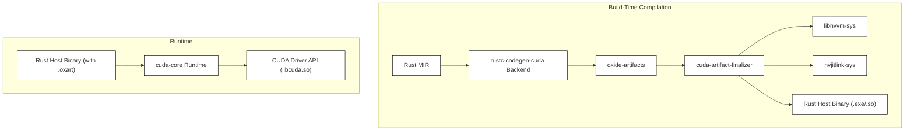
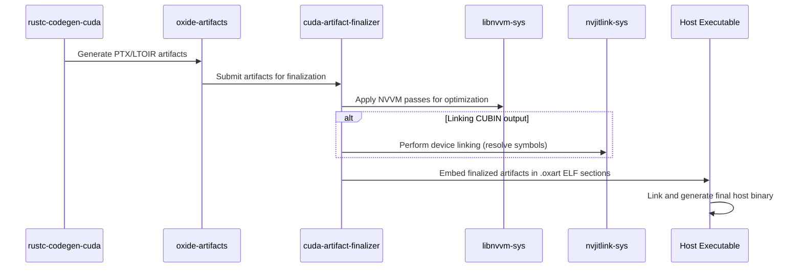

<!-- source: DeepWiki mcp.deepwiki.com · repo NVIDIA/cuda-rust · extra page Artifacts, Linking and Finalization · fetched 2026-10-26 -->

# Artifacts, Linking and Finalization (3.1.2)

Relevant source files

The following files were used as context for generating this wiki page:

- [.github/ISSUE_TEMPLATE/bug_report.yml](.github/ISSUE_TEMPLATE/bug_report.yml)
- [.github/workflows/book.yml](.github/workflows/book.yml)
- [.github/workflows/ci.yml](.github/workflows/ci.yml)
- [.github/workflows/docs.yml](.github/workflows/docs.yml)
- [.github/workflows/examples-compile.yml](.github/workflows/examples-compile.yml)
- [.gitmodules](.gitmodules)
- [cuda-oxide/dependency-licenses.csv](cuda-oxide/dependency-licenses.csv)

This section details the implementation and data flow of artifact generation, linking, and finalization stages within the `cuda-oxide` Rust-to-CUDA pipeline. It emphasizes how CUDA artifacts such as PTX, CUBIN, and LLVM-based LTOIR are managed, embedded, and finalized. The explanation covers the roles of the `oxide-artifacts` crate, reserved CUDA backend symbols, the `cuda-artifact-finalizer` crate, integration with native NVVM tooling (`libnvvm-sys` and `nvjitlink-sys`), and the use of custom ELF `.oxart` sections to embed compiled CUDA code.

---

## Purpose and Scope

The `cuda-oxide` compilation pipeline transforms Rust MIR into CUDA-compatible device code artifacts. These include multiple intermediate and final forms—PTX assembly, CUBIN object files, or LLVM IR for LTO—each serving different stages or deployment models in GPU compilation.

This page explains:

- The artifact types and formats used.
- How artifacts are linked and embedded into Rust host executables or libraries.
- The finalization process to produce CUDA device images.
- The interface with NVIDIA's native NVVM and JIT-link tooling.
- The specialized `.oxart` ELF section scheme used for artifact embedding.
- Reserved symbol conventions for CUDA backend linking.

---

## Artifact Types and Embedding

The `cuda-oxide` pipeline produces several types of backend artifacts that must be handled appropriately:

1. **PTX (Parallel Thread Execution):** NVIDIA's intermediate GPU assembly language. It is textual and typically embedded as CUDA kernels for further Just-In-Time (JIT) compilation by the CUDA driver during runtime.

2. **CUBIN (CUDA Binary):** The GPU device binary, essentially a ELF object containing compiled machine code for a specific GPU architecture. This is a native loadable image by the CUDA runtime.

3. **LTOIR (Link-Time Optimization Intermediate Representation):** LLVM IR with device-specific extensions preserved for further optimizations and linkage, allowing whole-program optimization for CUDA.

`cuda-oxide` manages these artifacts using the `oxide-artifacts` crate, which provides a consistent abstraction for them. The artifacts are embedded as custom ELF sections named `.oxart`. This design enables safe linking and extraction at runtime.

### ELF `.oxart` Sections

The `.oxart` section is a reserved ELF section name used to store backend CUDA artifacts inside host binaries or Rust static libraries. This section contains serialized artifact bundles, which include metadata such as:

- The kind of artifact (PTX, CUBIN, LTOIR).
- Target architecture information.
- Versioning stamps.
- The raw bytes of the artifact.

This embedding enables Rust host code, including the `cuda-core` runtime crate, to discover and load embedded CUDA kernels directly from the host executable, supporting integrated Rust-to-CUDA workflows.

---

## The `oxide-artifacts` Crate

The `oxide-artifacts` crate is central to artifact management. It defines:

- **Artifact Bundles:** Structs encapsulating multiple CUDA backend artifacts along with their metadata (kind, target ISA, versions).
- **Serialization/Deserialization:** Facilities to pack and unpack bundles into `.oxart` sections.
- **Reserved Symbols:** Defines a set of reserved symbol names used to mark CUDA kernels and modules in artifacts for linker interpretation.

The crate's usage includes:

- During codegen, emitting artifacts with proper section and symbol linkage.
- After compilation, serializing these artifacts into `.oxart` sections of host libraries or binaries.
- At runtime, the CUDA runtime (e.g., via `cuda-core`) enumerates `.oxart` sections to load embedded kernels.

### Reserved Symbols

The Rust CUDA backend reserves certain symbols to identify generated GPU kernels or metadata within the artifacts. These symbols enable deterministic linking and lifetime management of CUDA modules.

---

## CUDA Artifact Finalization (`cuda-artifact-finalizer` Crate)

Generated artifacts often require a final linking and optimization step before being consumable by the CUDA runtime or driver.

The `cuda-artifact-finalizer` crate encapsulates this logic:

- Takes LLVM IR or partial CUBINs and invokes LLVM-based transformations, such as linking, optimizations, and legalization, producing a final device ELF or PTX.
- Applies target-specific passes and embedding conventions to produce runtime-loadable images.
- Uses `libnvvm-sys` bindings to NVVM libraries and `nvjitlink-sys` to NVIDIA's JIT-link interfaces.

This crate abstracts away direct calls to the NVVM and nvJitLink C APIs and enables a Rust-native interface for artifact finalization. The finalizer ensures artifacts are finalized consistently, regardless of output kind (PTX text, device ELF binary, or LTOIR bundle).

---

## Integration with Native Tooling: `libnvvm-sys` and `nvjitlink-sys`

`cuda-oxide` leverages wrappers around NVIDIA's official native libraries:

- `libnvvm-sys`: Rust FFI bindings for the NVVM library, which implements NVPTX backend compilation and optimization as an LLVM pass library.
- `nvjitlink-sys`: Rust bindings to NVIDIA's nvJitLink library, which performs device-level linking of multiple CUBINs and supports symbol resolution and relocation.

The finalizer crate orchestrates calls to these libraries to produce deployable CUDA artifacts fully compatible with NVIDIA's runtime expectations.

---

## Data Flow and Key Functions

### Compilation to Artifacts

1. The Rust `rustc-codegen-cuda` backend emits CUDA LLVM IR and PTX assembly for device functions.
2. The `oxide-artifacts` crate packages these into bundles with metadata.
3. Through the Rust host linker invocation, these bundles are serialized into `.oxart` ELF sections.
4. Host executables or static libraries embed `.oxart` sections containing these artifacts.

### Finalization Pipeline

1. The `cuda-artifact-finalizer` receives `.oxart` bundles from intermediate build stages.
2. It calls `libnvvm-sys` to run NVVM passes and generate optimized device IR.
3. If targeting CUBIN output, it uses `nvjitlink-sys` to perform device binary linking and symbol management.
4. The finalizer outputs the fully linked device image suitable for runtime use.

### Host-Side Loading

- At runtime, the `cuda-core` crate scans embedded `.oxart` sections.
- It extracts CUDA binary artifacts via `oxide-artifacts`.
- It loads and launches kernels using the CUDA driver API.

---

## System-Function Mapping Diagram

**Explanation:** This diagram shows the data flow from Rust MIR to final device binaries embedded inside host executables. Key crates and native libraries used during compilation and runtime are shown.

Sources:  
- `cuda-oxide/crates/oxide-artifacts` (crate source lines describing artifacts and ELF embedding)  
- `cuda-oxide/crates/cuda-artifact-finalizer` (code invoking NVVM and nvJitLink)  
- `.github/workflows/examples-compile.yml:61-152` (toolkit setup with LLVM 22, libnvvm, nvjitlink package install)  

---

## PTX vs CUBIN vs LTOIR: When and How They Are Used

| Artifact Kind | Description                              | Usage                             | Embedding Method                    | Tools Involved         |
|---------------|------------------------------------------|---------------------------------|----------------------------------|----------------------|
| PTX           | Textual intermediate GPU ISA             | JIT compiled by CUDA driver at runtime | Embedded as `.oxart` bundle with PTX bytes | NVVM, rustc-codegen-cuda |
| CUBIN         | Compiled device machine code binary      | Directly loaded by CUDA driver          | Embedded as `.oxart` with binary data       | NVVM + nvjitlink      |
| LTOIR         | LLVM IR with device info for LTO          | Further link-time device optimization   | Serialized in `.oxart`                       | NVVM, LLVM backend    |

This table clarifies distinctions affecting use cases and tooling. LTOIR enables cross-module optimization but requires full LLVM linking and finalization before runtime. PTX is the most portable but requires JIT compilation. CUBIN is architecture-specific and faster at runtime but requires final device linking.

Sources:  
- `cuda-artifacts/src/lib.rs` (artifact kinds and serialization)  
- `cuda-artifact-finalizer/src/lib.rs` (finalization strategy)  

---

## Reserved Oxide Symbols and Linking

`oxide-artifacts` reserves certain symbol names visible to the linker. These symbols mark:

- CUDA kernels (device functions exposed to host).
- Entry points for kernel launches.
- Metadata regions for artifact bundles.

The linker retains these symbols, ensuring proper resolution and relocation. This design allows the host-side runtime to locate kernels inside the embedded `.oxart` sections by symbol address.

### Example Reserved Symbols

- `__nv_{}_kernel_entry` : Kernel entry symbol.
- `__oxide_artifact_bundle_start` / `__oxide_artifact_bundle_end`: Range markers framing the embedded artifact bundle.

Programming the codegen to emit these symbols correctly ensures correct kernel registration and launch at runtime.

Sources:  
- `cuda-oxide/crates/oxide-artifacts/src/symbols.rs` (reserved symbol definitions)  

---

## CUDA Artifact Finalization Workflow

This sequence details how Rust compilation integrates with native LLVM-based backend tooling and produces final host executables embedding CUDA artifacts ready for runtime loading.

Sources:  
- `cuda-artifact-finalizer/src/lib.rs` (finalize_device_code functions and native calls)  
- `.github/workflows/examples-compile.yml:61-152` (environment loading for LLVM and toolkit)  

---

## Summary

The `cuda-oxide` backend leverages a carefully designed artifact and linking infrastructure to integrate Rust CUDA device code compilation with NVIDIA's native NVVM and runtime tooling. Key aspects include:

- Use of `.oxart` ELF sections for embedding multiple CUDA artifact types inside host Rust binaries.
- Reserved symbols to aid linker and runtime kernel discovery.
- `oxide-artifacts` crate as the artifact bundle manager and serializer.
- `cuda-artifact-finalizer` crate orchestrating native backend passes and device linking.
- Use of libnvvm-sys and nvjitlink-sys to interface with NVVM and jit-link device object files.

This architecture provides a stable, driver-agnostic finalization stage, enabling robust Rust-to-CUDA workflows that transparently build, link, embed, and launch CUDA device code from Rust host applications.

---

**Sources:**  
- `.github/workflows/examples-compile.yml:61-153`  
- `cuda-oxide/crates/oxide-artifacts/src/lib.rs` (artifact definitions)  
- `cuda-oxide/crates/oxide-artifacts/src/symbols.rs` (reserved symbols)  
- `cuda-oxide/crates/cuda-artifact-finalizer/src/lib.rs` (finalization logic)  
- `cuda-oxide/dependency-licenses.csv` (info on `cuda-artifact-finalizer`, `libnvvm-sys`, and `nvjitlink-sys` crates)

---

