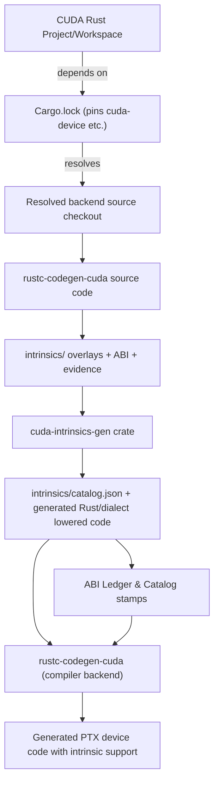

<!-- source: DeepWiki mcp.deepwiki.com · repo NVIDIA/cuda-rust · extra page Intrinsics and Target Specs · fetched 2026-10-26 -->

# Intrinsics and Target Specs

<details>
<summary>Relevant source files</summary>

The following files were used as context for generating this wiki page:

- [.vscode/settings.json](.vscode/settings.json)
- [cuda-oxide/crates/cargo-oxide/src/backend.rs](cuda-oxide/crates/cargo-oxide/src/backend.rs)
- [cuda-oxide/crates/cargo-oxide/src/backend_source.rs](cuda-oxide/crates/cargo-oxide/src/backend_source.rs)
- [cuda-oxide/cuda-oxide-book/compiler/catalog-generated-intrinsics.md](cuda-oxide/cuda-oxide-book/compiler/catalog-generated-intrinsics.md)
- [cuda-oxide/scripts/check-book-api-names.sh](cuda-oxide/scripts/check-book-api-names.sh)

</details>


This page details the "Intrinsics and Target Specs" subsystem within the `cuda-oxide` compiler pipeline of the NVIDIA `cuda-rust` codebase. It covers the intrinsic generation workflow driven by `cuda-intrinsics-gen`, the managed catalogs of intrinsic probes, overlays, and evidence, the handling of CUDA target specifications, and the specialized ABI history checks and catalog stamps that govern stable intrinsic identity.

This leaf page is focused on the implementation mechanisms of intrinsics declaration, target spec resolution, and ABI safety enforcement inside the `rustc-codegen-cuda` crate and its associated tooling surfaces.

---

## 1. Purpose and Scope

Within the compilation pipeline (section 3.1), the intrinsics and target specs steps provide foundational building blocks:

- **Intrinsics Generation:** The core intrinsic APIs, compiler lowering, dialect representations, and embedded metadata are generated automatically from structured catalog inputs, allowing consistent and verified intrinsic handling across the backend and device runtime.

- **Target Specification:** Defines how CUDA-specific target features (e.g., compute capabilities, supported operations) are specified, probed, and resolved.

- **ABI & Catalog Stamps:** Maintains a stable identity ledger for intrinsic ABIs, tracks catalog versions, and applies safety policies to guarantee long-term backward and forward compatibility.

All these aspects are implemented mostly inside the `cuda-intrinsics-gen` crate, driven by editable data artifacts organized under the `intrinsics/` directory, and resolved in coordination with the backend and rustc integration tools.

---

## 2. Generated Intrinsics Workflow

### 2.1 Overview of the Intrinsics Generation Pipeline

Intrinsics in `cuda-oxide` are mostly *not* hand-written. Instead, they are specified declaratively and generated through a structured pipeline managed by `cuda-intrinsics-gen`. This guarantees consistency across:

- Rust API signatures and visibility
- Dialect-MIR and LLVM lowering stubs
- Target predicate guards and feature probes
- ABI signatures and identifier stability
- Verified lowering evidence and test probes

The generation process inputs multiple layered catalog sources (locked LLVM intrinsics, overlays, ABI records, and lowering evidence) to produce:

- `intrinsics/catalog.json`: The canonical resolved catalog file (do not edit by hand!)
- Generated Rust source files implementing intrinsic APIs and lowering
- Target spec definitions and intrinsic probe dispatch maps

The high-level data flow is:

```mermaid
flowchart LR
    A[intrinsics/upstream.lock] --> B[intrinsics/imported.json]
    C[intrinsics/overlay.toml] --> D[intrinsics/overlay/*.toml]
    E[intrinsics/abi-v1.toml] --> F
    G[intrinsics/evidence/*.json] --> F
    B --> F[intrinsics/catalog.json]
    D --> F
    E --> F
    G --> F
    F --> H[generated outputs (Rust, dialect, ABI, probes)]
```

**Explanation:**

- `intrinsics/upstream.lock` pins the LLVM and rustc commit versions that provide the intrinsic extraction baseline.
- `intrinsics/imported.json` records the LLVM/NVPTX intrinsics extracted from that baseline.
- `intrinsics/overlay.toml` lists admitted overlay files describing the intrinsic families and policies.
- `intrinsics/overlay/*.toml` provide the explicit overlay metadata for intrinsic families (semantics, safety, lowering shape).
- `intrinsics/abi-v1.toml` contains an append-only ledger of stable intrinsic ABI identities.
- `intrinsics/evidence/*.json` files record formal lowering evidence for intrinsics requiring validation.
- These inputs resolve into the generated catalog and subsequently the Rust code, lowering dispatch, and target spec manifests.

### 2.2 Catalog Metadata and Versioning

The catalog generated file (`catalog.json`) embeds important metadata fields referencing versions and contract stability. Notably:

| Field              | Purpose                                                             |
|--------------------|---------------------------------------------------------------------|
| `schema`           | Serialized catalog format version (distinct from overlay schema)   |
| `catalog_version`   | Reviewed intrinsic catalog contract version                         |
| `intrinsic_abi`    | ABI generation edition, referencing stable ABI ledger entries      |
| `generator_version`| Version of the `cuda-intrinsics-gen` crate that generated the catalog|

These metadata fields ensure compatibility between the client code consuming intrinsics, the backend runtime, and the intrinsic lowering policies.

### 2.3 Intrinsics Contribution Workflow

Authors adding or extending intrinsics adhere to this procedure:

1. **Find an Existing Family:** Search the `intrinsics/overlay/` directory for a related intrinsic family with a matching semantic and shape.

2. **Extend Overlay Files:** Add or update entries in `.toml` overlay shards for policy and lowering control. Do *not* edit generated Rust code or downstream JSON files manually.

3. **Append ABI Ledger:** Add any new stable ABI entries to `intrinsics/abi-v1.toml` at the end (append-only, no reordering).

4. **Regenerate Artifacts:** Run the generation tool to rebuild `catalog.json` and all derived Rust and dialect source files.

This process leverages the reviewed catalog inputs as the *single source of truth* rather than editing generated code directly.

Sources: [cuda-oxide/cuda-oxide-book/compiler/catalog-generated-intrinsics.md:1-174]()

---

## 3. Target Specification (`cuda-target-spec`)

The CUDA target specification subsystem manages CUDA architecture features, intrinsic availability, and metadata about the assorted NVIDIA GPU targets. This includes:

- Baseline device feature sets for PTX targets, specifying features such as compute capability versions (e.g., sm_70, sm_80).
- Compilation environment predicates for whether an intrinsic or feature is available on a target.
- Embedded client metadata tying intrinsic generation and lowering to specific CUDA target profiles.

This target spec data integrates tightly with intrinsic catalogs to gate device capabilities and generate the correct PTX and codegen paths accordingly.

While detailed code entities for target specs reside mainly inside `rustc-codegen-cuda` and `cuda-intrinsics-gen`, the system ensures stable and precise dispatch and lowering of CUDA-specific intrinsics relative to target features.

Sources: [cuda-oxide/cuda-oxide-book/compiler/catalog-generated-intrinsics.md:37-100]()

---

## 4. ABI History Checks and Catalog Stamps

A critical aspect of intrinsic management within `cuda-oxide` is maintaining ABI stability over releases and guaranteeing compatibility between kernel binaries and runtime libraries.

This is achieved by:

- Maintaining a **stable, append-only ABI ledger** (`intrinsics/abi-v1.toml`). It records intrinsic ABI signatures that cannot be reordered or deleted, only appended.

- Generating **catalog stamps** with every resolved catalog. These stamps embed authoritative metadata about the intrinsic ABI version, the catalog version, and generation toolchain.

- Enforcing consistency between the catalog and the runtime/target specifications by embedding these stamps in generated sources.

- Running **historical ABI checks** to detect backward compatibility breaking changes in intrinsic declarations or lowering.

- Leveraging lowering **evidence metadata** (`intrinsics/evidence/*.json`) that captures probe results and verification tracing over LLVM/NVPTX backends.

This chain of immutable safety guards protects the CUDA Rust ecosystem from subtle breaking changes in intrinsic APIs and facilitates smooth evolution of device code.

Sources: [cuda-oxide/cuda-oxide-book/compiler/catalog-generated-intrinsics.md:70-140]()

---

## 5. Integration with Compiler Codebase

The main implementation and authoritative source for the intrinsics and target specs is in the `cuda-intrinsics-gen` crate, colocated in `cuda-oxide/crates/cuda-intrinsics-gen`. This crate reads the inputs from the `intrinsics/` directory, resolves overlays, ABI ledgers, and evidence, and generates:

- Rust intrinsic APIs under the `cuda-device` and `cuda-host` crates.
- Dialect lowering machinery in dialect-nvvm and dialect-ptx.
- Target spec predicates embedded in `rustc-codegen-cuda`.
- Intrinsics probe implementations that check features on the target GPU.

The backend source resolution ensures that the intrinsic ABI and target specs come from the *exact same* repository commit as the rest of the project dependencies to avoid version mismatch problems. This is controlled by `cargo-oxide`'s backend discovery and source management logic, which adheres to the committed versions recorded in the `Cargo.lock` and dependency metadata.

Sources: [cuda-oxide/crates/cargo-oxide/src/backend_source.rs:1-173] and [cuda-oxide/crates/cargo-oxide/src/backend.rs:1-131]()

---

## 6. Key Code Entities and Data Flow

### 6.1 Main File and Crate Roles

| File/Entity                                | Role                                                                                              |
|-------------------------------------------|-------------------------------------------------------------------------------------------------|
| `cuda-intrinsics-gen` (crate)             | Intrinsics generation crate that reads overlays, ABI ledger, evidence and produces catalog.      |
| `intrinsics/catalog.json`                  | Generated master catalog of resolved intrinsic contracts and metadata.                            |
| `intrinsics/overlay/*.toml`               | Human-edited overlay shards describing intrinsic policies and shapes.                            |
| `intrinsics/abi-v1.toml`                   | Append-only ABI ledger of intrinsic stable identity entries.                                     |
| `intrinsics/evidence/*.json`               | Verified lowering evidence for intrinsics requiring explicit validation.                         |
| `rustc-codegen-cuda` (crate)               | CUDA Rust backend responsible for device codegen using generated intrinsics and target specs.    |
| `cuda-oxide/crates/cargo-oxide/src/backend_source.rs` | Resolves backend source checkout according to project dependencies for reproducible builds.      |
| `cuda-oxide/crates/cargo-oxide/src/backend.rs`        | Finds or builds/load caches of the rady backend shared object and manages cache staleness.       |

### 6.2 Data and Control Flow around Intrinsics Generation



In this flow, the project dependencies fix the exact repository commit for the backend source and associated intrinsic overlays. The generation process produces a catalog that feeds the compiler backend, which emits device code embedding the requisite intrinsic calls, guarded by ABI stability checks.

Sources: [cuda-oxide/crates/cargo-oxide/src/backend_source.rs:1-173](), [cuda-oxide/cuda-oxide-book/compiler/catalog-generated-intrinsics.md:1-174](), [cuda-oxide/crates/cargo-oxide/src/backend.rs:1-131]()

---

## 7. Summary and Best Practices

- **Do not edit generated intrinsic code directly.** Edit only the overlay `.toml` shards, ABI ledger, or evidence files under `intrinsics/`, then regenerate.

- **Use existing intrinsic families as templates.** Avoid creating duplicate or semantically redundant families.

- **Respect ABI ledger append-only policy.** Never reorder or delete entries in `abi-v1.toml`.

- **Pin backend and target specs together.** Ensure your project dependency graph resolves a unique backend source checkout.

- **Verify intrinsic changes via evidence probes.** Add or update lowering evidence to maintain correctness guarantees.

- **Follow catalog schema versions carefully.** The generation tools reject mismatches.

By following these guidelines and respecting the structured generation pipeline, contributors can safely evolve the CUDA Rust intrinsic set and target specifications with long-term backward compatibility.

---

**Sources:**
- `cuda-oxide/cuda-oxide-book/compiler/catalog-generated-intrinsics.md:1-174`
- `cuda-oxide/crates/cargo-oxide/src/backend_source.rs:1-173`
- `cuda-oxide/crates/cargo-oxide/src/backend.rs:1-131`

---

