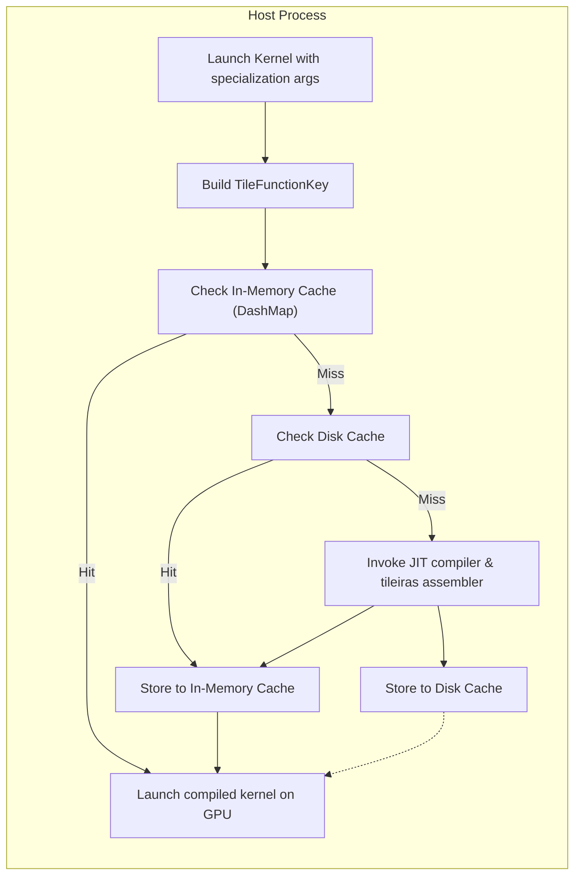
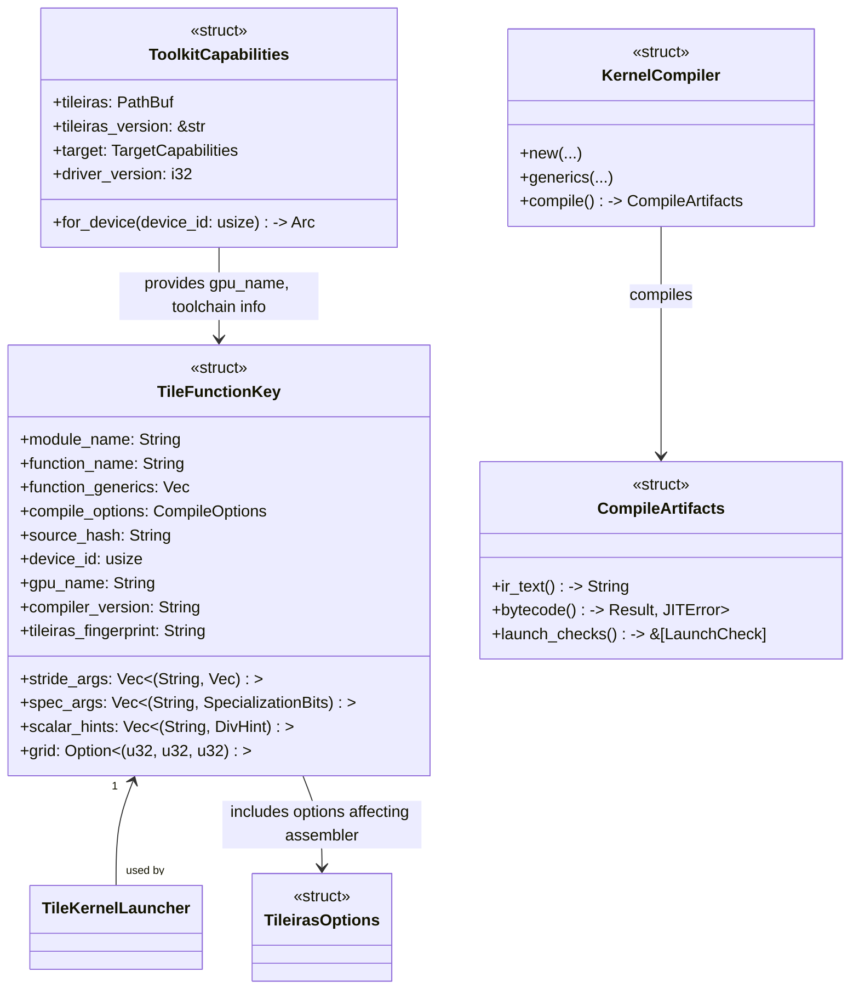
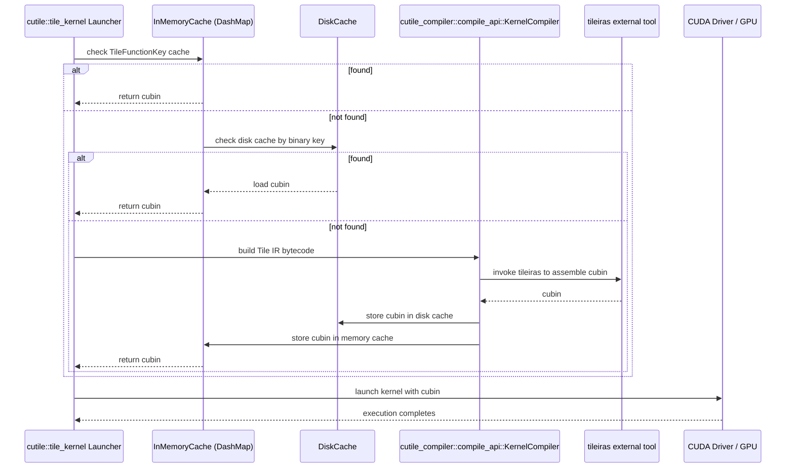

<!-- source: DeepWiki mcp.deepwiki.com · repo NVIDIA/cuda-rust · extra page JIT Compilation, Caching and tileiras · fetched 2026-10-26 -->

# 4.2.2 JIT Compilation, Caching and tileiras

<details>
<summary>Relevant source files</summary>

The following files were used as context for generating this wiki page:

- [cutile-rs/cutile-book/guide/jit-compilation.md](cutile-rs/cutile-book/guide/jit-compilation.md)
- [cutile-rs/cutile-compiler/src/compile_api.rs](cutile-rs/cutile-compiler/src/compile_api.rs)
- [cutile-rs/cutile-compiler/src/compiler/checks/mod.rs](cutile-rs/cutile-compiler/src/compiler/checks/mod.rs)
- [cutile-rs/cutile-compiler/src/compiler/checks/placement.rs](cutile-rs/cutile-compiler/src/compiler/checks/placement.rs)
- [cutile-rs/cutile-compiler/src/cuda_tile_runtime_utils.rs](cutile-rs/cutile-compiler/src/cuda_tile_runtime_utils.rs)
- [cutile-rs/cutile-compiler/src/lib.rs](cutile-rs/cutile-compiler/src/lib.rs)
- [cutile-rs/cutile-macro/src/kernel_launcher_generator.rs](cutile-rs/cutile-macro/src/kernel_launcher_generator.rs)
- [cutile-rs/cutile/src/tile_kernel.rs](cutile-rs/cutile/src/tile_kernel.rs)
- [cutile-rs/cutile/tests/gpu.rs](cutile-rs/cutile/tests/gpu.rs)
- [cutile-rs/cutile/tests/kernel_compiler.rs](cutile-rs/cutile/tests/kernel_compiler.rs)

</details>


This section provides an in-depth technical overview of the Just-In-Time (JIT) compilation process for cuTile Rust kernels, covering how kernel specializations are identified, the multi-layer caching system, and how the external Tile IR assembler tool `tileiras` is discovered, utilized, and fingerprinted.

The main focus areas include:

- The `TileFunctionKey` struct as the core specialization key.
- In-memory and disk caching strategies to minimize compilation overhead.
- Launch-site caching integration for efficient repeated kernel launches.
- Toolchain resolution for the `tileiras` binary and its version/fingerprint management.

---

## Overview of JIT Compilation in cuTile Rust

cuTile Rust employs *launch-time* JIT compilation for GPU kernels marked by `#[cutile::entry]`. Compilation is deferred until the first launch of a specialization, which includes the entry function, generic types/consts, grid configuration, compilation options, and target GPU architecture. Once compiled, the kernel binary (cubin) is cached *in memory* within the running host process so that subsequent launches with matching specializations execute immediately.

Changing parameters that affect the generated code causes new specializations and triggers compilation. Parameters such as runtime tensor extents that are dynamic do not create new specializations but affect kernel invocation only.

The JIT pipeline is:

```
Rust AST -> Tile IR bytecode -> GPU cubin
```

This process relies on the external `tileiras` tool to assemble bytecode into executable GPU cubins for the target architecture.

When a kernel is launched:

1. The runtime builds a `TileFunctionKey` representing the requested specialization.
2. It checks an in-memory cache for a matching compiled cubin.
3. If missing, it attempts to load from a disk cache keyed by a hash of the binary bytecode.
4. On a cache miss, it calls `tileiras` to assemble the bytecode into a cubin.
5. The result is stored in caches and returned for launch.

This setup balances fast repeated kernel invocations with the flexibility of dynamic Rust-generic-based GPU code specialization.

Sources:  
- cutile-rs/cutile/src/tile_kernel.rs:1-173  
- cutile-rs/cutile-compiler/src/cuda_tile_runtime_utils.rs:1-165  
- cutile-rs/cutile-book/guide/jit-compilation.md:1-97  

---

## TileFunctionKey: The Kernel Specialization Key

The `TileFunctionKey` struct uniquely identifies a compiled kernel specialization. It captures all compilation-relevant parameters that define a unique GPU kernel binary. This includes:

- **Module and function names** (`module_name`, `function_name`)
- **Function generics**: e.g., type parameters and const generics from kernel signature.
- **Stride arguments**: records which tensor strides are 1 for optimization decisions.
- **Specialization bits**: power-of-two divisibility and other specialization hints that heuristically improve performance.
- **Scalar hints**: divisibility hints for scalar parameters.
- **Optional compile-time grid launch dimensions**
- **Compile options**: tunable settings affecting code generation and scheduling.
- **The source hash** of the kernel's own module (only the kernel module, not dependencies)
- **Device ID and GPU name** targeted for binary generation.
- **Rust compiler version** used, ensuring compatibility with host code expectations.
- **`tileiras` fingerprint**, the version string and hash to detect the exact assembler in use.

`TileFunctionKey` supports equality and hashing, enabling it to serve as a cache key.

### Purpose

Two kernel launches sharing a `TileFunctionKey` reuse the same compiled cubin, avoiding redundant compilation and loading. The key therefore represents the specialization boundary.

### Notable Details

- Kernel runtime tensor extents are deliberately absent because they do not influence codegen, only runtime behavior.
- The `source_hash` covers just the kernel's own source, not dependencies, so edits in helper modules do not change these keys.
- The `tileiras_fingerprint` detects which assembler binary built the cubin, supporting toolchain consistency.

### Construction

A type-safe builder `TileFunctionKeyBuilder` is provided to construct keys and avoid field ordering errors.

```rust
let key = TileFunctionKey::builder("module_name", "function_name")
    .generics(vec!["f32".into(), "128".into()])
    .stride_args(strides)
    .spec_args(spec_bits)
    .scalar_hints(div_hints)
    .grid(Some((x, y, z)))
    .compile_options(opts)
    .source_hash(kernel_source_hash)
    .device_id(device_id)
    .gpu_name(get_gpu_name(device_id))
    .compiler_version(get_compiler_version())
    .tileiras_fingerprint(tileiras_fingerprint())
    .build();
```

Sources:  
- cutile-rs/cutile/src/tile_kernel.rs:92-173

---

## Multi-Layer Caching Architecture

### 1. In-Memory Cache

Each process maintains a *runtime* cache of compiled kernels keyed by `TileFunctionKey`. This cache is a `DashMap` (concurrent hashmap supporting lock-free reads) which stores cubin handles and compiled GPU functions.

- Enables instant launch reuse within a single process lifetime.
- The cache is cleared when the process exits.
- Counts and diagnostics (such as number of JIT compile misses) are maintained via an atomic counter.

### 2. Disk Cache

A persistent disk cache stores compiled cubins keyed by a hash computed over the kernel's Tile IR bytecode, the target GPU architecture, and the `tileiras` assembler fingerprint.

- Allows sharing compiled binaries between process restarts.
- Reduces costly compilation/assembly steps on subsequent runs.
- Upon a cache miss in memory, the system attempts to load the binary from disk before triggering JIT compilation.

### 3. Launch-Site Cache

At the call site (generated launcher structs), an additional per-launch-site cache exists keyed by the low-level specialization key. This avoids rebuilding keys frequently and helps threading reuse by caching compile results associated with launcher calls.

---

### Data Flow for Kernel Launch and Compilation



This shows the decision path from launch to compilation or cache retrieval.

Sources:  
- cutile-rs/cutile/src/tile_kernel.rs:1-173  

---

## Toolchain Resolution and tileiras Fingerprints

The external binary `tileiras` is required to assemble Tile IR bytecode into GPU cubins. The runtime has a rigorous resolution and fingerprinting mechanism to ensure consistent toolchain usage.

### tileiras Binary Discovery

- The `tileiras` executable is resolved in this order:

  1. Environment variable `CUTILE_TILEIRAS_PATH`: if set to an absolute path, it is used verbatim.
  2. CUDA Toolkit install directories indicated by environment variables `CUDA_TOOLKIT_PATH` and `CUDA_HOME` in order.
  3. Finally, fall back on the system-wide `PATH`.

- This logic mirrors build script detection for consistency.

### Toolchain Fingerprint

Once resolved, the following operate:

- `tileiras` version is queried via `--version`.
- A *fingerprint* computed based on file metadata or version string captures the identity of the assembler.
- This fingerprint is embedded in the cache keys and `TileFunctionKey`.
- Using a different or incompatible version triggers recompilation, preventing cache poisoning.

### Bytecode Version Negotiation

- The assembler supports certain bytecode versions.
- The environment variable `CUTILE_BYTECODE_VERSION` can request a specific target IR version.
- The chosen bytecode version is negotiated between the runtime serializer and the assembler to ensure compatibility.

Sources:  
- cutile-rs/cutile-compiler/src/cuda_tile_runtime_utils.rs:20-165  
- cutile-rs/cutile/src/tile_kernel.rs:15-19  

---

## Relationship between Natural Language Concepts and Code Entities

### System Names and Their Corresponding Rust Types and Functions



Sources:  
- cutile-rs/cutile/src/tile_kernel.rs:90-173  
- cutile-rs/cutile-compiler/src/compile_api.rs:1-180  
- cutile-rs/cutile-compiler/src/cuda_tile_runtime_utils.rs:43-91  

---

### End-to-End JIT Compilation Workflow in Code



This sequence clarifies the interaction between launcher code, caches, compiler, assembler, and GPU driver.

Sources:  
- cutile-rs/cutile/src/tile_kernel.rs:1-173  
- cutile-rs/cutile-compiler/src/compile_api.rs:1-180  
- cutile-rs/cutile-compiler/src/cuda_tile_runtime_utils.rs:1-165  

---

# Summary

This section detailed the JIT compilation machinery within cuTile Rust, focusing on:

- The construction of robust, collision-resistant specialization keys (`TileFunctionKey`), capturing codegen-relevant variants including generics, GPU target, and assembler versioning.
- A multi-layer caching system with in-memory caches for process lifetimes, persistent disk caches for workspace reuse, and per-launch-site caches for runtime efficiency.
- Environment-driven resolution of the required external `tileiras` assembler, including version and bytecode version negotiation to maintain pipeline consistency.
- The orchestration of kernel compilation, assembly, caching, and launching optimized for minimizing latency on first and repeated launches.

Understanding these pieces is crucial for contributors aiming to extend or debug cuTile Rust kernel launch performance and specialization behavior.

---

# Code References

| Feature/Concept                      | File & Line Range                                           |
|------------------------------------|-------------------------------------------------------------|
| ToolkitCapabilities and toolchain   | cutile-rs/cutile-compiler/src/cuda_tile_runtime_utils.rs:43-91  |
| TileFunctionKey struct and builder | cutile-rs/cutile/src/tile_kernel.rs:92-173                   |
| KernelCompiler and CompileArtifacts | cutile-rs/cutile-compiler/src/compile_api.rs:1-180           |
| JIT caching & launch orchestration | cutile-rs/cutile/src/tile_kernel.rs:1-173                    |
| JIT Compilation Guide (book)        | cutile-rs/cutile-book/guide/jit-compilation.md:1-97          |

---

