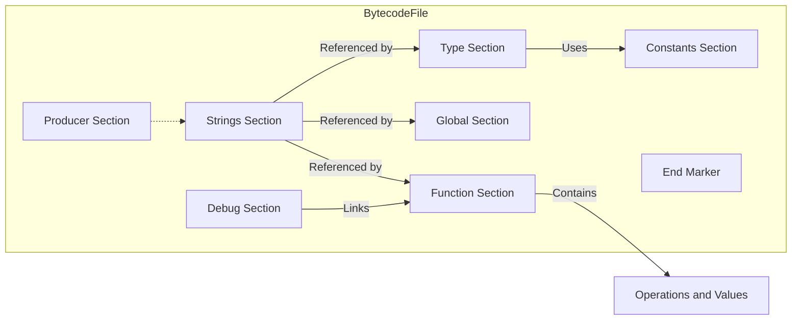
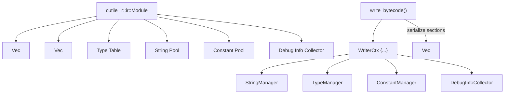

<!-- source: DeepWiki mcp.deepwiki.com · repo NVIDIA/cuda-rust · extra page cutile-ir: Bytecode Representation · fetched 2026-10-26 -->

# 4.2.1 cutile-ir: Bytecode Representation

<details>
<summary>Relevant source files</summary>

The following files were used as context for generating this wiki page:

- [cutile-rs/cutile-compiler/src/compiler/shared_utils.rs](cutile-rs/cutile-compiler/src/compiler/shared_utils.rs)
- [cutile-rs/cutile-compiler/src/compiler/tile_rust_type.rs](cutile-rs/cutile-compiler/src/compiler/tile_rust_type.rs)
- [cutile-rs/cutile-compiler/src/kernel_naming.rs](cutile-rs/cutile-compiler/src/kernel_naming.rs)
- [cutile-rs/cutile-ir/examples/decode_full.rs](cutile-rs/cutile-ir/examples/decode_full.rs)
- [cutile-rs/cutile-ir/examples/patch_debug_ids.rs](cutile-rs/cutile-ir/examples/patch_debug_ids.rs)
- [cutile-rs/cutile-ir/src/bytecode/debug_info.rs](cutile-rs/cutile-ir/src/bytecode/debug_info.rs)
- [cutile-rs/cutile-ir/src/bytecode/decoder.rs](cutile-rs/cutile-ir/src/bytecode/decoder.rs)
- [cutile-rs/cutile-ir/src/bytecode/encoding.rs](cutile-rs/cutile-ir/src/bytecode/encoding.rs)
- [cutile-rs/cutile-ir/src/bytecode/enums.rs](cutile-rs/cutile-ir/src/bytecode/enums.rs)
- [cutile-rs/cutile-ir/src/bytecode/mod.rs](cutile-rs/cutile-ir/src/bytecode/mod.rs)
- [cutile-rs/cutile-ir/src/bytecode/op_writer.rs](cutile-rs/cutile-ir/src/bytecode/op_writer.rs)
- [cutile-rs/cutile-ir/src/bytecode/writer.rs](cutile-rs/cutile-ir/src/bytecode/writer.rs)
- [cutile-rs/cutile-ir/tests/bytecode_determinism.rs](cutile-rs/cutile-ir/tests/bytecode_determinism.rs)
- [cutile-rs/cutile-ir/tests/per_op_roundtrip.rs](cutile-rs/cutile-ir/tests/per_op_roundtrip.rs)
- [cutile-rs/cutile/tests/token_threading.rs](cutile-rs/cutile/tests/token_threading.rs)

</details>


This page details the **Tile IR bytecode representation** within the `cutile-ir` crate, specifically the module model, bytecode writing and decoding processes, encoding formats, the defined enums mapping various bytecode components, debug info handling, bytecode versioning, and round-trip validation workflows for serialization consistency. This is a leaf page focused on the low-level on-disk binary format used to serialize the Tile IR [`Module`](crate::ir::Module) for consumption by the Tile IR JIT compiler (`tileiras`) and related tooling.

---

## Purpose and Scope

The Tile IR bytecode format is a compact binary serialization of the Tile IR in-memory `Module` that enables kernel artifacts to be saved, loaded, and processed independently of the Rust compiler. It is the intermediate step before just-in-time compilation to CUBIN/ELF or PTX. The format is tightly versioned to enable forward and backward compatibility, with explicit version negotiation and feature gating.

The bytecode representation covers:

- The **module model**: grouping globals, functions, constants, and type metadata.
- The **writer**: serialization of the module to binary with deterministic ordering.
- The **decoder**: a diagnostic tool reading binary bytecode and dumping a human-readable structured text representation.
- The **encoding primitives**: variable-length integers, fixed-size little-endian writes, floats, alignment bytes.
- The **enums**: constants representing sections, type tags, attribute tags, function flags, and debug tags.
- Integration of **debug info** into the bytecode, supporting source locations and symbols.
- Explicit **version negotiation** using structured `BytecodeVersion` triples and feature gating during writing.
- Ensuring **serialization determinism** and **round-trip validation** to guarantee stable caches and correctness.

---

## Tile IR Module Model for Bytecode

The Tile IR `Module` encapsulates:

- **Globals**: named global variables with type and initial constant values.
- **Functions**: `Operation`s including entry points and kernel code blocks.
- **Constants**: constant objects used inside the module.
- **Types**: all types used in the module, assigned indices for serialization.
- **Strings**: a string pool for attribute keys/names and symbol names.

In the bytecode format, these sections are serialized in a strict order to ensure dependencies resolve correctly:

1. **Header**: Magic bytes and the bytecode version (major.minor.tag).
2. **Global section**: Serialized global variable metadata.
3. **Function section**: Function table, including entry points and their operations.
4. **Constant section**: Raw data constants embedded for global and function body use.
5. **Debug section**: Debug info entries linking to source locations.
6. **Type section**: Type table entries, including composite and specialized tile types.
7. **String section**: String pool referenced by other sections.
8. **Producer section**: Optionally record the bytecode producer string identifying the tool.
9. **End marker**.

This layout supports incremental decoding and validation.

---

## Bytecode Writer: `write_bytecode`

The main entry point to serialize a Tile IR `Module` is the `write_bytecode` function, which optionally accepts a specific target `BytecodeVersion` for the emitted output.

```rust
pub fn write_bytecode(module: &Module) -> Result<Vec<u8>>;
pub fn write_bytecode_version(module: &Module, version: BytecodeVersion) -> Result<Vec<u8>>;
```

The writer procedure:

- Validates the requested version against supported ranges.
- Initializes a `WriterCtx` context containing:
  - A map from IR values to bytecode indices.
  - String, type, and constant managers implementing deduplication and indexing.
  - A debug info collector for attaching location info.
  - The target output `version`.

- Performs a **pre-scan** phase to collect all strings, types, and constants needed by globals and functions before writing any section.
- Writes sections to a expanding byte vector (`Vec<u8>`), strictly in order:
  - Calls specialized helpers such as `write_header`, `write_global_section`, `write_function_section`, `write_constant_section`, `write_debug_section`, `write_type_section`, `write_string_section`.
  - Adds the producer string section if present.
  - Terminates with the `EndOfBytecode` marker.

- Returns the serialized bytecode vector or an error on failure.

This guarantees deterministic output due to insertion-order string pools (`IndexMap`) and enforced ordering of types, values, and functions.

### Versioning and Feature Gating

During writing, certain operations or attributes require a minimum bytecode version. The writer enforces this by checking for each opcode, attribute, or feature whether the target version supports it, returning an error otherwise. For example, return statements inside loops or certain optimization hints have minimum required versions, preventing generation of invalid bytecode.

### Bytecode Round-Trip Validation

Round-trip tests instantiate minimal kernels exercising every operation pattern, serialize to bytecode, then decode and verify the round-tripped text for correctness, asserting no errors surfaced. This is implemented in the test suite to ensure writer/decoder fidelity.

---

## Bytecode Decoder: `decode_bytecode`

The `decode_bytecode` function reads raw Tile IR bytecode and produces a structured text dump intended for debugging and inspection (not for reconstructing full IR `Module` directly).

- Parses and verifies the header, including magic and bytecode version.
- Reads and collects raw bytecode sections: strings, types, globals, functions, constants, debug info.
- Decodes each section in dependency order, resolving references by string and type indices.
- Outputs human-readable information:
  - String pool listings.
  - Type declarations.
  - Function headers and bodies in textual form.
  - Debug information source locations.
- Detects and reports inconsistencies or unsupported features as errors.

This aids debugging of bytecode files produced by the writer or seen in external tools.

---

## Encoding Primitives

Encoding uses the `EncodingWriter` type implementing the fundamental binary data writing operations:

- **Variable-length unsigned integers (`varint`)** using LEB128-style encoding.
- **Signed integers encoded via zigzag signed varint** encoding for compact representation.
- **Fixed-width little-endian writes** of bytes, u16s, u32s, u64s, i32s, i64s, floats (`f32`, `f64`).
- **APFloat encoding** matching LLVM's on-disk float representation conventions.
- **Padding/alignment** via a special alignment byte `0xCB` to ensure proper alignment boundaries in the bytecode.

This module mirrors the C++ `EncodingWriter` implementation from the original CUDA-Tile codebase, maintaining compatibility with the toolchain.

---

## Bytecode Enums and Constants

The bytecode defines numerous enums representing:

| Enum                 | Description                                                       |
|----------------------|-------------------------------------------------------------------|
| `Section`            | Section identifiers used in the bytecode stream                   |
| `TypeTag`            | Identifies each type variant for type table serialization         |
| `DebugTag`           | Tags for debug info entries                                       |
| `DebugReserved`      | Reserved debug-location indices                                   |
| `FunctionFlag`       | Per-function bitflags for visibility, kernel type, optimization  |
| `AttributeTag`       | Tags used before attributes to identify their type                |
| `BytecodeVersion`    | Version triples encoding major, minor, and tag for bytecode       |
| `ALIGNMENT_BYTE`     | Special byte `0xCB` used for padding alignment                    |
| `MAGIC`              | Fixed magic byte header `[0x7F, b'T', b'i', b'l', b'e', b'I', b'R', 0x00]` |

These enums are used to guarantee consistent encoding and decoding of all bytecode components and drive the bytecode writer/reader logic.

Version constants guide supported minimum and current bytecode formats, e.g., 13.2 to 13.4.

---

## Debug Info Integration

The bytecode includes a separate **Debug section** that encodes source location metadata and debug symbols:

- The debug info collector builds entries for compile units, source files, lexical blocks, locations, and function subprograms.
- This debug info is serialized after constants but before types and strings, allowing source-level reconstruction tooling to map between Tile IR and original source.
- Debug info entries use `DebugTag` enum values to identify record kinds.
- Integration with function symbols ensures user-facing kernel names are recovered with source mapping for profilers and debuggers.

---

## Round-Trip Validation and Serialization Determinism

### Round-trip Validation

Tests extensively verify that:

- Every operation variant can be serialized into bytecode.
- The bytecode can be decoded back into a textual representation with no loss or error.
- This ensures the writer and decoder are synchronized and reliable in production scenarios.

### Serialization Determinism

Deterministic serialization is critical for content-addressed caching (SHA-256 over `.bc` files):

- The string pool uses deterministic insertion order (`indexmap::IndexMap`).
- Type and value indices are assigned in stable orders (insertion order).
- No iteration over unordered collections such as `HashMap` in code paths emitting serialized data.
- The test `same_module_serializes_to_identical_bytes` verifies byte-for-byte identical outputs when serializing the same Tile IR module twice in isolation.

---

## Diagrams

### Diagram 1: Tile IR Bytecode Serialization Flow

```mermaid
flowchart TB
    A[Input: Tile IR Module (cutile_ir::ir::Module)]
    B[Initialize WriterCtx (string/type/constant maps)]
    C[Prescan Module: Collect strings, types, constants]
    D[Write Header (MAGIC + BytecodeVersion)]
    E[Write Global Section]
    F[Write Function Section]
    G[Write Constant Section]
    H[Write Debug Section]
    I[Write Type Section]
    J[Write String Section]
    K[Write Producer Section (optional)]
    L[Write End Marker]
    M[Output: Bytecode Vec<u8>]

    A --> B --> C --> D --> E --> F --> G --> H --> I --> J --> K --> L --> M
```

**Explanation:** This linear pipeline describes the key steps the bytecode writer performs to serialize a Tile IR `Module`. The process enforces a strict output section order and performs pre-serialization indexing and validation.

---

### Diagram 2: Bytecode Section Dependencies and Relations



**Explanation:** The bytecode sections are interconnected; strings form the root dependency as they are referenced by globals, types, and functions. Types may contain constants. Functions consist of multiple operations referencing types and globals. Debug info links to function info and source symbols.

---

### Diagram 3: Bytecode Module to Code Entity Mapping



**Explanation:** This diagram relates in-memory Rust data structures representing the Tile IR `Module` with the writer context and managers responsible for orchestrating the serialization to bytecode. The main API entry is `write_bytecode`, which returns a `Vec<u8>` representing the full binary.

---

## Key Source Code Locations

| Topic                     | File and Line Ranges                     | Description                                     |
|---------------------------|-----------------------------------------|-------------------------------------------------|
| Bytecode Writer Entry     | `cutile-rs/cutile-ir/src/bytecode/writer.rs:29-118`    | Main `write_bytecode` functions, writer context, and section write orchestration.         |
| Bytecode Enums/Constants  | `cutile-rs/cutile-ir/src/bytecode/enums.rs:6-213`      | All bytecode format enums and constants like sections, types, versioning.                 |
| Encoding Primitives       | `cutile-rs/cutile-ir/src/bytecode/encoding.rs:0-215`   | Low-level byte and varint encoding for bytecode writes.                                  |
| Per-Op Serialization     | `cutile-rs/cutile-ir/src/bytecode/op_writer.rs:0-194`  | Operation-level dispatch to serialize each opcode body.                                  |
| Bytecode Decoder          | `cutile-rs/cutile-ir/src/bytecode/decoder.rs:0-207`    | Bytecode parsing and structured text emission for diagnostics.                           |
| Round-trip Tests          | `cutile-rs/cutile-ir/tests/per_op_roundtrip.rs`         | Tests verifying bytecode serialization and decoding correctness.                         |
| Serialization Determinism | `cutile-rs/cutile-ir/tests/bytecode_determinism.rs`     | Tests ensuring two serializations produce bit-identical bytecode for the same IR module. |

---

# Summary

The Tile IR bytecode representation in `cutile-ir` provides a carefully versioned, tightly specified, and deterministic binary serialization for Tile-based GPU kernels. It is implemented as a layered writer architecture backed by compact encoding primitives, a detailed type and string indexing system, and extensive version and feature checks. A separate decoder tool assists in troubleshooting. The design ensures stable caching and tooling interoperability, powering the rest of the `cutile-rs` Tile IR compiler stack.

---

## Sources

- `cutile-rs/cutile-ir/src/bytecode/writer.rs:1-198`  
- `cutile-rs/cutile-ir/src/bytecode/enums.rs:1-213`  
- `cutile-rs/cutile-ir/src/bytecode/encoding.rs:1-215`  
- `cutile-rs/cutile-ir/src/bytecode/op_writer.rs:1-194`  
- `cutile-rs/cutile-ir/src/bytecode/decoder.rs:1-207`  
- `cutile-rs/cutile-ir/tests/per_op_roundtrip.rs`  
- `cutile-rs/cutile-ir/tests/bytecode_determinism.rs`  
- `cutile-rs/cutile-ir/src/bytecode/mod.rs:1-23`

---

